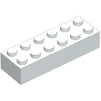
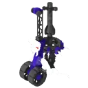
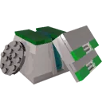

# Loot matrix 737

[Item database](../README.md) | [Methodology](../Methodology.md)

## Sources and mapped locations

| Kind | Source | Location evidence | Conditions |
| --- | --- | --- | --- |
| Drop | [AM - Venture Coy 1 (LOT 12331)](../sources/object-12331.md) | [Crux Prime (1800)](../locations/zone-1800.md) | DestructibleComponent 1688; static component precedence; Static association, not a live-spawn guarantee |
| Drop | [AM - Venture Coy 2 (LOT 12332)](../sources/object-12332.md) | [Crux Prime (1800)](../locations/zone-1800.md) | DestructibleComponent 1689; static component precedence; Static association, not a live-spawn guarantee |
| Drop | [AM - Venture Coy 3 (LOT 12333)](../sources/object-12333.md) | [Crux Prime (1800)](../locations/zone-1800.md) | DestructibleComponent 1690; static component precedence; Static association, not a live-spawn guarantee |

## Item candidates

Default vendor-stock probabilities are shown only when this matrix has a registered vendor. Loot probabilities use the generic algorithm, not a guarantee of actual use by every script/activity.

| Item | Modeled loot chance / expected count | Default vendor stock |
| --- | --- | --- |
| { .lu-ti width="24" loading="lazy" } [Brick 2x4 (LOT 29)](../29.md) | 1.81818182%; mean 0.018181818 | Not associated with a vendor |
| { .lu-ti width="24" loading="lazy" } [Brick 2x3 (LOT 30)](../30.md) | 1.81818182%; mean 0.018181818 | Not associated with a vendor |
| { .lu-ti width="24" loading="lazy" } [Brick 2x2 (LOT 31)](../31.md) | 1.81818182%; mean 0.018181818 | Not associated with a vendor |
| { .lu-ti width="24" loading="lazy" } [Brick 1x2 (LOT 32)](../32.md) | 1.81818182%; mean 0.018181818 | Not associated with a vendor |
| { .lu-ti width="24" loading="lazy" } [Brick 1x1 (LOT 33)](../33.md) | 1.81818182%; mean 0.018181818 | Not associated with a vendor |
| { .lu-ti width="24" loading="lazy" } [Brick 2x8 (LOT 35)](../35.md) | 1.81818182%; mean 0.018181818 | Not associated with a vendor |
| { .lu-ti width="24" loading="lazy" } [Brick 1x8 (LOT 36)](../36.md) | 1.81818182%; mean 0.018181818 | Not associated with a vendor |
| { .lu-ti width="24" loading="lazy" } [Brick 1x6 (LOT 37)](../37.md) | 1.81818182%; mean 0.018181818 | Not associated with a vendor |
| { .lu-ti width="24" loading="lazy" } [Brick 1x4 (LOT 38)](../38.md) | 1.81818182%; mean 0.018181818 | Not associated with a vendor |
| { .lu-ti width="24" loading="lazy" } [Plate 2x4 (LOT 39)](../39.md) | 1.81818182%; mean 0.018181818 | Not associated with a vendor |
| { .lu-ti width="24" loading="lazy" } [Plate 2x3 (LOT 40)](../40.md) | 1.81818182%; mean 0.018181818 | Not associated with a vendor |
| { .lu-ti width="24" loading="lazy" } [Plate 1x2 (LOT 41)](../41.md) | 1.81818182%; mean 0.018181818 | Not associated with a vendor |
| { .lu-ti width="24" loading="lazy" } [Plate 1x1 (LOT 42)](../42.md) | 1.81818182%; mean 0.018181818 | Not associated with a vendor |
| { .lu-ti width="24" loading="lazy" } [Plate 1x8 (LOT 58)](../58.md) | 1.81818182%; mean 0.018181818 | Not associated with a vendor |
| { .lu-ti width="24" loading="lazy" } [Brick 1x3 (LOT 59)](../59.md) | 1.81818182%; mean 0.018181818 | Not associated with a vendor |
| { .lu-ti width="24" loading="lazy" } [Plate 1x3 (LOT 60)](../60.md) | 1.81818182%; mean 0.018181818 | Not associated with a vendor |
| { .lu-ti width="24" loading="lazy" } [Plate 1x6 (LOT 62)](../62.md) | 1.81818182%; mean 0.018181818 | Not associated with a vendor |
| { .lu-ti width="24" loading="lazy" } [Plate 1x4 (LOT 66)](../66.md) | 1.81818182%; mean 0.018181818 | Not associated with a vendor |
| { .lu-ti width="24" loading="lazy" } [Brick 2x6 (LOT 98)](../98.md) | 1.81818182%; mean 0.018181818 | Not associated with a vendor |
| { .lu-ti width="24" loading="lazy" } [Plate 2x6 (LOT 144)](../144.md) | 1.81818182%; mean 0.018181818 | Not associated with a vendor |
| { .lu-ti width="24" loading="lazy" } [Plate 2x2 (LOT 865)](../865.md) | 1.81818182%; mean 0.018181818 | Not associated with a vendor |
| { .lu-ti width="24" loading="lazy" } [Plate 2x8 (LOT 869)](../869.md) | 1.81818182%; mean 0.018181818 | Not associated with a vendor |
| Imagination Powerup 2 points (LOT 4035; not an item registration) | 100%; mean 1 | Not associated with a vendor |
| Armor Powerup 2 points (LOT 11912; not an item registration) | 100%; mean 1 | Not associated with a vendor |
| Life Powerup 2 points (LOT 11915; not an item registration) | 100%; mean 1 | Not associated with a vendor |
| { .lu-ti width="24" loading="lazy" } [Massive Firecracker (LOT 12107)](../12107.md) | 0.175%; mean 0.00175 | Not associated with a vendor |
| { .lu-ti width="24" loading="lazy" } [Doc in a Box (LOT 12319)](../12319.md) | 0.525%; mean 0.00525 | Not associated with a vendor |
| { .lu-ti width="24" loading="lazy" } [Skeleton Ziggurat Model (LOT 12495)](../12495.md) | 0.00222222%; mean 0.000022222222 | Not associated with a vendor |
| { .lu-ti width="24" loading="lazy" } [Skeleton Watchtower Wall Model (LOT 12496)](../12496.md) | 0.00222222%; mean 0.000022222222 | Not associated with a vendor |
| { .lu-ti width="24" loading="lazy" } [Skeleton Corner Wall Model (LOT 12497)](../12497.md) | 0.02%; mean 0.0002 | Not associated with a vendor |
| { .lu-ti width="24" loading="lazy" } [Skeleton Wall Model (LOT 12498)](../12498.md) | 0.02%; mean 0.0002 | Not associated with a vendor |
| { .lu-ti width="24" loading="lazy" } [Skeleton T-Wall Model (LOT 12499)](../12499.md) | 0.00222222%; mean 0.000022222222 | Not associated with a vendor |
| { .lu-ti width="24" loading="lazy" } [Skeleton Skull Tower Model (LOT 12500)](../12500.md) | 0.00222222%; mean 0.000022222222 | Not associated with a vendor |
| { .lu-ti width="24" loading="lazy" } [Skeleton Short Wall Model (LOT 12501)](../12501.md) | 0.02%; mean 0.0002 | Not associated with a vendor |
| { .lu-ti width="24" loading="lazy" } [Skeleton Ribcage Bridge Model (LOT 12502)](../12502.md) | 0.00222222%; mean 0.000022222222 | Not associated with a vendor |
| { .lu-ti width="24" loading="lazy" } [Skeleton Repair Facility Model (LOT 12503)](../12503.md) | 0.00222222%; mean 0.000022222222 | Not associated with a vendor |
| { .lu-ti width="24" loading="lazy" } [Skeleton Wall Pillars Model (LOT 12504)](../12504.md) | 0.15%; mean 0.0015 | Not associated with a vendor |
| { .lu-ti width="24" loading="lazy" } [Skeleton Mobile Drilling Rig Model (LOT 12505)](../12505.md) | 0.00222222%; mean 0.000022222222 | Not associated with a vendor |
| { .lu-ti width="24" loading="lazy" } [Skeleton Hover Drone Model (LOT 12506)](../12506.md) | 0.00222222%; mean 0.000022222222 | Not associated with a vendor |
| { .lu-ti width="24" loading="lazy" } [Skeleton Gate Model (LOT 12507)](../12507.md) | 0.00222222%; mean 0.000022222222 | Not associated with a vendor |
| { .lu-ti width="24" loading="lazy" } [Skeleton Elevator Model (LOT 12508)](../12508.md) | 0.02%; mean 0.0002 | Not associated with a vendor |
| { .lu-ti width="24" loading="lazy" } [Battle Croissant (LOT 12762)](../12762.md) | 0.525%; mean 0.00525 | Not associated with a vendor |
| { .lu-ti width="24" loading="lazy" } [BBQ Drumstick (LOT 12763)](../12763.md) | 0.525%; mean 0.00525 | Not associated with a vendor |
| { .lu-ti width="24" loading="lazy" } [Big Fountain Soda (LOT 12764)](../12764.md) | 0.175%; mean 0.00175 | Not associated with a vendor |
| { .lu-ti width="24" loading="lazy" } [Energy Bar (LOT 12765)](../12765.md) | 0.525%; mean 0.00525 | Not associated with a vendor |
| { .lu-ti width="24" loading="lazy" } [Xpresso (LOT 12766)](../12766.md) | 0.175%; mean 0.00175 | Not associated with a vendor |
| { .lu-ti width="24" loading="lazy" } [Buff Out Armor Brush (LOT 12767)](../12767.md) | 0.525%; mean 0.00525 | Not associated with a vendor |
| { .lu-ti width="24" loading="lazy" } [Faction Token Proxy (LOT 13763)](../13763.md) | 2%; mean 0.02 | Not associated with a vendor |
| { .lu-ti width="24" loading="lazy" } [Imagimeter Base Chunk (LOT 14150)](../14150.md) | 33%; mean 0.33 | Not associated with a vendor |
| { .lu-ti width="24" loading="lazy" } [Med Pack (LOT 14679)](../14679.md) | 0.175%; mean 0.00175 | Not associated with a vendor |
| { .lu-ti width="24" loading="lazy" } [Armor Repair Kit (LOT 14680)](../14680.md) | 0.175%; mean 0.00175 | Not associated with a vendor |

## Raw matrix entries

| Row | Loot table | Rarity table | Trigger | Min | Max | Flag | Gate |
| --- | --- | --- | --- | --- | --- | --- | --- |
| 3965 | 110 | 4 | 0.4 | 1 | 1 |  | nexustower |
| 3968 | 415 | 4 | 1 | 1 | 1 |  | nexustower |
| 3969 | 419 | 4 | 1 | 1 | 1 |  | nexustower |
| 3970 | 423 | 4 | 1 | 1 | 1 |  | nexustower |
| 3973 | 445 | 4 | 0.035 | 1 | 1 |  | nexustower |
| 3974 | 446 | 4 | 0.01 | 1 | 1 |  | nexustower |
| 3975 | 670 | 23 | 0.02 | 1 | 1 |  | nexustower |
| 3976 | 684 | 24 | 0.33 | 1 | 1 |  | nexustower |

[LootMatrix](../../../db/LootMatrix.md), [LootTable](../../../db/LootTable.md), [RarityTable](../../../db/RarityTable.md).
