# Loot matrix 822

[Item database](../README.md) | [Methodology](../Methodology.md)

## Sources and mapped locations

| Kind | Source | Location evidence | Conditions |
| --- | --- | --- | --- |
| Vendor | [Kirsten Quasar - Astronaut Picnicker (LOT 5010)](../sources/object-5010.md) | [Avant Gardens (1100)](../locations/zone-1100.md) | Default inventory; vendorInvOverride can replace it |

**Generic loot probability unavailable:** at least one entry has maxToDrop < minToDrop. Vendor code treats a zero endpoint as “include the full table”; the generic loot code does not define that interpretation. No drop percentage is fabricated for this matrix.

## Item candidates

Default vendor-stock probabilities are shown only when this matrix has a registered vendor. Loot probabilities use the generic algorithm, not a guarantee of actual use by every script/activity.

| Item | Modeled loot chance / expected count | Default vendor stock |
| --- | --- | --- |
| 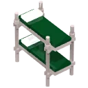{ .lu-ti width="24" loading="lazy" } [Space Fort Bunk Model (LOT 11822)](../11822.md) | Undefined for generic loot: reversed count range | 100% |
| 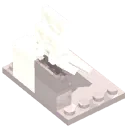{ .lu-ti width="24" loading="lazy" } [Space Fort Computer Model (LOT 11823)](../11823.md) | Undefined for generic loot: reversed count range | 100% |
| 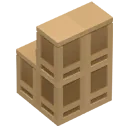{ .lu-ti width="24" loading="lazy" } [Space Fort Crate Stack Model (LOT 11824)](../11824.md) | Undefined for generic loot: reversed count range | 100% |
| 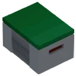{ .lu-ti width="24" loading="lazy" } [Space Fort Footlocker Model (LOT 11825)](../11825.md) | Undefined for generic loot: reversed count range | 100% |
| { .lu-ti width="24" loading="lazy" } [Space Fort Generator Model (LOT 11826)](../11826.md) | Undefined for generic loot: reversed count range | 100% |
| 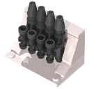{ .lu-ti width="24" loading="lazy" } [Space Fort Gun Rack Model 1 (LOT 11827)](../11827.md) | Undefined for generic loot: reversed count range | 100% |
| 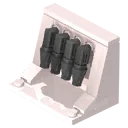{ .lu-ti width="24" loading="lazy" } [Space Fort Gun Rack Model 2 (LOT 11828)](../11828.md) | Undefined for generic loot: reversed count range | 100% |
| 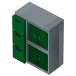{ .lu-ti width="24" loading="lazy" } [Space Fort Locker Model 1 (LOT 11829)](../11829.md) | Undefined for generic loot: reversed count range | 100% |
| 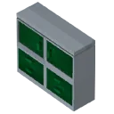{ .lu-ti width="24" loading="lazy" } [Space Fort Locker Model 2 (LOT 11830)](../11830.md) | Undefined for generic loot: reversed count range | 100% |
| 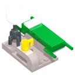{ .lu-ti width="24" loading="lazy" } [Space Fort Medical Stretcher Model 1 (LOT 11831)](../11831.md) | Undefined for generic loot: reversed count range | 100% |
| 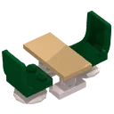{ .lu-ti width="24" loading="lazy" } [Space Fort Table Model 1 (LOT 11832)](../11832.md) | Undefined for generic loot: reversed count range | 100% |
| { .lu-ti width="24" loading="lazy" } [Space Fort Tool Rack Model 1 (LOT 11833)](../11833.md) | Undefined for generic loot: reversed count range | 100% |
| 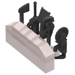{ .lu-ti width="24" loading="lazy" } [Space Fort Tool Rack Model 2 (LOT 11834)](../11834.md) | Undefined for generic loot: reversed count range | 100% |
| { .lu-ti width="24" loading="lazy" } [Space Fort Tool Rack Model 3 (LOT 11835)](../11835.md) | Undefined for generic loot: reversed count range | 100% |
| 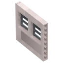{ .lu-ti width="24" loading="lazy" } [Space Fort Barricade Door Model (LOT 11836)](../11836.md) | Undefined for generic loot: reversed count range | 100% |
| 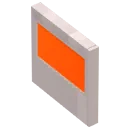{ .lu-ti width="24" loading="lazy" } [Space Fort Forcefield Door Model (LOT 11837)](../11837.md) | Undefined for generic loot: reversed count range | 100% |
| 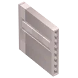{ .lu-ti width="24" loading="lazy" } [Space Fort Slotted Door Model (LOT 11838)](../11838.md) | Undefined for generic loot: reversed count range | 100% |
| 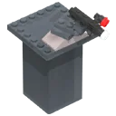{ .lu-ti width="24" loading="lazy" } [Space Fort Camera Model (LOT 11839)](../11839.md) | Undefined for generic loot: reversed count range | 100% |
| { .lu-ti width="24" loading="lazy" } [Space Fort Cannon Model (LOT 11840)](../11840.md) | Undefined for generic loot: reversed count range | 100% |
| 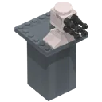{ .lu-ti width="24" loading="lazy" } [Space Fort Flak Model (LOT 11841)](../11841.md) | Undefined for generic loot: reversed count range | 100% |
| 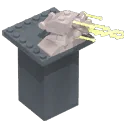{ .lu-ti width="24" loading="lazy" } [Space Fort Lightning Model (LOT 11842)](../11842.md) | Undefined for generic loot: reversed count range | 100% |
| { .lu-ti width="24" loading="lazy" } [Space Fort Missiles Model (LOT 11843)](../11843.md) | Undefined for generic loot: reversed count range | 100% |
| { .lu-ti width="24" loading="lazy" } [Space Fort Searchlight Defender Model (LOT 11844)](../11844.md) | Undefined for generic loot: reversed count range | 100% |
| { .lu-ti width="24" loading="lazy" } [Space Fort Invader Model (LOT 11845)](../11845.md) | Undefined for generic loot: reversed count range | 100% |
| 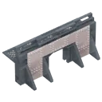{ .lu-ti width="24" loading="lazy" } [Space Fort Wide Wall Gate Model (LOT 11846)](../11846.md) | Undefined for generic loot: reversed count range | 100% |
| 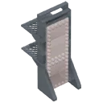{ .lu-ti width="24" loading="lazy" } [Space Fort Medium Wall Model (LOT 11847)](../11847.md) | Undefined for generic loot: reversed count range | 100% |
| 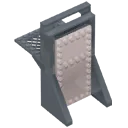{ .lu-ti width="24" loading="lazy" } [Space Fort Short Wall Model (LOT 11848)](../11848.md) | Undefined for generic loot: reversed count range | 100% |
| 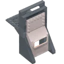{ .lu-ti width="24" loading="lazy" } [Space Fort Short Armored Wall Model (LOT 11849)](../11849.md) | Undefined for generic loot: reversed count range | 100% |
| 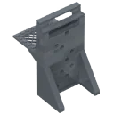{ .lu-ti width="24" loading="lazy" } [Space Fort Short Wall with Bulletholes Model (LOT 11850)](../11850.md) | Undefined for generic loot: reversed count range | 100% |
| { .lu-ti width="24" loading="lazy" } [Space Fort Battle-Damaged Short Wall Model (LOT 11851)](../11851.md) | Undefined for generic loot: reversed count range | 100% |
| 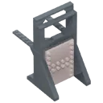{ .lu-ti width="24" loading="lazy" } [Space Fort Short Gunport Wall Model (LOT 11852)](../11852.md) | Undefined for generic loot: reversed count range | 100% |
| 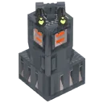{ .lu-ti width="24" loading="lazy" } [Space Fort Short Inside Corner Wall Model (LOT 11853)](../11853.md) | Undefined for generic loot: reversed count range | 100% |
| 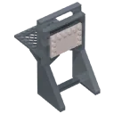{ .lu-ti width="24" loading="lazy" } [Space Fort Short Opening Wall Model (LOT 11854)](../11854.md) | Undefined for generic loot: reversed count range | 100% |
| { .lu-ti width="24" loading="lazy" } [Space Fort Short Outside Corner Wall Model (LOT 11855)](../11855.md) | Undefined for generic loot: reversed count range | 100% |
| 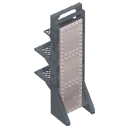{ .lu-ti width="24" loading="lazy" } [Space Fort Tall Wall Model (LOT 11856)](../11856.md) | Undefined for generic loot: reversed count range | 100% |
| 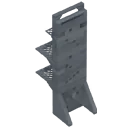{ .lu-ti width="24" loading="lazy" } [Space Fort Tall Wall with Bulletholes Model (LOT 11857)](../11857.md) | Undefined for generic loot: reversed count range | 100% |

## Raw matrix entries

| Row | Loot table | Rarity table | Trigger | Min | Max | Flag | Gate |
| --- | --- | --- | --- | --- | --- | --- | --- |
| 4433 | 800 | 4 | 1 | 1 | 0 |  | freetrial |

[LootMatrix](../../../db/LootMatrix.md), [LootTable](../../../db/LootTable.md), [RarityTable](../../../db/RarityTable.md).
