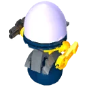
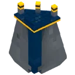
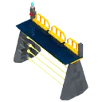
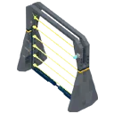
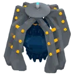
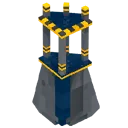
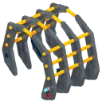

# Loot matrix 823

[Item database](../README.md) | [Methodology](../Methodology.md)

## Sources and mapped locations

| Kind | Source | Location evidence | Conditions |
| --- | --- | --- | --- |
| Vendor | [PRDX-4 - Robot Picnicker (LOT 5004)](../sources/object-5004.md) | [Avant Gardens (1100)](../locations/zone-1100.md) | Default inventory; vendorInvOverride can replace it |

**Generic loot probability unavailable:** at least one entry has maxToDrop < minToDrop. Vendor code treats a zero endpoint as “include the full table”; the generic loot code does not define that interpretation. No drop percentage is fabricated for this matrix.

## Item candidates

Default vendor-stock probabilities are shown only when this matrix has a registered vendor. Loot probabilities use the generic algorithm, not a guarantee of actual use by every script/activity.

| Item | Modeled loot chance / expected count | Default vendor stock |
| --- | --- | --- |
| { .lu-ti width="24" loading="lazy" } [Mech Bay Ball-Bot Model (LOT 11720)](../11720.md) | Undefined for generic loot: reversed count range | 100% |
| { .lu-ti width="24" loading="lazy" } [Mech Bay Ball-Bot Base Corner Model (LOT 11721)](../11721.md) | Undefined for generic loot: reversed count range | 100% |
| { .lu-ti width="24" loading="lazy" } [Mech Bay Ball-Bot Base Elevator Model (LOT 11722)](../11722.md) | Undefined for generic loot: reversed count range | 100% |
| { .lu-ti width="24" loading="lazy" } [Mech Bay Ball-Bot Base Energy Fence Model (LOT 11723)](../11723.md) | Undefined for generic loot: reversed count range | 100% |
| { .lu-ti width="24" loading="lazy" } [Mech Bay Ball-Bot Base Gate Model (LOT 11724)](../11724.md) | Undefined for generic loot: reversed count range | 100% |
| { .lu-ti width="24" loading="lazy" } [Mech Bay Ball-Bot Base Power Generator Model (LOT 11725)](../11725.md) | Undefined for generic loot: reversed count range | 100% |
| { .lu-ti width="24" loading="lazy" } [Mech Bay Ball-Bot Base Sensor Tower Model (LOT 11726)](../11726.md) | Undefined for generic loot: reversed count range | 100% |
| { .lu-ti width="24" loading="lazy" } [Mech Bay Ball-Bot Base Spare Part Model (LOT 11727)](../11727.md) | Undefined for generic loot: reversed count range | 100% |
| { .lu-ti width="24" loading="lazy" } [Mech Bay Ball-Bot Base Tall Corner Model (LOT 11728)](../11728.md) | Undefined for generic loot: reversed count range | 100% |
| { .lu-ti width="24" loading="lazy" } [Mech Bay Ball-Bot Bay Model (LOT 11729)](../11729.md) | Undefined for generic loot: reversed count range | 100% |
| { .lu-ti width="24" loading="lazy" } [Mech Bay Ball-Bot Boss Model (LOT 11730)](../11730.md) | Undefined for generic loot: reversed count range | 100% |
| { .lu-ti width="24" loading="lazy" } [Mech Bay Service Ball-Bot Model (LOT 11731)](../11731.md) | Undefined for generic loot: reversed count range | 100% |

## Raw matrix entries

| Row | Loot table | Rarity table | Trigger | Min | Max | Flag | Gate |
| --- | --- | --- | --- | --- | --- | --- | --- |
| 4434 | 801 | 4 | 1 | 1 | 0 |  | freetrial |

[LootMatrix](../../../db/LootMatrix.md), [LootTable](../../../db/LootTable.md), [RarityTable](../../../db/RarityTable.md).
