# Loot matrix 827

[Item database](../README.md) | [Methodology](../Methodology.md)

## Sources and mapped locations

| Kind | Source | Location evidence | Conditions |
| --- | --- | --- | --- |
| Vendor | [Dusty Holster - Cowboy Picnicker (LOT 5009)](../sources/object-5009.md) | [Avant Gardens (1100)](../locations/zone-1100.md) | Default inventory; vendorInvOverride can replace it |

**Generic loot probability unavailable:** at least one entry has maxToDrop < minToDrop. Vendor code treats a zero endpoint as “include the full table”; the generic loot code does not define that interpretation. No drop percentage is fabricated for this matrix.

## Item candidates

Default vendor-stock probabilities are shown only when this matrix has a registered vendor. Loot probabilities use the generic algorithm, not a guarantee of actual use by every script/activity.

| Item | Modeled loot chance / expected count | Default vendor stock |
| --- | --- | --- |
| 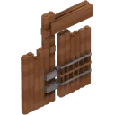{ .lu-ti width="24" loading="lazy" } [Fort Gate Model (LOT 9914)](../9914.md) | Undefined for generic loot: reversed count range | 100% |
| 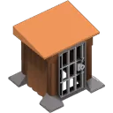{ .lu-ti width="24" loading="lazy" } [Fort Jail Model (LOT 9915)](../9915.md) | Undefined for generic loot: reversed count range | 100% |
| 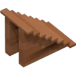{ .lu-ti width="24" loading="lazy" } [Fort Stairs Model (LOT 9916)](../9916.md) | Undefined for generic loot: reversed count range | 100% |
| 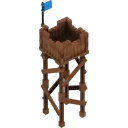{ .lu-ti width="24" loading="lazy" } [Fort Tower Model (LOT 9917)](../9917.md) | Undefined for generic loot: reversed count range | 100% |
| 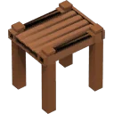{ .lu-ti width="24" loading="lazy" } [Fort Walkway Model (LOT 9918)](../9918.md) | Undefined for generic loot: reversed count range | 100% |
| 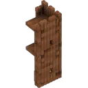{ .lu-ti width="24" loading="lazy" } [Fort Corner Model (LOT 9919)](../9919.md) | Undefined for generic loot: reversed count range | 100% |
| 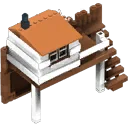{ .lu-ti width="24" loading="lazy" } [Fort Guardshack Model (LOT 9920)](../9920.md) | Undefined for generic loot: reversed count range | 100% |
| 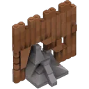{ .lu-ti width="24" loading="lazy" } [Fort Wall Rock Model (LOT 9921)](../9921.md) | Undefined for generic loot: reversed count range | 100% |
| 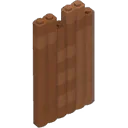{ .lu-ti width="24" loading="lazy" } [Fort Small Wall Model 1 (LOT 9922)](../9922.md) | Undefined for generic loot: reversed count range | 100% |
| 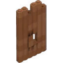{ .lu-ti width="24" loading="lazy" } [Fort Small Wall Model 2 (LOT 9923)](../9923.md) | Undefined for generic loot: reversed count range | 100% |
| 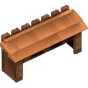{ .lu-ti width="24" loading="lazy" } [Fort Stable Model (LOT 9924)](../9924.md) | Undefined for generic loot: reversed count range | 100% |
| { .lu-ti width="24" loading="lazy" } [Farm Barn Door Model 1 (LOT 11592)](../11592.md) | Undefined for generic loot: reversed count range | 100% |
| 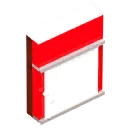{ .lu-ti width="24" loading="lazy" } [Farm Barn Door Model 2 (LOT 11593)](../11593.md) | Undefined for generic loot: reversed count range | 100% |
| { .lu-ti width="24" loading="lazy" } [Farm Barn Door Model 3 (LOT 11594)](../11594.md) | Undefined for generic loot: reversed count range | 100% |
| 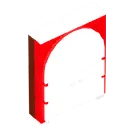{ .lu-ti width="24" loading="lazy" } [Farm Barn Door Model 4 (LOT 11595)](../11595.md) | Undefined for generic loot: reversed count range | 100% |
| { .lu-ti width="24" loading="lazy" } [Farm Barn Door Model 5 (LOT 11596)](../11596.md) | Undefined for generic loot: reversed count range | 100% |
| 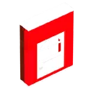{ .lu-ti width="24" loading="lazy" } [Farm Barn Door Model 6 (LOT 11597)](../11597.md) | Undefined for generic loot: reversed count range | 100% |
| 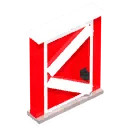{ .lu-ti width="24" loading="lazy" } [Farm Barn Door Model 7 (LOT 11598)](../11598.md) | Undefined for generic loot: reversed count range | 100% |
| { .lu-ti width="24" loading="lazy" } [Farm Barn Door Model 8 (LOT 11599)](../11599.md) | Undefined for generic loot: reversed count range | 100% |
| { .lu-ti width="24" loading="lazy" } [Farm Barn Short End Model (LOT 11600)](../11600.md) | Undefined for generic loot: reversed count range | 100% |
| { .lu-ti width="24" loading="lazy" } [Farm Barn Tall End Model (LOT 11601)](../11601.md) | Undefined for generic loot: reversed count range | 100% |
| { .lu-ti width="24" loading="lazy" } [Farm Barn Porch Model (LOT 11602)](../11602.md) | Undefined for generic loot: reversed count range | 100% |
| 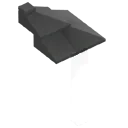{ .lu-ti width="24" loading="lazy" } [Farm Barn Porch Corner Model (LOT 11603)](../11603.md) | Undefined for generic loot: reversed count range | 100% |
| { .lu-ti width="24" loading="lazy" } [Farm Barn Shed End Model (LOT 11604)](../11604.md) | Undefined for generic loot: reversed count range | 100% |
| { .lu-ti width="24" loading="lazy" } [Farm Barn Shed End Left Model (LOT 11605)](../11605.md) | Undefined for generic loot: reversed count range | 100% |
| { .lu-ti width="24" loading="lazy" } [Farm Barn Shed End Right Model (LOT 11606)](../11606.md) | Undefined for generic loot: reversed count range | 100% |
| 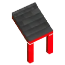{ .lu-ti width="24" loading="lazy" } [Farm Barn Shed Side Model (LOT 11607)](../11607.md) | Undefined for generic loot: reversed count range | 100% |
| 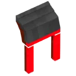{ .lu-ti width="24" loading="lazy" } [Farm Barn Side Short Model (LOT 11608)](../11608.md) | Undefined for generic loot: reversed count range | 100% |
| 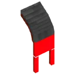{ .lu-ti width="24" loading="lazy" } [Farm Barn Side Tall Model (LOT 11609)](../11609.md) | Undefined for generic loot: reversed count range | 100% |
| 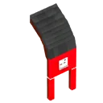{ .lu-ti width="24" loading="lazy" } [Farm Barn Side Tall Window Model (LOT 11610)](../11610.md) | Undefined for generic loot: reversed count range | 100% |
| { .lu-ti width="24" loading="lazy" } [Farm Barn Wall Arch Model (LOT 11611)](../11611.md) | Undefined for generic loot: reversed count range | 100% |
| { .lu-ti width="24" loading="lazy" } [Farm Barn Window Model 1 (LOT 11612)](../11612.md) | Undefined for generic loot: reversed count range | 100% |
| 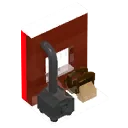{ .lu-ti width="24" loading="lazy" } [Farm Barn Window Model 2 (LOT 11613)](../11613.md) | Undefined for generic loot: reversed count range | 100% |
| 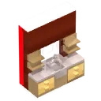{ .lu-ti width="24" loading="lazy" } [Farm Barn Window Model 3 (LOT 11614)](../11614.md) | Undefined for generic loot: reversed count range | 100% |
| 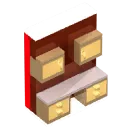{ .lu-ti width="24" loading="lazy" } [Farm Barn Window Model 4 (LOT 11615)](../11615.md) | Undefined for generic loot: reversed count range | 100% |
| 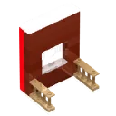{ .lu-ti width="24" loading="lazy" } [Farm Barn Window Model 5 (LOT 11616)](../11616.md) | Undefined for generic loot: reversed count range | 100% |
| 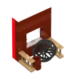{ .lu-ti width="24" loading="lazy" } [Farm Barn Window Model 6 (LOT 11617)](../11617.md) | Undefined for generic loot: reversed count range | 100% |
| 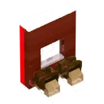{ .lu-ti width="24" loading="lazy" } [Farm Barn Window Model 7 (LOT 11618)](../11618.md) | Undefined for generic loot: reversed count range | 100% |
| 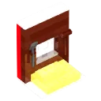{ .lu-ti width="24" loading="lazy" } [Farm Barn Window Model 8 (LOT 11619)](../11619.md) | Undefined for generic loot: reversed count range | 100% |
| 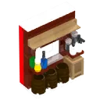{ .lu-ti width="24" loading="lazy" } [Farm Barn Window Model 9 (LOT 11620)](../11620.md) | Undefined for generic loot: reversed count range | 100% |
| 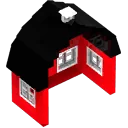{ .lu-ti width="24" loading="lazy" } [Farm Barn Back Model (LOT 11695)](../11695.md) | Undefined for generic loot: reversed count range | 100% |
| 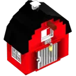{ .lu-ti width="24" loading="lazy" } [Farm Barn Front Model (LOT 11696)](../11696.md) | Undefined for generic loot: reversed count range | 100% |
| 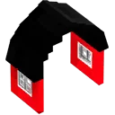{ .lu-ti width="24" loading="lazy" } [Farm Barn Middle Model (LOT 11697)](../11697.md) | Undefined for generic loot: reversed count range | 100% |
| { .lu-ti width="24" loading="lazy" } [Farm Chicken Model (LOT 11698)](../11698.md) | Undefined for generic loot: reversed count range | 100% |
| 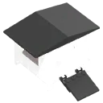{ .lu-ti width="24" loading="lazy" } [Farm Chicken Coop Model (LOT 11699)](../11699.md) | Undefined for generic loot: reversed count range | 100% |
| { .lu-ti width="24" loading="lazy" } [Farm Clothesline Model (LOT 11701)](../11701.md) | Undefined for generic loot: reversed count range | 100% |
| 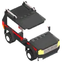{ .lu-ti width="24" loading="lazy" } [Farm 4WD Model (LOT 11704)](../11704.md) | Undefined for generic loot: reversed count range | 100% |
| 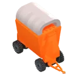{ .lu-ti width="24" loading="lazy" } [Farm Harvest Wagon Model (LOT 11707)](../11707.md) | Undefined for generic loot: reversed count range | 100% |
| 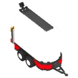{ .lu-ti width="24" loading="lazy" } [Farm Horse Trailer Model (LOT 11708)](../11708.md) | Undefined for generic loot: reversed count range | 100% |
| 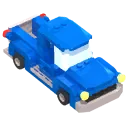{ .lu-ti width="24" loading="lazy" } [Farm Pickup Model (LOT 11709)](../11709.md) | Undefined for generic loot: reversed count range | 100% |
| { .lu-ti width="24" loading="lazy" } [Farm Sheep Model (LOT 11710)](../11710.md) | Undefined for generic loot: reversed count range | 100% |
| { .lu-ti width="24" loading="lazy" } [Farm Fence Gate Model (LOT 11717)](../11717.md) | Undefined for generic loot: reversed count range | 100% |
| 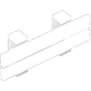{ .lu-ti width="24" loading="lazy" } [Farm Fence Short Model (LOT 11718)](../11718.md) | Undefined for generic loot: reversed count range | 100% |
| 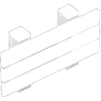{ .lu-ti width="24" loading="lazy" } [Farm Fence Tall Model (LOT 11719)](../11719.md) | Undefined for generic loot: reversed count range | 100% |
| 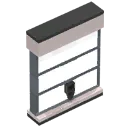{ .lu-ti width="24" loading="lazy" } [Farm Shed Door Model 1 (LOT 11802)](../11802.md) | Undefined for generic loot: reversed count range | 100% |
| 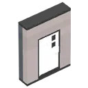{ .lu-ti width="24" loading="lazy" } [Farm Shed Door Model 2 (LOT 11803)](../11803.md) | Undefined for generic loot: reversed count range | 100% |
| 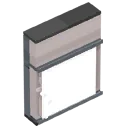{ .lu-ti width="24" loading="lazy" } [Farm Shed Door Model 3 (LOT 11804)](../11804.md) | Undefined for generic loot: reversed count range | 100% |
| 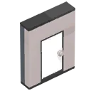{ .lu-ti width="24" loading="lazy" } [Farm Shed Door Model 4 (LOT 11805)](../11805.md) | Undefined for generic loot: reversed count range | 100% |
| 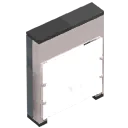{ .lu-ti width="24" loading="lazy" } [Farm Shed Door Model 5 (LOT 11806)](../11806.md) | Undefined for generic loot: reversed count range | 100% |
| 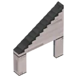{ .lu-ti width="24" loading="lazy" } [Farm Shed End Left Double Model (LOT 11807)](../11807.md) | Undefined for generic loot: reversed count range | 100% |
| 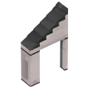{ .lu-ti width="24" loading="lazy" } [Farm Shed End Left Single Model (LOT 11808)](../11808.md) | Undefined for generic loot: reversed count range | 100% |
| 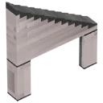{ .lu-ti width="24" loading="lazy" } [Farm Shed End Right Double Model (LOT 11809)](../11809.md) | Undefined for generic loot: reversed count range | 100% |
| 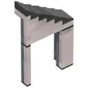{ .lu-ti width="24" loading="lazy" } [Farm Shed End Right Model (LOT 11810)](../11810.md) | Undefined for generic loot: reversed count range | 100% |
| { .lu-ti width="24" loading="lazy" } [Farm Shed End Narrow Model (LOT 11811)](../11811.md) | Undefined for generic loot: reversed count range | 100% |
| 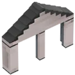{ .lu-ti width="24" loading="lazy" } [Farm Shed End Wide Model (LOT 11812)](../11812.md) | Undefined for generic loot: reversed count range | 100% |
| { .lu-ti width="24" loading="lazy" } [Farm Shed End Model (LOT 11813)](../11813.md) | Undefined for generic loot: reversed count range | 100% |
| { .lu-ti width="24" loading="lazy" } [Farm Shed Wall Short Model 1 (LOT 11814)](../11814.md) | Undefined for generic loot: reversed count range | 100% |
| { .lu-ti width="24" loading="lazy" } [Farm Shed Wall Short Model 2 (LOT 11815)](../11815.md) | Undefined for generic loot: reversed count range | 100% |
| { .lu-ti width="24" loading="lazy" } [Farm Shed Wall Short Model 3 (LOT 11816)](../11816.md) | Undefined for generic loot: reversed count range | 100% |
| { .lu-ti width="24" loading="lazy" } [Farm Shed Window Model 1 (LOT 11817)](../11817.md) | Undefined for generic loot: reversed count range | 100% |
| { .lu-ti width="24" loading="lazy" } [Farm Shed Window Model 2 (LOT 11818)](../11818.md) | Undefined for generic loot: reversed count range | 100% |
| { .lu-ti width="24" loading="lazy" } [Farm Shed Window Model 3 (LOT 11819)](../11819.md) | Undefined for generic loot: reversed count range | 100% |
| { .lu-ti width="24" loading="lazy" } [Farm Shed Window Model 4 (LOT 11820)](../11820.md) | Undefined for generic loot: reversed count range | 100% |
| { .lu-ti width="24" loading="lazy" } [Farm Shed Window Model 5 (LOT 11821)](../11821.md) | Undefined for generic loot: reversed count range | 100% |

## Raw matrix entries

| Row | Loot table | Rarity table | Trigger | Min | Max | Flag | Gate |
| --- | --- | --- | --- | --- | --- | --- | --- |
| 4438 | 805 | 4 | 1 | 1 | 0 |  | freetrial |

[LootMatrix](../../../db/LootMatrix.md), [LootTable](../../../db/LootTable.md), [RarityTable](../../../db/RarityTable.md).
