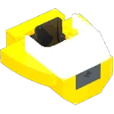

# Loot matrix 832

[Item database](../README.md) | [Methodology](../Methodology.md)

## Sources and mapped locations

| Kind | Source | Location evidence | Conditions |
| --- | --- | --- | --- |
| Package | [Duck Rocket Reward Pack (LOT 15979)](../sources/object-15979.md) | No matched local placement found | Static association, not a live-spawn guarantee |

## Item candidates

Default vendor-stock probabilities are shown only when this matrix has a registered vendor. Loot probabilities use the generic algorithm, not a guarantee of actual use by every script/activity.

| Item | Modeled loot chance / expected count | Default vendor stock |
| --- | --- | --- |
| { .lu-ti width="24" loading="lazy" } [Duck Rocket Nose Cone (LOT 14701)](../14701.md) | 100%; mean 1 | Not associated with a vendor |
| { .lu-ti width="24" loading="lazy" } [Duck Rocket Cockpit (LOT 14702)](../14702.md) | 100%; mean 1 | Not associated with a vendor |
| { .lu-ti width="24" loading="lazy" } [Duck Rocket Engine (LOT 14703)](../14703.md) | 100%; mean 1 | Not associated with a vendor |

## Raw matrix entries

| Row | Loot table | Rarity table | Trigger | Min | Max | Flag | Gate |
| --- | --- | --- | --- | --- | --- | --- | --- |
| 4460 | 822 | 25 | 1 | 1 | 1 |  | ftcommunityitems |
| 4461 | 823 | 25 | 1 | 1 | 1 |  | ftcommunityitems |
| 4462 | 824 | 25 | 1 | 1 | 1 |  | ftcommunityitems |

[LootMatrix](../../../db/LootMatrix.md), [LootTable](../../../db/LootTable.md), [RarityTable](../../../db/RarityTable.md).
