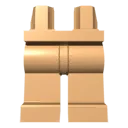
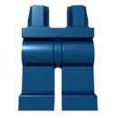
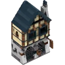
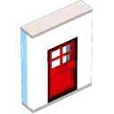
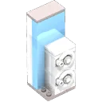
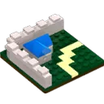
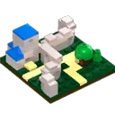
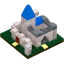

# Loot matrix 861

[Item database](../README.md) | [Methodology](../Methodology.md)

## Sources and mapped locations

| Kind | Source | Location evidence | Conditions |
| --- | --- | --- | --- |
| Activity | [SpiderCave Launcher (LOT 14672)](../sources/object-14672.md) | [Avant Gardens (1100)](../locations/zone-1100.md); [Spider Queen Battle (1102)](../locations/zone-1102.md); [Block Yard (1150)](../locations/zone-1150.md) | AG Spider Queen 2 Player (activity ID 14, rating threshold 200, reward 232); Selected only if this is the highest eligible rating threshold; instance zone 1102.; Static association, not a live-spawn guarantee |
| Activity | [AG Spider Queen Zone Control Object (LOT 16024)](../sources/object-16024.md) | No matched local placement found | AG Spider Queen 2 Player (activity ID 14, rating threshold 200, reward 232); Selected only if this is the highest eligible rating threshold; instance zone 1102.; Static association, not a live-spawn guarantee |
| Activity | [AG - Spider Boss Treasure Chest (LOT 16318)](../sources/object-16318.md) | No matched local placement found | AG Spider Queen 2 Player (activity ID 14, rating threshold 200, reward 232); Selected only if this is the highest eligible rating threshold; instance zone 1102.; Static association, not a live-spawn guarantee |

## Item candidates

Default vendor-stock probabilities are shown only when this matrix has a registered vendor. Loot probabilities use the generic algorithm, not a guarantee of actual use by every script/activity.

| Item | Modeled loot chance / expected count | Default vendor stock |
| --- | --- | --- |
| { .lu-ti width="24" loading="lazy" } [Brick 2x4 (LOT 29)](../29.md) | 12.9631685%; mean 0.13636364 | Not associated with a vendor |
| { .lu-ti width="24" loading="lazy" } [Brick 2x3 (LOT 30)](../30.md) | 12.9631685%; mean 0.13636364 | Not associated with a vendor |
| { .lu-ti width="24" loading="lazy" } [Brick 2x2 (LOT 31)](../31.md) | 12.9631685%; mean 0.13636364 | Not associated with a vendor |
| { .lu-ti width="24" loading="lazy" } [Brick 1x2 (LOT 32)](../32.md) | 12.9631685%; mean 0.13636364 | Not associated with a vendor |
| { .lu-ti width="24" loading="lazy" } [Brick 1x1 (LOT 33)](../33.md) | 12.9631685%; mean 0.13636364 | Not associated with a vendor |
| { .lu-ti width="24" loading="lazy" } [Brick 2x8 (LOT 35)](../35.md) | 12.9631685%; mean 0.13636364 | Not associated with a vendor |
| { .lu-ti width="24" loading="lazy" } [Brick 1x8 (LOT 36)](../36.md) | 12.9631685%; mean 0.13636364 | Not associated with a vendor |
| { .lu-ti width="24" loading="lazy" } [Brick 1x6 (LOT 37)](../37.md) | 12.9631685%; mean 0.13636364 | Not associated with a vendor |
| { .lu-ti width="24" loading="lazy" } [Brick 1x4 (LOT 38)](../38.md) | 12.9631685%; mean 0.13636364 | Not associated with a vendor |
| { .lu-ti width="24" loading="lazy" } [Plate 2x4 (LOT 39)](../39.md) | 12.9631685%; mean 0.13636364 | Not associated with a vendor |
| { .lu-ti width="24" loading="lazy" } [Plate 2x3 (LOT 40)](../40.md) | 12.9631685%; mean 0.13636364 | Not associated with a vendor |
| { .lu-ti width="24" loading="lazy" } [Plate 1x2 (LOT 41)](../41.md) | 12.9631685%; mean 0.13636364 | Not associated with a vendor |
| { .lu-ti width="24" loading="lazy" } [Plate 1x1 (LOT 42)](../42.md) | 12.9631685%; mean 0.13636364 | Not associated with a vendor |
| { .lu-ti width="24" loading="lazy" } [Plate 1x8 (LOT 58)](../58.md) | 12.9631685%; mean 0.13636364 | Not associated with a vendor |
| { .lu-ti width="24" loading="lazy" } [Brick 1x3 (LOT 59)](../59.md) | 12.9631685%; mean 0.13636364 | Not associated with a vendor |
| { .lu-ti width="24" loading="lazy" } [Plate 1x3 (LOT 60)](../60.md) | 12.9631685%; mean 0.13636364 | Not associated with a vendor |
| { .lu-ti width="24" loading="lazy" } [Plate 1x6 (LOT 62)](../62.md) | 12.9631685%; mean 0.13636364 | Not associated with a vendor |
| { .lu-ti width="24" loading="lazy" } [Plate 1x4 (LOT 66)](../66.md) | 12.9631685%; mean 0.13636364 | Not associated with a vendor |
| { .lu-ti width="24" loading="lazy" } [Brick 1x1 with 4 Studs (LOT 76)](../76.md) | 1.25%; mean 0.0125 | Not associated with a vendor |
| { .lu-ti width="24" loading="lazy" } [Brick 2x6 (LOT 98)](../98.md) | 12.9631685%; mean 0.13636364 | Not associated with a vendor |
| { .lu-ti width="24" loading="lazy" } [Washing Machine Brick (LOT 109)](../109.md) | 1.25%; mean 0.0125 | Not associated with a vendor |
| { .lu-ti width="24" loading="lazy" } [Slope Brick 45° 1x2 Inverted (LOT 111)](../111.md) | 1.25%; mean 0.0125 | Not associated with a vendor |
| { .lu-ti width="24" loading="lazy" } [Plate 1x2 with Single Stud (LOT 143)](../143.md) | 1.25%; mean 0.0125 | Not associated with a vendor |
| { .lu-ti width="24" loading="lazy" } [Plate 2x6 (LOT 144)](../144.md) | 12.9631685%; mean 0.13636364 | Not associated with a vendor |
| { .lu-ti width="24" loading="lazy" } [Plate 2x2 Round (LOT 178)](../178.md) | 1.25%; mean 0.0125 | Not associated with a vendor |
| { .lu-ti width="24" loading="lazy" } [Brick 1x1 with 2 Studs (LOT 711)](../711.md) | 1.25%; mean 0.0125 | Not associated with a vendor |
| { .lu-ti width="24" loading="lazy" } [Plate 1x1 with Tooth (LOT 726)](../726.md) | 1.25%; mean 0.0125 | Not associated with a vendor |
| { .lu-ti width="24" loading="lazy" } [Plate 2x2 (LOT 865)](../865.md) | 12.9631685%; mean 0.13636364 | Not associated with a vendor |
| { .lu-ti width="24" loading="lazy" } [Plate 2x8 (LOT 869)](../869.md) | 12.9631685%; mean 0.13636364 | Not associated with a vendor |
| { .lu-ti width="24" loading="lazy" } [Healing Banana (LOT 1966)](../1966.md) | 2.92157202%; mean 0.029605263 | Not associated with a vendor |
| { .lu-ti width="24" loading="lazy" } [Notion Potion (LOT 2198)](../2198.md) | 2.92157202%; mean 0.029605263 | Not associated with a vendor |
| { .lu-ti width="24" loading="lazy" } [Quicksicle (LOT 2620)](../2620.md) | 2.92157202%; mean 0.029605263 | Not associated with a vendor |
| { .lu-ti width="24" loading="lazy" } [Armor Polish (LOT 2993)](../2993.md) | 2.92157202%; mean 0.029605263 | Not associated with a vendor |
| { .lu-ti width="24" loading="lazy" } [Healing Cherry (LOT 2994)](../2994.md) | 2.92157202%; mean 0.029605263 | Not associated with a vendor |
| { .lu-ti width="24" loading="lazy" } [Armor Shine (LOT 2996)](../2996.md) | 2.92157202%; mean 0.029605263 | Not associated with a vendor |
| { .lu-ti width="24" loading="lazy" } [Strong Notion Potion (LOT 2998)](../2998.md) | 2.92157202%; mean 0.029605263 | Not associated with a vendor |
| { .lu-ti width="24" loading="lazy" } [BBQ Blast Hot Dog (LOT 3011)](../3011.md) | 2.92157202%; mean 0.029605263 | Not associated with a vendor |
| { .lu-ti width="24" loading="lazy" } [Green Imaginite (LOT 3039)](../3039.md) | 2.92157202%; mean 0.029605263 | Not associated with a vendor |
| { .lu-ti width="24" loading="lazy" } [Red Imaginite (LOT 3040)](../3040.md) | 4.58984375%; mean 0.046875 | Not associated with a vendor |
| { .lu-ti width="24" loading="lazy" } [Improved Crescent Wrench (LOT 3077)](../3077.md) | 0.15%; mean 0.0015 | Not associated with a vendor |
| { .lu-ti width="24" loading="lazy" } [Amber Gem (LOT 3100)](../3100.md) | 2.92157202%; mean 0.029605263 | Not associated with a vendor |
| { .lu-ti width="24" loading="lazy" } [Basic Shovel (LOT 3872)](../3872.md) | 0.9375%; mean 0.009375 | Not associated with a vendor |
| { .lu-ti width="24" loading="lazy" } [Hiccup Tablets (LOT 5832)](../5832.md) | 2.92157202%; mean 0.029605263 | Not associated with a vendor |
| { .lu-ti width="24" loading="lazy" } [Brick Booster Pack (LOT 5834)](../5834.md) | 2.92157202%; mean 0.029605263 | Not associated with a vendor |
| { .lu-ti width="24" loading="lazy" } [Super Brick Booster Pack (LOT 5835)](../5835.md) | 4.58984375%; mean 0.046875 | Not associated with a vendor |
| { .lu-ti width="24" loading="lazy" } [Picnic Basket (LOT 5836)](../5836.md) | 2.92157202%; mean 0.029605263 | Not associated with a vendor |
| { .lu-ti width="24" loading="lazy" } [Super Picnic Basket (LOT 5837)](../5837.md) | 4.58984375%; mean 0.046875 | Not associated with a vendor |
| { .lu-ti width="24" loading="lazy" } [Basic Shortsword of Knockback (LOT 5948)](../5948.md) | 0.15%; mean 0.0015 | Not associated with a vendor |
| { .lu-ti width="24" loading="lazy" } [Tiny Mushroom Model (LOT 6027)](../6027.md) | 2.34375%; mean 0.0234375 | Not associated with a vendor |
| { .lu-ti width="24" loading="lazy" } [Small Mushroom Model (LOT 6028)](../6028.md) | 2.34375%; mean 0.0234375 | Not associated with a vendor |
| { .lu-ti width="24" loading="lazy" } [Medium Mushroom Model (LOT 6029)](../6029.md) | 2.34375%; mean 0.0234375 | Not associated with a vendor |
| { .lu-ti width="24" loading="lazy" } [Large Mushroom Model (LOT 6030)](../6030.md) | 2.34375%; mean 0.0234375 | Not associated with a vendor |
| { .lu-ti width="24" loading="lazy" } [Tiny Crate Model (LOT 6031)](../6031.md) | 0.38461538%; mean 0.0038461538 | Not associated with a vendor |
| { .lu-ti width="24" loading="lazy" } [Small Crate Model (LOT 6032)](../6032.md) | 0.38461538%; mean 0.0038461538 | Not associated with a vendor |
| { .lu-ti width="24" loading="lazy" } [Medium Crate Model (LOT 6033)](../6033.md) | 0.4%; mean 0.004 | Not associated with a vendor |
| { .lu-ti width="24" loading="lazy" } [Large Crate Model (LOT 6034)](../6034.md) | 0.4%; mean 0.004 | Not associated with a vendor |
| { .lu-ti width="24" loading="lazy" } [Wooden Barrel Model (LOT 6035)](../6035.md) | 2.34375%; mean 0.0234375 | Not associated with a vendor |
| { .lu-ti width="24" loading="lazy" } [Tent Model (LOT 6036)](../6036.md) | 0.4%; mean 0.004 | Not associated with a vendor |
| { .lu-ti width="24" loading="lazy" } [Desk Model (LOT 6037)](../6037.md) | 0.38461538%; mean 0.0038461538 | Not associated with a vendor |
| { .lu-ti width="24" loading="lazy" } [Water Cooler Model (LOT 6039)](../6039.md) | 2.34375%; mean 0.0234375 | Not associated with a vendor |
| { .lu-ti width="24" loading="lazy" } [Small Table Model (LOT 6044)](../6044.md) | 2.34375%; mean 0.0234375 | Not associated with a vendor |
| { .lu-ti width="24" loading="lazy" } [Weapon Rack Model (LOT 6056)](../6056.md) | 0.38461538%; mean 0.0038461538 | Not associated with a vendor |
| { .lu-ti width="24" loading="lazy" } [Hut Model (LOT 6060)](../6060.md) | 0.38461538%; mean 0.0038461538 | Not associated with a vendor |
| { .lu-ti width="24" loading="lazy" } [Coffee Table Model (LOT 6064)](../6064.md) | 2.34375%; mean 0.0234375 | Not associated with a vendor |
| { .lu-ti width="24" loading="lazy" } [Cart Model (LOT 6065)](../6065.md) | 2.34375%; mean 0.0234375 | Not associated with a vendor |
| { .lu-ti width="24" loading="lazy" } [Fence Model (LOT 6071)](../6071.md) | 2.34375%; mean 0.0234375 | Not associated with a vendor |
| { .lu-ti width="24" loading="lazy" } [Wood Pile Model (LOT 6072)](../6072.md) | 2.34375%; mean 0.0234375 | Not associated with a vendor |
| { .lu-ti width="24" loading="lazy" } [Maelstrom-Infected Brick (LOT 6194)](../6194.md) | 100%; mean 2 | Not associated with a vendor |
| { .lu-ti width="24" loading="lazy" } [Thirst Quencher (LOT 6201)](../6201.md) | 2.92157202%; mean 0.029605263 | Not associated with a vendor |
| { .lu-ti width="24" loading="lazy" } [Basic Spear of Stunning (LOT 6203)](../6203.md) | 0.15%; mean 0.0015 | Not associated with a vendor |
| { .lu-ti width="24" loading="lazy" } [Nexus Force Healing Kit (LOT 6207)](../6207.md) | 2.92157202%; mean 0.029605263 | Not associated with a vendor |
| { .lu-ti width="24" loading="lazy" } [Improved Fishing Pole (LOT 6742)](../6742.md) | 0.15%; mean 0.0015 | Not associated with a vendor |
| { .lu-ti width="24" loading="lazy" } [Box of Cups Model (LOT 6778)](../6778.md) | 2.34375%; mean 0.0234375 | Not associated with a vendor |
| { .lu-ti width="24" loading="lazy" } [Blue Baseball Cap (LOT 6803)](../6803.md) | 0.375%; mean 0.00375 | Not associated with a vendor |
| { .lu-ti width="24" loading="lazy" } [Light Blue Gem (LOT 6865)](../6865.md) | 4.58984375%; mean 0.046875 | Not associated with a vendor |
| { .lu-ti width="24" loading="lazy" } [Pink Gem (LOT 6866)](../6866.md) | 2.92157202%; mean 0.029605263 | Not associated with a vendor |
| { .lu-ti width="24" loading="lazy" } [Improved Composite Axe (LOT 6881)](../6881.md) | 0.15%; mean 0.0015 | Not associated with a vendor |
| { .lu-ti width="24" loading="lazy" } [Flash Bang (LOT 6884)](../6884.md) | 2.92157202%; mean 0.029605263 | Not associated with a vendor |
| { .lu-ti width="24" loading="lazy" } [Candle Holder Model (LOT 7122)](../7122.md) | 2.34375%; mean 0.0234375 | Not associated with a vendor |
| { .lu-ti width="24" loading="lazy" } [Dock Model (LOT 7123)](../7123.md) | 0.38461538%; mean 0.0038461538 | Not associated with a vendor |
| { .lu-ti width="24" loading="lazy" } [Cabinet Model (LOT 7134)](../7134.md) | 0.38461538%; mean 0.0038461538 | Not associated with a vendor |
| { .lu-ti width="24" loading="lazy" } [Antique Chair Model (LOT 7135)](../7135.md) | 2.34375%; mean 0.0234375 | Not associated with a vendor |
| { .lu-ti width="24" loading="lazy" } [Double Trash Can Model (LOT 7759)](../7759.md) | 2.34375%; mean 0.0234375 | Not associated with a vendor |
| { .lu-ti width="24" loading="lazy" } [Trash Can Model (LOT 7761)](../7761.md) | 2.34375%; mean 0.0234375 | Not associated with a vendor |
| { .lu-ti width="24" loading="lazy" } [Bench Model (LOT 7770)](../7770.md) | 2.34375%; mean 0.0234375 | Not associated with a vendor |
| { .lu-ti width="24" loading="lazy" } [Firecracker (LOT 7778)](../7778.md) | 2.92157202%; mean 0.029605263 | Not associated with a vendor |
| { .lu-ti width="24" loading="lazy" } [Goblet Box Model (LOT 8055)](../8055.md) | 2.34375%; mean 0.0234375 | Not associated with a vendor |
| { .lu-ti width="24" loading="lazy" } [Console Model (LOT 8068)](../8068.md) | 2.34375%; mean 0.0234375 | Not associated with a vendor |
| { .lu-ti width="24" loading="lazy" } [Yellow Barricade Model (LOT 8069)](../8069.md) | 2.34375%; mean 0.0234375 | Not associated with a vendor |
| { .lu-ti width="24" loading="lazy" } [Barricade Model (LOT 8073)](../8073.md) | 2.34375%; mean 0.0234375 | Not associated with a vendor |
| { .lu-ti width="24" loading="lazy" } [Birdhouse Model (LOT 8077)](../8077.md) | 2.34375%; mean 0.0234375 | Not associated with a vendor |
| { .lu-ti width="24" loading="lazy" } [Basic Dagger (LOT 8217)](../8217.md) | 0.9375%; mean 0.009375 | Not associated with a vendor |
| { .lu-ti width="24" loading="lazy" } [Basic Pickaxe (LOT 8218)](../8218.md) | 0.9375%; mean 0.009375 | Not associated with a vendor |
| { .lu-ti width="24" loading="lazy" } [Basic Javelin (LOT 8219)](../8219.md) | 0.9375%; mean 0.009375 | Not associated with a vendor |
| { .lu-ti width="24" loading="lazy" } [Cloud Burst (LOT 8366)](../8366.md) | 2.92157202%; mean 0.029605263 | Not associated with a vendor |
| { .lu-ti width="24" loading="lazy" } [Quality Cutlass (LOT 8497)](../8497.md) | 0.25%; mean 0.0025 | Not associated with a vendor |
| { .lu-ti width="24" loading="lazy" } [Improved Hatchet (LOT 8498)](../8498.md) | 0.15%; mean 0.0015 | Not associated with a vendor |
| { .lu-ti width="24" loading="lazy" } [Quality Woodsman's Axe (LOT 8500)](../8500.md) | 0.25%; mean 0.0025 | Not associated with a vendor |
| { .lu-ti width="24" loading="lazy" } [Improved Ice Saw (LOT 8501)](../8501.md) | 0.15%; mean 0.0015 | Not associated with a vendor |
| { .lu-ti width="24" loading="lazy" } [Improved Scimitar (LOT 8502)](../8502.md) | 0.15%; mean 0.0015 | Not associated with a vendor |
| { .lu-ti width="24" loading="lazy" } [Quality Corseque (LOT 8503)](../8503.md) | 0.25%; mean 0.0025 | Not associated with a vendor |
| { .lu-ti width="24" loading="lazy" } [Improved Longsword (LOT 8504)](../8504.md) | 0.15%; mean 0.0015 | Not associated with a vendor |
| { .lu-ti width="24" loading="lazy" } [Basic Force Blade (LOT 8505)](../8505.md) | 0.9375%; mean 0.009375 | Not associated with a vendor |
| { .lu-ti width="24" loading="lazy" } [Quality Dirk (LOT 8506)](../8506.md) | 0.25%; mean 0.0025 | Not associated with a vendor |
| { .lu-ti width="24" loading="lazy" } [Improved Trident (LOT 8509)](../8509.md) | 0.15%; mean 0.0015 | Not associated with a vendor |
| { .lu-ti width="24" loading="lazy" } [Space Headgear (LOT 8546)](../8546.md) | 0.26666667%; mean 0.0026666667 | Not associated with a vendor |
| { .lu-ti width="24" loading="lazy" } [Cargo Pants (LOT 8647)](../8647.md) | 0.26666667%; mean 0.0026666667 | Not associated with a vendor |
| { .lu-ti width="24" loading="lazy" } [Jodhpurs (LOT 8664)](../8664.md) | 0.375%; mean 0.00375 | Not associated with a vendor |
| { .lu-ti width="24" loading="lazy" } [Sweat Pants (LOT 8666)](../8666.md) | 0.375%; mean 0.00375 | Not associated with a vendor |
| { .lu-ti width="24" loading="lazy" } [Clam Diggers (LOT 8667)](../8667.md) | 0.375%; mean 0.00375 | Not associated with a vendor |
| { .lu-ti width="24" loading="lazy" } [Reinforced Pith Helmet (LOT 8675)](../8675.md) | 0.26666667%; mean 0.0026666667 | Not associated with a vendor |
| { .lu-ti width="24" loading="lazy" } [Cadet Helm (LOT 8676)](../8676.md) | 0.2%; mean 0.002 | Not associated with a vendor |
| { .lu-ti width="24" loading="lazy" } [Brick 1x1 with 1 Stud on Side (LOT 9201)](../9201.md) | 1.25%; mean 0.0125 | Not associated with a vendor |
| { .lu-ti width="24" loading="lazy" } [Television Model (LOT 9488)](../9488.md) | 0.38461538%; mean 0.0038461538 | Not associated with a vendor |
| { .lu-ti width="24" loading="lazy" } [Troll Cart Model (LOT 9490)](../9490.md) | 2.34375%; mean 0.0234375 | Not associated with a vendor |
| { .lu-ti width="24" loading="lazy" } [Castle Weapon Rack Model (LOT 9493)](../9493.md) | 2.34375%; mean 0.0234375 | Not associated with a vendor |
| { .lu-ti width="24" loading="lazy" } [Medieval Wagon Model (LOT 9591)](../9591.md) | 0.38461538%; mean 0.0038461538 | Not associated with a vendor |
| { .lu-ti width="24" loading="lazy" } [Medieval Vendor Model (LOT 9596)](../9596.md) | 0.38461538%; mean 0.0038461538 | Not associated with a vendor |
| { .lu-ti width="24" loading="lazy" } [Medieval Village Stable Model (LOT 9648)](../9648.md) | 0.14285714%; mean 0.0014285714 | Not associated with a vendor |
| { .lu-ti width="24" loading="lazy" } [Medieval Village Forge Model (LOT 9649)](../9649.md) | 0.14285714%; mean 0.0014285714 | Not associated with a vendor |
| { .lu-ti width="24" loading="lazy" } [Medieval Village Inn Model (LOT 9650)](../9650.md) | 0.14285714%; mean 0.0014285714 | Not associated with a vendor |
| { .lu-ti width="24" loading="lazy" } [Medieval Village House Model (LOT 9651)](../9651.md) | 0.14285714%; mean 0.0014285714 | Not associated with a vendor |
| { .lu-ti width="24" loading="lazy" } [Castle Arbalest Model (LOT 9652)](../9652.md) | 0.38461538%; mean 0.0038461538 | Not associated with a vendor |
| { .lu-ti width="24" loading="lazy" } [Castle Barrel Gun Model (LOT 9653)](../9653.md) | 0.38461538%; mean 0.0038461538 | Not associated with a vendor |
| { .lu-ti width="24" loading="lazy" } [Castle Catapult Model (LOT 9654)](../9654.md) | 0.38461538%; mean 0.0038461538 | Not associated with a vendor |
| { .lu-ti width="24" loading="lazy" } [Castle Inner Corner Model (LOT 9656)](../9656.md) | 0.14285714%; mean 0.0014285714 | Not associated with a vendor |
| { .lu-ti width="24" loading="lazy" } [Castle Outside Corner Model (LOT 9657)](../9657.md) | 0.14285714%; mean 0.0014285714 | Not associated with a vendor |
| { .lu-ti width="24" loading="lazy" } [Castle Small Corner Model (LOT 9658)](../9658.md) | 0.4%; mean 0.004 | Not associated with a vendor |
| { .lu-ti width="24" loading="lazy" } [Castle Crossing Model (LOT 9659)](../9659.md) | 0.4%; mean 0.004 | Not associated with a vendor |
| { .lu-ti width="24" loading="lazy" } [Castle Gate Model (LOT 9660)](../9660.md) | 0.14285714%; mean 0.0014285714 | Not associated with a vendor |
| { .lu-ti width="24" loading="lazy" } [Castle Outhouse Model (LOT 9661)](../9661.md) | 0.4%; mean 0.004 | Not associated with a vendor |
| { .lu-ti width="24" loading="lazy" } [Castle Ramp Model (LOT 9662)](../9662.md) | 0.14285714%; mean 0.0014285714 | Not associated with a vendor |
| { .lu-ti width="24" loading="lazy" } [Castle Staircase Model (LOT 9663)](../9663.md) | 0.4%; mean 0.004 | Not associated with a vendor |
| { .lu-ti width="24" loading="lazy" } [Castle Tower Model (LOT 9664)](../9664.md) | 0.14285714%; mean 0.0014285714 | Not associated with a vendor |
| { .lu-ti width="24" loading="lazy" } [Castle Wall Bridge Model (LOT 9665)](../9665.md) | 0.14285714%; mean 0.0014285714 | Not associated with a vendor |
| { .lu-ti width="24" loading="lazy" } [Castle Wall End Model (LOT 9666)](../9666.md) | 0.4%; mean 0.004 | Not associated with a vendor |
| { .lu-ti width="24" loading="lazy" } [Castle Small Wall Model 1 (LOT 9667)](../9667.md) | 0.38461538%; mean 0.0038461538 | Not associated with a vendor |
| { .lu-ti width="24" loading="lazy" } [Castle Small Wall Model 2 (LOT 9668)](../9668.md) | 0.38461538%; mean 0.0038461538 | Not associated with a vendor |
| { .lu-ti width="24" loading="lazy" } [Castle Small Wall Model 3 (LOT 9669)](../9669.md) | 0.38461538%; mean 0.0038461538 | Not associated with a vendor |
| { .lu-ti width="24" loading="lazy" } [Castle Small Wall Model 4 (LOT 9670)](../9670.md) | 0.38461538%; mean 0.0038461538 | Not associated with a vendor |
| { .lu-ti width="24" loading="lazy" } [Castle Straight Wall Model (LOT 9671)](../9671.md) | 0.4%; mean 0.004 | Not associated with a vendor |
| { .lu-ti width="24" loading="lazy" } [Castle Medium Straight Wall Model (LOT 9672)](../9672.md) | 0.4%; mean 0.004 | Not associated with a vendor |
| { .lu-ti width="24" loading="lazy" } [Castle Medium Spikes Wall Model (LOT 9673)](../9673.md) | 0.4%; mean 0.004 | Not associated with a vendor |
| { .lu-ti width="24" loading="lazy" } [Castle T-Wall Model (LOT 9674)](../9674.md) | 0.14285714%; mean 0.0014285714 | Not associated with a vendor |
| { .lu-ti width="24" loading="lazy" } [Castle Tower Wall With No Top Model (LOT 9675)](../9675.md) | 0.14285714%; mean 0.0014285714 | Not associated with a vendor |
| { .lu-ti width="24" loading="lazy" } [Castle Tower Wall With Top Model (LOT 9676)](../9676.md) | 0.14285714%; mean 0.0014285714 | Not associated with a vendor |
| { .lu-ti width="24" loading="lazy" } [Castle Widening Wall Model (LOT 9677)](../9677.md) | 0.14285714%; mean 0.0014285714 | Not associated with a vendor |
| { .lu-ti width="24" loading="lazy" } [Castle Wall With Stairs Model (LOT 9678)](../9678.md) | 0.4%; mean 0.004 | Not associated with a vendor |
| { .lu-ti width="24" loading="lazy" } [House Bathtub Model 1 (LOT 10328)](../10328.md) | 0.38461538%; mean 0.0038461538 | Not associated with a vendor |
| { .lu-ti width="24" loading="lazy" } [House Bathtub Model 2 (LOT 10329)](../10329.md) | 0.38461538%; mean 0.0038461538 | Not associated with a vendor |
| { .lu-ti width="24" loading="lazy" } [House Closed Door Model 1 (LOT 10330)](../10330.md) | 2.34375%; mean 0.0234375 | Not associated with a vendor |
| { .lu-ti width="24" loading="lazy" } [House Open Door Model 1 (LOT 10331)](../10331.md) | 2.34375%; mean 0.0234375 | Not associated with a vendor |
| { .lu-ti width="24" loading="lazy" } [House Closed Door Model 2 (LOT 10332)](../10332.md) | 0.38461538%; mean 0.0038461538 | Not associated with a vendor |
| { .lu-ti width="24" loading="lazy" } [House Open Door Model 2 (LOT 10333)](../10333.md) | 0.38461538%; mean 0.0038461538 | Not associated with a vendor |
| { .lu-ti width="24" loading="lazy" } [House Closed Door Model 3 (LOT 10334)](../10334.md) | 2.34375%; mean 0.0234375 | Not associated with a vendor |
| { .lu-ti width="24" loading="lazy" } [House Open Door Model 3 (LOT 10335)](../10335.md) | 2.34375%; mean 0.0234375 | Not associated with a vendor |
| { .lu-ti width="24" loading="lazy" } [House Kitchen Model 1 (LOT 10336)](../10336.md) | 0.4%; mean 0.004 | Not associated with a vendor |
| { .lu-ti width="24" loading="lazy" } [House Kitchen Model 2 (LOT 10337)](../10337.md) | 0.38461538%; mean 0.0038461538 | Not associated with a vendor |
| { .lu-ti width="24" loading="lazy" } [House Kitchen Model 3 (LOT 10338)](../10338.md) | 0.38461538%; mean 0.0038461538 | Not associated with a vendor |
| { .lu-ti width="24" loading="lazy" } [House Laundry Model 1 (LOT 10339)](../10339.md) | 0.38461538%; mean 0.0038461538 | Not associated with a vendor |
| { .lu-ti width="24" loading="lazy" } [House Laundry Model 2 (LOT 10340)](../10340.md) | 0.38461538%; mean 0.0038461538 | Not associated with a vendor |
| { .lu-ti width="24" loading="lazy" } [House Library Model 1 (LOT 10341)](../10341.md) | 0.4%; mean 0.004 | Not associated with a vendor |
| { .lu-ti width="24" loading="lazy" } [House Library Model 2 (LOT 10342)](../10342.md) | 0.38461538%; mean 0.0038461538 | Not associated with a vendor |
| { .lu-ti width="24" loading="lazy" } [House Library Model 3 (LOT 10343)](../10343.md) | 0.38461538%; mean 0.0038461538 | Not associated with a vendor |
| { .lu-ti width="24" loading="lazy" } [House Library Model 4 (LOT 10344)](../10344.md) | 0.38461538%; mean 0.0038461538 | Not associated with a vendor |
| { .lu-ti width="24" loading="lazy" } [House Toilet Model 2 (LOT 10345)](../10345.md) | 0.38461538%; mean 0.0038461538 | Not associated with a vendor |
| { .lu-ti width="24" loading="lazy" } [House Vanity Model 1 (LOT 10346)](../10346.md) | 0.38461538%; mean 0.0038461538 | Not associated with a vendor |
| { .lu-ti width="24" loading="lazy" } [House Vanity Model 2 (LOT 10347)](../10347.md) | 0.38461538%; mean 0.0038461538 | Not associated with a vendor |
| { .lu-ti width="24" loading="lazy" } [House Vanity Model 3 (LOT 10348)](../10348.md) | 0.4%; mean 0.004 | Not associated with a vendor |
| { .lu-ti width="24" loading="lazy" } [House Vanity Model 4 (LOT 10349)](../10349.md) | 0.38461538%; mean 0.0038461538 | Not associated with a vendor |
| { .lu-ti width="24" loading="lazy" } [House Wall Arch Model (LOT 10350)](../10350.md) | 2.34375%; mean 0.0234375 | Not associated with a vendor |
| { .lu-ti width="24" loading="lazy" } [House Wall Art Model 1 (LOT 10351)](../10351.md) | 0.38461538%; mean 0.0038461538 | Not associated with a vendor |
| { .lu-ti width="24" loading="lazy" } [House Wall Art Model 2 (LOT 10352)](../10352.md) | 0.38461538%; mean 0.0038461538 | Not associated with a vendor |
| { .lu-ti width="24" loading="lazy" } [House Wall Blank Model 1 (LOT 10353)](../10353.md) | 2.34375%; mean 0.0234375 | Not associated with a vendor |
| { .lu-ti width="24" loading="lazy" } [House Wall Blank Model 2 (LOT 10354)](../10354.md) | 2.34375%; mean 0.0234375 | Not associated with a vendor |
| { .lu-ti width="24" loading="lazy" } [House Wall Blank Model 3 (LOT 10355)](../10355.md) | 2.34375%; mean 0.0234375 | Not associated with a vendor |
| { .lu-ti width="24" loading="lazy" } [House Wall Corner Model 1 (LOT 10356)](../10356.md) | 0.38461538%; mean 0.0038461538 | Not associated with a vendor |
| { .lu-ti width="24" loading="lazy" } [House Wall Corner Model 2 (LOT 10357)](../10357.md) | 0.38461538%; mean 0.0038461538 | Not associated with a vendor |
| { .lu-ti width="24" loading="lazy" } [House Wall Corner Model 3 (LOT 10358)](../10358.md) | 0.38461538%; mean 0.0038461538 | Not associated with a vendor |
| { .lu-ti width="24" loading="lazy" } [House Wall Fireplace Model 1 (LOT 10359)](../10359.md) | 0.4%; mean 0.004 | Not associated with a vendor |
| { .lu-ti width="24" loading="lazy" } [House Window Model 1 (LOT 10360)](../10360.md) | 0.38461538%; mean 0.0038461538 | Not associated with a vendor |
| { .lu-ti width="24" loading="lazy" } [House Window Model 2 (LOT 10361)](../10361.md) | 0.38461538%; mean 0.0038461538 | Not associated with a vendor |
| { .lu-ti width="24" loading="lazy" } [House Window Model 3 (LOT 10362)](../10362.md) | 0.4%; mean 0.004 | Not associated with a vendor |
| { .lu-ti width="24" loading="lazy" } [House Window Model 4 (LOT 10363)](../10363.md) | 0.4%; mean 0.004 | Not associated with a vendor |
| { .lu-ti width="24" loading="lazy" } [House Window Model 5 (LOT 10364)](../10364.md) | 0.4%; mean 0.004 | Not associated with a vendor |
| { .lu-ti width="24" loading="lazy" } [House Window Model 6 (LOT 10365)](../10365.md) | 0.4%; mean 0.004 | Not associated with a vendor |
| { .lu-ti width="24" loading="lazy" } [Basic Shortsword (LOT 10431)](../10431.md) | 0.9375%; mean 0.009375 | Not associated with a vendor |
| { .lu-ti width="24" loading="lazy" } [Basic Spear (LOT 10432)](../10432.md) | 0.9375%; mean 0.009375 | Not associated with a vendor |
| { .lu-ti width="24" loading="lazy" } [Basic Hammer (LOT 10433)](../10433.md) | 0.9375%; mean 0.009375 | Not associated with a vendor |
| { .lu-ti width="24" loading="lazy" } [Faction Token Proxy (LOT 13763)](../13763.md) | 100%; mean 3 | Not associated with a vendor |
| { .lu-ti width="24" loading="lazy" } [Micro Castle Model 1 (LOT 15949)](../15949.md) | 6.25%; mean 0.0625 | Not associated with a vendor |
| { .lu-ti width="24" loading="lazy" } [Micro Castle Model 2 (LOT 15950)](../15950.md) | 6.25%; mean 0.0625 | Not associated with a vendor |
| { .lu-ti width="24" loading="lazy" } [Micro Castle Model 3 (LOT 15951)](../15951.md) | 6.25%; mean 0.0625 | Not associated with a vendor |
| { .lu-ti width="24" loading="lazy" } [Micro Castle Model 4 (LOT 15952)](../15952.md) | 6.25%; mean 0.0625 | Not associated with a vendor |

## Raw matrix entries

| Row | Loot table | Rarity table | Trigger | Min | Max | Flag | Gate |
| --- | --- | --- | --- | --- | --- | --- | --- |
| 4581 | 72 | 4 | 0.1 | 1 | 1 |  |  |
| 4582 | 73 | 4 | 0.5 | 1 | 2 |  |  |
| 4583 | 88 | 9 | 1 | 2 | 2 |  |  |
| 4584 | 110 | 18 | 1 | 2 | 4 |  |  |
| 4585 | 114 | 4 | 1 | 1 | 1 |  |  |
| 4586 | 287 | 4 | 0.1 | 1 | 1 |  |  |
| 4587 | 379 | 18 | 0.1 | 1 | 1 |  |  |
| 4588 | 670 | 23 | 1 | 2 | 4 |  |  |
| 5027 | 862 | 4 | 1 | 1 | 1 |  |  |

[LootMatrix](../../../db/LootMatrix.md), [LootTable](../../../db/LootTable.md), [RarityTable](../../../db/RarityTable.md).
