# Loot matrix 895

[Item database](../README.md) | [Methodology](../Methodology.md)

## Sources and mapped locations

| Kind | Source | Location evidence | Conditions |
| --- | --- | --- | --- |
| Drop | [NJ -  Dragon Emblem Daily Chest (LOT 16552)](../sources/object-16552.md) | [Ninjago Monastery (2000)](../locations/zone-2000.md) | DestructibleComponent 2152; static component precedence; Static association, not a live-spawn guarantee |

## Item candidates

Default vendor-stock probabilities are shown only when this matrix has a registered vendor. Loot probabilities use the generic algorithm, not a guarantee of actual use by every script/activity.

| Item | Modeled loot chance / expected count | Default vendor stock |
| --- | --- | --- |
| { .lu-ti width="24" loading="lazy" } [Healing Banana (LOT 1966)](../1966.md) | 6.52032872%; mean 0.066176471 | Not associated with a vendor |
| { .lu-ti width="24" loading="lazy" } [Notion Potion (LOT 2198)](../2198.md) | 6.52032872%; mean 0.066176471 | Not associated with a vendor |
| { .lu-ti width="24" loading="lazy" } [Quicksicle (LOT 2620)](../2620.md) | 6.52032872%; mean 0.066176471 | Not associated with a vendor |
| { .lu-ti width="24" loading="lazy" } [Armor Polish (LOT 2993)](../2993.md) | 6.52032872%; mean 0.066176471 | Not associated with a vendor |
| { .lu-ti width="24" loading="lazy" } [Healing Cherry (LOT 2994)](../2994.md) | 6.52032872%; mean 0.066176471 | Not associated with a vendor |
| { .lu-ti width="24" loading="lazy" } [Armor Shine (LOT 2996)](../2996.md) | 6.52032872%; mean 0.066176471 | Not associated with a vendor |
| { .lu-ti width="24" loading="lazy" } [Strong Notion Potion (LOT 2998)](../2998.md) | 6.52032872%; mean 0.066176471 | Not associated with a vendor |
| { .lu-ti width="24" loading="lazy" } [Green Imaginite (LOT 3039)](../3039.md) | 6.52032872%; mean 0.066176471 | Not associated with a vendor |
| { .lu-ti width="24" loading="lazy" } [Red Imaginite (LOT 3040)](../3040.md) | 3.71875%; mean 0.0375 | Not associated with a vendor |
| { .lu-ti width="24" loading="lazy" } [Amber Gem (LOT 3100)](../3100.md) | 6.52032872%; mean 0.066176471 | Not associated with a vendor |
| { .lu-ti width="24" loading="lazy" } [Brick Booster Pack (LOT 5834)](../5834.md) | 6.52032872%; mean 0.066176471 | Not associated with a vendor |
| { .lu-ti width="24" loading="lazy" } [Super Brick Booster Pack (LOT 5835)](../5835.md) | 3.71875%; mean 0.0375 | Not associated with a vendor |
| { .lu-ti width="24" loading="lazy" } [Picnic Basket (LOT 5836)](../5836.md) | 6.52032872%; mean 0.066176471 | Not associated with a vendor |
| { .lu-ti width="24" loading="lazy" } [Super Picnic Basket (LOT 5837)](../5837.md) | 3.71875%; mean 0.0375 | Not associated with a vendor |
| { .lu-ti width="24" loading="lazy" } [Thirst Quencher (LOT 6201)](../6201.md) | 6.52032872%; mean 0.066176471 | Not associated with a vendor |
| { .lu-ti width="24" loading="lazy" } [Light Blue Gem (LOT 6865)](../6865.md) | 3.71875%; mean 0.0375 | Not associated with a vendor |
| { .lu-ti width="24" loading="lazy" } [Pink Gem (LOT 6866)](../6866.md) | 6.52032872%; mean 0.066176471 | Not associated with a vendor |
| { .lu-ti width="24" loading="lazy" } [Potion of Shielding (LOT 8365)](../8365.md) | 6.52032872%; mean 0.066176471 | Not associated with a vendor |
| { .lu-ti width="24" loading="lazy" } [Sushi (LOT 8375)](../8375.md) | 6.52032872%; mean 0.066176471 | Not associated with a vendor |
| { .lu-ti width="24" loading="lazy" } [Tough Buff Sauce (LOT 8376)](../8376.md) | 6.52032872%; mean 0.066176471 | Not associated with a vendor |
| { .lu-ti width="24" loading="lazy" } [Med Pack (LOT 14679)](../14679.md) | 4.94444444%; mean 0.05 | Not associated with a vendor |
| { .lu-ti width="24" loading="lazy" } [Armor Repair Kit (LOT 14680)](../14680.md) | 4.94444444%; mean 0.05 | Not associated with a vendor |
| { .lu-ti width="24" loading="lazy" } [Shimmering Katana (LOT 14682)](../14682.md) | 1.495%; mean 0.015 | Not associated with a vendor |
| { .lu-ti width="24" loading="lazy" } [Fury Katana (LOT 14683)](../14683.md) | 1.495%; mean 0.015 | Not associated with a vendor |
| { .lu-ti width="24" loading="lazy" } [Flowing Katana (LOT 14684)](../14684.md) | 1.495%; mean 0.015 | Not associated with a vendor |
| { .lu-ti width="24" loading="lazy" } [Training Yari (LOT 14713)](../14713.md) | 1.495%; mean 0.015 | Not associated with a vendor |
| { .lu-ti width="24" loading="lazy" } [Sankaku Yari (LOT 14714)](../14714.md) | 0.99777778%; mean 0.01 | Not associated with a vendor |
| { .lu-ti width="24" loading="lazy" } [Kai's Training Dagger (LOT 14780)](../14780.md) | 0.99777778%; mean 0.01 | Not associated with a vendor |
| { .lu-ti width="24" loading="lazy" } [Training Bo Staff (LOT 14829)](../14829.md) | 1.495%; mean 0.015 | Not associated with a vendor |
| { .lu-ti width="24" loading="lazy" } [Spinning Yari (LOT 14840)](../14840.md) | 1.495%; mean 0.015 | Not associated with a vendor |
| { .lu-ti width="24" loading="lazy" } [Kai's First Gi (LOT 15843)](../15843.md) | 0.99777778%; mean 0.01 | Not associated with a vendor |
| { .lu-ti width="24" loading="lazy" } [Scorpion Whip (LOT 15907)](../15907.md) | 0.24986111%; mean 0.0025 | Not associated with a vendor |
| { .lu-ti width="24" loading="lazy" } [Stinger (LOT 15909)](../15909.md) | 0.24986111%; mean 0.0025 | Not associated with a vendor |
| { .lu-ti width="24" loading="lazy" } [Sharp Kunai (LOT 15911)](../15911.md) | 1.495%; mean 0.015 | Not associated with a vendor |
| { .lu-ti width="24" loading="lazy" } [Crimson Kabuto (LOT 15914)](../15914.md) | 0.24986111%; mean 0.0025 | Not associated with a vendor |
| { .lu-ti width="24" loading="lazy" } [Tarnished Kabuto (LOT 15916)](../15916.md) | 0.99777778%; mean 0.01 | Not associated with a vendor |
| { .lu-ti width="24" loading="lazy" } [Practice Kabuto (LOT 15917)](../15917.md) | 1.495%; mean 0.015 | Not associated with a vendor |
| { .lu-ti width="24" loading="lazy" } [Scholar's Travel Hat (LOT 15920)](../15920.md) | 0.24986111%; mean 0.0025 | Not associated with a vendor |
| { .lu-ti width="24" loading="lazy" } [Apothecary's Hood (LOT 15935)](../15935.md) | 0.99777778%; mean 0.01 | Not associated with a vendor |
| { .lu-ti width="24" loading="lazy" } [Ki Filled Hood (LOT 15937)](../15937.md) | 49.21875%; mean 0.5625 | Not associated with a vendor |
| { .lu-ti width="24" loading="lazy" } [Kiro Swordsman's Hood (LOT 15947)](../15947.md) | 0.24986111%; mean 0.0025 | Not associated with a vendor |
| { .lu-ti width="24" loading="lazy" } [Slash and Stitch (LOT 15954)](../15954.md) | 0.24986111%; mean 0.0025 | Not associated with a vendor |
| { .lu-ti width="24" loading="lazy" } [Spearman's Healing Hood (LOT 15959)](../15959.md) | 0.99777778%; mean 0.01 | Not associated with a vendor |
| { .lu-ti width="24" loading="lazy" } [Think and Throw (LOT 15961)](../15961.md) | 0.99777778%; mean 0.01 | Not associated with a vendor |
| { .lu-ti width="24" loading="lazy" } [Imaginite Pack (LOT 15975)](../15975.md) | 0.24986111%; mean 0.0025 | Not associated with a vendor |
| 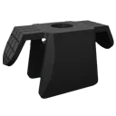{ .lu-ti width="24" loading="lazy" } [Dark Defense (LOT 15992)](../15992.md) | 0.24986111%; mean 0.0025 | Not associated with a vendor |
| 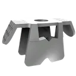{ .lu-ti width="24" loading="lazy" } [Shimmering O-Yoroi (LOT 15994)](../15994.md) | 0.24986111%; mean 0.0025 | Not associated with a vendor |
| { .lu-ti width="24" loading="lazy" } [Imaginite herbs (LOT 16035)](../16035.md) | 1.495%; mean 0.015 | Not associated with a vendor |
| { .lu-ti width="24" loading="lazy" } [Old Sushi (LOT 16037)](../16037.md) | 6.52032872%; mean 0.066176471 | Not associated with a vendor |
| { .lu-ti width="24" loading="lazy" } [Bancha Tea (LOT 16038)](../16038.md) | 3.71875%; mean 0.0375 | Not associated with a vendor |
| { .lu-ti width="24" loading="lazy" } [Cotton Repair Kit (LOT 16041)](../16041.md) | 3.71875%; mean 0.0375 | Not associated with a vendor |
| { .lu-ti width="24" loading="lazy" } [Exploding Ninjago Kunai (LOT 16059)](../16059.md) | 5.89288765%; mean 0.06 | Not associated with a vendor |
| { .lu-ti width="24" loading="lazy" } [Jay's First Gi (LOT 16063)](../16063.md) | 1.495%; mean 0.015 | Not associated with a vendor |
| { .lu-ti width="24" loading="lazy" } [Faded Gi (LOT 16066)](../16066.md) | 1.495%; mean 0.015 | Not associated with a vendor |
| { .lu-ti width="24" loading="lazy" } [Midori Gi (LOT 16068)](../16068.md) | 0.99777778%; mean 0.01 | Not associated with a vendor |
| { .lu-ti width="24" loading="lazy" } [Worn Gi (LOT 16070)](../16070.md) | 1.495%; mean 0.015 | Not associated with a vendor |
| { .lu-ti width="24" loading="lazy" } [Faded Kosode (LOT 16082)](../16082.md) | 1.495%; mean 0.015 | Not associated with a vendor |
| { .lu-ti width="24" loading="lazy" } [Dark Kosode (LOT 16083)](../16083.md) | 1.495%; mean 0.015 | Not associated with a vendor |
| 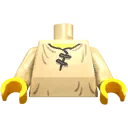{ .lu-ti width="24" loading="lazy" } [Common Kosode (LOT 16084)](../16084.md) | 49.21875%; mean 0.5625 | Not associated with a vendor |
| { .lu-ti width="24" loading="lazy" } [Sakura's Festival Kimono (LOT 16085)](../16085.md) | 0.24986111%; mean 0.0025 | Not associated with a vendor |
| { .lu-ti width="24" loading="lazy" } [Classy Kimono (LOT 16087)](../16087.md) | 0.99777778%; mean 0.01 | Not associated with a vendor |
| 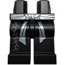{ .lu-ti width="24" loading="lazy" } [Cole's First Gi Pants (LOT 16096)](../16096.md) | 1.495%; mean 0.015 | Not associated with a vendor |
| { .lu-ti width="24" loading="lazy" } [Murasaki Pants (LOT 16100)](../16100.md) | 0.24986111%; mean 0.0025 | Not associated with a vendor |
| { .lu-ti width="24" loading="lazy" } [Haiiro Gi Pants (LOT 16102)](../16102.md) | 0.99777778%; mean 0.01 | Not associated with a vendor |
| { .lu-ti width="24" loading="lazy" } [Midori Gi Pants (LOT 16103)](../16103.md) | 0.24986111%; mean 0.0025 | Not associated with a vendor |
| { .lu-ti width="24" loading="lazy" } [Daidaiiro Gi Pants (LOT 16105)](../16105.md) | 0.99777778%; mean 0.01 | Not associated with a vendor |
| 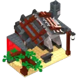{ .lu-ti width="24" loading="lazy" } [Monastery Blacksmith Model (LOT 16517)](../16517.md) | 0.68181818%; mean 0.0068181818 | Not associated with a vendor |
| 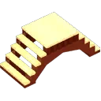{ .lu-ti width="24" loading="lazy" } [Monastery Bridge Model (LOT 16518)](../16518.md) | 1.97368421%; mean 0.019736842 | Not associated with a vendor |
| { .lu-ti width="24" loading="lazy" } [Monastery Drum Model (LOT 16519)](../16519.md) | 1.97368421%; mean 0.019736842 | Not associated with a vendor |
| { .lu-ti width="24" loading="lazy" } [Monastery Left Entrance Model (LOT 16520)](../16520.md) | 0.28571429%; mean 0.0028571429 | Not associated with a vendor |
| { .lu-ti width="24" loading="lazy" } [Monastery Right Entrance Model (LOT 16521)](../16521.md) | 0.28571429%; mean 0.0028571429 | Not associated with a vendor |
| { .lu-ti width="24" loading="lazy" } [Monastery Single Flag Model (LOT 16524)](../16524.md) | 1.97368421%; mean 0.019736842 | Not associated with a vendor |
| { .lu-ti width="24" loading="lazy" } [Monastery Large Gate Model (LOT 16525)](../16525.md) | 0.68181818%; mean 0.0068181818 | Not associated with a vendor |
| { .lu-ti width="24" loading="lazy" } [Monastery Wall with Gate Model (LOT 16526)](../16526.md) | 0.28571429%; mean 0.0028571429 | Not associated with a vendor |
| { .lu-ti width="24" loading="lazy" } [Monastery Small Gate Model (LOT 16527)](../16527.md) | 1.97368421%; mean 0.019736842 | Not associated with a vendor |
| { .lu-ti width="24" loading="lazy" } [Monastery Mountain Shrine Model (LOT 16528)](../16528.md) | 0.68181818%; mean 0.0068181818 | Not associated with a vendor |
| { .lu-ti width="24" loading="lazy" } [Monastery Railing Model (LOT 16529)](../16529.md) | 1.97368421%; mean 0.019736842 | Not associated with a vendor |
| { .lu-ti width="24" loading="lazy" } [Monastery Rock Chunk Model (LOT 16530)](../16530.md) | 1.97368421%; mean 0.019736842 | Not associated with a vendor |
| { .lu-ti width="24" loading="lazy" } [Monastery Screen Model (LOT 16531)](../16531.md) | 1.97368421%; mean 0.019736842 | Not associated with a vendor |
| 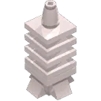{ .lu-ti width="24" loading="lazy" } [Monastery Shrine Model (LOT 16532)](../16532.md) | 1.97368421%; mean 0.019736842 | Not associated with a vendor |
| 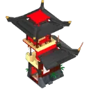{ .lu-ti width="24" loading="lazy" } [Monastery Tower Model (LOT 16533)](../16533.md) | 0.2%; mean 0.002 | Not associated with a vendor |
| { .lu-ti width="24" loading="lazy" } [Monastery Thin Wall Model 1 (LOT 16534)](../16534.md) | 1.97368421%; mean 0.019736842 | Not associated with a vendor |
| { .lu-ti width="24" loading="lazy" } [Monastery Thin Wall Model 2 (LOT 16535)](../16535.md) | 1.97368421%; mean 0.019736842 | Not associated with a vendor |
| { .lu-ti width="24" loading="lazy" } [Monastery Thin Wall Corner Model (LOT 16536)](../16536.md) | 1.97368421%; mean 0.019736842 | Not associated with a vendor |
| 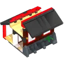{ .lu-ti width="24" loading="lazy" } [Monastery Wall Model 1 (LOT 16537)](../16537.md) | 0.28571429%; mean 0.0028571429 | Not associated with a vendor |
| { .lu-ti width="24" loading="lazy" } [Monastery Wall Model 2 (LOT 16538)](../16538.md) | 0.68181818%; mean 0.0068181818 | Not associated with a vendor |
| { .lu-ti width="24" loading="lazy" } [Monastery Wall Model 3 (LOT 16539)](../16539.md) | 0.68181818%; mean 0.0068181818 | Not associated with a vendor |
| { .lu-ti width="24" loading="lazy" } [Monastery Wall Model 4 (LOT 16540)](../16540.md) | 0.68181818%; mean 0.0068181818 | Not associated with a vendor |
| { .lu-ti width="24" loading="lazy" } [Monastery Wall Model 5 (LOT 16541)](../16541.md) | 1.97368421%; mean 0.019736842 | Not associated with a vendor |
| { .lu-ti width="24" loading="lazy" } [Monastery Inside Wall Corner Model (LOT 16542)](../16542.md) | 0.28571429%; mean 0.0028571429 | Not associated with a vendor |
| { .lu-ti width="24" loading="lazy" } [Monastery Outside Wall Corner Model 1 (LOT 16543)](../16543.md) | 0.28571429%; mean 0.0028571429 | Not associated with a vendor |
| 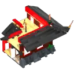{ .lu-ti width="24" loading="lazy" } [Monastery Outside Wall Corner Model 2 (LOT 16544)](../16544.md) | 0.2%; mean 0.002 | Not associated with a vendor |
| { .lu-ti width="24" loading="lazy" } [Monastery Wall with Stairs Model (LOT 16545)](../16545.md) | 0.28571429%; mean 0.0028571429 | Not associated with a vendor |
| { .lu-ti width="24" loading="lazy" } [Monastery Water Tower Model (LOT 16546)](../16546.md) | 1.97368421%; mean 0.019736842 | Not associated with a vendor |
| { .lu-ti width="24" loading="lazy" } [Skeleton Outpost Flag Model (LOT 16565)](../16565.md) | 1.97368421%; mean 0.019736842 | Not associated with a vendor |
| 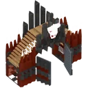{ .lu-ti width="24" loading="lazy" } [Skeleton Outpost Large Gate Model (LOT 16566)](../16566.md) | 0.2%; mean 0.002 | Not associated with a vendor |
| { .lu-ti width="24" loading="lazy" } [Skeleton Outpost Small Gate Model (LOT 16567)](../16567.md) | 0.28571429%; mean 0.0028571429 | Not associated with a vendor |
| 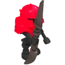{ .lu-ti width="24" loading="lazy" } [Skeleton Outpost Guard Model (LOT 16568)](../16568.md) | 1.97368421%; mean 0.019736842 | Not associated with a vendor |
| 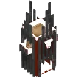{ .lu-ti width="24" loading="lazy" } [Skeleton Outpost Keep Model (LOT 16569)](../16569.md) | 0.2%; mean 0.002 | Not associated with a vendor |
| { .lu-ti width="24" loading="lazy" } [Skeleton Outpost Patroller Model (LOT 16570)](../16570.md) | 1.97368421%; mean 0.019736842 | Not associated with a vendor |
| { .lu-ti width="24" loading="lazy" } [Skeleton Outpost Spire Model (LOT 16571)](../16571.md) | 0.28571429%; mean 0.0028571429 | Not associated with a vendor |
| { .lu-ti width="24" loading="lazy" } [Skeleton Outpost Stable Model (LOT 16572)](../16572.md) | 1.97368421%; mean 0.019736842 | Not associated with a vendor |
| { .lu-ti width="24" loading="lazy" } [Skeleton Outpost Tower Model (LOT 16573)](../16573.md) | 0.68181818%; mean 0.0068181818 | Not associated with a vendor |
| 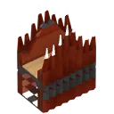{ .lu-ti width="24" loading="lazy" } [Skeleton Outpost Wall Model (LOT 16574)](../16574.md) | 0.28571429%; mean 0.0028571429 | Not associated with a vendor |
| 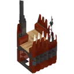{ .lu-ti width="24" loading="lazy" } [Skeleton Outpost Corner 1 Model (LOT 16575)](../16575.md) | 0.28571429%; mean 0.0028571429 | Not associated with a vendor |
| { .lu-ti width="24" loading="lazy" } [Skeleton Outpost Corner 2 Model (LOT 16576)](../16576.md) | 0.2%; mean 0.002 | Not associated with a vendor |
| { .lu-ti width="24" loading="lazy" } [Skeleton Outpost Short Wall 1 Model (LOT 16577)](../16577.md) | 1.97368421%; mean 0.019736842 | Not associated with a vendor |
| 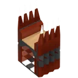{ .lu-ti width="24" loading="lazy" } [Skeleton Outpost Short Wall 2 Model (LOT 16578)](../16578.md) | 0.68181818%; mean 0.0068181818 | Not associated with a vendor |
| 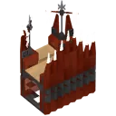{ .lu-ti width="24" loading="lazy" } [Skeleton Outpost T-Wall Model (LOT 16579)](../16579.md) | 0.28571429%; mean 0.0028571429 | Not associated with a vendor |
| 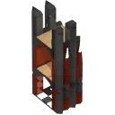{ .lu-ti width="24" loading="lazy" } [Skeleton Outpost Tall Wall Model (LOT 16580)](../16580.md) | 0.68181818%; mean 0.0068181818 | Not associated with a vendor |
| 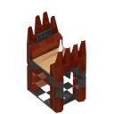{ .lu-ti width="24" loading="lazy" } [Skeleton Outpost Wall Arch Model (LOT 16581)](../16581.md) | 0.68181818%; mean 0.0068181818 | Not associated with a vendor |
| 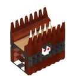{ .lu-ti width="24" loading="lazy" } [Skeleton Outpost Wall with Skull Model (LOT 16582)](../16582.md) | 0.28571429%; mean 0.0028571429 | Not associated with a vendor |
| { .lu-ti width="24" loading="lazy" } [Skeleton Outpost Wall with Stairs 1 Model (LOT 16583)](../16583.md) | 0.68181818%; mean 0.0068181818 | Not associated with a vendor |
| 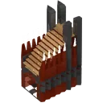{ .lu-ti width="24" loading="lazy" } [Skeleton Outpost Wall with Stairs 2 Model (LOT 16584)](../16584.md) | 0.28571429%; mean 0.0028571429 | Not associated with a vendor |
| { .lu-ti width="24" loading="lazy" } [Skeleton Outpost Weapon Rack Model (LOT 16585)](../16585.md) | 1.97368421%; mean 0.019736842 | Not associated with a vendor |

## Raw matrix entries

| Row | Loot table | Rarity table | Trigger | Min | Max | Flag | Gate |
| --- | --- | --- | --- | --- | --- | --- | --- |
| 5044 | 866 | 4 | 1 | 1 | 2 |  | njhub |
| 5093 | 846 | 4 | 1 | 1 | 2 |  | njhub |
| 5094 | 847 | 4 | 0.5 | 1 | 1 |  | njhub |

[LootMatrix](../../../db/LootMatrix.md), [LootTable](../../../db/LootTable.md), [RarityTable](../../../db/RarityTable.md).
