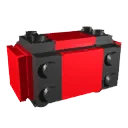

# AM - Unexploded Bomb — source LOT 12189

<!-- media:start (generated by scripts/build_media.py) -->
{ .lu-icon .lu-on-light width="128" loading="lazy" }
<!-- media:end -->

[Item database](../README.md) | [Methodology](../Methodology.md)

| Source use | Definition | Condition |
| --- | --- | --- |
| Drop | [Matrix 352](matrix-352.md) | DestructibleComponent 1669; static component precedence |

## Mapped placements and spawner waypoints

These are static candidates, not a statement that every instance is currently spawned or reachable. Coordinates are map XYZ. Inactive spawners and feature gates are retained explicitly. Client-only objects are excluded. Scene/spawner records can overlap and are not an enemy-population count.

| Zone | X | Y | Z | Scene / path | Conditions / stock override |
| --- | --- | --- | --- | --- | --- |
| [Crux Prime (1800)](../locations/zone-1800.md) | 607.374 | 95.035 | 208.464 | Spawner path: Imagination&#95;Missles | Scene missionID: 1275 |
| [Crux Prime (1800)](../locations/zone-1800.md) | 523.754 | 76.088 | 74.539 | Spawner path: Imagination&#95;Missles | Scene missionID: 1275 |
| [Crux Prime (1800)](../locations/zone-1800.md) | 486.247 | 78.685 | 23.938 | Spawner path: Imagination&#95;Missles | Scene missionID: 1275 |
| [Crux Prime (1800)](../locations/zone-1800.md) | 453.019 | 76.957 | -55.473 | Spawner path: Imagination&#95;Missles | Scene missionID: 1275 |
| [Crux Prime (1800)](../locations/zone-1800.md) | 409.48 | 75.869 | -95.422 | Spawner path: Imagination&#95;Missles | Scene missionID: 1275 |
| [Crux Prime (1800)](../locations/zone-1800.md) | 231.11 | 72.824 | -113.886 | Spawner path: Imagination&#95;Missles | Scene missionID: 1275 |
| [Crux Prime (1800)](../locations/zone-1800.md) | 234.039 | 79.943 | -25.737 | Spawner path: Imagination&#95;Missles | Scene missionID: 1275 |
| [Crux Prime (1800)](../locations/zone-1800.md) | 284.045 | 82.478 | 81.796 | Spawner path: Imagination&#95;Missles | Scene missionID: 1275 |
| [Crux Prime (1800)](../locations/zone-1800.md) | 309.252 | 67.424 | -198.393 | Spawner path: Imagination&#95;Missles | Scene missionID: 1275 |
| [Crux Prime (1800)](../locations/zone-1800.md) | 372.462 | 82.098 | 11.189 | Spawner path: Imagination&#95;Missles | Scene missionID: 1275 |
| [Crux Prime (1800)](../locations/zone-1800.md) | 348.217 | 88.501 | 173.207 | Spawner path: Imagination&#95;Missles | Scene missionID: 1275 |
| [Crux Prime (1800)](../locations/zone-1800.md) | 243.515 | 89.483 | 140.243 | Spawner path: Imagination&#95;Missles | Scene missionID: 1275 |
| [Crux Prime (1800)](../locations/zone-1800.md) | 467.821 | 92.622 | 216.34 | Spawner path: Imagination&#95;Missles | Scene missionID: 1275 |
