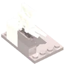

# Venture Explorer Foot Race Console — source LOT 12347

<!-- media:start (generated by scripts/build_media.py) -->
{ .lu-icon width="128" loading="lazy" }
<!-- media:end -->

[Item database](../README.md) | [Methodology](../Methodology.md)

| Source use | Definition | Condition |
| --- | --- | --- |
| Activity | [Matrix 598](matrix-598.md) | VE Instance Foot Race (activity ID 108, rating threshold -1, reward 169); Selected only if this is the highest eligible rating threshold; instance zone not specified. |

## Mapped placements and spawner waypoints

These are static candidates, not a statement that every instance is currently spawned or reachable. Coordinates are map XYZ. Inactive spawners and feature gates are retained explicitly. Client-only objects are excluded. Scene/spawner records can overlap and are not an enemy-population count.

No placement was found in the successfully parsed maps that matched a ZoneTable asset path. The source may be scripted, instanced, missing, or unused.
