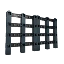

# GF - Smash Wall — source LOT 6946

<!-- media:start (generated by scripts/build_media.py) -->
{ .lu-icon .lu-on-light width="128" loading="lazy" }
<!-- media:end -->

[Item database](../README.md) | [Methodology](../Methodology.md)

| Source use | Definition | Condition |
| --- | --- | --- |
| Drop | [Matrix 227](matrix-227.md) | DestructibleComponent 655; static component precedence |

## Mapped placements and spawner waypoints

These are static candidates, not a statement that every instance is currently spawned or reachable. Coordinates are map XYZ. Inactive spawners and feature gates are retained explicitly. Client-only objects are excluded. Scene/spawner records can overlap and are not an enemy-population count.

| Zone | X | Y | Z | Scene / path | Conditions / stock override |
| --- | --- | --- | --- | --- | --- |
| [Gnarled Forest Deep Dive Map (375)](../locations/zone-375.md) | 173.539 | 286.009 | 143.77 | Spawner path: JailQBWall | No additional condition recorded |
| [Gnarled Forest (1300)](../locations/zone-1300.md) | 173.539 | 286.009 | 143.77 | Spawner path: JailQBWall | No additional condition recorded |
