# Brick — page 1/10

[Item database](../README.md)

Pages: [1](type-1-1.md) | [2](type-1-2.md) | [3](type-1-3.md) | [4](type-1-4.md) | [5](type-1-5.md) | [6](type-1-6.md) | [7](type-1-7.md) | [8](type-1-8.md) | [9](type-1-9.md) | [10](type-1-10.md)

| LOT | Item | Rarity | Description | Source evidence |
| --- | --- | --- | --- | --- |
| 14314 | [Unnamed LOT 14314 (LOT 14314)](../14314.md) | 1 | No client description | 0 matrices; 0 rewards; 0 community references |
| 16418 | [Unnamed LOT 16418 (LOT 16418)](../16418.md) | 1 | No client description | 0 matrices; 0 rewards; 0 community references |
| 16437 | [Unnamed LOT 16437 (LOT 16437)](../16437.md) | 1 | No client description | 0 matrices; 0 rewards; 0 community references |
| 9019 | { .lu-ti width="24" loading="lazy" } [1/2 Ball 3M (LOT 9019)](../9019.md) | 1 | No client description | 14 matrices; 0 rewards; 0 community references |
| 1254 | 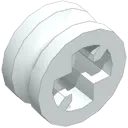{ .lu-ti width="24" loading="lazy" } [1/2 Bush (LOT 1254)](../1254.md) | 1 | No client description | 34 matrices; 0 rewards; 0 community references |
| 8939 | { .lu-ti width="24" loading="lazy" } [1/4-Dish 10x10 Inverted (LOT 8939)](../8939.md) | 1 | No client description | 37 matrices; 0 rewards; 0 community references |
| 8948 | 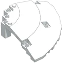{ .lu-ti width="24" loading="lazy" } [1/4-Dish 10x10 Top (LOT 8948)](../8948.md) | 1 | No client description | 37 matrices; 0 rewards; 0 community references |
| 8791 | 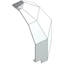{ .lu-ti width="24" loading="lazy" } [1/4-Dome 10x10x12 (LOT 8791)](../8791.md) | 1 | No client description | 7 matrices; 0 rewards; 0 community references |
| 8796 | 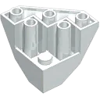{ .lu-ti width="24" loading="lazy" } [1/4-Dome Brick 3x3x2 Inverted (LOT 8796)](../8796.md) | 1 | No client description | 7 matrices; 0 rewards; 0 community references |
| 8795 | 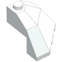{ .lu-ti width="24" loading="lazy" } [1/4-Dome Brick 3x3x2 Top (LOT 8795)](../8795.md) | 1 | No client description | 7 matrices; 0 rewards; 0 community references |
| 5187 | 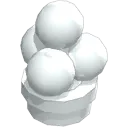{ .lu-ti width="24" loading="lazy" } [1x1 Round with Ice Cream (LOT 5187)](../5187.md) | 1 | No client description | 14 matrices; 0 rewards; 0 community references |
| 637 | 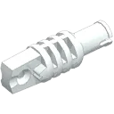{ .lu-ti width="24" loading="lazy" } [1x3 with Pin and Vertical Stub (LOT 637)](../637.md) | 1 | No client description | 34 matrices; 0 rewards; 0 community references |
| 601 | 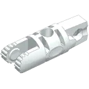{ .lu-ti width="24" loading="lazy" } [1x3 with Vertical Fork and Vertical Stub (LOT 601)](../601.md) | 1 | No client description | 19 matrices; 0 rewards; 0 community references |
| 626 | 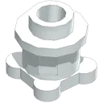{ .lu-ti width="24" loading="lazy" } [2/3 Brick 1x1 Round with Flanges (LOT 626)](../626.md) | 1 | No client description | 34 matrices; 0 rewards; 0 community references |
| 16445 | { .lu-ti width="24" loading="lazy" } [5 M. Ø3.2 Bone (LOT 16445)](../16445.md) | 1 | No client description | 21 matrices; 0 rewards; 0 community references |
| 16400 | 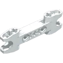{ .lu-ti width="24" loading="lazy" } [7M Double Ball Shell with Cross Hinge (LOT 16400)](../16400.md) | 1 | No client description | 34 matrices; 0 rewards; 0 community references |
| 9160 | 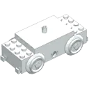{ .lu-ti width="24" loading="lazy" } [9V Train Engine (LOT 9160)](../9160.md) | 1 | No client description | 37 matrices; 0 rewards; 0 community references |
| 5040 | { .lu-ti width="24" loading="lazy" } [Admiral's Hat (LOT 5040)](../5040.md) | 1 | No client description | 21 matrices; 0 rewards; 0 community references |
| 9051 | { .lu-ti width="24" loading="lazy" } [Airplane Bottom 8x16x2 (LOT 9051)](../9051.md) | 1 | No client description | 37 matrices; 0 rewards; 0 community references |
| 5438 | { .lu-ti width="24" loading="lazy" } [Airplane Door (LOT 5438)](../5438.md) | 1 | No client description | 37 matrices; 0 rewards; 0 community references |
| 9059 | { .lu-ti width="24" loading="lazy" } [Airplane End 8x16x7 (LOT 9059)](../9059.md) | 1 | No client description | 37 matrices; 0 rewards; 0 community references |
| 9207 | { .lu-ti width="24" loading="lazy" } [Airplane Hull 6x10 Front Top with Studs (LOT 9207)](../9207.md) | 1 | No client description | 37 matrices; 0 rewards; 0 community references |
| 9055 | { .lu-ti width="24" loading="lazy" } [Airplane Hull 8x8x5 Top with Door (LOT 9055)](../9055.md) | 1 | No client description | 37 matrices; 0 rewards; 0 community references |
| 5563 | 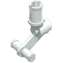{ .lu-ti width="24" loading="lazy" } [Airplane Landing Gear with Pin (LOT 5563)](../5563.md) | 1 | No client description | 34 matrices; 0 rewards; 0 community references |
| 425 | 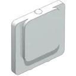{ .lu-ti width="24" loading="lazy" } [Airplane Window (LOT 425)](../425.md) | 1 | No client description | 7 matrices; 0 rewards; 0 community references |
| 800 | 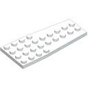{ .lu-ti width="24" loading="lazy" } [Airplane Wing 4x9 (LOT 800)](../800.md) | 1 | No client description | 25 matrices; 0 rewards; 0 community references |
| 5212 | { .lu-ti width="24" loading="lazy" } [Alien Breastplate (LOT 5212)](../5212.md) | 1 | No client description | 21 matrices; 0 rewards; 0 community references |
| 8931 | { .lu-ti width="24" loading="lazy" } [Alien Helmet (LOT 8931)](../8931.md) | 1 | No client description | 21 matrices; 0 rewards; 0 community references |
| 9179 | { .lu-ti width="24" loading="lazy" } [Alien Helmet "Snake" (LOT 9179)](../9179.md) | 1 | No client description | 21 matrices; 0 rewards; 0 community references |
| 842 | 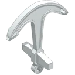{ .lu-ti width="24" loading="lazy" } [Anchor (LOT 842)](../842.md) | 1 | No client description | 2 matrices; 0 rewards; 0 community references |
| 460 | { .lu-ti width="24" loading="lazy" } [Angle Bracket 2x5x2 1/3 (LOT 460)](../460.md) | 1 | No client description | 37 matrices; 0 rewards; 0 community references |
| 413 | { .lu-ti width="24" loading="lazy" } [Angle Bracket 2x8 (LOT 413)](../413.md) | 1 | No client description | 37 matrices; 0 rewards; 0 community references |
| 811 | 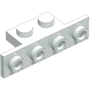{ .lu-ti width="24" loading="lazy" } [Angle Bracket Plate 1x2 / 1x4 (LOT 811)](../811.md) | 1 | No client description | 25 matrices; 0 rewards; 0 community references |
| 124 | 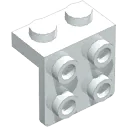{ .lu-ti width="24" loading="lazy" } [Angle Bracket Plate 1x2 / 2x2 (LOT 124)](../124.md) | 1 | No client description | 25 matrices; 0 rewards; 0 community references |
| 10256 | 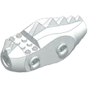{ .lu-ti width="24" loading="lazy" } [Animal Body 4x12x5  (LOT 10256)](../10256.md) | 1 | No client description | 2 matrices; 0 rewards; 0 community references |
| 9221 | 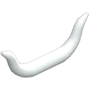{ .lu-ti width="24" loading="lazy" } [Animal Horns (LOT 9221)](../9221.md) | 1 | No client description | 21 matrices; 0 rewards; 0 community references |
| 9125 | { .lu-ti width="24" loading="lazy" } [Ant (LOT 9125)](../9125.md) | 1 | No client description | 2 matrices; 0 rewards; 0 community references |
| 348 | { .lu-ti width="24" loading="lazy" } [Antenna 4 (LOT 348)](../348.md) | 1 | No client description | 14 matrices; 0 rewards; 0 community references |
| 843 | { .lu-ti width="24" loading="lazy" } [Antenna 8 (LOT 843)](../843.md) | 1 | No client description | 37 matrices; 0 rewards; 0 community references |
| 8949 | 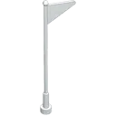{ .lu-ti width="24" loading="lazy" } [Antenna 8 with Streamer (LOT 8949)](../8949.md) | 1 | No client description | 14 matrices; 0 rewards; 0 community references |
| 5590 | { .lu-ti width="24" loading="lazy" } [Antique Key (LOT 5590)](../5590.md) | 1 | No client description | 21 matrices; 0 rewards; 0 community references |
| 16462 | { .lu-ti width="24" loading="lazy" } [Anubis Head (LOT 16462)](../16462.md) | 1 | No client description | 21 matrices; 0 rewards; 0 community references |
| 5312 | { .lu-ti width="24" loading="lazy" } [Apple with Leaf (LOT 5312)](../5312.md) | 1 | No client description | 21 matrices; 0 rewards; 0 community references |
| 16327 | 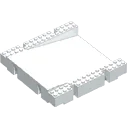{ .lu-ti width="24" loading="lazy" } [Approach 16x16x2 1/3 (LOT 16327)](../16327.md) | 1 | No client description | 7 matrices; 0 rewards; 0 community references |
| 8940 | { .lu-ti width="24" loading="lazy" } [Aqua Suit Helmet (LOT 8940)](../8940.md) | 1 | No client description | 21 matrices; 0 rewards; 0 community references |
| 478 | 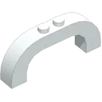{ .lu-ti width="24" loading="lazy" } [Arch 1x6x2 (LOT 478)](../478.md) | 1 | No client description | 7 matrices; 0 rewards; 0 community references |
| 464 | 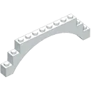{ .lu-ti width="24" loading="lazy" } [Arch Brick 1x12x3 (LOT 464)](../464.md) | 1 | No client description | 7 matrices; 0 rewards; 0 community references |
| 477 | 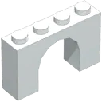{ .lu-ti width="24" loading="lazy" } [Arch Brick 1x4x2 (LOT 477)](../477.md) | 1 | No client description | 7 matrices; 0 rewards; 0 community references |
| 553 | 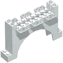{ .lu-ti width="24" loading="lazy" } [Arch with Groove 2x12x6 (LOT 553)](../553.md) | 1 | No client description | 7 matrices; 0 rewards; 0 community references |
| 10180 | { .lu-ti width="24" loading="lazy" } [Armored Dragon's Head (LOT 10180)](../10180.md) | 1 | No client description | 2 matrices; 0 rewards; 0 community references |
| 16449 | 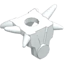{ .lu-ti width="24" loading="lazy" } [Armour with Spike (LOT 16449)](../16449.md) | 1 | No client description | 21 matrices; 0 rewards; 0 community references |
| 573 | { .lu-ti width="24" loading="lazy" } [Astromech Robot Leg (LOT 573)](../573.md) | 1 | No client description | 25 matrices; 0 rewards; 0 community references |
| 5196 | { .lu-ti width="24" loading="lazy" } [Astronaut Visor (LOT 5196)](../5196.md) | 1 | No client description | 21 matrices; 0 rewards; 0 community references |
| 9230 | 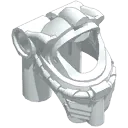{ .lu-ti width="24" loading="lazy" } [Atlantis Suit (LOT 9230)](../9230.md) | 1 | No client description | 21 matrices; 0 rewards; 0 community references |
| 8801 | { .lu-ti width="24" loading="lazy" } [Axle with Hafts (LOT 8801)](../8801.md) | 1 | No client description | 37 matrices; 0 rewards; 0 community references |
| 10248 | { .lu-ti width="24" loading="lazy" } [Baby Dino Head (LOT 10248)](../10248.md) | 1 | No client description | 2 matrices; 0 rewards; 0 community references |
| 5106 | { .lu-ti width="24" loading="lazy" } [Baker's Hat (LOT 5106)](../5106.md) | 1 | No client description | 21 matrices; 0 rewards; 0 community references |
| 5272 | { .lu-ti width="24" loading="lazy" } [Ball Coupling with Vertical Fork (LOT 5272)](../5272.md) | 1 | No client description | 37 matrices; 0 rewards; 0 community references |
| 16422 | 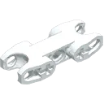{ .lu-ti width="24" loading="lazy" } [Ball Cup Double Ø10.2, 5M (LOT 16422)](../16422.md) | 1 | No client description | 34 matrices; 0 rewards; 0 community references |
| 9061 | { .lu-ti width="24" loading="lazy" } [Ball Ø16 (LOT 9061)](../9061.md) | 1 | No client description | 14 matrices; 0 rewards; 0 community references |
| 8914 | { .lu-ti width="24" loading="lazy" } [Ball Ø52mm (LOT 8914)](../8914.md) | 1 | No client description | 25 matrices; 0 rewards; 0 community references |
| 5469 | { .lu-ti width="24" loading="lazy" } [Balloon Tire Ø24 (LOT 5469)](../5469.md) | 1 | No client description | 37 matrices; 0 rewards; 0 community references |
| 5470 | { .lu-ti width="24" loading="lazy" } [Balloon Tire Ø37 (LOT 5470)](../5470.md) | 1 | No client description | 37 matrices; 0 rewards; 0 community references |
| 9107 | { .lu-ti width="24" loading="lazy" } [Balloon Tire Ø43 (LOT 9107)](../9107.md) | 1 | No client description | 37 matrices; 0 rewards; 0 community references |
| 9064 | 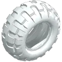{ .lu-ti width="24" loading="lazy" } [Balloon Tire Ø56 (LOT 9064)](../9064.md) | 1 | No client description | 37 matrices; 0 rewards; 0 community references |
| 382 | { .lu-ti width="24" loading="lazy" } [Balloon Tire Ø8/Ø21 (LOT 382)](../382.md) | 1 | No client description | 37 matrices; 0 rewards; 0 community references |
| 9056 | { .lu-ti width="24" loading="lazy" } [Balloon Tire Ø94.8 (LOT 9056)](../9056.md) | 1 | No client description | 37 matrices; 0 rewards; 0 community references |
| 5317 | { .lu-ti width="24" loading="lazy" } [Banana (LOT 5317)](../5317.md) | 1 | No client description | 21 matrices; 0 rewards; 0 community references |
| 687 | { .lu-ti width="24" loading="lazy" } [Banner 2x2 with Vertical Clips, Trapezoid (LOT 687)](../687.md) | 1 | No client description | 37 matrices; 0 rewards; 0 community references |
| 16343 | 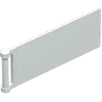{ .lu-ti width="24" loading="lazy" } [Banner with 3.18 Stick 3x8 (LOT 16343)](../16343.md) | 1 | No client description | 25 matrices; 0 rewards; 0 community references |
| 724 | { .lu-ti width="24" loading="lazy" } [Bar 1.5 with Clip (LOT 724)](../724.md) | 1 | No client description | 21 matrices; 0 rewards; 0 community references |
| 359 | 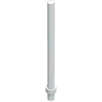{ .lu-ti width="24" loading="lazy" } [Bar 6 with Stop (LOT 359)](../359.md) | 1 | No client description | 34 matrices; 0 rewards; 0 community references |
| 5595 | 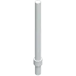{ .lu-ti width="24" loading="lazy" } [Bar 6 with Stop (LOT 5595)](../5595.md) | 1 | No client description | 34 matrices; 0 rewards; 0 community references |
| 5066 | 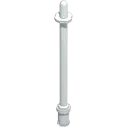{ .lu-ti width="24" loading="lazy" } [Bar 7 with Stopper and Pin on End (LOT 5066)](../5066.md) | 1 | No client description | 14 matrices; 0 rewards; 0 community references |
| 5585 | { .lu-ti width="24" loading="lazy" } [Barbed Wire (LOT 5585)](../5585.md) | 1 | No client description | 21 matrices; 0 rewards; 0 community references |
| 8787 | 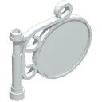{ .lu-ti width="24" loading="lazy" } [Baroque Sign (LOT 8787)](../8787.md) | 1 | No client description | 14 matrices; 0 rewards; 0 community references |
| 829 | { .lu-ti width="24" loading="lazy" } [Barrel 2x2 (LOT 829)](../829.md) | 1 | No client description | 14 matrices; 0 rewards; 0 community references |
| 8935 | { .lu-ti width="24" loading="lazy" } [Barrel 4x4 (LOT 8935)](../8935.md) | 1 | No client description | 14 matrices; 0 rewards; 0 community references |
| 5622 | { .lu-ti width="24" loading="lazy" } [BaseBall Cap (LOT 5622)](../5622.md) | 1 | No client description | 21 matrices; 0 rewards; 0 community references |
| 9042 | 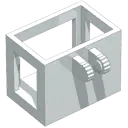{ .lu-ti width="24" loading="lazy" } [Basket 2x3x2 with Vertical Fork (LOT 9042)](../9042.md) | 1 | No client description | 19 matrices; 0 rewards; 0 community references |
| 5362 | { .lu-ti width="24" loading="lazy" } [Basketball (LOT 5362)](../5362.md) | 1 | No client description | 21 matrices; 0 rewards; 0 community references |
| 5207 | 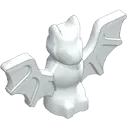{ .lu-ti width="24" loading="lazy" } [Bat (LOT 5207)](../5207.md) | 1 | No client description | 2 matrices; 0 rewards; 0 community references |
| 5209 | { .lu-ti width="24" loading="lazy" } [Bat Helmet (LOT 5209)](../5209.md) | 1 | No client description | 21 matrices; 0 rewards; 0 community references |
| 8915 | 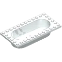{ .lu-ti width="24" loading="lazy" } [Bath Tub 6x12x2 1/3 (LOT 8915)](../8915.md) | 1 | No client description | 14 matrices; 0 rewards; 0 community references |
| 5100 | { .lu-ti width="24" loading="lazy" } [Battle Axe (LOT 5100)](../5100.md) | 1 | No client description | 21 matrices; 0 rewards; 0 community references |
| 5419 | 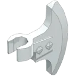{ .lu-ti width="24" loading="lazy" } [BattleAxe Head with Horizontal Clip (LOT 5419)](../5419.md) | 1 | No client description | 21 matrices; 0 rewards; 0 community references |
| 778 | { .lu-ti width="24" loading="lazy" } [Bay Window 3x8x6 (LOT 778)](../778.md) | 1 | No client description | 37 matrices; 0 rewards; 0 community references |
| 16398 | 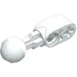{ .lu-ti width="24" loading="lazy" } [Beam 2 with Ball Ø 10.2 (LOT 16398)](../16398.md) | 1 | No client description | 34 matrices; 0 rewards; 0 community references |
| 595 | 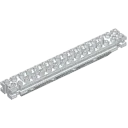{ .lu-ti width="24" loading="lazy" } [Beam 2x16x1 2/3 with Studs and Lattice (LOT 595)](../595.md) | 1 | No client description | 25 matrices; 0 rewards; 0 community references |
| 16408 | 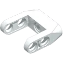{ .lu-ti width="24" loading="lazy" } [Beam 3M Ø4.85 with Fork (LOT 16408)](../16408.md) | 1 | No client description | 34 matrices; 0 rewards; 0 community references |
| 16433 | 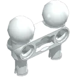{ .lu-ti width="24" loading="lazy" } [Beam 3M Snap/Ball Ø10.2 (LOT 16433)](../16433.md) | 1 | No client description | 34 matrices; 0 rewards; 0 community references |
| 16427 | 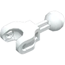{ .lu-ti width="24" loading="lazy" } [Beam A 4M Ball/Cup Ø10.2 (LOT 16427)](../16427.md) | 1 | No client description | 34 matrices; 0 rewards; 0 community references |
| 16426 | 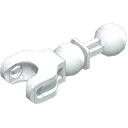{ .lu-ti width="24" loading="lazy" } [Beam A 5M Ball/Cup Ø10.2 (LOT 16426)](../16426.md) | 1 | No client description | 34 matrices; 0 rewards; 0 community references |
| 16425 | 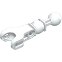{ .lu-ti width="24" loading="lazy" } [Beam A 6M Ball/Cup Ø10.2 (LOT 16425)](../16425.md) | 1 | No client description | 34 matrices; 0 rewards; 0 community references |
| 16424 | 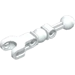{ .lu-ti width="24" loading="lazy" } [Beam A 7M Ball/Cup Ø10.2 (LOT 16424)](../16424.md) | 1 | No client description | 34 matrices; 0 rewards; 0 community references |
| 16429 | 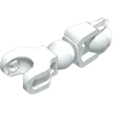{ .lu-ti width="24" loading="lazy" } [Beam B 5M Ball/Cup Ø10.2 (LOT 16429)](../16429.md) | 1 | No client description | 34 matrices; 0 rewards; 0 community references |
| 16428 | 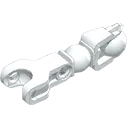{ .lu-ti width="24" loading="lazy" } [Beam B 6M Ball/Cup Ø10.2 (LOT 16428)](../16428.md) | 1 | No client description | 34 matrices; 0 rewards; 0 community references |
| 16430 | 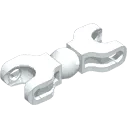{ .lu-ti width="24" loading="lazy" } [Beam C 5M Cup/Cup Ø10.2 (LOT 16430)](../16430.md) | 1 | No client description | 34 matrices; 0 rewards; 0 community references |
| 16397 | 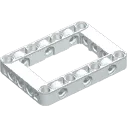{ .lu-ti width="24" loading="lazy" } [Beam Frame 5x7 Ø 4.85 (LOT 16397)](../16397.md) | 1 | No client description | 34 matrices; 0 rewards; 0 community references |
| 16396 | { .lu-ti width="24" loading="lazy" } [Beam R. Frame 5x11 Ø4.85 (LOT 16396)](../16396.md) | 1 | No client description | 34 matrices; 0 rewards; 0 community references |
| 16432 | { .lu-ti width="24" loading="lazy" } [Beam Torso 7x9 Ball Ø10.2 (LOT 16432)](../16432.md) | 1 | No client description | 34 matrices; 0 rewards; 0 community references |
| 16431 | { .lu-ti width="24" loading="lazy" } [Beam Torso 9x9 Ball Ø10.2 (LOT 16431)](../16431.md) | 1 | No client description | 34 matrices; 0 rewards; 0 community references |
| 8819 | { .lu-ti width="24" loading="lazy" } [Belt for Technic Wedge-Belt Wheel  (LOT 8819)](../8819.md) | 1 | No client description | 34 matrices; 0 rewards; 0 community references |
| 9220 | { .lu-ti width="24" loading="lazy" } [Big Feather for Helmet (LOT 9220)](../9220.md) | 1 | No client description | 21 matrices; 0 rewards; 0 community references |
| 5264 | { .lu-ti width="24" loading="lazy" } [Binoculars, High-tech (LOT 5264)](../5264.md) | 1 | No client description | 21 matrices; 0 rewards; 0 community references |
| 1224 | { .lu-ti width="24" loading="lazy" } [Binoculars, Round (LOT 1224)](../1224.md) | 1 | No client description | 21 matrices; 0 rewards; 0 community references |
| 8978 | { .lu-ti width="24" loading="lazy" } [BIONICLE Arm (LOT 8978)](../8978.md) | 1 | No client description | 34 matrices; 0 rewards; 0 community references |
| 9047 | { .lu-ti width="24" loading="lazy" } [BIONICLE Ball magazine (LOT 9047)](../9047.md) | 1 | No client description | 34 matrices; 0 rewards; 0 community references |
| 5476 | { .lu-ti width="24" loading="lazy" } [BIONICLE Blade (LOT 5476)](../5476.md) | 1 | No client description | 2 matrices; 0 rewards; 0 community references |
| 9075 | { .lu-ti width="24" loading="lazy" } [BIONICLE Blade (LOT 9075)](../9075.md) | 1 | No client description | 2 matrices; 0 rewards; 0 community references |
| 9112 | { .lu-ti width="24" loading="lazy" } [BIONICLE Blade (LOT 9112)](../9112.md) | 1 | No client description | 2 matrices; 0 rewards; 0 community references |
| 9077 | { .lu-ti width="24" loading="lazy" } [BIONICLE Blades (LOT 9077)](../9077.md) | 1 | No client description | 2 matrices; 0 rewards; 0 community references |
| 10265 | { .lu-ti width="24" loading="lazy" } [BIONICLE Claw (LOT 10265)](../10265.md) | 1 | No client description | 2 matrices; 0 rewards; 0 community references |
| 5405 | { .lu-ti width="24" loading="lazy" } [BIONICLE Claw 4x12 (LOT 5405)](../5405.md) | 1 | No client description | 34 matrices; 0 rewards; 0 community references |
| 5352 | { .lu-ti width="24" loading="lazy" } [BIONICLE Eye (LOT 5352)](../5352.md) | 1 | No client description | 34 matrices; 0 rewards; 0 community references |
| 8986 | { .lu-ti width="24" loading="lazy" } [BIONICLE Flame (LOT 8986)](../8986.md) | 1 | No client description | 14 matrices; 0 rewards; 0 community references |
| 8977 | { .lu-ti width="24" loading="lazy" } [BIONICLE Foot (LOT 8977)](../8977.md) | 1 | No client description | 34 matrices; 0 rewards; 0 community references |
| 8975 | { .lu-ti width="24" loading="lazy" } [BIONICLE Head (LOT 8975)](../8975.md) | 1 | No client description | 34 matrices; 0 rewards; 0 community references |
| 9058 | { .lu-ti width="24" loading="lazy" } [BIONICLE Shooter (LOT 9058)](../9058.md) | 1 | No client description | 34 matrices; 0 rewards; 0 community references |
| 5456 | { .lu-ti width="24" loading="lazy" } [BIONICLE Tool 1/12 (LOT 5456)](../5456.md) | 1 | No client description | 2 matrices; 0 rewards; 0 community references |
| 5465 | { .lu-ti width="24" loading="lazy" } [BIONICLE Tool 10/12 (LOT 5465)](../5465.md) | 1 | No client description | 2 matrices; 0 rewards; 0 community references |
| 5466 | { .lu-ti width="24" loading="lazy" } [BIONICLE Tool 11/12 (LOT 5466)](../5466.md) | 1 | No client description | 2 matrices; 0 rewards; 0 community references |
| 5467 | { .lu-ti width="24" loading="lazy" } [BIONICLE Tool 12/12 (LOT 5467)](../5467.md) | 1 | No client description | 2 matrices; 0 rewards; 0 community references |
| 5457 | { .lu-ti width="24" loading="lazy" } [BIONICLE Tool 2/12 (LOT 5457)](../5457.md) | 1 | No client description | 2 matrices; 0 rewards; 0 community references |
| 5458 | { .lu-ti width="24" loading="lazy" } [BIONICLE Tool 3/12 (LOT 5458)](../5458.md) | 1 | No client description | 2 matrices; 0 rewards; 0 community references |
| 5459 | { .lu-ti width="24" loading="lazy" } [BIONICLE Tool 4/12 (LOT 5459)](../5459.md) | 1 | No client description | 2 matrices; 0 rewards; 0 community references |
| 5460 | { .lu-ti width="24" loading="lazy" } [BIONICLE Tool 5/12 (LOT 5460)](../5460.md) | 1 | No client description | 2 matrices; 0 rewards; 0 community references |
| 5461 | { .lu-ti width="24" loading="lazy" } [BIONICLE Tool 6/12 (LOT 5461)](../5461.md) | 1 | No client description | 2 matrices; 0 rewards; 0 community references |
| 5462 | { .lu-ti width="24" loading="lazy" } [BIONICLE Tool 7/12 (LOT 5462)](../5462.md) | 1 | No client description | 2 matrices; 0 rewards; 0 community references |
| 5463 | { .lu-ti width="24" loading="lazy" } [BIONICLE Tool 8/12 (LOT 5463)](../5463.md) | 1 | No client description | 2 matrices; 0 rewards; 0 community references |
| 5464 | { .lu-ti width="24" loading="lazy" } [BIONICLE Tool 9/12 (LOT 5464)](../5464.md) | 1 | No client description | 2 matrices; 0 rewards; 0 community references |
| 5410 | { .lu-ti width="24" loading="lazy" } [BIONICLE Tool with 2 Pins No. 1 (LOT 5410)](../5410.md) | 1 | No client description | 1 matrices; 0 rewards; 0 community references |
| 5411 | { .lu-ti width="24" loading="lazy" } [BIONICLE Tool with 2 Pins No. 2 (LOT 5411)](../5411.md) | 1 | No client description | 1 matrices; 0 rewards; 0 community references |
| 5412 | { .lu-ti width="24" loading="lazy" } [BIONICLE Tool with 2 Pins No. 3 (LOT 5412)](../5412.md) | 1 | No client description | 1 matrices; 0 rewards; 0 community references |
| 5413 | { .lu-ti width="24" loading="lazy" } [BIONICLE Tool with 2 Pins No. 4 (LOT 5413)](../5413.md) | 1 | No client description | 1 matrices; 0 rewards; 0 community references |
| 5414 | { .lu-ti width="24" loading="lazy" } [BIONICLE Tool with 2 Pins No. 5 (LOT 5414)](../5414.md) | 1 | No client description | 1 matrices; 0 rewards; 0 community references |
| 5415 | { .lu-ti width="24" loading="lazy" } [BIONICLE Tool with 2 Pins No. 6 (LOT 5415)](../5415.md) | 1 | No client description | 1 matrices; 0 rewards; 0 community references |
| 9008 | { .lu-ti width="24" loading="lazy" } [BIONICLE Tooth (LOT 9008)](../9008.md) | 1 | No client description | 34 matrices; 0 rewards; 0 community references |
| 9085 | { .lu-ti width="24" loading="lazy" } [BIONICLE Toothed Wheel (LOT 9085)](../9085.md) | 1 | No client description | 34 matrices; 0 rewards; 0 community references |
| 5335 | { .lu-ti width="24" loading="lazy" } [BIONICLE Trident (LOT 5335)](../5335.md) | 1 | No client description | 1 matrices; 0 rewards; 0 community references |
| 9049 | { .lu-ti width="24" loading="lazy" } [BIONICLE Turbine Wheel (LOT 9049)](../9049.md) | 1 | No client description | 34 matrices; 0 rewards; 0 community references |
| 5420 | { .lu-ti width="24" loading="lazy" } [BIONICLE Wolf's Head (LOT 5420)](../5420.md) | 1 | No client description | 2 matrices; 0 rewards; 0 community references |
| 9175 | { .lu-ti width="24" loading="lazy" } [Birdcage (LOT 9175)](../9175.md) | 1 | No client description | 14 matrices; 0 rewards; 0 community references |
| 9153 | { .lu-ti width="24" loading="lazy" } [Blade with Haft (LOT 9153)](../9153.md) | 1 | No client description | 21 matrices; 0 rewards; 0 community references |
| 430 | { .lu-ti width="24" loading="lazy" } [Blades for Jet Turbine (LOT 430)](../430.md) | 1 | No client description | 37 matrices; 0 rewards; 0 community references |
| 734 | { .lu-ti width="24" loading="lazy" } [BMX Bike Fairing (LOT 734)](../734.md) | 1 | No client description | 37 matrices; 0 rewards; 0 community references |
| 9029 | { .lu-ti width="24" loading="lazy" } [Boat Bow 12x10 (LOT 9029)](../9029.md) | 1 | No client description | 37 matrices; 0 rewards; 0 community references |
| 8814 | { .lu-ti width="24" loading="lazy" } [Boat Bow 6x6 Bottom (LOT 8814)](../8814.md) | 1 | No client description | 37 matrices; 0 rewards; 0 community references |
| 9030 | { .lu-ti width="24" loading="lazy" } [Boat Bow Plate 12x8 (LOT 9030)](../9030.md) | 1 | No client description | 37 matrices; 0 rewards; 0 community references |
| 727 | { .lu-ti width="24" loading="lazy" } [Boat Bow Plate 6x7 (LOT 727)](../727.md) | 1 | No client description | 37 matrices; 0 rewards; 0 community references |
| 8805 | { .lu-ti width="24" loading="lazy" } [Boat Bowsprit (LOT 8805)](../8805.md) | 1 | No client description | 14 matrices; 0 rewards; 0 community references |
| 715 | { .lu-ti width="24" loading="lazy" } [Boat Mast 2x2x20 (LOT 715)](../715.md) | 1 | No client description | 37 matrices; 0 rewards; 0 community references |
| 5115 | { .lu-ti width="24" loading="lazy" } [Boat Mast 2x2x3 (LOT 5115)](../5115.md) | 1 | No client description | 37 matrices; 0 rewards; 0 community references |
| 8804 | { .lu-ti width="24" loading="lazy" } [Boat Mast Extension (LOT 8804)](../8804.md) | 1 | No client description | 14 matrices; 0 rewards; 0 community references |
| 836 | { .lu-ti width="24" loading="lazy" } [Boat Mast Platform Octagonal with Horizontal Clips (LOT 836)](../836.md) | 1 | No client description | 19 matrices; 0 rewards; 0 community references |
| 8870 | { .lu-ti width="24" loading="lazy" } [Bobbed Hair (LOT 8870)](../8870.md) | 1 | No client description | 21 matrices; 0 rewards; 0 community references |
| 5286 | { .lu-ti width="24" loading="lazy" } [Bobbin (LOT 5286)](../5286.md) | 1 | No client description | 37 matrices; 0 rewards; 0 community references |
| 10246 | { .lu-ti width="24" loading="lazy" } [Body 5x2x4 with Pins, Right (LOT 10246)](../10246.md) | 1 | No client description | 2 matrices; 0 rewards; 0 community references |
| 10245 | { .lu-ti width="24" loading="lazy" } [Body 5x2x4, Left (LOT 10245)](../10245.md) | 1 | No client description | 2 matrices; 0 rewards; 0 community references |
| 702 | { .lu-ti width="24" loading="lazy" } [Bonnet 1x2x2/3 Curved with Flap (LOT 702)](../702.md) | 1 | No client description | 25 matrices; 0 rewards; 0 community references |
| 656 | { .lu-ti width="24" loading="lazy" } [Bonnet 2x2 (LOT 656)](../656.md) | 1 | No client description | 37 matrices; 0 rewards; 0 community references |
| 606 | { .lu-ti width="24" loading="lazy" } [Bonnet 2x2 Curved (LOT 606)](../606.md) | 1 | No client description | 37 matrices; 0 rewards; 0 community references |
| 607 | { .lu-ti width="24" loading="lazy" } [Bonnet 2x2 Motor (LOT 607)](../607.md) | 1 | No client description | 37 matrices; 0 rewards; 0 community references |
| 701 | { .lu-ti width="24" loading="lazy" } [Bonnet 2x2x2/3 Curved with 2 Studs (LOT 701)](../701.md) | 1 | No client description | 25 matrices; 0 rewards; 0 community references |
| 700 | { .lu-ti width="24" loading="lazy" } [Bonnet 2x3x2/3 Curved with Flap and 2 Studs (LOT 700)](../700.md) | 1 | No client description | 25 matrices; 0 rewards; 0 community references |
| 9040 | { .lu-ti width="24" loading="lazy" } [Bonnet 3x4x2/3 Curved with Cut-Out (LOT 9040)](../9040.md) | 1 | No client description | 37 matrices; 0 rewards; 0 community references |
| 9109 | { .lu-ti width="24" loading="lazy" } [Bonnet 6x5x2 Curved (LOT 9109)](../9109.md) | 1 | No client description | 37 matrices; 0 rewards; 0 community references |
| 5311 | { .lu-ti width="24" loading="lazy" } [Book (LOT 5311)](../5311.md) | 1 | No client description | 21 matrices; 0 rewards; 0 community references |
| 5135 | { .lu-ti width="24" loading="lazy" } [Bow (LOT 5135)](../5135.md) | 1 | No client description | 21 matrices; 0 rewards; 0 community references |
| 82 | { .lu-ti width="24" loading="lazy" } [Bow 1x1x1 1/3 (LOT 82)](../82.md) | 1 | No client description | 7 matrices; 0 rewards; 0 community references |
| 77 | { .lu-ti width="24" loading="lazy" } [Bow 1x3x2 (LOT 77)](../77.md) | 1 | No client description | 7 matrices; 0 rewards; 0 community references |
| 449 | { .lu-ti width="24" loading="lazy" } [Bow 1x6x 3 1/3 (LOT 449)](../449.md) | 1 | No client description | 7 matrices; 0 rewards; 0 community references |
| 9205 | { .lu-ti width="24" loading="lazy" } [Bow 6x10x1 Bottom (LOT 9205)](../9205.md) | 1 | No client description | 37 matrices; 0 rewards; 0 community references |
| 9208 | { .lu-ti width="24" loading="lazy" } [Bow 6x10x4 Base (LOT 9208)](../9208.md) | 1 | No client description | 37 matrices; 0 rewards; 0 community references |
| 8991 | { .lu-ti width="24" loading="lazy" } [Bow Brick 1x3x2 (LOT 8991)](../8991.md) | 1 | No client description | 7 matrices; 0 rewards; 0 community references |
| 8812 | { .lu-ti width="24" loading="lazy" } [Bow Plate 9x10 (LOT 8812)](../8812.md) | 1 | No client description | 37 matrices; 0 rewards; 0 community references |
| 16345 | { .lu-ti width="24" loading="lazy" } [Bowed Cockpit 6x8x3 (LOT 16345)](../16345.md) | 1 | No client description | 37 matrices; 0 rewards; 0 community references |
| 8922 | { .lu-ti width="24" loading="lazy" } [Bowsprit 11 2/3 M (LOT 8922)](../8922.md) | 1 | No client description | 37 matrices; 0 rewards; 0 community references |
| 5571 | { .lu-ti width="24" loading="lazy" } [Box 2x2x2 (LOT 5571)](../5571.md) | 1 | No client description | 14 matrices; 0 rewards; 0 community references |
| 383 | { .lu-ti width="24" loading="lazy" } [Box 2x2x2 with Hinge (LOT 383)](../383.md) | 1 | No client description | 14 matrices; 0 rewards; 0 community references |
| 534 | { .lu-ti width="24" loading="lazy" } [Box 3x4 (LOT 534)](../534.md) | 1 | No client description | 14 matrices; 0 rewards; 0 community references |
| 5332 | { .lu-ti width="24" loading="lazy" } [Boy's Hair (LOT 5332)](../5332.md) | 1 | No client description | 21 matrices; 0 rewards; 0 community references |
| 5401 | { .lu-ti width="24" loading="lazy" } [Bracket 1x1 with Pin (LOT 5401)](../5401.md) | 1 | No client description | 21 matrices; 0 rewards; 0 community references |
| 1210 | { .lu-ti width="24" loading="lazy" } [Bracket 1x1 with Pin Hole - 1x1 with Stud (LOT 1210)](../1210.md) | 1 | No client description | 21 matrices; 0 rewards; 0 community references |
| 407 | { .lu-ti width="24" loading="lazy" } [Bracket 2x3 - 2x2 (LOT 407)](../407.md) | 1 | No client description | 37 matrices; 0 rewards; 0 community references |
| 347 | { .lu-ti width="24" loading="lazy" } [Bracket Plate 2x2 - 2x2 (LOT 347)](../347.md) | 1 | No client description | 37 matrices; 0 rewards; 0 community references |
| 5576 | { .lu-ti width="24" loading="lazy" } [Breastplate (LOT 5576)](../5576.md) | 1 | No client description | 21 matrices; 0 rewards; 0 community references |
| 9161 | { .lu-ti width="24" loading="lazy" } [Breastplate Chrome Silver (LOT 9161)](../9161.md) | 1 | No client description | 21 matrices; 0 rewards; 0 community references |
| 752 | { .lu-ti width="24" loading="lazy" } [Brick 12x12 0 4.85 Combo (LOT 752)](../752.md) | 1 | No client description | 25 matrices; 0 rewards; 0 community references |
| 5176 | { .lu-ti width="24" loading="lazy" } [Brick 12x12 1/4-Circle (LOT 5176)](../5176.md) | 1 | No client description | 25 matrices; 0 rewards; 0 community references |
| 33 | { .lu-ti width="24" loading="lazy" } [Brick 1x1 (LOT 33)](../33.md) | 1 | No client description | 163 matrices; 0 rewards; 0 community references |
| 53 | { .lu-ti width="24" loading="lazy" } [Brick 1x1 Round (LOT 53)](../53.md) | 1 | No client description | 26 matrices; 0 rewards; 0 community references |
| 539 | { .lu-ti width="24" loading="lazy" } [Brick 1x1 Round with 3 Bamboo Leaves (LOT 539)](../539.md) | 1 | No client description | 14 matrices; 0 rewards; 0 community references |
| 411 | { .lu-ti width="24" loading="lazy" } [Brick 1x1 Round with Cross Flower (LOT 411)](../411.md) | 1 | No client description | 14 matrices; 0 rewards; 0 community references |
| 412 | { .lu-ti width="24" loading="lazy" } [Brick 1x1 Round with Flower (LOT 412)](../412.md) | 1 | No client description | 14 matrices; 0 rewards; 0 community references |
| 9201 | { .lu-ti width="24" loading="lazy" } [Brick 1x1 with 1 Stud on Side (LOT 9201)](../9201.md) | 1 | No client description | 36 matrices; 0 rewards; 0 community references |
| 711 | { .lu-ti width="24" loading="lazy" } [Brick 1x1 with 2 Studs (LOT 711)](../711.md) | 1 | No client description | 36 matrices; 0 rewards; 0 community references |
| 76 | { .lu-ti width="24" loading="lazy" } [Brick 1x1 with 4 Studs (LOT 76)](../76.md) | 1 | No client description | 36 matrices; 0 rewards; 0 community references |
| 864 | { .lu-ti width="24" loading="lazy" } [Brick 1x1 with Handle (LOT 864)](../864.md) | 1 | No client description | 19 matrices; 0 rewards; 0 community references |
| 5520 | { .lu-ti width="24" loading="lazy" } [Brick 1x1 with Horizontal Clip (LOT 5520)](../5520.md) | 1 | No client description | 19 matrices; 0 rewards; 0 community references |
