# Brick — page 10/10

[Item database](../README.md)

Pages: [1](type-1-1.md) | [2](type-1-2.md) | [3](type-1-3.md) | [4](type-1-4.md) | [5](type-1-5.md) | [6](type-1-6.md) | [7](type-1-7.md) | [8](type-1-8.md) | [9](type-1-9.md) | [10](type-1-10.md)

| LOT | Item | Rarity | Description | Source evidence |
| --- | --- | --- | --- | --- |
| 664 | 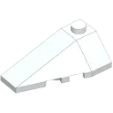{ .lu-ti width="24" loading="lazy" } [Wedge 2x4 Triple Left  (LOT 664)](../664.md) | 1 | No client description | 25 matrices; 0 rewards; 0 community references |
| 665 | 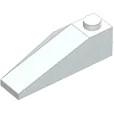{ .lu-ti width="24" loading="lazy" } [Wedge 2x4 Triple Right (LOT 665)](../665.md) | 1 | No client description | 25 matrices; 0 rewards; 0 community references |
| 650 | 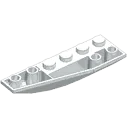{ .lu-ti width="24" loading="lazy" } [Wedge 2x6 Curved Inverted Left (LOT 650)](../650.md) | 1 | No client description | 25 matrices; 0 rewards; 0 community references |
| 649 | 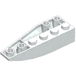{ .lu-ti width="24" loading="lazy" } [Wedge 2x6 Curved Inverted Right (LOT 649)](../649.md) | 1 | No client description | 25 matrices; 0 rewards; 0 community references |
| 642 | 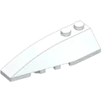{ .lu-ti width="24" loading="lazy" } [Wedge 2x6 Curved Left (LOT 642)](../642.md) | 1 | No client description | 25 matrices; 0 rewards; 0 community references |
| 641 | 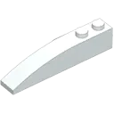{ .lu-ti width="24" loading="lazy" } [Wedge 2x6 Curved Right (LOT 641)](../641.md) | 1 | No client description | 25 matrices; 0 rewards; 0 community references |
| 743 | 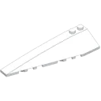{ .lu-ti width="24" loading="lazy" } [Wedge 3x10 Curved Left (LOT 743)](../743.md) | 1 | No client description | 37 matrices; 0 rewards; 0 community references |
| 744 | { .lu-ti width="24" loading="lazy" } [Wedge 3x10 Curved Right (LOT 744)](../744.md) | 1 | No client description | 37 matrices; 0 rewards; 0 community references |
| 5356 | 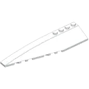{ .lu-ti width="24" loading="lazy" } [Wedge 3x12 Curved Left (LOT 5356)](../5356.md) | 1 | No client description | 25 matrices; 0 rewards; 0 community references |
| 5355 | 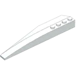{ .lu-ti width="24" loading="lazy" } [Wedge 3x12 Curved Right (LOT 5355)](../5355.md) | 1 | No client description | 25 matrices; 0 rewards; 0 community references |
| 644 | { .lu-ti width="24" loading="lazy" } [Wedge 3x8x2 Curved Left (LOT 644)](../644.md) | 1 | No client description | 37 matrices; 0 rewards; 0 community references |
| 643 | { .lu-ti width="24" loading="lazy" } [Wedge 3x8x2 Curved Right (LOT 643)](../643.md) | 1 | No client description | 37 matrices; 0 rewards; 0 community references |
| 689 | { .lu-ti width="24" loading="lazy" } [Wedge 4x16 (LOT 689)](../689.md) | 1 | No client description | 37 matrices; 0 rewards; 0 community references |
| 707 | { .lu-ti width="24" loading="lazy" } [Wedge 4x2 Triple (LOT 707)](../707.md) | 1 | No client description | 37 matrices; 0 rewards; 0 community references |
| 9132 | { .lu-ti width="24" loading="lazy" } [Wedge 4x3 Curved (LOT 9132)](../9132.md) | 1 | No client description | 37 matrices; 0 rewards; 0 community references |
| 730 | { .lu-ti width="24" loading="lazy" } [Wedge 4x4  (LOT 730)](../730.md) | 1 | No client description | 37 matrices; 0 rewards; 0 community references |
| 705 | 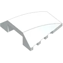{ .lu-ti width="24" loading="lazy" } [Wedge 4x4 Curved (LOT 705)](../705.md) | 1 | No client description | 37 matrices; 0 rewards; 0 community references |
| 725 | { .lu-ti width="24" loading="lazy" } [Wedge 4x4 Triple (LOT 725)](../725.md) | 1 | No client description | 37 matrices; 0 rewards; 0 community references |
| 5385 | { .lu-ti width="24" loading="lazy" } [Wedge 4x4 Triple with Tip (LOT 5385)](../5385.md) | 1 | No client description | 37 matrices; 0 rewards; 0 community references |
| 421 | { .lu-ti width="24" loading="lazy" } [Wedge 4x4 Triple, Inverted (LOT 421)](../421.md) | 1 | No client description | 37 matrices; 0 rewards; 0 community references |
| 706 | { .lu-ti width="24" loading="lazy" } [Wedge 4x4 Triple, Open with Struts (LOT 706)](../706.md) | 1 | No client description | 37 matrices; 0 rewards; 0 community references |
| 9159 | { .lu-ti width="24" loading="lazy" } [Wedge 4x4 Triple, Rocky (LOT 9159)](../9159.md) | 1 | No client description | 37 matrices; 0 rewards; 0 community references |
| 423 | { .lu-ti width="24" loading="lazy" } [Wedge 4x4 with Cut-Out (LOT 423)](../423.md) | 1 | No client description | 37 matrices; 0 rewards; 0 community references |
| 666 | 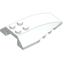{ .lu-ti width="24" loading="lazy" } [Wedge 4x6 Curved (LOT 666)](../666.md) | 1 | No client description | 25 matrices; 0 rewards; 0 community references |
| 422 | 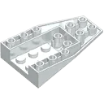{ .lu-ti width="24" loading="lazy" } [Wedge 4x6 Inverted (LOT 422)](../422.md) | 1 | No client description | 37 matrices; 0 rewards; 0 community references |
| 667 | { .lu-ti width="24" loading="lazy" } [Wedge 4x6 Inverted (LOT 667)](../667.md) | 1 | No client description | 37 matrices; 0 rewards; 0 community references |
| 8962 | { .lu-ti width="24" loading="lazy" } [Wedge 6x8 with Cut-Out (LOT 8962)](../8962.md) | 1 | No client description | 37 matrices; 0 rewards; 0 community references |
| 500 | 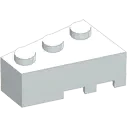{ .lu-ti width="24" loading="lazy" } [Wedge Brick 2x3 Left (LOT 500)](../500.md) | 1 | No client description | 25 matrices; 0 rewards; 0 community references |
| 499 | 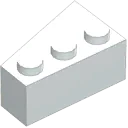{ .lu-ti width="24" loading="lazy" } [Wedge Brick 2x3 Right (LOT 499)](../499.md) | 1 | No client description | 25 matrices; 0 rewards; 0 community references |
| 652 | 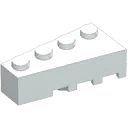{ .lu-ti width="24" loading="lazy" } [Wedge Brick 2x4 Left (LOT 652)](../652.md) | 1 | No client description | 25 matrices; 0 rewards; 0 community references |
| 670 | 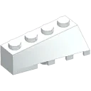{ .lu-ti width="24" loading="lazy" } [Wedge Brick 2x4 Left Sloped (LOT 670)](../670.md) | 1 | No client description | 25 matrices; 0 rewards; 0 community references |
| 651 | 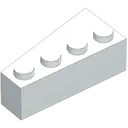{ .lu-ti width="24" loading="lazy" } [Wedge Brick 2x4 Right (LOT 651)](../651.md) | 1 | No client description | 25 matrices; 0 rewards; 0 community references |
| 669 | 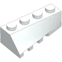{ .lu-ti width="24" loading="lazy" } [Wedge Brick 2x4 Right Sloped (LOT 669)](../669.md) | 1 | No client description | 25 matrices; 0 rewards; 0 community references |
| 672 | 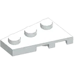{ .lu-ti width="24" loading="lazy" } [Wedge Plate 2x3 Left (LOT 672)](../672.md) | 1 | No client description | 25 matrices; 0 rewards; 0 community references |
| 671 | 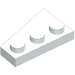{ .lu-ti width="24" loading="lazy" } [Wedge Plate 2x3 Right (LOT 671)](../671.md) | 1 | No client description | 25 matrices; 0 rewards; 0 community references |
| 748 | 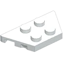{ .lu-ti width="24" loading="lazy" } [Wedge Plate 2x4 (LOT 748)](../748.md) | 1 | No client description | 25 matrices; 0 rewards; 0 community references |
| 654 | 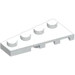{ .lu-ti width="24" loading="lazy" } [Wedge Plate 2x4 Left (LOT 654)](../654.md) | 1 | No client description | 25 matrices; 0 rewards; 0 community references |
| 653 | 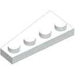{ .lu-ti width="24" loading="lazy" } [Wedge Plate 2x4 Right (LOT 653)](../653.md) | 1 | No client description | 25 matrices; 0 rewards; 0 community references |
| 693 | 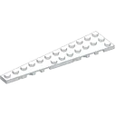{ .lu-ti width="24" loading="lazy" } [Wedge Plate 3x12 Left (LOT 693)](../693.md) | 1 | No client description | 25 matrices; 0 rewards; 0 community references |
| 694 | 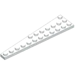{ .lu-ti width="24" loading="lazy" } [Wedge Plate 3x12 Right (LOT 694)](../694.md) | 1 | No client description | 25 matrices; 0 rewards; 0 community references |
| 722 | { .lu-ti width="24" loading="lazy" } [Wedge Plate 3x4 with Cut-Out (LOT 722)](../722.md) | 1 | No client description | 37 matrices; 0 rewards; 0 community references |
| 756 | 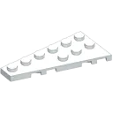{ .lu-ti width="24" loading="lazy" } [Wedge Plate 3x6 Left (LOT 756)](../756.md) | 1 | No client description | 25 matrices; 0 rewards; 0 community references |
| 755 | 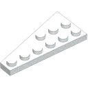{ .lu-ti width="24" loading="lazy" } [Wedge Plate 3x6 Right (LOT 755)](../755.md) | 1 | No client description | 25 matrices; 0 rewards; 0 community references |
| 729 | 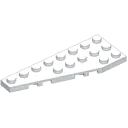{ .lu-ti width="24" loading="lazy" } [Wedge Plate 3x8 Left (LOT 729)](../729.md) | 1 | No client description | 25 matrices; 0 rewards; 0 community references |
| 728 | 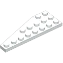{ .lu-ti width="24" loading="lazy" } [Wedge Plate 3x8 Right (LOT 728)](../728.md) | 1 | No client description | 25 matrices; 0 rewards; 0 community references |
| 668 | { .lu-ti width="24" loading="lazy" } [Wedge Plate 4x4 with Cut-Out (LOT 668)](../668.md) | 1 | No client description | 37 matrices; 0 rewards; 0 community references |
| 614 | { .lu-ti width="24" loading="lazy" } [Wedge Plate 4x6 (LOT 614)](../614.md) | 1 | No client description | 25 matrices; 0 rewards; 0 community references |
| 566 | 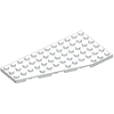{ .lu-ti width="24" loading="lazy" } [Wedge Plate 6x12 Left (LOT 566)](../566.md) | 1 | No client description | 25 matrices; 0 rewards; 0 community references |
| 567 | 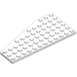{ .lu-ti width="24" loading="lazy" } [Wedge Plate 6x12 Right (LOT 567)](../567.md) | 1 | No client description | 25 matrices; 0 rewards; 0 community references |
| 696 | { .lu-ti width="24" loading="lazy" } [Wedge Plate 6x4 with Cut-Out (LOT 696)](../696.md) | 1 | No client description | 37 matrices; 0 rewards; 0 community references |
| 1225 | { .lu-ti width="24" loading="lazy" } [Wheel for Skate Board (LOT 1225)](../1225.md) | 1 | No client description | 21 matrices; 0 rewards; 0 community references |
| 8811 | { .lu-ti width="24" loading="lazy" } [Wheel Hard-Plastic Medium (LOT 8811)](../8811.md) | 1 | No client description | 37 matrices; 0 rewards; 0 community references |
| 467 | { .lu-ti width="24" loading="lazy" } [Wheel Hard-Plastic Ø24 Small (LOT 467)](../467.md) | 1 | No client description | 37 matrices; 0 rewards; 0 community references |
| 561 | { .lu-ti width="24" loading="lazy" } [Wheel Hard-Plastic Ø43 with Treads (LOT 561)](../561.md) | 1 | No client description | 37 matrices; 0 rewards; 0 community references |
| 8802 | { .lu-ti width="24" loading="lazy" } [Wheel Hard-Plastic Ø56 Large (LOT 8802)](../8802.md) | 1 | No client description | 37 matrices; 0 rewards; 0 community references |
| 8808 | { .lu-ti width="24" loading="lazy" } [Wheel Hard-Plastic Ø75 Giant (LOT 8808)](../8808.md) | 1 | No client description | 37 matrices; 0 rewards; 0 community references |
| 757 | { .lu-ti width="24" loading="lazy" } [Wheel Hard-Plastic with Spokes Ø56x22 (LOT 757)](../757.md) | 1 | No client description | 37 matrices; 0 rewards; 0 community references |
| 16322 | { .lu-ti width="24" loading="lazy" } [Wheel with Spokes Ø27.4 (LOT 16322)](../16322.md) | 1 | No client description | 37 matrices; 0 rewards; 0 community references |
| 8849 | { .lu-ti width="24" loading="lazy" } [Wheelbarrow (LOT 8849)](../8849.md) | 1 | No client description | 37 matrices; 0 rewards; 0 community references |
| 2135 | { .lu-ti width="24" loading="lazy" } [Whip with Loop (LOT 2135)](../2135.md) | 1 | No client description | 21 matrices; 0 rewards; 0 community references |
| 9117 | { .lu-ti width="24" loading="lazy" } [Whip, Furled (LOT 9117)](../9117.md) | 1 | No client description | 21 matrices; 0 rewards; 0 community references |
| 5433 | { .lu-ti width="24" loading="lazy" } [Wig Manga 1 (LOT 5433)](../5433.md) | 1 | No client description | 21 matrices; 0 rewards; 0 community references |
| 5434 | { .lu-ti width="24" loading="lazy" } [Wig Manga 2 (LOT 5434)](../5434.md) | 1 | No client description | 21 matrices; 0 rewards; 0 community references |
| 5162 | { .lu-ti width="24" loading="lazy" } [Wig Ponytail (LOT 5162)](../5162.md) | 1 | No client description | 21 matrices; 0 rewards; 0 community references |
| 5364 | { .lu-ti width="24" loading="lazy" } [Wig with Blow-dried Hairdo (LOT 5364)](../5364.md) | 1 | No client description | 21 matrices; 0 rewards; 0 community references |
| 5582 | { .lu-ti width="24" loading="lazy" } [Wig with Long Ponytail (LOT 5582)](../5582.md) | 1 | No client description | 21 matrices; 0 rewards; 0 community references |
| 5276 | { .lu-ti width="24" loading="lazy" } [Wig with Multiple Braids (LOT 5276)](../5276.md) | 1 | No client description | 21 matrices; 0 rewards; 0 community references |
| 8839 | { .lu-ti width="24" loading="lazy" } [Wig with Small Pigtails (LOT 8839)](../8839.md) | 1 | No client description | 21 matrices; 0 rewards; 0 community references |
| 5142 | { .lu-ti width="24" loading="lazy" } [Wig with Wavy Hair (LOT 5142)](../5142.md) | 1 | No client description | 21 matrices; 0 rewards; 0 community references |
| 5587 | { .lu-ti width="24" loading="lazy" } [Wig, Bowl Cut (LOT 5587)](../5587.md) | 1 | No client description | 21 matrices; 0 rewards; 0 community references |
| 5108 | { .lu-ti width="24" loading="lazy" } [Wig, Boy (LOT 5108)](../5108.md) | 1 | No client description | 21 matrices; 0 rewards; 0 community references |
| 5592 | { .lu-ti width="24" loading="lazy" } [Wig, Boy (LOT 5592)](../5592.md) | 1 | No client description | 21 matrices; 0 rewards; 0 community references |
| 5282 | { .lu-ti width="24" loading="lazy" } [Wig, Crew Cut (LOT 5282)](../5282.md) | 1 | No client description | 21 matrices; 0 rewards; 0 community references |
| 9190 | { .lu-ti width="24" loading="lazy" } [Wig, Girl with Long Hair (LOT 9190)](../9190.md) | 1 | No client description | 21 matrices; 0 rewards; 0 community references |
| 16435 | { .lu-ti width="24" loading="lazy" } [Wig, Long Hair (LOT 16435)](../16435.md) | 1 | No client description | 21 matrices; 0 rewards; 0 community references |
| 16412 | { .lu-ti width="24" loading="lazy" } [Wig, Medium Hair (LOT 16412)](../16412.md) | 1 | No client description | 21 matrices; 0 rewards; 0 community references |
| 9156 | { .lu-ti width="24" loading="lazy" } [Wig, Older Guy (LOT 9156)](../9156.md) | 1 | No client description | 21 matrices; 0 rewards; 0 community references |
| 16434 | { .lu-ti width="24" loading="lazy" } [Wig, Short Hair (LOT 16434)](../16434.md) | 1 | No client description | 21 matrices; 0 rewards; 0 community references |
| 5359 | { .lu-ti width="24" loading="lazy" } [Wig, Wolfman  (LOT 5359)](../5359.md) | 1 | No client description | 21 matrices; 0 rewards; 0 community references |
| 5533 | 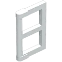{ .lu-ti width="24" loading="lazy" } [Window ½ for Frame 1x4x3 (LOT 5533)](../5533.md) | 1 | No client description | 7 matrices; 0 rewards; 0 community references |
| 833 | 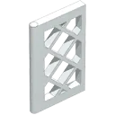{ .lu-ti width="24" loading="lazy" } [Window 2x3 with Lattice (LOT 833)](../833.md) | 1 | No client description | 7 matrices; 0 rewards; 0 community references |
| 16319 | { .lu-ti width="24" loading="lazy" } [Window 2x4/1x4 (LOT 16319)](../16319.md) | 1 | No client description | 7 matrices; 0 rewards; 0 community references |
| 361 | 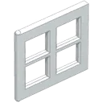{ .lu-ti width="24" loading="lazy" } [Window 4x3 (LOT 361)](../361.md) | 1 | No client description | 7 matrices; 0 rewards; 0 community references |
| 337 | 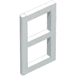{ .lu-ti width="24" loading="lazy" } [Window for Frame 2x3 (LOT 337)](../337.md) | 1 | No client description | 7 matrices; 0 rewards; 0 community references |
| 10270 | { .lu-ti width="24" loading="lazy" } [Window for Plane Front 6x10x4 (LOT 10270)](../10270.md) | 1 | No client description | 37 matrices; 0 rewards; 0 community references |
| 851 | { .lu-ti width="24" loading="lazy" } [Window for Ship's Bridge (LOT 851)](../851.md) | 1 | No client description | 37 matrices; 0 rewards; 0 community references |
| 512 | { .lu-ti width="24" loading="lazy" } [Window Frame 1x2x2 2/3 Curved Top (LOT 512)](../512.md) | 1 | No client description | 7 matrices; 0 rewards; 0 community references |
| 360 | 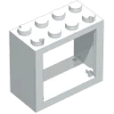{ .lu-ti width="24" loading="lazy" } [Window Frame 2x4x3 (LOT 360)](../360.md) | 1 | No client description | 7 matrices; 0 rewards; 0 community references |
| 336 | 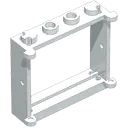{ .lu-ti width="24" loading="lazy" } [Window Frame 4x3 (LOT 336)](../336.md) | 1 | No client description | 7 matrices; 0 rewards; 0 community references |
| 10197 | 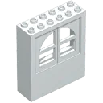{ .lu-ti width="24" loading="lazy" } [Window with Frame 2x6x6 (LOT 10197)](../10197.md) | 1 | No client description | 7 matrices; 0 rewards; 0 community references |
| 16340 | 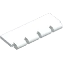{ .lu-ti width="24" loading="lazy" } [Windscreen 1x4x1 1/3 (LOT 16340)](../16340.md) | 1 | No client description | 19 matrices; 0 rewards; 0 community references |
| 9143 | 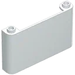{ .lu-ti width="24" loading="lazy" } [Windscreen 1x6x3 Vertical (LOT 9143)](../9143.md) | 1 | No client description | 7 matrices; 0 rewards; 0 community references |
| 16393 | 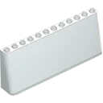{ .lu-ti width="24" loading="lazy" } [Windscreen 2x12x4 (LOT 16393)](../16393.md) | 1 | No client description | 7 matrices; 0 rewards; 0 community references |
| 67 | 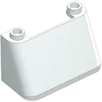{ .lu-ti width="24" loading="lazy" } [Windscreen 2x4x2 (LOT 67)](../67.md) | 1 | No client description | 37 matrices; 0 rewards; 0 community references |
| 380 | { .lu-ti width="24" loading="lazy" } [Windscreen 2x4x2 Inverted (LOT 380)](../380.md) | 1 | No client description | 37 matrices; 0 rewards; 0 community references |
| 403 | { .lu-ti width="24" loading="lazy" } [Windscreen 2x4x2 Vertical (LOT 403)](../403.md) | 1 | No client description | 37 matrices; 0 rewards; 0 community references |
| 456 | 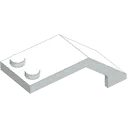{ .lu-ti width="24" loading="lazy" } [Windscreen 2x5X1 1/3 (LOT 456)](../456.md) | 1 | No client description | 37 matrices; 0 rewards; 0 community references |
| 16328 | { .lu-ti width="24" loading="lazy" } [Windscreen 3x10x3 (LOT 16328)](../16328.md) | 1 | No client description | 37 matrices; 0 rewards; 0 community references |
| 812 | 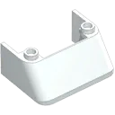{ .lu-ti width="24" loading="lazy" } [Windscreen 3x4x1/3 (LOT 812)](../812.md) | 1 | No client description | 37 matrices; 0 rewards; 0 community references |
| 343 | 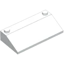{ .lu-ti width="24" loading="lazy" } [Windscreen 3x6 25° (LOT 343)](../343.md) | 1 | No client description | 25 matrices; 0 rewards; 0 community references |
| 5489 | { .lu-ti width="24" loading="lazy" } [Windscreen 3x6 25° (LOT 5489)](../5489.md) | 1 | No client description | 25 matrices; 0 rewards; 0 community references |
| 575 | { .lu-ti width="24" loading="lazy" } [Windscreen 3x6x5 (LOT 575)](../575.md) | 1 | No client description | 37 matrices; 0 rewards; 0 community references |
| 760 | 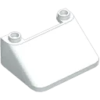{ .lu-ti width="24" loading="lazy" } [Windscreen 4x3x1 1/3 (LOT 760)](../760.md) | 1 | No client description | 37 matrices; 0 rewards; 0 community references |
| 5617 | { .lu-ti width="24" loading="lazy" } [Windscreen 4x3x3 Edged (LOT 5617)](../5617.md) | 1 | No client description | 37 matrices; 0 rewards; 0 community references |
| 5185 | { .lu-ti width="24" loading="lazy" } [Windscreen 4x4x1 (LOT 5185)](../5185.md) | 1 | No client description | 37 matrices; 0 rewards; 0 community references |
| 16326 | 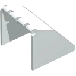{ .lu-ti width="24" loading="lazy" } [Windscreen 4x4x3 (LOT 16326)](../16326.md) | 1 | No client description | 19 matrices; 0 rewards; 0 community references |
| 8891 | { .lu-ti width="24" loading="lazy" } [Windscreen 4x6x1 1/3 (LOT 8891)](../8891.md) | 1 | No client description | 37 matrices; 0 rewards; 0 community references |
| 9005 | { .lu-ti width="24" loading="lazy" } [Windscreen 6x12x6 (LOT 9005)](../9005.md) | 1 | No client description | 37 matrices; 0 rewards; 0 community references |
| 16438 | { .lu-ti width="24" loading="lazy" } [Windscreen 6x3x2 (LOT 16438)](../16438.md) | 1 | No client description | 37 matrices; 0 rewards; 0 community references |
| 16348 | 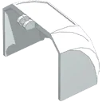{ .lu-ti width="24" loading="lazy" } [Windscreen 6x4x4 (LOT 16348)](../16348.md) | 1 | No client description | 19 matrices; 0 rewards; 0 community references |
| 803 | { .lu-ti width="24" loading="lazy" } [Windscreen 6x6 Octagonal with Hinge (LOT 803)](../803.md) | 1 | No client description | 7 matrices; 0 rewards; 0 community references |
| 616 | { .lu-ti width="24" loading="lazy" } [Windscreen 6x8x3 (LOT 616)](../616.md) | 1 | No client description | 37 matrices; 0 rewards; 0 community references |
| 5579 | { .lu-ti width="24" loading="lazy" } [Windscreen 8x5x2 Edged (LOT 5579)](../5579.md) | 1 | No client description | 37 matrices; 0 rewards; 0 community references |
| 5389 | { .lu-ti width="24" loading="lazy" } [Wing 4x7 Scaled (LOT 5389)](../5389.md) | 1 | No client description | 21 matrices; 0 rewards; 0 community references |
| 16339 | { .lu-ti width="24" loading="lazy" } [Wing 4x8x3 1/3 2x4 Under (LOT 16339)](../16339.md) | 1 | No client description | 37 matrices; 0 rewards; 0 community references |
| 5358 | { .lu-ti width="24" loading="lazy" } [Wolf's Head (LOT 5358)](../5358.md) | 1 | No client description | 2 matrices; 0 rewards; 0 community references |
| 8806 | 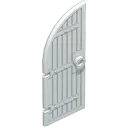{ .lu-ti width="24" loading="lazy" } [Wooden Door 3x6 with 1/4 Circle Top (LOT 8806)](../8806.md) | 1 | No client description | 7 matrices; 0 rewards; 0 community references |
| 5333 | 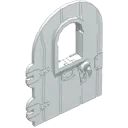{ .lu-ti width="24" loading="lazy" } [Wooden Door 4x6 with Pane (LOT 5333)](../5333.md) | 1 | No client description | 7 matrices; 0 rewards; 0 community references |
| 461 | { .lu-ti width="24" loading="lazy" } [Wooden Door 4x8 with 1/4-Circle Top (LOT 461)](../461.md) | 1 | No client description | 7 matrices; 0 rewards; 0 community references |
| 545 | { .lu-ti width="24" loading="lazy" } [Wooden Door 5x9 with Studs (LOT 545)](../545.md) | 1 | No client description | 7 matrices; 0 rewards; 0 community references |
| 385 | { .lu-ti width="24" loading="lazy" } [Wooden Tub, Round 4x4 (LOT 385)](../385.md) | 1 | No client description | 14 matrices; 0 rewards; 0 community references |
