# Brick — page 2/10

[Item database](../README.md)

Pages: [1](type-1-1.md) | [2](type-1-2.md) | [3](type-1-3.md) | [4](type-1-4.md) | [5](type-1-5.md) | [6](type-1-6.md) | [7](type-1-7.md) | [8](type-1-8.md) | [9](type-1-9.md) | [10](type-1-10.md)

| LOT | Item | Rarity | Description | Source evidence |
| --- | --- | --- | --- | --- |
| 9091 | 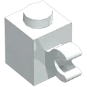{ .lu-ti width="24" loading="lazy" } [Brick 1x1 with Vertical Clip (LOT 9091)](../9091.md) | 1 | No client description | 19 matrices; 0 rewards; 0 community references |
| 465 | 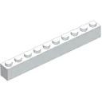{ .lu-ti width="24" loading="lazy" } [Brick 1x10 (LOT 465)](../465.md) | 1 | No client description | 25 matrices; 0 rewards; 0 community references |
| 466 | 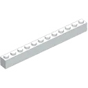{ .lu-ti width="24" loading="lazy" } [Brick 1x12 (LOT 466)](../466.md) | 1 | No client description | 25 matrices; 0 rewards; 0 community references |
| 374 | 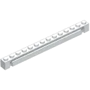{ .lu-ti width="24" loading="lazy" } [Brick 1x14 with Groove (LOT 374)](../374.md) | 1 | No client description | 7 matrices; 0 rewards; 0 community references |
| 26 | 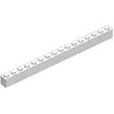{ .lu-ti width="24" loading="lazy" } [Brick 1x16 (LOT 26)](../26.md) | 1 | No client description | 25 matrices; 0 rewards; 0 community references |
| 400 | 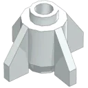{ .lu-ti width="24" loading="lazy" } [Brick 1x1x1 Round with Fins (LOT 400)](../400.md) | 1 | No client description | 25 matrices; 0 rewards; 0 community references |
| 5078 | 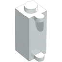{ .lu-ti width="24" loading="lazy" } [Brick 1x1x2 with Shutter Holder (LOT 5078)](../5078.md) | 1 | No client description | 7 matrices; 0 rewards; 0 community references |
| 9094 | 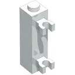{ .lu-ti width="24" loading="lazy" } [Brick 1x1x3 with 2 Horizontal Clips (LOT 9094)](../9094.md) | 1 | No client description | 19 matrices; 0 rewards; 0 community references |
| 816 | 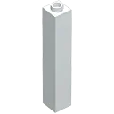{ .lu-ti width="24" loading="lazy" } [Brick 1x1x5 (LOT 816)](../816.md) | 1 | No client description | 25 matrices; 0 rewards; 0 community references |
| 32 | { .lu-ti width="24" loading="lazy" } [Brick 1x2 (LOT 32)](../32.md) | 1 | No client description | 164 matrices; 0 rewards; 0 community references |
| 5074 | 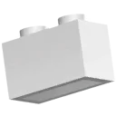{ .lu-ti width="24" loading="lazy" } [Brick 1x2 Hollow (LOT 5074)](../5074.md) | 1 | No client description | 25 matrices; 0 rewards; 0 community references |
| 88 | 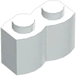{ .lu-ti width="24" loading="lazy" } [Brick 1x2 Palisade (LOT 88)](../88.md) | 1 | No client description | 7 matrices; 0 rewards; 0 community references |
| 753 | 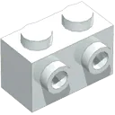{ .lu-ti width="24" loading="lazy" } [Brick 1x2 with 4 Studs (LOT 753)](../753.md) | 1 | No client description | 25 matrices; 0 rewards; 0 community references |
| 373 | 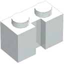{ .lu-ti width="24" loading="lazy" } [Brick 1x2 with Groove (LOT 373)](../373.md) | 1 | No client description | 25 matrices; 0 rewards; 0 community references |
| 547 | 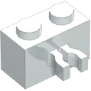{ .lu-ti width="24" loading="lazy" } [Brick 1x2 with Horizontal Clip (LOT 547)](../547.md) | 1 | No client description | 19 matrices; 0 rewards; 0 community references |
| 597 | 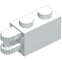{ .lu-ti width="24" loading="lazy" } [Brick 1x2 with Horizontal Fork (LOT 597)](../597.md) | 1 | No client description | 19 matrices; 0 rewards; 0 community references |
| 713 | 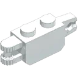{ .lu-ti width="24" loading="lazy" } [Brick 1x2 with Horizontal Fork and Vertical Stub (LOT 713)](../713.md) | 1 | No client description | 19 matrices; 0 rewards; 0 community references |
| 598 | 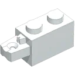{ .lu-ti width="24" loading="lazy" } [Brick 1x2 with Horizontal Stub (LOT 598)](../598.md) | 1 | No client description | 19 matrices; 0 rewards; 0 community references |
| 546 | 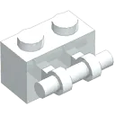{ .lu-ti width="24" loading="lazy" } [Brick 1x2 with Narrow Handle (LOT 546)](../546.md) | 1 | No client description | 19 matrices; 0 rewards; 0 community references |
| 25 | 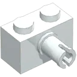{ .lu-ti width="24" loading="lazy" } [Brick 1x2 with Pin (LOT 25)](../25.md) | 1 | No client description | 19 matrices; 0 rewards; 0 community references |
| 5616 | 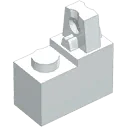{ .lu-ti width="24" loading="lazy" } [Brick 1x2 with Stub on Top (LOT 5616)](../5616.md) | 1 | No client description | 19 matrices; 0 rewards; 0 community references |
| 93 | 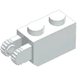{ .lu-ti width="24" loading="lazy" } [Brick 1x2 with Vertical Fork (LOT 93)](../93.md) | 1 | No client description | 19 matrices; 0 rewards; 0 community references |
| 583 | 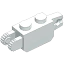{ .lu-ti width="24" loading="lazy" } [Brick 1x2 with Vertical Fork and Vertical Stub (LOT 583)](../583.md) | 1 | No client description | 19 matrices; 0 rewards; 0 community references |
| 10232 | 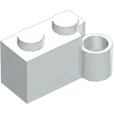{ .lu-ti width="24" loading="lazy" } [Brick 1x2 with Vertical Pin Hole Bottom Part (LOT 10232)](../10232.md) | 1 | No client description | 19 matrices; 0 rewards; 0 community references |
| 10231 | 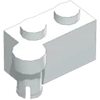{ .lu-ti width="24" loading="lazy" } [Brick 1x2 with Vertical Pin Top Part (LOT 10231)](../10231.md) | 1 | No client description | 19 matrices; 0 rewards; 0 community references |
| 92 | 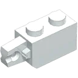{ .lu-ti width="24" loading="lazy" } [Brick 1x2 with Vertical Stub (LOT 92)](../92.md) | 1 | No client description | 19 matrices; 0 rewards; 0 community references |
| 890 | 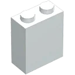{ .lu-ti width="24" loading="lazy" } [Brick 1x2x2 (LOT 890)](../890.md) | 1 | No client description | 25 matrices; 0 rewards; 0 community references |
| 817 | 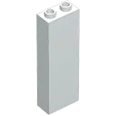{ .lu-ti width="24" loading="lazy" } [Brick 1x2x5 (LOT 817)](../817.md) | 1 | No client description | 25 matrices; 0 rewards; 0 community references |
| 446 | 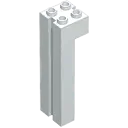{ .lu-ti width="24" loading="lazy" } [Brick 1x2x5 with Groove (LOT 446)](../446.md) | 1 | No client description | 25 matrices; 0 rewards; 0 community references |
| 9241 | 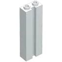{ .lu-ti width="24" loading="lazy" } [Brick 1x2x5 with Groove (LOT 9241)](../9241.md) | 1 | No client description | 7 matrices; 0 rewards; 0 community references |
| 59 | { .lu-ti width="24" loading="lazy" } [Brick 1x3 (LOT 59)](../59.md) | 1 | No client description | 163 matrices; 0 rewards; 0 community references |
| 392 | 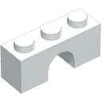{ .lu-ti width="24" loading="lazy" } [Brick 1x3 with Bow (LOT 392)](../392.md) | 1 | No client description | 7 matrices; 0 rewards; 0 community references |
| 16446 | { .lu-ti width="24" loading="lazy" } [Brick 1x3x2 with Inside and Outside Bow (LOT 16446)](../16446.md) | 1 | No client description | 7 matrices; 0 rewards; 0 community references |
| 929 | 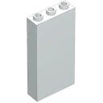{ .lu-ti width="24" loading="lazy" } [Brick 1x3x5 (LOT 929)](../929.md) | 1 | No client description | 7 matrices; 0 rewards; 0 community references |
| 38 | { .lu-ti width="24" loading="lazy" } [Brick 1x4 (LOT 38)](../38.md) | 1 | No client description | 163 matrices; 0 rewards; 0 community references |
| 8827 | 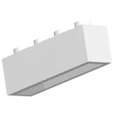{ .lu-ti width="24" loading="lazy" } [Brick 1x4 Hollow (LOT 8827)](../8827.md) | 1 | No client description | 25 matrices; 0 rewards; 0 community references |
| 633 | 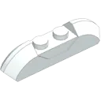{ .lu-ti width="24" loading="lazy" } [Brick 1x4 with 2 Studs and Curved Ends (LOT 633)](../633.md) | 1 | No client description | 14 matrices; 0 rewards; 0 community references |
| 61 | 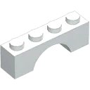{ .lu-ti width="24" loading="lazy" } [Brick 1x4 with Bow (LOT 61)](../61.md) | 1 | No client description | 7 matrices; 0 rewards; 0 community references |
| 853 | 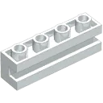{ .lu-ti width="24" loading="lazy" } [Brick 1x4 with Groove (LOT 853)](../853.md) | 1 | No client description | 7 matrices; 0 rewards; 0 community references |
| 121 | 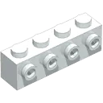{ .lu-ti width="24" loading="lazy" } [Brick 1x4 with Studs on Side (LOT 121)](../121.md) | 1 | No client description | 25 matrices; 0 rewards; 0 community references |
| 584 | 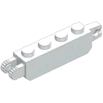{ .lu-ti width="24" loading="lazy" } [Brick 1x4 with Vertical Fork and Vertical Stub (LOT 584)](../584.md) | 1 | No client description | 19 matrices; 0 rewards; 0 community references |
| 480 | 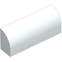{ .lu-ti width="24" loading="lazy" } [Brick 1x4x1 1/3 with Bowed Ridge (LOT 480)](../480.md) | 1 | No client description | 7 matrices; 0 rewards; 0 community references |
| 5417 | 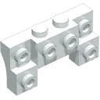{ .lu-ti width="24" loading="lazy" } [Brick 1x4x1 1/3 with Studs on Side (LOT 5417)](../5417.md) | 1 | No client description | 37 matrices; 0 rewards; 0 community references |
| 37 | { .lu-ti width="24" loading="lazy" } [Brick 1x6 (LOT 37)](../37.md) | 1 | No client description | 163 matrices; 0 rewards; 0 community references |
| 16448 | 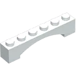{ .lu-ti width="24" loading="lazy" } [Brick 1x6 with Inside Bow (LOT 16448)](../16448.md) | 1 | No client description | 7 matrices; 0 rewards; 0 community references |
| 585 | 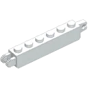{ .lu-ti width="24" loading="lazy" } [Brick 1x6 with Vertical Fork and Vertical Stub (LOT 585)](../585.md) | 1 | No client description | 19 matrices; 0 rewards; 0 community references |
| 928 | 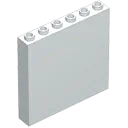{ .lu-ti width="24" loading="lazy" } [Brick 1x6x5 (LOT 928)](../928.md) | 1 | No client description | 7 matrices; 0 rewards; 0 community references |
| 36 | { .lu-ti width="24" loading="lazy" } [Brick 1x8 (LOT 36)](../36.md) | 1 | No client description | 163 matrices; 0 rewards; 0 community references |
| 34 | 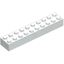{ .lu-ti width="24" loading="lazy" } [Brick 2x10 (LOT 34)](../34.md) | 1 | No client description | 25 matrices; 0 rewards; 0 community references |
| 541 | 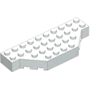{ .lu-ti width="24" loading="lazy" } [Brick 2x10 with Bay (LOT 541)](../541.md) | 1 | No client description | 25 matrices; 0 rewards; 0 community references |
| 31 | { .lu-ti width="24" loading="lazy" } [Brick 2x2 (LOT 31)](../31.md) | 1 | No client description | 164 matrices; 0 rewards; 0 community references |
| 5485 | 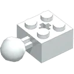{ .lu-ti width="24" loading="lazy" } [Brick 2x2 Ball Joint (LOT 5485)](../5485.md) | 1 | No client description | 34 matrices; 0 rewards; 0 community references |
| 120 | { .lu-ti width="24" loading="lazy" } [Brick 2x2 Round (LOT 120)](../120.md) | 1 | No client description | 25 matrices; 0 rewards; 0 community references |
| 576 | { .lu-ti width="24" loading="lazy" } [Brick 2x2 Round with Dome (LOT 576)](../576.md) | 1 | No client description | 25 matrices; 0 rewards; 0 community references |
| 5484 | 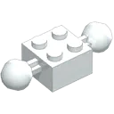{ .lu-ti width="24" loading="lazy" } [Brick 2x2 with 2 Ball Joints (LOT 5484)](../5484.md) | 1 | No client description | 34 matrices; 0 rewards; 0 community references |
| 1199 | 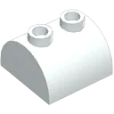{ .lu-ti width="24" loading="lazy" } [Brick 2x2 with Bow and Studs (LOT 1199)](../1199.md) | 1 | No client description | 25 matrices; 0 rewards; 0 community references |
| 506 | { .lu-ti width="24" loading="lazy" } [Brick 2x2 with Cross Axle Hole and 2 Pins (LOT 506)](../506.md) | 1 | No client description | 37 matrices; 0 rewards; 0 community references |
| 5588 | 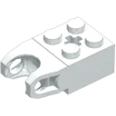{ .lu-ti width="24" loading="lazy" } [Brick 2x2 with Cup for Ball (LOT 5588)](../5588.md) | 1 | No client description | 34 matrices; 0 rewards; 0 community references |
| 731 | { .lu-ti width="24" loading="lazy" } [Brick 2x2 with Fender (LOT 731)](../731.md) | 1 | No client description | 37 matrices; 0 rewards; 0 community references |
| 16423 | 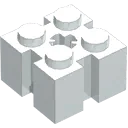{ .lu-ti width="24" loading="lazy" } [Brick 2x2 with Groove (LOT 16423)](../16423.md) | 1 | No client description | 25 matrices; 0 rewards; 0 community references |
| 85 | 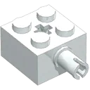{ .lu-ti width="24" loading="lazy" } [Brick 2x2 with Pin (LOT 85)](../85.md) | 1 | No client description | 34 matrices; 0 rewards; 0 community references |
| 5149 | { .lu-ti width="24" loading="lazy" } [Brick 2x2 with Pin on Top (LOT 5149)](../5149.md) | 1 | No client description | 19 matrices; 0 rewards; 0 community references |
| 632 | { .lu-ti width="24" loading="lazy" } [Brick 2x2 with Vertical Fork (LOT 632)](../632.md) | 1 | No client description | 19 matrices; 0 rewards; 0 community references |
| 586 | { .lu-ti width="24" loading="lazy" } [Brick 2x2 with Vertical Stub (LOT 586)](../586.md) | 1 | No client description | 19 matrices; 0 rewards; 0 community references |
| 572 | { .lu-ti width="24" loading="lazy" } [Brick 2x2x2 Round  (LOT 572)](../572.md) | 1 | No client description | 25 matrices; 0 rewards; 0 community references |
| 402 | { .lu-ti width="24" loading="lazy" } [Brick 2x2x2 Round with Fins (LOT 402)](../402.md) | 1 | No client description | 37 matrices; 0 rewards; 0 community references |
| 5219 | { .lu-ti width="24" loading="lazy" } [Brick 2x2x3 (LOT 5219)](../5219.md) | 1 | No client description | 25 matrices; 0 rewards; 0 community references |
| 8873 | { .lu-ti width="24" loading="lazy" } [Brick 2x2x3 1/3 Octagonal (LOT 8873)](../8873.md) | 1 | No client description | 7 matrices; 0 rewards; 0 community references |
| 8878 | { .lu-ti width="24" loading="lazy" } [Brick 2x2x3x1/3 Octagonal with 90° Angle (LOT 8878)](../8878.md) | 1 | No client description | 7 matrices; 0 rewards; 0 community references |
| 8877 | { .lu-ti width="24" loading="lazy" } [Brick 2x2x3x1/3 Octagonal with Studs on Side (LOT 8877)](../8877.md) | 1 | No client description | 7 matrices; 0 rewards; 0 community references |
| 30 | { .lu-ti width="24" loading="lazy" } [Brick 2x3 (LOT 30)](../30.md) | 1 | No client description | 163 matrices; 0 rewards; 0 community references |
| 483 | { .lu-ti width="24" loading="lazy" } [Brick 2x3 with Curved Top (LOT 483)](../483.md) | 1 | No client description | 25 matrices; 0 rewards; 0 community references |
| 8872 | { .lu-ti width="24" loading="lazy" } [Brick 2x3x2x1/3 Octagonal Diagonal (LOT 8872)](../8872.md) | 1 | No client description | 7 matrices; 0 rewards; 0 community references |
| 29 | { .lu-ti width="24" loading="lazy" } [Brick 2x4 (LOT 29)](../29.md) | 1 | No client description | 164 matrices; 0 rewards; 0 community references |
| 493 | { .lu-ti width="24" loading="lazy" } [Brick 2x4 with 2 Pins (LOT 493)](../493.md) | 1 | No client description | 37 matrices; 0 rewards; 0 community references |
| 481 | { .lu-ti width="24" loading="lazy" } [Brick 2x4 with Bowed Ridge (LOT 481)](../481.md) | 1 | No client description | 7 matrices; 0 rewards; 0 community references |
| 450 | { .lu-ti width="24" loading="lazy" } [Brick 2x4x2 with Bottom Connection on Sides (LOT 450)](../450.md) | 1 | No client description | 25 matrices; 0 rewards; 0 community references |
| 809 | { .lu-ti width="24" loading="lazy" } [Brick 2x4x2 with Studs on Sides (LOT 809)](../809.md) | 1 | No client description | 25 matrices; 0 rewards; 0 community references |
| 8937 | { .lu-ti width="24" loading="lazy" } [Brick 2x4x3 (LOT 8937)](../8937.md) | 1 | No client description | 25 matrices; 0 rewards; 0 community references |
| 98 | { .lu-ti width="24" loading="lazy" } [Brick 2x6 (LOT 98)](../98.md) | 1 | No client description | 163 matrices; 0 rewards; 0 community references |
| 8897 | { .lu-ti width="24" loading="lazy" } [Brick 2x6x3 (LOT 8897)](../8897.md) | 1 | No client description | 25 matrices; 0 rewards; 0 community references |
| 35 | { .lu-ti width="24" loading="lazy" } [Brick 2x8 (LOT 35)](../35.md) | 1 | No client description | 163 matrices; 0 rewards; 0 community references |
| 5182 | { .lu-ti width="24" loading="lazy" } [Brick 4X10 (LOT 5182)](../5182.md) | 1 | No client description | 25 matrices; 0 rewards; 0 community references |
| 9088 | { .lu-ti width="24" loading="lazy" } [Brick 4x12 (LOT 9088)](../9088.md) | 1 | No client description | 25 matrices; 0 rewards; 0 community references |
| 8950 | { .lu-ti width="24" loading="lazy" } [Brick 4x18 (LOT 8950)](../8950.md) | 1 | No client description | 25 matrices; 0 rewards; 0 community references |
| 846 | { .lu-ti width="24" loading="lazy" } [Brick 4x4 ¼-Circle (LOT 846)](../846.md) | 1 | No client description | 25 matrices; 0 rewards; 0 community references |
| 9197 | { .lu-ti width="24" loading="lazy" } [Brick 4x4 Round with Pin Hole (LOT 9197)](../9197.md) | 1 | No client description | 25 matrices; 0 rewards; 0 community references |
| 5564 | { .lu-ti width="24" loading="lazy" } [Brick 4x4x2 with Bow (LOT 5564)](../5564.md) | 1 | No client description | 37 matrices; 0 rewards; 0 community references |
| 16366 | { .lu-ti width="24" loading="lazy" } [Brick 4x6 (LOT 16366)](../16366.md) | 1 | No client description | 25 matrices; 0 rewards; 0 community references |
| 472 | { .lu-ti width="24" loading="lazy" } [Brick 4x6 Wedge with Cut-Out (LOT 472)](../472.md) | 1 | No client description | 37 matrices; 0 rewards; 0 community references |
| 712 | { .lu-ti width="24" loading="lazy" } [Brick 4x8 1/2-Circle (LOT 712)](../712.md) | 1 | No client description | 34 matrices; 0 rewards; 0 community references |
| 16375 | { .lu-ti width="24" loading="lazy" } [Brick 6x6x2 W. Ø4.85 (LOT 16375)](../16375.md) | 1 | No client description | 25 matrices; 0 rewards; 0 community references |
| 676 | { .lu-ti width="24" loading="lazy" } [Brick 8x16 (LOT 676)](../676.md) | 1 | No client description | 25 matrices; 0 rewards; 0 community references |
| 673 | { .lu-ti width="24" loading="lazy" } [Brick 8x8 (LOT 673)](../673.md) | 1 | No client description | 25 matrices; 0 rewards; 0 community references |
| 8813 | { .lu-ti width="24" loading="lazy" } [Brick Bow 8x10 (LOT 8813)](../8813.md) | 1 | No client description | 37 matrices; 0 rewards; 0 community references |
| 674 | { .lu-ti width="24" loading="lazy" } [Brick Column 1x1x6 (LOT 674)](../674.md) | 1 | No client description | 7 matrices; 0 rewards; 0 community references |
| 776 | { .lu-ti width="24" loading="lazy" } [Brick Column 2x2x11 (LOT 776)](../776.md) | 1 | No client description | 7 matrices; 0 rewards; 0 community references |
| 5618 | { .lu-ti width="24" loading="lazy" } [Brick Curved 1/4 2x2 (LOT 5618)](../5618.md) | 1 | No client description | 7 matrices; 0 rewards; 0 community references |
| 717 | { .lu-ti width="24" loading="lazy" } [Brick Curved 1/4 4x4 (LOT 717)](../717.md) | 1 | No client description | 7 matrices; 0 rewards; 0 community references |
| 13267 | { .lu-ti width="24" loading="lazy" } [Brick with Bow 1x3x2 (LOT 13267)](../13267.md) | 1 | No client description | 0 matrices; 0 rewards; 0 community references |
| 787 | { .lu-ti width="24" loading="lazy" } [Brick with Bow 1x5x4 (LOT 787)](../787.md) | 1 | No client description | 7 matrices; 0 rewards; 0 community references |
| 524 | { .lu-ti width="24" loading="lazy" } [Brick with Bow 1x5x4 Inverted (LOT 524)](../524.md) | 1 | No client description | 7 matrices; 0 rewards; 0 community references |
| 899 | { .lu-ti width="24" loading="lazy" } [Brick with Bow 1x6 (LOT 899)](../899.md) | 1 | No client description | 7 matrices; 0 rewards; 0 community references |
| 894 | { .lu-ti width="24" loading="lazy" } [Brick with Bow 1x6x2 (LOT 894)](../894.md) | 1 | No client description | 7 matrices; 0 rewards; 0 community references |
| 895 | { .lu-ti width="24" loading="lazy" } [Brick with Bow 1x8x2 (LOT 895)](../895.md) | 1 | No client description | 7 matrices; 0 rewards; 0 community references |
| 81 | { .lu-ti width="24" loading="lazy" } [Brick with Bow 4x1x1 1/3 (LOT 81)](../81.md) | 1 | No client description | 7 matrices; 0 rewards; 0 community references |
| 5259 | { .lu-ti width="24" loading="lazy" } [Brick with Lion Head (LOT 5259)](../5259.md) | 1 | No client description | 7 matrices; 0 rewards; 0 community references |
| 570 | { .lu-ti width="24" loading="lazy" } [Brick with Shaft 1x8x1 (LOT 570)](../570.md) | 1 | No client description | 37 matrices; 0 rewards; 0 community references |
| 11113 | { .lu-ti width="24" loading="lazy" } [BroadSword (LOT 11113)](../11113.md) | 1 | No client description | 21 matrices; 0 rewards; 0 community references |
| 5117 | { .lu-ti width="24" loading="lazy" } [Broom (LOT 5117)](../5117.md) | 1 | No client description | 21 matrices; 0 rewards; 0 community references |
| 5601 | { .lu-ti width="24" loading="lazy" } [Bucket (LOT 5601)](../5601.md) | 1 | No client description | 21 matrices; 0 rewards; 0 community references |
| 9162 | { .lu-ti width="24" loading="lazy" } [Bugle (LOT 9162)](../9162.md) | 1 | No client description | 21 matrices; 0 rewards; 0 community references |
| 452 | { .lu-ti width="24" loading="lazy" } [Bush (LOT 452)](../452.md) | 1 | No client description | 14 matrices; 0 rewards; 0 community references |
| 8883 | { .lu-ti width="24" loading="lazy" } [Bush Bottom (LOT 8883)](../8883.md) | 1 | No client description | 14 matrices; 0 rewards; 0 community references |
| 9215 | { .lu-ti width="24" loading="lazy" } [Butterfly (LOT 9215)](../9215.md) | 1 | No client description | 2 matrices; 0 rewards; 0 community references |
| 5125 | { .lu-ti width="24" loading="lazy" } [Butterfly Net (LOT 5125)](../5125.md) | 1 | No client description | 21 matrices; 0 rewards; 0 community references |
| 9071 | { .lu-ti width="24" loading="lazy" } [Cam Wheel Ø26 (LOT 9071)](../9071.md) | 1 | No client description | 37 matrices; 0 rewards; 0 community references |
| 16414 | { .lu-ti width="24" loading="lazy" } [Camel (LOT 16414)](../16414.md) | 1 | No client description | 2 matrices; 0 rewards; 0 community references |
| 5204 | { .lu-ti width="24" loading="lazy" } [Camera (LOT 5204)](../5204.md) | 1 | No client description | 21 matrices; 0 rewards; 0 community references |
| 404 | { .lu-ti width="24" loading="lazy" } [Camera Brick 1x2x2/3 (LOT 404)](../404.md) | 1 | No client description | 25 matrices; 0 rewards; 0 community references |
| 10206 | { .lu-ti width="24" loading="lazy" } [Cannon (LOT 10206)](../10206.md) | 1 | No client description | 2 matrices; 0 rewards; 0 community references |
| 8868 | { .lu-ti width="24" loading="lazy" } [Canoe (LOT 8868)](../8868.md) | 1 | No client description | 37 matrices; 0 rewards; 0 community references |
| 8793 | { .lu-ti width="24" loading="lazy" } [Car Chassis 4x7 (LOT 8793)](../8793.md) | 1 | No client description | 37 matrices; 0 rewards; 0 community references |
| 371 | { .lu-ti width="24" loading="lazy" } [Car Chassis Plate 4x10 (LOT 371)](../371.md) | 1 | No client description | 37 matrices; 0 rewards; 0 community references |
| 8917 | { .lu-ti width="24" loading="lazy" } [Car Chassis Plate 4x10x2/3 (LOT 8917)](../8917.md) | 1 | No client description | 37 matrices; 0 rewards; 0 community references |
| 751 | { .lu-ti width="24" loading="lazy" } [Car Chassis Plate 4x12x2/3 (LOT 751)](../751.md) | 1 | No client description | 37 matrices; 0 rewards; 0 community references |
| 5114 | { .lu-ti width="24" loading="lazy" } [Car Chassis Plate 4x5 (LOT 5114)](../5114.md) | 1 | No client description | 37 matrices; 0 rewards; 0 community references |
| 9043 | { .lu-ti width="24" loading="lazy" } [Car Chassis Plate 6x16x2/3 (LOT 9043)](../9043.md) | 1 | No client description | 37 matrices; 0 rewards; 0 community references |
| 8998 | { .lu-ti width="24" loading="lazy" } [Carnosaur Head 3x6x3 (LOT 8998)](../8998.md) | 1 | No client description | 2 matrices; 0 rewards; 0 community references |
| 5323 | { .lu-ti width="24" loading="lazy" } [Carrot (LOT 5323)](../5323.md) | 1 | No client description | 21 matrices; 0 rewards; 0 community references |
| 8855 | { .lu-ti width="24" loading="lazy" } [Casing 2x4x2 (LOT 8855)](../8855.md) | 1 | No client description | 7 matrices; 0 rewards; 0 community references |
| 9009 | { .lu-ti width="24" loading="lazy" } [Casing 6x8x4 (LOT 9009)](../9009.md) | 1 | No client description | 37 matrices; 0 rewards; 0 community references |
| 454 | { .lu-ti width="24" loading="lazy" } [Castle Balcony 4x8x2 (LOT 454)](../454.md) | 1 | No client description | 7 matrices; 0 rewards; 0 community references |
| 8885 | { .lu-ti width="24" loading="lazy" } [Castle Balcony 7x7x2 (LOT 8885)](../8885.md) | 1 | No client description | 7 matrices; 0 rewards; 0 community references |
| 5032 | { .lu-ti width="24" loading="lazy" } [Castle Maiden's Headdress (LOT 5032)](../5032.md) | 1 | No client description | 21 matrices; 0 rewards; 0 community references |
| 549 | { .lu-ti width="24" loading="lazy" } [Castle Tower Element 4x3x6 (LOT 549)](../549.md) | 1 | No client description | 7 matrices; 0 rewards; 0 community references |
| 554 | { .lu-ti width="24" loading="lazy" } [Catapult Arm 12 (LOT 554)](../554.md) | 1 | No client description | 37 matrices; 0 rewards; 0 community references |
| 16413 | { .lu-ti width="24" loading="lazy" } [Catapult Arm 1x4 (LOT 16413)](../16413.md) | 1 | No client description | 34 matrices; 0 rewards; 0 community references |
| 9163 | { .lu-ti width="24" loading="lazy" } [Caterpillar Belt Element, Rubber (LOT 9163)](../9163.md) | 1 | No client description | 37 matrices; 0 rewards; 0 community references |
| 9050 | { .lu-ti width="24" loading="lazy" } [Caterpillar Belt, Rubber (LOT 9050)](../9050.md) | 1 | No client description | 37 matrices; 0 rewards; 0 community references |
| 557 | { .lu-ti width="24" loading="lazy" } [Catwalk 3x14x2 1/3 (LOT 557)](../557.md) | 1 | No client description | 37 matrices; 0 rewards; 0 community references |
| 5325 | { .lu-ti width="24" loading="lazy" } [Celery (LOT 5325)](../5325.md) | 1 | No client description | 21 matrices; 0 rewards; 0 community references |
| 8997 | { .lu-ti width="24" loading="lazy" } [Ceratops Head 5x10x4 (LOT 8997)](../8997.md) | 1 | No client description | 2 matrices; 0 rewards; 0 community references |
| 5208 | { .lu-ti width="24" loading="lazy" } [Chain 16M (LOT 5208)](../5208.md) | 1 | No client description | 14 matrices; 0 rewards; 0 community references |
| 9089 | { .lu-ti width="24" loading="lazy" } [Chain 16M (LOT 9089)](../9089.md) | 1 | No client description | 7 matrices; 0 rewards; 0 community references |
| 1222 | { .lu-ti width="24" loading="lazy" } [Chalice (LOT 1222)](../1222.md) | 1 | No client description | 21 matrices; 0 rewards; 0 community references |
| 5195 | { .lu-ti width="24" loading="lazy" } [Cherry (LOT 5195)](../5195.md) | 1 | No client description | 21 matrices; 0 rewards; 0 community references |
| 8934 | { .lu-ti width="24" loading="lazy" } [Chief Brilliant Plumage (LOT 8934)](../8934.md) | 1 | No client description | 21 matrices; 0 rewards; 0 community references |
| 5243 | { .lu-ti width="24" loading="lazy" } [Circular Saw (LOT 5243)](../5243.md) | 1 | No client description | 21 matrices; 0 rewards; 0 community references |
| 10202 | { .lu-ti width="24" loading="lazy" } [Click-Turntable 4x4 with Sliding Block (LOT 10202)](../10202.md) | 1 | No client description | 19 matrices; 0 rewards; 0 community references |
| 5451 | { .lu-ti width="24" loading="lazy" } [Closed Wrench (LOT 5451)](../5451.md) | 1 | No client description | 21 matrices; 0 rewards; 0 community references |
| 9036 | { .lu-ti width="24" loading="lazy" } [Cloth Cape (LOT 9036)](../9036.md) | 1 | No client description | 21 matrices; 0 rewards; 0 community references |
| 9041 | { .lu-ti width="24" loading="lazy" } [Cockpit 10x4x3 (LOT 9041)](../9041.md) | 1 | No client description | 37 matrices; 0 rewards; 0 community references |
| 582 | { .lu-ti width="24" loading="lazy" } [Cockpit 19° Bowed Type 2 (LOT 582)](../582.md) | 1 | No client description | 37 matrices; 0 rewards; 0 community references |
| 9245 | { .lu-ti width="24" loading="lazy" } [Cockpit 19° Bowed Type 2 (LOT 9245)](../9245.md) | 1 | No client description | 37 matrices; 0 rewards; 0 community references |
| 8881 | { .lu-ti width="24" loading="lazy" } [Cockpit 4x11x2 2/3 Bottom (LOT 8881)](../8881.md) | 1 | No client description | 37 matrices; 0 rewards; 0 community references |
| 16323 | { .lu-ti width="24" loading="lazy" } [Cockpit 4x4x4 (LOT 16323)](../16323.md) | 1 | No client description | 25 matrices; 0 rewards; 0 community references |
| 658 | { .lu-ti width="24" loading="lazy" } [Cockpit 4x6x2 Curved (LOT 658)](../658.md) | 1 | No client description | 37 matrices; 0 rewards; 0 community references |
| 577 | { .lu-ti width="24" loading="lazy" } [Cockpit 4x7x2 Angular with Vertical Fork (LOT 577)](../577.md) | 1 | No client description | 37 matrices; 0 rewards; 0 community references |
| 16349 | { .lu-ti width="24" loading="lazy" } [Cockpit 4x8x4 (LOT 16349)](../16349.md) | 1 | No client description | 19 matrices; 0 rewards; 0 community references |
| 16346 | { .lu-ti width="24" loading="lazy" } [Cockpit 6x12x2 (LOT 16346)](../16346.md) | 1 | No client description | 37 matrices; 0 rewards; 0 community references |
| 9228 | { .lu-ti width="24" loading="lazy" } [Cockpit 6x4x2 Oval with Handle (LOT 9228)](../9228.md) | 1 | No client description | 37 matrices; 0 rewards; 0 community references |
| 9022 | { .lu-ti width="24" loading="lazy" } [Cockpit 6x4x3 with Vertical Fork (LOT 9022)](../9022.md) | 1 | No client description | 37 matrices; 0 rewards; 0 community references |
| 16361 | { .lu-ti width="24" loading="lazy" } [Cockpit 6x8x4 (LOT 16361)](../16361.md) | 1 | No client description | 19 matrices; 0 rewards; 0 community references |
| 5580 | { .lu-ti width="24" loading="lazy" } [Cockpit 6x8x4 with Vertical Fork (LOT 5580)](../5580.md) | 1 | No client description | 37 matrices; 0 rewards; 0 community references |
| 710 | { .lu-ti width="24" loading="lazy" } [Cockpit Bottom 4x10x2 (LOT 710)](../710.md) | 1 | No client description | 37 matrices; 0 rewards; 0 community references |
| 406 | { .lu-ti width="24" loading="lazy" } [Cockpit Bottom 6x6x1 1/3 (LOT 406)](../406.md) | 1 | No client description | 37 matrices; 0 rewards; 0 community references |
| 9188 | { .lu-ti width="24" loading="lazy" } [Cockpit Egg-shaped with Vertical Fork Ø64x48 (LOT 9188)](../9188.md) | 1 | No client description | 37 matrices; 0 rewards; 0 community references |
| 16390 | { .lu-ti width="24" loading="lazy" } [Cockpit Element 4x8x3 (LOT 16390)](../16390.md) | 1 | No client description | 37 matrices; 0 rewards; 0 community references |
| 708 | { .lu-ti width="24" loading="lazy" } [Cockpit Frame 4x10x2 with Oval Cut-Out (LOT 708)](../708.md) | 1 | No client description | 37 matrices; 0 rewards; 0 community references |
| 552 | { .lu-ti width="24" loading="lazy" } [Cockpit Glass 4x5x3 (LOT 552)](../552.md) | 1 | No client description | 37 matrices; 0 rewards; 0 community references |
| 10253 | { .lu-ti width="24" loading="lazy" } [Cockpit Glass 6x4x2 (LOT 10253)](../10253.md) | 1 | No client description | 37 matrices; 0 rewards; 0 community references |
| 709 | { .lu-ti width="24" loading="lazy" } [Cockpit Oval with Vertical Fork (LOT 709)](../709.md) | 1 | No client description | 37 matrices; 0 rewards; 0 community references |
| 5322 | { .lu-ti width="24" loading="lazy" } [Comb (LOT 5322)](../5322.md) | 1 | No client description | 21 matrices; 0 rewards; 0 community references |
| 9057 | { .lu-ti width="24" loading="lazy" } [Compy Dinosaur (LOT 9057)](../9057.md) | 1 | No client description | 2 matrices; 0 rewards; 0 community references |
| 5180 | { .lu-ti width="24" loading="lazy" } [Cone 1x1 (LOT 5180)](../5180.md) | 1 | No client description | 25 matrices; 0 rewards; 0 community references |
| 11040 | { .lu-ti width="24" loading="lazy" } [Cone 1x1 (LOT 11040)](../11040.md) | 1 | No client description | 0 matrices; 0 rewards; 0 community references |
| 8874 | { .lu-ti width="24" loading="lazy" } [Cone 2x2x1 1/3 Octagonal (LOT 8874)](../8874.md) | 1 | No client description | 7 matrices; 0 rewards; 0 community references |
| 345 | { .lu-ti width="24" loading="lazy" } [Cone 2x2x2 (LOT 345)](../345.md) | 1 | No client description | 37 matrices; 0 rewards; 0 community references |
| 488 | { .lu-ti width="24" loading="lazy" } [Cone 3x3x2 (LOT 488)](../488.md) | 1 | No client description | 37 matrices; 0 rewards; 0 community references |
| 346 | { .lu-ti width="24" loading="lazy" } [Cone 4x4x2 (LOT 346)](../346.md) | 1 | No client description | 37 matrices; 0 rewards; 0 community references |
| 416 | { .lu-ti width="24" loading="lazy" } [Cone 4x4x2 Hollow (LOT 416)](../416.md) | 1 | No client description | 37 matrices; 0 rewards; 0 community references |
| 704 | { .lu-ti width="24" loading="lazy" } [Cone Half 8x4x6 (LOT 704)](../704.md) | 1 | No client description | 37 matrices; 0 rewards; 0 community references |
| 16407 | { .lu-ti width="24" loading="lazy" } [Cone Wheel Z20 Ø4.85 (LOT 16407)](../16407.md) | 1 | No client description | 34 matrices; 0 rewards; 0 community references |
| 9152 | { .lu-ti width="24" loading="lazy" } [Conical Drill with Spikes (LOT 9152)](../9152.md) | 1 | No client description | 37 matrices; 0 rewards; 0 community references |
| 16388 | { .lu-ti width="24" loading="lazy" } [Connecting Link (LOT 16388)](../16388.md) | 1 | No client description | 19 matrices; 0 rewards; 0 community references |
| 8953 | { .lu-ti width="24" loading="lazy" } [Connecting Rod 6P (LOT 8953)](../8953.md) | 1 | No client description | 34 matrices; 0 rewards; 0 community references |
| 5089 | { .lu-ti width="24" loading="lazy" } [Construction Worker's Helmet (LOT 5089)](../5089.md) | 1 | No client description | 21 matrices; 0 rewards; 0 community references |
| 497 | { .lu-ti width="24" loading="lazy" } [Container Door 1x2x3 (LOT 497)](../497.md) | 1 | No client description | 7 matrices; 0 rewards; 0 community references |
| 10192 | { .lu-ti width="24" loading="lazy" } [Control Stick with Base (LOT 10192)](../10192.md) | 1 | No client description | 14 matrices; 0 rewards; 0 community references |
| 16 | { .lu-ti width="24" loading="lazy" } [Corner Brick 1x2x2 (LOT 16)](../16.md) | 1 | No client description | 25 matrices; 0 rewards; 0 community references |
| 819 | { .lu-ti width="24" loading="lazy" } [Corner Brick 3x3 with Cut-Out (LOT 819)](../819.md) | 1 | No client description | 7 matrices; 0 rewards; 0 community references |
| 593 | { .lu-ti width="24" loading="lazy" } [Corner Brick 45° 3x3 (LOT 593)](../593.md) | 1 | No client description | 25 matrices; 0 rewards; 0 community references |
| 8889 | { .lu-ti width="24" loading="lazy" } [Corner Brick 5x5 with Cut-Out (LOT 8889)](../8889.md) | 1 | No client description | 7 matrices; 0 rewards; 0 community references |
| 797 | { .lu-ti width="24" loading="lazy" } [Corner Plate 10x10 45° (LOT 797)](../797.md) | 1 | No client description | 25 matrices; 0 rewards; 0 community references |
| 19 | { .lu-ti width="24" loading="lazy" } [Corner Plate 1x2x2 (LOT 19)](../19.md) | 1 | No client description | 25 matrices; 0 rewards; 0 community references |
| 852 | { .lu-ti width="24" loading="lazy" } [Corner Plate 2x4x4 (LOT 852)](../852.md) | 1 | No client description | 25 matrices; 0 rewards; 0 community references |
| 804 | { .lu-ti width="24" loading="lazy" } [Corner Plate 3x6 Double 45° (LOT 804)](../804.md) | 1 | No client description | 25 matrices; 0 rewards; 0 community references |
| 815 | { .lu-ti width="24" loading="lazy" } [Corner Plate 45° 3x3 (LOT 815)](../815.md) | 1 | No client description | 25 matrices; 0 rewards; 0 community references |
| 591 | { .lu-ti width="24" loading="lazy" } [Corner Plate 45° 4x4 (LOT 591)](../591.md) | 1 | No client description | 25 matrices; 0 rewards; 0 community references |
