# Brick — page 3/10

[Item database](../README.md)

Pages: [1](type-1-1.md) | [2](type-1-2.md) | [3](type-1-3.md) | [4](type-1-4.md) | [5](type-1-5.md) | [6](type-1-6.md) | [7](type-1-7.md) | [8](type-1-8.md) | [9](type-1-9.md) | [10](type-1-10.md)

| LOT | Item | Rarity | Description | Source evidence |
| --- | --- | --- | --- | --- |
| 592 | { .lu-ti width="24" loading="lazy" } [Corner Plate 45° 8x8 (LOT 592)](../592.md) | 1 | No client description | 25 matrices; 0 rewards; 0 community references |
| 462 | 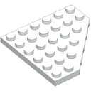{ .lu-ti width="24" loading="lazy" } [Corner Plate 6x6x45° (LOT 462)](../462.md) | 1 | No client description | 25 matrices; 0 rewards; 0 community references |
| 9166 | 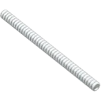{ .lu-ti width="24" loading="lazy" } [Corrugated Pipe 112mm (LOT 9166)](../9166.md) | 1 | No client description | 34 matrices; 0 rewards; 0 community references |
| 5609 | 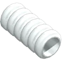{ .lu-ti width="24" loading="lazy" } [Corrugated Pipe 16mm (LOT 5609)](../5609.md) | 1 | No client description | 34 matrices; 0 rewards; 0 community references |
| 9167 | 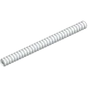{ .lu-ti width="24" loading="lazy" } [Corrugated Pipe 88mm (LOT 9167)](../9167.md) | 1 | No client description | 34 matrices; 0 rewards; 0 community references |
| 8824 | 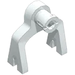{ .lu-ti width="24" loading="lazy" } [Coupling Lever (LOT 8824)](../8824.md) | 1 | No client description | 34 matrices; 0 rewards; 0 community references |
| 10187 | 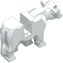{ .lu-ti width="24" loading="lazy" } [Cow (LOT 10187)](../10187.md) | 1 | No client description | 2 matrices; 0 rewards; 0 community references |
| 9158 | 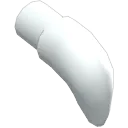{ .lu-ti width="24" loading="lazy" } [Cow Horn (LOT 9158)](../9158.md) | 1 | No client description | 2 matrices; 0 rewards; 0 community references |
| 8840 | { .lu-ti width="24" loading="lazy" } [Cowboy Hat (LOT 8840)](../8840.md) | 1 | No client description | 21 matrices; 0 rewards; 0 community references |
| 690 | { .lu-ti width="24" loading="lazy" } [Cowl 4x4x2/3 (LOT 690)](../690.md) | 1 | No client description | 37 matrices; 0 rewards; 0 community references |
| 749 | { .lu-ti width="24" loading="lazy" } [Cowl 4x6x2/3 (LOT 749)](../749.md) | 1 | No client description | 37 matrices; 0 rewards; 0 community references |
| 5319 | { .lu-ti width="24" loading="lazy" } [Crab (LOT 5319)](../5319.md) | 1 | No client description | 2 matrices; 0 rewards; 0 community references |
| 8816 | 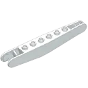{ .lu-ti width="24" loading="lazy" } [Crane Base 2x16x16 (LOT 8816)](../8816.md) | 1 | No client description | 7 matrices; 0 rewards; 0 community references |
| 8815 | 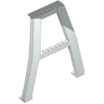{ .lu-ti width="24" loading="lazy" } [Crane Gantry 2x16x16 (LOT 8815)](../8815.md) | 1 | No client description | 7 matrices; 0 rewards; 0 community references |
| 8932 | { .lu-ti width="24" loading="lazy" } [Crash Helmet (LOT 8932)](../8932.md) | 1 | No client description | 21 matrices; 0 rewards; 0 community references |
| 5033 | { .lu-ti width="24" loading="lazy" } [Crash Helmet Visor (LOT 5033)](../5033.md) | 1 | No client description | 21 matrices; 0 rewards; 0 community references |
| 9070 | { .lu-ti width="24" loading="lazy" } [Crawler Track Element 5x1 (LOT 9070)](../9070.md) | 1 | No client description | 37 matrices; 0 rewards; 0 community references |
| 9014 | { .lu-ti width="24" loading="lazy" } [Crawler Track Rubber 151mm (LOT 9014)](../9014.md) | 1 | No client description | 37 matrices; 0 rewards; 0 community references |
| 10236 | 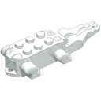{ .lu-ti width="24" loading="lazy" } [Crocodile, Body (LOT 10236)](../10236.md) | 1 | No client description | 2 matrices; 0 rewards; 0 community references |
| 10238 | 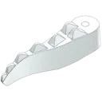{ .lu-ti width="24" loading="lazy" } [Crocodile/Dragon Tail (LOT 10238)](../10238.md) | 1 | No client description | 2 matrices; 0 rewards; 0 community references |
| 10237 | 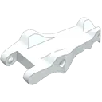{ .lu-ti width="24" loading="lazy" } [Crocodile/Dragon Top Jaw (LOT 10237)](../10237.md) | 1 | No client description | 2 matrices; 0 rewards; 0 community references |
| 5321 | { .lu-ti width="24" loading="lazy" } [Croissant (LOT 5321)](../5321.md) | 1 | No client description | 21 matrices; 0 rewards; 0 community references |
| 16395 | 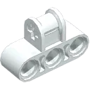{ .lu-ti width="24" loading="lazy" } [Cross Block 3x2 (LOT 16395)](../16395.md) | 1 | No client description | 34 matrices; 0 rewards; 0 community references |
| 16447 | 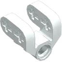{ .lu-ti width="24" loading="lazy" } [Cross Block/Form 2x2x2 (LOT 16447)](../16447.md) | 1 | No client description | 34 matrices; 0 rewards; 0 community references |
| 5056 | { .lu-ti width="24" loading="lazy" } [Crossbow (LOT 5056)](../5056.md) | 1 | No client description | 21 matrices; 0 rewards; 0 community references |
| 16507 | { .lu-ti width="24" loading="lazy" } [Crowbar (LOT 16507)](../16507.md) | 1 | No client description | 21 matrices; 0 rewards; 0 community references |
| 5602 | { .lu-ti width="24" loading="lazy" } [Crown Helmet (LOT 5602)](../5602.md) | 1 | No client description | 2 matrices; 0 rewards; 0 community references |
| 5210 | 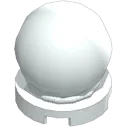{ .lu-ti width="24" loading="lazy" } [Crystal Globe (LOT 5210)](../5210.md) | 1 | No client description | 14 matrices; 0 rewards; 0 community references |
| 397 | 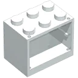{ .lu-ti width="24" loading="lazy" } [Cupboard 2x3x2 (LOT 397)](../397.md) | 1 | No client description | 7 matrices; 0 rewards; 0 community references |
| 398 | 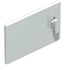{ .lu-ti width="24" loading="lazy" } [Cupboard Door 3x2 (LOT 398)](../398.md) | 1 | No client description | 7 matrices; 0 rewards; 0 community references |
| 13321 | 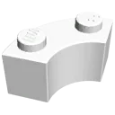{ .lu-ti width="24" loading="lazy" } [Curved Brick with 2 Studs (LOT 13321)](../13321.md) | 1 | No client description | 0 matrices; 0 rewards; 0 community references |
| 9170 | { .lu-ti width="24" loading="lazy" } [Curved Rail 22.5 Metalized (LOT 9170)](../9170.md) | 1 | No client description | 37 matrices; 0 rewards; 0 community references |
| 1228 | 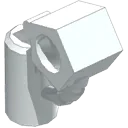{ .lu-ti width="24" loading="lazy" } [Cyborg Arm with Pin Hole (LOT 1228)](../1228.md) | 1 | No client description | 34 matrices; 0 rewards; 0 community references |
| 571 | 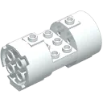{ .lu-ti width="24" loading="lazy" } [Cylinder Brick 3x6x2 2/3 (LOT 571)](../571.md) | 1 | No client description | 25 matrices; 0 rewards; 0 community references |
| 5105 | 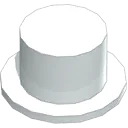{ .lu-ti width="24" loading="lazy" } [Cylinder Hat (LOT 5105)](../5105.md) | 1 | No client description | 2 matrices; 0 rewards; 0 community references |
| 9080 | { .lu-ti width="24" loading="lazy" } [Cylinder Shell 3x6x10 Conical (LOT 9080)](../9080.md) | 1 | No client description | 37 matrices; 0 rewards; 0 community references |
| 8845 | 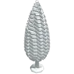{ .lu-ti width="24" loading="lazy" } [Cypress (LOT 8845)](../8845.md) | 1 | No client description | 14 matrices; 0 rewards; 0 community references |
| 5397 | { .lu-ti width="24" loading="lazy" } [Dark Knight Helmet (LOT 5397)](../5397.md) | 1 | No client description | 21 matrices; 0 rewards; 0 community references |
| 8989 | { .lu-ti width="24" loading="lazy" } [Decoration Ball (LOT 8989)](../8989.md) | 1 | No client description | 21 matrices; 0 rewards; 0 community references |
| 8809 | { .lu-ti width="24" loading="lazy" } [Device Shield with Vertical Clips (LOT 8809)](../8809.md) | 1 | No client description | 37 matrices; 0 rewards; 0 community references |
| 5223 | { .lu-ti width="24" loading="lazy" } [Diamond with Stick (LOT 5223)](../5223.md) | 1 | No client description | 21 matrices; 0 rewards; 0 community references |
| 16394 | 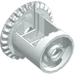{ .lu-ti width="24" loading="lazy" } [Differential 3M Z 28 (LOT 16394)](../16394.md) | 1 | No client description | 34 matrices; 0 rewards; 0 community references |
| 623 | 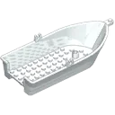{ .lu-ti width="24" loading="lazy" } [Dinghy 8x18x3 1/3 (LOT 623)](../623.md) | 1 | No client description | 37 matrices; 0 rewards; 0 community references |
| 5275 | 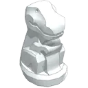{ .lu-ti width="24" loading="lazy" } [Dino Cub (LOT 5275)](../5275.md) | 1 | No client description | 2 matrices; 0 rewards; 0 community references |
| 5345 | 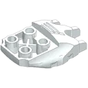{ .lu-ti width="24" loading="lazy" } [Dino Foot 2x4x2/3 (LOT 5345)](../5345.md) | 1 | No client description | 2 matrices; 0 rewards; 0 community references |
| 5341 | 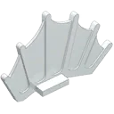{ .lu-ti width="24" loading="lazy" } [Dinosaur Back Fin 8x2x5 (LOT 5341)](../5341.md) | 1 | No client description | 2 matrices; 0 rewards; 0 community references |
| 10241 | 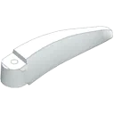{ .lu-ti width="24" loading="lazy" } [Dinosaurus Tail (LOT 10241)](../10241.md) | 1 | No client description | 2 matrices; 0 rewards; 0 community references |
| 746 | 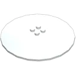{ .lu-ti width="24" loading="lazy" } [Dish 10x10 (LOT 746)](../746.md) | 1 | No client description | 25 matrices; 0 rewards; 0 community references |
| 415 | 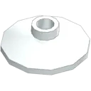{ .lu-ti width="24" loading="lazy" } [Dish 2x2 Inverted (LOT 415)](../415.md) | 1 | No client description | 25 matrices; 0 rewards; 0 community references |
| 675 | 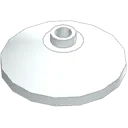{ .lu-ti width="24" loading="lazy" } [Dish 3x3 Inverted (LOT 675)](../675.md) | 1 | No client description | 25 matrices; 0 rewards; 0 community references |
| 350 | 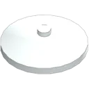{ .lu-ti width="24" loading="lazy" } [Dish 4x4 Inverted (LOT 350)](../350.md) | 1 | No client description | 25 matrices; 0 rewards; 0 community references |
| 677 | 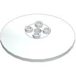{ .lu-ti width="24" loading="lazy" } [Dish 6x6 Inverted  (LOT 677)](../677.md) | 1 | No client description | 25 matrices; 0 rewards; 0 community references |
| 381 | { .lu-ti width="24" loading="lazy" } [Dish 6x6 Inverted with Grid (LOT 381)](../381.md) | 1 | No client description | 14 matrices; 0 rewards; 0 community references |
| 351 | 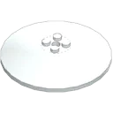{ .lu-ti width="24" loading="lazy" } [Dish 8x8 Inverted (LOT 351)](../351.md) | 1 | No client description | 25 matrices; 0 rewards; 0 community references |
| 5188 | 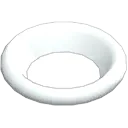{ .lu-ti width="24" loading="lazy" } [Dish Ø24 (LOT 5188)](../5188.md) | 1 | No client description | 21 matrices; 0 rewards; 0 community references |
| 5205 | { .lu-ti width="24" loading="lazy" } [Diver's Mask (LOT 5205)](../5205.md) | 1 | No client description | 21 matrices; 0 rewards; 0 community references |
| 16439 | 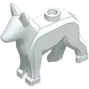{ .lu-ti width="24" loading="lazy" } [Dog with Knob (LOT 16439)](../16439.md) | 1 | No client description | 2 matrices; 0 rewards; 0 community references |
| 5402 | 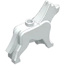{ .lu-ti width="24" loading="lazy" } [Dog/Wolf (LOT 5402)](../5402.md) | 1 | No client description | 2 matrices; 0 rewards; 0 community references |
| 5036 | { .lu-ti width="24" loading="lazy" } [Dolly without Wheel (LOT 5036)](../5036.md) | 1 | No client description | 37 matrices; 0 rewards; 0 community references |
| 8900 | 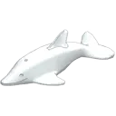{ .lu-ti width="24" loading="lazy" } [Dolphin (LOT 8900)](../8900.md) | 1 | No client description | 2 matrices; 0 rewards; 0 community references |
| 849 | 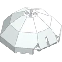{ .lu-ti width="24" loading="lazy" } [Dome 10x10x4 with Hinge (LOT 849)](../849.md) | 1 | No client description | 7 matrices; 0 rewards; 0 community references |
| 535 | 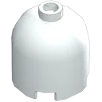{ .lu-ti width="24" loading="lazy" } [Dome 2x2x1 2/3 (LOT 535)](../535.md) | 1 | No client description | 25 matrices; 0 rewards; 0 community references |
| 8941 | 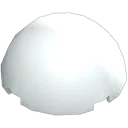{ .lu-ti width="24" loading="lazy" } [Dome 4x4 Faceted (LOT 8941)](../8941.md) | 1 | No client description | 25 matrices; 0 rewards; 0 community references |
| 9194 | { .lu-ti width="24" loading="lazy" } [Dome 4x4 Smooth Ø32 (LOT 9194)](../9194.md) | 1 | No client description | 25 matrices; 0 rewards; 0 community references |
| 732 | { .lu-ti width="24" loading="lazy" } [Dome 6x6 with Vertical Fork (LOT 732)](../732.md) | 1 | No client description | 37 matrices; 0 rewards; 0 community references |
| 934 | 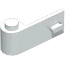{ .lu-ti width="24" loading="lazy" } [Door 1x3x1 Left (LOT 934)](../934.md) | 1 | No client description | 7 matrices; 0 rewards; 0 community references |
| 933 | 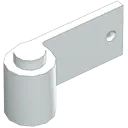{ .lu-ti width="24" loading="lazy" } [Door 1x3x1 Right (LOT 933)](../933.md) | 1 | No client description | 7 matrices; 0 rewards; 0 community references |
| 882 | 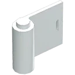{ .lu-ti width="24" loading="lazy" } [Door 1x3x2 Right (LOT 882)](../882.md) | 1 | No client description | 7 matrices; 0 rewards; 0 community references |
| 885 | 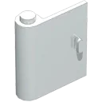{ .lu-ti width="24" loading="lazy" } [Door 1x3x3 Left (LOT 885)](../885.md) | 1 | No client description | 7 matrices; 0 rewards; 0 community references |
| 884 | 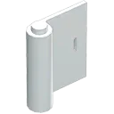{ .lu-ti width="24" loading="lazy" } [Door 1x3x3 Right (LOT 884)](../884.md) | 1 | No client description | 7 matrices; 0 rewards; 0 community references |
| 5542 | 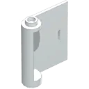{ .lu-ti width="24" loading="lazy" } [Door 1x3x3 Right (LOT 5542)](../5542.md) | 1 | No client description | 7 matrices; 0 rewards; 0 community references |
| 887 | 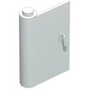{ .lu-ti width="24" loading="lazy" } [Door 1x3x4 Left (LOT 887)](../887.md) | 1 | No client description | 7 matrices; 0 rewards; 0 community references |
| 886 | 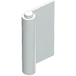{ .lu-ti width="24" loading="lazy" } [Door 1x3x4 Right (LOT 886)](../886.md) | 1 | No client description | 7 matrices; 0 rewards; 0 community references |
| 5491 | 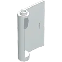{ .lu-ti width="24" loading="lazy" } [Door 1x3x4 Right (LOT 5491)](../5491.md) | 1 | No client description | 7 matrices; 0 rewards; 0 community references |
| 8832 | { .lu-ti width="24" loading="lazy" } [Door 1x5x4 Right (LOT 8832)](../8832.md) | 1 | No client description | 7 matrices; 0 rewards; 0 community references |
| 8893 | { .lu-ti width="24" loading="lazy" } [Door 4x4 with Grills and Handle (LOT 8893)](../8893.md) | 1 | No client description | 7 matrices; 0 rewards; 0 community references |
| 8841 | { .lu-ti width="24" loading="lazy" } [Door 4x6 with Grill (LOT 8841)](../8841.md) | 1 | No client description | 7 matrices; 0 rewards; 0 community references |
| 5537 | { .lu-ti width="24" loading="lazy" } [Door with Pane for Frame 1x4x6 (LOT 5537)](../5537.md) | 1 | No client description | 7 matrices; 0 rewards; 0 community references |
| 489 | { .lu-ti width="24" loading="lazy" } [Door with Pane for Frame 2x6x6 (LOT 489)](../489.md) | 1 | No client description | 7 matrices; 0 rewards; 0 community references |
| 340 | { .lu-ti width="24" loading="lazy" } [Door with Pane for Frame 4x5 (LOT 340)](../340.md) | 1 | No client description | 7 matrices; 0 rewards; 0 community references |
| 16389 | { .lu-ti width="24" loading="lazy" } [Double Wing 8x8 (LOT 16389)](../16389.md) | 1 | No client description | 37 matrices; 0 rewards; 0 community references |
| 10266 | { .lu-ti width="24" loading="lazy" } [Dragon (LOT 10266)](../10266.md) | 1 | No client description | 2 matrices; 0 rewards; 0 community references |
| 16460 | { .lu-ti width="24" loading="lazy" } [Dragon Head (LOT 16460)](../16460.md) | 1 | No client description | 2 matrices; 0 rewards; 0 community references |
| 9213 | { .lu-ti width="24" loading="lazy" } [Dragon Ornament for Dragon Knight's Helmet (LOT 9213)](../9213.md) | 1 | No client description | 21 matrices; 0 rewards; 0 community references |
| 5165 | { .lu-ti width="24" loading="lazy" } [Dragon-Knight Helmet (LOT 5165)](../5165.md) | 1 | No client description | 2 matrices; 0 rewards; 0 community references |
| 5171 | { .lu-ti width="24" loading="lazy" } [Dragon's Arm, Left (LOT 5171)](../5171.md) | 1 | No client description | 2 matrices; 0 rewards; 0 community references |
| 5170 | { .lu-ti width="24" loading="lazy" } [Dragon's Arm, Right (LOT 5170)](../5170.md) | 1 | No client description | 2 matrices; 0 rewards; 0 community references |
| 10179 | { .lu-ti width="24" loading="lazy" } [Dragon's Head (LOT 10179)](../10179.md) | 1 | No client description | 2 matrices; 0 rewards; 0 community references |
| 10250 | { .lu-ti width="24" loading="lazy" } [Dragon's Head 2 (LOT 10250)](../10250.md) | 1 | No client description | 2 matrices; 0 rewards; 0 community references |
| 10257 | { .lu-ti width="24" loading="lazy" } [Dragon's Head, Jaw (LOT 10257)](../10257.md) | 1 | No client description | 2 matrices; 0 rewards; 0 community references |
| 10251 | { .lu-ti width="24" loading="lazy" } [Dragon's Tail (LOT 10251)](../10251.md) | 1 | No client description | 2 matrices; 0 rewards; 0 community references |
| 1231 | { .lu-ti width="24" loading="lazy" } [Dragon's Wing (LOT 1231)](../1231.md) | 1 | No client description | 2 matrices; 0 rewards; 0 community references |
| 399 | { .lu-ti width="24" loading="lazy" } [Drawer (LOT 399)](../399.md) | 1 | No client description | 7 matrices; 0 rewards; 0 community references |
| 5448 | { .lu-ti width="24" loading="lazy" } [Drilling Machine (LOT 5448)](../5448.md) | 1 | No client description | 21 matrices; 0 rewards; 0 community references |
| 10228 | { .lu-ti width="24" loading="lazy" } [Drum Holder 2x2 (LOT 10228)](../10228.md) | 1 | No client description | 37 matrices; 0 rewards; 0 community references |
| 10229 | { .lu-ti width="24" loading="lazy" } [Drum Ø11 (LOT 10229)](../10229.md) | 1 | No client description | 37 matrices; 0 rewards; 0 community references |
| 22 | { .lu-ti width="24" loading="lazy" } [Dustbin (LOT 22)](../22.md) | 1 | No client description | 14 matrices; 0 rewards; 0 community references |
| 5548 | { .lu-ti width="24" loading="lazy" } [Dwarf King Beard (LOT 5548)](../5548.md) | 1 | No client description | 21 matrices; 0 rewards; 0 community references |
| 5546 | { .lu-ti width="24" loading="lazy" } [Dwarf King's Helmet (LOT 5546)](../5546.md) | 1 | No client description | 21 matrices; 0 rewards; 0 community references |
| 5549 | { .lu-ti width="24" loading="lazy" } [Dwarf Warrior Beard (LOT 5549)](../5549.md) | 1 | No client description | 21 matrices; 0 rewards; 0 community references |
| 5547 | { .lu-ti width="24" loading="lazy" } [Dwarf Warrior's Helmet (LOT 5547)](../5547.md) | 1 | No client description | 21 matrices; 0 rewards; 0 community references |
| 9154 | { .lu-ti width="24" loading="lazy" } [Dynamite (LOT 9154)](../9154.md) | 1 | No client description | 21 matrices; 0 rewards; 0 community references |
| 16464 | { .lu-ti width="24" loading="lazy" } [Egyptian Eaglewing (LOT 16464)](../16464.md) | 1 | No client description | 21 matrices; 0 rewards; 0 community references |
| 16461 | { .lu-ti width="24" loading="lazy" } [Egyptian Sword (LOT 16461)](../16461.md) | 1 | No client description | 21 matrices; 0 rewards; 0 community references |
| 375 | { .lu-ti width="24" loading="lazy" } [Element for Rolling Gate (LOT 375)](../375.md) | 1 | No client description | 7 matrices; 0 rewards; 0 community references |
| 5152 | { .lu-ti width="24" loading="lazy" } [Element Separator (LOT 5152)](../5152.md) | 1 | No client description | 25 matrices; 0 rewards; 0 community references |
| 5368 | { .lu-ti width="24" loading="lazy" } [Elephant Ear (LOT 5368)](../5368.md) | 1 | No client description | 2 matrices; 0 rewards; 0 community references |
| 11114 | { .lu-ti width="24" loading="lazy" } [Elephant Head (LOT 11114)](../11114.md) | 1 | No client description | 0 matrices; 0 rewards; 0 community references |
| 5369 | { .lu-ti width="24" loading="lazy" } [Elephant Tail/Trunk (LOT 5369)](../5369.md) | 1 | No client description | 2 matrices; 0 rewards; 0 community references |
| 376 | { .lu-ti width="24" loading="lazy" } [End Element for Rolling Gate (LOT 376)](../376.md) | 1 | No client description | 7 matrices; 0 rewards; 0 community references |
| 8916 | { .lu-ti width="24" loading="lazy" } [End Piece for Lorry (LOT 8916)](../8916.md) | 1 | No client description | 37 matrices; 0 rewards; 0 community references |
| 5244 | { .lu-ti width="24" loading="lazy" } [Energy Element (LOT 5244)](../5244.md) | 1 | No client description | 14 matrices; 0 rewards; 0 community references |
| 737 | { .lu-ti width="24" loading="lazy" } [Engine 2x2x1 1/3 with Air Intake (LOT 737)](../737.md) | 1 | No client description | 37 matrices; 0 rewards; 0 community references |
| 605 | { .lu-ti width="24" loading="lazy" } [Engine Block 2x2x2 2/3 Sloped (LOT 605)](../605.md) | 1 | No client description | 37 matrices; 0 rewards; 0 community references |
| 8803 | { .lu-ti width="24" loading="lazy" } [Epaulets (LOT 8803)](../8803.md) | 1 | No client description | 21 matrices; 0 rewards; 0 community references |
| 9128 | { .lu-ti width="24" loading="lazy" } [Evil Wig (LOT 9128)](../9128.md) | 1 | No client description | 21 matrices; 0 rewards; 0 community references |
| 5347 | { .lu-ti width="24" loading="lazy" } [Exhaust Pipe with Grooves and Pin (LOT 5347)](../5347.md) | 1 | No client description | 37 matrices; 0 rewards; 0 community references |
| 769 | { .lu-ti width="24" loading="lazy" } [Exhaust Pipe with Pin (LOT 769)](../769.md) | 1 | No client description | 37 matrices; 0 rewards; 0 community references |
| 16367 | { .lu-ti width="24" loading="lazy" } [Exhaust Pipe, Left (LOT 16367)](../16367.md) | 1 | No client description | 37 matrices; 0 rewards; 0 community references |
| 16368 | { .lu-ti width="24" loading="lazy" } [Exhaust Pipe, Right (LOT 16368)](../16368.md) | 1 | No client description | 37 matrices; 0 rewards; 0 community references |
| 5604 | { .lu-ti width="24" loading="lazy" } [Fanfare Horn, Chrome (LOT 5604)](../5604.md) | 1 | No client description | 21 matrices; 0 rewards; 0 community references |
| 9224 | { .lu-ti width="24" loading="lazy" } [Fang with Shaft (LOT 9224)](../9224.md) | 1 | No client description | 2 matrices; 0 rewards; 0 community references |
| 16370 | { .lu-ti width="24" loading="lazy" } [Farmer's Cap (LOT 16370)](../16370.md) | 1 | No client description | 21 matrices; 0 rewards; 0 community references |
| 9218 | { .lu-ti width="24" loading="lazy" } [Feather for Helmet (LOT 9218)](../9218.md) | 1 | No client description | 21 matrices; 0 rewards; 0 community references |
| 9110 | { .lu-ti width="24" loading="lazy" } [Fedora Hat (LOT 9110)](../9110.md) | 1 | No client description | 21 matrices; 0 rewards; 0 community references |
| 5181 | { .lu-ti width="24" loading="lazy" } [Feeding Bottle (LOT 5181)](../5181.md) | 1 | No client description | 21 matrices; 0 rewards; 0 community references |
| 912 | { .lu-ti width="24" loading="lazy" } [Fence 1x4x1 (LOT 912)](../912.md) | 1 | No client description | 14 matrices; 0 rewards; 0 community references |
| 879 | { .lu-ti width="24" loading="lazy" } [Fence 1x4x2 (LOT 879)](../879.md) | 1 | No client description | 14 matrices; 0 rewards; 0 community references |
| 8923 | { .lu-ti width="24" loading="lazy" } [Fence 1x6x2 with Arches (LOT 8923)](../8923.md) | 1 | No client description | 7 matrices; 0 rewards; 0 community references |
| 8830 | { .lu-ti width="24" loading="lazy" } [Fence Gate 1x4 (LOT 8830)](../8830.md) | 1 | No client description | 7 matrices; 0 rewards; 0 community references |
| 548 | { .lu-ti width="24" loading="lazy" } [Fern Leaf (LOT 548)](../548.md) | 1 | No client description | 14 matrices; 0 rewards; 0 community references |
| 9191 | { .lu-ti width="24" loading="lazy" } [Fez (LOT 9191)](../9191.md) | 1 | No client description | 21 matrices; 0 rewards; 0 community references |
| 5091 | { .lu-ti width="24" loading="lazy" } [Firefighter's Axe (LOT 5091)](../5091.md) | 1 | No client description | 21 matrices; 0 rewards; 0 community references |
| 5090 | { .lu-ti width="24" loading="lazy" } [Firefighter's Helmet (LOT 5090)](../5090.md) | 1 | No client description | 21 matrices; 0 rewards; 0 community references |
| 5175 | { .lu-ti width="24" loading="lazy" } [Fireman Breathing Mask (LOT 5175)](../5175.md) | 1 | No client description | 21 matrices; 0 rewards; 0 community references |
| 5248 | { .lu-ti width="24" loading="lazy" } [Fish Ornament with Stick (LOT 5248)](../5248.md) | 1 | No client description | 2 matrices; 0 rewards; 0 community references |
| 5063 | { .lu-ti width="24" loading="lazy" } [Fishing Rod (LOT 5063)](../5063.md) | 1 | No client description | 21 matrices; 0 rewards; 0 community references |
| 785 | { .lu-ti width="24" loading="lazy" } [Flag 2x2 with Horizontal Clips (LOT 785)](../785.md) | 1 | No client description | 0 matrices; 0 rewards; 0 community references |
| 5552 | { .lu-ti width="24" loading="lazy" } [Flag 2x2 with Horizontal Clips (LOT 5552)](../5552.md) | 1 | No client description | 14 matrices; 0 rewards; 0 community references |
| 747 | { .lu-ti width="24" loading="lazy" } [Flag 5x6 Hexagonal with Horizontal Clips (LOT 747)](../747.md) | 1 | No client description | 37 matrices; 0 rewards; 0 community references |
| 831 | { .lu-ti width="24" loading="lazy" } [Flag 6x4 with Horizontal Clips (LOT 831)](../831.md) | 1 | No client description | 14 matrices; 0 rewards; 0 community references |
| 16399 | { .lu-ti width="24" loading="lazy" } [Flame (LOT 16399)](../16399.md) | 1 | No client description | 14 matrices; 0 rewards; 0 community references |
| 9239 | { .lu-ti width="24" loading="lazy" } [Flame 1x4 with Shaft (LOT 9239)](../9239.md) | 1 | No client description | 14 matrices; 0 rewards; 0 community references |
| 9186 | { .lu-ti width="24" loading="lazy" } [Flame 7M with Shaft (LOT 9186)](../9186.md) | 1 | No client description | 14 matrices; 0 rewards; 0 community references |
| 5169 | { .lu-ti width="24" loading="lazy" } [Flame with Haft (LOT 5169)](../5169.md) | 1 | No client description | 14 matrices; 0 rewards; 0 community references |
| 589 | { .lu-ti width="24" loading="lazy" } [Flap 2x8 with Vertical Fork (LOT 589)](../589.md) | 1 | No client description | 37 matrices; 0 rewards; 0 community references |
| 762 | { .lu-ti width="24" loading="lazy" } [Flap 3x12 with Vertical Fork (LOT 762)](../762.md) | 1 | No client description | 37 matrices; 0 rewards; 0 community references |
| 877 | { .lu-ti width="24" loading="lazy" } [Flat Tile 2x2 (LOT 877)](../877.md) | 1 | No client description | 25 matrices; 0 rewards; 0 community references |
| 8945 | { .lu-ti width="24" loading="lazy" } [Flat-Bed Platform 6x12 with Vertical Fork (LOT 8945)](../8945.md) | 1 | No client description | 37 matrices; 0 rewards; 0 community references |
| 9072 | { .lu-ti width="24" loading="lazy" } [Flex Hose 19M with Sticks (LOT 9072)](../9072.md) | 1 | No client description | 34 matrices; 0 rewards; 0 community references |
| 16353 | { .lu-ti width="24" loading="lazy" } [Flex Rod 14M (LOT 16353)](../16353.md) | 1 | No client description | 34 matrices; 0 rewards; 0 community references |
| 16354 | { .lu-ti width="24" loading="lazy" } [Flex Rod 16M (LOT 16354)](../16354.md) | 1 | No client description | 34 matrices; 0 rewards; 0 community references |
| 16347 | { .lu-ti width="24" loading="lazy" } [Flex Tube 12 M (LOT 16347)](../16347.md) | 1 | No client description | 34 matrices; 0 rewards; 0 community references |
| 9076 | { .lu-ti width="24" loading="lazy" } [Flexible Tentacle (LOT 9076)](../9076.md) | 1 | No client description | 2 matrices; 0 rewards; 0 community references |
| 8807 | { .lu-ti width="24" loading="lazy" } [Flintlock Pistol (LOT 8807)](../8807.md) | 1 | No client description | 21 matrices; 0 rewards; 0 community references |
| 5055 | { .lu-ti width="24" loading="lazy" } [Flintlock Rifle (LOT 5055)](../5055.md) | 1 | No client description | 21 matrices; 0 rewards; 0 community references |
| 9002 | { .lu-ti width="24" loading="lazy" } [Flipper (LOT 9002)](../9002.md) | 1 | DO NOT DROP | 0 matrices; 0 rewards; 0 community references |
| 5342 | { .lu-ti width="24" loading="lazy" } [Flipper with Pin (LOT 5342)](../5342.md) | 1 | No client description | 2 matrices; 0 rewards; 0 community references |
| 8954 | { .lu-ti width="24" loading="lazy" } [Flipper with Stud (LOT 8954)](../8954.md) | 1 | No client description | 34 matrices; 0 rewards; 0 community references |
| 924 | { .lu-ti width="24" loading="lazy" } [Flower Stems (LOT 924)](../924.md) | 1 | No client description | 14 matrices; 0 rewards; 0 community references |
| 514 | { .lu-ti width="24" loading="lazy" } [Fly-Screen for Window (LOT 514)](../514.md) | 1 | No client description | 7 matrices; 0 rewards; 0 community references |
| 5229 | { .lu-ti width="24" loading="lazy" } [Flying Goggles (LOT 5229)](../5229.md) | 1 | No client description | 21 matrices; 0 rewards; 0 community references |
| 5230 | { .lu-ti width="24" loading="lazy" } [Flying Helmet (LOT 5230)](../5230.md) | 1 | No client description | 21 matrices; 0 rewards; 0 community references |
| 8918 | { .lu-ti width="24" loading="lazy" } [Foal (LOT 8918)](../8918.md) | 1 | No client description | 2 matrices; 0 rewards; 0 community references |
| 9083 | { .lu-ti width="24" loading="lazy" } [Foam Dart 014.5 - 66mm (LOT 9083)](../9083.md) | 1 | No client description | 34 matrices; 0 rewards; 0 community references |
| 112 | { .lu-ti width="24" loading="lazy" } [Foliate Tree, Globe (LOT 112)](../112.md) | 1 | No client description | 14 matrices; 0 rewards; 0 community references |
| 9127 | { .lu-ti width="24" loading="lazy" } [Foreleg, Left (LOT 9127)](../9127.md) | 1 | No client description | 2 matrices; 0 rewards; 0 community references |
| 9126 | { .lu-ti width="24" loading="lazy" } [Foreleg, Right (LOT 9126)](../9126.md) | 1 | No client description | 2 matrices; 0 rewards; 0 community references |
| 8860 | { .lu-ti width="24" loading="lazy" } [Forestman Cap (LOT 8860)](../8860.md) | 1 | No client description | 21 matrices; 0 rewards; 0 community references |
| 1213 | { .lu-ti width="24" loading="lazy" } [Fork Connector with 4 Tips (LOT 1213)](../1213.md) | 1 | No client description | 14 matrices; 0 rewards; 0 community references |
| 10175 | { .lu-ti width="24" loading="lazy" } [Forklift with Vertical Fork (LOT 10175)](../10175.md) | 1 | No client description | 37 matrices; 0 rewards; 0 community references |
| 5527 | { .lu-ti width="24" loading="lazy" } [Frame 1x2x2 (LOT 5527)](../5527.md) | 1 | No client description | 7 matrices; 0 rewards; 0 community references |
| 5528 | { .lu-ti width="24" loading="lazy" } [Frame 1x2x3 (LOT 5528)](../5528.md) | 1 | No client description | 7 matrices; 0 rewards; 0 community references |
| 353 | { .lu-ti width="24" loading="lazy" } [Frame 1x2x3 Narrow (LOT 353)](../353.md) | 1 | No client description | 7 matrices; 0 rewards; 0 community references |
| 5529 | { .lu-ti width="24" loading="lazy" } [Frame 1x4x3 (LOT 5529)](../5529.md) | 1 | No client description | 7 matrices; 0 rewards; 0 community references |
| 8892 | { .lu-ti width="24" loading="lazy" } [Frame 1x4x4 (LOT 8892)](../8892.md) | 1 | No client description | 7 matrices; 0 rewards; 0 community references |
| 5530 | { .lu-ti width="24" loading="lazy" } [Frame 1x4x6 (LOT 5530)](../5530.md) | 1 | No client description | 7 matrices; 0 rewards; 0 community references |
| 122 | { .lu-ti width="24" loading="lazy" } [Frame 1x4x6 for Door (LOT 122)](../122.md) | 1 | No client description | 7 matrices; 0 rewards; 0 community references |
| 761 | { .lu-ti width="24" loading="lazy" } [Frame 1x4x6 with 2 Cross-Beams (LOT 761)](../761.md) | 1 | No client description | 7 matrices; 0 rewards; 0 community references |
| 5531 | { .lu-ti width="24" loading="lazy" } [Frame 2x4x3 (LOT 5531)](../5531.md) | 1 | No client description | 7 matrices; 0 rewards; 0 community references |
| 490 | { .lu-ti width="24" loading="lazy" } [Frame 2x6x6 (LOT 490)](../490.md) | 1 | No client description | 7 matrices; 0 rewards; 0 community references |
| 9157 | { .lu-ti width="24" loading="lazy" } [Frame Plate 4x4 (LOT 9157)](../9157.md) | 1 | No client description | 25 matrices; 0 rewards; 0 community references |
| 8864 | { .lu-ti width="24" loading="lazy" } [Frame Right 1x4x6 Inverted (LOT 8864)](../8864.md) | 1 | No client description | 7 matrices; 0 rewards; 0 community references |
| 387 | { .lu-ti width="24" loading="lazy" } [Frame Skylight 4x4x3/45° (LOT 387)](../387.md) | 1 | No client description | 7 matrices; 0 rewards; 0 community references |
| 5555 | { .lu-ti width="24" loading="lazy" } [Frame Slanting 3x4x3 (LOT 5555)](../5555.md) | 1 | No client description | 7 matrices; 0 rewards; 0 community references |
| 8794 | { .lu-ti width="24" loading="lazy" } [Frame with Hinge for Windscreen 6x6 Octagonal (LOT 8794)](../8794.md) | 1 | No client description | 19 matrices; 0 rewards; 0 community references |
| 9183 | { .lu-ti width="24" loading="lazy" } [Frenzy Head (LOT 9183)](../9183.md) | 1 | No client description | 2 matrices; 0 rewards; 0 community references |
| 5326 | { .lu-ti width="24" loading="lazy" } [Frog (LOT 5326)](../5326.md) | 1 | No client description | 2 matrices; 0 rewards; 0 community references |
| 5161 | { .lu-ti width="24" loading="lazy" } [Frogman Visor (LOT 5161)](../5161.md) | 1 | No client description | 21 matrices; 0 rewards; 0 community references |
| 5506 | { .lu-ti width="24" loading="lazy" } [Frogman's Feet (LOT 5506)](../5506.md) | 1 | No client description | 21 matrices; 0 rewards; 0 community references |
| 686 | { .lu-ti width="24" loading="lazy" } [Front 2x2 with Suction Cup (LOT 686)](../686.md) | 1 | No client description | 37 matrices; 0 rewards; 0 community references |
| 16410 | { .lu-ti width="24" loading="lazy" } [Front 4x6x1 2/3 (LOT 16410)](../16410.md) | 1 | No client description | 25 matrices; 0 rewards; 0 community references |
| 16336 | { .lu-ti width="24" loading="lazy" } [Front Fork (LOT 16336)](../16336.md) | 1 | No client description | 34 matrices; 0 rewards; 0 community references |
| 8852 | { .lu-ti width="24" loading="lazy" } [Garrison Cap (LOT 8852)](../8852.md) | 1 | No client description | 25 matrices; 0 rewards; 0 community references |
| 357 | { .lu-ti width="24" loading="lazy" } [Gate 1x4x2 with 2 Studs (LOT 357)](../357.md) | 1 | No client description | 14 matrices; 0 rewards; 0 community references |
| 828 | { .lu-ti width="24" loading="lazy" } [Gate 1x8x2 (LOT 828)](../828.md) | 1 | No client description | 14 matrices; 0 rewards; 0 community references |
| 8810 | { .lu-ti width="24" loading="lazy" } [Gate 1x8x3 (LOT 8810)](../8810.md) | 1 | No client description | 14 matrices; 0 rewards; 0 community references |
| 16455 | { .lu-ti width="24" loading="lazy" } [General Skeleton Head (LOT 16455)](../16455.md) | 1 | No client description | 2 matrices; 0 rewards; 0 community references |
| 5060 | { .lu-ti width="24" loading="lazy" } [Ghost Costume (LOT 5060)](../5060.md) | 1 | No client description | 21 matrices; 0 rewards; 0 community references |
| 5334 | { .lu-ti width="24" loading="lazy" } [Girl's Hair (LOT 5334)](../5334.md) | 1 | No client description | 21 matrices; 0 rewards; 0 community references |
