# Brick — page 4/10

[Item database](../README.md)

Pages: [1](type-1-1.md) | [2](type-1-2.md) | [3](type-1-3.md) | [4](type-1-4.md) | [5](type-1-5.md) | [6](type-1-6.md) | [7](type-1-7.md) | [8](type-1-8.md) | [9](type-1-9.md) | [10](type-1-10.md)

| LOT | Item | Rarity | Description | Source evidence |
| --- | --- | --- | --- | --- |
| 5315 | { .lu-ti width="24" loading="lazy" } [Glass (LOT 5315)](../5315.md) | 1 | No client description | 21 matrices; 0 rewards; 0 community references |
| 9174 | 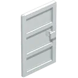{ .lu-ti width="24" loading="lazy" } [Glass Door for Frame 1x4x6 (LOT 9174)](../9174.md) | 1 | No client description | 7 matrices; 0 rewards; 0 community references |
| 5387 | 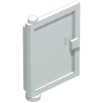{ .lu-ti width="24" loading="lazy" } [Glass Door with Frame 4x5 Left (LOT 5387)](../5387.md) | 1 | No client description | 7 matrices; 0 rewards; 0 community references |
| 5612 | 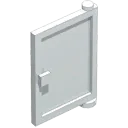{ .lu-ti width="24" loading="lazy" } [Glass Door with Frame 4x5 Right (LOT 5612)](../5612.md) | 1 | No client description | 7 matrices; 0 rewards; 0 community references |
| 5553 | 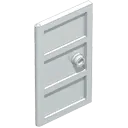{ .lu-ti width="24" loading="lazy" } [Glass Door with Stud for 1x4x6 Frame (LOT 5553)](../5553.md) | 1 | No client description | 7 matrices; 0 rewards; 0 community references |
| 5535 | 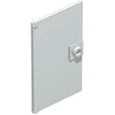{ .lu-ti width="24" loading="lazy" } [Glass Door with Stud for Frame 1x4x6 (LOT 5535)](../5535.md) | 1 | No client description | 7 matrices; 0 rewards; 0 community references |
| 10258 | 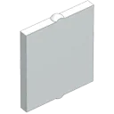{ .lu-ti width="24" loading="lazy" } [Glass for Frame 1x2x2 (LOT 10258)](../10258.md) | 1 | No client description | 7 matrices; 0 rewards; 0 community references |
| 5532 | 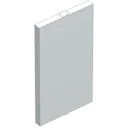{ .lu-ti width="24" loading="lazy" } [Glass for Frame 1x2x3 (LOT 5532)](../5532.md) | 1 | No client description | 7 matrices; 0 rewards; 0 community references |
| 338 | 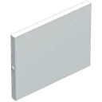{ .lu-ti width="24" loading="lazy" } [Glass for Frame 1x4x3 (LOT 338)](../338.md) | 1 | No client description | 7 matrices; 0 rewards; 0 community references |
| 10259 | 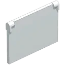{ .lu-ti width="24" loading="lazy" } [Glass for Frame 1x4x3 (LOT 10259)](../10259.md) | 1 | No client description | 7 matrices; 0 rewards; 0 community references |
| 107 | 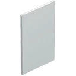{ .lu-ti width="24" loading="lazy" } [Glass for Frame 1x4x6 (LOT 107)](../107.md) | 1 | No client description | 7 matrices; 0 rewards; 0 community references |
| 388 | { .lu-ti width="24" loading="lazy" } [Glass for Skylight 4x4x3/45° (LOT 388)](../388.md) | 1 | No client description | 7 matrices; 0 rewards; 0 community references |
| 369 | 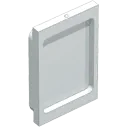{ .lu-ti width="24" loading="lazy" } [Glass for Train Door (LOT 369)](../369.md) | 1 | No client description | 7 matrices; 0 rewards; 0 community references |
| 354 | 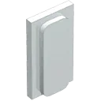{ .lu-ti width="24" loading="lazy" } [Glass for Train Window 1x2x3 (LOT 354)](../354.md) | 1 | No client description | 7 matrices; 0 rewards; 0 community references |
| 352 | 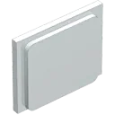{ .lu-ti width="24" loading="lazy" } [Glass for Train Window 1x4x3 (LOT 352)](../352.md) | 1 | No client description | 7 matrices; 0 rewards; 0 community references |
| 8800 | 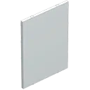{ .lu-ti width="24" loading="lazy" } [Glass Pane 4x5 (LOT 8800)](../8800.md) | 1 | No client description | 0 matrices; 0 rewards; 0 community references |
| 16380 | { .lu-ti width="24" loading="lazy" } [Globe (LOT 16380)](../16380.md) | 1 | No client description | 14 matrices; 0 rewards; 0 community references |
| 5608 | { .lu-ti width="24" loading="lazy" } [Goblet (LOT 5608)](../5608.md) | 1 | No client description | 21 matrices; 0 rewards; 0 community references |
| 16373 | { .lu-ti width="24" loading="lazy" } [Goggles (LOT 16373)](../16373.md) | 1 | No client description | 21 matrices; 0 rewards; 0 community references |
| 16360 | { .lu-ti width="24" loading="lazy" } [Grab for Link (LOT 16360)](../16360.md) | 1 | No client description | 19 matrices; 0 rewards; 0 community references |
| 5241 | { .lu-ti width="24" loading="lazy" } [Grappling Hook (LOT 5241)](../5241.md) | 1 | No client description | 21 matrices; 0 rewards; 0 community references |
| 5581 | 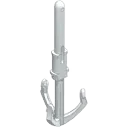{ .lu-ti width="24" loading="lazy" } [Grappling Hook with Stick (LOT 5581)](../5581.md) | 1 | No client description | 1 matrices; 0 rewards; 0 community references |
| 516 | 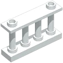{ .lu-ti width="24" loading="lazy" } [Grating 1x4x2 with 2 Studs (LOT 516)](../516.md) | 1 | No client description | 14 matrices; 0 rewards; 0 community references |
| 436 | 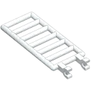{ .lu-ti width="24" loading="lazy" } [Grating 1x4x6 with 2 Horizontal Clips (LOT 436)](../436.md) | 1 | No client description | 14 matrices; 0 rewards; 0 community references |
| 523 | 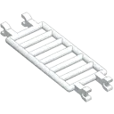{ .lu-ti width="24" loading="lazy" } [Grating 1x4x6 with 4 Horizontal Clips (LOT 523)](../523.md) | 1 | No client description | 14 matrices; 0 rewards; 0 community references |
| 517 | 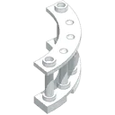{ .lu-ti width="24" loading="lazy" } [Grating 4x4x2 with 2 Studs 1/4-Circle (LOT 517)](../517.md) | 1 | No client description | 14 matrices; 0 rewards; 0 community references |
| 8848 | { .lu-ti width="24" loading="lazy" } [Great Helm with Chin Guard (LOT 8848)](../8848.md) | 1 | No client description | 21 matrices; 0 rewards; 0 community references |
| 5097 | { .lu-ti width="24" loading="lazy" } [Great Helm with Neck Protection (LOT 5097)](../5097.md) | 1 | No client description | 21 matrices; 0 rewards; 0 community references |
| 9034 | 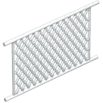{ .lu-ti width="24" loading="lazy" } [Grid 95x57 (LOT 9034)](../9034.md) | 1 | No client description | 14 matrices; 0 rewards; 0 community references |
| 363 | 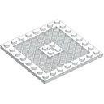{ .lu-ti width="24" loading="lazy" } [Grid Plate 8x8 (LOT 363)](../363.md) | 1 | No client description | 7 matrices; 0 rewards; 0 community references |
| 832 | 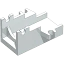{ .lu-ti width="24" loading="lazy" } [Gun Carriage 2x4x1 1/3 (LOT 832)](../832.md) | 1 | No client description | 2 matrices; 0 rewards; 0 community references |
| 5102 | { .lu-ti width="24" loading="lazy" } [Hair Brush (LOT 5102)](../5102.md) | 1 | No client description | 21 matrices; 0 rewards; 0 community references |
| 8987 | { .lu-ti width="24" loading="lazy" } [Hairdryer (LOT 8987)](../8987.md) | 1 | No client description | 21 matrices; 0 rewards; 0 community references |
| 5166 | { .lu-ti width="24" loading="lazy" } [Halberd (LOT 5166)](../5166.md) | 1 | No client description | 21 matrices; 0 rewards; 0 community references |
| 5446 | 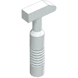{ .lu-ti width="24" loading="lazy" } [Hammer (LOT 5446)](../5446.md) | 1 | No client description | 21 matrices; 0 rewards; 0 community references |
| 16467 | 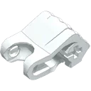{ .lu-ti width="24" loading="lazy" } [Hand 2x3x2 Ball Cup Ø10.2 (LOT 16467)](../16467.md) | 1 | No client description | 34 matrices; 0 rewards; 0 community references |
| 1214 | { .lu-ti width="24" loading="lazy" } [Hand Ladle (LOT 1214)](../1214.md) | 1 | No client description | 21 matrices; 0 rewards; 0 community references |
| 9165 | { .lu-ti width="24" loading="lazy" } [Hand Tool with Suction Cup (LOT 9165)](../9165.md) | 1 | No client description | 21 matrices; 0 rewards; 0 community references |
| 5198 | { .lu-ti width="24" loading="lazy" } [Hand-Held Scanner (LOT 5198)](../5198.md) | 1 | No client description | 21 matrices; 0 rewards; 0 community references |
| 9108 | { .lu-ti width="24" loading="lazy" } [Handcuffs (LOT 9108)](../9108.md) | 1 | No client description | 21 matrices; 0 rewards; 0 community references |
| 5109 | { .lu-ti width="24" loading="lazy" } [Handheld Radio (LOT 5109)](../5109.md) | 1 | No client description | 21 matrices; 0 rewards; 0 community references |
| 510 | { .lu-ti width="24" loading="lazy" } [Handle Bar with Hinge (LOT 510)](../510.md) | 1 | No client description | 1 matrices; 0 rewards; 0 community references |
| 5605 | { .lu-ti width="24" loading="lazy" } [Handle for Bucket (LOT 5605)](../5605.md) | 1 | No client description | 21 matrices; 0 rewards; 0 community references |
| 469 | 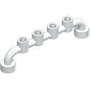{ .lu-ti width="24" loading="lazy" } [Hanger 1x6 with 4 Studs (LOT 469)](../469.md) | 1 | No client description | 14 matrices; 0 rewards; 0 community references |
| 5203 | { .lu-ti width="24" loading="lazy" } [Harpoon 5M (LOT 5203)](../5203.md) | 1 | No client description | 21 matrices; 0 rewards; 0 community references |
| 16451 | { .lu-ti width="24" loading="lazy" } [Hat (LOT 16451)](../16451.md) | 1 | No client description | 21 matrices; 0 rewards; 0 community references |
| 5047 | { .lu-ti width="24" loading="lazy" } [Head Scarf (LOT 5047)](../5047.md) | 1 | No client description | 21 matrices; 0 rewards; 0 community references |
| 16457 | 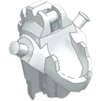{ .lu-ti width="24" loading="lazy" } [Head with Underjaw with Ø3.2 Shaft (LOT 16457)](../16457.md) | 1 | No client description | 2 matrices; 0 rewards; 0 community references |
| 16458 | { .lu-ti width="24" loading="lazy" } [Headtop with Ø3.2 Grip (LOT 16458)](../16458.md) | 1 | No client description | 2 matrices; 0 rewards; 0 community references |
| 5254 | 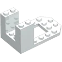{ .lu-ti width="24" loading="lazy" } [Helicopter Chassis 4x7x3 (LOT 5254)](../5254.md) | 1 | No client description | 37 matrices; 0 rewards; 0 community references |
| 8919 | { .lu-ti width="24" loading="lazy" } [Helmet with Hose and Stud (LOT 8919)](../8919.md) | 1 | No client description | 21 matrices; 0 rewards; 0 community references |
| 5583 | { .lu-ti width="24" loading="lazy" } [Helmet with Jagged Jaw (LOT 5583)](../5583.md) | 1 | No client description | 21 matrices; 0 rewards; 0 community references |
| 16509 | { .lu-ti width="24" loading="lazy" } [Helmet with Ø3.2 Shaft at Front (LOT 16509)](../16509.md) | 1 | No client description | 21 matrices; 0 rewards; 0 community references |
| 850 | 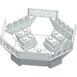{ .lu-ti width="24" loading="lazy" } [Hemisphere 10x10x4 Inverted (LOT 850)](../850.md) | 1 | No client description | 7 matrices; 0 rewards; 0 community references |
| 9122 | 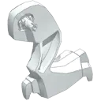{ .lu-ti width="24" loading="lazy" } [Hind Leg with Claws, Left (LOT 9122)](../9122.md) | 1 | No client description | 2 matrices; 0 rewards; 0 community references |
| 9121 | 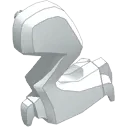{ .lu-ti width="24" loading="lazy" } [Hind Leg with Claws, Right (LOT 9121)](../9121.md) | 1 | No client description | 2 matrices; 0 rewards; 0 community references |
| 68 | 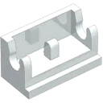{ .lu-ti width="24" loading="lazy" } [Hinge Brick 1x2 Base (LOT 68)](../68.md) | 1 | No client description | 19 matrices; 0 rewards; 0 community references |
| 69 | 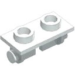{ .lu-ti width="24" loading="lazy" } [Hinge Brick 1x2 Top (LOT 69)](../69.md) | 1 | No client description | 19 matrices; 0 rewards; 0 community references |
| 16363 | 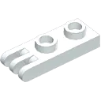{ .lu-ti width="24" loading="lazy" } [Hinge Plate 1x2 1/2 (LOT 16363)](../16363.md) | 1 | No client description | 19 matrices; 0 rewards; 0 community references |
| 16364 | 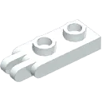{ .lu-ti width="24" loading="lazy" } [Hinge Plate 1x2 1/2 (LOT 16364)](../16364.md) | 1 | No client description | 19 matrices; 0 rewards; 0 community references |
| 10194 | 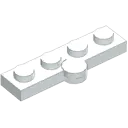{ .lu-ti width="24" loading="lazy" } [Hinge Plate 1x2 1x2 Complete (LOT 10194)](../10194.md) | 1 | No client description | 19 matrices; 0 rewards; 0 community references |
| 16371 | 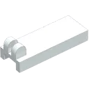{ .lu-ti width="24" loading="lazy" } [Hinge Plate 1x2.5 without Knob (LOT 16371)](../16371.md) | 1 | No client description | 19 matrices; 0 rewards; 0 community references |
| 16365 | 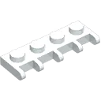{ .lu-ti width="24" loading="lazy" } [Hinge Plate 1x4 (LOT 16365)](../16365.md) | 1 | No client description | 19 matrices; 0 rewards; 0 community references |
| 5384 | { .lu-ti width="24" loading="lazy" } [Hockey Body Armor (LOT 5384)](../5384.md) | 1 | No client description | 21 matrices; 0 rewards; 0 community references |
| 8799 | 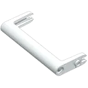{ .lu-ti width="24" loading="lazy" } [Holder for Circular Brush (LOT 8799)](../8799.md) | 1 | No client description | 37 matrices; 0 rewards; 0 community references |
| 16374 | { .lu-ti width="24" loading="lazy" } [Holder with Cross Axle and Knob (LOT 16374)](../16374.md) | 1 | No client description | 25 matrices; 0 rewards; 0 community references |
| 8933 | { .lu-ti width="24" loading="lazy" } [Hollow Stump (LOT 8933)](../8933.md) | 1 | No client description | 14 matrices; 0 rewards; 0 community references |
| 5269 | { .lu-ti width="24" loading="lazy" } [Hood (LOT 5269)](../5269.md) | 1 | No client description | 21 matrices; 0 rewards; 1 community references |
| 5271 | { .lu-ti width="24" loading="lazy" } [Hook with Ball 1x3 (LOT 5271)](../5271.md) | 1 | No client description | 37 matrices; 0 rewards; 0 community references |
| 10254 | 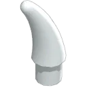{ .lu-ti width="24" loading="lazy" } [Horn with Shaft (LOT 10254)](../10254.md) | 1 | No client description | 2 matrices; 0 rewards; 0 community references |
| 10198 | { .lu-ti width="24" loading="lazy" } [Horse (LOT 10198)](../10198.md) | 1 | No client description | 2 matrices; 0 rewards; 0 community references |
| 5168 | 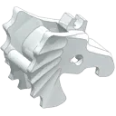{ .lu-ti width="24" loading="lazy" } [Horse Dragon Mask with Clip (LOT 5168)](../5168.md) | 1 | No client description | 21 matrices; 0 rewards; 0 community references |
| 5396 | 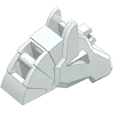{ .lu-ti width="24" loading="lazy" } [Horse Head Armor with Clip (LOT 5396)](../5396.md) | 1 | No client description | 2 matrices; 0 rewards; 0 community references |
| 5130 | { .lu-ti width="24" loading="lazy" } [Horse Saddle (LOT 5130)](../5130.md) | 1 | No client description | 21 matrices; 0 rewards; 0 community references |
| 16463 | { .lu-ti width="24" loading="lazy" } [Horus Hat (LOT 16463)](../16463.md) | 1 | No client description | 21 matrices; 0 rewards; 0 community references |
| 5586 | { .lu-ti width="24" loading="lazy" } [Hub Cap Ø24 (LOT 5586)](../5586.md) | 1 | No client description | 37 matrices; 0 rewards; 0 community references |
| 9010 | { .lu-ti width="24" loading="lazy" } [Hub Ø11.2 x 7.84mm (LOT 9010)](../9010.md) | 1 | No client description | 37 matrices; 0 rewards; 0 community references |
| 91 | { .lu-ti width="24" loading="lazy" } [Hub Ø17.6 x 14mm (LOT 91)](../91.md) | 1 | No client description | 37 matrices; 0 rewards; 0 community references |
| 492 | { .lu-ti width="24" loading="lazy" } [Hub Ø17mm with 4 Studs (LOT 492)](../492.md) | 1 | No client description | 37 matrices; 0 rewards; 0 community references |
| 901 | { .lu-ti width="24" loading="lazy" } [Hub Ø8mm for Fork Bearing (LOT 901)](../901.md) | 1 | No client description | 37 matrices; 0 rewards; 0 community references |
| 536 | { .lu-ti width="24" loading="lazy" } [Hub with Spokes Ø17 (LOT 536)](../536.md) | 1 | No client description | 37 matrices; 0 rewards; 0 community references |
| 5242 | { .lu-ti width="24" loading="lazy" } [Ice Axe (LOT 5242)](../5242.md) | 1 | No client description | 21 matrices; 0 rewards; 0 community references |
| 5357 | 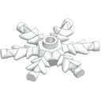{ .lu-ti width="24" loading="lazy" } [Ice Crystal (LOT 5357)](../5357.md) | 1 | No client description | 14 matrices; 0 rewards; 0 community references |
| 5383 | { .lu-ti width="24" loading="lazy" } [Ice Hockey Helmet (LOT 5383)](../5383.md) | 1 | No client description | 21 matrices; 0 rewards; 0 community references |
| 5164 | { .lu-ti width="24" loading="lazy" } [Ice Saw (LOT 5164)](../5164.md) | 1 | No client description | 21 matrices; 0 rewards; 0 community references |
| 5318 | { .lu-ti width="24" loading="lazy" } [Ice-Cream Cone (LOT 5318)](../5318.md) | 1 | No client description | 21 matrices; 0 rewards; 0 community references |
| 9217 | { .lu-ti width="24" loading="lazy" } [Imitation jewelry Wheel (LOT 9217)](../9217.md) | 1 | No client description | 21 matrices; 0 rewards; 0 community references |
| 5260 | { .lu-ti width="24" loading="lazy" } [Inca Helmet (LOT 5260)](../5260.md) | 1 | No client description | 21 matrices; 0 rewards; 0 community references |
| 5213 | { .lu-ti width="24" loading="lazy" } [Indian Feather with Bolt (LOT 5213)](../5213.md) | 1 | No client description | 21 matrices; 0 rewards; 0 community references |
| 5214 | { .lu-ti width="24" loading="lazy" } [Indian Feather with Clip (LOT 5214)](../5214.md) | 1 | No client description | 21 matrices; 0 rewards; 0 community references |
| 8930 | { .lu-ti width="24" loading="lazy" } [Indian Wig (LOT 8930)](../8930.md) | 1 | No client description | 21 matrices; 0 rewards; 0 community references |
| 5245 | { .lu-ti width="24" loading="lazy" } [Insectoid Helmet (LOT 5245)](../5245.md) | 1 | No client description | 21 matrices; 0 rewards; 0 community references |
| 432 | { .lu-ti width="24" loading="lazy" } [Inverted Windscreen 3x4x4 (LOT 432)](../432.md) | 1 | No client description | 37 matrices; 0 rewards; 0 community references |
| 513 | 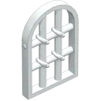{ .lu-ti width="24" loading="lazy" } [Iron Bars for Window (LOT 513)](../513.md) | 1 | No client description | 7 matrices; 0 rewards; 0 community references |
| 8871 | { .lu-ti width="24" loading="lazy" } [Islander Demon Mask (LOT 8871)](../8871.md) | 1 | No client description | 21 matrices; 0 rewards; 0 community references |
| 9062 | { .lu-ti width="24" loading="lazy" } [Jet Front 8x16x5 with Cockpit (LOT 9062)](../9062.md) | 1 | No client description | 37 matrices; 0 rewards; 0 community references |
| 9052 | { .lu-ti width="24" loading="lazy" } [Jet Hull Bottom 8x8x2 (LOT 9052)](../9052.md) | 1 | No client description | 37 matrices; 0 rewards; 0 community references |
| 5437 | { .lu-ti width="24" loading="lazy" } [Jet Hull Top 8x8x2 (LOT 5437)](../5437.md) | 1 | No client description | 37 matrices; 0 rewards; 0 community references |
| 429 | { .lu-ti width="24" loading="lazy" } [Jet Turbine with 2x2 Base (LOT 429)](../429.md) | 1 | No client description | 37 matrices; 0 rewards; 0 community references |
| 5150 | { .lu-ti width="24" loading="lazy" } [Jetpack with Studs (LOT 5150)](../5150.md) | 1 | No client description | 21 matrices; 0 rewards; 0 community references |
| 9124 | { .lu-ti width="24" loading="lazy" } [Joker Hat (LOT 9124)](../9124.md) | 1 | No client description | 21 matrices; 0 rewards; 0 community references |
| 9226 | { .lu-ti width="24" loading="lazy" } [Key Stone 4x4 Round (LOT 9226)](../9226.md) | 1 | No client description | 37 matrices; 0 rewards; 0 community references |
| 5186 | { .lu-ti width="24" loading="lazy" } [Kitten (LOT 5186)](../5186.md) | 1 | No client description | 2 matrices; 0 rewards; 0 community references |
| 5039 | { .lu-ti width="24" loading="lazy" } [Knapsack (LOT 5039)](../5039.md) | 1 | No client description | 21 matrices; 0 rewards; 0 community references |
| 5377 | 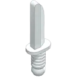{ .lu-ti width="24" loading="lazy" } [Knife (LOT 5377)](../5377.md) | 1 | No client description | 21 matrices; 0 rewards; 0 community references |
| 5059 | { .lu-ti width="24" loading="lazy" } [Knight Armor with Skirt (LOT 5059)](../5059.md) | 1 | No client description | 21 matrices; 0 rewards; 0 community references |
| 5101 | { .lu-ti width="24" loading="lazy" } [Knight Jousting Lance (LOT 5101)](../5101.md) | 1 | No client description | 21 matrices; 0 rewards; 0 community references |
| 5572 | { .lu-ti width="24" loading="lazy" } [Knight Shield Octagonal (LOT 5572)](../5572.md) | 1 | No client description | 21 matrices; 0 rewards; 0 community references |
| 5398 | 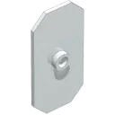{ .lu-ti width="24" loading="lazy" } [Knight Shield Octagonal with Stud (LOT 5398)](../5398.md) | 1 | No client description | 21 matrices; 0 rewards; 0 community references |
| 5098 | { .lu-ti width="24" loading="lazy" } [Knight Shield Triangular (LOT 5098)](../5098.md) | 1 | No client description | 21 matrices; 0 rewards; 0 community references |
| 5136 | { .lu-ti width="24" loading="lazy" } [Knight Tournament Helmet (LOT 5136)](../5136.md) | 1 | No client description | 21 matrices; 0 rewards; 0 community references |
| 5258 | { .lu-ti width="24" loading="lazy" } [Knight's Helmet with Brim (LOT 5258)](../5258.md) | 1 | No client description | 21 matrices; 0 rewards; 0 community references |
| 16421 | 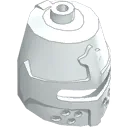{ .lu-ti width="24" loading="lazy" } [Knight&#96;s Helmet (LOT 16421)](../16421.md) | 1 | No client description | 21 matrices; 0 rewards; 0 community references |
| 5351 | { .lu-ti width="24" loading="lazy" } [Knit Cap (LOT 5351)](../5351.md) | 1 | No client description | 21 matrices; 0 rewards; 0 community references |
| 9185 | { .lu-ti width="24" loading="lazy" } [Kranxx Head (LOT 9185)](../9185.md) | 1 | No client description | 21 matrices; 0 rewards; 0 community references |
| 370 | 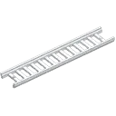{ .lu-ti width="24" loading="lazy" } [Ladder (LOT 370)](../370.md) | 1 | No client description | 14 matrices; 0 rewards; 0 community references |
| 5118 | { .lu-ti width="24" loading="lazy" } [Ladle (LOT 5118)](../5118.md) | 1 | No client description | 21 matrices; 0 rewards; 0 community references |
| 5507 | { .lu-ti width="24" loading="lazy" } [Lady Wig (LOT 5507)](../5507.md) | 1 | No client description | 21 matrices; 0 rewards; 0 community references |
| 9214 | { .lu-ti width="24" loading="lazy" } [Ladybird (LOT 9214)](../9214.md) | 1 | No client description | 2 matrices; 0 rewards; 0 community references |
| 16405 | 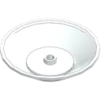{ .lu-ti width="24" loading="lazy" } [Lamp Shade (LOT 16405)](../16405.md) | 1 | No client description | 25 matrices; 0 rewards; 0 community references |
| 784 | { .lu-ti width="24" loading="lazy" } [Lamppost 2x2x7 (LOT 784)](../784.md) | 1 | No client description | 14 matrices; 0 rewards; 0 community references |
| 550 | { .lu-ti width="24" loading="lazy" } [Landing Skid 12x6x1 1/3 (LOT 550)](../550.md) | 1 | No client description | 37 matrices; 0 rewards; 0 community references |
| 5126 | { .lu-ti width="24" loading="lazy" } [Large Axe (LOT 5126)](../5126.md) | 1 | No client description | 21 matrices; 0 rewards; 0 community references |
| 9095 | 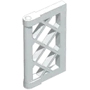{ .lu-ti width="24" loading="lazy" } [Lattice 1/2 for Frame 1x4x3 (LOT 9095)](../9095.md) | 1 | No client description | 7 matrices; 0 rewards; 0 community references |
| 435 | 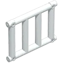{ .lu-ti width="24" loading="lazy" } [Lattice 1x4x3 (LOT 435)](../435.md) | 1 | No client description | 14 matrices; 0 rewards; 0 community references |
| 5573 | { .lu-ti width="24" loading="lazy" } [Lattice 1x4x3 (LOT 5573)](../5573.md) | 1 | No client description | 14 matrices; 0 rewards; 0 community references |
| 714 | { .lu-ti width="24" loading="lazy" } [Lattice 3x28 (LOT 714)](../714.md) | 1 | No client description | 37 matrices; 0 rewards; 0 community references |
| 444 | { .lu-ti width="24" loading="lazy" } [Lattice 9X13 M (LOT 444)](../444.md) | 1 | No client description | 14 matrices; 0 rewards; 0 community references |
| 9140 | { .lu-ti width="24" loading="lazy" } [Lattice A-mast 1x6x10 (LOT 9140)](../9140.md) | 1 | No client description | 7 matrices; 0 rewards; 0 community references |
| 9139 | { .lu-ti width="24" loading="lazy" } [Lattice Brick 1x6x5 with Cross-Beams (LOT 9139)](../9139.md) | 1 | No client description | 7 matrices; 0 rewards; 0 community references |
| 594 | { .lu-ti width="24" loading="lazy" } [Lattice Brick 2x2x10 Type 1 (LOT 594)](../594.md) | 1 | No client description | 7 matrices; 0 rewards; 0 community references |
| 763 | { .lu-ti width="24" loading="lazy" } [Lattice Brick 2x2x10 Type 2 (LOT 763)](../763.md) | 1 | No client description | 7 matrices; 0 rewards; 0 community references |
| 9168 | { .lu-ti width="24" loading="lazy" } [Lattice Brick 2x2x5 (LOT 9168)](../9168.md) | 1 | No client description | 7 matrices; 0 rewards; 0 community references |
| 8863 | { .lu-ti width="24" loading="lazy" } [Lattice Corner 1x4x6 (LOT 8863)](../8863.md) | 1 | No client description | 7 matrices; 0 rewards; 0 community references |
| 660 | { .lu-ti width="24" loading="lazy" } [Lattice Door 4x7 2/3 (LOT 660)](../660.md) | 1 | No client description | 7 matrices; 0 rewards; 0 community references |
| 5536 | { .lu-ti width="24" loading="lazy" } [Lattice Door for Frame 1x4x6 (LOT 5536)](../5536.md) | 1 | No client description | 7 matrices; 0 rewards; 0 community references |
| 459 | { .lu-ti width="24" loading="lazy" } [Lattice Fence 1x8x2 2/3 (LOT 459)](../459.md) | 1 | No client description | 14 matrices; 0 rewards; 0 community references |
| 8928 | { .lu-ti width="24" loading="lazy" } [Lattice Fence 2x12x6 (LOT 8928)](../8928.md) | 1 | No client description | 14 matrices; 0 rewards; 0 community references |
| 16440 | { .lu-ti width="24" loading="lazy" } [Lattice for Frame 4x6 (LOT 16440)](../16440.md) | 1 | No client description | 7 matrices; 0 rewards; 0 community references |
| 10272 | { .lu-ti width="24" loading="lazy" } [Left Arm for Rock Monster 2, Medium Large (LOT 10272)](../10272.md) | 1 | No client description | 2 matrices; 0 rewards; 0 community references |
| 883 | { .lu-ti width="24" loading="lazy" } [Left Door 1x3x2 (LOT 883)](../883.md) | 1 | No client description | 7 matrices; 0 rewards; 0 community references |
| 5543 | { .lu-ti width="24" loading="lazy" } [Left Door 1x3x3 (LOT 5543)](../5543.md) | 1 | No client description | 7 matrices; 0 rewards; 0 community references |
| 5492 | { .lu-ti width="24" loading="lazy" } [Left Door 1x3x4 (LOT 5492)](../5492.md) | 1 | No client description | 7 matrices; 0 rewards; 0 community references |
| 8833 | { .lu-ti width="24" loading="lazy" } [Left Door 1x5x4 (LOT 8833)](../8833.md) | 1 | No client description | 7 matrices; 0 rewards; 0 community references |
| 9212 | { .lu-ti width="24" loading="lazy" } [Left Wing for Dragon Knight's Helmet (LOT 9212)](../9212.md) | 1 | No client description | 21 matrices; 0 rewards; 0 community references |
| 10249 | { .lu-ti width="24" loading="lazy" } [Leg 4x8x5 2/3 (LOT 10249)](../10249.md) | 1 | No client description | 2 matrices; 0 rewards; 0 community references |
| 10252 | { .lu-ti width="24" loading="lazy" } [Leg 5x8x7 2/3 without Decoration (LOT 10252)](../10252.md) | 1 | No client description | 2 matrices; 0 rewards; 0 community references |
| 5534 | { .lu-ti width="24" loading="lazy" } [Lid ½ for Frame 1x4x3 (LOT 5534)](../5534.md) | 1 | No client description | 7 matrices; 0 rewards; 0 community references |
| 384 | { .lu-ti width="24" loading="lazy" } [Lid for Box 2x2x2 (LOT 384)](../384.md) | 1 | No client description | 14 matrices; 0 rewards; 0 community references |
| 5062 | { .lu-ti width="24" loading="lazy" } [Life Vest (LOT 5062)](../5062.md) | 1 | No client description | 21 matrices; 0 rewards; 0 community references |
| 5267 | { .lu-ti width="24" loading="lazy" } [Lifering with Stud (LOT 5267)](../5267.md) | 1 | No client description | 21 matrices; 0 rewards; 0 community references |
| 9209 | { .lu-ti width="24" loading="lazy" } [Liftarm Cylinder with Heft (LOT 9209)](../9209.md) | 1 | No client description | 34 matrices; 0 rewards; 0 community references |
| 9210 | { .lu-ti width="24" loading="lazy" } [Liftarm Rod with Heft (LOT 9210)](../9210.md) | 1 | No client description | 34 matrices; 0 rewards; 0 community references |
| 579 | { .lu-ti width="24" loading="lazy" } [Light Sword Blade (LOT 579)](../579.md) | 1 | No client description | 25 matrices; 0 rewards; 0 community references |
| 1223 | { .lu-ti width="24" loading="lazy" } [Light Sword Handle (LOT 1223)](../1223.md) | 1 | No client description | 0 matrices; 0 rewards; 0 community references |
| 5598 | { .lu-ti width="24" loading="lazy" } [Light Sword Handle (LOT 5598)](../5598.md) | 1 | No client description | 21 matrices; 0 rewards; 0 community references |
| 5505 | { .lu-ti width="24" loading="lazy" } [Lightning Bolt with Handle (LOT 5505)](../5505.md) | 1 | No client description | 21 matrices; 0 rewards; 0 community references |
| 16359 | { .lu-ti width="24" loading="lazy" } [Link for Grab (LOT 16359)](../16359.md) | 1 | No client description | 19 matrices; 0 rewards; 0 community references |
| 16386 | { .lu-ti width="24" loading="lazy" } [Link with Snap with Fork (LOT 16386)](../16386.md) | 1 | No client description | 19 matrices; 0 rewards; 0 community references |
| 16387 | { .lu-ti width="24" loading="lazy" } [Link with Snap with Friction (LOT 16387)](../16387.md) | 1 | No client description | 19 matrices; 0 rewards; 0 community references |
| 5120 | { .lu-ti width="24" loading="lazy" } [Loaf of Bread (LOT 5120)](../5120.md) | 1 | No client description | 21 matrices; 0 rewards; 0 community references |
| 11041 | { .lu-ti width="24" loading="lazy" } [m2429 (LOT 11041)](../11041.md) | 1 | Sub-Assembly | 0 matrices; 0 rewards; 0 community references |
| 11042 | { .lu-ti width="24" loading="lazy" } [m2430 (LOT 11042)](../11042.md) | 1 | Sub-Assembly | 0 matrices; 0 rewards; 0 community references |
| 11043 | { .lu-ti width="24" loading="lazy" } [m2531 (LOT 11043)](../11043.md) | 1 | Sub-Assembly | 0 matrices; 0 rewards; 0 community references |
| 11044 | { .lu-ti width="24" loading="lazy" } [m2532 (LOT 11044)](../11044.md) | 1 | Sub-Assembly | 0 matrices; 0 rewards; 0 community references |
| 11045 | { .lu-ti width="24" loading="lazy" } [m2533 (LOT 11045)](../11045.md) | 1 | Sub-Assembly | 0 matrices; 0 rewards; 0 community references |
| 11046 | { .lu-ti width="24" loading="lazy" } [m2534 (LOT 11046)](../11046.md) | 1 | Sub-Assembly | 0 matrices; 0 rewards; 0 community references |
| 11047 | { .lu-ti width="24" loading="lazy" } [m2550 (LOT 11047)](../11047.md) | 1 | Sub-Assembly | 0 matrices; 0 rewards; 0 community references |
| 11048 | { .lu-ti width="24" loading="lazy" } [m30289 (LOT 11048)](../11048.md) | 1 | Sub-Assembly | 0 matrices; 0 rewards; 0 community references |
| 11049 | { .lu-ti width="24" loading="lazy" } [m30291 (LOT 11049)](../11049.md) | 1 | Sub-Assembly | 0 matrices; 0 rewards; 0 community references |
| 11319 | { .lu-ti width="24" loading="lazy" } [m30321 (LOT 11319)](../11319.md) | 1 | Sub-Assembly | 0 matrices; 0 rewards; 0 community references |
| 11050 | { .lu-ti width="24" loading="lazy" } [m30488 (LOT 11050)](../11050.md) | 1 | Sub-Assembly | 0 matrices; 0 rewards; 0 community references |
| 11051 | { .lu-ti width="24" loading="lazy" } [m30491 (LOT 11051)](../11051.md) | 1 | Sub-Assembly | 0 matrices; 0 rewards; 0 community references |
| 11052 | { .lu-ti width="24" loading="lazy" } [m30516 (LOT 11052)](../11052.md) | 1 | Sub-Assembly | 0 matrices; 0 rewards; 0 community references |
| 5283 | { .lu-ti width="24" loading="lazy" } [m30658 (LOT 5283)](../5283.md) | 1 | Sub-Assembly | 0 matrices; 0 rewards; 0 community references |
| 11054 | { .lu-ti width="24" loading="lazy" } [m32075 (LOT 11054)](../11054.md) | 1 | Sub-Assembly | 0 matrices; 0 rewards; 0 community references |
| 11055 | { .lu-ti width="24" loading="lazy" } [m3326 (LOT 11055)](../11055.md) | 1 | Sub-Assembly | 0 matrices; 0 rewards; 0 community references |
| 11056 | { .lu-ti width="24" loading="lazy" } [m3403 (LOT 11056)](../11056.md) | 1 | Sub-Assembly | 0 matrices; 0 rewards; 0 community references |
| 11057 | { .lu-ti width="24" loading="lazy" } [m3404 (LOT 11057)](../11057.md) | 1 | Sub-Assembly | 0 matrices; 0 rewards; 0 community references |
| 918 | { .lu-ti width="24" loading="lazy" } [m3679 (LOT 918)](../918.md) | 1 | Sub-Assembly | 0 matrices; 0 rewards; 0 community references |
| 5085 | { .lu-ti width="24" loading="lazy" } [m3680 (LOT 5085)](../5085.md) | 1 | Sub-Assembly | 0 matrices; 0 rewards; 0 community references |
| 11060 | { .lu-ti width="24" loading="lazy" } [m3814 (LOT 11060)](../11060.md) | 1 | Sub-Assembly | 0 matrices; 0 rewards; 0 community references |
| 11061 | { .lu-ti width="24" loading="lazy" } [m3815 (LOT 11061)](../11061.md) | 1 | Sub-Assembly | 0 matrices; 0 rewards; 0 community references |
| 11062 | { .lu-ti width="24" loading="lazy" } [m3816 (LOT 11062)](../11062.md) | 1 | Sub-Assembly | 0 matrices; 0 rewards; 0 community references |
| 11063 | { .lu-ti width="24" loading="lazy" } [m3817 (LOT 11063)](../11063.md) | 1 | Sub-Assembly | 0 matrices; 0 rewards; 0 community references |
| 11064 | { .lu-ti width="24" loading="lazy" } [m3818 (LOT 11064)](../11064.md) | 1 | Sub-Assembly | 0 matrices; 0 rewards; 0 community references |
| 11065 | { .lu-ti width="24" loading="lazy" } [m3819 (LOT 11065)](../11065.md) | 1 | Sub-Assembly | 0 matrices; 0 rewards; 0 community references |
| 11066 | { .lu-ti width="24" loading="lazy" } [m3820 (LOT 11066)](../11066.md) | 1 | Sub-Assembly | 0 matrices; 0 rewards; 0 community references |
| 11067 | { .lu-ti width="24" loading="lazy" } [m3828 (LOT 11067)](../11067.md) | 1 | Sub-Assembly | 0 matrices; 0 rewards; 0 community references |
| 11068 | { .lu-ti width="24" loading="lazy" } [m3829 (LOT 11068)](../11068.md) | 1 | Sub-Assembly | 0 matrices; 0 rewards; 0 community references |
| 5349 | { .lu-ti width="24" loading="lazy" } [m41141 (LOT 5349)](../5349.md) | 1 | Sub-Assembly | 0 matrices; 0 rewards; 0 community references |
| 11070 | { .lu-ti width="24" loading="lazy" } [m4254 (LOT 11070)](../11070.md) | 1 | Sub-Assembly | 0 matrices; 0 rewards; 0 community references |
| 11071 | { .lu-ti width="24" loading="lazy" } [m4255 (LOT 11071)](../11071.md) | 1 | Sub-Assembly | 0 matrices; 0 rewards; 0 community references |
| 9013 | { .lu-ti width="24" loading="lazy" } [m43890 (LOT 9013)](../9013.md) | 1 | Sub-Assembly | 0 matrices; 0 rewards; 0 community references |
| 11073 | { .lu-ti width="24" loading="lazy" } [m4492 (LOT 11073)](../11073.md) | 1 | Sub-Assembly | 0 matrices; 0 rewards; 0 community references |
| 11074 | { .lu-ti width="24" loading="lazy" } [m4493 (LOT 11074)](../11074.md) | 1 | Sub-Assembly | 0 matrices; 0 rewards; 0 community references |
| 11075 | { .lu-ti width="24" loading="lazy" } [m4518 (LOT 11075)](../11075.md) | 1 | Sub-Assembly | 0 matrices; 0 rewards; 0 community references |
| 11076 | { .lu-ti width="24" loading="lazy" } [m45707 (LOT 11076)](../11076.md) | 1 | Sub-Assembly | 0 matrices; 0 rewards; 0 community references |
| 11077 | { .lu-ti width="24" loading="lazy" } [m4592 (LOT 11077)](../11077.md) | 1 | Sub-Assembly | 0 matrices; 0 rewards; 0 community references |
| 11078 | { .lu-ti width="24" loading="lazy" } [m4593 (LOT 11078)](../11078.md) | 1 | Sub-Assembly | 0 matrices; 0 rewards; 0 community references |
