# Brick — page 5/10

[Item database](../README.md)

Pages: [1](type-1-1.md) | [2](type-1-2.md) | [3](type-1-3.md) | [4](type-1-4.md) | [5](type-1-5.md) | [6](type-1-6.md) | [7](type-1-7.md) | [8](type-1-8.md) | [9](type-1-9.md) | [10](type-1-10.md)

| LOT | Item | Rarity | Description | Source evidence |
| --- | --- | --- | --- | --- |
| 11079 | 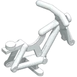{ .lu-ti width="24" loading="lazy" } [m4719 (LOT 11079)](../11079.md) | 1 | Sub-Assembly | 0 matrices; 0 rewards; 0 community references |
| 9032 | { .lu-ti width="24" loading="lazy" } [m48168 (LOT 9032)](../9032.md) | 1 | Sub-Assembly | 0 matrices; 0 rewards; 0 community references |
| 9035 | 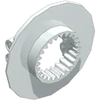{ .lu-ti width="24" loading="lazy" } [m48452 (LOT 9035)](../9035.md) | 1 | Sub-Assembly | 0 matrices; 0 rewards; 0 community references |
| 11082 | 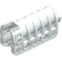{ .lu-ti width="24" loading="lazy" } [m57029 (LOT 11082)](../11082.md) | 1 | Sub-Assembly | 0 matrices; 0 rewards; 0 community references |
| 11083 | { .lu-ti width="24" loading="lazy" } [m59220 (LOT 11083)](../11083.md) | 1 | Sub-Assembly | 0 matrices; 0 rewards; 0 community references |
| 11084 | { .lu-ti width="24" loading="lazy" } [m59222 (LOT 11084)](../11084.md) | 1 | Sub-Assembly | 0 matrices; 0 rewards; 0 community references |
| 16515 | 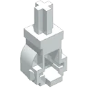{ .lu-ti width="24" loading="lazy" } [m61280 (LOT 16515)](../16515.md) | 1 | Sub-Assembly | 0 matrices; 0 rewards; 0 community references |
| 11085 | 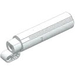{ .lu-ti width="24" loading="lazy" } [m62271 (LOT 11085)](../11085.md) | 1 | Sub-Assembly | 0 matrices; 0 rewards; 0 community references |
| 9119 | { .lu-ti width="24" loading="lazy" } [m62273 (LOT 9119)](../9119.md) | 1 | Sub-Assembly | 0 matrices; 0 rewards; 0 community references |
| 9120 | 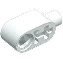{ .lu-ti width="24" loading="lazy" } [m62274 (LOT 9120)](../9120.md) | 1 | Sub-Assembly | 0 matrices; 0 rewards; 0 community references |
| 11088 | 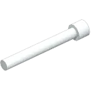{ .lu-ti width="24" loading="lazy" } [m62275 (LOT 11088)](../11088.md) | 1 | Sub-Assembly | 0 matrices; 0 rewards; 0 community references |
| 8901 | 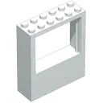{ .lu-ti width="24" loading="lazy" } [m6236 (LOT 8901)](../8901.md) | 1 | Sub-Assembly | 0 matrices; 0 rewards; 0 community references |
| 5574 | 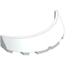{ .lu-ti width="24" loading="lazy" } [m62360 (LOT 5574)](../5574.md) | 1 | Sub-Assembly | 0 matrices; 0 rewards; 0 community references |
| 5575 | { .lu-ti width="24" loading="lazy" } [m62361 (LOT 5575)](../5575.md) | 1 | Sub-Assembly | 0 matrices; 0 rewards; 0 community references |
| 8902 | 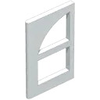{ .lu-ti width="24" loading="lazy" } [m6237 (LOT 8902)](../8902.md) | 1 | Sub-Assembly | 0 matrices; 0 rewards; 0 community references |
| 9123 | 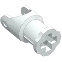{ .lu-ti width="24" loading="lazy" } [m62520 (LOT 9123)](../9123.md) | 1 | Sub-Assembly | 0 matrices; 0 rewards; 0 community references |
| 11037 | { .lu-ti width="24" loading="lazy" } [m62604 (LOT 11037)](../11037.md) | 1 | Sub-Assembly | 0 matrices; 0 rewards; 0 community references |
| 11093 | 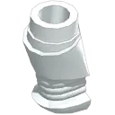{ .lu-ti width="24" loading="lazy" } [m62691 (LOT 11093)](../11093.md) | 1 | Sub-Assembly | 0 matrices; 0 rewards; 0 community references |
| 5596 | 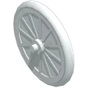{ .lu-ti width="24" loading="lazy" } [m64248 (LOT 5596)](../5596.md) | 1 | Sub-Assembly | 0 matrices; 0 rewards; 0 community references |
| 11095 | 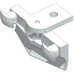{ .lu-ti width="24" loading="lazy" } [m64415 (LOT 11095)](../11095.md) | 1 | Sub-Assembly | 0 matrices; 0 rewards; 0 community references |
| 11096 | 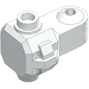{ .lu-ti width="24" loading="lazy" } [m64417 (LOT 11096)](../11096.md) | 1 | Sub-Assembly | 0 matrices; 0 rewards; 0 community references |
| 11097 | 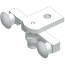{ .lu-ti width="24" loading="lazy" } [m64424 (LOT 11097)](../11097.md) | 1 | Sub-Assembly | 0 matrices; 0 rewards; 0 community references |
| 11098 | 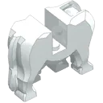{ .lu-ti width="24" loading="lazy" } [m64778 (LOT 11098)](../11098.md) | 1 | Sub-Assembly | 0 matrices; 0 rewards; 0 community references |
| 11099 | { .lu-ti width="24" loading="lazy" } [m64780 (LOT 11099)](../11099.md) | 1 | Sub-Assembly | 0 matrices; 0 rewards; 0 community references |
| 11100 | 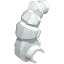{ .lu-ti width="24" loading="lazy" } [m64783 (LOT 11100)](../11100.md) | 1 | Sub-Assembly | 0 matrices; 0 rewards; 0 community references |
| 11101 | 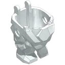{ .lu-ti width="24" loading="lazy" } [m64784 (LOT 11101)](../11101.md) | 1 | Sub-Assembly | 0 matrices; 0 rewards; 0 community references |
| 11102 | { .lu-ti width="24" loading="lazy" } [m64785 (LOT 11102)](../11102.md) | 1 | Sub-Assembly | 0 matrices; 0 rewards; 0 community references |
| 11103 | 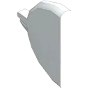{ .lu-ti width="24" loading="lazy" } [m85059 (LOT 11103)](../11103.md) | 1 | Sub-Assembly | 0 matrices; 0 rewards; 0 community references |
| 9235 | { .lu-ti width="24" loading="lazy" } [m87780 (LOT 9235)](../9235.md) | 1 | Sub-Assembly | 0 matrices; 0 rewards; 0 community references |
| 16631 | 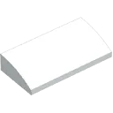{ .lu-ti width="24" loading="lazy" } [m88930 (LOT 16631)](../16631.md) | 1 | No client description | 0 matrices; 0 rewards; 0 community references |
| 11105 | { .lu-ti width="24" loading="lazy" } [m92284 (LOT 11105)](../11105.md) | 1 | Sub-Assembly | 0 matrices; 0 rewards; 0 community references |
| 11038 | 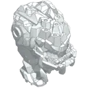{ .lu-ti width="24" loading="lazy" } [m92285 (LOT 11038)](../11038.md) | 1 | Sub-Assembly | 0 matrices; 0 rewards; 0 community references |
| 11036 | { .lu-ti width="24" loading="lazy" } [m93170 (LOT 11036)](../11036.md) | 1 | Sub-Assembly | 0 matrices; 0 rewards; 0 community references |
| 11108 | 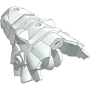{ .lu-ti width="24" loading="lazy" } [m93173 (LOT 11108)](../11108.md) | 1 | Sub-Assembly | 0 matrices; 0 rewards; 0 community references |
| 5173 | { .lu-ti width="24" loading="lazy" } [Magic Hat (LOT 5173)](../5173.md) | 1 | No client description | 21 matrices; 0 rewards; 0 community references |
| 5167 | { .lu-ti width="24" loading="lazy" } [Magic Wand (LOT 5167)](../5167.md) | 1 | No client description | 21 matrices; 0 rewards; 0 community references |
| 5611 | { .lu-ti width="24" loading="lazy" } [Magnet Cylindrical (LOT 5611)](../5611.md) | 1 | No client description | 37 matrices; 0 rewards; 0 community references |
| 5222 | { .lu-ti width="24" loading="lazy" } [Magnifying Glass (LOT 5222)](../5222.md) | 1 | No client description | 21 matrices; 0 rewards; 0 community references |
| 5331 | { .lu-ti width="24" loading="lazy" } [Man's Wig (LOT 5331)](../5331.md) | 1 | No client description | 21 matrices; 0 rewards; 0 community references |
| 8924 | 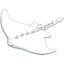{ .lu-ti width="24" loading="lazy" } [Manta Ray (LOT 8924)](../8924.md) | 1 | No client description | 2 matrices; 0 rewards; 0 community references |
| 5279 | { .lu-ti width="24" loading="lazy" } [Martian Head with Clip (LOT 5279)](../5279.md) | 1 | No client description | 2 matrices; 0 rewards; 0 community references |
| 5280 | 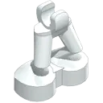{ .lu-ti width="24" loading="lazy" } [Martian Legs with Clip (LOT 5280)](../5280.md) | 1 | No client description | 2 matrices; 0 rewards; 0 community references |
| 716 | { .lu-ti width="24" loading="lazy" } [Mast 2x22 with Platform 4x4 (LOT 716)](../716.md) | 1 | No client description | 37 matrices; 0 rewards; 0 community references |
| 8929 | { .lu-ti width="24" loading="lazy" } [Medicine Man Wig (LOT 8929)](../8929.md) | 1 | No client description | 21 matrices; 0 rewards; 0 community references |
| 1217 | { .lu-ti width="24" loading="lazy" } [Megaphone (LOT 1217)](../1217.md) | 1 | No client description | 21 matrices; 0 rewards; 0 community references |
| 5129 | { .lu-ti width="24" loading="lazy" } [Metal Detector (LOT 5129)](../5129.md) | 1 | No client description | 21 matrices; 0 rewards; 0 community references |
| 5054 | 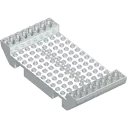{ .lu-ti width="24" loading="lazy" } [Middle Section Ship 8x16 (LOT 5054)](../5054.md) | 1 | No client description | 37 matrices; 0 rewards; 0 community references |
| 10182 | 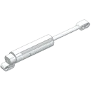{ .lu-ti width="24" loading="lazy" } [Mindstorms Linear Actuator 10-15 M (LOT 10182)](../10182.md) | 1 | No client description | 34 matrices; 0 rewards; 0 community references |
| 10191 | { .lu-ti width="24" loading="lazy" } [Mini Bicycle (LOT 10191)](../10191.md) | 1 | No client description | 37 matrices; 0 rewards; 0 community references |
| 8846 | { .lu-ti width="24" loading="lazy" } [Mini Crash Helmet (LOT 8846)](../8846.md) | 1 | No client description | 21 matrices; 0 rewards; 0 community references |
| 16357 | { .lu-ti width="24" loading="lazy" } [Mini Dragon (LOT 16357)](../16357.md) | 1 | No client description | 2 matrices; 0 rewards; 0 community references |
| 5440 | 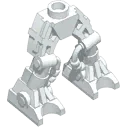{ .lu-ti width="24" loading="lazy" } [Mini Robot Legs with Stud (LOT 5440)](../5440.md) | 1 | No client description | 2 matrices; 0 rewards; 0 community references |
| 10188 | 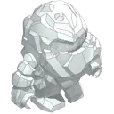{ .lu-ti width="24" loading="lazy" } [Mini Rock Monster 1 (LOT 10188)](../10188.md) | 1 | No client description | 2 matrices; 0 rewards; 0 community references |
| 10208 | 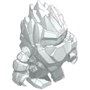{ .lu-ti width="24" loading="lazy" } [Mini Rock Monster 2 (LOT 10208)](../10208.md) | 1 | No client description | 2 matrices; 0 rewards; 0 community references |
| 8847 | { .lu-ti width="24" loading="lazy" } [Mini Shield (LOT 8847)](../8847.md) | 1 | No client description | 37 matrices; 0 rewards; 0 community references |
| 5481 | { .lu-ti width="24" loading="lazy" } [Mini-Head Bad Monster 7 (LOT 5481)](../5481.md) | 1 | No client description | 2 matrices; 0 rewards; 0 community references |
| 5477 | 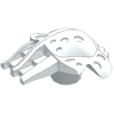{ .lu-ti width="24" loading="lazy" } [Mini-Head Bad Monster 8 (LOT 5477)](../5477.md) | 1 | No client description | 2 matrices; 0 rewards; 0 community references |
| 5478 | 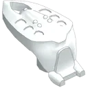{ .lu-ti width="24" loading="lazy" } [Mini-Head Bad Monster 9 (LOT 5478)](../5478.md) | 1 | No client description | 2 matrices; 0 rewards; 0 community references |
| 5482 | { .lu-ti width="24" loading="lazy" } [Mini-Head Good Monster 7 (LOT 5482)](../5482.md) | 1 | No client description | 2 matrices; 0 rewards; 0 community references |
| 5479 | { .lu-ti width="24" loading="lazy" } [Mini-Head Good Monster 8 (LOT 5479)](../5479.md) | 1 | No client description | 2 matrices; 0 rewards; 0 community references |
| 5480 | { .lu-ti width="24" loading="lazy" } [Mini-Head Good Monster 9 (LOT 5480)](../5480.md) | 1 | No client description | 2 matrices; 0 rewards; 0 community references |
| 5445 | { .lu-ti width="24" loading="lazy" } [Mini-Head Piraka No. 1 (LOT 5445)](../5445.md) | 1 | No client description | 2 matrices; 0 rewards; 0 community references |
| 5423 | 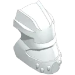{ .lu-ti width="24" loading="lazy" } [Mini-Head Piraka No. 2 (LOT 5423)](../5423.md) | 1 | No client description | 2 matrices; 0 rewards; 0 community references |
| 5425 | 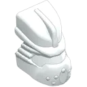{ .lu-ti width="24" loading="lazy" } [Mini-Head Piraka No. 3 (LOT 5425)](../5425.md) | 1 | No client description | 2 matrices; 0 rewards; 0 community references |
| 5427 | { .lu-ti width="24" loading="lazy" } [Mini-Head Piraka No. 4 (LOT 5427)](../5427.md) | 1 | No client description | 2 matrices; 0 rewards; 0 community references |
| 5429 | { .lu-ti width="24" loading="lazy" } [Mini-Head Piraka No. 5 (LOT 5429)](../5429.md) | 1 | No client description | 2 matrices; 0 rewards; 0 community references |
| 5431 | { .lu-ti width="24" loading="lazy" } [Mini-Head Piraka No. 6 (LOT 5431)](../5431.md) | 1 | No client description | 2 matrices; 0 rewards; 0 community references |
| 5422 | 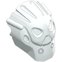{ .lu-ti width="24" loading="lazy" } [Mini-Head Toa No. 1 (LOT 5422)](../5422.md) | 1 | No client description | 2 matrices; 0 rewards; 0 community references |
| 5424 | { .lu-ti width="24" loading="lazy" } [Mini-Head Toa No. 2 (LOT 5424)](../5424.md) | 1 | No client description | 2 matrices; 0 rewards; 0 community references |
| 5426 | { .lu-ti width="24" loading="lazy" } [Mini-Head Toa No. 3 (LOT 5426)](../5426.md) | 1 | No client description | 2 matrices; 0 rewards; 0 community references |
| 5428 | { .lu-ti width="24" loading="lazy" } [Mini-Head Toa No. 4 (LOT 5428)](../5428.md) | 1 | No client description | 2 matrices; 0 rewards; 0 community references |
| 5430 | { .lu-ti width="24" loading="lazy" } [Mini-Head Toa No. 5 (LOT 5430)](../5430.md) | 1 | No client description | 2 matrices; 0 rewards; 0 community references |
| 5439 | { .lu-ti width="24" loading="lazy" } [Mini-Head Toa No. 6 (LOT 5439)](../5439.md) | 1 | No client description | 2 matrices; 0 rewards; 0 community references |
| 5354 | { .lu-ti width="24" loading="lazy" } [Minifig Short Legs and Hips (LOT 5354)](../5354.md) | 1 | No client description | 21 matrices; 0 rewards; 0 community references |
| 1209 | { .lu-ti width="24" loading="lazy" } [Minifigure Head (LOT 1209)](../1209.md) | 1 | No client description | 21 matrices; 0 rewards; 0 community references |
| 10190 | { .lu-ti width="24" loading="lazy" } [Minifigure Legs (LOT 10190)](../10190.md) | 1 | No client description | 21 matrices; 0 rewards; 0 community references |
| 10204 | 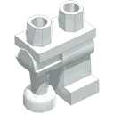{ .lu-ti width="24" loading="lazy" } [Minifigure Legs with Right Wooden Leg (LOT 10204)](../10204.md) | 1 | No client description | 21 matrices; 0 rewards; 0 community references |
| 10200 | { .lu-ti width="24" loading="lazy" } [Minifigure Torso (LOT 10200)](../10200.md) | 1 | No client description | 21 matrices; 0 rewards; 0 community references |
| 10205 | { .lu-ti width="24" loading="lazy" } [Minifigure Torso with Left Hook Prosthesis (LOT 10205)](../10205.md) | 1 | No client description | 21 matrices; 0 rewards; 0 community references |
| 10184 | { .lu-ti width="24" loading="lazy" } [Minifigure Torso with Right Arm Prosthesis (LOT 10184)](../10184.md) | 1 | No client description | 21 matrices; 0 rewards; 0 community references |
| 10196 | { .lu-ti width="24" loading="lazy" } [Monkey (LOT 10196)](../10196.md) | 1 | No client description | 2 matrices; 0 rewards; 0 community references |
| 5201 | { .lu-ti width="24" loading="lazy" } [Morion Helmet (LOT 5201)](../5201.md) | 1 | No client description | 21 matrices; 0 rewards; 0 community references |
| 5504 | { .lu-ti width="24" loading="lazy" } [Morningstar (LOT 5504)](../5504.md) | 1 | No client description | 21 matrices; 0 rewards; 0 community references |
| 5343 | 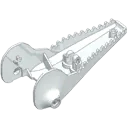{ .lu-ti width="24" loading="lazy" } [Mosasaur Bottom Jaw (LOT 5343)](../5343.md) | 1 | No client description | 2 matrices; 0 rewards; 0 community references |
| 8996 | 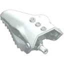{ .lu-ti width="24" loading="lazy" } [Mosasaur Top Jaw (LOT 8996)](../8996.md) | 1 | No client description | 2 matrices; 0 rewards; 0 community references |
| 733 | { .lu-ti width="24" loading="lazy" } [Motorbike Chassis (LOT 733)](../733.md) | 1 | No client description | 37 matrices; 0 rewards; 0 community references |
| 542 | { .lu-ti width="24" loading="lazy" } [Motorbike Front Fork (LOT 542)](../542.md) | 1 | No client description | 37 matrices; 0 rewards; 0 community references |
| 9244 | { .lu-ti width="24" loading="lazy" } [Motorcycle Fairing (LOT 9244)](../9244.md) | 1 | No client description | 37 matrices; 0 rewards; 0 community references |
| 16419 | { .lu-ti width="24" loading="lazy" } [Motorcycle Rim Ø 75 (LOT 16419)](../16419.md) | 1 | No client description | 37 matrices; 0 rewards; 0 community references |
| 16417 | { .lu-ti width="24" loading="lazy" } [Motorcycle Tire Ø 94.2 (LOT 16417)](../16417.md) | 1 | No client description | 37 matrices; 0 rewards; 0 community references |
| 5468 | { .lu-ti width="24" loading="lazy" } [Moulding Element with 4 Flowers (LOT 5468)](../5468.md) | 1 | No client description | 14 matrices; 0 rewards; 0 community references |
| 5220 | 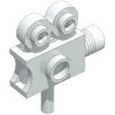{ .lu-ti width="24" loading="lazy" } [Movie Camera (LOT 5220)](../5220.md) | 1 | No client description | 21 matrices; 0 rewards; 0 community references |
| 5107 | { .lu-ti width="24" loading="lazy" } [Mug with Holder (LOT 5107)](../5107.md) | 1 | No client description | 21 matrices; 0 rewards; 0 community references |
| 16341 | 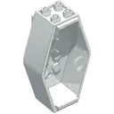{ .lu-ti width="24" loading="lazy" } [Mummy Coffin (LOT 16341)](../16341.md) | 1 | No client description | 14 matrices; 0 rewards; 0 community references |
| 16342 | 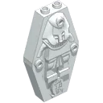{ .lu-ti width="24" loading="lazy" } [Mummy Coffin Lid (LOT 16342)](../16342.md) | 1 | No client description | 14 matrices; 0 rewards; 0 community references |
| 10247 | 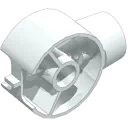{ .lu-ti width="24" loading="lazy" } [Neck - Tail Rotary Joint (LOT 10247)](../10247.md) | 1 | No client description | 2 matrices; 0 rewards; 0 community references |
| 5216 | { .lu-ti width="24" loading="lazy" } [Neck Scarf (LOT 5216)](../5216.md) | 1 | No client description | 21 matrices; 0 rewards; 0 community references |
| 5234 | { .lu-ti width="24" loading="lazy" } [Ninja Headgear (LOT 5234)](../5234.md) | 1 | No client description | 2 matrices; 0 rewards; 0 community references |
| 5232 | { .lu-ti width="24" loading="lazy" } [Ninja Sword (LOT 5232)](../5232.md) | 1 | No client description | 21 matrices; 0 rewards; 0 community references |
| 5551 | { .lu-ti width="24" loading="lazy" } [Notched Scimitar (LOT 5551)](../5551.md) | 1 | No client description | 21 matrices; 0 rewards; 0 community references |
| 1216 | { .lu-ti width="24" loading="lazy" } [Nozzle (LOT 1216)](../1216.md) | 1 | No client description | 0 matrices; 0 rewards; 0 community references |
| 5556 | { .lu-ti width="24" loading="lazy" } [Nozzle with Shaft (LOT 5556)](../5556.md) | 1 | No client description | 21 matrices; 0 rewards; 0 community references |
| 3799 | { .lu-ti width="24" loading="lazy" } [NPC Brick 2X4 (LOT 3799)](../3799.md) | 5 | Carried by troll in scene 1 | 0 matrices; 0 rewards; 0 community references |
| 3801 | 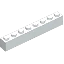{ .lu-ti width="24" loading="lazy" } [NPC Brick 2X8 (LOT 3801)](../3801.md) | 5 | Carried by Dwarf In scene 1 | 0 matrices; 0 rewards; 0 community references |
| 16444 | { .lu-ti width="24" loading="lazy" } [Ø3.2 Shaft with Cored Knob (LOT 16444)](../16444.md) | 1 | No client description | 21 matrices; 0 rewards; 0 community references |
| 5151 | 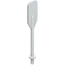{ .lu-ti width="24" loading="lazy" } [Oar (LOT 5151)](../5151.md) | 1 | No client description | 14 matrices; 0 rewards; 0 community references |
| 5160 | 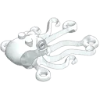{ .lu-ti width="24" loading="lazy" } [Octopus (LOT 5160)](../5160.md) | 1 | No client description | 2 matrices; 0 rewards; 0 community references |
| 5217 | { .lu-ti width="24" loading="lazy" } [Officer's Cap (LOT 5217)](../5217.md) | 1 | No client description | 21 matrices; 0 rewards; 0 community references |
| 5447 | { .lu-ti width="24" loading="lazy" } [Oil Can (LOT 5447)](../5447.md) | 1 | No client description | 21 matrices; 0 rewards; 0 community references |
| 5330 | { .lu-ti width="24" loading="lazy" } [Old Man's Wig (LOT 5330)](../5330.md) | 1 | No client description | 21 matrices; 0 rewards; 0 community references |
| 5450 | { .lu-ti width="24" loading="lazy" } [Open Firm Key (LOT 5450)](../5450.md) | 1 | No client description | 21 matrices; 0 rewards; 0 community references |
| 16420 | { .lu-ti width="24" loading="lazy" } [Ostrich  (LOT 16420)](../16420.md) | 1 | No client description | 2 matrices; 0 rewards; 0 community references |
| 16384 | { .lu-ti width="24" loading="lazy" } [Outer Cable 256mm (LOT 16384)](../16384.md) | 1 | No client description | 34 matrices; 0 rewards; 0 community references |
| 16383 | 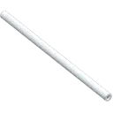{ .lu-ti width="24" loading="lazy" } [Outercable 64mm (LOT 16383)](../16383.md) | 1 | No client description | 34 matrices; 0 rewards; 0 community references |
| 16406 | 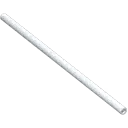{ .lu-ti width="24" loading="lazy" } [Outercable 80mm (LOT 16406)](../16406.md) | 1 | No client description | 34 matrices; 0 rewards; 0 community references |
| 5058 | { .lu-ti width="24" loading="lazy" } [Oval Battle Shield (LOT 5058)](../5058.md) | 1 | No client description | 21 matrices; 0 rewards; 0 community references |
| 8894 | { .lu-ti width="24" loading="lazy" } [Oval Suitcase (LOT 8894)](../8894.md) | 1 | No client description | 21 matrices; 0 rewards; 0 community references |
| 16436 | { .lu-ti width="24" loading="lazy" } [Owl (LOT 16436)](../16436.md) | 1 | No client description | 2 matrices; 0 rewards; 0 community references |
| 5206 | { .lu-ti width="24" loading="lazy" } [Oxygen Bottle with Tube (LOT 5206)](../5206.md) | 1 | No client description | 21 matrices; 0 rewards; 0 community references |
| 5094 | { .lu-ti width="24" loading="lazy" } [Oxygen Bottles (LOT 5094)](../5094.md) | 1 | No client description | 21 matrices; 0 rewards; 0 community references |
| 5046 | { .lu-ti width="24" loading="lazy" } [Paddle (LOT 5046)](../5046.md) | 1 | No client description | 21 matrices; 0 rewards; 0 community references |
| 530 | 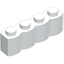{ .lu-ti width="24" loading="lazy" } [Palisade Brick 1x4 (LOT 530)](../530.md) | 1 | No client description | 7 matrices; 0 rewards; 0 community references |
| 8936 | { .lu-ti width="24" loading="lazy" } [Palisade Wall 1x6x6 (LOT 8936)](../8936.md) | 1 | No client description | 7 matrices; 0 rewards; 0 community references |
| 470 | { .lu-ti width="24" loading="lazy" } [Palm Leaf (LOT 470)](../470.md) | 1 | No client description | 14 matrices; 0 rewards; 0 community references |
| 830 | { .lu-ti width="24" loading="lazy" } [Palm Leaf (LOT 830)](../830.md) | 1 | No client description | 14 matrices; 0 rewards; 0 community references |
| 564 | { .lu-ti width="24" loading="lazy" } [Palm Leaves Quadruple (LOT 564)](../564.md) | 1 | No client description | 14 matrices; 0 rewards; 0 community references |
| 468 | 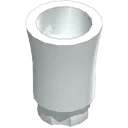{ .lu-ti width="24" loading="lazy" } [Palm Stem Element (LOT 468)](../468.md) | 1 | No client description | 14 matrices; 0 rewards; 0 community references |
| 5140 | { .lu-ti width="24" loading="lazy" } [Pan (LOT 5140)](../5140.md) | 1 | No client description | 21 matrices; 0 rewards; 0 community references |
| 487 | { .lu-ti width="24" loading="lazy" } [Panel 1x1x1 Corner (LOT 487)](../487.md) | 1 | No client description | 25 matrices; 0 rewards; 0 community references |
| 428 | 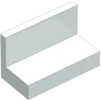{ .lu-ti width="24" loading="lazy" } [Panel 1x2x1 (LOT 428)](../428.md) | 1 | No client description | 25 matrices; 0 rewards; 0 community references |
| 427 | { .lu-ti width="24" loading="lazy" } [Panel 1x2x2 (LOT 427)](../427.md) | 1 | No client description | 7 matrices; 0 rewards; 0 community references |
| 794 | { .lu-ti width="24" loading="lazy" } [Panel 1x2x2 with Window (LOT 794)](../794.md) | 1 | No client description | 7 matrices; 0 rewards; 0 community references |
| 5511 | { .lu-ti width="24" loading="lazy" } [Panel 1x2x2 with Window (LOT 5511)](../5511.md) | 1 | No client description | 7 matrices; 0 rewards; 0 community references |
| 17 | { .lu-ti width="24" loading="lazy" } [Panel 1x2x3 (LOT 17)](../17.md) | 1 | No client description | 7 matrices; 0 rewards; 0 community references |
| 71 | { .lu-ti width="24" loading="lazy" } [Panel 1x2x3 (LOT 71)](../71.md) | 1 | No client description | 37 matrices; 0 rewards; 0 community references |
| 9202 | { .lu-ti width="24" loading="lazy" } [Panel 1x2x3 (LOT 9202)](../9202.md) | 1 | No client description | 7 matrices; 0 rewards; 0 community references |
| 5274 | { .lu-ti width="24" loading="lazy" } [Panel 1x4x1 (LOT 5274)](../5274.md) | 1 | No client description | 25 matrices; 0 rewards; 0 community references |
| 426 | { .lu-ti width="24" loading="lazy" } [Panel 1x4x2 with Windows (LOT 426)](../426.md) | 1 | No client description | 7 matrices; 0 rewards; 0 community references |
| 5561 | { .lu-ti width="24" loading="lazy" } [Panel 1x4x2 with Windows (LOT 5561)](../5561.md) | 1 | No client description | 7 matrices; 0 rewards; 0 community references |
| 5197 | { .lu-ti width="24" loading="lazy" } [Panel 1x4x3 (LOT 5197)](../5197.md) | 1 | No client description | 7 matrices; 0 rewards; 0 community references |
| 5526 | { .lu-ti width="24" loading="lazy" } [Panel 1x4x3 (LOT 5526)](../5526.md) | 1 | No client description | 7 matrices; 0 rewards; 0 community references |
| 765 | { .lu-ti width="24" loading="lazy" } [Panel 1x6x5 (LOT 765)](../765.md) | 1 | No client description | 7 matrices; 0 rewards; 0 community references |
| 683 | { .lu-ti width="24" loading="lazy" } [Panel 2x4x3 Curved with Vertical Fork (LOT 683)](../683.md) | 1 | No client description | 19 matrices; 0 rewards; 0 community references |
| 8898 | { .lu-ti width="24" loading="lazy" } [Panel 2x4x4 1/2-Circle (LOT 8898)](../8898.md) | 1 | No client description | 25 matrices; 0 rewards; 0 community references |
| 9178 | { .lu-ti width="24" loading="lazy" } [Panel 2x4x5 1/2-Circle (LOT 9178)](../9178.md) | 1 | No client description | 7 matrices; 0 rewards; 0 community references |
| 822 | { .lu-ti width="24" loading="lazy" } [Panel 3x2x6 Curved (LOT 822)](../822.md) | 1 | No client description | 7 matrices; 0 rewards; 0 community references |
| 8882 | { .lu-ti width="24" loading="lazy" } [Panel 3x3x6 1/4-Circle with Dome (LOT 8882)](../8882.md) | 1 | No client description | 7 matrices; 0 rewards; 0 community references |
| 8798 | { .lu-ti width="24" loading="lazy" } [Panel 3x3x6 Corner Convex (LOT 8798)](../8798.md) | 1 | No client description | 7 matrices; 0 rewards; 0 community references |
| 844 | { .lu-ti width="24" loading="lazy" } [Panel 3x4x6 with Curve (LOT 844)](../844.md) | 1 | No client description | 7 matrices; 0 rewards; 0 community references |
| 8792 | { .lu-ti width="24" loading="lazy" } [Panel 3x6 Angled with Vertical Clips (LOT 8792)](../8792.md) | 1 | No client description | 37 matrices; 0 rewards; 0 community references |
| 9238 | { .lu-ti width="24" loading="lazy" } [Panel 3x6x6 1/2-Circle (LOT 9238)](../9238.md) | 1 | No client description | 7 matrices; 0 rewards; 0 community references |
| 8946 | { .lu-ti width="24" loading="lazy" } [Panel 3x6x6 with Window and Roof Slope (LOT 8946)](../8946.md) | 1 | No client description | 7 matrices; 0 rewards; 0 community references |
| 602 | { .lu-ti width="24" loading="lazy" } [Panel 4x4x6 1/4-Circle (LOT 602)](../602.md) | 1 | No client description | 7 matrices; 0 rewards; 0 community references |
| 8797 | { .lu-ti width="24" loading="lazy" } [Panel 4x4x6 Corner Concave (LOT 8797)](../8797.md) | 1 | No client description | 7 matrices; 0 rewards; 0 community references |
| 537 | { .lu-ti width="24" loading="lazy" } [Panel 4x6x6 Sloped (LOT 537)](../537.md) | 1 | No client description | 25 matrices; 0 rewards; 0 community references |
| 845 | { .lu-ti width="24" loading="lazy" } [Panel 5x6x10 with Curve (LOT 845)](../845.md) | 1 | No client description | 7 matrices; 0 rewards; 0 community references |
| 8790 | { .lu-ti width="24" loading="lazy" } [Panel 6x10x11 with Studs (LOT 8790)](../8790.md) | 1 | No client description | 7 matrices; 0 rewards; 0 community references |
| 8867 | { .lu-ti width="24" loading="lazy" } [Panel 6x6x9 1/4-Circle with Dome (LOT 8867)](../8867.md) | 1 | No client description | 7 matrices; 0 rewards; 0 community references |
| 386 | { .lu-ti width="24" loading="lazy" } [Panel Wall 1x5x6 with Window (LOT 386)](../386.md) | 1 | No client description | 7 matrices; 0 rewards; 0 community references |
| 791 | { .lu-ti width="24" loading="lazy" } [Panel Wall 3x3x6 Corner (LOT 791)](../791.md) | 1 | No client description | 7 matrices; 0 rewards; 0 community references |
| 723 | { .lu-ti width="24" loading="lazy" } [Panel Wall 3x8x6 with Window (LOT 723)](../723.md) | 1 | No client description | 7 matrices; 0 rewards; 0 community references |
| 8927 | { .lu-ti width="24" loading="lazy" } [Panel Wall 6x3x6 Corner with Window (LOT 8927)](../8927.md) | 1 | No client description | 7 matrices; 0 rewards; 0 community references |
| 8880 | { .lu-ti width="24" loading="lazy" } [Panel Wall Corner with Window 6x6x6 (LOT 8880)](../8880.md) | 1 | No client description | 7 matrices; 0 rewards; 0 community references |
| 5139 | { .lu-ti width="24" loading="lazy" } [Pannier (LOT 5139)](../5139.md) | 1 | No client description | 21 matrices; 0 rewards; 0 community references |
| 5071 | { .lu-ti width="24" loading="lazy" } [Pantograph with Vertical Fork (LOT 5071)](../5071.md) | 1 | No client description | 37 matrices; 0 rewards; 0 community references |
| 768 | { .lu-ti width="24" loading="lazy" } [Parabolic Dish (LOT 768)](../768.md) | 1 | No client description | 14 matrices; 0 rewards; 0 community references |
| 8903 | { .lu-ti width="24" loading="lazy" } [Parasol (LOT 8903)](../8903.md) | 1 | No client description | 14 matrices; 0 rewards; 0 community references |
| 5050 | { .lu-ti width="24" loading="lazy" } [Parrot (LOT 5050)](../5050.md) | 1 | No client description | 2 matrices; 0 rewards; 0 community references |
| 5079 | { .lu-ti width="24" loading="lazy" } [Peaked Cap (LOT 5079)](../5079.md) | 1 | No client description | 21 matrices; 0 rewards; 0 community references |
| 520 | { .lu-ti width="24" loading="lazy" } [Petals/Propeller with 4 Studs (LOT 520)](../520.md) | 1 | No client description | 14 matrices; 0 rewards; 0 community references |
| 5227 | { .lu-ti width="24" loading="lazy" } [Pharaoh's Headdress (LOT 5227)](../5227.md) | 1 | No client description | 21 matrices; 0 rewards; 0 community references |
| 5096 | { .lu-ti width="24" loading="lazy" } [PickAxe (LOT 5096)](../5096.md) | 1 | No client description | 21 matrices; 0 rewards; 0 community references |
| 628 | { .lu-ti width="24" loading="lazy" } [Picket Fence 1x4x2 (LOT 628)](../628.md) | 1 | No client description | 14 matrices; 0 rewards; 0 community references |
| 5116 | { .lu-ti width="24" loading="lazy" } [Pipe Wrench (LOT 5116)](../5116.md) | 1 | No client description | 21 matrices; 0 rewards; 0 community references |
| 640 | { .lu-ti width="24" loading="lazy" } [Pitched Roof 6x6x3 (LOT 640)](../640.md) | 1 | No client description | 7 matrices; 0 rewards; 0 community references |
| 5124 | { .lu-ti width="24" loading="lazy" } [Pitcher (LOT 5124)](../5124.md) | 1 | No client description | 21 matrices; 0 rewards; 0 community references |
| 8858 | { .lu-ti width="24" loading="lazy" } [Pitchfork (LOT 8858)](../8858.md) | 1 | No client description | 21 matrices; 0 rewards; 0 community references |
| 9018 | { .lu-ti width="24" loading="lazy" } [Pivot Joint Housing on 2x2-Base (LOT 9018)](../9018.md) | 1 | No client description | 14 matrices; 0 rewards; 0 community references |
| 10271 | { .lu-ti width="24" loading="lazy" } [Plane Front 6x10x4 with Window (LOT 10271)](../10271.md) | 1 | No client description | 37 matrices; 0 rewards; 0 community references |
| 806 | { .lu-ti width="24" loading="lazy" } [Plant Leaves 4x3 (LOT 806)](../806.md) | 1 | No client description | 14 matrices; 0 rewards; 0 community references |
| 802 | { .lu-ti width="24" loading="lazy" } [Plant Leaves 6x5 (LOT 802)](../802.md) | 1 | No client description | 14 matrices; 0 rewards; 0 community references |
| 496 | { .lu-ti width="24" loading="lazy" } [Plant with 3 Leaves (LOT 496)](../496.md) | 1 | No client description | 14 matrices; 0 rewards; 0 community references |
| 8861 | { .lu-ti width="24" loading="lazy" } [Plastic Cape (LOT 8861)](../8861.md) | 1 | No client description | 21 matrices; 0 rewards; 0 community references |
| 16333 | { .lu-ti width="24" loading="lazy" } [Plastic Motor, Crank/Cross (LOT 16333)](../16333.md) | 1 | No client description | 34 matrices; 0 rewards; 0 community references |
| 16330 | { .lu-ti width="24" loading="lazy" } [Plastic Motor, Cylinder (LOT 16330)](../16330.md) | 1 | No client description | 34 matrices; 0 rewards; 0 community references |
| 16332 | { .lu-ti width="24" loading="lazy" } [Plastic Motor, Main Pin (LOT 16332)](../16332.md) | 1 | No client description | 34 matrices; 0 rewards; 0 community references |
| 16331 | { .lu-ti width="24" loading="lazy" } [Plastic Motor, Piston (LOT 16331)](../16331.md) | 1 | No client description | 34 matrices; 0 rewards; 0 community references |
| 451 | { .lu-ti width="24" loading="lazy" } [Plate 10x10 Octagonal with Cut-Out (LOT 451)](../451.md) | 1 | No client description | 37 matrices; 0 rewards; 0 community references |
| 42 | { .lu-ti width="24" loading="lazy" } [Plate 1x1 (LOT 42)](../42.md) | 1 | No client description | 163 matrices; 0 rewards; 0 community references |
| 84 | { .lu-ti width="24" loading="lazy" } [Plate 1x1 Round (LOT 84)](../84.md) | 1 | No client description | 25 matrices; 0 rewards; 0 community references |
| 8838 | { .lu-ti width="24" loading="lazy" } [Plate 1x1 Round with Ball (LOT 8838)](../8838.md) | 1 | No client description | 19 matrices; 0 rewards; 0 community references |
| 627 | { .lu-ti width="24" loading="lazy" } [Plate 1x1 Round with Flanges (LOT 627)](../627.md) | 1 | No client description | 34 matrices; 0 rewards; 0 community references |
| 110 | { .lu-ti width="24" loading="lazy" } [Plate 1x1 with Collar and Bilateral Studs (LOT 110)](../110.md) | 1 | No client description | 25 matrices; 0 rewards; 0 community references |
| 70 | { .lu-ti width="24" loading="lazy" } [Plate 1x1 with Horizontal Clip (LOT 70)](../70.md) | 1 | No client description | 19 matrices; 0 rewards; 0 community references |
| 9098 | { .lu-ti width="24" loading="lazy" } [Plate 1x1 with Horizontal Clip (LOT 9098)](../9098.md) | 1 | No client description | 19 matrices; 0 rewards; 0 community references |
| 726 | { .lu-ti width="24" loading="lazy" } [Plate 1x1 with Tooth (LOT 726)](../726.md) | 1 | No client description | 36 matrices; 0 rewards; 0 community references |
| 9103 | { .lu-ti width="24" loading="lazy" } [Plate 1x1 with Vertical Clip (LOT 9103)](../9103.md) | 1 | No client description | 19 matrices; 0 rewards; 0 community references |
| 11141 | { .lu-ti width="24" loading="lazy" } [Plate 1x1 with Vertical Clip (LOT 11141)](../11141.md) | 1 | No client description | 0 matrices; 0 rewards; 0 community references |
| 390 | { .lu-ti width="24" loading="lazy" } [Plate 1x10 (LOT 390)](../390.md) | 1 | No client description | 25 matrices; 0 rewards; 0 community references |
| 5523 | { .lu-ti width="24" loading="lazy" } [Plate 1x12 (LOT 5523)](../5523.md) | 1 | No client description | 25 matrices; 0 rewards; 0 community references |
