# Brick — page 6/10

[Item database](../README.md)

Pages: [1](type-1-1.md) | [2](type-1-2.md) | [3](type-1-3.md) | [4](type-1-4.md) | [5](type-1-5.md) | [6](type-1-6.md) | [7](type-1-7.md) | [8](type-1-8.md) | [9](type-1-9.md) | [10](type-1-10.md)

| LOT | Item | Rarity | Description | Source evidence |
| --- | --- | --- | --- | --- |
| 41 | { .lu-ti width="24" loading="lazy" } [Plate 1x2 (LOT 41)](../41.md) | 1 | No client description | 163 matrices; 0 rewards; 0 community references |
| 5517 | 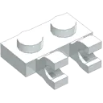{ .lu-ti width="24" loading="lazy" } [Plate 1x2 with 2 Horizontal Clips (LOT 5517)](../5517.md) | 1 | No client description | 19 matrices; 0 rewards; 0 community references |
| 837 | 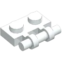{ .lu-ti width="24" loading="lazy" } [Plate 1x2 with Handle Type 1 (LOT 837)](../837.md) | 1 | No client description | 19 matrices; 0 rewards; 0 community references |
| 103 | 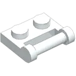{ .lu-ti width="24" loading="lazy" } [Plate 1x2 with Handle Type 2 (LOT 103)](../103.md) | 1 | No client description | 19 matrices; 0 rewards; 0 community references |
| 335 | 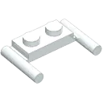{ .lu-ti width="24" loading="lazy" } [Plate 1x2 with Handles (LOT 335)](../335.md) | 1 | No client description | 25 matrices; 0 rewards; 0 community references |
| 16321 | { .lu-ti width="24" loading="lazy" } [Plate 1x2 with Hinge (LOT 16321)](../16321.md) | 1 | No client description | 19 matrices; 0 rewards; 0 community references |
| 5522 | 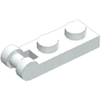{ .lu-ti width="24" loading="lazy" } [Plate 1x2 with Hinge End (LOT 5522)](../5522.md) | 1 | No client description | 19 matrices; 0 rewards; 0 community references |
| 410 | 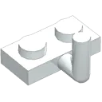{ .lu-ti width="24" loading="lazy" } [Plate 1x2 with Hook (LOT 410)](../410.md) | 1 | No client description | 19 matrices; 0 rewards; 0 community references |
| 9131 | 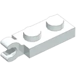{ .lu-ti width="24" loading="lazy" } [Plate 1x2 with Horizontal Clip (LOT 9131)](../9131.md) | 1 | No client description | 19 matrices; 0 rewards; 0 community references |
| 904 | 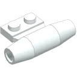{ .lu-ti width="24" loading="lazy" } [Plate 1x2 with Jet Engine (LOT 904)](../904.md) | 1 | No client description | 37 matrices; 0 rewards; 0 community references |
| 366 | 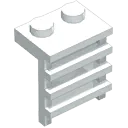{ .lu-ti width="24" loading="lazy" } [Plate 1x2 with Ladder (LOT 366)](../366.md) | 1 | No client description | 25 matrices; 0 rewards; 0 community references |
| 405 | { .lu-ti width="24" loading="lazy" } [Plate 1x2 with Lattice Strut and End Tube (LOT 405)](../405.md) | 1 | No client description | 37 matrices; 0 rewards; 0 community references |
| 685 | { .lu-ti width="24" loading="lazy" } [Plate 1x2 with Racer Mudguards (LOT 685)](../685.md) | 1 | No client description | 37 matrices; 0 rewards; 0 community references |
| 738 | { .lu-ti width="24" loading="lazy" } [Plate 1x2 with Radiator (LOT 738)](../738.md) | 1 | No client description | 37 matrices; 0 rewards; 0 community references |
| 659 | 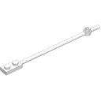{ .lu-ti width="24" loading="lazy" } [Plate 1x2 with Shaft 12M (LOT 659)](../659.md) | 1 | No client description | 25 matrices; 0 rewards; 0 community references |
| 143 | { .lu-ti width="24" loading="lazy" } [Plate 1x2 with Single Stud (LOT 143)](../143.md) | 1 | No client description | 36 matrices; 0 rewards; 0 community references |
| 613 | 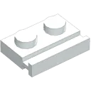{ .lu-ti width="24" loading="lazy" } [Plate 1x2 with Slide (LOT 613)](../613.md) | 1 | No client description | 25 matrices; 0 rewards; 0 community references |
| 740 | { .lu-ti width="24" loading="lazy" } [Plate 1x2 with Spoiler (LOT 740)](../740.md) | 1 | No client description | 37 matrices; 0 rewards; 0 community references |
| 581 | 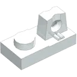{ .lu-ti width="24" loading="lazy" } [Plate 1x2 with Stub on Top (LOT 581)](../581.md) | 1 | No client description | 19 matrices; 0 rewards; 0 community references |
| 619 | 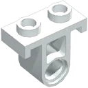{ .lu-ti width="24" loading="lazy" } [Plate 1x2 with Technic Beam (LOT 619)](../619.md) | 1 | No client description | 34 matrices; 0 rewards; 0 community references |
| 5037 | { .lu-ti width="24" loading="lazy" } [Plate 1x2 with Tow Bar and Ball (LOT 5037)](../5037.md) | 1 | No client description | 19 matrices; 0 rewards; 0 community references |
| 101 | 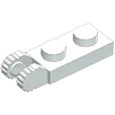{ .lu-ti width="24" loading="lazy" } [Plate 1x2 with Vertical Fork (LOT 101)](../101.md) | 1 | No client description | 19 matrices; 0 rewards; 0 community references |
| 5518 | 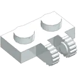{ .lu-ti width="24" loading="lazy" } [Plate 1x2 with Vertical Fork (LOT 5518)](../5518.md) | 1 | No client description | 19 matrices; 0 rewards; 0 community references |
| 100 | 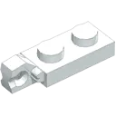{ .lu-ti width="24" loading="lazy" } [Plate 1x2 with Vertical Stub (LOT 100)](../100.md) | 1 | No client description | 19 matrices; 0 rewards; 0 community references |
| 678 | 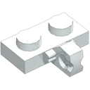{ .lu-ti width="24" loading="lazy" } [Plate 1x2 with Vertical Stub (LOT 678)](../678.md) | 1 | No client description | 19 matrices; 0 rewards; 0 community references |
| 60 | { .lu-ti width="24" loading="lazy" } [Plate 1x3 (LOT 60)](../60.md) | 1 | No client description | 163 matrices; 0 rewards; 0 community references |
| 66 | { .lu-ti width="24" loading="lazy" } [Plate 1x4 (LOT 66)](../66.md) | 1 | No client description | 163 matrices; 0 rewards; 0 community references |
| 16372 | 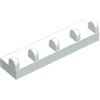{ .lu-ti width="24" loading="lazy" } [Plate 1x4 Vertical Hinge (LOT 16372)](../16372.md) | 1 | No client description | 19 matrices; 0 rewards; 0 community references |
| 16443 | 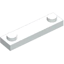{ .lu-ti width="24" loading="lazy" } [Plate 1x4 with 2 Knobs (LOT 16443)](../16443.md) | 1 | No client description | 25 matrices; 0 rewards; 0 community references |
| 28 | { .lu-ti width="24" loading="lazy" } [Plate 1x4 with 2 Snaps (LOT 28)](../28.md) | 1 | No client description | 37 matrices; 0 rewards; 0 community references |
| 679 | 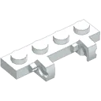{ .lu-ti width="24" loading="lazy" } [Plate 1x4 with 2 Vertical Stubs (LOT 679)](../679.md) | 1 | No client description | 19 matrices; 0 rewards; 0 community references |
| 8829 | 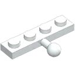{ .lu-ti width="24" loading="lazy" } [Plate 1x4 with Coupling Ball (LOT 8829)](../8829.md) | 1 | No client description | 19 matrices; 0 rewards; 0 community references |
| 8828 | 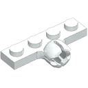{ .lu-ti width="24" loading="lazy" } [Plate 1x4 with Coupling Cup (LOT 8828)](../8828.md) | 1 | No client description | 19 matrices; 0 rewards; 0 community references |
| 5200 | 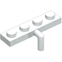{ .lu-ti width="24" loading="lazy" } [Plate 1x4 with Lateral Reversed Hook (LOT 5200)](../5200.md) | 1 | No client description | 19 matrices; 0 rewards; 0 community references |
| 401 | 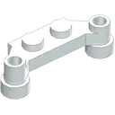{ .lu-ti width="24" loading="lazy" } [Plate 1x4 with Offset Ends (LOT 401)](../401.md) | 1 | No client description | 25 matrices; 0 rewards; 0 community references |
| 5559 | { .lu-ti width="24" loading="lazy" } [Plate 1x4x2/3 with 2 Protruding Pistons (LOT 5559)](../5559.md) | 1 | No client description | 37 matrices; 0 rewards; 0 community references |
| 62 | 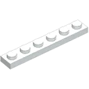{ .lu-ti width="24" loading="lazy" } [Plate 1x6 (LOT 62)](../62.md) | 1 | No client description | 180 matrices; 0 rewards; 0 community references |
| 502 | 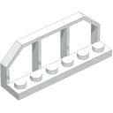{ .lu-ti width="24" loading="lazy" } [Plate 1x6 with Railing (LOT 502)](../502.md) | 1 | No client description | 14 matrices; 0 rewards; 0 community references |
| 58 | { .lu-ti width="24" loading="lazy" } [Plate 1x8 (LOT 58)](../58.md) | 1 | No client description | 164 matrices; 0 rewards; 0 community references |
| 604 | 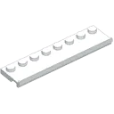{ .lu-ti width="24" loading="lazy" } [Plate 1x8 with Extended Slide (LOT 604)](../604.md) | 1 | No client description | 25 matrices; 0 rewards; 0 community references |
| 395 | 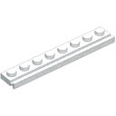{ .lu-ti width="24" loading="lazy" } [Plate 1x8 with Slide (LOT 395)](../395.md) | 1 | No client description | 25 matrices; 0 rewards; 0 community references |
| 180 | 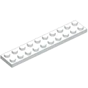{ .lu-ti width="24" loading="lazy" } [Plate 2x10 (LOT 180)](../180.md) | 1 | No client description | 25 matrices; 0 rewards; 0 community references |
| 814 | 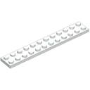{ .lu-ti width="24" loading="lazy" } [Plate 2x12 (LOT 814)](../814.md) | 1 | No client description | 25 matrices; 0 rewards; 0 community references |
| 379 | 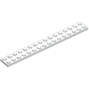{ .lu-ti width="24" loading="lazy" } [Plate 2x16 (LOT 379)](../379.md) | 1 | No client description | 25 matrices; 0 rewards; 0 community references |
| 5589 | { .lu-ti width="24" loading="lazy" } [Plate 2x16 Rotor Blade (LOT 5589)](../5589.md) | 1 | No client description | 37 matrices; 0 rewards; 0 community references |
| 865 | { .lu-ti width="24" loading="lazy" } [Plate 2x2 (LOT 865)](../865.md) | 1 | No client description | 163 matrices; 0 rewards; 0 community references |
| 473 | 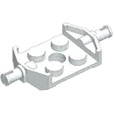{ .lu-ti width="24" loading="lazy" } [Plate 2x2 2/3 with 2 Snaps (LOT 473)](../473.md) | 1 | No client description | 37 matrices; 0 rewards; 0 community references |
| 83 | 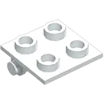{ .lu-ti width="24" loading="lazy" } [Plate 2x2 for Hinge Brick 1x2 (LOT 83)](../83.md) | 1 | No client description | 19 matrices; 0 rewards; 0 community references |
| 178 | { .lu-ti width="24" loading="lazy" } [Plate 2x2 Round (LOT 178)](../178.md) | 1 | No client description | 36 matrices; 0 rewards; 0 community references |
| 855 | { .lu-ti width="24" loading="lazy" } [Plate 2x2 Round with Clips for Wheel (LOT 855)](../855.md) | 1 | No client description | 37 matrices; 0 rewards; 0 community references |
| 9203 | 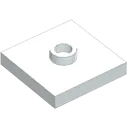{ .lu-ti width="24" loading="lazy" } [Plate 2x2 with 1 Stud (LOT 9203)](../9203.md) | 1 | No client description | 25 matrices; 0 rewards; 0 community references |
| 116 | { .lu-ti width="24" loading="lazy" } [Plate 2x2 with 2 Snaps (LOT 116)](../116.md) | 1 | No client description | 37 matrices; 0 rewards; 0 community references |
| 801 | { .lu-ti width="24" loading="lazy" } [Plate 2x2 with Airplane Landing Gear (LOT 801)](../801.md) | 1 | No client description | 37 matrices; 0 rewards; 0 community references |
| 8844 | 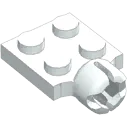{ .lu-ti width="24" loading="lazy" } [Plate 2x2 with Ball Socket (LOT 8844)](../8844.md) | 1 | No client description | 19 matrices; 0 rewards; 0 community references |
| 5593 | 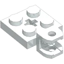{ .lu-ti width="24" loading="lazy" } [Plate 2x2 with Ball Socket and Cross Axle Hole (LOT 5593)](../5593.md) | 1 | No client description | 19 matrices; 0 rewards; 0 community references |
| 102 | { .lu-ti width="24" loading="lazy" } [Plate 2x2 with Bilateral Wheel Bearings (LOT 102)](../102.md) | 1 | No client description | 37 matrices; 0 rewards; 0 community references |
| 5086 | 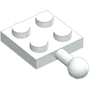{ .lu-ti width="24" loading="lazy" } [Plate 2x2 with Coupling Ball (LOT 5086)](../5086.md) | 1 | No client description | 19 matrices; 0 rewards; 0 community references |
| 931 | { .lu-ti width="24" loading="lazy" } [Plate 2x2 with Fenders (LOT 931)](../931.md) | 1 | No client description | 37 matrices; 0 rewards; 0 community references |
| 431 | 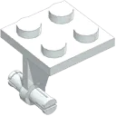{ .lu-ti width="24" loading="lazy" } [Plate 2x2 with Landing Gear (LOT 431)](../431.md) | 1 | No client description | 37 matrices; 0 rewards; 0 community references |
| 511 | 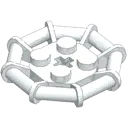{ .lu-ti width="24" loading="lazy" } [Plate 2x2 with Parabolic Ring (LOT 511)](../511.md) | 1 | No client description | 14 matrices; 0 rewards; 0 community references |
| 826 | 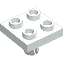{ .lu-ti width="24" loading="lazy" } [Plate 2x2 with Pin Underneath (LOT 826)](../826.md) | 1 | No client description | 19 matrices; 0 rewards; 0 community references |
| 74 | { .lu-ti width="24" loading="lazy" } [Plate 2x2 with Snap (LOT 74)](../74.md) | 1 | No client description | 37 matrices; 0 rewards; 0 community references |
| 522 | 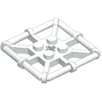{ .lu-ti width="24" loading="lazy" } [Plate 2x2 with Square Ring (LOT 522)](../522.md) | 1 | No client description | 14 matrices; 0 rewards; 0 community references |
| 655 | { .lu-ti width="24" loading="lazy" } [Plate 2x2 with Wedged Fenders (LOT 655)](../655.md) | 1 | No client description | 37 matrices; 0 rewards; 0 community references |
| 40 | { .lu-ti width="24" loading="lazy" } [Plate 2x3 (LOT 40)](../40.md) | 1 | No client description | 164 matrices; 0 rewards; 0 community references |
| 878 | 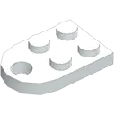{ .lu-ti width="24" loading="lazy" } [Plate 2x3 Semi-Round with Eye (LOT 878)](../878.md) | 1 | No client description | 25 matrices; 0 rewards; 0 community references |
| 39 | { .lu-ti width="24" loading="lazy" } [Plate 2x4 (LOT 39)](../39.md) | 1 | No client description | 163 matrices; 0 rewards; 0 community references |
| 8952 | 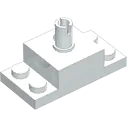{ .lu-ti width="24" loading="lazy" } [Plate 2x4 / 2x2x1 with Pin on Top (LOT 8952)](../8952.md) | 1 | No client description | 19 matrices; 0 rewards; 0 community references |
| 5081 | 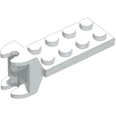{ .lu-ti width="24" loading="lazy" } [Plate 2x4 Across Hinge (LOT 5081)](../5081.md) | 1 | No client description | 19 matrices; 0 rewards; 0 community references |
| 5080 | 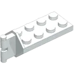{ .lu-ti width="24" loading="lazy" } [Plate 2x4 Cross Coupling (LOT 5080)](../5080.md) | 1 | No client description | 19 matrices; 0 rewards; 0 community references |
| 932 | { .lu-ti width="24" loading="lazy" } [Plate 2x4 Mudguard (LOT 932)](../932.md) | 1 | No client description | 37 matrices; 0 rewards; 0 community references |
| 538 | { .lu-ti width="24" loading="lazy" } [Plate 2x4 with 2 Pins (LOT 538)](../538.md) | 1 | No client description | 37 matrices; 0 rewards; 0 community references |
| 657 | { .lu-ti width="24" loading="lazy" } [Plate 2x4 with Grille (LOT 657)](../657.md) | 1 | No client description | 37 matrices; 0 rewards; 0 community references |
| 16362 | 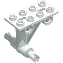{ .lu-ti width="24" loading="lazy" } [Plate 2x4 with Snap 4xØ4.85 (LOT 16362)](../16362.md) | 1 | No client description | 34 matrices; 0 rewards; 0 community references |
| 11134 | { .lu-ti width="24" loading="lazy" } [Plate 2x4x1 1/3 with Side Bows (LOT 11134)](../11134.md) | 1 | No client description | 37 matrices; 0 rewards; 0 community references |
| 144 | { .lu-ti width="24" loading="lazy" } [Plate 2x6 (LOT 144)](../144.md) | 1 | No client description | 163 matrices; 0 rewards; 0 community references |
| 9204 | 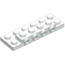{ .lu-ti width="24" loading="lazy" } [Plate 2x6x2/3 with 4 Horizontal Studs (LOT 9204)](../9204.md) | 1 | No client description | 25 matrices; 0 rewards; 0 community references |
| 869 | { .lu-ti width="24" loading="lazy" } [Plate 2x8 (LOT 869)](../869.md) | 1 | No client description | 163 matrices; 0 rewards; 0 community references |
| 568 | 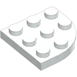{ .lu-ti width="24" loading="lazy" } [Plate 3x3, 1/4-Circle (LOT 568)](../568.md) | 1 | No client description | 25 matrices; 0 rewards; 0 community references |
| 43 | 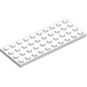{ .lu-ti width="24" loading="lazy" } [Plate 4x10 (LOT 43)](../43.md) | 1 | No client description | 25 matrices; 0 rewards; 0 community references |
| 868 | 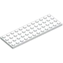{ .lu-ti width="24" loading="lazy" } [Plate 4x12 (LOT 868)](../868.md) | 1 | No client description | 25 matrices; 0 rewards; 0 community references |
| 44 | { .lu-ti width="24" loading="lazy" } [Plate 4x4 (LOT 44)](../44.md) | 1 | No client description | 25 matrices; 0 rewards; 0 community references |
| 603 | { .lu-ti width="24" loading="lazy" } [Plate 4x4 1/4-Circle (LOT 603)](../603.md) | 1 | No client description | 25 matrices; 0 rewards; 0 community references |
| 5519 | { .lu-ti width="24" loading="lazy" } [Plate 4x4 Round with Pin Hole (LOT 5519)](../5519.md) | 1 | No client description | 25 matrices; 0 rewards; 0 community references |
| 8866 | { .lu-ti width="24" loading="lazy" } [Plate 4x4 with Boat Mast Base (LOT 8866)](../8866.md) | 1 | No client description | 37 matrices; 0 rewards; 0 community references |
| 8884 | { .lu-ti width="24" loading="lazy" } [Plate 4x4 with Boat Mast Base (LOT 8884)](../8884.md) | 1 | No client description | 14 matrices; 0 rewards; 0 community references |
| 681 | { .lu-ti width="24" loading="lazy" } [Plate 4x4 with Vertical Fork (LOT 681)](../681.md) | 1 | No client description | 19 matrices; 0 rewards; 0 community references |
| 45 | { .lu-ti width="24" loading="lazy" } [Plate 4x6 (LOT 45)](../45.md) | 1 | No client description | 25 matrices; 0 rewards; 0 community references |
| 47 | { .lu-ti width="24" loading="lazy" } [Plate 4x8 (LOT 47)](../47.md) | 1 | No client description | 25 matrices; 0 rewards; 0 community references |
| 903 | { .lu-ti width="24" loading="lazy" } [Plate 4x8 Tail Fin (LOT 903)](../903.md) | 1 | No client description | 37 matrices; 0 rewards; 0 community references |
| 46 | { .lu-ti width="24" loading="lazy" } [Plate 6x10 (LOT 46)](../46.md) | 1 | No client description | 25 matrices; 0 rewards; 0 community references |
| 867 | { .lu-ti width="24" loading="lazy" } [Plate 6x12 (LOT 867)](../867.md) | 1 | No client description | 25 matrices; 0 rewards; 0 community references |
| 900 | { .lu-ti width="24" loading="lazy" } [Plate 6x14 (LOT 900)](../900.md) | 1 | No client description | 25 matrices; 0 rewards; 0 community references |
| 866 | { .lu-ti width="24" loading="lazy" } [Plate 6x16 (LOT 866)](../866.md) | 1 | No client description | 25 matrices; 0 rewards; 0 community references |
| 8826 | { .lu-ti width="24" loading="lazy" } [Plate 6x24 (LOT 8826)](../8826.md) | 1 | No client description | 25 matrices; 0 rewards; 0 community references |
| 349 | { .lu-ti width="24" loading="lazy" } [Plate 6x6 (LOT 349)](../349.md) | 1 | No client description | 25 matrices; 0 rewards; 0 community references |
| 518 | { .lu-ti width="24" loading="lazy" } [Plate 6x6 Octagonal with Cut-Out (LOT 518)](../518.md) | 1 | No client description | 25 matrices; 0 rewards; 0 community references |
| 434 | { .lu-ti width="24" loading="lazy" } [Plate 6x6, 1/4-Circle (LOT 434)](../434.md) | 1 | No client description | 25 matrices; 0 rewards; 0 community references |
| 559 | { .lu-ti width="24" loading="lazy" } [Plate 6x6x2/3 Cross with Dome (LOT 559)](../559.md) | 1 | No client description | 37 matrices; 0 rewards; 0 community references |
| 48 | { .lu-ti width="24" loading="lazy" } [Plate 6x8 (LOT 48)](../48.md) | 1 | No client description | 25 matrices; 0 rewards; 0 community references |
| 910 | { .lu-ti width="24" loading="lazy" } [Plate 7x12 Left Wing (LOT 910)](../910.md) | 1 | No client description | 37 matrices; 0 rewards; 0 community references |
| 909 | { .lu-ti width="24" loading="lazy" } [Plate 7x12 Right Wing (LOT 909)](../909.md) | 1 | No client description | 37 matrices; 0 rewards; 0 community references |
| 639 | { .lu-ti width="24" loading="lazy" } [Plate 8x8 (LOT 639)](../639.md) | 1 | No client description | 25 matrices; 0 rewards; 0 community references |
| 8920 | { .lu-ti width="24" loading="lazy" } [Plate Frame 6x8 for Trap Door (LOT 8920)](../8920.md) | 1 | No client description | 7 matrices; 0 rewards; 0 community references |
| 8921 | { .lu-ti width="24" loading="lazy" } [Plate Trap Door 4x5 (LOT 8921)](../8921.md) | 1 | No client description | 7 matrices; 0 rewards; 0 community references |
| 8899 | { .lu-ti width="24" loading="lazy" } [Plate Wing 16x14 (LOT 8899)](../8899.md) | 1 | No client description | 37 matrices; 0 rewards; 0 community references |
| 9053 | { .lu-ti width="24" loading="lazy" } [Plate Wing 54x20x2/3 (LOT 9053)](../9053.md) | 1 | No client description | 37 matrices; 0 rewards; 0 community references |
| 5199 | { .lu-ti width="24" loading="lazy" } [Plate Wing 6x8x2/3 with Lattice (LOT 5199)](../5199.md) | 1 | No client description | 37 matrices; 0 rewards; 0 community references |
| 16325 | { .lu-ti width="24" loading="lazy" } [Plateau 16x16x2 1/3 (LOT 16325)](../16325.md) | 1 | No client description | 7 matrices; 0 rewards; 0 community references |
| 5250 | { .lu-ti width="24" loading="lazy" } [Pneumatic Hammer (LOT 5250)](../5250.md) | 1 | No client description | 21 matrices; 0 rewards; 0 community references |
| 1265 | { .lu-ti width="24" loading="lazy" } [Pneumatic T-Piece (LOT 1265)](../1265.md) | 1 | No client description | 25 matrices; 0 rewards; 0 community references |
| 10199 | { .lu-ti width="24" loading="lazy" } [Polar Bear (LOT 10199)](../10199.md) | 1 | No client description | 2 matrices; 0 rewards; 0 community references |
| 5262 | { .lu-ti width="24" loading="lazy" } [Polar Hood with Fur Lining (LOT 5262)](../5262.md) | 1 | No client description | 21 matrices; 0 rewards; 0 community references |
| 5265 | { .lu-ti width="24" loading="lazy" } [Polar Rucksack (LOT 5265)](../5265.md) | 1 | No client description | 21 matrices; 0 rewards; 0 community references |
| 5247 | { .lu-ti width="24" loading="lazy" } [Popsicle (LOT 5247)](../5247.md) | 1 | No client description | 21 matrices; 0 rewards; 0 community references |
| 16415 | { .lu-ti width="24" loading="lazy" } [Porcupine, Shoulder Armor (LOT 16415)](../16415.md) | 1 | No client description | 21 matrices; 0 rewards; 0 community references |
| 5141 | { .lu-ti width="24" loading="lazy" } [Pot with Handle (LOT 5141)](../5141.md) | 1 | No client description | 21 matrices; 0 rewards; 0 community references |
| 5313 | { .lu-ti width="24" loading="lazy" } [Pot with Handle (LOT 5313)](../5313.md) | 1 | No client description | 21 matrices; 0 rewards; 0 community references |
| 5119 | { .lu-ti width="24" loading="lazy" } [Pot with Handles (LOT 5119)](../5119.md) | 1 | No client description | 21 matrices; 0 rewards; 0 community references |
| 5508 | { .lu-ti width="24" loading="lazy" } [Princess Hair (LOT 5508)](../5508.md) | 1 | No client description | 21 matrices; 0 rewards; 0 community references |
| 863 | { .lu-ti width="24" loading="lazy" } [Profile Brick 1x2 (LOT 863)](../863.md) | 1 | No client description | 25 matrices; 0 rewards; 0 community references |
| 409 | { .lu-ti width="24" loading="lazy" } [Propeller 3 Blades Ø5.5 (LOT 409)](../409.md) | 1 | No client description | 37 matrices; 0 rewards; 0 community references |
| 827 | { .lu-ti width="24" loading="lazy" } [Propeller 5x5 with 4 Blades (LOT 827)](../827.md) | 1 | No client description | 19 matrices; 0 rewards; 0 community references |
| 805 | { .lu-ti width="24" loading="lazy" } [Propeller Ø3.5 with 3 Blades (LOT 805)](../805.md) | 1 | No client description | 37 matrices; 0 rewards; 0 community references |
| 562 | { .lu-ti width="24" loading="lazy" } [Propeller Ø7 with 3 Blades and Pin Hole (LOT 562)](../562.md) | 1 | No client description | 37 matrices; 0 rewards; 0 community references |
| 5072 | { .lu-ti width="24" loading="lazy" } [Propeller Ø9 with 2 Blades and Pin Hole (LOT 5072)](../5072.md) | 1 | No client description | 37 matrices; 0 rewards; 0 community references |
| 8875 | { .lu-ti width="24" loading="lazy" } [Propeller Ring-Casing with Fins (LOT 8875)](../8875.md) | 1 | No client description | 37 matrices; 0 rewards; 0 community references |
| 9187 | { .lu-ti width="24" loading="lazy" } [Protective Vest (LOT 9187)](../9187.md) | 1 | No client description | 21 matrices; 0 rewards; 0 community references |
| 8951 | { .lu-ti width="24" loading="lazy" } [Pterodactyl (LOT 8951)](../8951.md) | 1 | No client description | 2 matrices; 0 rewards; 0 community references |
| 16379 | { .lu-ti width="24" loading="lazy" } [Puck Ø16 x 2/3 (LOT 16379)](../16379.md) | 1 | No client description | 34 matrices; 0 rewards; 0 community references |
| 5092 | { .lu-ti width="24" loading="lazy" } [Push Broom (LOT 5092)](../5092.md) | 1 | No client description | 21 matrices; 0 rewards; 0 community references |
| 764 | { .lu-ti width="24" loading="lazy" } [Quarter Circle Brick with Sloped Rim 10x10 (LOT 764)](../764.md) | 1 | No client description | 37 matrices; 0 rewards; 0 community references |
| 5134 | { .lu-ti width="24" loading="lazy" } [Quiver (LOT 5134)](../5134.md) | 1 | No client description | 21 matrices; 0 rewards; 0 community references |
| 8990 | { .lu-ti width="24" loading="lazy" } [Rabbit (LOT 8990)](../8990.md) | 1 | No client description | 2 matrices; 0 rewards; 0 community references |
| 5486 | { .lu-ti width="24" loading="lazy" } [Racing Tire Ø30.4 (LOT 5486)](../5486.md) | 1 | No client description | 37 matrices; 0 rewards; 0 community references |
| 16401 | { .lu-ti width="24" loading="lazy" } [Rack 13 M (LOT 16401)](../16401.md) | 1 | No client description | 34 matrices; 0 rewards; 0 community references |
| 16411 | { .lu-ti width="24" loading="lazy" } [Rack 7 M (LOT 16411)](../16411.md) | 1 | No client description | 34 matrices; 0 rewards; 0 community references |
| 16402 | { .lu-ti width="24" loading="lazy" } [Rack with Ball (LOT 16402)](../16402.md) | 1 | No client description | 34 matrices; 0 rewards; 0 community references |
| 533 | { .lu-ti width="24" loading="lazy" } [Radiator Grille 1x4x2 (LOT 533)](../533.md) | 1 | No client description | 37 matrices; 0 rewards; 0 community references |
| 9172 | { .lu-ti width="24" loading="lazy" } [Railroad Switch Left (LOT 9172)](../9172.md) | 1 | No client description | 37 matrices; 0 rewards; 0 community references |
| 9171 | { .lu-ti width="24" loading="lazy" } [Railroad Switch Right (LOT 9171)](../9171.md) | 1 | No client description | 37 matrices; 0 rewards; 0 community references |
| 5328 | { .lu-ti width="24" loading="lazy" } [Rat (LOT 5328)](../5328.md) | 1 | No client description | 2 matrices; 0 rewards; 0 community references |
| 5215 | { .lu-ti width="24" loading="lazy" } [Revolver (LOT 5215)](../5215.md) | 1 | No client description | 21 matrices; 0 rewards; 0 community references |
| 5218 | { .lu-ti width="24" loading="lazy" } [Rifle (LOT 5218)](../5218.md) | 1 | No client description | 21 matrices; 0 rewards; 0 community references |
| 10273 | { .lu-ti width="24" loading="lazy" } [Right Arm for Rock Monster 2, Medium Large (LOT 10273)](../10273.md) | 1 | No client description | 2 matrices; 0 rewards; 0 community references |
| 9211 | { .lu-ti width="24" loading="lazy" } [Right Wing for Dragon Knight's Helmet (LOT 9211)](../9211.md) | 1 | No client description | 21 matrices; 0 rewards; 0 community references |
| 5455 | { .lu-ti width="24" loading="lazy" } [Rim 30x20 (LOT 5455)](../5455.md) | 1 | No client description | 37 matrices; 0 rewards; 0 community references |
| 543 | { .lu-ti width="24" loading="lazy" } [Rim for Motorcycle (LOT 543)](../543.md) | 1 | No client description | 37 matrices; 0 rewards; 0 community references |
| 78 | { .lu-ti width="24" loading="lazy" } [Rim Ø11 Wide (LOT 78)](../78.md) | 1 | No client description | 37 matrices; 0 rewards; 0 community references |
| 5406 | { .lu-ti width="24" loading="lazy" } [Rim Ø11.2 (LOT 5406)](../5406.md) | 1 | No client description | 34 matrices; 0 rewards; 0 community references |
| 758 | { .lu-ti width="24" loading="lazy" } [Rim Ø18 (LOT 758)](../758.md) | 1 | No client description | 37 matrices; 0 rewards; 0 community references |
| 106 | { .lu-ti width="24" loading="lazy" } [Rim Ø18 Wide  (LOT 106)](../106.md) | 1 | No client description | 37 matrices; 0 rewards; 0 community references |
| 5454 | { .lu-ti width="24" loading="lazy" } [Rim Ø18 Wide with Cross Axle Hole (LOT 5454)](../5454.md) | 1 | No client description | 37 matrices; 0 rewards; 0 community references |
| 9068 | { .lu-ti width="24" loading="lazy" } [Rim Ø30 (LOT 9068)](../9068.md) | 1 | No client description | 37 matrices; 0 rewards; 0 community references |
| 8958 | { .lu-ti width="24" loading="lazy" } [Rim Ø43.2 (LOT 8958)](../8958.md) | 1 | No client description | 37 matrices; 0 rewards; 0 community references |
| 9247 | { .lu-ti width="24" loading="lazy" } [Rim Ø56 (LOT 9247)](../9247.md) | 1 | No client description | 37 matrices; 0 rewards; 0 community references |
| 16335 | { .lu-ti width="24" loading="lazy" } [Rim Ø61.6 x 13.6 (LOT 16335)](../16335.md) | 1 | No client description | 34 matrices; 0 rewards; 0 community references |
| 117 | { .lu-ti width="24" loading="lazy" } [Rim Ø8 (LOT 117)](../117.md) | 1 | No client description | 34 matrices; 0 rewards; 0 community references |
| 87 | { .lu-ti width="24" loading="lazy" } [Rim Ø8 Wide (LOT 87)](../87.md) | 1 | No client description | 37 matrices; 0 rewards; 0 community references |
| 736 | { .lu-ti width="24" loading="lazy" } [Rim with Axle Ø14.58 (LOT 736)](../736.md) | 1 | No client description | 37 matrices; 0 rewards; 0 community references |
| 1226 | { .lu-ti width="24" loading="lazy" } [Rippled Bar on Stud Socket with 2 Clips (LOT 1226)](../1226.md) | 1 | No client description | 19 matrices; 0 rewards; 0 community references |
| 16344 | { .lu-ti width="24" loading="lazy" } [Roadway Straight 16x32 (LOT 16344)](../16344.md) | 1 | No client description | 7 matrices; 0 rewards; 0 community references |
| 1203 | { .lu-ti width="24" loading="lazy" } [Robot Arm (LOT 1203)](../1203.md) | 1 | No client description | 2 matrices; 0 rewards; 0 community references |
| 1208 | { .lu-ti width="24" loading="lazy" } [Robot Arm with Angled Hand (LOT 1208)](../1208.md) | 1 | No client description | 2 matrices; 0 rewards; 0 community references |
| 1206 | { .lu-ti width="24" loading="lazy" } [Robot Arm with Clip (LOT 1206)](../1206.md) | 1 | No client description | 2 matrices; 0 rewards; 0 community references |
| 1218 | { .lu-ti width="24" loading="lazy" } [Robot Arm with Stud and Clip (LOT 1218)](../1218.md) | 1 | No client description | 25 matrices; 0 rewards; 0 community references |
| 634 | { .lu-ti width="24" loading="lazy" } [Robot Claw with Stud and Vertical Fork (LOT 634)](../634.md) | 1 | No client description | 19 matrices; 0 rewards; 0 community references |
| 1205 | { .lu-ti width="24" loading="lazy" } [Robot Leg 1x2 with Clip (LOT 1205)](../1205.md) | 1 | No client description | 2 matrices; 0 rewards; 0 community references |
| 5268 | { .lu-ti width="24" loading="lazy" } [Robot Legs (LOT 5268)](../5268.md) | 1 | No client description | 2 matrices; 0 rewards; 0 community references |
| 1202 | { .lu-ti width="24" loading="lazy" } [Robot Torso (LOT 1202)](../1202.md) | 1 | No client description | 2 matrices; 0 rewards; 0 community references |
| 5435 | { .lu-ti width="24" loading="lazy" } [Robot Torso (LOT 5435)](../5435.md) | 1 | No client description | 2 matrices; 0 rewards; 0 community references |
| 1207 | { .lu-ti width="24" loading="lazy" } [Robot Torso with Shaft (LOT 1207)](../1207.md) | 1 | No client description | 2 matrices; 0 rewards; 0 community references |
| 5263 | { .lu-ti width="24" loading="lazy" } [Rock 4x4x1 1/3 Top Part (LOT 5263)](../5263.md) | 1 | No client description | 14 matrices; 0 rewards; 0 community references |
| 8947 | { .lu-ti width="24" loading="lazy" } [Rock 4x4x1 2/3 Bottom Part (LOT 8947)](../8947.md) | 1 | No client description | 14 matrices; 0 rewards; 0 community references |
| 5270 | { .lu-ti width="24" loading="lazy" } [Rock Crystal (LOT 5270)](../5270.md) | 1 | No client description | 14 matrices; 0 rewards; 0 community references |
| 5386 | { .lu-ti width="24" loading="lazy" } [Rock Face 2x4x6 (LOT 5386)](../5386.md) | 1 | No client description | 7 matrices; 0 rewards; 0 community references |
| 5159 | { .lu-ti width="24" loading="lazy" } [Rock Face 3x8x7 (LOT 5159)](../5159.md) | 1 | No client description | 7 matrices; 0 rewards; 0 community references |
| 5158 | { .lu-ti width="24" loading="lazy" } [Rock Face 4x10x6 (LOT 5158)](../5158.md) | 1 | No client description | 7 matrices; 0 rewards; 0 community references |
| 10207 | { .lu-ti width="24" loading="lazy" } [Rock Monster 1, Medium Large (LOT 10207)](../10207.md) | 1 | No client description | 2 matrices; 0 rewards; 0 community references |
| 10209 | { .lu-ti width="24" loading="lazy" } [Rock Monster 2, Medium Large (LOT 10209)](../10209.md) | 1 | No client description | 2 matrices; 0 rewards; 0 community references |
| 9141 | { .lu-ti width="24" loading="lazy" } [Roll Bar 4x6x3 (LOT 9141)](../9141.md) | 1 | No client description | 7 matrices; 0 rewards; 0 community references |
| 16358 | { .lu-ti width="24" loading="lazy" } [Roof 4x4 with Hinge (LOT 16358)](../16358.md) | 1 | No client description | 19 matrices; 0 rewards; 0 community references |
| 16381 | { .lu-ti width="24" loading="lazy" } [Roof Tile 4x4/45° with Hinge (LOT 16381)](../16381.md) | 1 | No client description | 19 matrices; 0 rewards; 0 community references |
| 9216 | { .lu-ti width="24" loading="lazy" } [Rosette (LOT 9216)](../9216.md) | 1 | No client description | 21 matrices; 0 rewards; 0 community references |
| 5324 | { .lu-ti width="24" loading="lazy" } [Rosette with Ribbon (LOT 5324)](../5324.md) | 1 | No client description | 21 matrices; 0 rewards; 0 community references |
| 608 | { .lu-ti width="24" loading="lazy" } [Rotor 4x16x1 with 2 Blades (LOT 608)](../608.md) | 1 | No client description | 37 matrices; 0 rewards; 0 community references |
| 5488 | { .lu-ti width="24" loading="lazy" } [Round Cap 1x1 with Bar (LOT 5488)](../5488.md) | 1 | No client description | 14 matrices; 0 rewards; 0 community references |
| 5503 | { .lu-ti width="24" loading="lazy" } [Round Shield (LOT 5503)](../5503.md) | 1 | No client description | 21 matrices; 0 rewards; 0 community references |
| 5257 | { .lu-ti width="24" loading="lazy" } [Round Sign with Clip (LOT 5257)](../5257.md) | 1 | No client description | 14 matrices; 0 rewards; 0 community references |
| 16442 | { .lu-ti width="24" loading="lazy" } [Round Wall 3x6x10 (LOT 16442)](../16442.md) | 1 | No client description | 25 matrices; 0 rewards; 0 community references |
| 839 | { .lu-ti width="24" loading="lazy" } [Rowing Boat 5x14x2 1/3 (LOT 839)](../839.md) | 1 | No client description | 37 matrices; 0 rewards; 0 community references |
| 9129 | { .lu-ti width="24" loading="lazy" } [Rubber Boat 22x10x3 (LOT 9129)](../9129.md) | 1 | No client description | 37 matrices; 0 rewards; 0 community references |
| 777 | { .lu-ti width="24" loading="lazy" } [Rubber Boat 6x10 (LOT 777)](../777.md) | 1 | No client description | 37 matrices; 0 rewards; 0 community references |
| 5225 | { .lu-ti width="24" loading="lazy" } [Rucksack, Opening (LOT 5225)](../5225.md) | 1 | No client description | 21 matrices; 0 rewards; 0 community references |
| 5370 | { .lu-ti width="24" loading="lazy" } [Russian Fur Cap (LOT 5370)](../5370.md) | 1 | No client description | 21 matrices; 0 rewards; 0 community references |
| 5041 | { .lu-ti width="24" loading="lazy" } [Sabre (LOT 5041)](../5041.md) | 1 | No client description | 21 matrices; 0 rewards; 0 community references |
| 16441 | { .lu-ti width="24" loading="lazy" } [Sack (LOT 16441)](../16441.md) | 1 | No client description | 21 matrices; 0 rewards; 0 community references |
| 5226 | { .lu-ti width="24" loading="lazy" } [Safari Hat (LOT 5226)](../5226.md) | 1 | No client description | 21 matrices; 0 rewards; 0 community references |
| 5231 | { .lu-ti width="24" loading="lazy" } [Safari Helmet (LOT 5231)](../5231.md) | 1 | No client description | 21 matrices; 0 rewards; 0 community references |
| 9031 | { .lu-ti width="24" loading="lazy" } [Sailing Ship Stern Cabin (LOT 9031)](../9031.md) | 1 | No client description | 37 matrices; 0 rewards; 0 community references |
