# Brick — page 7/10

[Item database](../README.md)

Pages: [1](type-1-1.md) | [2](type-1-2.md) | [3](type-1-3.md) | [4](type-1-4.md) | [5](type-1-5.md) | [6](type-1-6.md) | [7](type-1-7.md) | [8](type-1-8.md) | [9](type-1-9.md) | [10](type-1-10.md)

| LOT | Item | Rarity | Description | Source evidence |
| --- | --- | --- | --- | --- |
| 5233 | { .lu-ti width="24" loading="lazy" } [Samurai Armor (LOT 5233)](../5233.md) | 1 | No client description | 21 matrices; 0 rewards; 0 community references |
| 8938 | { .lu-ti width="24" loading="lazy" } [Samurai Helmet (LOT 8938)](../8938.md) | 1 | No client description | 21 matrices; 0 rewards; 0 community references |
| 9164 | { .lu-ti width="24" loading="lazy" } [Samurai Helmet Ornament (LOT 9164)](../9164.md) | 1 | No client description | 21 matrices; 0 rewards; 0 community references |
| 5174 | 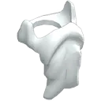{ .lu-ti width="24" loading="lazy" } [Santa Beard (LOT 5174)](../5174.md) | 1 | No client description | 21 matrices; 0 rewards; 0 community references |
| 5316 | { .lu-ti width="24" loading="lazy" } [Sausage (LOT 5316)](../5316.md) | 1 | No client description | 21 matrices; 0 rewards; 0 community references |
| 635 | { .lu-ti width="24" loading="lazy" } [Saw Blade, Round Ø36.7 (LOT 635)](../635.md) | 1 | No client description | 37 matrices; 0 rewards; 0 community references |
| 9105 | 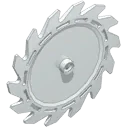{ .lu-ti width="24" loading="lazy" } [Saw Blade, Round Ø71.32 (LOT 9105)](../9105.md) | 1 | No client description | 37 matrices; 0 rewards; 0 community references |
| 8925 | { .lu-ti width="24" loading="lazy" } [Sawfish Head (LOT 8925)](../8925.md) | 1 | No client description | 2 matrices; 0 rewards; 0 community references |
| 16465 | 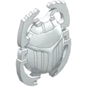{ .lu-ti width="24" loading="lazy" } [Scarab Shield with Ø 3.2 Shaft (LOT 16465)](../16465.md) | 1 | No client description | 14 matrices; 0 rewards; 0 community references |
| 5366 | { .lu-ti width="24" loading="lazy" } [Scimitar (LOT 5366)](../5366.md) | 1 | No client description | 21 matrices; 0 rewards; 0 community references |
| 8788 | 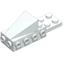{ .lu-ti width="24" loading="lazy" } [Scooter Chassis 2x6 with Lateral Studs (LOT 8788)](../8788.md) | 1 | No client description | 25 matrices; 0 rewards; 0 community references |
| 5228 | { .lu-ti width="24" loading="lazy" } [Scorpion (LOT 5228)](../5228.md) | 1 | No client description | 2 matrices; 0 rewards; 0 community references |
| 692 | 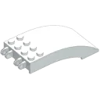{ .lu-ti width="24" loading="lazy" } [Screen 4x8x2 Curved with Vertical Fork (LOT 692)](../692.md) | 1 | No client description | 19 matrices; 0 rewards; 0 community references |
| 596 | 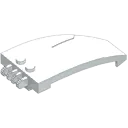{ .lu-ti width="24" loading="lazy" } [Screen 4x8x2 Trapezoid Curved with Vertical Fork (LOT 596)](../596.md) | 1 | No client description | 19 matrices; 0 rewards; 0 community references |
| 5449 | { .lu-ti width="24" loading="lazy" } [Screwdriver (LOT 5449)](../5449.md) | 1 | No client description | 21 matrices; 0 rewards; 0 community references |
| 5110 | 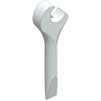{ .lu-ti width="24" loading="lazy" } [Screwdriver/Wrench (LOT 5110)](../5110.md) | 1 | No client description | 21 matrices; 0 rewards; 0 community references |
| 5502 | { .lu-ti width="24" loading="lazy" } [Scythe Blade (LOT 5502)](../5502.md) | 1 | No client description | 21 matrices; 0 rewards; 0 community references |
| 521 | 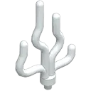{ .lu-ti width="24" loading="lazy" } [Sea Grass (LOT 521)](../521.md) | 1 | No client description | 14 matrices; 0 rewards; 0 community references |
| 355 | 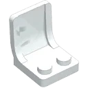{ .lu-ti width="24" loading="lazy" } [Seat 2x2x2 with 2 Studs (LOT 355)](../355.md) | 1 | No client description | 1 matrices; 0 rewards; 0 community references |
| 5073 | { .lu-ti width="24" loading="lazy" } [Semi Trailer Truck Chassis 6x34 (LOT 5073)](../5073.md) | 1 | No client description | 37 matrices; 0 rewards; 0 community references |
| 16459 | { .lu-ti width="24" loading="lazy" } [Sensei Beard (LOT 16459)](../16459.md) | 1 | No client description | 21 matrices; 0 rewards; 0 community references |
| 8942 | { .lu-ti width="24" loading="lazy" } [Sensor Dish with Bent Stem (LOT 8942)](../8942.md) | 1 | No client description | 14 matrices; 0 rewards; 0 community references |
| 5224 | { .lu-ti width="24" loading="lazy" } [Sextant (LOT 5224)](../5224.md) | 1 | No client description | 21 matrices; 0 rewards; 0 community references |
| 9065 | { .lu-ti width="24" loading="lazy" } [Shackles (LOT 9065)](../9065.md) | 1 | No client description | 21 matrices; 0 rewards; 0 community references |
| 16466 | 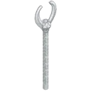{ .lu-ti width="24" loading="lazy" } [Shaft Ø3.2 with Cored Ø3.2 Hole (LOT 16466)](../16466.md) | 1 | No client description | 21 matrices; 0 rewards; 0 community references |
| 5049 | { .lu-ti width="24" loading="lazy" } [Shako (LOT 5049)](../5049.md) | 1 | No client description | 21 matrices; 0 rewards; 0 community references |
| 10183 | { .lu-ti width="24" loading="lazy" } [Shark 8x16 (LOT 10183)](../10183.md) | 1 | No client description | 2 matrices; 0 rewards; 0 community references |
| 5051 | { .lu-ti width="24" loading="lazy" } [Shark Body (LOT 5051)](../5051.md) | 1 | No client description | 2 matrices; 0 rewards; 0 community references |
| 9231 | { .lu-ti width="24" loading="lazy" } [Shark Head for Minifigure (LOT 9231)](../9231.md) | 1 | No client description | 2 matrices; 0 rewards; 0 community references |
| 5052 | 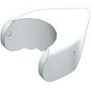{ .lu-ti width="24" loading="lazy" } [Shark Jaw (LOT 5052)](../5052.md) | 1 | No client description | 2 matrices; 0 rewards; 0 community references |
| 5246 | { .lu-ti width="24" loading="lazy" } [Shell (LOT 5246)](../5246.md) | 1 | No client description | 21 matrices; 0 rewards; 0 community references |
| 691 | { .lu-ti width="24" loading="lazy" } [Shell 6x10x2 (LOT 691)](../691.md) | 1 | No client description | 37 matrices; 0 rewards; 0 community references |
| 695 | { .lu-ti width="24" loading="lazy" } [Shell 6x10x2 Inverted (LOT 695)](../695.md) | 1 | No client description | 37 matrices; 0 rewards; 0 community references |
| 645 | { .lu-ti width="24" loading="lazy" } [Shell 6x8x2 (LOT 645)](../645.md) | 1 | No client description | 37 matrices; 0 rewards; 0 community references |
| 646 | { .lu-ti width="24" loading="lazy" } [Shell 6x8x2 Inverted (LOT 646)](../646.md) | 1 | No client description | 37 matrices; 0 rewards; 0 community references |
| 418 | { .lu-ti width="24" loading="lazy" } [Ship Steering Wheel (LOT 418)](../418.md) | 1 | No client description | 1 matrices; 0 rewards; 0 community references |
| 9227 | { .lu-ti width="24" loading="lazy" } [Ship's Propeller Ø6 with 7 Blades and Pin Hole (LOT 9227)](../9227.md) | 1 | No client description | 37 matrices; 0 rewards; 0 community references |
| 8876 | { .lu-ti width="24" loading="lazy" } [Ship's Propeller with 3 Blades and Cross Axle Hole (LOT 8876)](../8876.md) | 1 | No client description | 37 matrices; 0 rewards; 0 community references |
| 5099 | 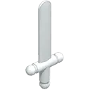{ .lu-ti width="24" loading="lazy" } [Shortsword (LOT 5099)](../5099.md) | 1 | No client description | 21 matrices; 0 rewards; 0 community references |
| 9118 | { .lu-ti width="24" loading="lazy" } [Shoulder Bag (LOT 9118)](../9118.md) | 1 | No client description | 21 matrices; 0 rewards; 0 community references |
| 8869 | { .lu-ti width="24" loading="lazy" } [Shoulder Jet Pack (LOT 8869)](../8869.md) | 1 | No client description | 37 matrices; 0 rewards; 0 community references |
| 5093 | { .lu-ti width="24" loading="lazy" } [Shovel (LOT 5093)](../5093.md) | 1 | No client description | 21 matrices; 0 rewards; 0 community references |
| 588 | { .lu-ti width="24" loading="lazy" } [Shovel 4x6x2 1/3 with Vertical Fork (LOT 588)](../588.md) | 1 | No client description | 37 matrices; 0 rewards; 0 community references |
| 703 | { .lu-ti width="24" loading="lazy" } [Shovel 4x8x2 2/3 with Vertical Fork (LOT 703)](../703.md) | 1 | No client description | 37 matrices; 0 rewards; 0 community references |
| 838 | 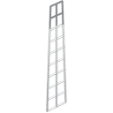{ .lu-ti width="24" loading="lazy" } [Shroud (LOT 838)](../838.md) | 1 | No client description | 14 matrices; 0 rewards; 0 community references |
| 447 | { .lu-ti width="24" loading="lazy" } [Shroud, Small (LOT 447)](../447.md) | 1 | No client description | 37 matrices; 0 rewards; 0 community references |
| 5554 | 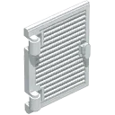{ .lu-ti width="24" loading="lazy" } [Shutter 1x2x3 with Shaft (LOT 5554)](../5554.md) | 1 | No client description | 7 matrices; 0 rewards; 0 community references |
| 5103 | 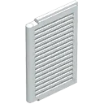{ .lu-ti width="24" loading="lazy" } [Shutter 2x3 (LOT 5103)](../5103.md) | 1 | No client description | 7 matrices; 0 rewards; 0 community references |
| 8837 | 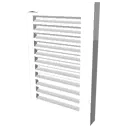{ .lu-ti width="24" loading="lazy" } [Shutter for Window (LOT 8837)](../8837.md) | 1 | No client description | 34 matrices; 0 rewards; 0 community references |
| 16334 | 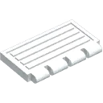{ .lu-ti width="24" loading="lazy" } [Sideboard 2x4 (LOT 16334)](../16334.md) | 1 | No client description | 19 matrices; 0 rewards; 0 community references |
| 8944 | 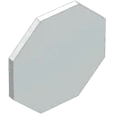{ .lu-ti width="24" loading="lazy" } [Sign Octagonal with Vertical Clip (LOT 8944)](../8944.md) | 1 | No client description | 14 matrices; 0 rewards; 0 community references |
| 5471 | { .lu-ti width="24" loading="lazy" } [Silver Harpoons (LOT 5471)](../5471.md) | 1 | No client description | 21 matrices; 0 rewards; 0 community references |
| 9038 | { .lu-ti width="24" loading="lazy" } [Sitting Rat (LOT 9038)](../9038.md) | 1 | No client description | 2 matrices; 0 rewards; 0 community references |
| 5360 | 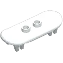{ .lu-ti width="24" loading="lazy" } [Skateboard 1 (LOT 5360)](../5360.md) | 1 | No client description | 21 matrices; 0 rewards; 0 community references |
| 5381 | { .lu-ti width="24" loading="lazy" } [Skateboard 2 (LOT 5381)](../5381.md) | 1 | No client description | 21 matrices; 0 rewards; 0 community references |
| 9007 | { .lu-ti width="24" loading="lazy" } [Skates with 2 Studs (LOT 9007)](../9007.md) | 1 | No client description | 21 matrices; 0 rewards; 0 community references |
| 16453 | 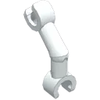{ .lu-ti width="24" loading="lazy" } [Skeleton Arm (LOT 16453)](../16453.md) | 1 | No client description | 2 matrices; 0 rewards; 0 community references |
| 16468 | 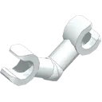{ .lu-ti width="24" loading="lazy" } [Skeleton Arm (LOT 16468)](../16468.md) | 1 | No client description | 2 matrices; 0 rewards; 0 community references |
| 5190 | { .lu-ti width="24" loading="lazy" } [Skeleton Arm Type 1 (LOT 5190)](../5190.md) | 1 | No client description | 2 matrices; 0 rewards; 0 community references |
| 5189 | 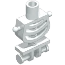{ .lu-ti width="24" loading="lazy" } [Skeleton Body Type 1 (LOT 5189)](../5189.md) | 1 | No client description | 2 matrices; 0 rewards; 0 community references |
| 5514 | 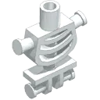{ .lu-ti width="24" loading="lazy" } [Skeleton Body Type 2 (LOT 5514)](../5514.md) | 1 | No client description | 2 matrices; 0 rewards; 0 community references |
| 5501 | 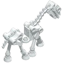{ .lu-ti width="24" loading="lazy" } [Skeleton Horse (LOT 5501)](../5501.md) | 1 | No client description | 2 matrices; 0 rewards; 0 community references |
| 1201 | 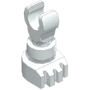{ .lu-ti width="24" loading="lazy" } [Skeleton Leg (LOT 1201)](../1201.md) | 1 | No client description | 2 matrices; 0 rewards; 0 community references |
| 16454 | 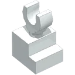{ .lu-ti width="24" loading="lazy" } [Skeleton Leg (LOT 16454)](../16454.md) | 1 | No client description | 2 matrices; 0 rewards; 0 community references |
| 16452 | 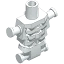{ .lu-ti width="24" loading="lazy" } [Skeleton Torso (LOT 16452)](../16452.md) | 1 | No client description | 2 matrices; 0 rewards; 0 community references |
| 16456 | { .lu-ti width="24" loading="lazy" } [Skeletonhead with Knob (LOT 16456)](../16456.md) | 1 | No client description | 2 matrices; 0 rewards; 0 community references |
| 8992 | 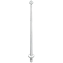{ .lu-ti width="24" loading="lazy" } [Ski Pole (LOT 8992)](../8992.md) | 1 | No client description | 14 matrices; 0 rewards; 0 community references |
| 1219 | { .lu-ti width="24" loading="lazy" } [Skid 1x4 with Stud and Clip (LOT 1219)](../1219.md) | 1 | No client description | 21 matrices; 0 rewards; 0 community references |
| 5388 | { .lu-ti width="24" loading="lazy" } [Skull 3x3 with 2 Pins (LOT 5388)](../5388.md) | 1 | No client description | 2 matrices; 0 rewards; 0 community references |
| 9182 | { .lu-ti width="24" loading="lazy" } [Skull Helmet (LOT 9182)](../9182.md) | 1 | No client description | 21 matrices; 0 rewards; 0 community references |
| 5138 | { .lu-ti width="24" loading="lazy" } [Sledgehammer (LOT 5138)](../5138.md) | 1 | No client description | 21 matrices; 0 rewards; 0 community references |
| 854 | 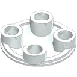{ .lu-ti width="24" loading="lazy" } [Slide Shoe Round 2x2 (LOT 854)](../854.md) | 1 | No client description | 25 matrices; 0 rewards; 0 community references |
| 5251 | { .lu-ti width="24" loading="lazy" } [Slider Roller with Handle (LOT 5251)](../5251.md) | 1 | No client description | 21 matrices; 0 rewards; 0 community references |
| 5137 | 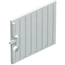{ .lu-ti width="24" loading="lazy" } [Sliding Gate 6x5 (LOT 5137)](../5137.md) | 1 | No client description | 7 matrices; 0 rewards; 0 community references |
| 9181 | { .lu-ti width="24" loading="lazy" } [Slizer Helmet (LOT 9181)](../9181.md) | 1 | No client description | 21 matrices; 0 rewards; 0 community references |
| 5562 | 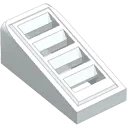{ .lu-ti width="24" loading="lazy" } [Slope 1x2x2/3 Brick with Grating (LOT 5562)](../5562.md) | 1 | No client description | 14 matrices; 0 rewards; 0 community references |
| 5521 | 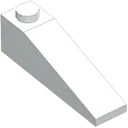{ .lu-ti width="24" loading="lazy" } [Slope Brick 18° 1x4 (LOT 5521)](../5521.md) | 1 | No client description | 25 matrices; 0 rewards; 0 community references |
| 574 | 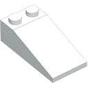{ .lu-ti width="24" loading="lazy" } [Slope Brick 18° 2x4 (LOT 574)](../574.md) | 1 | No client description | 25 matrices; 0 rewards; 0 community references |
| 663 | 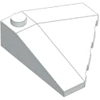{ .lu-ti width="24" loading="lazy" } [Slope Brick 18° 4x4 Corner (LOT 663)](../663.md) | 1 | No client description | 25 matrices; 0 rewards; 0 community references |
| 9189 | { .lu-ti width="24" loading="lazy" } [Slope Brick 1x10 Curved (LOT 9189)](../9189.md) | 1 | No client description | 37 matrices; 0 rewards; 0 community references |
| 104 | { .lu-ti width="24" loading="lazy" } [Slope Brick 1x1x2/3 (LOT 104)](../104.md) | 1 | No client description | 25 matrices; 0 rewards; 0 community references |
| 9192 | 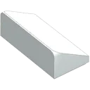{ .lu-ti width="24" loading="lazy" } [Slope Brick 1x2x2/3 (LOT 9192)](../9192.md) | 1 | No client description | 25 matrices; 0 rewards; 0 community references |
| 789 | 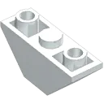{ .lu-ti width="24" loading="lazy" } [Slope Brick 1x3 45° Inverted Double (LOT 789)](../789.md) | 1 | No client description | 25 matrices; 0 rewards; 0 community references |
| 105 | 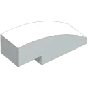{ .lu-ti width="24" loading="lazy" } [Slope Brick 1x3 Curved (LOT 105)](../105.md) | 1 | No client description | 7 matrices; 0 rewards; 0 community references |
| 5570 | 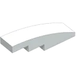{ .lu-ti width="24" loading="lazy" } [Slope Brick 1x4 Curved (LOT 5570)](../5570.md) | 1 | No client description | 7 matrices; 0 rewards; 0 community references |
| 647 | 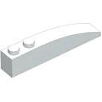{ .lu-ti width="24" loading="lazy" } [Slope Brick 1x6 Curved (LOT 647)](../647.md) | 1 | No client description | 25 matrices; 0 rewards; 0 community references |
| 648 | 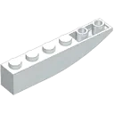{ .lu-ti width="24" loading="lazy" } [Slope Brick 1x6 Curved, Inverted (LOT 648)](../648.md) | 1 | No client description | 25 matrices; 0 rewards; 0 community references |
| 745 | { .lu-ti width="24" loading="lazy" } [Slope Brick 1x8x1 2/3 Curved with Arch (LOT 745)](../745.md) | 1 | No client description | 37 matrices; 0 rewards; 0 community references |
| 73 | 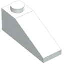{ .lu-ti width="24" loading="lazy" } [Slope Brick 25° 1x3 (LOT 73)](../73.md) | 1 | No client description | 25 matrices; 0 rewards; 0 community references |
| 114 | { .lu-ti width="24" loading="lazy" } [Slope Brick 25° 1x3 Inverted (LOT 114)](../114.md) | 1 | No client description | 25 matrices; 0 rewards; 0 community references |
| 113 | { .lu-ti width="24" loading="lazy" } [Slope Brick 25° 2x3 (LOT 113)](../113.md) | 1 | No client description | 25 matrices; 0 rewards; 0 community references |
| 927 | 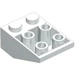{ .lu-ti width="24" loading="lazy" } [Slope Brick 25° 2x3 Inverted (LOT 927)](../927.md) | 1 | No client description | 25 matrices; 0 rewards; 0 community references |
| 364 | 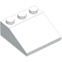{ .lu-ti width="24" loading="lazy" } [Slope Brick 25° 3x3 (LOT 364)](../364.md) | 1 | No client description | 25 matrices; 0 rewards; 0 community references |
| 141 | { .lu-ti width="24" loading="lazy" } [Slope Brick 25° 3x3 Outside Corner (LOT 141)](../141.md) | 1 | No client description | 25 matrices; 0 rewards; 0 community references |
| 891 | 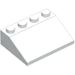{ .lu-ti width="24" loading="lazy" } [Slope Brick 25° 4x3 (LOT 891)](../891.md) | 1 | No client description | 25 matrices; 0 rewards; 0 community references |
| 394 | 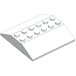{ .lu-ti width="24" loading="lazy" } [Slope Brick 25° 6x6 Double (LOT 394)](../394.md) | 1 | No client description | 25 matrices; 0 rewards; 0 community references |
| 893 | 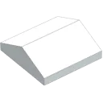{ .lu-ti width="24" loading="lazy" } [Slope Brick 25° Ridged 2x2 (LOT 893)](../893.md) | 1 | No client description | 25 matrices; 0 rewards; 0 community references |
| 892 | 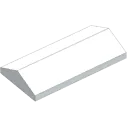{ .lu-ti width="24" loading="lazy" } [Slope Brick 25° Ridged 2x4 (LOT 892)](../892.md) | 1 | No client description | 25 matrices; 0 rewards; 0 community references |
| 424 | 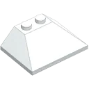{ .lu-ti width="24" loading="lazy" } [Slope Brick 25°/45° 4x3 (LOT 424)](../424.md) | 1 | No client description | 25 matrices; 0 rewards; 0 community references |
| 5557 | 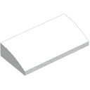{ .lu-ti width="24" loading="lazy" } [Slope Brick 2x4x2/3 Curved (LOT 5557)](../5557.md) | 1 | No client description | 7 matrices; 0 rewards; 0 community references |
| 9015 | 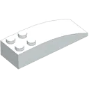{ .lu-ti width="24" loading="lazy" } [Slope Brick 2x6 Curved (LOT 9015)](../9015.md) | 1 | No client description | 25 matrices; 0 rewards; 0 community references |
| 9004 | { .lu-ti width="24" loading="lazy" } [Slope Brick 2x8x2 Curved (LOT 9004)](../9004.md) | 1 | No client description | 7 matrices; 0 rewards; 0 community references |
| 50 | { .lu-ti width="24" loading="lazy" } [Slope Brick 45° 1x2 (LOT 50)](../50.md) | 1 | No client description | 25 matrices; 0 rewards; 0 community references |
| 111 | { .lu-ti width="24" loading="lazy" } [Slope Brick 45° 1x2 Inverted (LOT 111)](../111.md) | 1 | No client description | 36 matrices; 0 rewards; 0 community references |
| 876 | { .lu-ti width="24" loading="lazy" } [Slope Brick 45° 1x2 Top, with Inverted Connection (LOT 876)](../876.md) | 1 | No client description | 25 matrices; 0 rewards; 0 community references |
| 754 | { .lu-ti width="24" loading="lazy" } [Slope Brick 45° 1x6 Double Inverted with Cut-Out (LOT 754)](../754.md) | 1 | No client description | 37 matrices; 0 rewards; 0 community references |
| 540 | { .lu-ti width="24" loading="lazy" } [Slope Brick 45° 2x10x2 Double (LOT 540)](../540.md) | 1 | No client description | 37 matrices; 0 rewards; 0 community references |
| 49 | { .lu-ti width="24" loading="lazy" } [Slope Brick 45° 2x2 (LOT 49)](../49.md) | 1 | No client description | 25 matrices; 0 rewards; 0 community references |
| 179 | { .lu-ti width="24" loading="lazy" } [Slope Brick 45° 2x2 Corner, Inverted (LOT 179)](../179.md) | 1 | No client description | 25 matrices; 0 rewards; 0 community references |
| 52 | { .lu-ti width="24" loading="lazy" } [Slope Brick 45° 2x2 Inside Corner (LOT 52)](../52.md) | 1 | No client description | 25 matrices; 0 rewards; 0 community references |
| 916 | { .lu-ti width="24" loading="lazy" } [Slope Brick 45° 2x2 Inverted (LOT 916)](../916.md) | 1 | No client description | 25 matrices; 0 rewards; 0 community references |
| 51 | { .lu-ti width="24" loading="lazy" } [Slope Brick 45° 2x2 Outside Corner (LOT 51)](../51.md) | 1 | No client description | 25 matrices; 0 rewards; 0 community references |
| 119 | { .lu-ti width="24" loading="lazy" } [Slope Brick 45° 2x4 Inverted Double with Cut-Out (LOT 119)](../119.md) | 1 | No client description | 37 matrices; 0 rewards; 0 community references |
| 871 | { .lu-ti width="24" loading="lazy" } [Slope Brick 45° 3x2 (LOT 871)](../871.md) | 1 | No client description | 25 matrices; 0 rewards; 0 community references |
| 9173 | { .lu-ti width="24" loading="lazy" } [Slope Brick 45° 4x10x2 Double with Windows (LOT 9173)](../9173.md) | 1 | No client description | 37 matrices; 0 rewards; 0 community references |
| 870 | { .lu-ti width="24" loading="lazy" } [Slope Brick 45° 4x2 (LOT 870)](../870.md) | 1 | No client description | 25 matrices; 0 rewards; 0 community references |
| 420 | { .lu-ti width="24" loading="lazy" } [Slope Brick 45° 4x4 Inverted Double with Cut-Out (LOT 420)](../420.md) | 1 | No client description | 37 matrices; 0 rewards; 0 community references |
| 5294 | { .lu-ti width="24" loading="lazy" } [Slope Brick 45° 4x6 Double (LOT 5294)](../5294.md) | 1 | No client description | 25 matrices; 0 rewards; 0 community references |
| 5235 | { .lu-ti width="24" loading="lazy" } [Slope Brick 45° 4x6 Double Inverted (LOT 5235)](../5235.md) | 1 | No client description | 37 matrices; 0 rewards; 0 community references |
| 5516 | { .lu-ti width="24" loading="lazy" } [Slope Brick 45° 4x6 Double Inverted with Cut-Out (LOT 5516)](../5516.md) | 1 | No client description | 37 matrices; 0 rewards; 0 community references |
| 5127 | { .lu-ti width="24" loading="lazy" } [Slope Brick 45° 8x2 (LOT 5127)](../5127.md) | 1 | No client description | 25 matrices; 0 rewards; 0 community references |
| 682 | { .lu-ti width="24" loading="lazy" } [Slope Brick 45° Double with Vertical Fork (LOT 682)](../682.md) | 1 | No client description | 19 matrices; 0 rewards; 0 community references |
| 587 | { .lu-ti width="24" loading="lazy" } [Slope Brick 45° Inverted, Double with 2 Pins (LOT 587)](../587.md) | 1 | No client description | 19 matrices; 0 rewards; 0 community references |
| 874 | { .lu-ti width="24" loading="lazy" } [Slope Brick 45° Ridged 1x2 (LOT 874)](../874.md) | 1 | No client description | 25 matrices; 0 rewards; 0 community references |
| 873 | { .lu-ti width="24" loading="lazy" } [Slope Brick 45° Ridged 2x2 (LOT 873)](../873.md) | 1 | No client description | 25 matrices; 0 rewards; 0 community references |
| 872 | { .lu-ti width="24" loading="lazy" } [Slope Brick 45° Ridged 2x4 (LOT 872)](../872.md) | 1 | No client description | 25 matrices; 0 rewards; 0 community references |
| 875 | { .lu-ti width="24" loading="lazy" } [Slope Brick 45° Triple Ridged 1x2 (LOT 875)](../875.md) | 1 | No client description | 25 matrices; 0 rewards; 0 community references |
| 8879 | { .lu-ti width="24" loading="lazy" } [Slope Brick 53° 1x3x3 1/3 with Studs (LOT 8879)](../8879.md) | 1 | No client description | 25 matrices; 0 rewards; 0 community references |
| 551 | { .lu-ti width="24" loading="lazy" } [Slope Brick 55° 1x6x5 (LOT 551)](../551.md) | 1 | No client description | 25 matrices; 0 rewards; 0 community references |
| 5524 | { .lu-ti width="24" loading="lazy" } [Slope Brick 65° 2x1x2 (LOT 5524)](../5524.md) | 1 | No client description | 25 matrices; 0 rewards; 0 community references |
| 917 | { .lu-ti width="24" loading="lazy" } [Slope Brick 65° 2x2x2 (LOT 917)](../917.md) | 1 | No client description | 25 matrices; 0 rewards; 0 community references |
| 578 | { .lu-ti width="24" loading="lazy" } [Slope Brick 65° 6x6x2 Inverted Quadruple (LOT 578)](../578.md) | 1 | No client description | 7 matrices; 0 rewards; 0 community references |
| 396 | { .lu-ti width="24" loading="lazy" } [Slope Brick 6x8 (LOT 396)](../396.md) | 1 | No client description | 25 matrices; 0 rewards; 0 community references |
| 920 | { .lu-ti width="24" loading="lazy" } [Slope Brick 73° 2x2x2 Pyramid (LOT 920)](../920.md) | 1 | No client description | 25 matrices; 0 rewards; 0 community references |
| 115 | { .lu-ti width="24" loading="lazy" } [Slope Brick 75° 1x2x3 (LOT 115)](../115.md) | 1 | No client description | 25 matrices; 0 rewards; 0 community references |
| 24 | { .lu-ti width="24" loading="lazy" } [Slope Brick 75° 1x2x3 Inverted (LOT 24)](../24.md) | 1 | No client description | 25 matrices; 0 rewards; 0 community references |
| 590 | { .lu-ti width="24" loading="lazy" } [Slope Brick 75° 2x2x3 (LOT 590)](../590.md) | 1 | No client description | 25 matrices; 0 rewards; 0 community references |
| 919 | { .lu-ti width="24" loading="lazy" } [Slope Brick 75° 2x2x3 Corner (LOT 919)](../919.md) | 1 | No client description | 25 matrices; 0 rewards; 0 community references |
| 9219 | { .lu-ti width="24" loading="lazy" } [Small Feather for Helmet (LOT 9219)](../9219.md) | 1 | No client description | 21 matrices; 0 rewards; 0 community references |
| 810 | { .lu-ti width="24" loading="lazy" } [Small Spruce Tree (LOT 810)](../810.md) | 1 | No client description | 14 matrices; 0 rewards; 0 community references |
| 5211 | { .lu-ti width="24" loading="lazy" } [Snake (LOT 5211)](../5211.md) | 1 | No client description | 2 matrices; 0 rewards; 0 community references |
| 5373 | { .lu-ti width="24" loading="lazy" } [Snake Body Piece (LOT 5373)](../5373.md) | 1 | No client description | 37 matrices; 0 rewards; 0 community references |
| 5363 | { .lu-ti width="24" loading="lazy" } [Snake Head with Pin (LOT 5363)](../5363.md) | 1 | No client description | 2 matrices; 0 rewards; 0 community references |
| 9012 | { .lu-ti width="24" loading="lazy" } [Snake Tail Piece (LOT 9012)](../9012.md) | 1 | No client description | 2 matrices; 0 rewards; 0 community references |
| 10178 | { .lu-ti width="24" loading="lazy" } [Snake Tail Piece (LOT 10178)](../10178.md) | 1 | No client description | 2 matrices; 0 rewards; 0 community references |
| 9028 | { .lu-ti width="24" loading="lazy" } [Snowboard (LOT 9028)](../9028.md) | 1 | No client description | 21 matrices; 0 rewards; 0 community references |
| 5261 | { .lu-ti width="24" loading="lazy" } [Snowshoe (LOT 5261)](../5261.md) | 1 | No client description | 21 matrices; 0 rewards; 0 community references |
| 5327 | { .lu-ti width="24" loading="lazy" } [Snowy Owl (LOT 5327)](../5327.md) | 1 | No client description | 2 matrices; 0 rewards; 0 community references |
| 5610 | { .lu-ti width="24" loading="lazy" } [Soccer Ball (LOT 5610)](../5610.md) | 1 | No client description | 14 matrices; 0 rewards; 0 community references |
| 1215 | { .lu-ti width="24" loading="lazy" } [Space Blaster with Grooves (LOT 1215)](../1215.md) | 1 | No client description | 14 matrices; 0 rewards; 0 community references |
| 9193 | { .lu-ti width="24" loading="lazy" } [Space Blaster, Smooth (LOT 9193)](../9193.md) | 1 | No client description | 25 matrices; 0 rewards; 0 community references |
| 5123 | { .lu-ti width="24" loading="lazy" } [Space Gun (LOT 5123)](../5123.md) | 1 | No client description | 21 matrices; 0 rewards; 0 community references |
| 5266 | { .lu-ti width="24" loading="lazy" } [Space Helmet without Chin Strap (LOT 5266)](../5266.md) | 1 | No client description | 21 matrices; 0 rewards; 0 community references |
| 5607 | { .lu-ti width="24" loading="lazy" } [Space Suit (LOT 5607)](../5607.md) | 1 | No client description | 21 matrices; 0 rewards; 0 community references |
| 8888 | { .lu-ti width="24" loading="lazy" } [Space Suit with Helmet and Breathing Device (LOT 8888)](../8888.md) | 1 | No client description | 21 matrices; 0 rewards; 0 community references |
| 8887 | { .lu-ti width="24" loading="lazy" } [Space Suit with Helmet and Propeller (LOT 8887)](../8887.md) | 1 | No client description | 21 matrices; 0 rewards; 0 community references |
| 5133 | { .lu-ti width="24" loading="lazy" } [Spear (LOT 5133)](../5133.md) | 1 | No client description | 21 matrices; 0 rewards; 0 community references |
| 5252 | { .lu-ti width="24" loading="lazy" } [Spider (LOT 5252)](../5252.md) | 1 | No client description | 2 matrices; 0 rewards; 0 community references |
| 5253 | { .lu-ti width="24" loading="lazy" } [Spider Web (LOT 5253)](../5253.md) | 1 | No client description | 14 matrices; 0 rewards; 0 community references |
| 9106 | { .lu-ti width="24" loading="lazy" } [Spike 2x8 (Flexible) with 2 Studs (LOT 9106)](../9106.md) | 1 | No client description | 25 matrices; 0 rewards; 0 community references |
| 5371 | { .lu-ti width="24" loading="lazy" } [Spiked Pike (LOT 5371)](../5371.md) | 1 | No client description | 21 matrices; 0 rewards; 0 community references |
| 5444 | { .lu-ti width="24" loading="lazy" } [Spiked Tentacle (LOT 5444)](../5444.md) | 1 | No client description | 2 matrices; 0 rewards; 0 community references |
| 8896 | { .lu-ti width="24" loading="lazy" } [Spiral Tube with Flanges (LOT 8896)](../8896.md) | 1 | No client description | 25 matrices; 0 rewards; 0 community references |
| 9133 | { .lu-ti width="24" loading="lazy" } [Spiral Tube with Flanges (LOT 9133)](../9133.md) | 1 | No client description | 14 matrices; 0 rewards; 0 community references |
| 9222 | { .lu-ti width="24" loading="lazy" } [Splendorous Feather (LOT 9222)](../9222.md) | 1 | No client description | 21 matrices; 0 rewards; 0 community references |
| 1234 | { .lu-ti width="24" loading="lazy" } [Spoiler with Framework and 2 Pins (LOT 1234)](../1234.md) | 1 | No client description | 37 matrices; 0 rewards; 0 community references |
| 624 | { .lu-ti width="24" loading="lazy" } [Spoked Wheel Ø43 (LOT 624)](../624.md) | 1 | No client description | 37 matrices; 0 rewards; 0 community references |
| 16355 | { .lu-ti width="24" loading="lazy" } [Spoked Wheel Ø56 (LOT 16355)](../16355.md) | 1 | No client description | 37 matrices; 0 rewards; 0 community references |
| 5565 | { .lu-ti width="24" loading="lazy" } [Spool Ø16 (LOT 5565)](../5565.md) | 1 | No client description | 37 matrices; 0 rewards; 0 community references |
| 5285 | { .lu-ti width="24" loading="lazy" } [Sprocket Wheel Ø24 (LOT 5285)](../5285.md) | 1 | No client description | 37 matrices; 0 rewards; 0 community references |
| 9151 | { .lu-ti width="24" loading="lazy" } [Sprocket Wheel with Spikes Ø62 (LOT 9151)](../9151.md) | 1 | No client description | 37 matrices; 0 rewards; 0 community references |
| 16385 | { .lu-ti width="24" loading="lazy" } [Sprocket, Ø40.7 (LOT 16385)](../16385.md) | 1 | No client description | 34 matrices; 0 rewards; 0 community references |
| 2137 | { .lu-ti width="24" loading="lazy" } [Spruce Tree (LOT 2137)](../2137.md) | 1 | No client description | 14 matrices; 0 rewards; 0 community references |
| 5255 | { .lu-ti width="24" loading="lazy" } [Square Sign with Vertical Clip (LOT 5255)](../5255.md) | 1 | No client description | 14 matrices; 0 rewards; 0 community references |
| 9225 | { .lu-ti width="24" loading="lazy" } [Squid Bottom Body (LOT 9225)](../9225.md) | 1 | No client description | 2 matrices; 0 rewards; 0 community references |
| 9184 | { .lu-ti width="24" loading="lazy" } [Squid Head (LOT 9184)](../9184.md) | 1 | No client description | 21 matrices; 0 rewards; 0 community references |
| 9232 | { .lu-ti width="24" loading="lazy" } [Squidman Head (LOT 9232)](../9232.md) | 1 | No client description | 21 matrices; 0 rewards; 0 community references |
| 8886 | { .lu-ti width="24" loading="lazy" } [Stable Door (LOT 8886)](../8886.md) | 1 | No client description | 7 matrices; 0 rewards; 0 community references |
| 529 | { .lu-ti width="24" loading="lazy" } [Staircase 4x6x7 (LOT 529)](../529.md) | 1 | No client description | 7 matrices; 0 rewards; 0 community references |
| 389 | { .lu-ti width="24" loading="lazy" } [Stanchion 2x4x5 Inclined (LOT 389)](../389.md) | 1 | No client description | 37 matrices; 0 rewards; 0 community references |
| 8817 | { .lu-ti width="24" loading="lazy" } [Stanchion 5 (LOT 8817)](../8817.md) | 1 | No client description | 7 matrices; 0 rewards; 0 community references |
| 8943 | { .lu-ti width="24" loading="lazy" } [Standard with Foot 2x2x5 (LOT 8943)](../8943.md) | 1 | No client description | 14 matrices; 0 rewards; 0 community references |
| 16450 | { .lu-ti width="24" loading="lazy" } [Star with Ø3.2 Wheel (LOT 16450)](../16450.md) | 1 | No client description | 21 matrices; 0 rewards; 0 community references |
| 5320 | { .lu-ti width="24" loading="lazy" } [Starfish (LOT 5320)](../5320.md) | 1 | No client description | 2 matrices; 0 rewards; 0 community references |
| 16320 | { .lu-ti width="24" loading="lazy" } [Steering Lever (LOT 16320)](../16320.md) | 1 | No client description | 19 matrices; 0 rewards; 0 community references |
| 1200 | { .lu-ti width="24" loading="lazy" } [Steering Nozzle with 2 Studs  (LOT 1200)](../1200.md) | 1 | No client description | 37 matrices; 0 rewards; 0 community references |
| 609 | { .lu-ti width="24" loading="lazy" } [Steering Wheel Ø16 for Console 2x2 (LOT 609)](../609.md) | 1 | No client description | 1 matrices; 0 rewards; 0 community references |
| 5070 | { .lu-ti width="24" loading="lazy" } [Steering Wheel Ø24 (LOT 5070)](../5070.md) | 1 | No client description | 1 matrices; 0 rewards; 0 community references |
| 16356 | { .lu-ti width="24" loading="lazy" } [Steering Wheel/Crank (LOT 16356)](../16356.md) | 1 | No client description | 34 matrices; 0 rewards; 0 community references |
| 10269 | { .lu-ti width="24" loading="lazy" } [Stegosaurus Body 4x12x6 (LOT 10269)](../10269.md) | 1 | No client description | 2 matrices; 0 rewards; 0 community references |
| 9233 | { .lu-ti width="24" loading="lazy" } [Stingray Helmet (LOT 9233)](../9233.md) | 1 | No client description | 2 matrices; 0 rewards; 0 community references |
| 9146 | { .lu-ti width="24" loading="lazy" } [Stockfish (LOT 9146)](../9146.md) | 1 | No client description | 2 matrices; 0 rewards; 0 community references |
| 5075 | { .lu-ti width="24" loading="lazy" } [Straight Rail (LOT 5075)](../5075.md) | 1 | No client description | 34 matrices; 0 rewards; 0 community references |
| 9169 | { .lu-ti width="24" loading="lazy" } [Straight Rail Metalized (LOT 9169)](../9169.md) | 1 | No client description | 37 matrices; 0 rewards; 0 community references |
| 5240 | { .lu-ti width="24" loading="lazy" } [Strap 12M (LOT 5240)](../5240.md) | 1 | No client description | 14 matrices; 0 rewards; 0 community references |
| 393 | { .lu-ti width="24" loading="lazy" } [Streamer (LOT 393)](../393.md) | 1 | No client description | 14 matrices; 0 rewards; 0 community references |
| 5145 | { .lu-ti width="24" loading="lazy" } [Stretcher 2x6 (LOT 5145)](../5145.md) | 1 | No client description | 21 matrices; 0 rewards; 0 community references |
| 5594 | { .lu-ti width="24" loading="lazy" } [String with End Studs 30M (LOT 5594)](../5594.md) | 1 | No client description | 14 matrices; 0 rewards; 0 community references |
| 5128 | { .lu-ti width="24" loading="lazy" } [Suitcase (LOT 5128)](../5128.md) | 1 | No client description | 21 matrices; 0 rewards; 0 community references |
| 8851 | { .lu-ti width="24" loading="lazy" } [Sunshade (LOT 8851)](../8851.md) | 1 | No client description | 14 matrices; 0 rewards; 0 community references |
