# Brick — page 8/10

[Item database](../README.md)

Pages: [1](type-1-1.md) | [2](type-1-2.md) | [3](type-1-3.md) | [4](type-1-4.md) | [5](type-1-5.md) | [6](type-1-6.md) | [7](type-1-7.md) | [8](type-1-8.md) | [9](type-1-9.md) | [10](type-1-10.md)

| LOT | Item | Rarity | Description | Source evidence |
| --- | --- | --- | --- | --- |
| 5156 | { .lu-ti width="24" loading="lazy" } [Surfboard 10M (LOT 5156)](../5156.md) | 1 | No client description | 21 matrices; 0 rewards; 0 community references |
| 16324 | 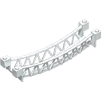{ .lu-ti width="24" loading="lazy" } [Suspension Bridge 4x16x3 (LOT 16324)](../16324.md) | 1 | No client description | 7 matrices; 0 rewards; 0 community references |
| 5399 | 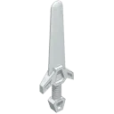{ .lu-ti width="24" loading="lazy" } [Sword with Inverted V-Guard (LOT 5399)](../5399.md) | 1 | No client description | 21 matrices; 0 rewards; 0 community references |
| 10201 | 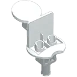{ .lu-ti width="24" loading="lazy" } [Tabletop Soccer Minifigure Socket  (LOT 10201)](../10201.md) | 1 | No client description | 34 matrices; 0 rewards; 0 community references |
| 8999 | { .lu-ti width="24" loading="lazy" } [Tail Base Long (LOT 8999)](../8999.md) | 1 | No client description | 2 matrices; 0 rewards; 0 community references |
| 9000 | 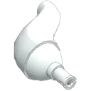{ .lu-ti width="24" loading="lazy" } [Tail Base Short (LOT 9000)](../9000.md) | 1 | No client description | 2 matrices; 0 rewards; 0 community references |
| 9206 | 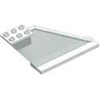{ .lu-ti width="24" loading="lazy" } [Tail Fin 2x12x5 (LOT 9206)](../9206.md) | 1 | No client description | 37 matrices; 0 rewards; 0 community references |
| 9054 | { .lu-ti width="24" loading="lazy" } [Tail Fin 2x12x8 (LOT 9054)](../9054.md) | 1 | No client description | 37 matrices; 0 rewards; 0 community references |
| 684 | { .lu-ti width="24" loading="lazy" } [Tail Fin 2x3x2 (LOT 684)](../684.md) | 1 | No client description | 37 matrices; 0 rewards; 0 community references |
| 491 | { .lu-ti width="24" loading="lazy" } [Tail Fin 2x6x4 (LOT 491)](../491.md) | 1 | No client description | 37 matrices; 0 rewards; 0 community references |
| 8835 | { .lu-ti width="24" loading="lazy" } [Tail Fin 4x2x2 (LOT 8835)](../8835.md) | 1 | No client description | 37 matrices; 0 rewards; 0 community references |
| 911 | { .lu-ti width="24" loading="lazy" } [Tail Fin on Plate 2x3 (LOT 911)](../911.md) | 1 | No client description | 37 matrices; 0 rewards; 0 community references |
| 788 | { .lu-ti width="24" loading="lazy" } [Tail Fin on Tile 1x4 (LOT 788)](../788.md) | 1 | No client description | 37 matrices; 0 rewards; 0 community references |
| 8865 | 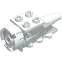{ .lu-ti width="24" loading="lazy" } [Tail Fin with Rocket Engine (LOT 8865)](../8865.md) | 1 | No client description | 37 matrices; 0 rewards; 0 community references |
| 8995 | 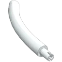{ .lu-ti width="24" loading="lazy" } [Tail Middle Part (LOT 8995)](../8995.md) | 1 | No client description | 2 matrices; 0 rewards; 0 community references |
| 5416 | 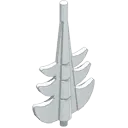{ .lu-ti width="24" loading="lazy" } [Tail with Jagged Fins and Shaft (LOT 5416)](../5416.md) | 1 | No client description | 2 matrices; 0 rewards; 0 community references |
| 9023 | { .lu-ti width="24" loading="lazy" } [Tank Bottom 8x6x2 (LOT 9023)](../9023.md) | 1 | No client description | 37 matrices; 0 rewards; 0 community references |
| 9024 | { .lu-ti width="24" loading="lazy" } [Tank Top Part 8x6x2 (LOT 9024)](../9024.md) | 1 | No client description | 37 matrices; 0 rewards; 0 community references |
| 408 | 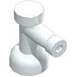{ .lu-ti width="24" loading="lazy" } [Tap 1x1 (LOT 408)](../408.md) | 1 | No client description | 25 matrices; 0 rewards; 0 community references |
| 505 | 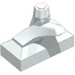{ .lu-ti width="24" loading="lazy" } [Tap Element 1x2 (LOT 505)](../505.md) | 1 | No client description | 14 matrices; 0 rewards; 0 community references |
| 11039 | 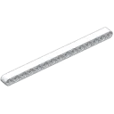{ .lu-ti width="24" loading="lazy" } [Technic 15M Beam (LOT 11039)](../11039.md) | 1 | No client description | 34 matrices; 0 rewards; 0 community references |
| 1262 | 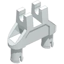{ .lu-ti width="24" loading="lazy" } [Technic 1x3 Flange with Hinge and 2 Pins (LOT 1262)](../1262.md) | 1 | No client description | 34 matrices; 0 rewards; 0 community references |
| 1261 | 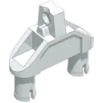{ .lu-ti width="24" loading="lazy" } [Technic 1x3 Flange with Stub on top and 2 Pins (LOT 1261)](../1261.md) | 1 | No client description | 34 matrices; 0 rewards; 0 community references |
| 5303 | 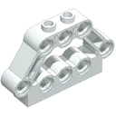{ .lu-ti width="24" loading="lazy" } [Technic 1x5x2 2/3 Support Block (LOT 5303)](../5303.md) | 1 | No client description | 34 matrices; 0 rewards; 0 community references |
| 5483 | 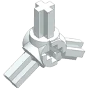{ .lu-ti width="24" loading="lazy" } [Technic 3-Branch Cross Axle (LOT 5483)](../5483.md) | 1 | No client description | 34 matrices; 0 rewards; 0 community references |
| 636 | 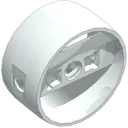{ .lu-ti width="24" loading="lazy" } [Technic 4x4 Connector Ring (LOT 636)](../636.md) | 1 | No client description | 34 matrices; 0 rewards; 0 community references |
| 1236 | { .lu-ti width="24" loading="lazy" } [Technic Air Intake Curved with 2 Pins (LOT 1236)](../1236.md) | 1 | No client description | 37 matrices; 0 rewards; 0 community references |
| 9142 | 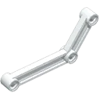{ .lu-ti width="24" loading="lazy" } [Technic Angle Beam 4x6 (LOT 9142)](../9142.md) | 1 | No client description | 34 matrices; 0 rewards; 0 community references |
| 8956 | 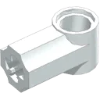{ .lu-ti width="24" loading="lazy" } [Technic Angle Connector 0° (LOT 8956)](../8956.md) | 1 | No client description | 34 matrices; 0 rewards; 0 community references |
| 5288 | 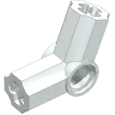{ .lu-ti width="24" loading="lazy" } [Technic Angle Connector 112.5° (LOT 5288)](../5288.md) | 1 | No client description | 34 matrices; 0 rewards; 0 community references |
| 5298 | 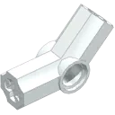{ .lu-ti width="24" loading="lazy" } [Technic Angle Connector 135° (LOT 5298)](../5298.md) | 1 | No client description | 34 matrices; 0 rewards; 0 community references |
| 5289 | 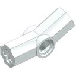{ .lu-ti width="24" loading="lazy" } [Technic Angle Connector 157.5° (LOT 5289)](../5289.md) | 1 | No client description | 34 matrices; 0 rewards; 0 community references |
| 8959 | 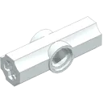{ .lu-ti width="24" loading="lazy" } [Technic Angle Connector 180° (LOT 8959)](../8959.md) | 1 | No client description | 34 matrices; 0 rewards; 0 community references |
| 5287 | 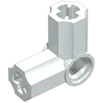{ .lu-ti width="24" loading="lazy" } [Technic Angle Connector 90° (LOT 5287)](../5287.md) | 1 | No client description | 34 matrices; 0 rewards; 0 community references |
| 8981 | 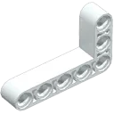{ .lu-ti width="24" loading="lazy" } [Technic Angular Beam 3x5 90° (LOT 8981)](../8981.md) | 1 | No client description | 34 matrices; 0 rewards; 0 community references |
| 8955 | 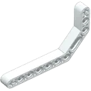{ .lu-ti width="24" loading="lazy" } [Technic Angular Beam 3x7 45°/90°  (LOT 8955)](../8955.md) | 1 | No client description | 34 matrices; 0 rewards; 0 community references |
| 5302 | 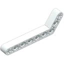{ .lu-ti width="24" loading="lazy" } [Technic Angular Beam 45° 3x7 (LOT 5302)](../5302.md) | 1 | No client description | 34 matrices; 0 rewards; 0 community references |
| 5304 | 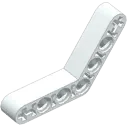{ .lu-ti width="24" loading="lazy" } [Technic Angular Beam 45° 4x4 (LOT 5304)](../5304.md) | 1 | No client description | 34 matrices; 0 rewards; 0 community references |
| 8911 | 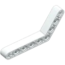{ .lu-ti width="24" loading="lazy" } [Technic Angular Beam 45° 4x6 (LOT 8911)](../8911.md) | 1 | No client description | 34 matrices; 0 rewards; 0 community references |
| 8963 | 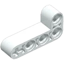{ .lu-ti width="24" loading="lazy" } [Technic Angular Beam 4x2 90° (LOT 8963)](../8963.md) | 1 | No client description | 34 matrices; 0 rewards; 0 community references |
| 8961 | 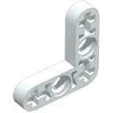{ .lu-ti width="24" loading="lazy" } [Technic Angular Half-beam 90° 3x3 (LOT 8961)](../8961.md) | 1 | No client description | 34 matrices; 0 rewards; 0 community references |
| 5293 | 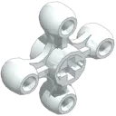{ .lu-ti width="24" loading="lazy" } [Technic Angular Wheel (LOT 5293)](../5293.md) | 1 | No client description | 34 matrices; 0 rewards; 0 community references |
| 9135 | 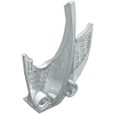{ .lu-ti width="24" loading="lazy" } [Technic Aqua-Fin 5x9x4 (LOT 9135)](../9135.md) | 1 | No client description | 2 matrices; 0 rewards; 0 community references |
| 10177 | 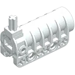{ .lu-ti width="24" loading="lazy" } [Technic Arrow Gun 6x2x2 (LOT 10177)](../10177.md) | 1 | No client description | 34 matrices; 0 rewards; 0 community references |
| 9069 | 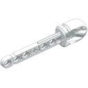{ .lu-ti width="24" loading="lazy" } [Technic Arrow with Rubber Tip Type 2 (LOT 9069)](../9069.md) | 1 | No client description | 1 matrices; 0 rewards; 0 community references |
| 8907 | 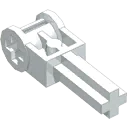{ .lu-ti width="24" loading="lazy" } [Technic Axle 1.5 with Cross Axle Connection Bush (LOT 8907)](../8907.md) | 1 | No client description | 34 matrices; 0 rewards; 0 community references |
| 5068 | 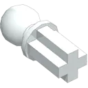{ .lu-ti width="24" loading="lazy" } [Technic Axle 2 with Ball (LOT 5068)](../5068.md) | 1 | No client description | 34 matrices; 0 rewards; 0 community references |
| 1252 | 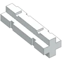{ .lu-ti width="24" loading="lazy" } [Technic Axle 2 with Grooves (LOT 1252)](../1252.md) | 1 | No client description | 34 matrices; 0 rewards; 0 community references |
| 8994 | 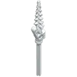{ .lu-ti width="24" loading="lazy" } [Technic Axle with Thorny Drill (LOT 8994)](../8994.md) | 1 | No client description | 1 matrices; 0 rewards; 0 community references |
| 9090 | 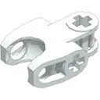{ .lu-ti width="24" loading="lazy" } [Technic Ball Cup (LOT 9090)](../9090.md) | 1 | No client description | 34 matrices; 0 rewards; 0 community references |
| 9099 | 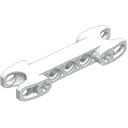{ .lu-ti width="24" loading="lazy" } [Technic Ball Cup Double 7M (LOT 9099)](../9099.md) | 1 | No client description | 34 matrices; 0 rewards; 0 community references |
| 5306 | 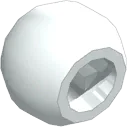{ .lu-ti width="24" loading="lazy" } [Technic Ball Joint (LOT 5306)](../5306.md) | 1 | No client description | 34 matrices; 0 rewards; 0 community references |
| 5308 | 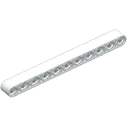{ .lu-ti width="24" loading="lazy" } [Technic Beam 11 (LOT 5308)](../5308.md) | 1 | No client description | 34 matrices; 0 rewards; 0 community references |
| 5597 | 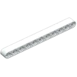{ .lu-ti width="24" loading="lazy" } [Technic Beam 11 (LOT 5597)](../5597.md) | 1 | No client description | 0 matrices; 0 rewards; 0 community references |
| 5350 | 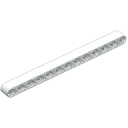{ .lu-ti width="24" loading="lazy" } [Technic Beam 13 (LOT 5350)](../5350.md) | 1 | No client description | 34 matrices; 0 rewards; 0 community references |
| 9177 | 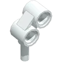{ .lu-ti width="24" loading="lazy" } [Technic Beam 1x2 with Haft (LOT 9177)](../9177.md) | 1 | No client description | 34 matrices; 0 rewards; 0 community references |
| 5365 | 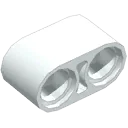{ .lu-ti width="24" loading="lazy" } [Technic Beam 2 (LOT 5365)](../5365.md) | 1 | No client description | 34 matrices; 0 rewards; 0 community references |
| 9039 | 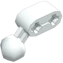{ .lu-ti width="24" loading="lazy" } [Technic Beam 2 with Ball (LOT 9039)](../9039.md) | 1 | No client description | 34 matrices; 0 rewards; 0 community references |
| 5525 | 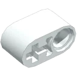{ .lu-ti width="24" loading="lazy" } [Technic Beam 2 with Cross Axle Hole (LOT 5525)](../5525.md) | 1 | No client description | 34 matrices; 0 rewards; 0 community references |
| 5191 | 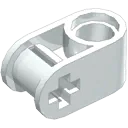{ .lu-ti width="24" loading="lazy" } [Technic Beam 2 with Lateral Cross Axle Hole (LOT 5191)](../5191.md) | 1 | No client description | 34 matrices; 0 rewards; 0 community references |
| 9134 | 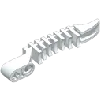{ .lu-ti width="24" loading="lazy" } [Technic Beam 2 with Robot Arm (LOT 9134)](../9134.md) | 1 | No client description | 2 matrices; 0 rewards; 0 community references |
| 9020 | { .lu-ti width="24" loading="lazy" } [Technic Beam 2x2 90° Angle (LOT 9020)](../9020.md) | 1 | No client description | 34 matrices; 0 rewards; 0 community references |
| 8980 | { .lu-ti width="24" loading="lazy" } [Technic Beam 3 (LOT 8980)](../8980.md) | 1 | No client description | 34 matrices; 0 rewards; 0 community references |
| 1256 | { .lu-ti width="24" loading="lazy" } [Technic Beam 3 with 2 Lateral Cross Axle Holes (LOT 1256)](../1256.md) | 1 | No client description | 34 matrices; 0 rewards; 0 community references |
| 5403 | { .lu-ti width="24" loading="lazy" } [Technic Beam 3 with 4 Pins (LOT 5403)](../5403.md) | 1 | No client description | 34 matrices; 0 rewards; 0 community references |
| 9006 | { .lu-ti width="24" loading="lazy" } [Technic Beam 3 with Lateral Cross Axle Hole (LOT 9006)](../9006.md) | 1 | No client description | 34 matrices; 0 rewards; 0 community references |
| 8976 | { .lu-ti width="24" loading="lazy" } [Technic Beam 5 (LOT 8976)](../8976.md) | 1 | No client description | 34 matrices; 0 rewards; 0 community references |
| 5307 | { .lu-ti width="24" loading="lazy" } [Technic Beam 7 (LOT 5307)](../5307.md) | 1 | No client description | 34 matrices; 0 rewards; 0 community references |
| 8964 | { .lu-ti width="24" loading="lazy" } [Technic Beam 7, Special (LOT 8964)](../8964.md) | 1 | No client description | 34 matrices; 0 rewards; 0 community references |
| 9001 | { .lu-ti width="24" loading="lazy" } [Technic Beam 9 (LOT 9001)](../9001.md) | 1 | No client description | 34 matrices; 0 rewards; 0 community references |
| 860 | { .lu-ti width="24" loading="lazy" } [Technic Bearing Plate 2x2 with 2 Pin Holes (LOT 860)](../860.md) | 1 | No client description | 34 matrices; 0 rewards; 0 community references |
| 23 | { .lu-ti width="24" loading="lazy" } [Technic Bearing Plate 2x2 with Pin Hole (LOT 23)](../23.md) | 1 | No client description | 25 matrices; 0 rewards; 0 community references |
| 8966 | { .lu-ti width="24" loading="lazy" } [Technic Bevel Gear Z20 (LOT 8966)](../8966.md) | 1 | No client description | 34 matrices; 0 rewards; 0 community references |
| 1263 | { .lu-ti width="24" loading="lazy" } [Technic Bracket Beam with 4 Pins (LOT 1263)](../1263.md) | 1 | No client description | 34 matrices; 0 rewards; 0 community references |
| 86 | { .lu-ti width="24" loading="lazy" } [Technic Brick 1x1 (LOT 86)](../86.md) | 1 | No client description | 25 matrices; 0 rewards; 0 community references |
| 857 | { .lu-ti width="24" loading="lazy" } [Technic Brick 1x10 (LOT 857)](../857.md) | 1 | No client description | 34 matrices; 0 rewards; 0 community references |
| 342 | { .lu-ti width="24" loading="lazy" } [Technic Brick 1x12 (LOT 342)](../342.md) | 1 | No client description | 34 matrices; 0 rewards; 0 community references |
| 612 | { .lu-ti width="24" loading="lazy" } [Technic Brick 1x14 (LOT 612)](../612.md) | 1 | No client description | 34 matrices; 0 rewards; 0 community references |
| 8843 | { .lu-ti width="24" loading="lazy" } [Technic Brick 1x16 (LOT 8843)](../8843.md) | 1 | No client description | 34 matrices; 0 rewards; 0 community references |
| 64 | { .lu-ti width="24" loading="lazy" } [Technic Brick 1x2 (LOT 64)](../64.md) | 1 | No client description | 34 matrices; 0 rewards; 0 community references |
| 610 | { .lu-ti width="24" loading="lazy" } [Technic Brick 1x2 with 2 Pin Holes (LOT 610)](../610.md) | 1 | No client description | 34 matrices; 0 rewards; 0 community references |
| 5278 | { .lu-ti width="24" loading="lazy" } [Technic Brick 1x2 with 2 Pins (LOT 5278)](../5278.md) | 1 | No client description | 34 matrices; 0 rewards; 0 community references |
| 9180 | { .lu-ti width="24" loading="lazy" } [Technic Brick 1x2 with Bars (LOT 9180)](../9180.md) | 1 | No client description | 34 matrices; 0 rewards; 0 community references |
| 615 | { .lu-ti width="24" loading="lazy" } [Technic Brick 1x2 with Cross Axle Hole (LOT 615)](../615.md) | 1 | No client description | 34 matrices; 0 rewards; 0 community references |
| 3 | { .lu-ti width="24" loading="lazy" } [Technic Brick 1x4 (LOT 3)](../3.md) | 1 | No client description | 34 matrices; 0 rewards; 0 community references |
| 858 | { .lu-ti width="24" loading="lazy" } [Technic Brick 1x4 with Wing (LOT 858)](../858.md) | 1 | No client description | 34 matrices; 0 rewards; 0 community references |
| 341 | { .lu-ti width="24" loading="lazy" } [Technic Brick 1x6 (LOT 341)](../341.md) | 1 | No client description | 34 matrices; 0 rewards; 0 community references |
| 859 | { .lu-ti width="24" loading="lazy" } [Technic Brick 1x6 Sloped (LOT 859)](../859.md) | 1 | No client description | 34 matrices; 0 rewards; 0 community references |
| 65 | { .lu-ti width="24" loading="lazy" } [Technic Brick 1x8 (LOT 65)](../65.md) | 1 | No client description | 34 matrices; 0 rewards; 0 community references |
| 721 | { .lu-ti width="24" loading="lazy" } [Technic Brick 2x2 with 2 Cylinders (LOT 721)](../721.md) | 1 | No client description | 34 matrices; 0 rewards; 0 community references |
| 719 | { .lu-ti width="24" loading="lazy" } [Technic Brick 2x2 with Ball Cup Horizontal Snap (LOT 719)](../719.md) | 1 | No client description | 34 matrices; 0 rewards; 0 community references |
| 720 | { .lu-ti width="24" loading="lazy" } [Technic Brick 2x2 with Ball Cup Vertical (LOT 720)](../720.md) | 1 | No client description | 34 matrices; 0 rewards; 0 community references |
| 698 | { .lu-ti width="24" loading="lazy" } [Technic Brick 2x2 with Click Joint and Cylinder Joint (LOT 698)](../698.md) | 1 | No client description | 34 matrices; 0 rewards; 0 community references |
| 718 | { .lu-ti width="24" loading="lazy" } [Technic Brick 2x2 with Cylinder (LOT 718)](../718.md) | 1 | No client description | 34 matrices; 0 rewards; 0 community references |
| 638 | { .lu-ti width="24" loading="lazy" } [Technic Brick 2x2x2 with Click Joint Opening (LOT 638)](../638.md) | 1 | No client description | 34 matrices; 0 rewards; 0 community references |
| 697 | { .lu-ti width="24" loading="lazy" } [Technic Brick 2x3 with Ball Cup Vertical and Cylinder (LOT 697)](../697.md) | 1 | No client description | 34 matrices; 0 rewards; 0 community references |
| 699 | { .lu-ti width="24" loading="lazy" } [Technic Brick 2x3 with Click Joint and Cylinder Joint (LOT 699)](../699.md) | 1 | No client description | 34 matrices; 0 rewards; 0 community references |
| 486 | { .lu-ti width="24" loading="lazy" } [Technic Brick 4x4 Round (LOT 486)](../486.md) | 1 | No client description | 34 matrices; 0 rewards; 0 community references |
| 9044 | { .lu-ti width="24" loading="lazy" } [Technic Brick Casing 4x12x3 (LOT 9044)](../9044.md) | 1 | No client description | 34 matrices; 0 rewards; 0 community references |
| 622 | { .lu-ti width="24" loading="lazy" } [Technic Brick Corner 5x5 (LOT 622)](../622.md) | 1 | No client description | 34 matrices; 0 rewards; 0 community references |
| 618 | { .lu-ti width="24" loading="lazy" } [Technic Brick Framing 4x4 (LOT 618)](../618.md) | 1 | No client description | 34 matrices; 0 rewards; 0 community references |
| 123 | { .lu-ti width="24" loading="lazy" } [Technic Brick Framing 4x6 (LOT 123)](../123.md) | 1 | No client description | 34 matrices; 0 rewards; 0 community references |
| 621 | { .lu-ti width="24" loading="lazy" } [Technic Brick Framing 6x8 (LOT 621)](../621.md) | 1 | No client description | 34 matrices; 0 rewards; 0 community references |
| 1233 | { .lu-ti width="24" loading="lazy" } [Technic Bumper 1x4x7 (LOT 1233)](../1233.md) | 1 | No client description | 37 matrices; 0 rewards; 0 community references |
| 1249 | { .lu-ti width="24" loading="lazy" } [Technic Bush (LOT 1249)](../1249.md) | 1 | No client description | 34 matrices; 0 rewards; 0 community references |
| 8960 | { .lu-ti width="24" loading="lazy" } [Technic Bush with Cross Axle Connection Bush (LOT 8960)](../8960.md) | 1 | No client description | 34 matrices; 0 rewards; 0 community references |
| 600 | { .lu-ti width="24" loading="lazy" } [Technic Bush with Horizontal Fork (LOT 600)](../600.md) | 1 | No client description | 19 matrices; 0 rewards; 0 community references |
| 599 | { .lu-ti width="24" loading="lazy" } [Technic Bush with Horizontal Stub (LOT 599)](../599.md) | 1 | No client description | 19 matrices; 0 rewards; 0 community references |
| 5296 | { .lu-ti width="24" loading="lazy" } [Technic Bush with Pin Collar (LOT 5296)](../5296.md) | 1 | No client description | 34 matrices; 0 rewards; 0 community references |
| 8908 | { .lu-ti width="24" loading="lazy" } [Technic Cam Disc (LOT 8908)](../8908.md) | 1 | No client description | 34 matrices; 0 rewards; 0 community references |
| 8969 | { .lu-ti width="24" loading="lazy" } [Technic Casing for Worm Screw (LOT 8969)](../8969.md) | 1 | No client description | 34 matrices; 0 rewards; 0 community references |
| 5558 | { .lu-ti width="24" loading="lazy" } [Technic Casing with Air Intakes (LOT 5558)](../5558.md) | 1 | No client description | 37 matrices; 0 rewards; 0 community references |
| 8912 | { .lu-ti width="24" loading="lazy" } [Technic Change-Over Catch (LOT 8912)](../8912.md) | 1 | No client description | 34 matrices; 0 rewards; 0 community references |
| 1260 | { .lu-ti width="24" loading="lazy" } [Technic Click Joint with Pin (LOT 1260)](../1260.md) | 1 | No client description | 34 matrices; 0 rewards; 0 community references |
| 631 | { .lu-ti width="24" loading="lazy" } [Technic Column for Spiral Staircase (LOT 631)](../631.md) | 1 | No client description | 34 matrices; 0 rewards; 0 community references |
| 9116 | { .lu-ti width="24" loading="lazy" } [Technic Connection Block 3x2x3 (LOT 9116)](../9116.md) | 1 | No client description | 34 matrices; 0 rewards; 0 community references |
| 9115 | { .lu-ti width="24" loading="lazy" } [Technic Connection Element for Hydraulic Cylinder (LOT 9115)](../9115.md) | 1 | No client description | 34 matrices; 0 rewards; 0 community references |
| 9086 | { .lu-ti width="24" loading="lazy" } [Technic Crane Arm 16 (LOT 9086)](../9086.md) | 1 | No client description | 25 matrices; 0 rewards; 0 community references |
| 8821 | { .lu-ti width="24" loading="lazy" } [Technic Crank (LOT 8821)](../8821.md) | 1 | No client description | 34 matrices; 0 rewards; 0 community references |
| 1243 | { .lu-ti width="24" loading="lazy" } [Technic Cross Axle 10 (LOT 1243)](../1243.md) | 1 | No client description | 34 matrices; 0 rewards; 0 community references |
| 1242 | { .lu-ti width="24" loading="lazy" } [Technic Cross Axle 12 (LOT 1242)](../1242.md) | 1 | No client description | 34 matrices; 0 rewards; 0 community references |
| 1244 | { .lu-ti width="24" loading="lazy" } [Technic Cross Axle 3 (LOT 1244)](../1244.md) | 1 | No client description | 34 matrices; 0 rewards; 0 community references |
| 1248 | { .lu-ti width="24" loading="lazy" } [Technic Cross Axle 3 with Stud (LOT 1248)](../1248.md) | 1 | No client description | 34 matrices; 0 rewards; 0 community references |
| 9037 | { .lu-ti width="24" loading="lazy" } [Technic Cross Axle 32 (LOT 9037)](../9037.md) | 1 | No client description | 34 matrices; 0 rewards; 0 community references |
| 1239 | { .lu-ti width="24" loading="lazy" } [Technic Cross Axle 4 (LOT 1239)](../1239.md) | 1 | No client description | 34 matrices; 0 rewards; 0 community references |
| 9199 | { .lu-ti width="24" loading="lazy" } [Technic Cross Axle 4 with End Stop (LOT 9199)](../9199.md) | 1 | No client description | 34 matrices; 0 rewards; 0 community references |
| 1253 | { .lu-ti width="24" loading="lazy" } [Technic Cross Axle 5 (LOT 1253)](../1253.md) | 1 | No client description | 34 matrices; 0 rewards; 0 community references |
| 5509 | { .lu-ti width="24" loading="lazy" } [Technic Cross Axle 5.5 with Stop (LOT 5509)](../5509.md) | 1 | No client description | 34 matrices; 0 rewards; 0 community references |
| 1240 | { .lu-ti width="24" loading="lazy" } [Technic Cross Axle 6 (LOT 1240)](../1240.md) | 1 | No client description | 34 matrices; 0 rewards; 0 community references |
| 1259 | { .lu-ti width="24" loading="lazy" } [Technic Cross Axle 7 (LOT 1259)](../1259.md) | 1 | No client description | 34 matrices; 0 rewards; 0 community references |
| 1241 | { .lu-ti width="24" loading="lazy" } [Technic Cross Axle 8 (LOT 1241)](../1241.md) | 1 | No client description | 34 matrices; 0 rewards; 0 community references |
| 5441 | { .lu-ti width="24" loading="lazy" } [Technic Cross Axle 8 with End Stop (LOT 5441)](../5441.md) | 1 | No client description | 34 matrices; 0 rewards; 0 community references |
| 9093 | { .lu-ti width="24" loading="lazy" } [Technic Cross Axle 9 (LOT 9093)](../9093.md) | 1 | No client description | 34 matrices; 0 rewards; 0 community references |
| 1245 | { .lu-ti width="24" loading="lazy" } [Technic Cross Axle Extension, Rippled (LOT 1245)](../1245.md) | 1 | No client description | 34 matrices; 0 rewards; 0 community references |
| 5510 | { .lu-ti width="24" loading="lazy" } [Technic Cross Axle Extension, Smooth (LOT 5510)](../5510.md) | 1 | No client description | 34 matrices; 0 rewards; 0 community references |
| 8972 | { .lu-ti width="24" loading="lazy" } [Technic Cross-Joiner Double 2x1 (LOT 8972)](../8972.md) | 1 | No client description | 34 matrices; 0 rewards; 0 community references |
| 9003 | { .lu-ti width="24" loading="lazy" } [Technic Cross-Joiner Double 2x1 with 2 Half-Beams (LOT 9003)](../9003.md) | 1 | No client description | 34 matrices; 0 rewards; 0 community references |
| 5309 | { .lu-ti width="24" loading="lazy" } [Technic Cross-Joiner Double 2x1 with Bar 2 (LOT 5309)](../5309.md) | 1 | No client description | 34 matrices; 0 rewards; 0 community references |
| 5084 | { .lu-ti width="24" loading="lazy" } [Technic Crown Gear 24 (LOT 5084)](../5084.md) | 1 | No client description | 34 matrices; 0 rewards; 0 community references |
| 5067 | { .lu-ti width="24" loading="lazy" } [Technic Dish Ø24 (LOT 5067)](../5067.md) | 1 | No client description | 34 matrices; 0 rewards; 0 community references |
| 9078 | { .lu-ti width="24" loading="lazy" } [Technic Dome 7x7x5 Ø4.85 (LOT 9078)](../9078.md) | 1 | No client description | 14 matrices; 0 rewards; 0 community references |
| 5301 | { .lu-ti width="24" loading="lazy" } [Technic Double Conical Wheel Z12 (LOT 5301)](../5301.md) | 1 | No client description | 34 matrices; 0 rewards; 0 community references |
| 5300 | { .lu-ti width="24" loading="lazy" } [Technic Double Conical Wheel Z20 (LOT 5300)](../5300.md) | 1 | No client description | 34 matrices; 0 rewards; 0 community references |
| 8979 | { .lu-ti width="24" loading="lazy" } [Technic Double Conical Wheel Z36 (LOT 8979)](../8979.md) | 1 | No client description | 34 matrices; 0 rewards; 0 community references |
| 9025 | { .lu-ti width="24" loading="lazy" } [Technic Double Plug (LOT 9025)](../9025.md) | 1 | DO NOT DROP | 0 matrices; 0 rewards; 0 community references |
| 9063 | { .lu-ti width="24" loading="lazy" } [Technic Dragon Wing 8x10 (LOT 9063)](../9063.md) | 1 | No client description | 2 matrices; 0 rewards; 0 community references |
| 5409 | { .lu-ti width="24" loading="lazy" } [Technic Dragon Wing with 2 Pin Holes (LOT 5409)](../5409.md) | 1 | No client description | 2 matrices; 0 rewards; 0 community references |
| 8905 | { .lu-ti width="24" loading="lazy" } [Technic Driving Ring (LOT 8905)](../8905.md) | 1 | No client description | 34 matrices; 0 rewards; 0 community references |
| 8825 | { .lu-ti width="24" loading="lazy" } [Technic Excavator Bucket (LOT 8825)](../8825.md) | 1 | No client description | 37 matrices; 0 rewards; 0 community references |
| 8967 | { .lu-ti width="24" loading="lazy" } [Technic Flex Rod 11 (LOT 8967)](../8967.md) | 1 | No client description | 34 matrices; 0 rewards; 0 community references |
| 8968 | { .lu-ti width="24" loading="lazy" } [Technic Flex Rod 12 (LOT 8968)](../8968.md) | 1 | No client description | 34 matrices; 0 rewards; 0 community references |
| 5310 | { .lu-ti width="24" loading="lazy" } [Technic Flex Rod 7 (LOT 5310)](../5310.md) | 1 | No client description | 34 matrices; 0 rewards; 0 community references |
| 9026 | { .lu-ti width="24" loading="lazy" } [Technic Flexible Double Bush (LOT 9026)](../9026.md) | 1 | No client description | 34 matrices; 0 rewards; 0 community references |
| 8820 | { .lu-ti width="24" loading="lazy" } [Technic Fork (LOT 8820)](../8820.md) | 1 | No client description | 34 matrices; 0 rewards; 0 community references |
| 5421 | { .lu-ti width="24" loading="lazy" } [Technic Fork 3 with Pin (LOT 5421)](../5421.md) | 1 | No client description | 34 matrices; 0 rewards; 0 community references |
| 1251 | { .lu-ti width="24" loading="lazy" } [Technic Friction Pin 1.5 with Cross Axle Hole (LOT 1251)](../1251.md) | 1 | No client description | 34 matrices; 0 rewards; 0 community references |
| 16350 | { .lu-ti width="24" loading="lazy" } [Technic Gear (LOT 16350)](../16350.md) | 1 | No client description | 0 matrices; 0 rewards; 0 community references |
| 926 | { .lu-ti width="24" loading="lazy" } [Technic Gear Plate 1x4 (LOT 926)](../926.md) | 1 | No client description | 34 matrices; 0 rewards; 0 community references |
| 5111 | { .lu-ti width="24" loading="lazy" } [Technic Gear Wheel 16 (LOT 5111)](../5111.md) | 1 | No client description | 34 matrices; 0 rewards; 0 community references |
| 8906 | { .lu-ti width="24" loading="lazy" } [Technic Gear Wheel 16 with Pin Hole (LOT 8906)](../8906.md) | 1 | No client description | 34 matrices; 0 rewards; 0 community references |
| 5083 | { .lu-ti width="24" loading="lazy" } [Technic Gear Wheel 24 (LOT 5083)](../5083.md) | 1 | No client description | 34 matrices; 0 rewards; 0 community references |
| 8842 | { .lu-ti width="24" loading="lazy" } [Technic Gear Wheel 40 (LOT 8842)](../8842.md) | 1 | No client description | 34 matrices; 0 rewards; 0 community references |
| 5082 | { .lu-ti width="24" loading="lazy" } [Technic Gear Wheel 8 (LOT 5082)](../5082.md) | 1 | No client description | 34 matrices; 0 rewards; 0 community references |
| 5305 | { .lu-ti width="24" loading="lazy" } [Technic Half Beam 1x4 (LOT 5305)](../5305.md) | 1 | No client description | 34 matrices; 0 rewards; 0 community references |
| 5353 | { .lu-ti width="24" loading="lazy" } [Technic Half Beam 2 (LOT 5353)](../5353.md) | 1 | No client description | 34 matrices; 0 rewards; 0 community references |
| 5194 | { .lu-ti width="24" loading="lazy" } [Technic Half Beam 3 (LOT 5194)](../5194.md) | 1 | No client description | 34 matrices; 0 rewards; 0 community references |
| 8970 | { .lu-ti width="24" loading="lazy" } [Technic Half Beam 3x3 with Curve (LOT 8970)](../8970.md) | 1 | No client description | 34 matrices; 0 rewards; 0 community references |
| 5299 | { .lu-ti width="24" loading="lazy" } [Technic Half Beam 3x5 with Curve (LOT 5299)](../5299.md) | 1 | No client description | 34 matrices; 0 rewards; 0 community references |
| 5284 | { .lu-ti width="24" loading="lazy" } [Technic Half Beam 4 with Cuff (LOT 5284)](../5284.md) | 1 | No client description | 34 matrices; 0 rewards; 0 community references |
| 5290 | { .lu-ti width="24" loading="lazy" } [Technic Half Beam 5 (LOT 5290)](../5290.md) | 1 | No client description | 34 matrices; 0 rewards; 0 community references |
| 8971 | { .lu-ti width="24" loading="lazy" } [Technic Half Beam 5x7 with Curve (LOT 8971)](../8971.md) | 1 | No client description | 34 matrices; 0 rewards; 0 community references |
| 5291 | { .lu-ti width="24" loading="lazy" } [Technic Half Beam 6 (LOT 5291)](../5291.md) | 1 | No client description | 34 matrices; 0 rewards; 0 community references |
| 5292 | { .lu-ti width="24" loading="lazy" } [Technic Half Beam 7 (LOT 5292)](../5292.md) | 1 | No client description | 34 matrices; 0 rewards; 0 community references |
| 9082 | { .lu-ti width="24" loading="lazy" } [Technic Horseshoe with Cross Axle (LOT 9082)](../9082.md) | 1 | No client description | 34 matrices; 0 rewards; 0 community references |
| 378 | { .lu-ti width="24" loading="lazy" } [Technic Hub 30x20 (LOT 378)](../378.md) | 1 | No client description | 34 matrices; 0 rewards; 0 community references |
| 5064 | { .lu-ti width="24" loading="lazy" } [Technic Hub Ø30 (LOT 5064)](../5064.md) | 1 | No client description | 34 matrices; 0 rewards; 0 community references |
| 5515 | { .lu-ti width="24" loading="lazy" } [Technic Hub Ø31.37 (LOT 5515)](../5515.md) | 1 | No client description | 34 matrices; 0 rewards; 0 community references |
| 5400 | { .lu-ti width="24" loading="lazy" } [Technic Hub with 4 Sticks (LOT 5400)](../5400.md) | 1 | No client description | 25 matrices; 0 rewards; 0 community references |
| 9048 | { .lu-ti width="24" loading="lazy" } [Technic Lift Arm, Cylinder (LOT 9048)](../9048.md) | 1 | No client description | 34 matrices; 0 rewards; 0 community references |
| 8984 | { .lu-ti width="24" loading="lazy" } [Technic Panel 10M-7 Right (LOT 8984)](../8984.md) | 1 | No client description | 34 matrices; 0 rewards; 0 community references |
| 8985 | { .lu-ti width="24" loading="lazy" } [Technic Panel 10M-8 (LOT 8985)](../8985.md) | 1 | No client description | 34 matrices; 0 rewards; 0 community references |
| 9147 | { .lu-ti width="24" loading="lazy" } [Technic Panel 3x11 Left (LOT 9147)](../9147.md) | 1 | No client description | 34 matrices; 0 rewards; 0 community references |
| 9138 | { .lu-ti width="24" loading="lazy" } [Technic Panel 3x11 Right (LOT 9138)](../9138.md) | 1 | No client description | 34 matrices; 0 rewards; 0 community references |
| 9196 | { .lu-ti width="24" loading="lazy" } [Technic Panel 3x5 Left (LOT 9196)](../9196.md) | 1 | No client description | 37 matrices; 0 rewards; 0 community references |
| 9200 | { .lu-ti width="24" loading="lazy" } [Technic Panel 3x5 Right (LOT 9200)](../9200.md) | 1 | No client description | 34 matrices; 0 rewards; 0 community references |
| 9149 | { .lu-ti width="24" loading="lazy" } [Technic Panel 3x7 Left (LOT 9149)](../9149.md) | 1 | No client description | 34 matrices; 0 rewards; 0 community references |
| 9136 | { .lu-ti width="24" loading="lazy" } [Technic Panel 3x7 Right (LOT 9136)](../9136.md) | 1 | No client description | 34 matrices; 0 rewards; 0 community references |
| 9101 | { .lu-ti width="24" loading="lazy" } [Technic Panel 4x7x4 Left (LOT 9101)](../9101.md) | 1 | No client description | 37 matrices; 0 rewards; 0 community references |
| 9100 | { .lu-ti width="24" loading="lazy" } [Technic Panel 4x7x4 Right (LOT 9100)](../9100.md) | 1 | No client description | 37 matrices; 0 rewards; 0 community references |
| 8982 | { .lu-ti width="24" loading="lazy" } [Technic Panel 5M-5 Right (LOT 8982)](../8982.md) | 1 | No client description | 34 matrices; 0 rewards; 0 community references |
| 8983 | { .lu-ti width="24" loading="lazy" } [Technic Panel 5M-6 Left (LOT 8983)](../8983.md) | 1 | No client description | 34 matrices; 0 rewards; 0 community references |
| 9137 | { .lu-ti width="24" loading="lazy" } [Technic Panel 5x11 Left (LOT 9137)](../9137.md) | 1 | No client description | 34 matrices; 0 rewards; 0 community references |
| 9148 | { .lu-ti width="24" loading="lazy" } [Technic Panel 5x11 Right (LOT 9148)](../9148.md) | 1 | No client description | 34 matrices; 0 rewards; 0 community references |
| 9016 | { .lu-ti width="24" loading="lazy" } [Technic Panel 7M No.22 Right (LOT 9016)](../9016.md) | 1 | No client description | 34 matrices; 0 rewards; 0 community references |
| 9017 | { .lu-ti width="24" loading="lazy" } [Technic Panel 7M No.23 Left (LOT 9017)](../9017.md) | 1 | No client description | 34 matrices; 0 rewards; 0 community references |
| 63 | { .lu-ti width="24" loading="lazy" } [Technic Pin (LOT 63)](../63.md) | 1 | No client description | 34 matrices; 0 rewards; 0 community references |
| 72 | { .lu-ti width="24" loading="lazy" } [Technic Pin 0.5 (LOT 72)](../72.md) | 1 | No client description | 34 matrices; 0 rewards; 0 community references |
| 5560 | { .lu-ti width="24" loading="lazy" } [Technic Pin 0.5 with Shaft (LOT 5560)](../5560.md) | 1 | No client description | 34 matrices; 0 rewards; 0 community references |
| 1250 | { .lu-ti width="24" loading="lazy" } [Technic Pin 0.75 (LOT 1250)](../1250.md) | 1 | No client description | 34 matrices; 0 rewards; 0 community references |
| 1257 | { .lu-ti width="24" loading="lazy" } [Technic Pin 1.5 (LOT 1257)](../1257.md) | 1 | No client description | 34 matrices; 0 rewards; 0 community references |
