# Brick — page 9/10

[Item database](../README.md)

Pages: [1](type-1-1.md) | [2](type-1-2.md) | [3](type-1-3.md) | [4](type-1-4.md) | [5](type-1-5.md) | [6](type-1-6.md) | [7](type-1-7.md) | [8](type-1-8.md) | [9](type-1-9.md) | [10](type-1-10.md)

| LOT | Item | Rarity | Description | Source evidence |
| --- | --- | --- | --- | --- |
| 1246 | 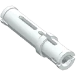{ .lu-ti width="24" loading="lazy" } [Technic Pin 1.5 with Friction (LOT 1246)](../1246.md) | 1 | No client description | 34 matrices; 0 rewards; 0 community references |
| 9198 | 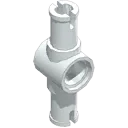{ .lu-ti width="24" loading="lazy" } [Technic Pin 1.5 with Hole (LOT 9198)](../9198.md) | 1 | No client description | 34 matrices; 0 rewards; 0 community references |
| 1255 | 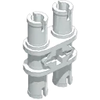{ .lu-ti width="24" loading="lazy" } [Technic Pin Double 1.5 with Cross Axle (LOT 1255)](../1255.md) | 1 | No client description | 34 matrices; 0 rewards; 0 community references |
| 5193 | 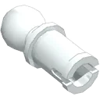{ .lu-ti width="24" loading="lazy" } [Technic Pin with Ball (LOT 5193)](../5193.md) | 1 | No client description | 34 matrices; 0 rewards; 0 community references |
| 1247 | 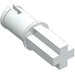{ .lu-ti width="24" loading="lazy" } [Technic Pin with Cross Axle (LOT 1247)](../1247.md) | 1 | No client description | 34 matrices; 0 rewards; 0 community references |
| 1238 | 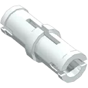{ .lu-ti width="24" loading="lazy" } [Technic Pin with Friction (LOT 1238)](../1238.md) | 1 | No client description | 34 matrices; 0 rewards; 0 community references |
| 1258 | 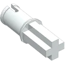{ .lu-ti width="24" loading="lazy" } [Technic Pin with Friction and Cross Axle (LOT 1258)](../1258.md) | 1 | No client description | 34 matrices; 0 rewards; 0 community references |
| 5367 | 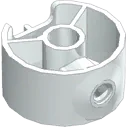{ .lu-ti width="24" loading="lazy" } [Technic Pivot Joint (LOT 5367)](../5367.md) | 1 | No client description | 34 matrices; 0 rewards; 0 community references |
| 922 | 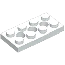{ .lu-ti width="24" loading="lazy" } [Technic Plate 2x4 (LOT 922)](../922.md) | 1 | No client description | 34 matrices; 0 rewards; 0 community references |
| 611 | 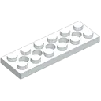{ .lu-ti width="24" loading="lazy" } [Technic Plate 2x6 (LOT 611)](../611.md) | 1 | No client description | 34 matrices; 0 rewards; 0 community references |
| 923 | 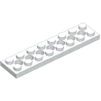{ .lu-ti width="24" loading="lazy" } [Technic Plate 2x8 (LOT 923)](../923.md) | 1 | No client description | 34 matrices; 0 rewards; 0 community references |
| 1235 | { .lu-ti width="24" loading="lazy" } [Technic Railing with 2 Pins (LOT 1235)](../1235.md) | 1 | No client description | 37 matrices; 0 rewards; 0 community references |
| 1237 | 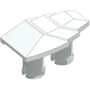{ .lu-ti width="24" loading="lazy" } [Technic Ridge Profile with 2 Pins (LOT 1237)](../1237.md) | 1 | No client description | 34 matrices; 0 rewards; 0 community references |
| 5295 | 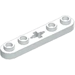{ .lu-ti width="24" loading="lazy" } [Technic Rotor 2 Blades (LOT 5295)](../5295.md) | 1 | No client description | 34 matrices; 0 rewards; 0 community references |
| 617 | { .lu-ti width="24" loading="lazy" } [Technic Rotor 3 Blades (LOT 617)](../617.md) | 1 | No client description | 34 matrices; 0 rewards; 0 community references |
| 9144 | 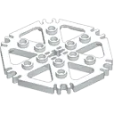{ .lu-ti width="24" loading="lazy" } [Technic Rotor 6 Blades with Connecting Beams and Vertical Clips (LOT 9144)](../9144.md) | 1 | No client description | 34 matrices; 0 rewards; 0 community references |
| 9046 | { .lu-ti width="24" loading="lazy" } [Technic Shell 3x5x2 (LOT 9046)](../9046.md) | 1 | No client description | 34 matrices; 0 rewards; 0 community references |
| 10255 | 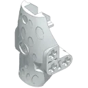{ .lu-ti width="24" loading="lazy" } [Technic Shell 3x5x3 (LOT 10255)](../10255.md) | 1 | No client description | 2 matrices; 0 rewards; 0 community references |
| 9073 | 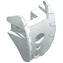{ .lu-ti width="24" loading="lazy" } [Technic Shell 4x5x3 (LOT 9073)](../9073.md) | 1 | No client description | 2 matrices; 0 rewards; 0 community references |
| 10203 | 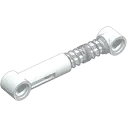{ .lu-ti width="24" loading="lazy" } [Technic Shock Absorber, Extra Hard (LOT 10203)](../10203.md) | 1 | No client description | 34 matrices; 0 rewards; 0 community references |
| 5374 | 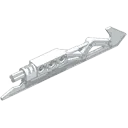{ .lu-ti width="24" loading="lazy" } [Technic Skate (LOT 5374)](../5374.md) | 1 | No client description | 2 matrices; 0 rewards; 0 community references |
| 9102 | { .lu-ti width="24" loading="lazy" } [Technic Spoiler 3x11x2 (LOT 9102)](../9102.md) | 1 | No client description | 37 matrices; 0 rewards; 0 community references |
| 16352 | 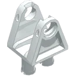{ .lu-ti width="24" loading="lazy" } [Technic Steering Gear, Bearing 2M (LOT 16352)](../16352.md) | 1 | No client description | 34 matrices; 0 rewards; 0 community references |
| 8993 | 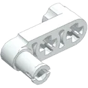{ .lu-ti width="24" loading="lazy" } [Technic Steering Knuckle Arm (LOT 8993)](../8993.md) | 1 | No client description | 34 matrices; 0 rewards; 0 community references |
| 8973 | 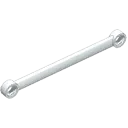{ .lu-ti width="24" loading="lazy" } [Technic Steering Link (LOT 8973)](../8973.md) | 1 | No client description | 34 matrices; 0 rewards; 0 community references |
| 1232 | 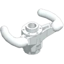{ .lu-ti width="24" loading="lazy" } [Technic Steering Wheel (LOT 1232)](../1232.md) | 1 | No client description | 1 matrices; 0 rewards; 0 community references |
| 16329 | 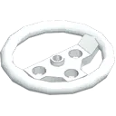{ .lu-ti width="24" loading="lazy" } [Technic Steering Wheel (LOT 16329)](../16329.md) | 1 | No client description | 34 matrices; 0 rewards; 0 community references |
| 16351 | 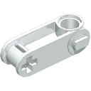{ .lu-ti width="24" loading="lazy" } [Technic Steering-Gear 3M (LOT 16351)](../16351.md) | 1 | No client description | 34 matrices; 0 rewards; 0 community references |
| 8974 | 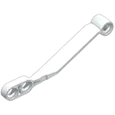{ .lu-ti width="24" loading="lazy" } [Technic Suspension Arm (LOT 8974)](../8974.md) | 1 | No client description | 34 matrices; 0 rewards; 0 community references |
| 9092 | 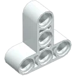{ .lu-ti width="24" loading="lazy" } [Technic T-Beam 3x3 (LOT 9092)](../9092.md) | 1 | No client description | 34 matrices; 0 rewards; 0 community references |
| 16404 | 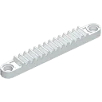{ .lu-ti width="24" loading="lazy" } [Technic Toothed Bar 8M (LOT 16404)](../16404.md) | 1 | No client description | 34 matrices; 0 rewards; 0 community references |
| 8965 | 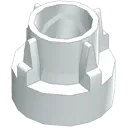{ .lu-ti width="24" loading="lazy" } [Technic Transmission Ring (LOT 8965)](../8965.md) | 1 | No client description | 34 matrices; 0 rewards; 0 community references |
| 8823 | 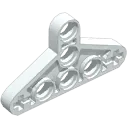{ .lu-ti width="24" loading="lazy" } [Technic Triangle Half Beam 5x3 (LOT 8823)](../8823.md) | 1 | No client description | 34 matrices; 0 rewards; 0 community references |
| 1264 | { .lu-ti width="24" loading="lazy" } [Technic Tube 2 (LOT 1264)](../1264.md) | 1 | No client description | 34 matrices; 0 rewards; 0 community references |
| 5577 | { .lu-ti width="24" loading="lazy" } [Technic Tube 2 Straight with Slot (LOT 5577)](../5577.md) | 1 | No client description | 34 matrices; 0 rewards; 0 community references |
| 9223 | 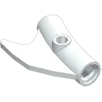{ .lu-ti width="24" loading="lazy" } [Technic Tube Curved with Fin (LOT 9223)](../9223.md) | 1 | No client description | 2 matrices; 0 rewards; 0 community references |
| 10176 | { .lu-ti width="24" loading="lazy" } [Technic Turntable (LOT 10176)](../10176.md) | 1 | No client description | 34 matrices; 0 rewards; 0 community references |
| 10181 | 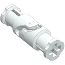{ .lu-ti width="24" loading="lazy" } [Technic Universal Joint (LOT 10181)](../10181.md) | 1 | No client description | 34 matrices; 0 rewards; 0 community references |
| 9155 | { .lu-ti width="24" loading="lazy" } [Technic Wall Element 5x11 (LOT 9155)](../9155.md) | 1 | No client description | 37 matrices; 0 rewards; 0 community references |
| 8853 | 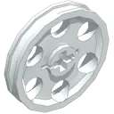{ .lu-ti width="24" loading="lazy" } [Technic Wedge-Belt Wheel Ø24 (LOT 8853)](../8853.md) | 1 | No client description | 34 matrices; 0 rewards; 0 community references |
| 8909 | { .lu-ti width="24" loading="lazy" } [Technic Wheel Block 4x4 (LOT 8909)](../8909.md) | 1 | No client description | 37 matrices; 0 rewards; 0 community references |
| 5297 | 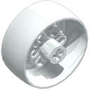{ .lu-ti width="24" loading="lazy" } [Technic Wheel Hard-Plastic 30.4x14 (LOT 5297)](../5297.md) | 1 | No client description | 34 matrices; 0 rewards; 0 community references |
| 9150 | { .lu-ti width="24" loading="lazy" } [Technic Wheel Ø62 with Spikes (LOT 9150)](../9150.md) | 1 | No client description | 37 matrices; 0 rewards; 0 community references |
| 8910 | { .lu-ti width="24" loading="lazy" } [Technic Wheel Z12 (LOT 8910)](../8910.md) | 1 | No client description | 34 matrices; 0 rewards; 0 community references |
| 9113 | 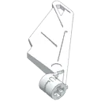{ .lu-ti width="24" loading="lazy" } [Technic Wing (LOT 9113)](../9113.md) | 1 | No client description | 2 matrices; 0 rewards; 0 community references |
| 8862 | 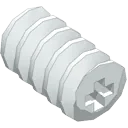{ .lu-ti width="24" loading="lazy" } [Technic Worm Screw (LOT 8862)](../8862.md) | 1 | No client description | 34 matrices; 0 rewards; 0 community references |
| 1220 | { .lu-ti width="24" loading="lazy" } [Telephone Receiver (LOT 1220)](../1220.md) | 1 | No client description | 21 matrices; 0 rewards; 0 community references |
| 9145 | { .lu-ti width="24" loading="lazy" } [Telescope Bar 1x1x2 (LOT 9145)](../9145.md) | 1 | No client description | 21 matrices; 0 rewards; 0 community references |
| 344 | 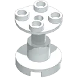{ .lu-ti width="24" loading="lazy" } [Telescope Stand 2x2x2 (LOT 344)](../344.md) | 1 | No client description | 14 matrices; 0 rewards; 0 community references |
| 16317 | 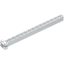{ .lu-ti width="24" loading="lazy" } [Telescope, Lever (LOT 16317)](../16317.md) | 1 | No client description | 34 matrices; 0 rewards; 0 community references |
| 9079 | 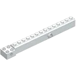{ .lu-ti width="24" loading="lazy" } [Telescopic Arm 2x1 1/3x16 (LOT 9079)](../9079.md) | 1 | No client description | 34 matrices; 0 rewards; 0 community references |
| 4985 | { .lu-ti width="24" loading="lazy" } [Test Contest Portal Rebuild Loot (LOT 4985)](../4985.md) | 5 | No client description | 0 matrices; 0 rewards; 0 community references |
| 4925 | [Test Horse Mount (LOT 4925)](../4925.md) | 5 | The Magical Mystery Horse | 0 matrices; 0 rewards; 0 community references |
| 8854 | { .lu-ti width="24" loading="lazy" } [Thread Drum (LOT 8854)](../8854.md) | 1 | No client description | 37 matrices; 0 rewards; 0 community references |
| 5048 | 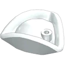{ .lu-ti width="24" loading="lazy" } [Three-Cornered Hat (LOT 5048)](../5048.md) | 1 | No client description | 2 matrices; 0 rewards; 0 community references |
| 569 | { .lu-ti width="24" loading="lazy" } [Thruster with Grill on 2x2-Tile (LOT 569)](../569.md) | 1 | No client description | 37 matrices; 0 rewards; 0 community references |
| 8856 | 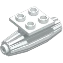{ .lu-ti width="24" loading="lazy" } [Thruster with Grills Below 2x2-Plate (LOT 8856)](../8856.md) | 1 | No client description | 37 matrices; 0 rewards; 0 community references |
| 56 | { .lu-ti width="24" loading="lazy" } [Tile 1x1 (LOT 56)](../56.md) | 1 | No client description | 25 matrices; 0 rewards; 0 community references |
| 27 | { .lu-ti width="24" loading="lazy" } [Tile 1x1 with Clip (LOT 27)](../27.md) | 1 | No client description | 19 matrices; 0 rewards; 0 community references |
| 55 | 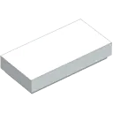{ .lu-ti width="24" loading="lazy" } [Tile 1x2 (LOT 55)](../55.md) | 1 | No client description | 25 matrices; 0 rewards; 0 community references |
| 9084 | 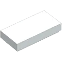{ .lu-ti width="24" loading="lazy" } [Tile 1x2 Engraved  (LOT 9084)](../9084.md) | 1 | No client description | 25 matrices; 0 rewards; 0 community references |
| 18 | 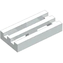{ .lu-ti width="24" loading="lazy" } [Tile 1x2 Grill (LOT 18)](../18.md) | 1 | No client description | 25 matrices; 0 rewards; 0 community references |
| 8789 | { .lu-ti width="24" loading="lazy" } [Tile 1x2 with Console (LOT 8789)](../8789.md) | 1 | No client description | 38 matrices; 0 rewards; 0 community references |
| 808 | { .lu-ti width="24" loading="lazy" } [Tile 1x2 with Handle (LOT 808)](../808.md) | 1 | No client description | 19 matrices; 0 rewards; 0 community references |
| 479 | { .lu-ti width="24" loading="lazy" } [Tile 1x2 with Handle 1x4x2 (LOT 479)](../479.md) | 1 | No client description | 14 matrices; 0 rewards; 0 community references |
| 10189 | { .lu-ti width="24" loading="lazy" } [Tile 1x2 with Steering Wheel (LOT 10189)](../10189.md) | 1 | No client description | 1 matrices; 0 rewards; 0 community references |
| 620 | 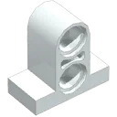{ .lu-ti width="24" loading="lazy" } [Tile 1x2 with Technic Beam (LOT 620)](../620.md) | 1 | No client description | 34 matrices; 0 rewards; 0 community references |
| 504 | { .lu-ti width="24" loading="lazy" } [Tile 1x2 with Water Tap (LOT 504)](../504.md) | 1 | No client description | 14 matrices; 0 rewards; 0 community references |
| 9130 | 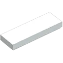{ .lu-ti width="24" loading="lazy" } [Tile 1x3 (LOT 9130)](../9130.md) | 1 | No client description | 25 matrices; 0 rewards; 0 community references |
| 99 | 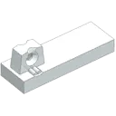{ .lu-ti width="24" loading="lazy" } [Tile 1x3 with Stub on Top (LOT 99)](../99.md) | 1 | No client description | 19 matrices; 0 rewards; 0 community references |
| 807 | 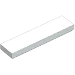{ .lu-ti width="24" loading="lazy" } [Tile 1x4 (LOT 807)](../807.md) | 1 | No client description | 25 matrices; 0 rewards; 0 community references |
| 688 | 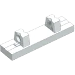{ .lu-ti width="24" loading="lazy" } [Tile 1x4 with 2 Stubs on Top (LOT 688)](../688.md) | 1 | No client description | 19 matrices; 0 rewards; 0 community references |
| 8831 | 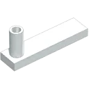{ .lu-ti width="24" loading="lazy" } [Tile 1x4 with Hinge for Fence Gate (LOT 8831)](../8831.md) | 1 | No client description | 25 matrices; 0 rewards; 0 community references |
| 503 | 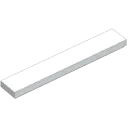{ .lu-ti width="24" loading="lazy" } [Tile 1x6 (LOT 503)](../503.md) | 1 | No client description | 25 matrices; 0 rewards; 0 community references |
| 365 | { .lu-ti width="24" loading="lazy" } [Tile 1x8 (LOT 365)](../365.md) | 1 | No client description | 26 matrices; 0 rewards; 0 community references |
| 362 | { .lu-ti width="24" loading="lazy" } [Tile 2x2 Round (LOT 362)](../362.md) | 1 | No client description | 25 matrices; 0 rewards; 0 community references |
| 793 | { .lu-ti width="24" loading="lazy" } [Tile 2x2 Round with Hanger on Top (LOT 793)](../793.md) | 1 | No client description | 37 matrices; 0 rewards; 0 community references |
| 841 | { .lu-ti width="24" loading="lazy" } [Tile 2x2 with Palm Base (LOT 841)](../841.md) | 1 | No client description | 14 matrices; 0 rewards; 0 community references |
| 8904 | { .lu-ti width="24" loading="lazy" } [Tile 2x2 with Parasol Stand (LOT 8904)](../8904.md) | 1 | No client description | 14 matrices; 0 rewards; 0 community references |
| 818 | { .lu-ti width="24" loading="lazy" } [Tile 2x2 with Pin on Top (LOT 818)](../818.md) | 1 | No client description | 19 matrices; 0 rewards; 0 community references |
| 565 | { .lu-ti width="24" loading="lazy" } [Tile 2x3 with 2 Horizontal Clips (LOT 565)](../565.md) | 1 | No client description | 19 matrices; 0 rewards; 0 community references |
| 9195 | { .lu-ti width="24" loading="lazy" } [Tile 2x4 (LOT 9195)](../9195.md) | 1 | No client description | 25 matrices; 0 rewards; 0 community references |
| 9237 | { .lu-ti width="24" loading="lazy" } [Tile 2x6 with Holder (LOT 9237)](../9237.md) | 1 | No client description | 25 matrices; 0 rewards; 0 community references |
| 475 | { .lu-ti width="24" loading="lazy" } [Tile 4x4 with 4 Studs (LOT 475)](../475.md) | 1 | No client description | 25 matrices; 0 rewards; 0 community references |
| 563 | { .lu-ti width="24" loading="lazy" } [Tile 4x4 with Palm Stem (LOT 563)](../563.md) | 1 | No client description | 14 matrices; 0 rewards; 0 community references |
| 476 | { .lu-ti width="24" loading="lazy" } [Tile 4x6 with 12 Studs (LOT 476)](../476.md) | 1 | No client description | 25 matrices; 0 rewards; 0 community references |
| 501 | { .lu-ti width="24" loading="lazy" } [Tile 4x8 with 12 Studs (LOT 501)](../501.md) | 1 | No client description | 25 matrices; 0 rewards; 0 community references |
| 5179 | { .lu-ti width="24" loading="lazy" } [Tile 6x12 with 22 Studs (LOT 5179)](../5179.md) | 1 | No client description | 25 matrices; 0 rewards; 0 community references |
| 8895 | { .lu-ti width="24" loading="lazy" } [Tile 6x16 with 26 Studs (LOT 8895)](../8895.md) | 1 | No client description | 25 matrices; 0 rewards; 0 community references |
| 8913 | { .lu-ti width="24" loading="lazy" } [Tile 6x6 (LOT 8913)](../8913.md) | 1 | No client description | 25 matrices; 0 rewards; 0 community references |
| 5390 | { .lu-ti width="24" loading="lazy" } [Tile 8x16 (LOT 5390)](../5390.md) | 1 | No client description | 25 matrices; 0 rewards; 0 community references |
| 474 | { .lu-ti width="24" loading="lazy" } [Tile 8x8 Round with 4 Studs (LOT 474)](../474.md) | 1 | No client description | 25 matrices; 0 rewards; 0 community references |
| 739 | { .lu-ti width="24" loading="lazy" } [Tile with Cover Curved 1x4.5 (LOT 739)](../739.md) | 1 | No client description | 37 matrices; 0 rewards; 0 community references |
| 1211 | { .lu-ti width="24" loading="lazy" } [Tiny Wheels with Axle (LOT 1211)](../1211.md) | 1 | No client description | 37 matrices; 0 rewards; 0 community references |
| 1230 | { .lu-ti width="24" loading="lazy" } [Tip of the Tail Ø6 (LOT 1230)](../1230.md) | 1 | No client description | 2 matrices; 0 rewards; 0 community references |
| 5038 | { .lu-ti width="24" loading="lazy" } [Tipper Body 3x4-Base (LOT 5038)](../5038.md) | 1 | No client description | 37 matrices; 0 rewards; 0 community references |
| 356 | { .lu-ti width="24" loading="lazy" } [Tipper Body 4x6-Base (LOT 356)](../356.md) | 1 | No client description | 38 matrices; 0 rewards; 0 community references |
| 759 | { .lu-ti width="24" loading="lazy" } [Tipper Body 8x24x5 (LOT 759)](../759.md) | 1 | No client description | 37 matrices; 0 rewards; 0 community references |
| 558 | { .lu-ti width="24" loading="lazy" } [Tipper Bucket 8x12x3 1/3  (LOT 558)](../558.md) | 1 | No client description | 37 matrices; 0 rewards; 0 community references |
| 898 | { .lu-ti width="24" loading="lazy" } [Tipper Bucket Front with Chute (LOT 898)](../898.md) | 1 | No client description | 37 matrices; 0 rewards; 0 community references |
| 913 | { .lu-ti width="24" loading="lazy" } [Tire for Tractor Ø17/Ø43 (LOT 913)](../913.md) | 1 | No client description | 37 matrices; 0 rewards; 0 community references |
| 9087 | { .lu-ti width="24" loading="lazy" } [Tire Ø14 Smooth (LOT 9087)](../9087.md) | 1 | No client description | 37 matrices; 0 rewards; 0 community references |
| 10230 | { .lu-ti width="24" loading="lazy" } [Tire Ø14 Smooth (LOT 10230)](../10230.md) | 1 | No client description | 37 matrices; 0 rewards; 0 community references |
| 509 | { .lu-ti width="24" loading="lazy" } [Tire Ø14.4 Smooth, Wide (LOT 509)](../509.md) | 1 | No client description | 37 matrices; 0 rewards; 0 community references |
| 5407 | { .lu-ti width="24" loading="lazy" } [Tire Ø14.58 Narrow (LOT 5407)](../5407.md) | 1 | No client description | 37 matrices; 0 rewards; 0 community references |
| 914 | { .lu-ti width="24" loading="lazy" } [Tire Ø15 Narrow (LOT 914)](../914.md) | 1 | No client description | 37 matrices; 0 rewards; 0 community references |
| 906 | { .lu-ti width="24" loading="lazy" } [Tire Ø17 Narrow (LOT 906)](../906.md) | 1 | No client description | 37 matrices; 0 rewards; 0 community references |
| 5361 | { .lu-ti width="24" loading="lazy" } [Tire Ø17.6 (LOT 5361)](../5361.md) | 1 | No client description | 37 matrices; 0 rewards; 0 community references |
| 735 | { .lu-ti width="24" loading="lazy" } [Tire Ø20.9 (LOT 735)](../735.md) | 1 | No client description | 37 matrices; 0 rewards; 0 community references |
| 5545 | { .lu-ti width="24" loading="lazy" } [Tire Ø21, Wide (LOT 5545)](../5545.md) | 1 | No client description | 37 matrices; 0 rewards; 0 community references |
| 11135 | { .lu-ti width="24" loading="lazy" } [Tire Ø21x12 Normal, Wide (LOT 11135)](../11135.md) | 1 | No client description | 37 matrices; 0 rewards; 0 community references |
| 95 | { .lu-ti width="24" loading="lazy" } [Tire Ø24 Wide (LOT 95)](../95.md) | 1 | No client description | 37 matrices; 0 rewards; 0 community references |
| 94 | { .lu-ti width="24" loading="lazy" } [Tire Ø30.4 (LOT 94)](../94.md) | 1 | No client description | 37 matrices; 0 rewards; 0 community references |
| 792 | { .lu-ti width="24" loading="lazy" } [Tire Ø30.4 Narrow (LOT 792)](../792.md) | 1 | No client description | 0 matrices; 0 rewards; 0 community references |
| 9066 | { .lu-ti width="24" loading="lazy" } [Tire Ø30.4 Narrow (LOT 9066)](../9066.md) | 1 | No client description | 37 matrices; 0 rewards; 0 community references |
| 5453 | { .lu-ti width="24" loading="lazy" } [Tire Ø37 Wide (LOT 5453)](../5453.md) | 1 | No client description | 37 matrices; 0 rewards; 0 community references |
| 9067 | { .lu-ti width="24" loading="lazy" } [Tire Ø43 Narrow (LOT 9067)](../9067.md) | 1 | No client description | 37 matrices; 0 rewards; 0 community references |
| 5065 | { .lu-ti width="24" loading="lazy" } [Tire Ø43.2 (LOT 5065)](../5065.md) | 1 | No client description | 37 matrices; 0 rewards; 0 community references |
| 5375 | { .lu-ti width="24" loading="lazy" } [Tire Ø43.2 (LOT 5375)](../5375.md) | 1 | No client description | 37 matrices; 0 rewards; 0 community references |
| 8957 | { .lu-ti width="24" loading="lazy" } [Tire Ø62.4 (LOT 8957)](../8957.md) | 1 | No client description | 37 matrices; 0 rewards; 0 community references |
| 1212 | { .lu-ti width="24" loading="lazy" } [Tool Holder (LOT 1212)](../1212.md) | 1 | No client description | 21 matrices; 0 rewards; 0 community references |
| 16403 | { .lu-ti width="24" loading="lazy" } [Toothed Bar 10M (LOT 16403)](../16403.md) | 1 | No client description | 34 matrices; 0 rewards; 0 community references |
| 625 | { .lu-ti width="24" loading="lazy" } [Tower Roof Half 6x8x9 (LOT 625)](../625.md) | 1 | No client description | 7 matrices; 0 rewards; 0 community references |
| 795 | { .lu-ti width="24" loading="lazy" } [Towing Bars with 1x2 and 2x2 Plates (LOT 795)](../795.md) | 1 | No client description | 37 matrices; 0 rewards; 0 community references |
| 16416 | { .lu-ti width="24" loading="lazy" } [Track Element, 5x1.5 (LOT 16416)](../16416.md) | 1 | No client description | 37 matrices; 0 rewards; 0 community references |
| 5613 | { .lu-ti width="24" loading="lazy" } [Train Bearing 3x6 (LOT 5613)](../5613.md) | 1 | No client description | 37 matrices; 0 rewards; 0 community references |
| 5112 | { .lu-ti width="24" loading="lazy" } [Train Bogie Plate 4x6 (LOT 5112)](../5112.md) | 1 | No client description | 25 matrices; 0 rewards; 0 community references |
| 8850 | { .lu-ti width="24" loading="lazy" } [Train Buffer (LOT 8850)](../8850.md) | 1 | No client description | 37 matrices; 0 rewards; 0 community references |
| 10185 | { .lu-ti width="24" loading="lazy" } [Train Buffer 1 (LOT 10185)](../10185.md) | 1 | No client description | 37 matrices; 0 rewards; 0 community references |
| 10186 | { .lu-ti width="24" loading="lazy" } [Train Buffer 2 (LOT 10186)](../10186.md) | 1 | No client description | 37 matrices; 0 rewards; 0 community references |
| 9027 | { .lu-ti width="24" loading="lazy" } [Train Buffer with Plough (LOT 9027)](../9027.md) | 1 | No client description | 37 matrices; 0 rewards; 0 community references |
| 367 | { .lu-ti width="24" loading="lazy" } [Train Door 1x4x5 Left (LOT 367)](../367.md) | 1 | No client description | 7 matrices; 0 rewards; 0 community references |
| 368 | { .lu-ti width="24" loading="lazy" } [Train Door 1x4x5 Right (LOT 368)](../368.md) | 1 | No client description | 7 matrices; 0 rewards; 0 community references |
| 861 | { .lu-ti width="24" loading="lazy" } [Train Roof 45° 2x6 with Cut-Out (LOT 861)](../861.md) | 1 | No client description | 25 matrices; 0 rewards; 0 community references |
| 862 | { .lu-ti width="24" loading="lazy" } [Train Roof Front 45°/33° 6x6 with Cut-Out (LOT 862)](../862.md) | 1 | No client description | 37 matrices; 0 rewards; 0 community references |
| 5192 | { .lu-ti width="24" loading="lazy" } [Train Wagon Chassis 6x24 (LOT 5192)](../5192.md) | 1 | No client description | 37 matrices; 0 rewards; 0 community references |
| 5113 | { .lu-ti width="24" loading="lazy" } [Train Wagon Chassis 6x28 (LOT 5113)](../5113.md) | 1 | No client description | 37 matrices; 0 rewards; 0 community references |
| 9081 | { .lu-ti width="24" loading="lazy" } [Train Wheel for Metal Axle Ø16.6x23 (LOT 9081)](../9081.md) | 1 | Sub-Assembly | 0 matrices; 0 rewards; 0 community references |
| 5404 | { .lu-ti width="24" loading="lazy" } [Train Wheel Ø8.2/14.6 (LOT 5404)](../5404.md) | 1 | No client description | 34 matrices; 0 rewards; 0 community references |
| 5452 | { .lu-ti width="24" loading="lazy" } [Train Wheel with Cross Axle (LOT 5452)](../5452.md) | 1 | No client description | 34 matrices; 0 rewards; 0 community references |
| 498 | { .lu-ti width="24" loading="lazy" } [Train Window 1x4x3 (LOT 498)](../498.md) | 1 | No client description | 7 matrices; 0 rewards; 0 community references |
| 10233 | { .lu-ti width="24" loading="lazy" } [Treasure chest 2x4 Bottom Part (LOT 10233)](../10233.md) | 1 | No client description | 14 matrices; 0 rewards; 0 community references |
| 10234 | { .lu-ti width="24" loading="lazy" } [Treasure chest 2x4 Lid (LOT 10234)](../10234.md) | 1 | No client description | 14 matrices; 0 rewards; 0 community references |
| 16337 | { .lu-ti width="24" loading="lazy" } [Trencher, Shovel (LOT 16337)](../16337.md) | 1 | No client description | 34 matrices; 0 rewards; 0 community references |
| 5256 | { .lu-ti width="24" loading="lazy" } [Triangular Sign with Vertical Clip (LOT 5256)](../5256.md) | 1 | No client description | 14 matrices; 0 rewards; 0 community references |
| 10268 | { .lu-ti width="24" loading="lazy" } [Triceratops Body 4x11x5 (LOT 10268)](../10268.md) | 1 | No client description | 2 matrices; 0 rewards; 0 community references |
| 10244 | { .lu-ti width="24" loading="lazy" } [Triceratops Top Jaw (LOT 10244)](../10244.md) | 1 | No client description | 2 matrices; 0 rewards; 0 community references |
| 9229 | { .lu-ti width="24" loading="lazy" } [Trident (LOT 9229)](../9229.md) | 1 | No client description | 1 matrices; 0 rewards; 0 community references |
| 780 | { .lu-ti width="24" loading="lazy" } [Trike Chassis (LOT 780)](../780.md) | 1 | No client description | 37 matrices; 0 rewards; 0 community references |
| 9096 | { .lu-ti width="24" loading="lazy" } [Troll (LOT 9096)](../9096.md) | 1 | No client description | 2 matrices; 0 rewards; 0 community references |
| 9097 | { .lu-ti width="24" loading="lazy" } [Troll Club (LOT 9097)](../9097.md) | 1 | No client description | 21 matrices; 0 rewards; 0 community references |
| 10263 | { .lu-ti width="24" loading="lazy" } [Troll, Left Arm, Assembled (LOT 10263)](../10263.md) | 1 | No client description | 2 matrices; 0 rewards; 0 community references |
| 10261 | { .lu-ti width="24" loading="lazy" } [Troll, Left Hand (LOT 10261)](../10261.md) | 1 | No client description | 2 matrices; 0 rewards; 0 community references |
| 10262 | { .lu-ti width="24" loading="lazy" } [Troll, Right Arm, Assembled (LOT 10262)](../10262.md) | 1 | No client description | 2 matrices; 0 rewards; 0 community references |
| 10260 | { .lu-ti width="24" loading="lazy" } [Troll, Right Hand (LOT 10260)](../10260.md) | 1 | No client description | 2 matrices; 0 rewards; 0 community references |
| 767 | { .lu-ti width="24" loading="lazy" } [Tube Curved 2x2 (LOT 767)](../767.md) | 1 | No client description | 25 matrices; 0 rewards; 0 community references |
| 766 | { .lu-ti width="24" loading="lazy" } [Tube Straight 2 with Stud (LOT 766)](../766.md) | 1 | No client description | 25 matrices; 0 rewards; 0 community references |
| 5329 | { .lu-ti width="24" loading="lazy" } [Turban (LOT 5329)](../5329.md) | 1 | No client description | 21 matrices; 0 rewards; 0 community references |
| 661 | { .lu-ti width="24" loading="lazy" } [Turbine 4x5x3 with 8 Studs (LOT 661)](../661.md) | 1 | No client description | 37 matrices; 0 rewards; 0 community references |
| 662 | { .lu-ti width="24" loading="lazy" } [Turbine Wheel with Pin (LOT 662)](../662.md) | 1 | No client description | 37 matrices; 0 rewards; 0 community references |
| 9060 | { .lu-ti width="24" loading="lazy" } [Turbo Propeller (LOT 9060)](../9060.md) | 1 | No client description | 37 matrices; 0 rewards; 0 community references |
| 8988 | { .lu-ti width="24" loading="lazy" } [Turkey (LOT 8988)](../8988.md) | 1 | No client description | 21 matrices; 0 rewards; 0 community references |
| 5314 | { .lu-ti width="24" loading="lazy" } [Turkey Drumstick (LOT 5314)](../5314.md) | 1 | No client description | 21 matrices; 0 rewards; 0 community references |
| 10195 | { .lu-ti width="24" loading="lazy" } [Turntable 2x2 (LOT 10195)](../10195.md) | 1 | No client description | 25 matrices; 0 rewards; 0 community references |
| 10193 | { .lu-ti width="24" loading="lazy" } [Turntable 4x4 (LOT 10193)](../10193.md) | 1 | No client description | 19 matrices; 0 rewards; 0 community references |
| 10264 | { .lu-ti width="24" loading="lazy" } [Turntable 4x4 Bottom Part (LOT 10264)](../10264.md) | 1 | No client description | 19 matrices; 0 rewards; 0 community references |
| 10267 | { .lu-ti width="24" loading="lazy" } [Tyrannosaurus Rex Body 4x12x8 (LOT 10267)](../10267.md) | 1 | No client description | 2 matrices; 0 rewards; 0 community references |
| 10243 | { .lu-ti width="24" loading="lazy" } [Tyrannosaurus Rex Top Jaw (LOT 10243)](../10243.md) | 1 | No client description | 2 matrices; 0 rewards; 0 community references |
| 5146 | { .lu-ti width="24" loading="lazy" } [Underframe for Stretcher (LOT 5146)](../5146.md) | 1 | No client description | 21 matrices; 0 rewards; 0 community references |
| 8926 | { .lu-ti width="24" loading="lazy" } [Underwater scooter (LOT 8926)](../8926.md) | 1 | No client description | 21 matrices; 0 rewards; 0 community references |
| 5619 | { .lu-ti width="24" loading="lazy" } [V-Belt Ø15 White (LOT 5619)](../5619.md) | 1 | No client description | 34 matrices; 0 rewards; 0 community references |
| 5620 | { .lu-ti width="24" loading="lazy" } [V-Belt Ø24 Red (LOT 5620)](../5620.md) | 1 | No client description | 34 matrices; 0 rewards; 0 community references |
| 5621 | { .lu-ti width="24" loading="lazy" } [V-Belt Ø26 Blue (LOT 5621)](../5621.md) | 1 | No client description | 34 matrices; 0 rewards; 0 community references |
| 9176 | { .lu-ti width="24" loading="lazy" } [V-Belt Ø33 Yellow (LOT 9176)](../9176.md) | 1 | No client description | 34 matrices; 0 rewards; 0 community references |
| 5221 | { .lu-ti width="24" loading="lazy" } [Vehicle Cabin 4x5 with 2 seats (LOT 5221)](../5221.md) | 1 | No client description | 37 matrices; 0 rewards; 0 community references |
| 5095 | { .lu-ti width="24" loading="lazy" } [Vest (LOT 5095)](../5095.md) | 1 | No client description | 21 matrices; 0 rewards; 0 community references |
| 5418 | { .lu-ti width="24" loading="lazy" } [Viking Helmet (LOT 5418)](../5418.md) | 1 | No client description | 21 matrices; 0 rewards; 1 community references |
| 9045 | { .lu-ti width="24" loading="lazy" } [Viking Ship Front 16x20x8 (LOT 9045)](../9045.md) | 1 | No client description | 37 matrices; 0 rewards; 0 community references |
| 9243 | { .lu-ti width="24" loading="lazy" } [Visor for Atlantis Suit (LOT 9243)](../9243.md) | 1 | No client description | 21 matrices; 0 rewards; 0 community references |
| 5061 | { .lu-ti width="24" loading="lazy" } [Visor for Knight's Helmet (LOT 5061)](../5061.md) | 1 | No client description | 21 matrices; 0 rewards; 0 community references |
| 5391 | { .lu-ti width="24" loading="lazy" } [Visor No. 1 Wise (LOT 5391)](../5391.md) | 1 | No client description | 21 matrices; 0 rewards; 0 community references |
| 5394 | { .lu-ti width="24" loading="lazy" } [Visor No. 2 Joker (LOT 5394)](../5394.md) | 1 | No client description | 21 matrices; 0 rewards; 0 community references |
| 5392 | { .lu-ti width="24" loading="lazy" } [Visor No. 3 Rookie (LOT 5392)](../5392.md) | 1 | No client description | 21 matrices; 0 rewards; 0 community references |
| 5393 | { .lu-ti width="24" loading="lazy" } [Visor No. 4 Brute (LOT 5393)](../5393.md) | 1 | No client description | 21 matrices; 0 rewards; 0 community references |
| 5395 | { .lu-ti width="24" loading="lazy" } [Visor No. 5 Evil (LOT 5395)](../5395.md) | 1 | No client description | 21 matrices; 0 rewards; 0 community references |
| 8890 | { .lu-ti width="24" loading="lazy" } [Visor with Antenna (LOT 8890)](../8890.md) | 1 | No client description | 21 matrices; 0 rewards; 0 community references |
| 9234 | { .lu-ti width="24" loading="lazy" } [Visor with Slit (LOT 9234)](../9234.md) | 1 | No client description | 21 matrices; 0 rewards; 0 community references |
| 680 | { .lu-ti width="24" loading="lazy" } [Wagon Side 2x4 with Vertical Fork (LOT 680)](../680.md) | 1 | No client description | 19 matrices; 0 rewards; 0 community references |
| 391 | { .lu-ti width="24" loading="lazy" } [Wagon Wheel Spoked, Large (LOT 391)](../391.md) | 1 | No client description | 37 matrices; 0 rewards; 0 community references |
| 16392 | { .lu-ti width="24" loading="lazy" } [Wall 1x12x12 (LOT 16392)](../16392.md) | 1 | No client description | 7 matrices; 0 rewards; 0 community references |
| 11137 | { .lu-ti width="24" loading="lazy" } [Wall 1x4x5 with Bowed Window (LOT 11137)](../11137.md) | 1 | No client description | 7 matrices; 0 rewards; 0 community references |
| 630 | { .lu-ti width="24" loading="lazy" } [Wall 1x8x6 with Doorway and 2 Vertical Clips (LOT 630)](../630.md) | 1 | No client description | 7 matrices; 0 rewards; 0 community references |
| 16409 | { .lu-ti width="24" loading="lazy" } [Wall 3x3x6, 45° (LOT 16409)](../16409.md) | 1 | No client description | 7 matrices; 0 rewards; 0 community references |
| 16338 | { .lu-ti width="24" loading="lazy" } [Wall Corner 6x6x12 (LOT 16338)](../16338.md) | 1 | No client description | 7 matrices; 0 rewards; 0 community references |
| 16391 | { .lu-ti width="24" loading="lazy" } [Wall Hinge 45° (LOT 16391)](../16391.md) | 1 | No client description | 19 matrices; 0 rewards; 0 community references |
| 5035 | { .lu-ti width="24" loading="lazy" } [Warhorse Caparison (LOT 5035)](../5035.md) | 1 | No client description | 2 matrices; 0 rewards; 0 community references |
| 5550 | { .lu-ti width="24" loading="lazy" } [Warrior Helmet (LOT 5550)](../5550.md) | 1 | No client description | 21 matrices; 0 rewards; 0 community references |
| 482 | { .lu-ti width="24" loading="lazy" } [Washbowl 4x4 with 4 Studs (LOT 482)](../482.md) | 1 | No client description | 14 matrices; 0 rewards; 0 community references |
| 109 | { .lu-ti width="24" loading="lazy" } [Washing Machine Brick (LOT 109)](../109.md) | 1 | No client description | 36 matrices; 0 rewards; 0 community references |
| 580 | { .lu-ti width="24" loading="lazy" } [Wedge 11° Double 2x16 (LOT 580)](../580.md) | 1 | No client description | 37 matrices; 0 rewards; 0 community references |
