# Behavior — page 1/1

[Item database](../README.md)

Pages: [1](type-10-1.md)

| LOT | Item | Rarity | Description | Source evidence |
| --- | --- | --- | --- | --- |
| 13510 | 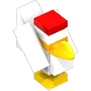{ .lu-ti width="24" loading="lazy" } [Unnamed LOT 13510 (LOT 13510)](../13510.md) | 1 | No client description | 0 matrices; 0 rewards; 0 community references |
| 10490 | { .lu-ti width="24" loading="lazy" } [Advanced Smash Behavior (LOT 10490)](../10490.md) | 1 | Smashes model on attack then completely resets model and all behaviors. | 0 matrices; 1 rewards; 0 community references |
| 10424 | 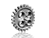{ .lu-ti width="24" loading="lazy" } [AG Property Pushback Platform - Interact Behavior (LOT 10424)](../10424.md) | 1 | A platform that moves up, spins, smashes and rebuilds | 0 matrices; 0 rewards; 0 community references |
| 10444 | { .lu-ti width="24" loading="lazy" } [AG Property Pushback Platform - Touch Behavior (LOT 10444)](../10444.md) | 1 | A platform that moves up, spins, smashes and rebuilds | 0 matrices; 0 rewards; 0 community references |
| 10450 | 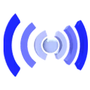{ .lu-ti width="24" loading="lazy" } [Alarm Behavior (LOT 10450)](../10450.md) | 1 | An alarm will sound while a player is close to the model. | 0 matrices; 1 rewards; 0 community references |
| 13533 | 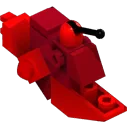{ .lu-ti width="24" loading="lazy" } [Anglerfish Behavior (LOT 13533)](../13533.md) | 1 | A behavior that bops around and dispenses imagination when interacted with. | 0 matrices; 0 rewards; 0 community references |
| 10062 | { .lu-ti width="24" loading="lazy" } [Auto Elevator Behavior (LOT 10062)](../10062.md) | 1 | Auto Elevator | 0 matrices; 0 rewards; 0 community references |
| 4852 | [B3Bouncer (LOT 4852)](../4852.md) |  | Bouncer Behavior | 0 matrices; 0 rewards; 0 community references |
| 4818 | [B3Springpad (LOT 4818)](../4818.md) |  | Springpad Behavior | 0 matrices; 0 rewards; 0 community references |
| 10461 | 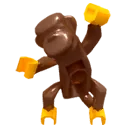{ .lu-ti width="24" loading="lazy" } [Basic AI Behavior (LOT 10461)](../10461.md) | 1 | This Behavior will enable your model to follow and flee from players. | 0 matrices; 1 rewards; 0 community references |
| 10063 | { .lu-ti width="24" loading="lazy" } [Basic Enemy Behavior (LOT 10063)](../10063.md) | 1 | Makes model an enemy | 0 matrices; 0 rewards; 0 community references |
| 10447 | 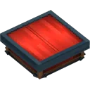{ .lu-ti width="24" loading="lazy" } [Basic Platform Behavior (LOT 10447)](../10447.md) | 1 | When interacted with, model will raise and lower. | 0 matrices; 1 rewards; 0 community references |
| 10044 | { .lu-ti width="24" loading="lazy" } [Basic Smash Behavior (LOT 10044)](../10044.md) | 1 | Smash an object and rebuild it | 0 matrices; 0 rewards; 0 community references |
| 10446 | 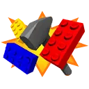{ .lu-ti width="24" loading="lazy" } [Basic Smash Behavior (LOT 10446)](../10446.md) | 1 | When attacked, model will smash, wait 10 seconds, then rebuild. | 0 matrices; 1 rewards; 0 community references |
| 11010 | { .lu-ti width="24" loading="lazy" } [BEHAVIOR - FV Property Pushback - Spike Platform (LOT 11010)](../11010.md) | 1 | Spike Platform Behavior - For ND use only. | 0 matrices; 0 rewards; 0 community references |
| 11004 | { .lu-ti width="24" loading="lazy" } [BEHAVIOR - GF Property Pushback - Fire Beast (LOT 11004)](../11004.md) | 1 | Fire Beast Behavior - For ND use only. | 0 matrices; 0 rewards; 0 community references |
| 10998 | { .lu-ti width="24" loading="lazy" } [BEHAVIOR - GF Property Pushback - Ice Barrier (LOT 10998)](../10998.md) | 1 | Ice Barrier Behavior - For ND use only. | 0 matrices; 0 rewards; 0 community references |
| 11024 | { .lu-ti width="24" loading="lazy" } [BEHAVIOR - GF Property Pushback - Platform (LOT 11024)](../11024.md) | 1 | GF Property Pushback - Platform | 0 matrices; 0 rewards; 0 community references |
| 11000 | { .lu-ti width="24" loading="lazy" } [BEHAVIOR - GF Property Pushback - Tombstone (LOT 11000)](../11000.md) | 1 | Tombstone Behavior - For ND use only. | 0 matrices; 0 rewards; 0 community references |
| 11110 | { .lu-ti width="24" loading="lazy" } [BEHAVIOR - NS Property Pushback - Blocker (LOT 11110)](../11110.md) | 1 | NS Property Pushback - Blocker | 0 matrices; 0 rewards; 0 community references |
| 11006 | { .lu-ti width="24" loading="lazy" } [BEHAVIOR - NS Property Pushback - Cage (LOT 11006)](../11006.md) | 1 | Cage Behavior - For ND use only. | 0 matrices; 0 rewards; 0 community references |
| 11028 | { .lu-ti width="24" loading="lazy" } [BEHAVIOR - NS Property Pushback - Platform (LOT 11028)](../11028.md) | 1 | NS Property Pushback - Platform | 0 matrices; 0 rewards; 0 community references |
| 11008 | { .lu-ti width="24" loading="lazy" } [BEHAVIOR - NS Property Pushback - Rhino (LOT 11008)](../11008.md) | 1 | Rhino Behavior - For ND use only. | 0 matrices; 0 rewards; 0 community references |
| 7960 | { .lu-ti width="24" loading="lazy" } [Behavior Prototype 1 (LOT 7960)](../7960.md) | 1 | Test Behavior Object | 0 matrices; 0 rewards; 0 community references |
| 7963 | { .lu-ti width="24" loading="lazy" } [Behavior Prototype 3 (LOT 7963)](../7963.md) | 1 | Test Behavior Object | 0 matrices; 0 rewards; 0 community references |
| 7964 | { .lu-ti width="24" loading="lazy" } [Behavior Prototype 4 (LOT 7964)](../7964.md) | 1 | Test Behavior Object | 0 matrices; 0 rewards; 0 community references |
| 11115 | 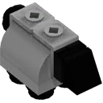{ .lu-ti width="24" loading="lazy" } [Black Sheep Behavior (LOT 11115)](../11115.md) | 1 | Test Behavior | 0 matrices; 0 rewards; 0 community references |
| 13618 | 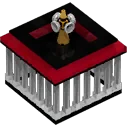{ .lu-ti width="24" loading="lazy" } [Cage Behavior (LOT 13618)](../13618.md) | 1 | A behavior that makes a model move up and down and sound an alarm. | 0 matrices; 0 rewards; 0 community references |
| 13449 | 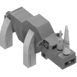{ .lu-ti width="24" loading="lazy" } [Charging Rhino Behavior (LOT 13449)](../13449.md) | 1 | A behavior that causes a model to charge when a player gets close. | 0 matrices; 0 rewards; 0 community references |
| 10449 | 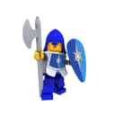{ .lu-ti width="24" loading="lazy" } [Circular Patrol Behavior (LOT 10449)](../10449.md) | 1 | When interacted with, model will patrol in a counter-clockwise circle. | 0 matrices; 1 rewards; 0 community references |
| 10491 | { .lu-ti width="24" loading="lazy" } [Damage Behavior (LOT 10491)](../10491.md) | 1 | Drains the Life of a player every second while touching the model. | 0 matrices; 1 rewards; 0 community references |
| 13626 | 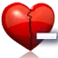{ .lu-ti width="24" loading="lazy" } [Damage Behavior (LOT 13626)](../13626.md) | 1 | A behavior that makes a model damage a player on touch. | 0 matrices; 0 rewards; 0 community references |
| 10048 | { .lu-ti width="24" loading="lazy" } [Drop Power-Ups Behavior (LOT 10048)](../10048.md) | 1 | When attacked, drop power-ups | 0 matrices; 0 rewards; 0 community references |
| 10452 | 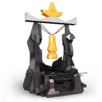{ .lu-ti width="24" loading="lazy" } [Dynamite Behavior (LOT 10452)](../10452.md) | 1 | This Behavior will cause the model to smash when the chat word "detonate" is sent. Use with the Remote Detonator Behavior. | 0 matrices; 0 rewards; 0 community references |
| 13613 | 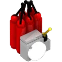{ .lu-ti width="24" loading="lazy" } [Dynamite Behavior (LOT 13613)](../13613.md) | 1 | A behavior that makes a model explode by various means.  This behavior can be used in conjunction with the Dynamite Plunger Behavior or the Brittle Behavior. | 0 matrices; 0 rewards; 0 community references |
| 13611 | 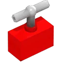{ .lu-ti width="24" loading="lazy" } [Dynamite Pluger Behavior (LOT 13611)](../13611.md) | 1 | A behavior that makes a model communicate to a model with the Dynamite Behavior to explode. | 0 matrices; 0 rewards; 0 community references |
| 10050 | { .lu-ti width="24" loading="lazy" } [Elevator Behavior (LOT 10050)](../10050.md) | 1 | Floats up and down | 0 matrices; 0 rewards; 0 community references |
| 13559 | [Enemy Behavior Alpha (LOT 13559)](../13559.md) | 1 | A behavior that controls enemy movement.  Works with Enemy Behavior Beta. | 0 matrices; 0 rewards; 0 community references |
| 13560 | [Enemy Behavior Beta (LOT 13560)](../13560.md) | 1 | A behavior that controls enemy damage and smashing.  Works with Enemy Behavior Alpha. | 0 matrices; 0 rewards; 0 community references |
| 13615 | 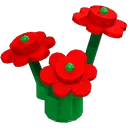{ .lu-ti width="24" loading="lazy" } [Flowers Behavior (LOT 13615)](../13615.md) | 1 | A behavior that makes a model smash when touched and release imagination. | 0 matrices; 0 rewards; 0 community references |
| 13608 | { .lu-ti width="24" loading="lazy" } [Food Behavior (LOT 13608)](../13608.md) | 1 | A behavior that makes a model give power-ups and smash when interacted with. | 0 matrices; 0 rewards; 0 community references |
| 11032 | 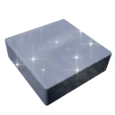{ .lu-ti width="24" loading="lazy" } [Fragile Model Behavior (LOT 11032)](../11032.md) | 1 | Model will smash when any object touches it, or it encounters a loud noise from an explosive smash. Object rebuilds through various methods. | 0 matrices; 1 rewards; 0 community references |
| 10061 | { .lu-ti width="24" loading="lazy" } [Greeter Behavior (LOT 10061)](../10061.md) | 1 | A friendly greeter | 0 matrices; 0 rewards; 0 community references |
| 10453 | { .lu-ti width="24" loading="lazy" } [Greeter Behavior (LOT 10453)](../10453.md) | 1 | Turns your model into a friendly greeter for your property with many ways to interact with it. Your model will even patrol for you if you ask it to. | 0 matrices; 0 rewards; 0 community references |
| 13419 | 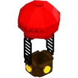{ .lu-ti width="24" loading="lazy" } [Hotair Balloon Behavior (LOT 13419)](../13419.md) | 1 | A hot air balloon that moves up, floats, and moves down. | 0 matrices; 0 rewards; 0 community references |
| 10489 | { .lu-ti width="24" loading="lazy" } [Imagination Dispenser Behavior (LOT 10489)](../10489.md) | 1 | Dispenses imagination when interacted with. Recharges every 10 seconds. | 0 matrices; 1 rewards; 0 community references |
| 13439 | 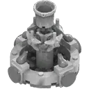{ .lu-ti width="24" loading="lazy" } [Imagination Fountain Behavior (LOT 13439)](../13439.md) | 1 | A behavior that releases imagination when the model is interacted with. | 0 matrices; 0 rewards; 0 community references |
| 10064 | { .lu-ti width="24" loading="lazy" } [Juke Box Behavior (LOT 10064)](../10064.md) | 1 | Plays music | 0 matrices; 0 rewards; 0 community references |
| 10996 | 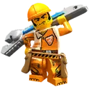{ .lu-ti width="24" loading="lazy" } [Manipulate Model Behavior (LOT 10996)](../10996.md) | 1 | Allows a player to slide and rotate a model around. Interacting pushes the model forward and attacking causes it to spin. | 0 matrices; 1 rewards; 0 community references |
| 13495 | 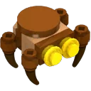{ .lu-ti width="24" loading="lazy" } [Micro Spider Behavior (LOT 13495)](../13495.md) | 1 | A behavior that causes a model to leap down upon passing players. | 0 matrices; 0 rewards; 0 community references |
| 11163 | 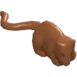{ .lu-ti width="24" loading="lazy" } [Mouse Behavior (LOT 11163)](../11163.md) | 1 | Basic critter behavior | 0 matrices; 0 rewards; 0 community references |
| 10058 | { .lu-ti width="24" loading="lazy" } [Move Around Behavior (LOT 10058)](../10058.md) | 1 | Moves model around | 0 matrices; 0 rewards; 0 community references |
| 10056 | { .lu-ti width="24" loading="lazy" } [Move Forward and Back Behavior (LOT 10056)](../10056.md) | 1 | Move Forward and Back | 0 matrices; 0 rewards; 0 community references |
| 10057 | { .lu-ti width="24" loading="lazy" } [Patrol Behavior (LOT 10057)](../10057.md) | 1 | Model will patrol an area | 0 matrices; 0 rewards; 0 community references |
| 10049 | { .lu-ti width="24" loading="lazy" } [Play Sound Behavior (LOT 10049)](../10049.md) | 1 | Plays a sound | 0 matrices; 0 rewards; 0 community references |
| 10059 | { .lu-ti width="24" loading="lazy" } [Proximity Alarm Behavior (LOT 10059)](../10059.md) | 1 | Alarm sounds when close | 0 matrices; 0 rewards; 0 community references |
| 10060 | { .lu-ti width="24" loading="lazy" } [Proximity Build Behavior (LOT 10060)](../10060.md) | 1 | Model will build when close, smash when far | 0 matrices; 0 rewards; 0 community references |
| 11030 | 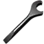{ .lu-ti width="24" loading="lazy" } [Proximity Build Behavior (LOT 11030)](../11030.md) | 1 | Model will build when a player gets close, smash when a player moves away. | 0 matrices; 1 rewards; 0 community references |
| 10993 | 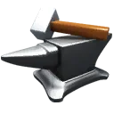{ .lu-ti width="24" loading="lazy" } [Proximity Rebuild Behavior (LOT 10993)](../10993.md) | 1 | Model smashes when a player walks away and rebuilds when a player walks close. | 0 matrices; 0 rewards; 0 community references |
| 13497 | 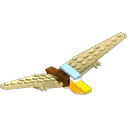{ .lu-ti width="24" loading="lazy" } [Pteranodon Behavior (LOT 13497)](../13497.md) | 1 | A behavior that causes a model to move up and fly in circles. | 0 matrices; 0 rewards; 0 community references |
| 6429 | [Quick Build (LOT 6429)](../6429.md) |  | Quick Build Behavior | 0 matrices; 0 rewards; 0 community references |
| 13531 | 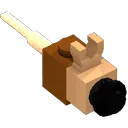{ .lu-ti width="24" loading="lazy" } [Rat Behavior (LOT 13531)](../13531.md) | 1 | A behavior that makes a model act like a rat. | 0 matrices; 0 rewards; 0 community references |
| 7962 | { .lu-ti width="24" loading="lazy" } [Rebuild Behavior (LOT 7962)](../7962.md) | 1 | Test Behavior Object | 0 matrices; 0 rewards; 0 community references |
| 10451 | 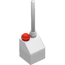{ .lu-ti width="24" loading="lazy" } [Remote Detonator Behavior (LOT 10451)](../10451.md) | 1 | A remote detonator for dynamite. This behavior requires the Dynamite Behavior to be placed on a model. | 0 matrices; 0 rewards; 0 community references |
| 10290 | { .lu-ti width="24" loading="lazy" } [Rising Platform Behavior (LOT 10290)](../10290.md) | 1 | A Behavior for your models | 0 matrices; 0 rewards; 0 community references |
| 13535 | 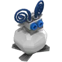{ .lu-ti width="24" loading="lazy" } [Scared Rock Beast Behavior (LOT 13535)](../13535.md) | 1 | A behavior that makes a model flee from a player. | 0 matrices; 0 rewards; 0 community references |
| 13542 | [Scared Salamunky Behavior (LOT 13542)](../13542.md) | 1 | A behavior makes a model into a patroling enemy. | 0 matrices; 0 rewards; 0 community references |
| 4648 | [Smashable (LOT 4648)](../4648.md) | 1 | Smashable Behavior | 0 matrices; 0 rewards; 0 community references |
| 13620 | 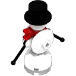{ .lu-ti width="24" loading="lazy" } [Snowman Behavior (LOT 13620)](../13620.md) | 1 | A behavior that makes a model smash when attacked, drop power-ups, then rebuild when interacted with. | 0 matrices; 0 rewards; 0 community references |
| 11033 | { .lu-ti width="24" loading="lazy" } [Sounds on Touch Behavior (LOT 11033)](../11033.md) | 1 | Plays different sounds depending on what is touching or stops touching the model | 0 matrices; 1 rewards; 0 community references |
| 13628 | 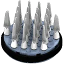{ .lu-ti width="24" loading="lazy" } [Spike Platform Behavior (LOT 13628)](../13628.md) | 1 | A behavior that makes a model spin around. | 0 matrices; 0 rewards; 0 community references |
| 10051 | { .lu-ti width="24" loading="lazy" } [Spin Around Behavior (LOT 10051)](../10051.md) | 1 | Spin completely around | 0 matrices; 0 rewards; 0 community references |
| 10448 | { .lu-ti width="24" loading="lazy" } [Spin Right Behavior (LOT 10448)](../10448.md) | 1 | When interacted with, model will spin clockwise in a circle. | 0 matrices; 1 rewards; 0 community references |
| 8184 | [Test Behavior 3 (LOT 8184)](../8184.md) | 1 | Test to see if object creator can make a new behavior item correctly | 0 matrices; 0 rewards; 0 community references |
| 8173 | { .lu-ti width="24" loading="lazy" } [TEST behavior object (LOT 8173)](../8173.md) | 1 | test | 0 matrices; 0 rewards; 0 community references |
| 8185 | [Test Behavior object 4 (LOT 8185)](../8185.md) | 1 | No client description | 0 matrices; 0 rewards; 0 community references |
| 8186 | [Test Behavior object 5 (LOT 8186)](../8186.md) | 1 | No client description | 0 matrices; 0 rewards; 0 community references |
| 10997 | { .lu-ti width="24" loading="lazy" } [Touch Sensitive Platform Behavior (LOT 10997)](../10997.md) | 1 | Model moves up and down when touched. The model also gives instructions when approached. | 0 matrices; 1 rewards; 0 community references |
| 10422 | 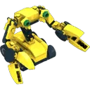{ .lu-ti width="24" loading="lazy" } [Toy Robot Behavior (LOT 10422)](../10422.md) | 1 | Turn robot on and off. Robot will move forward until it encounters an obstacle. | 0 matrices; 1 rewards; 0 community references |
| 13431 | { .lu-ti width="24" loading="lazy" } [Trophy Behavior (LOT 13431)](../13431.md) | 1 | A behavior that makes a trophy congratulate and reward the player when the model is touched. | 0 matrices; 0 rewards; 0 community references |
| 13473 | 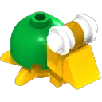{ .lu-ti width="24" loading="lazy" } [Turtle Behavior (LOT 13473)](../13473.md) | 1 | A behavior that causes a model to wander back and forth and follow a player. | 0 matrices; 0 rewards; 0 community references |
| 10492 | { .lu-ti width="24" loading="lazy" } [Unleash Power-Ups Behavior (LOT 10492)](../10492.md) | 1 | Model drops Hearts, Imagination, and Armor when attacked. | 0 matrices; 1 rewards; 0 community references |
| 7965 | { .lu-ti width="24" loading="lazy" } [User Behavior In Inventory (LOT 7965)](../7965.md) | 0 | Represents user behaviors in a player's inventory. | 0 matrices; 0 rewards; 0 community references |
