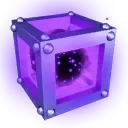
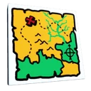
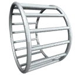
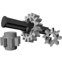
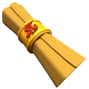
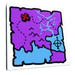
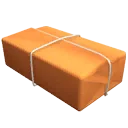

# Collectible — page 1/1

[Item database](../README.md)

Pages: [1](type-13-1.md)

| LOT | Item | Rarity | Description | Source evidence |
| --- | --- | --- | --- | --- |
| 12324 | { .lu-ti width="24" loading="lazy" } [Unnamed LOT 12324 (LOT 12324)](../12324.md) | 1 | No client description | 0 matrices; 0 rewards; 0 community references |
| 12325 | { .lu-ti width="24" loading="lazy" } [Unnamed LOT 12325 (LOT 12325)](../12325.md) | 1 | No client description | 0 matrices; 0 rewards; 0 community references |
| 12326 | { .lu-ti width="24" loading="lazy" } [Unnamed LOT 12326 (LOT 12326)](../12326.md) | 1 | No client description | 0 matrices; 0 rewards; 0 community references |
| 14554 | { .lu-ti width="24" loading="lazy" } [Unnamed LOT 14554 (LOT 14554)](../14554.md) | 1 | No client description | 0 matrices; 0 rewards; 0 community references |
| 14219 | { .lu-ti width="24" loading="lazy" } [Ace's Jetpack (LOT 14219)](../14219.md) | 2 | Return this to Ace Warprider in Nexus Tower. | 0 matrices; 1 rewards; 0 community references |
| 13578 | { .lu-ti width="24" loading="lazy" } [Achilles' Shield (LOT 13578)](../13578.md) | 2 | Return this to Achilles Plutarch in Nexus Tower. | 0 matrices; 1 rewards; 0 community references |
| 12317 | { .lu-ti width="24" loading="lazy" } [Aura Blossoms (LOT 12317)](../12317.md) | 2 | Return this to Sensei Wu in Crux Prime! | 1 matrices; 0 rewards; 0 community references |
| 13587 | { .lu-ti width="24" loading="lazy" } [Bottled Water (LOT 13587)](../13587.md) | 1 | No client description | 1 matrices; 0 rewards; 0 community references |
| 12237 | { .lu-ti width="24" loading="lazy" } [Candy Cane (LOT 12237)](../12237.md) | 2 | Spend this at a Winter vendor! | 5 matrices; 4 rewards; 0 community references |
| 9274 | { .lu-ti width="24" loading="lazy" } [Captain Jack Knife's Treasure Map (LOT 9274)](../9274.md) | 1 | No client description | 0 matrices; 0 rewards; 0 community references |
| 8121 | { .lu-ti width="24" loading="lazy" } [DroppedLootTemplate (LOT 8121)](../8121.md) | 1 | Loot template used to render actual loot icon gfx to | 0 matrices; 0 rewards; 0 community references |
| 14556 | { .lu-ti width="24" loading="lazy" } [Flashlight (LOT 14556)](../14556.md) | 1 | Return this to Rusty Steele in Avant Gardens. | 1 matrices; 0 rewards; 0 community references |
| 12321 | { .lu-ti width="24" loading="lazy" } [Foozle (LOT 12321)](../12321.md) | 2 | No client description | 0 matrices; 0 rewards; 0 community references |
| 14221 | { .lu-ti width="24" loading="lazy" } [Gwen's Smoke Machine (LOT 14221)](../14221.md) | 2 | Return this to Gwen Tweenbangle in Nexus Tower. | 0 matrices; 1 rewards; 0 community references |
| 14555 | { .lu-ti width="24" loading="lazy" } [Hamster Wheel (LOT 14555)](../14555.md) | 1 | Return this to Rusty Steele in Avant Gardens | 1 matrices; 0 rewards; 0 community references |
| 14553 | { .lu-ti width="24" loading="lazy" } [Maelstrom Cube (LOT 14553)](../14553.md) | 1 | Use for Paradox missions in Avant Gardens. | 0 matrices; 3 rewards; 0 community references |
| 14223 | { .lu-ti width="24" loading="lazy" } [Meyer's Thinking Hat (LOT 14223)](../14223.md) | 2 | Return this to Meyer Muckrake in Nexus Tower. | 0 matrices; 1 rewards; 0 community references |
| 12323 | { .lu-ti width="24" loading="lazy" } [Nexus Talon Datacard (LOT 12323)](../12323.md) | 2 | Return this to Sherland Powers in Crux Prime! | 1 matrices; 0 rewards; 0 community references |
| 14498 | { .lu-ti width="24" loading="lazy" } [Portable Chaos Cleaner (LOT 14498)](../14498.md) | 1 | Give this to Nya in the Ninjago Monastery. | 0 matrices; 0 rewards; 0 community references |
| 14558 | { .lu-ti width="24" loading="lazy" } [Rocco's Earth Student Kit (LOT 14558)](../14558.md) | 1 | Return this package to Rocco Sirocco at the Sentinel Base Camp in Avant Gardens. | 0 matrices; 0 rewards; 0 community references |
| 14222 | { .lu-ti width="24" loading="lazy" } [Rutger's Hair Gel (LOT 14222)](../14222.md) | 2 | Return this to Rutger Hemoglobin in Nexus Tower. | 0 matrices; 1 rewards; 0 community references |
| 12320 | { .lu-ti width="24" loading="lazy" } [Sherland Powers' Property Warp (LOT 12320)](../12320.md) | 2 | No client description | 1 matrices; 0 rewards; 0 community references |
| 14557 | { .lu-ti width="24" loading="lazy" } [Spare Robot Part (LOT 14557)](../14557.md) | 1 | Use to rebuild the robot near the Paradox Lab in Avant Gardens. | 1 matrices; 0 rewards; 0 community references |
| 12390 | { .lu-ti width="24" loading="lazy" } [Spider Boss Processor (LOT 12390)](../12390.md) | 1 | No client description | 0 matrices; 0 rewards; 0 community references |
| 14549 | { .lu-ti width="24" loading="lazy" } [Spider Queen's Postcard (LOT 14549)](../14549.md) | 1 | Return this to Melodie Foxtrot in Avant Gardens. | 1 matrices; 0 rewards; 0 community references |
| 12318 | { .lu-ti width="24" loading="lazy" } [Test Ancient Scroll (LOT 12318)](../12318.md) | 2 | No client description | 0 matrices; 0 rewards; 0 community references |
| 12837 | { .lu-ti width="24" loading="lazy" } [Test DELETION Object (LOT 12837)](../12837.md) | 2 | Used to test stack deletion | 0 matrices; 0 rewards; 0 community references |
| 14169 | { .lu-ti width="24" loading="lazy" } [Treasure Finder (LOT 14169)](../14169.md) | 2 | Double-click to use! | 1 matrices; 1 rewards; 0 community references |
| 16650 | { .lu-ti width="24" loading="lazy" } [Urufu's Treasure (LOT 16650)](../16650.md) | 1 | Return this to Urufu in the Ninjago Monastery. | 1 matrices; 0 rewards; 0 community references |
| 16651 | { .lu-ti width="24" loading="lazy" } [Urufu's Treasure (LOT 16651)](../16651.md) | 1 | Return this to Urufu in the Ninjago Monastery. | 1 matrices; 0 rewards; 0 community references |
| 16652 | { .lu-ti width="24" loading="lazy" } [Urufu's Treasure (LOT 16652)](../16652.md) | 1 | Return this to Urufu in the Ninjago Monastery. | 1 matrices; 0 rewards; 0 community references |
| 16653 | { .lu-ti width="24" loading="lazy" } [Urufu's Treasure (LOT 16653)](../16653.md) | 1 | Return this to Urufu in the Ninjago Monastery. | 1 matrices; 0 rewards; 0 community references |
| 16654 | { .lu-ti width="24" loading="lazy" } [Urufu's Treasure (LOT 16654)](../16654.md) | 1 | Return this to Urufu in the Ninjago Monastery. | 1 matrices; 0 rewards; 0 community references |
| 14523 | { .lu-ti width="24" loading="lazy" } [Wisdom Petals (LOT 14523)](../14523.md) | 1 | Return these to Sensei Wu in the Ninjago Monastery! | 0 matrices; 0 rewards; 0 community references |
