# Consumable — page 1/2

[Item database](../README.md)

Pages: [1](type-14-1.md) | [2](type-14-2.md)

| LOT | Item | Rarity | Description | Source evidence |
| --- | --- | --- | --- | --- |
| 3009 | { .lu-ti width="24" loading="lazy" } [Unnamed LOT 3009 (LOT 3009)](../3009.md) | 2 | No client description | 0 matrices; 0 rewards; 0 community references |
| 3078 | { .lu-ti width="24" loading="lazy" } [Unnamed LOT 3078 (LOT 3078)](../3078.md) | 2 | No client description | 0 matrices; 0 rewards; 0 community references |
| 3812 | 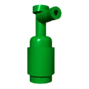{ .lu-ti width="24" loading="lazy" } [Unnamed LOT 3812 (LOT 3812)](../3812.md) | 2 | No client description | 0 matrices; 0 rewards; 0 community references |
| 6218 | { .lu-ti width="24" loading="lazy" } [Unnamed LOT 6218 (LOT 6218)](../6218.md) | 1 | No client description | 0 matrices; 0 rewards; 0 community references |
| 6221 | { .lu-ti width="24" loading="lazy" } [Unnamed LOT 6221 (LOT 6221)](../6221.md) | 1 | No client description | 0 matrices; 0 rewards; 0 community references |
| 6821 | { .lu-ti width="24" loading="lazy" } [Unnamed LOT 6821 (LOT 6821)](../6821.md) | 1 | No client description | 0 matrices; 0 rewards; 0 community references |
| 6983 | { .lu-ti width="24" loading="lazy" } [Unnamed LOT 6983 (LOT 6983)](../6983.md) | 1 | No client description | 0 matrices; 0 rewards; 0 community references |
| 7609 | { .lu-ti width="24" loading="lazy" } [Unnamed LOT 7609 (LOT 7609)](../7609.md) | 4 | No client description | 0 matrices; 0 rewards; 0 community references |
| 7777 | { .lu-ti width="24" loading="lazy" } [Unnamed LOT 7777 (LOT 7777)](../7777.md) | 1 | No client description | 0 matrices; 0 rewards; 0 community references |
| 10291 | { .lu-ti width="24" loading="lazy" } [Unnamed LOT 10291 (LOT 10291)](../10291.md) | 3 | No client description | 0 matrices; 0 rewards; 0 community references |
| 10292 | { .lu-ti width="24" loading="lazy" } [Unnamed LOT 10292 (LOT 10292)](../10292.md) | 3 | No client description | 0 matrices; 0 rewards; 0 community references |
| 10293 | { .lu-ti width="24" loading="lazy" } [Unnamed LOT 10293 (LOT 10293)](../10293.md) | 3 | No client description | 0 matrices; 0 rewards; 0 community references |
| 10294 | { .lu-ti width="24" loading="lazy" } [Unnamed LOT 10294 (LOT 10294)](../10294.md) | 3 | No client description | 0 matrices; 0 rewards; 0 community references |
| 10518 | { .lu-ti width="24" loading="lazy" } [Unnamed LOT 10518 (LOT 10518)](../10518.md) | 3 | No client description | 0 matrices; 0 rewards; 0 community references |
| 12096 | { .lu-ti width="24" loading="lazy" } [Unnamed LOT 12096 (LOT 12096)](../12096.md) | 3 | No client description | 0 matrices; 0 rewards; 0 community references |
| 12104 | { .lu-ti width="24" loading="lazy" } [Unnamed LOT 12104 (LOT 12104)](../12104.md) | 3 | No client description | 0 matrices; 0 rewards; 0 community references |
| 12105 | { .lu-ti width="24" loading="lazy" } [Unnamed LOT 12105 (LOT 12105)](../12105.md) | 2 | No client description | 0 matrices; 0 rewards; 0 community references |
| 12111 | { .lu-ti width="24" loading="lazy" } [Unnamed LOT 12111 (LOT 12111)](../12111.md) | 1 | No client description | 0 matrices; 0 rewards; 0 community references |
| 12112 | { .lu-ti width="24" loading="lazy" } [Unnamed LOT 12112 (LOT 12112)](../12112.md) | 1 | No client description | 0 matrices; 0 rewards; 0 community references |
| 12113 | { .lu-ti width="24" loading="lazy" } [Unnamed LOT 12113 (LOT 12113)](../12113.md) | 1 | No client description | 0 matrices; 0 rewards; 0 community references |
| 14515 | { .lu-ti width="24" loading="lazy" } [Unnamed LOT 14515 (LOT 14515)](../14515.md) | 1 | No client description | 1 matrices; 0 rewards; 0 community references |
| 14522 | { .lu-ti width="24" loading="lazy" } [Unnamed LOT 14522 (LOT 14522)](../14522.md) | 1 | No client description | 0 matrices; 0 rewards; 0 community references |
| 14589 | { .lu-ti width="24" loading="lazy" } [Unnamed LOT 14589 (LOT 14589)](../14589.md) | 3 | No client description | 0 matrices; 0 rewards; 0 community references |
| 15941 | { .lu-ti width="24" loading="lazy" } [Unnamed LOT 15941 (LOT 15941)](../15941.md) | 4 | No client description | 0 matrices; 0 rewards; 0 community references |
| 15942 | { .lu-ti width="24" loading="lazy" } [Unnamed LOT 15942 (LOT 15942)](../15942.md) | 4 | No client description | 0 matrices; 0 rewards; 0 community references |
| 15945 | { .lu-ti width="24" loading="lazy" } [Unnamed LOT 15945 (LOT 15945)](../15945.md) | 4 | No client description | 0 matrices; 0 rewards; 0 community references |
| 16036 | 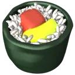{ .lu-ti width="24" loading="lazy" } [Unnamed LOT 16036 (LOT 16036)](../16036.md) | 1 | No client description | 0 matrices; 0 rewards; 0 community references |
| 16039 | { .lu-ti width="24" loading="lazy" } [Unnamed LOT 16039 (LOT 16039)](../16039.md) | 2 | No client description | 0 matrices; 0 rewards; 0 community references |
| 16042 | { .lu-ti width="24" loading="lazy" } [Unnamed LOT 16042 (LOT 16042)](../16042.md) | 1 | No client description | 0 matrices; 0 rewards; 0 community references |
| 16056 | { .lu-ti width="24" loading="lazy" } [Unnamed LOT 16056 (LOT 16056)](../16056.md) | 3 | No client description | 0 matrices; 0 rewards; 0 community references |
| 16201 | { .lu-ti width="24" loading="lazy" } [Unnamed LOT 16201 (LOT 16201)](../16201.md) | 3 | No client description | 0 matrices; 0 rewards; 0 community references |
| 16202 | { .lu-ti width="24" loading="lazy" } [Unnamed LOT 16202 (LOT 16202)](../16202.md) | 3 | No client description | 0 matrices; 0 rewards; 0 community references |
| 16204 | { .lu-ti width="24" loading="lazy" } [Unnamed LOT 16204 (LOT 16204)](../16204.md) | 3 | No client description | 0 matrices; 0 rewards; 0 community references |
| 16253 | { .lu-ti width="24" loading="lazy" } [Unnamed LOT 16253 (LOT 16253)](../16253.md) | 3 | No client description | 0 matrices; 0 rewards; 0 community references |
| 16254 | { .lu-ti width="24" loading="lazy" } [Unnamed LOT 16254 (LOT 16254)](../16254.md) | 3 | No client description | 0 matrices; 0 rewards; 0 community references |
| 16655 | { .lu-ti width="24" loading="lazy" } [Unnamed LOT 16655 (LOT 16655)](../16655.md) | 1 | No client description | 0 matrices; 0 rewards; 0 community references |
| 6642 | { .lu-ti width="24" loading="lazy" } [3 pt Healing Kit (LOT 6642)](../6642.md) | 5 | Restores 3 point of Health | 0 matrices; 0 rewards; 0 community references |
| 6644 | { .lu-ti width="24" loading="lazy" } [3 pt Repair Kit (LOT 6644)](../6644.md) | 5 | Restores 3 points of Armor | 0 matrices; 0 rewards; 0 community references |
| 6643 | { .lu-ti width="24" loading="lazy" } [4 pt Restoration Kit (LOT 6643)](../6643.md) | 5 | Restores 4 points of Imagination | 0 matrices; 0 rewards; 0 community references |
| 12481 | { .lu-ti width="24" loading="lazy" } [Alien Core (LOT 12481)](../12481.md) | 2 | Return this to Vanda Darkflame. | 0 matrices; 0 rewards; 0 community references |
| 12479 | { .lu-ti width="24" loading="lazy" } [Alien Pod (LOT 12479)](../12479.md) | 2 | Return this to Vanda Darkflame. | 0 matrices; 0 rewards; 0 community references |
| 12480 | { .lu-ti width="24" loading="lazy" } [Alien Shell (LOT 12480)](../12480.md) | 2 | Return this to Vanda Darkflame. | 0 matrices; 0 rewards; 0 community references |
| 3100 | { .lu-ti width="24" loading="lazy" } [Amber Gem (LOT 3100)](../3100.md) | 1 | A gem that can be sold! | 131 matrices; 0 rewards; 0 community references |
| 2097196 | { .lu-ti width="24" loading="lazy" } [Amber Gem (LOT 2097196)](../2097196.md) | 1 | A gem that can be sold! | 0 matrices; 0 rewards; 0 community references |
| 13426 | 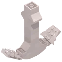{ .lu-ti width="24" loading="lazy" } [Anchors Away (LOT 13426)](../13426.md) | 2 | Double-click to use! | 18 matrices; 0 rewards; 1 community references |
| 9700 | { .lu-ti width="24" loading="lazy" } [Anvil of Armor (LOT 9700)](../9700.md) | 1 | Double-click to use! | 0 matrices; 1 rewards; 0 community references |
| 2997 | { .lu-ti width="24" loading="lazy" } [Armor Gleam (LOT 2997)](../2997.md) | 1 | Double-click to use! | 59 matrices; 1 rewards; 1 community references |
| 2993 | { .lu-ti width="24" loading="lazy" } [Armor Polish (LOT 2993)](../2993.md) | 1 | Double-click to use! | 148 matrices; 1 rewards; 1 community references |
| 2996 | { .lu-ti width="24" loading="lazy" } [Armor Shine (LOT 2996)](../2996.md) | 1 | Double-click to use! | 153 matrices; 1 rewards; 1 community references |
| 9624 | { .lu-ti width="24" loading="lazy" } [Assembly Awesome-Ade (LOT 9624)](../9624.md) | 2 | Double-click to use! | 2 matrices; 0 rewards; 1 community references |
| 13575 | { .lu-ti width="24" loading="lazy" } [Assembly Awesome-Ade 2 (LOT 13575)](../13575.md) | 3 | Double-click to use! | 1 matrices; 0 rewards; 1 community references |
| 8318 | { .lu-ti width="24" loading="lazy" } [Assembly Token (LOT 8318)](../8318.md) | 1 | Spend this at an Assembly vendor! | 1 matrices; 0 rewards; 0 community references; faction proxy applies |
| 8363 | { .lu-ti width="24" loading="lazy" } [Bag of Glitter (LOT 8363)](../8363.md) | 1 | Double-click to use! | 45 matrices; 0 rewards; 1 community references |
| 6265 | { .lu-ti width="24" loading="lazy" } [Bag of Peanuts (LOT 6265)](../6265.md) | 1 | Elephants like peanuts! | 2 matrices; 2 rewards; 1 community references |
| 12108 | { .lu-ti width="24" loading="lazy" } [Balloon Animals (LOT 12108)](../12108.md) | 3 | Double-click to use! | 1 matrices; 0 rewards; 0 community references |
| 14508 | { .lu-ti width="24" loading="lazy" } [Bamboo Bite (LOT 14508)](../14508.md) | 1 | Use this in a recipe for Johnny Umami! | 1 matrices; 0 rewards; 0 community references |
| 12493 | 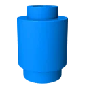{ .lu-ti width="24" loading="lazy" } [Banana Split (LOT 12493)](../12493.md) | 1 | No client description | 0 matrices; 0 rewards; 0 community references |
| 16038 | { .lu-ti width="24" loading="lazy" } [Bancha Tea (LOT 16038)](../16038.md) | 2 | Double-click to use! | 43 matrices; 26 rewards; 0 community references |
| 12762 | { .lu-ti width="24" loading="lazy" } [Battle Croissant (LOT 12762)](../12762.md) | 1 | Double-click to use! | 43 matrices; 0 rewards; 1 community references |
| 3011 | { .lu-ti width="24" loading="lazy" } [BBQ Blast Hot Dog (LOT 3011)](../3011.md) | 1 | Double-click to use! | 69 matrices; 0 rewards; 1 community references |
| 12763 | { .lu-ti width="24" loading="lazy" } [BBQ Drumstick (LOT 12763)](../12763.md) | 1 | Double-click to use! | 44 matrices; 0 rewards; 1 community references |
| 13786 | { .lu-ti width="24" loading="lazy" } [Ben's Butter Spreaders (LOT 13786)](../13786.md) | 1 | Double-click to use! | 0 matrices; 0 rewards; 0 community references |
| 14507 | { .lu-ti width="24" loading="lazy" } [Bento Blocks (LOT 14507)](../14507.md) | 3 | Double-click to use! | 1 matrices; 1 rewards; 0 community references |
| 10520 | { .lu-ti width="24" loading="lazy" } [Beta Tester Book (LOT 10520)](../10520.md) | 3 | Double-click to use! | 0 matrices; 1 rewards; 0 community references |
| 12764 | { .lu-ti width="24" loading="lazy" } [Big Fountain Soda (LOT 12764)](../12764.md) | 2 | Double-click to use! | 43 matrices; 0 rewards; 1 community references |
| 3038 | { .lu-ti width="24" loading="lazy" } [Blue Imaginite (LOT 3038)](../3038.md) | 3 | Buy increased backpack size with this! | 47 matrices; 0 rewards; 0 community references |
| 14473 | { .lu-ti width="24" loading="lazy" } [Bone Bucket Building Instructions (LOT 14473)](../14473.md) | 1 | Return this to Jay in the Ninjago Dojo of Lightning. | 1 matrices; 0 rewards; 0 community references |
| 2946 | 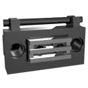{ .lu-ti width="24" loading="lazy" } [Boom Box (LOT 2946)](../2946.md) | 3 | Double-click to use! | 0 matrices; 1 rewards; 0 community references |
| 7084 | { .lu-ti width="24" loading="lazy" } [Boom Trap Kit (LOT 7084)](../7084.md) | 1 | Double-click to use! | 22 matrices; 1 rewards; 1 community references |
| 10698 | { .lu-ti width="24" loading="lazy" } [Bradford Rant Book (LOT 10698)](../10698.md) | 3 | Double-click to use! | 0 matrices; 1 rewards; 0 community references |
| 2985 | { .lu-ti width="24" loading="lazy" } [Bubble Blower (LOT 2985)](../2985.md) | 3 | Double-click to use! | 0 matrices; 1 rewards; 0 community references |
| 12767 | { .lu-ti width="24" loading="lazy" } [Buff Out Armor Brush (LOT 12767)](../12767.md) | 1 | Double-click to use! | 44 matrices; 0 rewards; 1 community references |
| 7724 | { .lu-ti width="24" loading="lazy" } [Buttery Croissant (LOT 7724)](../7724.md) | 1 | Double-click to use! | 65 matrices; 0 rewards; 1 community references |
| 4859 | { .lu-ti width="24" loading="lazy" } [Cannonball (LOT 4859)](../4859.md) | 1 | Return this to the Pirate Cannoneer! | 1 matrices; 0 rewards; 0 community references |
| 7787 | { .lu-ti width="24" loading="lazy" } [Cauldron of Life (LOT 7787)](../7787.md) | 3 | Double-click to use! | 0 matrices; 1 rewards; 0 community references |
| 14493 | { .lu-ti width="24" loading="lazy" } [Chaos Cleaner Instructions (LOT 14493)](../14493.md) | 1 | Return this to Jay in the Ninjago Dojo of Lightning. | 0 matrices; 1 rewards; 0 community references |
| 12474 | { .lu-ti width="24" loading="lazy" } [Cherry Blast (LOT 12474)](../12474.md) | 1 | Double-click to use! | 1 matrices; 0 rewards; 1 community references |
| 14506 | { .lu-ti width="24" loading="lazy" } [Chilly Freezesteak (LOT 14506)](../14506.md) | 3 | Double-click to use! | 1 matrices; 1 rewards; 0 community references |
| 6860 | { .lu-ti width="24" loading="lazy" } [Clear Gem (LOT 6860)](../6860.md) | 4 | A valuable gem that can be sold! | 1 matrices; 0 rewards; 0 community references |
| 7779 | { .lu-ti width="24" loading="lazy" } [Clod Chucking Shovel (LOT 7779)](../7779.md) | 3 | Double-click to use! | 0 matrices; 1 rewards; 0 community references |
| 8366 | { .lu-ti width="24" loading="lazy" } [Cloud Burst (LOT 8366)](../8366.md) | 1 | Double-click to use! | 65 matrices; 0 rewards; 1 community references |
| 16041 | { .lu-ti width="24" loading="lazy" } [Cotton Repair Kit (LOT 16041)](../16041.md) | 2 | Double-click to use! | 43 matrices; 26 rewards; 0 community references |
| 13058 | { .lu-ti width="24" loading="lazy" } [Cracked Ronin's Helm (LOT 13058)](../13058.md) | 2 | Return this to Duke Exeter in Nexus Tower! | 1 matrices; 0 rewards; 0 community references |
| 14500 | { .lu-ti width="24" loading="lazy" } [Cringe Lo's Love Note (LOT 14500)](../14500.md) | 1 | Take this to Nya in the Ninjago Monastery! | 0 matrices; 1 rewards; 0 community references |
| 16898 | 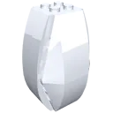{ .lu-ti width="24" loading="lazy" } [Crocodile Egg (LOT 16898)](../16898.md) | 4 | No client description | 1 matrices; 0 rewards; 0 community references |
| 10038 | { .lu-ti width="24" loading="lazy" } [Cup of Yo (LOT 10038)](../10038.md) | 3 | Double-click to use! | 21 matrices; 0 rewards; 1 community references |
| 6861 | { .lu-ti width="24" loading="lazy" } [Dark Blue Gem (LOT 6861)](../6861.md) | 4 | A valuable gem that can be sold! | 1 matrices; 0 rewards; 0 community references |
| 6862 | { .lu-ti width="24" loading="lazy" } [Dark Red Gem (LOT 6862)](../6862.md) | 4 | A valuable gem that can be sold! | 49 matrices; 1 rewards; 0 community references |
| 15943 | { .lu-ti width="24" loading="lazy" } [Dark Red Plate (LOT 15943)](../15943.md) | 4 | A valuable plate that can be sold! | 0 matrices; 0 rewards; 0 community references |
| 14497 | { .lu-ti width="24" loading="lazy" } [Diamond Gem (LOT 14497)](../14497.md) | 2 | A gem that can be sold! | 1 matrices; 0 rewards; 0 community references |
| 14502 | 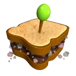{ .lu-ti width="24" loading="lazy" } [Dirt Sandwich (LOT 14502)](../14502.md) | 2 | Double-click to use! | 1 matrices; 1 rewards; 0 community references |
| 12319 | { .lu-ti width="24" loading="lazy" } [Doc in a Box (LOT 12319)](../12319.md) | 1 | Double-click to use! | 43 matrices; 0 rewards; 1 community references |
| 14132 | { .lu-ti width="24" loading="lazy" } [Dr. Overbuild's Property Scanner (LOT 14132)](../14132.md) | 1 | Double-click to use! | 0 matrices; 1 rewards; 0 community references |
| 13777 | 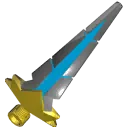{ .lu-ti width="24" loading="lazy" } [Duke Exeter's Sword (LOT 13777)](../13777.md) | 4 | Interact with the blue X-marks on Crux Prime to call down Imagination Blasts. | 0 matrices; 0 rewards; 0 community references |
| 16296 | { .lu-ti width="24" loading="lazy" } [Earth Spinjitzu Scroll (LOT 16296)](../16296.md) | 1 | Return this to &lt;name&gt; in the Ninjago Monastery. | 0 matrices; 0 rewards; 0 community references |
| 14503 | { .lu-ti width="24" loading="lazy" } [Electric Hoagie (LOT 14503)](../14503.md) | 2 | Double-click to use! | 1 matrices; 1 rewards; 0 community references |
| 8367 | { .lu-ti width="24" loading="lazy" } [Enchanted Dragon's Tooth (LOT 8367)](../8367.md) | 4 | Double-click to summon the spirit of the dragon! | 0 matrices; 1 rewards; 0 community references |
| 12765 | { .lu-ti width="24" loading="lazy" } [Energy Bar (LOT 12765)](../12765.md) | 1 | Double-click to use! | 43 matrices; 0 rewards; 1 community references |
| 5833 | { .lu-ti width="24" loading="lazy" } [Everlasting Hiccup Tablets (LOT 5833)](../5833.md) | 3 | Double-click to use! | 0 matrices; 1 rewards; 0 community references |
| 3012 | { .lu-ti width="24" loading="lazy" } [Everlasting Hot Dog (LOT 3012)](../3012.md) | 3 | Double-click to use! | 0 matrices; 1 rewards; 0 community references |
| 16059 | { .lu-ti width="24" loading="lazy" } [Exploding Ninjago Kunai (LOT 16059)](../16059.md) | 3 | Double-click to use! | 43 matrices; 0 rewards; 1 community references |
| 14518 | { .lu-ti width="24" loading="lazy" } [Eye Bone (LOT 14518)](../14518.md) | 1 | Return this to Furious Urufu in the Ninjago Monastery. | 1 matrices; 0 rewards; 0 community references |
| 13763 | { .lu-ti width="24" loading="lazy" } [Faction Token Proxy (LOT 13763)](../13763.md) | 1 | No client description | 259 matrices; 0 rewards; 0 community references |
| 14496 | { .lu-ti width="24" loading="lazy" } [Finger Nail (LOT 14496)](../14496.md) | 1 | Return this to Jay in the Ninjago Dojo of Lightning. | 2 matrices; 0 rewards; 0 community references |
| 16299 | { .lu-ti width="24" loading="lazy" } [Fire Spinjitzu Scroll (LOT 16299)](../16299.md) | 1 | Return this to &lt;name&gt; in the Ninjago Monastery. | 0 matrices; 0 rewards; 0 community references |
| 7778 | { .lu-ti width="24" loading="lazy" } [Firecracker (LOT 7778)](../7778.md) | 1 | Double-click to use! | 85 matrices; 1 rewards; 1 community references |
| 14470 | { .lu-ti width="24" loading="lazy" } [Flame Fruit (LOT 14470)](../14470.md) | 2 | Use this in a recipe for Johnny Umami! | 1 matrices; 2 rewards; 0 community references |
| 14509 | { .lu-ti width="24" loading="lazy" } [Flame-Roasted Popsicle (LOT 14509)](../14509.md) | 3 | Double-click to use! | 1 matrices; 1 rewards; 0 community references |
| 6884 | { .lu-ti width="24" loading="lazy" } [Flash Bang (LOT 6884)](../6884.md) | 1 | Double-click to use! | 88 matrices; 0 rewards; 1 community references |
| 7785 | { .lu-ti width="24" loading="lazy" } [Flash Bulb (LOT 7785)](../7785.md) | 4 | No client description | 0 matrices; 1 rewards; 0 community references |
| 12594 | { .lu-ti width="24" loading="lazy" } [Flowin' MC (LOT 12594)](../12594.md) | 3 | Double-click to use! | 0 matrices; 1 rewards; 0 community references |
| 12475 | 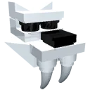{ .lu-ti width="24" loading="lazy" } [Fossilized Pet Bone (LOT 12475)](../12475.md) | 1 | Return this to Dr. Overbuild. | 2 matrices; 0 rewards; 0 community references |
| 7788 | 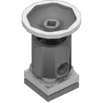{ .lu-ti width="24" loading="lazy" } [Fountain of Imagination (LOT 7788)](../7788.md) | 3 | Double-click to use! | 0 matrices; 1 rewards; 0 community references |
| 14471 | { .lu-ti width="24" loading="lazy" } [Frost Fruit (LOT 14471)](../14471.md) | 2 | Use this in a recipe for Johnny Umami! | 1 matrices; 1 rewards; 0 community references |
| 12380 | { .lu-ti width="24" loading="lazy" } [Frostburgh Delivery Package (LOT 12380)](../12380.md) | 3 | Mission Item | 0 matrices; 0 rewards; 0 community references |
| 2986 | { .lu-ti width="24" loading="lazy" } [Funky Horn (LOT 2986)](../2986.md) | 3 | Double-click to use! | 0 matrices; 1 rewards; 0 community references |
| 14519 | { .lu-ti width="24" loading="lazy" } [Funny Bone (LOT 14519)](../14519.md) | 1 | Return this to Furious Urufu in the Ninjago Monastery. | 1 matrices; 0 rewards; 0 community references |
| 9259 | { .lu-ti width="24" loading="lazy" } [Garden Shovel (LOT 9259)](../9259.md) | 2 | Double-click to use! | 23 matrices; 0 rewards; 0 community references |
| 12240 | { .lu-ti width="24" loading="lazy" } [Gingerbread Cookie (LOT 12240)](../12240.md) | 1 | Double-click to use! | 4 matrices; 0 rewards; 1 community references |
| 6864 | { .lu-ti width="24" loading="lazy" } [Green Gem (LOT 6864)](../6864.md) | 3 | A valuable gem that can be sold! | 47 matrices; 0 rewards; 0 community references |
| 3039 | { .lu-ti width="24" loading="lazy" } [Green Imaginite (LOT 3039)](../3039.md) | 1 | Spend this on minigames! | 143 matrices; 3 rewards; 0 community references |
| 14495 | { .lu-ti width="24" loading="lazy" } [Hammer Toe (LOT 14495)](../14495.md) | 1 | Return this to Jay in the Ninjago Dojo of Lightning. | 2 matrices; 0 rewards; 0 community references |
| 6790 | { .lu-ti width="24" loading="lazy" } [Hardtack Biscuit (LOT 6790)](../6790.md) | 1 | Double-click to use! | 23 matrices; 2 rewards; 0 community references |
| 8566 | { .lu-ti width="24" loading="lazy" } [Headless Mannequin (LOT 8566)](../8566.md) | 1 | Jailed Ninjas may want this! | 0 matrices; 1 rewards; 0 community references |
| 2995 | { .lu-ti width="24" loading="lazy" } [Healing Apple (LOT 2995)](../2995.md) | 1 | Double-click to use! | 59 matrices; 1 rewards; 1 community references |
| 1966 | { .lu-ti width="24" loading="lazy" } [Healing Banana (LOT 1966)](../1966.md) | 1 | Double-click to use! | 147 matrices; 2 rewards; 1 community references |
| 2994 | { .lu-ti width="24" loading="lazy" } [Healing Cherry (LOT 2994)](../2994.md) | 1 | Double-click to use! | 154 matrices; 0 rewards; 1 community references |
| 7725 | { .lu-ti width="24" loading="lazy" } [Healing Drumstick (LOT 7725)](../7725.md) | 1 | Double-click to use! | 65 matrices; 0 rewards; 1 community references |
| 12482 | { .lu-ti width="24" loading="lazy" } [Hello Griffy Doll (LOT 12482)](../12482.md) | 2 | Return this to Neido on Crux Prime. | 2 matrices; 0 rewards; 0 community references |
| 5832 | { .lu-ti width="24" loading="lazy" } [Hiccup Tablets (LOT 5832)](../5832.md) | 1 | Double-click to use! | 63 matrices; 2 rewards; 1 community references |
| 1883 | { .lu-ti width="24" loading="lazy" } [Hot Chocolate (LOT 1883)](../1883.md) | 1 | Double-click to use! | 22 matrices; 1 rewards; 1 community references |
| 12241 | { .lu-ti width="24" loading="lazy" } [Hot Cocoa (LOT 12241)](../12241.md) | 1 | Double-click to use! | 3 matrices; 0 rewards; 1 community references |
| 16297 | { .lu-ti width="24" loading="lazy" } [Ice Spinjitzu Scroll (LOT 16297)](../16297.md) | 1 | Return this to &lt;name&gt; in the Ninjago Monastery. | 0 matrices; 0 rewards; 0 community references |
| 14150 | { .lu-ti width="24" loading="lazy" } [Imagimeter Base Chunk (LOT 14150)](../14150.md) | 2 | No client description | 1 matrices; 0 rewards; 0 community references |
| 16035 | { .lu-ti width="24" loading="lazy" } [Imaginite herbs (LOT 16035)](../16035.md) | 2 | Use this to Remove Maelstrom Poisoning | 3 matrices; 1 rewards; 0 community references |
| 14521 | 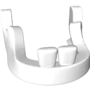{ .lu-ti width="24" loading="lazy" } [Jaw Bone (LOT 14521)](../14521.md) | 1 | Return this to Furious Urufu in the Ninjago Monastery. | 1 matrices; 0 rewards; 0 community references |
| 9595 | { .lu-ti width="24" loading="lazy" } [Johnny Thunder's Autograph (LOT 9595)](../9595.md) | 3 | A signed photo of Johnny Thunder! | 0 matrices; 1 rewards; 0 community references |
| 14186 | { .lu-ti width="24" loading="lazy" } [Journal of the Founders (LOT 14186)](../14186.md) | 3 | Double-click to unlock 8 additional Vault slots! | 0 matrices; 1 rewards; 0 community references |
| 12116 | { .lu-ti width="24" loading="lazy" } [Juggling Bag (LOT 12116)](../12116.md) | 4 | Double-click to use! | 1 matrices; 1 rewards; 0 community references |
| 10521 | { .lu-ti width="24" loading="lazy" } [LEGO Club Book (LOT 10521)](../10521.md) | 3 | Double-click to use! | 0 matrices; 0 rewards; 0 community references |
| 7989 | { .lu-ti width="24" loading="lazy" } [LEGO Dice (LOT 7989)](../7989.md) | 3 | Double-click to use! | 0 matrices; 1 rewards; 0 community references |
| 12513 | { .lu-ti width="24" loading="lazy" } [LEGO Dice (LOT 12513)](../12513.md) | 3 | Double-click to use! | 1 matrices; 0 rewards; 0 community references |
| 6865 | { .lu-ti width="24" loading="lazy" } [Light Blue Gem (LOT 6865)](../6865.md) | 2 | A valuable gem that can be sold! | 113 matrices; 1 rewards; 0 community references |
| 16298 | { .lu-ti width="24" loading="lazy" } [Lightning Spinjitzu Scroll (LOT 16298)](../16298.md) | 1 | Return this to &lt;name&gt; in the Ninjago Monastery. | 0 matrices; 0 rewards; 0 community references |
| 14591 | { .lu-ti width="24" loading="lazy" } [Lucky Shovel (LOT 14591)](../14591.md) | 1 | Double-click to use! | 0 matrices; 0 rewards; 0 community references |
| 14501 | { .lu-ti width="24" loading="lazy" } [Lucky Wolf's Paw (LOT 14501)](../14501.md) | 1 | Return this to Cringe Lo in the Ninjago Monastery! | 1 matrices; 0 rewards; 0 community references |
| 12492 | { .lu-ti width="24" loading="lazy" } [Maelstrom Sample (LOT 12492)](../12492.md) | 1 | Return this to Rutger Hemoglobin. | 5 matrices; 0 rewards; 0 community references |
| 14592 | 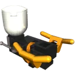{ .lu-ti width="24" loading="lazy" } [Maelstrom Vacuum (LOT 14592)](../14592.md) | 1 | Double-click to use, or drag it to slot 5 in your Action Bar! | 0 matrices; 1 rewards; 0 community references |
| 12103 | { .lu-ti width="24" loading="lazy" } [Maneater Seeds (LOT 12103)](../12103.md) | 3 | Double-click to use! | 1 matrices; 0 rewards; 0 community references |
| 6195 | { .lu-ti width="24" loading="lazy" } [Manic Motion Potion (LOT 6195)](../6195.md) | 5 | Increases your speed for a short time | 0 matrices; 0 rewards; 0 community references |
| 12107 | { .lu-ti width="24" loading="lazy" } [Massive Firecracker (LOT 12107)](../12107.md) | 2 | Double-click to use! | 42 matrices; 0 rewards; 1 community references |
| 6912 | { .lu-ti width="24" loading="lazy" } [Mermaid Head (LOT 6912)](../6912.md) | 1 | Somewhere, a Mermaid has lost her head. | 1 matrices; 0 rewards; 0 community references |
| 11228 | 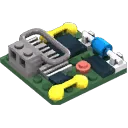{ .lu-ti width="24" loading="lazy" } [Moonbase Circuit Board (LOT 11228)](../11228.md) | 1 | Moonbase Circuit Board | 0 matrices; 1 rewards; 0 community references |
| 6207 | { .lu-ti width="24" loading="lazy" } [Nexus Force Healing Kit (LOT 6207)](../6207.md) | 1 | Double-click to use! | 46 matrices; 1 rewards; 0 community references |
| 12115 | { .lu-ti width="24" loading="lazy" } [Nexus Force Supply Crate (LOT 12115)](../12115.md) | 3 | Double-click to open this crate of supplies! | 0 matrices; 50 rewards; 0 community references |
| 13529 | { .lu-ti width="24" loading="lazy" } [Nexus Tower Gift Bag (LOT 13529)](../13529.md) | 2 | Double-click to open this bag of supplies! | 0 matrices; 0 rewards; 0 community references |
| 14474 | { .lu-ti width="24" loading="lazy" } [Ninja Target Building Instructions (LOT 14474)](../14474.md) | 1 | Use this to rebuild and modify Skeleton Catapults! | 0 matrices; 1 rewards; 0 community references |
| 16023 | { .lu-ti width="24" loading="lazy" } [Ninjago Hound Treat (LOT 16023)](../16023.md) | 3 | Double-click to use! | 1 matrices; 2 rewards; 1 community references |
| 2198 | { .lu-ti width="24" loading="lazy" } [Notion Potion (LOT 2198)](../2198.md) | 1 | Double-click to use! | 144 matrices; 2 rewards; 1 community references |
| 13074 | { .lu-ti width="24" loading="lazy" } [Nuckal's Maelstrom Crystal (LOT 13074)](../13074.md) | 2 | Return this to Neido on Crux Prime! | 1 matrices; 0 rewards; 0 community references |
| 16037 | { .lu-ti width="24" loading="lazy" } [Old Sushi (LOT 16037)](../16037.md) | 1 | Double-click to use! | 43 matrices; 26 rewards; 0 community references |
| 14512 | { .lu-ti width="24" loading="lazy" } [Onyx Gem (LOT 14512)](../14512.md) | 1 | A gem that can be sold! | 1 matrices; 0 rewards; 0 community references |
| 9625 | { .lu-ti width="24" loading="lazy" } [Paradox Power Potion (LOT 9625)](../9625.md) | 2 | Double-click to use! | 2 matrices; 0 rewards; 1 community references |
| 13576 | { .lu-ti width="24" loading="lazy" } [Paradox Power Potion 2 (LOT 13576)](../13576.md) | 3 | Double-click to use! | 1 matrices; 0 rewards; 1 community references |
| 8320 | { .lu-ti width="24" loading="lazy" } [Paradox Token (LOT 8320)](../8320.md) | 1 | Spend this at a Paradox vendor! | 1 matrices; 0 rewards; 0 community references; faction proxy applies |
| 6332 | { .lu-ti width="24" loading="lazy" } [Pet Rock Bridge Part 1 (LOT 6332)](../6332.md) | 1 | Collectible in Pet Rock to build a bridge | 1 matrices; 0 rewards; 0 community references |
| 6333 | { .lu-ti width="24" loading="lazy" } [Pet Rock Bridge Part 2 (LOT 6333)](../6333.md) | 1 | Collectible in Pet Rock to build a bridge | 1 matrices; 0 rewards; 0 community references |
| 6334 | { .lu-ti width="24" loading="lazy" } [Pet Rock Bridge Part 3 (LOT 6334)](../6334.md) | 1 | Collectible in Pet Rock to build a bridge | 1 matrices; 0 rewards; 0 community references |
| 5836 | { .lu-ti width="24" loading="lazy" } [Picnic Basket (LOT 5836)](../5836.md) | 1 | Double-click to open! | 125 matrices; 1 rewards; 0 community references |
| 6866 | { .lu-ti width="24" loading="lazy" } [Pink Gem (LOT 6866)](../6866.md) | 1 | A gem that can be sold! | 131 matrices; 0 rewards; 0 community references |
| 8655 | { .lu-ti width="24" loading="lazy" } [Pirate-Sized Ninja Clothes (LOT 8655)](../8655.md) | 1 | Trapped Pirates may want this! | 1 matrices; 0 rewards; 0 community references |
| 13737 | { .lu-ti width="24" loading="lazy" } [Pirate's Picnic Basket (LOT 13737)](../13737.md) | 2 | Double-click to open! | 0 matrices; 1 rewards; 0 community references |
| 12554 | { .lu-ti width="24" loading="lazy" } [Pocket Cannon (LOT 12554)](../12554.md) | 1 | Double-click to use! | 1 matrices; 1 rewards; 1 community references |
| 7794 | { .lu-ti width="24" loading="lazy" } [Portable Drumset (LOT 7794)](../7794.md) | 3 | Double-click to use! | 0 matrices; 1 rewards; 0 community references |
| 8365 | { .lu-ti width="24" loading="lazy" } [Potion of Shielding (LOT 8365)](../8365.md) | 1 | Double-click to use! | 86 matrices; 2 rewards; 1 community references |
| 10519 | { .lu-ti width="24" loading="lazy" } [Pre-Order Book (LOT 10519)](../10519.md) | 3 | Double-click to use! | 0 matrices; 0 rewards; 0 community references |
| 2620 | { .lu-ti width="24" loading="lazy" } [Quicksicle (LOT 2620)](../2620.md) | 1 | Double-click to use! | 147 matrices; 3 rewards; 1 community references |
| 11923 | { .lu-ti width="24" loading="lazy" } [Rank 1 Adventurer Book (LOT 11923)](../11923.md) | 1 | Double-click to use! | 2 matrices; 0 rewards; 0 community references |
| 20 | { .lu-ti width="24" loading="lazy" } [Rank 1 Buccaneer Book (LOT 20)](../20.md) | 1 | Double-click to use! | 2 matrices; 0 rewards; 0 community references |
| 21 | { .lu-ti width="24" loading="lazy" } [Rank 1 Daredevil Book (LOT 21)](../21.md) | 1 | Double-click to use! | 2 matrices; 0 rewards; 0 community references |
| 130 | { .lu-ti width="24" loading="lazy" } [Rank 1 Engineer Book (LOT 130)](../130.md) | 1 | Double-click to use! | 2 matrices; 0 rewards; 0 community references |
| 11925 | { .lu-ti width="24" loading="lazy" } [Rank 1 Inventor Book (LOT 11925)](../11925.md) | 1 | Double-click to use! | 2 matrices; 0 rewards; 0 community references |
| 80 | { .lu-ti width="24" loading="lazy" } [Rank 1 Knight Book (LOT 80)](../80.md) | 1 | Double-click to use! | 2 matrices; 0 rewards; 0 community references |
| 89 | { .lu-ti width="24" loading="lazy" } [Rank 1 Samurai Book (LOT 89)](../89.md) | 1 | Double-click to use! | 2 matrices; 0 rewards; 0 community references |
| 11922 | { .lu-ti width="24" loading="lazy" } [Rank 1 Shinobi Book (LOT 11922)](../11922.md) | 1 | Double-click to use! | 2 matrices; 0 rewards; 0 community references |
| 118 | { .lu-ti width="24" loading="lazy" } [Rank 1 Sorcerer Book (LOT 118)](../118.md) | 1 | Double-click to use! | 2 matrices; 0 rewards; 0 community references |
| 125 | { .lu-ti width="24" loading="lazy" } [Rank 1 Space Marauder Book (LOT 125)](../125.md) | 1 | Double-click to use! | 2 matrices; 0 rewards; 0 community references |
| 11924 | { .lu-ti width="24" loading="lazy" } [Rank 1 Space Ranger Book (LOT 11924)](../11924.md) | 1 | Double-click to use! | 2 matrices; 0 rewards; 0 community references |
| 131 | { .lu-ti width="24" loading="lazy" } [Rank 1 Summoner Book (LOT 131)](../131.md) | 1 | Double-click to use! | 2 matrices; 0 rewards; 0 community references |
| 11926 | { .lu-ti width="24" loading="lazy" } [Rank 2 Adventurer Book (LOT 11926)](../11926.md) | 1 | Double-click to use! | 0 matrices; 1 rewards; 0 community references |
| 9935 | { .lu-ti width="24" loading="lazy" } [Rank 2 Buccaneer Book (LOT 9935)](../9935.md) | 1 | Double-click to use! | 0 matrices; 1 rewards; 0 community references |
| 9976 | { .lu-ti width="24" loading="lazy" } [Rank 2 Daredevil Book (LOT 9976)](../9976.md) | 1 | Double-click to use! | 0 matrices; 1 rewards; 0 community references |
| 9968 | { .lu-ti width="24" loading="lazy" } [Rank 2 Engineer Book (LOT 9968)](../9968.md) | 1 | Double-click to use! | 0 matrices; 1 rewards; 0 community references |
| 11929 | { .lu-ti width="24" loading="lazy" } [Rank 2 Inventor Book (LOT 11929)](../11929.md) | 1 | Double-click to use! | 0 matrices; 1 rewards; 0 community references |
| 9972 | { .lu-ti width="24" loading="lazy" } [Rank 2 Knight Book (LOT 9972)](../9972.md) | 1 | Double-click to use! | 0 matrices; 1 rewards; 0 community references |
| 9974 | { .lu-ti width="24" loading="lazy" } [Rank 2 Samurai Book (LOT 9974)](../9974.md) | 1 | Double-click to use! | 0 matrices; 1 rewards; 0 community references |
| 11927 | { .lu-ti width="24" loading="lazy" } [Rank 2 Shinobi Book (LOT 11927)](../11927.md) | 1 | Double-click to use! | 0 matrices; 1 rewards; 0 community references |
| 9964 | { .lu-ti width="24" loading="lazy" } [Rank 2 Sorcerer Book (LOT 9964)](../9964.md) | 1 | Double-click to use! | 0 matrices; 1 rewards; 0 community references |
| 9966 | { .lu-ti width="24" loading="lazy" } [Rank 2 Space Marauder Book (LOT 9966)](../9966.md) | 1 | Double-click to use! | 0 matrices; 1 rewards; 0 community references |
| 11928 | { .lu-ti width="24" loading="lazy" } [Rank 2 Space Ranger Book (LOT 11928)](../11928.md) | 1 | Double-click to use! | 0 matrices; 1 rewards; 0 community references |
