# Consumable — page 2/2

[Item database](../README.md)

Pages: [1](type-14-1.md) | [2](type-14-2.md)

| LOT | Item | Rarity | Description | Source evidence |
| --- | --- | --- | --- | --- |
| 9970 | { .lu-ti width="24" loading="lazy" } [Rank 2 Summoner Book (LOT 9970)](../9970.md) | 1 | Double-click to use! | 0 matrices; 1 rewards; 0 community references |
| 11931 | { .lu-ti width="24" loading="lazy" } [Rank 3 Adventurer Book (LOT 11931)](../11931.md) | 1 | Double-click to use! | 0 matrices; 1 rewards; 0 community references |
| 9936 | { .lu-ti width="24" loading="lazy" } [Rank 3 Buccaneer Book (LOT 9936)](../9936.md) | 1 | Double-click to use! | 0 matrices; 1 rewards; 0 community references |
| 9963 | { .lu-ti width="24" loading="lazy" } [Rank 3 Daredevil Book (LOT 9963)](../9963.md) | 1 | Double-click to use! | 0 matrices; 1 rewards; 0 community references |
| 9969 | { .lu-ti width="24" loading="lazy" } [Rank 3 Engineer Book (LOT 9969)](../9969.md) | 1 | Double-click to use! | 0 matrices; 1 rewards; 0 community references |
| 11934 | { .lu-ti width="24" loading="lazy" } [Rank 3 Inventor Book (LOT 11934)](../11934.md) | 1 | Double-click to use! | 0 matrices; 1 rewards; 0 community references |
| 9973 | { .lu-ti width="24" loading="lazy" } [Rank 3 Knight Book (LOT 9973)](../9973.md) | 1 | Double-click to use! | 0 matrices; 1 rewards; 0 community references |
| 9975 | { .lu-ti width="24" loading="lazy" } [Rank 3 Samurai Book (LOT 9975)](../9975.md) | 1 | Double-click to use! | 0 matrices; 1 rewards; 0 community references |
| 11932 | { .lu-ti width="24" loading="lazy" } [Rank 3 Shinobi Book (LOT 11932)](../11932.md) | 1 | Double-click to use! | 0 matrices; 1 rewards; 0 community references |
| 9965 | { .lu-ti width="24" loading="lazy" } [Rank 3 Sorcerer Book (LOT 9965)](../9965.md) | 1 | Double-click to use! | 0 matrices; 1 rewards; 0 community references |
| 9967 | { .lu-ti width="24" loading="lazy" } [Rank 3 Space Marauder Book (LOT 9967)](../9967.md) | 1 | Double-click to use! | 0 matrices; 1 rewards; 0 community references |
| 11933 | { .lu-ti width="24" loading="lazy" } [Rank 3 Space Ranger Book (LOT 11933)](../11933.md) | 1 | Double-click to use! | 0 matrices; 1 rewards; 0 community references |
| 9971 | { .lu-ti width="24" loading="lazy" } [Rank 3 Summoner Book (LOT 9971)](../9971.md) | 1 | Double-click to use! | 0 matrices; 1 rewards; 0 community references |
| 3040 | { .lu-ti width="24" loading="lazy" } [Red Imaginite (LOT 3040)](../3040.md) | 2 | Imaginite can sometimes be lucky - if you know where to use it. | 140 matrices; 0 rewards; 0 community references |
| 14516 | 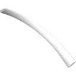{ .lu-ti width="24" loading="lazy" } [Rib Bone (LOT 14516)](../14516.md) | 1 | Return this to Furious Urufu in the Ninjago Monastery. | 1 matrices; 0 rewards; 0 community references |
| 12518 | { .lu-ti width="24" loading="lazy" } [Riffin' Guitar (LOT 12518)](../12518.md) | 2 | Double-click to use! | 0 matrices; 1 rewards; 0 community references |
| 14467 | 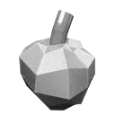{ .lu-ti width="24" loading="lazy" } [Rock Fruit (LOT 14467)](../14467.md) | 2 | Use this in a recipe for Johnny Umami! | 1 matrices; 0 rewards; 0 community references |
| 12520 | 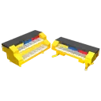{ .lu-ti width="24" loading="lazy" } [Rockin' Keyboards (LOT 12520)](../12520.md) | 2 | Double-click to use! | 0 matrices; 1 rewards; 0 community references |
| 14511 | { .lu-ti width="24" loading="lazy" } [Rockolate Bar (LOT 14511)](../14511.md) | 3 | Double-click to use! | 1 matrices; 1 rewards; 0 community references |
| 12114 | { .lu-ti width="24" loading="lazy" } [S.N.A.C.K. (LOT 12114)](../12114.md) | 1 | Double-click to unwrap this S.N.A.C.K. pack! | 0 matrices; 110 rewards; 0 community references |
| 12466 | { .lu-ti width="24" loading="lazy" } [Safe Functionator (LOT 12466)](../12466.md) | 2 | Return this to Dr. Overbuild. | 0 matrices; 1 rewards; 0 community references |
| 12464 | { .lu-ti width="24" loading="lazy" } [Safe Housing (LOT 12464)](../12464.md) | 2 | Return this to Dr. Overbuild. | 0 matrices; 1 rewards; 0 community references |
| 12465 | { .lu-ti width="24" loading="lazy" } [Safe Lock (LOT 12465)](../12465.md) | 2 | Return this to Dr. Overbuild. | 0 matrices; 1 rewards; 0 community references |
| 12109 | { .lu-ti width="24" loading="lazy" } [Sensei Wu's Imagination Tea (LOT 12109)](../12109.md) | 2 | Double-click to use! | 1 matrices; 1 rewards; 0 community references |
| 8319 | { .lu-ti width="24" loading="lazy" } [Sentinel Faction Token (LOT 8319)](../8319.md) | 1 | Spend this at a Sentinel vendor! | 1 matrices; 0 rewards; 0 community references; faction proxy applies |
| 12483 | 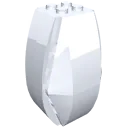{ .lu-ti width="24" loading="lazy" } [Sentinel Pet Egg (LOT 12483)](../12483.md) | 2 | Return this to Coalessa. | 0 matrices; 1 rewards; 0 community references |
| 9623 | { .lu-ti width="24" loading="lazy" } [Sentinel Super Soda (LOT 9623)](../9623.md) | 2 | Double-click to use! | 2 matrices; 0 rewards; 1 community references |
| 13574 | { .lu-ti width="24" loading="lazy" } [Sentinel Super Soda 2 (LOT 13574)](../13574.md) | 3 | Double-click to use! | 1 matrices; 0 rewards; 1 community references |
| 12389 | { .lu-ti width="24" loading="lazy" } [Sentry Translator (LOT 12389)](../12389.md) | 1 | No client description | 0 matrices; 0 rewards; 0 community references |
| 14468 | 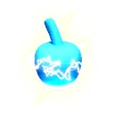{ .lu-ti width="24" loading="lazy" } [Shock Fruit (LOT 14468)](../14468.md) | 2 | Use this in a recipe for Johnny Umami! | 1 matrices; 1 rewards; 0 community references |
| 14494 | { .lu-ti width="24" loading="lazy" } [Shoulder Socket Wrench (LOT 14494)](../14494.md) | 1 | Return this to Jay in the Ninjago Dojo of Lightning. | 2 matrices; 0 rewards; 0 community references |
| 8371 | { .lu-ti width="24" loading="lazy" } [Shuriken (LOT 8371)](../8371.md) | 1 | Double-click to use! | 25 matrices; 0 rewards; 1 community references |
| 12322 | { .lu-ti width="24" loading="lazy" } [Skeleton Bone (LOT 12322)](../12322.md) | 1 | Return this to Mardolf in Nimbus Station! | 1 matrices; 0 rewards; 0 community references |
| 13057 | { .lu-ti width="24" loading="lazy" } [Skeleton Schematic Page (LOT 13057)](../13057.md) | 2 | Return this to Neido in Crux Prime! | 1 matrices; 0 rewards; 0 community references |
| 14475 | 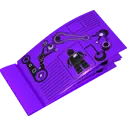{ .lu-ti width="24" loading="lazy" } [Skull-a-Ton Building Instructions (LOT 14475)](../14475.md) | 1 | You'll need this to unlock the Skeleton Cages in the Ninjago Caves! | 1 matrices; 0 rewards; 0 community references |
| 12281 | { .lu-ti width="24" loading="lazy" } [Snow Storm (LOT 12281)](../12281.md) | 2 | Double-click to use! | 2 matrices; 1 rewards; 0 community references |
| 12288 | { .lu-ti width="24" loading="lazy" } [Snowball (LOT 12288)](../12288.md) | 1 | Double-click to use! | 3 matrices; 0 rewards; 0 community references |
| 13059 | { .lu-ti width="24" loading="lazy" } [Splintered Horseman's Lance (LOT 13059)](../13059.md) | 2 | Return this to Duke Exeter in Nexus Tower! | 3 matrices; 0 rewards; 0 community references |
| 12110 | { .lu-ti width="24" loading="lazy" } [Spring Shoes (LOT 12110)](../12110.md) | 2 | Double-click to use! | 1 matrices; 0 rewards; 0 community references |
| 12569 | 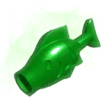{ .lu-ti width="24" loading="lazy" } [Stink Bomb (LOT 12569)](../12569.md) | 3 | Double-click to use! | 0 matrices; 0 rewards; 0 community references |
| 6885 | { .lu-ti width="24" loading="lazy" } [Stinky Fish (LOT 6885)](../6885.md) | 1 | Don't eat it! | 21 matrices; 1 rewards; 1 community references |
| 2998 | { .lu-ti width="24" loading="lazy" } [Strong Notion Potion (LOT 2998)](../2998.md) | 1 | Double-click to use! | 154 matrices; 2 rewards; 1 community references |
| 10699 | { .lu-ti width="24" loading="lazy" } [Subscription Renewal Book (LOT 10699)](../10699.md) | 3 | Double-click to use! | 0 matrices; 0 rewards; 0 community references |
| 12102 | { .lu-ti width="24" loading="lazy" } [Sunflower Seed (LOT 12102)](../12102.md) | 3 | Double-click to use! | 1 matrices; 0 rewards; 0 community references |
| 2999 | { .lu-ti width="24" loading="lazy" } [Super Notion Potion (LOT 2999)](../2999.md) | 1 | Double-click to use! | 53 matrices; 2 rewards; 1 community references |
| 5837 | { .lu-ti width="24" loading="lazy" } [Super Picnic Basket (LOT 5837)](../5837.md) | 2 | Double-click to open! | 125 matrices; 0 rewards; 0 community references |
| 8375 | { .lu-ti width="24" loading="lazy" } [Sushi (LOT 8375)](../8375.md) | 1 | Double-click to use! | 69 matrices; 0 rewards; 1 community references |
| 14517 | { .lu-ti width="24" loading="lazy" } [Tail Bone (LOT 14517)](../14517.md) | 1 | Return this to Furious Urufu in the Ninjago Monastery. | 2 matrices; 0 rewards; 0 community references |
| 6886 | { .lu-ti width="24" loading="lazy" } [Tasty Fish (LOT 6886)](../6886.md) | 1 | Double-click to use! | 22 matrices; 1 rewards; 1 community references |
| 13890 | { .lu-ti width="24" loading="lazy" } [Test consumable of Testing (LOT 13890)](../13890.md) | 2 | Double-click to use! | 0 matrices; 0 rewards; 0 community references |
| 2670 | { .lu-ti width="24" loading="lazy" } [Test Contest Insta Bot (LOT 2670)](../2670.md) | 5 | Team 5 | 0 matrices; 0 rewards; 0 community references |
| 12476 | 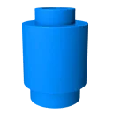{ .lu-ti width="24" loading="lazy" } [TEST DELETE ME (LOT 12476)](../12476.md) | 2 | Return this to &lt;NPC Name&gt; | 0 matrices; 0 rewards; 0 community references |
| 12477 | { .lu-ti width="24" loading="lazy" } [TEST DELETE ME (LOT 12477)](../12477.md) | 2 | Return this to &lt;NPC Name&gt; | 0 matrices; 0 rewards; 0 community references |
| 12478 | { .lu-ti width="24" loading="lazy" } [TEST DELETE ME (LOT 12478)](../12478.md) | 2 | Return this to &lt;NPC Name&gt; | 0 matrices; 0 rewards; 0 community references |
| 10298 | { .lu-ti width="24" loading="lazy" } [Test Faction Consumable (LOT 10298)](../10298.md) | 5 | for testing moving skills to faction consumables | 0 matrices; 0 rewards; 0 community references |
| 14469 | { .lu-ti width="24" loading="lazy" } [test Fruit (LOT 14469)](../14469.md) | 5 | test | 0 matrices; 0 rewards; 0 community references |
| 4757 | { .lu-ti width="24" loading="lazy" } [Test LEGO Factory Minifigure (LOT 4757)](../4757.md) | 5 | Used for a demo only | 0 matrices; 0 rewards; 0 community references |
| 8182 | { .lu-ti width="24" loading="lazy" } [Test Nexus Force Faction Token (LOT 8182)](../8182.md) | 5 | No client description | 0 matrices; 0 rewards; 0 community references |
| 6233 | { .lu-ti width="24" loading="lazy" } [Test Piratesicle (LOT 6233)](../6233.md) | 5 | Object pirates give to you | 0 matrices; 0 rewards; 0 community references |
| 9996 | { .lu-ti width="24" loading="lazy" } [Test Rank 4 Buccaneer Book (LOT 9996)](../9996.md) | 5 | Double-click to use! | 0 matrices; 0 rewards; 0 community references |
| 9994 | { .lu-ti width="24" loading="lazy" } [Test Rank 4 Daredevil Book (LOT 9994)](../9994.md) | 5 | Double-click to use! | 0 matrices; 0 rewards; 0 community references |
| 10000 | { .lu-ti width="24" loading="lazy" } [Test Rank 4 Knight Book (LOT 10000)](../10000.md) | 5 | Double-click to use! | 0 matrices; 0 rewards; 0 community references |
| 9999 | { .lu-ti width="24" loading="lazy" } [Test Rank 4 Samurai Book (LOT 9999)](../9999.md) | 5 | Double-click to use! | 0 matrices; 0 rewards; 0 community references |
| 9997 | { .lu-ti width="24" loading="lazy" } [Test Rank 4 Sorcerer Book (LOT 9997)](../9997.md) | 5 | Double-click to use! | 0 matrices; 0 rewards; 0 community references |
| 9998 | { .lu-ti width="24" loading="lazy" } [Test Rank 4 Space Marauder Book (LOT 9998)](../9998.md) | 5 | Double-click to use! | 0 matrices; 0 rewards; 0 community references |
| 9995 | { .lu-ti width="24" loading="lazy" } [Test Rank 4 Summoner Book (LOT 9995)](../9995.md) | 5 | Double-click to use! | 0 matrices; 0 rewards; 0 community references |
| 8374 | { .lu-ti width="24" loading="lazy" } [Test Summon Scroll (LOT 8374)](../8374.md) | 5 | No client description | 0 matrices; 0 rewards; 0 community references |
| 12735 | { .lu-ti width="24" loading="lazy" } [The Big One! (LOT 12735)](../12735.md) | 4 | Double-click to use! | 41 matrices; 1 rewards; 0 community references |
| 6201 | { .lu-ti width="24" loading="lazy" } [Thirst Quencher (LOT 6201)](../6201.md) | 1 | Double-click to use! | 131 matrices; 1 rewards; 1 community references |
| 12451 | { .lu-ti width="24" loading="lazy" } [Thumpin' Bass (LOT 12451)](../12451.md) | 3 | Double-click to use! | 0 matrices; 1 rewards; 0 community references |
| 8376 | { .lu-ti width="24" loading="lazy" } [Tough Buff Sauce (LOT 8376)](../8376.md) | 1 | Double-click to use! | 69 matrices; 2 rewards; 1 community references |
| 10021 | { .lu-ti width="24" loading="lazy" } [Un-Stink Potion (LOT 10021)](../10021.md) | 1 | Double-click to use! | 20 matrices; 0 rewards; 1 community references |
| 8321 | { .lu-ti width="24" loading="lazy" } [Venture League Token (LOT 8321)](../8321.md) | 1 | Spend this at a Venture League vendor! | 1 matrices; 0 rewards; 0 community references; faction proxy applies |
| 9626 | { .lu-ti width="24" loading="lazy" } [Venture Vitality Vial (LOT 9626)](../9626.md) | 2 | Double-click to use! | 2 matrices; 0 rewards; 1 community references |
| 13577 | { .lu-ti width="24" loading="lazy" } [Venture Vitality Vial 2 (LOT 13577)](../13577.md) | 3 | Double-click to use! | 1 matrices; 0 rewards; 1 community references |
| 3290 | 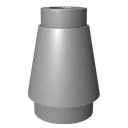{ .lu-ti width="24" loading="lazy" } [Water Sprayer Module 1 (LOT 3290)](../3290.md) | 3 | Return this to Mardolf! | 1 matrices; 1 rewards; 0 community references |
| 3291 | { .lu-ti width="24" loading="lazy" } [Water Sprayer Module 2 (LOT 3291)](../3291.md) | 3 | Return this to Mardolf! | 0 matrices; 1 rewards; 0 community references |
| 3292 | 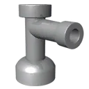{ .lu-ti width="24" loading="lazy" } [Water Sprayer Module 3 (LOT 3292)](../3292.md) | 3 | Return this to Mardolf! | 0 matrices; 1 rewards; 0 community references |
| 12598 | { .lu-ti width="24" loading="lazy" } [Witch's Surf-Broom (LOT 12598)](../12598.md) | 4 | Double-click to use! | 0 matrices; 1 rewards; 0 community references |
| 12766 | { .lu-ti width="24" loading="lazy" } [Xpresso (LOT 12766)](../12766.md) | 2 | Double-click to use! | 43 matrices; 1 rewards; 1 community references |
| 6863 | { .lu-ti width="24" loading="lazy" } [Yellow Gem (LOT 6863)](../6863.md) | 4 | A valuable gem that can be sold! | 47 matrices; 0 rewards; 0 community references |
| 15944 | 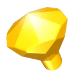{ .lu-ti width="24" loading="lazy" } [Yellow Plate (LOT 15944)](../15944.md) | 4 | A valuable plate that can be sold! | 0 matrices; 0 rewards; 0 community references |
| 2989 | { .lu-ti width="24" loading="lazy" } [Yo Ho Ho Mug (LOT 2989)](../2989.md) | 3 | Double-click to use! | 0 matrices; 1 rewards; 0 community references |
| 14504 | { .lu-ti width="24" loading="lazy" } [Yucki-Yaki (LOT 14504)](../14504.md) | 2 | Double-click to use! | 1 matrices; 1 rewards; 0 community references |
