# Chest — page 1/6

[Item database](../README.md)

Pages: [1](type-15-1.md) | [2](type-15-2.md) | [3](type-15-3.md) | [4](type-15-4.md) | [5](type-15-5.md) | [6](type-15-6.md)

| LOT | Item | Rarity | Description | Source evidence |
| --- | --- | --- | --- | --- |
| 1799 | { .lu-ti width="24" loading="lazy" } [Unnamed LOT 1799 (LOT 1799)](../1799.md) | 2 | No client description | 0 matrices; 0 rewards; 0 community references |
| 3937 | { .lu-ti width="24" loading="lazy" } [Unnamed LOT 3937 (LOT 3937)](../3937.md) | 1 | No client description | 0 matrices; 0 rewards; 0 community references |
| 6196 | 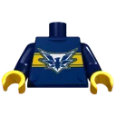{ .lu-ti width="24" loading="lazy" } [Unnamed LOT 6196 (LOT 6196)](../6196.md) | 4 | No client description | 0 matrices; 0 rewards; 0 community references |
| 6889 | { .lu-ti width="24" loading="lazy" } [Unnamed LOT 6889 (LOT 6889)](../6889.md) | 1 | No client description | 0 matrices; 0 rewards; 0 community references |
| 6892 | { .lu-ti width="24" loading="lazy" } [Unnamed LOT 6892 (LOT 6892)](../6892.md) | 1 | No client description | 0 matrices; 0 rewards; 0 community references |
| 6894 | { .lu-ti width="24" loading="lazy" } [Unnamed LOT 6894 (LOT 6894)](../6894.md) | 1 | No client description | 0 matrices; 0 rewards; 0 community references |
| 6897 | { .lu-ti width="24" loading="lazy" } [Unnamed LOT 6897 (LOT 6897)](../6897.md) | 1 | No client description | 0 matrices; 0 rewards; 0 community references |
| 7872 | { .lu-ti width="24" loading="lazy" } [Unnamed LOT 7872 (LOT 7872)](../7872.md) | 4 | No client description | 0 matrices; 0 rewards; 0 community references |
| 10126 | 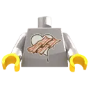{ .lu-ti width="24" loading="lazy" } [Unnamed LOT 10126 (LOT 10126)](../10126.md) | 3 | No client description | 0 matrices; 0 rewards; 0 community references |
| 12683 | { .lu-ti width="24" loading="lazy" } [Unnamed LOT 12683 (LOT 12683)](../12683.md) | 3 | No client description | 0 matrices; 0 rewards; 0 community references |
| 12684 | { .lu-ti width="24" loading="lazy" } [Unnamed LOT 12684 (LOT 12684)](../12684.md) | 3 | No client description | 0 matrices; 0 rewards; 0 community references |
| 12685 | { .lu-ti width="24" loading="lazy" } [Unnamed LOT 12685 (LOT 12685)](../12685.md) | 3 | No client description | 0 matrices; 0 rewards; 0 community references |
| 12687 | { .lu-ti width="24" loading="lazy" } [Unnamed LOT 12687 (LOT 12687)](../12687.md) | 3 | No client description | 0 matrices; 0 rewards; 0 community references |
| 12692 | { .lu-ti width="24" loading="lazy" } [Unnamed LOT 12692 (LOT 12692)](../12692.md) | 3 | No client description | 0 matrices; 0 rewards; 0 community references |
| 12694 | { .lu-ti width="24" loading="lazy" } [Unnamed LOT 12694 (LOT 12694)](../12694.md) | 3 | No client description | 0 matrices; 0 rewards; 0 community references |
| 12697 | { .lu-ti width="24" loading="lazy" } [Unnamed LOT 12697 (LOT 12697)](../12697.md) | 3 | No client description | 0 matrices; 0 rewards; 0 community references |
| 12699 | { .lu-ti width="24" loading="lazy" } [Unnamed LOT 12699 (LOT 12699)](../12699.md) | 3 | No client description | 0 matrices; 0 rewards; 0 community references |
| 12701 | { .lu-ti width="24" loading="lazy" } [Unnamed LOT 12701 (LOT 12701)](../12701.md) | 3 | No client description | 0 matrices; 0 rewards; 0 community references |
| 12703 | { .lu-ti width="24" loading="lazy" } [Unnamed LOT 12703 (LOT 12703)](../12703.md) | 3 | No client description | 0 matrices; 0 rewards; 0 community references |
| 12704 | { .lu-ti width="24" loading="lazy" } [Unnamed LOT 12704 (LOT 12704)](../12704.md) | 3 | No client description | 0 matrices; 0 rewards; 0 community references |
| 12713 | { .lu-ti width="24" loading="lazy" } [Unnamed LOT 12713 (LOT 12713)](../12713.md) | 3 | No client description | 0 matrices; 0 rewards; 0 community references |
| 12716 | { .lu-ti width="24" loading="lazy" } [Unnamed LOT 12716 (LOT 12716)](../12716.md) | 3 | No client description | 0 matrices; 0 rewards; 0 community references |
| 12717 | { .lu-ti width="24" loading="lazy" } [Unnamed LOT 12717 (LOT 12717)](../12717.md) | 3 | No client description | 0 matrices; 0 rewards; 0 community references |
| 12746 | { .lu-ti width="24" loading="lazy" } [Unnamed LOT 12746 (LOT 12746)](../12746.md) | 3 | No client description | 0 matrices; 0 rewards; 0 community references |
| 12750 | { .lu-ti width="24" loading="lazy" } [Unnamed LOT 12750 (LOT 12750)](../12750.md) | 3 | No client description | 0 matrices; 0 rewards; 0 community references |
| 12751 | { .lu-ti width="24" loading="lazy" } [Unnamed LOT 12751 (LOT 12751)](../12751.md) | 3 | No client description | 0 matrices; 0 rewards; 0 community references |
| 12752 | { .lu-ti width="24" loading="lazy" } [Unnamed LOT 12752 (LOT 12752)](../12752.md) | 3 | No client description | 0 matrices; 0 rewards; 0 community references |
| 12757 | { .lu-ti width="24" loading="lazy" } [Unnamed LOT 12757 (LOT 12757)](../12757.md) | 3 | No client description | 0 matrices; 0 rewards; 0 community references |
| 14170 | { .lu-ti width="24" loading="lazy" } [Unnamed LOT 14170 (LOT 14170)](../14170.md) | 4 | No client description | 0 matrices; 0 rewards; 0 community references |
| 16071 | 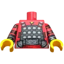{ .lu-ti width="24" loading="lazy" } [Unnamed LOT 16071 (LOT 16071)](../16071.md) | 2 | No client description | 0 matrices; 0 rewards; 0 community references |
| 16072 | 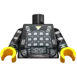{ .lu-ti width="24" loading="lazy" } [Unnamed LOT 16072 (LOT 16072)](../16072.md) | 2 | No client description | 0 matrices; 0 rewards; 0 community references |
| 16073 | 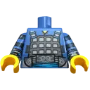{ .lu-ti width="24" loading="lazy" } [Unnamed LOT 16073 (LOT 16073)](../16073.md) | 2 | No client description | 0 matrices; 0 rewards; 0 community references |
| 16074 | 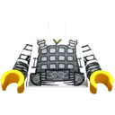{ .lu-ti width="24" loading="lazy" } [Unnamed LOT 16074 (LOT 16074)](../16074.md) | 2 | No client description | 0 matrices; 0 rewards; 0 community references |
| 16075 | 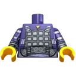{ .lu-ti width="24" loading="lazy" } [Unnamed LOT 16075 (LOT 16075)](../16075.md) | 2 | No client description | 0 matrices; 0 rewards; 0 community references |
| 16077 | 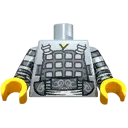{ .lu-ti width="24" loading="lazy" } [Unnamed LOT 16077 (LOT 16077)](../16077.md) | 2 | No client description | 0 matrices; 0 rewards; 0 community references |
| 16078 | 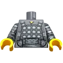{ .lu-ti width="24" loading="lazy" } [Unnamed LOT 16078 (LOT 16078)](../16078.md) | 2 | No client description | 0 matrices; 0 rewards; 0 community references |
| 16079 | { .lu-ti width="24" loading="lazy" } [Unnamed LOT 16079 (LOT 16079)](../16079.md) | 2 | No client description | 0 matrices; 0 rewards; 0 community references |
| 16080 | 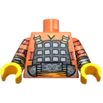{ .lu-ti width="24" loading="lazy" } [Unnamed LOT 16080 (LOT 16080)](../16080.md) | 2 | No client description | 0 matrices; 0 rewards; 0 community references |
| 16081 | 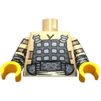{ .lu-ti width="24" loading="lazy" } [Unnamed LOT 16081 (LOT 16081)](../16081.md) | 2 | No client description | 0 matrices; 0 rewards; 0 community references |
| 16089 | { .lu-ti width="24" loading="lazy" } [Unnamed LOT 16089 (LOT 16089)](../16089.md) | 2 | No client description | 0 matrices; 0 rewards; 0 community references |
| 16090 | 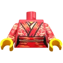{ .lu-ti width="24" loading="lazy" } [Unnamed LOT 16090 (LOT 16090)](../16090.md) | 2 | No client description | 0 matrices; 0 rewards; 0 community references |
| 16091 | { .lu-ti width="24" loading="lazy" } [Unnamed LOT 16091 (LOT 16091)](../16091.md) | 2 | No client description | 0 matrices; 0 rewards; 0 community references |
| 16092 | 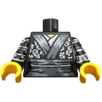{ .lu-ti width="24" loading="lazy" } [Unnamed LOT 16092 (LOT 16092)](../16092.md) | 2 | No client description | 0 matrices; 0 rewards; 0 community references |
| 14116 | 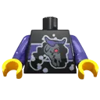{ .lu-ti width="24" loading="lazy" } [4 Riders Shirt (LOT 14116)](../14116.md) | 4 | No client description | 0 matrices; 0 rewards; 0 community references |
| 7484 | 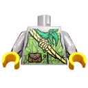{ .lu-ti width="24" loading="lazy" } [Adventurer Coat 1 (LOT 7484)](../7484.md) | 4 | Rank 1 Specialty Kit Item | 2 matrices; 0 rewards; 0 community references |
| 7485 | 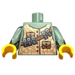{ .lu-ti width="24" loading="lazy" } [Adventurer Coat 2 (LOT 7485)](../7485.md) | 4 | Rank 2 Specialty Kit Item | 1 matrices; 0 rewards; 0 community references |
| 7486 | 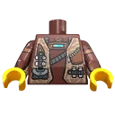{ .lu-ti width="24" loading="lazy" } [Adventurer Coat 3 (LOT 7486)](../7486.md) | 4 | Rank 3 Specialty Kit Item | 1 matrices; 0 rewards; 0 community references |
| 6929 | 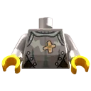{ .lu-ti width="24" loading="lazy" } [Armored Shirt (LOT 6929)](../6929.md) | 3 | No client description | 1 matrices; 1 rewards; 0 community references |
| 14354 | { .lu-ti width="24" loading="lazy" } [Assenbly Gear - Summoner - chest proxy (LOT 14354)](../14354.md) | 4 | No client description | 0 matrices; 0 rewards; 0 community references |
| 8612 | { .lu-ti width="24" loading="lazy" } [Aviator Shirt (LOT 8612)](../8612.md) | 2 | No client description | 15 matrices; 0 rewards; 1 community references |
| 12708 | 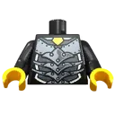{ .lu-ti width="24" loading="lazy" } [Banded Armor (LOT 12708)](../12708.md) | 2 | No client description | 40 matrices; 0 rewards; 1 community references |
| 12682 | { .lu-ti width="24" loading="lazy" } [Baseball Jersey 1 (LOT 12682)](../12682.md) | 2 | No client description | 1 matrices; 0 rewards; 1 community references |
| 12686 | 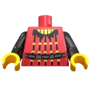{ .lu-ti width="24" loading="lazy" } [Bat Lord Shirt (LOT 12686)](../12686.md) | 4 | No client description | 40 matrices; 0 rewards; 1 community references |
| 8361 | 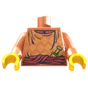{ .lu-ti width="24" loading="lazy" } [Belted Ninja Shirt (LOT 8361)](../8361.md) | 4 | No client description | 11 matrices; 0 rewards; 1 community references |
| 10129 | { .lu-ti width="24" loading="lazy" } [Beta Tester Shirt (LOT 10129)](../10129.md) | 4 | No client description | 0 matrices; 1 rewards; 1 community references |
| 12712 | { .lu-ti width="24" loading="lazy" } [Biking Jersey (LOT 12712)](../12712.md) | 2 | No client description | 1 matrices; 0 rewards; 1 community references |
| 2958 | 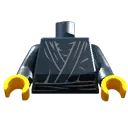{ .lu-ti width="24" loading="lazy" } [Black Ninja Gi (LOT 2958)](../2958.md) | 2 | No client description | 0 matrices; 0 rewards; 0 community references |
| 2954 | { .lu-ti width="24" loading="lazy" } [Black Pirate Ship Shirt (LOT 2954)](../2954.md) | 4 | No client description | 8 matrices; 0 rewards; 1 community references |
| 8604 | 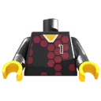{ .lu-ti width="24" loading="lazy" } [Black Soccer Shirt (LOT 8604)](../8604.md) | 2 | No client description | 4 matrices; 0 rewards; 1 community references |
| 12707 | 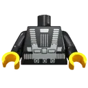{ .lu-ti width="24" loading="lazy" } [Blacktron Shirt (LOT 12707)](../12707.md) | 2 | No client description | 40 matrices; 0 rewards; 1 community references |
| 12711 | 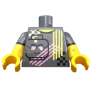{ .lu-ti width="24" loading="lazy" } [Blocks Shirt (LOT 12711)](../12711.md) | 1 | No client description | 40 matrices; 0 rewards; 1 community references |
| 6802 | { .lu-ti width="24" loading="lazy" } [Blue Captain Shirt (LOT 6802)](../6802.md) | 2 | No client description | 0 matrices; 1 rewards; 0 community references |
| 10122 | { .lu-ti width="24" loading="lazy" } [Blue Double Breasted Uniform (LOT 10122)](../10122.md) | 2 | No client description | 0 matrices; 1 rewards; 0 community references |
| 8087 | { .lu-ti width="24" loading="lazy" } [Blue Imperial Shirt (LOT 8087)](../8087.md) | 2 | No client description | 15 matrices; 0 rewards; 1 community references |
| 8345 | { .lu-ti width="24" loading="lazy" } [Blue Kimono (LOT 8345)](../8345.md) | 2 | No client description | 0 matrices; 1 rewards; 0 community references |
| 2951 | { .lu-ti width="24" loading="lazy" } [Blue Striped Crew Shirt (LOT 2951)](../2951.md) | 2 | No client description | 0 matrices; 1 rewards; 1 community references |
| 8602 | { .lu-ti width="24" loading="lazy" } [Blue Uniform (LOT 8602)](../8602.md) | 2 | No client description | 1 matrices; 0 rewards; 1 community references |
| 12747 | { .lu-ti width="24" loading="lazy" } [Body Armor (LOT 12747)](../12747.md) | 3 | No client description | 1 matrices; 0 rewards; 1 community references |
| 12758 | { .lu-ti width="24" loading="lazy" } [Bone Suit Shirt (LOT 12758)](../12758.md) | 3 | No client description | 40 matrices; 0 rewards; 1 community references |
| 12311 | { .lu-ti width="24" loading="lazy" } [Bowling Shirt (LOT 12311)](../12311.md) | 1 | No client description | 4 matrices; 0 rewards; 1 community references |
| 4074 | 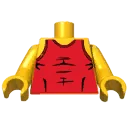{ .lu-ti width="24" loading="lazy" } [Boy's Tank Top (LOT 4074)](../4074.md) | 1 | No client description | 32 matrices; 0 rewards; 0 community references |
| 4108 | 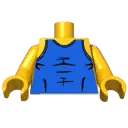{ .lu-ti width="24" loading="lazy" } [Boy's Tank Top (LOT 4108)](../4108.md) | 1 | No client description | 32 matrices; 0 rewards; 0 community references |
| 4142 | { .lu-ti width="24" loading="lazy" } [Boy's Tank Top (LOT 4142)](../4142.md) | 1 | No client description | 0 matrices; 0 rewards; 0 community references |
| 4176 | { .lu-ti width="24" loading="lazy" } [Boy's Tank Top (LOT 4176)](../4176.md) | 1 | No client description | 32 matrices; 0 rewards; 0 community references |
| 4210 | { .lu-ti width="24" loading="lazy" } [Boy's Tank Top (LOT 4210)](../4210.md) | 1 | No client description | 32 matrices; 0 rewards; 0 community references |
| 4244 | 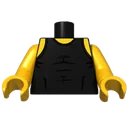{ .lu-ti width="24" loading="lazy" } [Boy's Tank Top (LOT 4244)](../4244.md) | 1 | No client description | 32 matrices; 0 rewards; 0 community references |
| 4278 | 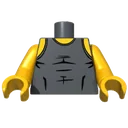{ .lu-ti width="24" loading="lazy" } [Boy's Tank Top (LOT 4278)](../4278.md) | 1 | No client description | 32 matrices; 0 rewards; 0 community references |
| 4312 | 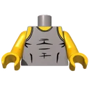{ .lu-ti width="24" loading="lazy" } [Boy's Tank Top (LOT 4312)](../4312.md) | 1 | No client description | 32 matrices; 0 rewards; 0 community references |
| 4346 | { .lu-ti width="24" loading="lazy" } [Boy's Tank Top (LOT 4346)](../4346.md) | 1 | No client description | 32 matrices; 0 rewards; 0 community references |
| 4380 | { .lu-ti width="24" loading="lazy" } [Boy's Tank Top (LOT 4380)](../4380.md) | 1 | No client description | 32 matrices; 0 rewards; 0 community references |
| 4414 | 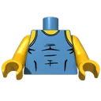{ .lu-ti width="24" loading="lazy" } [Boy's Tank Top (LOT 4414)](../4414.md) | 1 | No client description | 32 matrices; 0 rewards; 0 community references |
| 4448 | { .lu-ti width="24" loading="lazy" } [Boy's Tank Top (LOT 4448)](../4448.md) | 1 | No client description | 32 matrices; 0 rewards; 0 community references |
| 4482 | 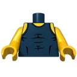{ .lu-ti width="24" loading="lazy" } [Boy's Tank Top (LOT 4482)](../4482.md) | 1 | No client description | 32 matrices; 0 rewards; 0 community references |
| 4516 | 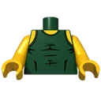{ .lu-ti width="24" loading="lazy" } [Boy's Tank Top (LOT 4516)](../4516.md) | 1 | No client description | 32 matrices; 0 rewards; 0 community references |
| 4550 | 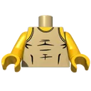{ .lu-ti width="24" loading="lazy" } [Boy's Tank Top (LOT 4550)](../4550.md) | 1 | No client description | 32 matrices; 0 rewards; 0 community references |
| 4584 | 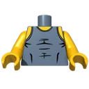{ .lu-ti width="24" loading="lazy" } [Boy's Tank Top (LOT 4584)](../4584.md) | 1 | No client description | 32 matrices; 0 rewards; 0 community references |
| 4618 | 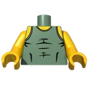{ .lu-ti width="24" loading="lazy" } [Boy's Tank Top (LOT 4618)](../4618.md) | 1 | No client description | 32 matrices; 0 rewards; 0 community references |
| 10167 | { .lu-ti width="24" loading="lazy" } [Bradford Rant Shirt (LOT 10167)](../10167.md) | 4 | Thanks for your help from the Bradford Rant Institute of Cosmic Kinesis! | 0 matrices; 1 rewards; 1 community references |
| 14101 | { .lu-ti width="24" loading="lazy" } [Bricksel Adams Shirt (LOT 14101)](../14101.md) | 4 | No client description | 0 matrices; 0 rewards; 0 community references |
| 6800 | { .lu-ti width="24" loading="lazy" } [Brown First Mate's Shirt (LOT 6800)](../6800.md) | 2 | No client description | 0 matrices; 1 rewards; 0 community references |
| 7376 | 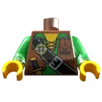{ .lu-ti width="24" loading="lazy" } [Buccaneer Shirt 1 (LOT 7376)](../7376.md) | 4 | Rank 1 Specialty Kit Item | 2 matrices; 0 rewards; 0 community references |
| 7377 | 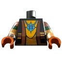{ .lu-ti width="24" loading="lazy" } [Buccaneer Shirt 2 (LOT 7377)](../7377.md) | 4 | Rank 2 Specialty Kit Item | 1 matrices; 0 rewards; 0 community references |
| 7378 | 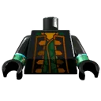{ .lu-ti width="24" loading="lazy" } [Buccaneer Shirt 3 (LOT 7378)](../7378.md) | 4 | Rank 3 Specialty Kit Item | 1 matrices; 0 rewards; 0 community references |
| 12954 | { .lu-ti width="24" loading="lazy" } [Buccaneer Shirt 3 (LOT 12954)](../12954.md) | 4 | Rank 3 Specialty Kit Item | 1 matrices; 0 rewards; 0 community references |
| 4054 | { .lu-ti width="24" loading="lazy" } [Business Jacket (LOT 4054)](../4054.md) | 1 | No client description | 32 matrices; 0 rewards; 0 community references |
| 4088 | { .lu-ti width="24" loading="lazy" } [Business Jacket (LOT 4088)](../4088.md) | 1 | No client description | 32 matrices; 0 rewards; 0 community references |
| 4122 | { .lu-ti width="24" loading="lazy" } [Business Jacket (LOT 4122)](../4122.md) | 1 | No client description | 0 matrices; 0 rewards; 0 community references |
| 4156 | { .lu-ti width="24" loading="lazy" } [Business Jacket (LOT 4156)](../4156.md) | 1 | No client description | 32 matrices; 0 rewards; 0 community references |
| 4190 | { .lu-ti width="24" loading="lazy" } [Business Jacket (LOT 4190)](../4190.md) | 1 | No client description | 32 matrices; 0 rewards; 0 community references |
| 4224 | { .lu-ti width="24" loading="lazy" } [Business Jacket (LOT 4224)](../4224.md) | 1 | No client description | 32 matrices; 0 rewards; 0 community references |
| 4258 | { .lu-ti width="24" loading="lazy" } [Business Jacket (LOT 4258)](../4258.md) | 1 | No client description | 32 matrices; 0 rewards; 0 community references |
| 4292 | { .lu-ti width="24" loading="lazy" } [Business Jacket (LOT 4292)](../4292.md) | 1 | No client description | 32 matrices; 0 rewards; 0 community references |
| 4326 | { .lu-ti width="24" loading="lazy" } [Business Jacket (LOT 4326)](../4326.md) | 1 | No client description | 32 matrices; 0 rewards; 0 community references |
| 4360 | { .lu-ti width="24" loading="lazy" } [Business Jacket (LOT 4360)](../4360.md) | 1 | No client description | 32 matrices; 0 rewards; 0 community references |
| 4394 | { .lu-ti width="24" loading="lazy" } [Business Jacket (LOT 4394)](../4394.md) | 1 | No client description | 32 matrices; 0 rewards; 0 community references |
| 4428 | { .lu-ti width="24" loading="lazy" } [Business Jacket (LOT 4428)](../4428.md) | 1 | No client description | 32 matrices; 0 rewards; 0 community references |
| 4462 | { .lu-ti width="24" loading="lazy" } [Business Jacket (LOT 4462)](../4462.md) | 1 | No client description | 32 matrices; 0 rewards; 0 community references |
| 4496 | { .lu-ti width="24" loading="lazy" } [Business Jacket (LOT 4496)](../4496.md) | 1 | No client description | 32 matrices; 0 rewards; 0 community references |
| 4530 | { .lu-ti width="24" loading="lazy" } [Business Jacket (LOT 4530)](../4530.md) | 1 | No client description | 32 matrices; 0 rewards; 0 community references |
| 4564 | { .lu-ti width="24" loading="lazy" } [Business Jacket (LOT 4564)](../4564.md) | 1 | No client description | 32 matrices; 0 rewards; 0 community references |
| 4598 | { .lu-ti width="24" loading="lazy" } [Business Jacket (LOT 4598)](../4598.md) | 1 | No client description | 32 matrices; 0 rewards; 0 community references |
| 4057 | { .lu-ti width="24" loading="lazy" } [Business Suit (LOT 4057)](../4057.md) | 1 | No client description | 32 matrices; 0 rewards; 0 community references |
| 4091 | { .lu-ti width="24" loading="lazy" } [Business Suit (LOT 4091)](../4091.md) | 1 | No client description | 32 matrices; 0 rewards; 0 community references |
| 4125 | { .lu-ti width="24" loading="lazy" } [Business Suit (LOT 4125)](../4125.md) | 1 | No client description | 0 matrices; 0 rewards; 0 community references |
| 4159 | { .lu-ti width="24" loading="lazy" } [Business Suit (LOT 4159)](../4159.md) | 1 | No client description | 32 matrices; 0 rewards; 0 community references |
| 4193 | { .lu-ti width="24" loading="lazy" } [Business Suit (LOT 4193)](../4193.md) | 1 | No client description | 32 matrices; 0 rewards; 0 community references |
| 4227 | { .lu-ti width="24" loading="lazy" } [Business Suit (LOT 4227)](../4227.md) | 1 | No client description | 32 matrices; 0 rewards; 0 community references |
| 4261 | { .lu-ti width="24" loading="lazy" } [Business Suit (LOT 4261)](../4261.md) | 1 | No client description | 32 matrices; 0 rewards; 0 community references |
| 4295 | { .lu-ti width="24" loading="lazy" } [Business Suit (LOT 4295)](../4295.md) | 1 | No client description | 32 matrices; 0 rewards; 0 community references |
| 4329 | { .lu-ti width="24" loading="lazy" } [Business Suit (LOT 4329)](../4329.md) | 1 | No client description | 32 matrices; 0 rewards; 0 community references |
| 4363 | { .lu-ti width="24" loading="lazy" } [Business Suit (LOT 4363)](../4363.md) | 1 | No client description | 32 matrices; 0 rewards; 0 community references |
| 4397 | { .lu-ti width="24" loading="lazy" } [Business Suit (LOT 4397)](../4397.md) | 1 | No client description | 32 matrices; 0 rewards; 0 community references |
| 4431 | { .lu-ti width="24" loading="lazy" } [Business Suit (LOT 4431)](../4431.md) | 1 | No client description | 32 matrices; 0 rewards; 0 community references |
| 4465 | { .lu-ti width="24" loading="lazy" } [Business Suit (LOT 4465)](../4465.md) | 1 | No client description | 32 matrices; 0 rewards; 0 community references |
| 4499 | { .lu-ti width="24" loading="lazy" } [Business Suit (LOT 4499)](../4499.md) | 1 | No client description | 32 matrices; 0 rewards; 0 community references |
| 4533 | { .lu-ti width="24" loading="lazy" } [Business Suit (LOT 4533)](../4533.md) | 1 | No client description | 32 matrices; 0 rewards; 0 community references |
| 4567 | { .lu-ti width="24" loading="lazy" } [Business Suit (LOT 4567)](../4567.md) | 1 | No client description | 32 matrices; 0 rewards; 0 community references |
| 4601 | { .lu-ti width="24" loading="lazy" } [Business Suit (LOT 4601)](../4601.md) | 1 | No client description | 32 matrices; 0 rewards; 0 community references |
| 5730 | { .lu-ti width="24" loading="lazy" } [Butterfly Shirt (LOT 5730)](../5730.md) | 1 | No client description | 32 matrices; 0 rewards; 0 community references |
| 5736 | { .lu-ti width="24" loading="lazy" } [Butterfly Shirt (LOT 5736)](../5736.md) | 1 | No client description | 32 matrices; 0 rewards; 0 community references |
| 5742 | { .lu-ti width="24" loading="lazy" } [Butterfly Shirt (LOT 5742)](../5742.md) | 1 | No client description | 0 matrices; 0 rewards; 0 community references |
| 5748 | { .lu-ti width="24" loading="lazy" } [Butterfly Shirt (LOT 5748)](../5748.md) | 1 | No client description | 32 matrices; 0 rewards; 0 community references |
| 5754 | { .lu-ti width="24" loading="lazy" } [Butterfly Shirt (LOT 5754)](../5754.md) | 1 | No client description | 32 matrices; 0 rewards; 0 community references |
| 5760 | { .lu-ti width="24" loading="lazy" } [Butterfly Shirt (LOT 5760)](../5760.md) | 1 | No client description | 32 matrices; 0 rewards; 0 community references |
| 5766 | { .lu-ti width="24" loading="lazy" } [Butterfly Shirt (LOT 5766)](../5766.md) | 1 | No client description | 32 matrices; 0 rewards; 0 community references |
| 5772 | { .lu-ti width="24" loading="lazy" } [Butterfly Shirt (LOT 5772)](../5772.md) | 1 | No client description | 32 matrices; 0 rewards; 0 community references |
| 5778 | { .lu-ti width="24" loading="lazy" } [Butterfly Shirt (LOT 5778)](../5778.md) | 1 | No client description | 32 matrices; 0 rewards; 0 community references |
| 5784 | { .lu-ti width="24" loading="lazy" } [Butterfly Shirt (LOT 5784)](../5784.md) | 1 | No client description | 32 matrices; 0 rewards; 0 community references |
| 5790 | { .lu-ti width="24" loading="lazy" } [Butterfly Shirt (LOT 5790)](../5790.md) | 1 | No client description | 32 matrices; 0 rewards; 0 community references |
| 5796 | { .lu-ti width="24" loading="lazy" } [Butterfly Shirt (LOT 5796)](../5796.md) | 1 | No client description | 32 matrices; 0 rewards; 0 community references |
| 5802 | { .lu-ti width="24" loading="lazy" } [Butterfly Shirt (LOT 5802)](../5802.md) | 1 | No client description | 32 matrices; 0 rewards; 0 community references |
| 5808 | { .lu-ti width="24" loading="lazy" } [Butterfly Shirt (LOT 5808)](../5808.md) | 1 | No client description | 32 matrices; 0 rewards; 0 community references |
| 5814 | { .lu-ti width="24" loading="lazy" } [Butterfly Shirt (LOT 5814)](../5814.md) | 1 | No client description | 32 matrices; 0 rewards; 0 community references |
| 5820 | { .lu-ti width="24" loading="lazy" } [Butterfly Shirt (LOT 5820)](../5820.md) | 1 | No client description | 32 matrices; 0 rewards; 0 community references |
| 5826 | { .lu-ti width="24" loading="lazy" } [Butterfly Shirt (LOT 5826)](../5826.md) | 1 | No client description | 32 matrices; 0 rewards; 0 community references |
| 8597 | { .lu-ti width="24" loading="lazy" } [Card Shark Shirt (LOT 8597)](../8597.md) | 3 | No client description | 0 matrices; 1 rewards; 1 community references |
| 4060 | { .lu-ti width="24" loading="lazy" } [Casual Suit (LOT 4060)](../4060.md) | 1 | No client description | 32 matrices; 0 rewards; 0 community references |
| 4094 | { .lu-ti width="24" loading="lazy" } [Casual Suit (LOT 4094)](../4094.md) | 1 | No client description | 32 matrices; 0 rewards; 0 community references |
| 4128 | { .lu-ti width="24" loading="lazy" } [Casual Suit (LOT 4128)](../4128.md) | 1 | No client description | 0 matrices; 0 rewards; 0 community references |
| 4162 | { .lu-ti width="24" loading="lazy" } [Casual Suit (LOT 4162)](../4162.md) | 1 | No client description | 32 matrices; 0 rewards; 0 community references |
| 4196 | { .lu-ti width="24" loading="lazy" } [Casual Suit (LOT 4196)](../4196.md) | 1 | No client description | 32 matrices; 0 rewards; 0 community references |
| 4230 | { .lu-ti width="24" loading="lazy" } [Casual Suit (LOT 4230)](../4230.md) | 1 | No client description | 32 matrices; 0 rewards; 0 community references |
| 4264 | { .lu-ti width="24" loading="lazy" } [Casual Suit (LOT 4264)](../4264.md) | 1 | No client description | 32 matrices; 0 rewards; 0 community references |
| 4298 | { .lu-ti width="24" loading="lazy" } [Casual Suit (LOT 4298)](../4298.md) | 1 | No client description | 32 matrices; 0 rewards; 0 community references |
| 4332 | { .lu-ti width="24" loading="lazy" } [Casual Suit (LOT 4332)](../4332.md) | 1 | No client description | 32 matrices; 0 rewards; 0 community references |
| 4366 | { .lu-ti width="24" loading="lazy" } [Casual Suit (LOT 4366)](../4366.md) | 1 | No client description | 32 matrices; 0 rewards; 0 community references |
| 4400 | { .lu-ti width="24" loading="lazy" } [Casual Suit (LOT 4400)](../4400.md) | 1 | No client description | 32 matrices; 0 rewards; 0 community references |
| 4434 | { .lu-ti width="24" loading="lazy" } [Casual Suit (LOT 4434)](../4434.md) | 1 | No client description | 32 matrices; 0 rewards; 0 community references |
| 4468 | { .lu-ti width="24" loading="lazy" } [Casual Suit (LOT 4468)](../4468.md) | 1 | No client description | 32 matrices; 0 rewards; 0 community references |
| 4502 | { .lu-ti width="24" loading="lazy" } [Casual Suit (LOT 4502)](../4502.md) | 1 | No client description | 32 matrices; 0 rewards; 0 community references |
| 4536 | { .lu-ti width="24" loading="lazy" } [Casual Suit (LOT 4536)](../4536.md) | 1 | No client description | 32 matrices; 0 rewards; 0 community references |
| 4570 | { .lu-ti width="24" loading="lazy" } [Casual Suit (LOT 4570)](../4570.md) | 1 | No client description | 32 matrices; 0 rewards; 0 community references |
| 4604 | { .lu-ti width="24" loading="lazy" } [Casual Suit (LOT 4604)](../4604.md) | 1 | No client description | 32 matrices; 0 rewards; 0 community references |
| 8613 | 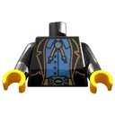{ .lu-ti width="24" loading="lazy" } [Cattle Rustler Shirt (LOT 8613)](../8613.md) | 2 | No client description | 15 matrices; 0 rewards; 1 community references |
| 8609 | { .lu-ti width="24" loading="lazy" } [Cavalry Shirt (LOT 8609)](../8609.md) | 1 | No client description | 1 matrices; 0 rewards; 1 community references |
| 8628 | { .lu-ti width="24" loading="lazy" } [Checkered Flag Shirt (LOT 8628)](../8628.md) | 2 | No client description | 0 matrices; 0 rewards; 0 community references |
| 4051 | { .lu-ti width="24" loading="lazy" } [Checkered Shirt (LOT 4051)](../4051.md) | 1 | No client description | 32 matrices; 0 rewards; 0 community references |
| 4085 | { .lu-ti width="24" loading="lazy" } [Checkered Shirt (LOT 4085)](../4085.md) | 1 | No client description | 32 matrices; 0 rewards; 0 community references |
| 4119 | 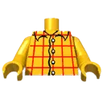{ .lu-ti width="24" loading="lazy" } [Checkered Shirt (LOT 4119)](../4119.md) | 1 | No client description | 0 matrices; 0 rewards; 0 community references |
| 4153 | { .lu-ti width="24" loading="lazy" } [Checkered Shirt (LOT 4153)](../4153.md) | 1 | No client description | 32 matrices; 0 rewards; 0 community references |
| 4187 | 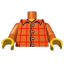{ .lu-ti width="24" loading="lazy" } [Checkered Shirt (LOT 4187)](../4187.md) | 1 | No client description | 32 matrices; 0 rewards; 0 community references |
| 4221 | { .lu-ti width="24" loading="lazy" } [Checkered Shirt (LOT 4221)](../4221.md) | 1 | No client description | 32 matrices; 0 rewards; 0 community references |
| 4255 | { .lu-ti width="24" loading="lazy" } [Checkered Shirt (LOT 4255)](../4255.md) | 1 | No client description | 32 matrices; 0 rewards; 0 community references |
| 4289 | { .lu-ti width="24" loading="lazy" } [Checkered Shirt (LOT 4289)](../4289.md) | 1 | No client description | 32 matrices; 0 rewards; 0 community references |
| 4323 | 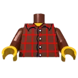{ .lu-ti width="24" loading="lazy" } [Checkered Shirt (LOT 4323)](../4323.md) | 1 | No client description | 32 matrices; 0 rewards; 0 community references |
| 4357 | { .lu-ti width="24" loading="lazy" } [Checkered Shirt (LOT 4357)](../4357.md) | 1 | No client description | 32 matrices; 0 rewards; 0 community references |
| 4391 | { .lu-ti width="24" loading="lazy" } [Checkered Shirt (LOT 4391)](../4391.md) | 1 | No client description | 32 matrices; 0 rewards; 0 community references |
| 4425 | { .lu-ti width="24" loading="lazy" } [Checkered Shirt (LOT 4425)](../4425.md) | 1 | No client description | 32 matrices; 0 rewards; 0 community references |
| 4459 | { .lu-ti width="24" loading="lazy" } [Checkered Shirt (LOT 4459)](../4459.md) | 1 | No client description | 32 matrices; 0 rewards; 0 community references |
| 4493 | { .lu-ti width="24" loading="lazy" } [Checkered Shirt (LOT 4493)](../4493.md) | 1 | No client description | 32 matrices; 0 rewards; 0 community references |
| 4527 | 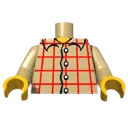{ .lu-ti width="24" loading="lazy" } [Checkered Shirt (LOT 4527)](../4527.md) | 1 | No client description | 32 matrices; 0 rewards; 0 community references |
| 4561 | { .lu-ti width="24" loading="lazy" } [Checkered Shirt (LOT 4561)](../4561.md) | 1 | No client description | 32 matrices; 0 rewards; 0 community references |
| 4595 | { .lu-ti width="24" loading="lazy" } [Checkered Shirt (LOT 4595)](../4595.md) | 1 | No client description | 32 matrices; 0 rewards; 0 community references |
| 7745 | { .lu-ti width="24" loading="lazy" } [Chef Jacket (LOT 7745)](../7745.md) | 2 | No client description | 1 matrices; 0 rewards; 1 community references |
| 12748 | { .lu-ti width="24" loading="lazy" } [Classic Astronaut Shirt (LOT 12748)](../12748.md) | 4 | No client description | 0 matrices; 1 rewards; 1 community references |
| 6229 | { .lu-ti width="24" loading="lazy" } [Classic Rocket Shirt (LOT 6229)](../6229.md) | 3 | No client description | 0 matrices; 1 rewards; 1 community references |
| 16087 | { .lu-ti width="24" loading="lazy" } [Classy Kimono (LOT 16087)](../16087.md) | 3 | No client description | 27 matrices; 0 rewards; 1 community references |
| 16639 | { .lu-ti width="24" loading="lazy" } [Cole's DX Gi of Quakes (LOT 16639)](../16639.md) | 4 | Wear this to look like Cole DX! | 2 matrices; 0 rewards; 0 community references |
| 15844 | 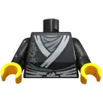{ .lu-ti width="24" loading="lazy" } [Cole's First Gi (LOT 15844)](../15844.md) | 3 | No client description | 0 matrices; 1 rewards; 1 community references |
| 16606 | 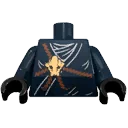{ .lu-ti width="24" loading="lazy" } [Cole's Gi of Quakes (LOT 16606)](../16606.md) | 3 | Wear this to look like Cole! | 1 matrices; 0 rewards; 1 community references |
| 16084 | 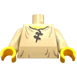{ .lu-ti width="24" loading="lazy" } [Common Kosode (LOT 16084)](../16084.md) | 1 | No client description | 28 matrices; 0 rewards; 1 community references |
| 2944 | { .lu-ti width="24" loading="lazy" } [Concert Superstar Shirt (LOT 2944)](../2944.md) | 2 | No client description | 0 matrices; 1 rewards; 0 community references |
| 3938 | { .lu-ti width="24" loading="lazy" } [Conductor's Shirt (LOT 3938)](../3938.md) | 2 | No client description | 4 matrices; 0 rewards; 1 community references |
| 8631 | { .lu-ti width="24" loading="lazy" } [Confederate Shirt (LOT 8631)](../8631.md) | 3 | No client description | 8 matrices; 0 rewards; 1 community references |
| 12705 | { .lu-ti width="24" loading="lazy" } [Cool Car Euro Shirt (LOT 12705)](../12705.md) | 2 | No client description | 1 matrices; 0 rewards; 1 community references |
| 12706 | { .lu-ti width="24" loading="lazy" } [Cool Car Import Shirt (LOT 12706)](../12706.md) | 2 | No client description | 1 matrices; 0 rewards; 1 community references |
| 12688 | { .lu-ti width="24" loading="lazy" } [Cool Car Muscle Shirt (LOT 12688)](../12688.md) | 2 | No client description | 1 matrices; 0 rewards; 1 community references |
| 8629 | { .lu-ti width="24" loading="lazy" } [Cool Car Shirt (LOT 8629)](../8629.md) | 2 | No client description | 0 matrices; 0 rewards; 0 community references |
| 4077 | { .lu-ti width="24" loading="lazy" } [Corduroy Jacket (LOT 4077)](../4077.md) | 1 | No client description | 32 matrices; 0 rewards; 0 community references |
| 4111 | { .lu-ti width="24" loading="lazy" } [Corduroy Jacket (LOT 4111)](../4111.md) | 1 | No client description | 32 matrices; 0 rewards; 0 community references |
