# Chest — page 2/6

[Item database](../README.md)

Pages: [1](type-15-1.md) | [2](type-15-2.md) | [3](type-15-3.md) | [4](type-15-4.md) | [5](type-15-5.md) | [6](type-15-6.md)

| LOT | Item | Rarity | Description | Source evidence |
| --- | --- | --- | --- | --- |
| 4145 | { .lu-ti width="24" loading="lazy" } [Corduroy Jacket (LOT 4145)](../4145.md) | 1 | No client description | 0 matrices; 0 rewards; 0 community references |
| 4179 | { .lu-ti width="24" loading="lazy" } [Corduroy Jacket (LOT 4179)](../4179.md) | 1 | No client description | 32 matrices; 0 rewards; 0 community references |
| 4213 | { .lu-ti width="24" loading="lazy" } [Corduroy Jacket (LOT 4213)](../4213.md) | 1 | No client description | 32 matrices; 0 rewards; 0 community references |
| 4247 | { .lu-ti width="24" loading="lazy" } [Corduroy Jacket (LOT 4247)](../4247.md) | 1 | No client description | 32 matrices; 0 rewards; 0 community references |
| 4281 | { .lu-ti width="24" loading="lazy" } [Corduroy Jacket (LOT 4281)](../4281.md) | 1 | No client description | 32 matrices; 0 rewards; 0 community references |
| 4315 | { .lu-ti width="24" loading="lazy" } [Corduroy Jacket (LOT 4315)](../4315.md) | 1 | No client description | 32 matrices; 0 rewards; 0 community references |
| 4349 | { .lu-ti width="24" loading="lazy" } [Corduroy Jacket (LOT 4349)](../4349.md) | 1 | No client description | 32 matrices; 0 rewards; 0 community references |
| 4383 | { .lu-ti width="24" loading="lazy" } [Corduroy Jacket (LOT 4383)](../4383.md) | 1 | No client description | 32 matrices; 0 rewards; 0 community references |
| 4417 | { .lu-ti width="24" loading="lazy" } [Corduroy Jacket (LOT 4417)](../4417.md) | 1 | No client description | 32 matrices; 0 rewards; 0 community references |
| 4451 | { .lu-ti width="24" loading="lazy" } [Corduroy Jacket (LOT 4451)](../4451.md) | 1 | No client description | 32 matrices; 0 rewards; 0 community references |
| 4485 | { .lu-ti width="24" loading="lazy" } [Corduroy Jacket (LOT 4485)](../4485.md) | 1 | No client description | 32 matrices; 0 rewards; 0 community references |
| 4519 | { .lu-ti width="24" loading="lazy" } [Corduroy Jacket (LOT 4519)](../4519.md) | 1 | No client description | 32 matrices; 0 rewards; 0 community references |
| 4553 | { .lu-ti width="24" loading="lazy" } [Corduroy Jacket (LOT 4553)](../4553.md) | 1 | No client description | 32 matrices; 0 rewards; 0 community references |
| 4587 | { .lu-ti width="24" loading="lazy" } [Corduroy Jacket (LOT 4587)](../4587.md) | 1 | No client description | 32 matrices; 0 rewards; 0 community references |
| 4621 | { .lu-ti width="24" loading="lazy" } [Corduroy Jacket (LOT 4621)](../4621.md) | 1 | No client description | 32 matrices; 0 rewards; 0 community references |
| 4055 | { .lu-ti width="24" loading="lazy" } [Coveralls (LOT 4055)](../4055.md) | 1 | No client description | 32 matrices; 0 rewards; 0 community references |
| 4089 | { .lu-ti width="24" loading="lazy" } [Coveralls (LOT 4089)](../4089.md) | 1 | No client description | 32 matrices; 0 rewards; 0 community references |
| 4123 | { .lu-ti width="24" loading="lazy" } [Coveralls (LOT 4123)](../4123.md) | 1 | No client description | 0 matrices; 0 rewards; 0 community references |
| 4157 | { .lu-ti width="24" loading="lazy" } [Coveralls (LOT 4157)](../4157.md) | 1 | No client description | 32 matrices; 0 rewards; 0 community references |
| 4191 | { .lu-ti width="24" loading="lazy" } [Coveralls (LOT 4191)](../4191.md) | 1 | No client description | 32 matrices; 0 rewards; 0 community references |
| 4225 | { .lu-ti width="24" loading="lazy" } [Coveralls (LOT 4225)](../4225.md) | 1 | No client description | 32 matrices; 0 rewards; 0 community references |
| 4259 | { .lu-ti width="24" loading="lazy" } [Coveralls (LOT 4259)](../4259.md) | 1 | No client description | 32 matrices; 0 rewards; 0 community references |
| 4293 | { .lu-ti width="24" loading="lazy" } [Coveralls (LOT 4293)](../4293.md) | 1 | No client description | 32 matrices; 0 rewards; 0 community references |
| 4327 | { .lu-ti width="24" loading="lazy" } [Coveralls (LOT 4327)](../4327.md) | 1 | No client description | 32 matrices; 0 rewards; 0 community references |
| 4361 | { .lu-ti width="24" loading="lazy" } [Coveralls (LOT 4361)](../4361.md) | 1 | No client description | 32 matrices; 0 rewards; 0 community references |
| 4395 | { .lu-ti width="24" loading="lazy" } [Coveralls (LOT 4395)](../4395.md) | 1 | No client description | 32 matrices; 0 rewards; 0 community references |
| 4429 | { .lu-ti width="24" loading="lazy" } [Coveralls (LOT 4429)](../4429.md) | 1 | No client description | 32 matrices; 0 rewards; 0 community references |
| 4463 | { .lu-ti width="24" loading="lazy" } [Coveralls (LOT 4463)](../4463.md) | 1 | No client description | 32 matrices; 0 rewards; 0 community references |
| 4497 | { .lu-ti width="24" loading="lazy" } [Coveralls (LOT 4497)](../4497.md) | 1 | No client description | 32 matrices; 0 rewards; 0 community references |
| 4531 | { .lu-ti width="24" loading="lazy" } [Coveralls (LOT 4531)](../4531.md) | 1 | No client description | 32 matrices; 0 rewards; 0 community references |
| 4565 | { .lu-ti width="24" loading="lazy" } [Coveralls (LOT 4565)](../4565.md) | 1 | No client description | 32 matrices; 0 rewards; 0 community references |
| 4599 | { .lu-ti width="24" loading="lazy" } [Coveralls (LOT 4599)](../4599.md) | 1 | No client description | 32 matrices; 0 rewards; 0 community references |
| 12749 | { .lu-ti width="24" loading="lazy" } [Cow Skull Shirt (LOT 12749)](../12749.md) | 2 | No client description | 0 matrices; 1 rewards; 1 community references |
| 13746 | [Crate Disguise Shirt Proxy (LOT 13746)](../13746.md) | 1 | No client description | 0 matrices; 0 rewards; 0 community references |
| 8608 | { .lu-ti width="24" loading="lazy" } [Crown on Checks Shirt (LOT 8608)](../8608.md) | 2 | No client description | 0 matrices; 1 rewards; 0 community references |
| 12603 | 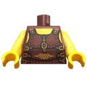{ .lu-ti width="24" loading="lazy" } [Cuirass Armor (LOT 12603)](../12603.md) | 3 | No client description | 0 matrices; 1 rewards; 0 community references |
| 16069 | { .lu-ti width="24" loading="lazy" } [Daidaiiro Gi (LOT 16069)](../16069.md) | 2 | No client description | 0 matrices; 1 rewards; 1 community references |
| 7487 | { .lu-ti width="24" loading="lazy" } [Daredevil Jacket 1 (LOT 7487)](../7487.md) | 4 | Rank 1 Specialty Kit Item | 2 matrices; 0 rewards; 0 community references |
| 7488 | { .lu-ti width="24" loading="lazy" } [Daredevil Jacket 2 (LOT 7488)](../7488.md) | 4 | Rank 2 Specialty Kit Item | 1 matrices; 0 rewards; 0 community references |
| 7489 | { .lu-ti width="24" loading="lazy" } [Daredevil Jacket 3 (LOT 7489)](../7489.md) | 4 | Rank 3 Specialty Kit Item | 1 matrices; 0 rewards; 0 community references |
| 12956 | { .lu-ti width="24" loading="lazy" } [Daredevil Jacket 3 (LOT 12956)](../12956.md) | 4 | Rank 3 Specialty Kit Item | 1 matrices; 0 rewards; 0 community references |
| 8623 | { .lu-ti width="24" loading="lazy" } [Dark Blue Princess Shirt (LOT 8623)](../8623.md) | 2 | No client description | 4 matrices; 0 rewards; 1 community references |
| 16083 | 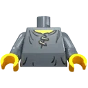{ .lu-ti width="24" loading="lazy" } [Dark Kosode (LOT 16083)](../16083.md) | 2 | No client description | 28 matrices; 0 rewards; 1 community references |
| 12689 | { .lu-ti width="24" loading="lazy" } [Dashiki Shirt (LOT 12689)](../12689.md) | 3 | No client description | 0 matrices; 1 rewards; 1 community references |
| 12700 | { .lu-ti width="24" loading="lazy" } [Denim Shirt (LOT 12700)](../12700.md) | 1 | No client description | 40 matrices; 0 rewards; 1 community references |
| 7746 | 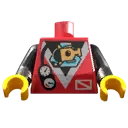{ .lu-ti width="24" loading="lazy" } [Diver Wetsuit (LOT 7746)](../7746.md) | 2 | No client description | 1 matrices; 0 rewards; 1 community references |
| 3862 | { .lu-ti width="24" loading="lazy" } [Double Striped Skunk Shirt (LOT 3862)](../3862.md) | 2 | No client description | 1 matrices; 0 rewards; 1 community references |
| 13756 | [Dragon Disguise Shirt Proxy (LOT 13756)](../13756.md) | 1 | Usedin Nexus Tower Mission Chains | 0 matrices; 0 rewards; 0 community references |
| 8348 | 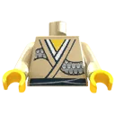{ .lu-ti width="24" loading="lazy" } [Dragon Style Gi (LOT 8348)](../8348.md) | 4 | Masters of Dragon style Kung Fu do not use any weapons! | 0 matrices; 1 rewards; 1 community references |
| 8615 | { .lu-ti width="24" loading="lazy" } [EMT Shirt (LOT 8615)](../8615.md) | 2 | No client description | 22 matrices; 0 rewards; 1 community references |
| 7370 | { .lu-ti width="24" loading="lazy" } [Engineer Shirt 1 (LOT 7370)](../7370.md) | 4 | Rank 1 Specialty Kit Item | 2 matrices; 0 rewards; 0 community references |
| 7371 | { .lu-ti width="24" loading="lazy" } [Engineer Shirt 2 (LOT 7371)](../7371.md) | 4 | Rank 2 Specialty Kit Item | 1 matrices; 0 rewards; 0 community references |
| 7372 | { .lu-ti width="24" loading="lazy" } [Engineer Shirt 3 (LOT 7372)](../7372.md) | 4 | Rank 3 Specialty Kit Item | 1 matrices; 0 rewards; 0 community references |
| 12947 | 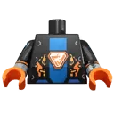{ .lu-ti width="24" loading="lazy" } [Engineer Shirt 3 (LOT 12947)](../12947.md) | 4 | Rank 3 Specialty Kit Item | 1 matrices; 0 rewards; 0 community references |
| 12690 | { .lu-ti width="24" loading="lazy" } [Explorien Bot Shirt (LOT 12690)](../12690.md) | 2 | No client description | 40 matrices; 0 rewards; 1 community references |
| 16066 | { .lu-ti width="24" loading="lazy" } [Faded Gi (LOT 16066)](../16066.md) | 2 | No client description | 27 matrices; 0 rewards; 1 community references |
| 16082 | { .lu-ti width="24" loading="lazy" } [Faded Kosode (LOT 16082)](../16082.md) | 2 | No client description | 28 matrices; 0 rewards; 1 community references |
| 8627 | { .lu-ti width="24" loading="lazy" } [Fancy Captain Shirt (LOT 8627)](../8627.md) | 4 | No client description | 0 matrices; 1 rewards; 0 community references |
| 8618 | { .lu-ti width="24" loading="lazy" } [Female Pirate Shirt (LOT 8618)](../8618.md) | 2 | No client description | 3 matrices; 0 rewards; 1 community references |
| 10131 | { .lu-ti width="24" loading="lazy" } [Fire Brick Shirt (LOT 10131)](../10131.md) | 2 | No client description | 0 matrices; 1 rewards; 0 community references |
| 7742 | { .lu-ti width="24" loading="lazy" } [Firefighter Coat (LOT 7742)](../7742.md) | 2 | No client description | 1 matrices; 0 rewards; 1 community references |
| 6799 | { .lu-ti width="24" loading="lazy" } [First Mate's Vest (LOT 6799)](../6799.md) | 2 | No client description | 0 matrices; 1 rewards; 0 community references |
| 9697 | { .lu-ti width="24" loading="lazy" } [Fish Skeleton Shirt (LOT 9697)](../9697.md) | 2 | No client description | 0 matrices; 1 rewards; 0 community references |
| 12691 | { .lu-ti width="24" loading="lazy" } [Flaming Tire Shirt (LOT 12691)](../12691.md) | 3 | No client description | 1 matrices; 0 rewards; 1 community references |
| 12299 | { .lu-ti width="24" loading="lazy" } [Flannel Shirt (LOT 12299)](../12299.md) | 2 | No client description | 1 matrices; 0 rewards; 1 community references |
| 7748 | { .lu-ti width="24" loading="lazy" } [Flower Shirt (LOT 7748)](../7748.md) | 2 | No client description | 1 matrices; 0 rewards; 1 community references |
| 12714 | { .lu-ti width="24" loading="lazy" } [Futuron Shirt (LOT 12714)](../12714.md) | 2 | No client description | 40 matrices; 0 rewards; 1 community references |
| 16268 | { .lu-ti width="24" loading="lazy" } [Gi of Flames (LOT 16268)](../16268.md) | 3 | Wear this to look like a Ninja of Fire and rocket directly to the Ninjago Caves! | 2 matrices; 1 rewards; 1 community references |
| 16267 | { .lu-ti width="24" loading="lazy" } [Gi of Frost (LOT 16267)](../16267.md) | 3 | Wear this to look like a Ninja of Ice and rocket directly to the Ninjago Caves! | 2 matrices; 1 rewards; 1 community references |
| 14173 | 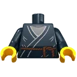{ .lu-ti width="24" loading="lazy" } [Gi of Quakes (LOT 14173)](../14173.md) | 3 | Wear this to look like a Ninja of Earth and rocket directly to the Ninjago Caves! | 2 matrices; 1 rewards; 1 community references |
| 16266 | { .lu-ti width="24" loading="lazy" } [Gi of Storms (LOT 16266)](../16266.md) | 3 | Wear this to look like a Ninja of Lightning and rocket directly to the Ninjago Caves! | 2 matrices; 1 rewards; 1 community references |
| 4056 | { .lu-ti width="24" loading="lazy" } [Girl's Business Jacket (LOT 4056)](../4056.md) | 1 | No client description | 32 matrices; 0 rewards; 0 community references |
| 4090 | { .lu-ti width="24" loading="lazy" } [Girl's Business Jacket (LOT 4090)](../4090.md) | 1 | No client description | 32 matrices; 0 rewards; 0 community references |
| 4124 | { .lu-ti width="24" loading="lazy" } [Girl's Business Jacket (LOT 4124)](../4124.md) | 1 | No client description | 0 matrices; 0 rewards; 0 community references |
| 4158 | { .lu-ti width="24" loading="lazy" } [Girl's Business Jacket (LOT 4158)](../4158.md) | 1 | No client description | 32 matrices; 0 rewards; 0 community references |
| 4192 | { .lu-ti width="24" loading="lazy" } [Girl's Business Jacket (LOT 4192)](../4192.md) | 1 | No client description | 32 matrices; 0 rewards; 0 community references |
| 4226 | { .lu-ti width="24" loading="lazy" } [Girl's Business Jacket (LOT 4226)](../4226.md) | 1 | No client description | 32 matrices; 0 rewards; 0 community references |
| 4260 | { .lu-ti width="24" loading="lazy" } [Girl's Business Jacket (LOT 4260)](../4260.md) | 1 | No client description | 32 matrices; 0 rewards; 0 community references |
| 4294 | { .lu-ti width="24" loading="lazy" } [Girl's Business Jacket (LOT 4294)](../4294.md) | 1 | No client description | 32 matrices; 0 rewards; 0 community references |
| 4328 | { .lu-ti width="24" loading="lazy" } [Girl's Business Jacket (LOT 4328)](../4328.md) | 1 | No client description | 32 matrices; 0 rewards; 0 community references |
| 4362 | { .lu-ti width="24" loading="lazy" } [Girl's Business Jacket (LOT 4362)](../4362.md) | 1 | No client description | 32 matrices; 0 rewards; 0 community references |
| 4396 | { .lu-ti width="24" loading="lazy" } [Girl's Business Jacket (LOT 4396)](../4396.md) | 1 | No client description | 32 matrices; 0 rewards; 0 community references |
| 4430 | { .lu-ti width="24" loading="lazy" } [Girl's Business Jacket (LOT 4430)](../4430.md) | 1 | No client description | 32 matrices; 0 rewards; 0 community references |
| 4464 | { .lu-ti width="24" loading="lazy" } [Girl's Business Jacket (LOT 4464)](../4464.md) | 1 | No client description | 32 matrices; 0 rewards; 0 community references |
| 4498 | { .lu-ti width="24" loading="lazy" } [Girl's Business Jacket (LOT 4498)](../4498.md) | 1 | No client description | 32 matrices; 0 rewards; 0 community references |
| 4532 | { .lu-ti width="24" loading="lazy" } [Girl's Business Jacket (LOT 4532)](../4532.md) | 1 | No client description | 32 matrices; 0 rewards; 0 community references |
| 4566 | { .lu-ti width="24" loading="lazy" } [Girl's Business Jacket (LOT 4566)](../4566.md) | 1 | No client description | 32 matrices; 0 rewards; 0 community references |
| 4600 | { .lu-ti width="24" loading="lazy" } [Girl's Business Jacket (LOT 4600)](../4600.md) | 1 | No client description | 32 matrices; 0 rewards; 0 community references |
| 4071 | { .lu-ti width="24" loading="lazy" } [Girl's Medieval Vest (LOT 4071)](../4071.md) | 1 | No client description | 32 matrices; 0 rewards; 0 community references |
| 4105 | { .lu-ti width="24" loading="lazy" } [Girl's Medieval Vest (LOT 4105)](../4105.md) | 1 | No client description | 32 matrices; 0 rewards; 0 community references |
| 4139 | { .lu-ti width="24" loading="lazy" } [Girl's Medieval Vest (LOT 4139)](../4139.md) | 1 | No client description | 0 matrices; 0 rewards; 0 community references |
| 4173 | { .lu-ti width="24" loading="lazy" } [Girl's Medieval Vest (LOT 4173)](../4173.md) | 1 | No client description | 32 matrices; 0 rewards; 0 community references |
| 4207 | { .lu-ti width="24" loading="lazy" } [Girl's Medieval Vest (LOT 4207)](../4207.md) | 1 | No client description | 32 matrices; 0 rewards; 0 community references |
| 4241 | { .lu-ti width="24" loading="lazy" } [Girl's Medieval Vest (LOT 4241)](../4241.md) | 1 | No client description | 32 matrices; 0 rewards; 0 community references |
| 4275 | { .lu-ti width="24" loading="lazy" } [Girl's Medieval Vest (LOT 4275)](../4275.md) | 1 | No client description | 32 matrices; 0 rewards; 0 community references |
| 4309 | { .lu-ti width="24" loading="lazy" } [Girl's Medieval Vest (LOT 4309)](../4309.md) | 1 | No client description | 32 matrices; 0 rewards; 0 community references |
| 4343 | { .lu-ti width="24" loading="lazy" } [Girl's Medieval Vest (LOT 4343)](../4343.md) | 1 | No client description | 32 matrices; 0 rewards; 0 community references |
| 4377 | { .lu-ti width="24" loading="lazy" } [Girl's Medieval Vest (LOT 4377)](../4377.md) | 1 | No client description | 32 matrices; 0 rewards; 0 community references |
| 4411 | { .lu-ti width="24" loading="lazy" } [Girl's Medieval Vest (LOT 4411)](../4411.md) | 1 | No client description | 32 matrices; 0 rewards; 0 community references |
| 4445 | { .lu-ti width="24" loading="lazy" } [Girl's Medieval Vest (LOT 4445)](../4445.md) | 1 | No client description | 32 matrices; 0 rewards; 0 community references |
| 4479 | { .lu-ti width="24" loading="lazy" } [Girl's Medieval Vest (LOT 4479)](../4479.md) | 1 | No client description | 32 matrices; 0 rewards; 0 community references |
| 4513 | { .lu-ti width="24" loading="lazy" } [Girl's Medieval Vest (LOT 4513)](../4513.md) | 1 | No client description | 32 matrices; 0 rewards; 0 community references |
| 4547 | { .lu-ti width="24" loading="lazy" } [Girl's Medieval Vest (LOT 4547)](../4547.md) | 1 | No client description | 32 matrices; 0 rewards; 0 community references |
| 4581 | { .lu-ti width="24" loading="lazy" } [Girl's Medieval Vest (LOT 4581)](../4581.md) | 1 | No client description | 32 matrices; 0 rewards; 0 community references |
| 4615 | { .lu-ti width="24" loading="lazy" } [Girl's Medieval Vest (LOT 4615)](../4615.md) | 1 | No client description | 32 matrices; 0 rewards; 0 community references |
| 4076 | { .lu-ti width="24" loading="lazy" } [Girl's Midriff Jacket (LOT 4076)](../4076.md) | 1 | No client description | 32 matrices; 0 rewards; 0 community references |
| 4110 | { .lu-ti width="24" loading="lazy" } [Girl's Midriff Jacket (LOT 4110)](../4110.md) | 1 | No client description | 32 matrices; 0 rewards; 0 community references |
| 4144 | { .lu-ti width="24" loading="lazy" } [Girl's Midriff Jacket (LOT 4144)](../4144.md) | 1 | No client description | 0 matrices; 0 rewards; 0 community references |
| 4178 | { .lu-ti width="24" loading="lazy" } [Girl's Midriff Jacket (LOT 4178)](../4178.md) | 1 | No client description | 32 matrices; 0 rewards; 0 community references |
| 4212 | { .lu-ti width="24" loading="lazy" } [Girl's Midriff Jacket (LOT 4212)](../4212.md) | 1 | No client description | 32 matrices; 0 rewards; 0 community references |
| 4246 | { .lu-ti width="24" loading="lazy" } [Girl's Midriff Jacket (LOT 4246)](../4246.md) | 1 | No client description | 32 matrices; 0 rewards; 0 community references |
| 4280 | { .lu-ti width="24" loading="lazy" } [Girl's Midriff Jacket (LOT 4280)](../4280.md) | 1 | No client description | 32 matrices; 0 rewards; 0 community references |
| 4314 | { .lu-ti width="24" loading="lazy" } [Girl's Midriff Jacket (LOT 4314)](../4314.md) | 1 | No client description | 32 matrices; 0 rewards; 0 community references |
| 4348 | { .lu-ti width="24" loading="lazy" } [Girl's Midriff Jacket (LOT 4348)](../4348.md) | 1 | No client description | 32 matrices; 0 rewards; 0 community references |
| 4382 | { .lu-ti width="24" loading="lazy" } [Girl's Midriff Jacket (LOT 4382)](../4382.md) | 1 | No client description | 32 matrices; 0 rewards; 0 community references |
| 4416 | { .lu-ti width="24" loading="lazy" } [Girl's Midriff Jacket (LOT 4416)](../4416.md) | 1 | No client description | 32 matrices; 0 rewards; 0 community references |
| 4450 | { .lu-ti width="24" loading="lazy" } [Girl's Midriff Jacket (LOT 4450)](../4450.md) | 1 | No client description | 32 matrices; 0 rewards; 0 community references |
| 4484 | { .lu-ti width="24" loading="lazy" } [Girl's Midriff Jacket (LOT 4484)](../4484.md) | 1 | No client description | 32 matrices; 0 rewards; 0 community references |
| 4518 | { .lu-ti width="24" loading="lazy" } [Girl's Midriff Jacket (LOT 4518)](../4518.md) | 1 | No client description | 32 matrices; 0 rewards; 0 community references |
| 4552 | { .lu-ti width="24" loading="lazy" } [Girl's Midriff Jacket (LOT 4552)](../4552.md) | 1 | No client description | 32 matrices; 0 rewards; 0 community references |
| 4586 | { .lu-ti width="24" loading="lazy" } [Girl's Midriff Jacket (LOT 4586)](../4586.md) | 1 | No client description | 32 matrices; 0 rewards; 0 community references |
| 4620 | 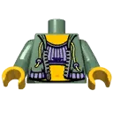{ .lu-ti width="24" loading="lazy" } [Girl's Midriff Jacket (LOT 4620)](../4620.md) | 1 | No client description | 32 matrices; 0 rewards; 0 community references |
| 4075 | { .lu-ti width="24" loading="lazy" } [Girl's Tank Top (LOT 4075)](../4075.md) | 1 | No client description | 32 matrices; 0 rewards; 0 community references |
| 4109 | { .lu-ti width="24" loading="lazy" } [Girl's Tank Top (LOT 4109)](../4109.md) | 1 | No client description | 32 matrices; 0 rewards; 0 community references |
| 4143 | { .lu-ti width="24" loading="lazy" } [Girl's Tank Top (LOT 4143)](../4143.md) | 1 | No client description | 0 matrices; 0 rewards; 0 community references |
| 4177 | { .lu-ti width="24" loading="lazy" } [Girl's Tank Top (LOT 4177)](../4177.md) | 1 | No client description | 32 matrices; 0 rewards; 0 community references |
| 4211 | { .lu-ti width="24" loading="lazy" } [Girl's Tank Top (LOT 4211)](../4211.md) | 1 | No client description | 32 matrices; 0 rewards; 0 community references |
| 4245 | { .lu-ti width="24" loading="lazy" } [Girl's Tank Top (LOT 4245)](../4245.md) | 1 | No client description | 32 matrices; 0 rewards; 0 community references |
| 4279 | { .lu-ti width="24" loading="lazy" } [Girl's Tank Top (LOT 4279)](../4279.md) | 1 | No client description | 32 matrices; 0 rewards; 0 community references |
| 4313 | { .lu-ti width="24" loading="lazy" } [Girl's Tank Top (LOT 4313)](../4313.md) | 1 | No client description | 32 matrices; 0 rewards; 0 community references |
| 4347 | { .lu-ti width="24" loading="lazy" } [Girl's Tank Top (LOT 4347)](../4347.md) | 1 | No client description | 32 matrices; 0 rewards; 0 community references |
| 4381 | { .lu-ti width="24" loading="lazy" } [Girl's Tank Top (LOT 4381)](../4381.md) | 1 | No client description | 32 matrices; 0 rewards; 0 community references |
| 4415 | { .lu-ti width="24" loading="lazy" } [Girl's Tank Top (LOT 4415)](../4415.md) | 1 | No client description | 32 matrices; 0 rewards; 0 community references |
| 4449 | { .lu-ti width="24" loading="lazy" } [Girl's Tank Top (LOT 4449)](../4449.md) | 1 | No client description | 32 matrices; 0 rewards; 0 community references |
| 4483 | { .lu-ti width="24" loading="lazy" } [Girl's Tank Top (LOT 4483)](../4483.md) | 1 | No client description | 32 matrices; 0 rewards; 0 community references |
| 4517 | { .lu-ti width="24" loading="lazy" } [Girl's Tank Top (LOT 4517)](../4517.md) | 1 | No client description | 32 matrices; 0 rewards; 0 community references |
| 4551 | { .lu-ti width="24" loading="lazy" } [Girl's Tank Top (LOT 4551)](../4551.md) | 1 | No client description | 32 matrices; 0 rewards; 0 community references |
| 4585 | { .lu-ti width="24" loading="lazy" } [Girl's Tank Top (LOT 4585)](../4585.md) | 1 | No client description | 32 matrices; 0 rewards; 0 community references |
| 4619 | { .lu-ti width="24" loading="lazy" } [Girl's Tank Top (LOT 4619)](../4619.md) | 1 | No client description | 32 matrices; 0 rewards; 0 community references |
| 8357 | { .lu-ti width="24" loading="lazy" } [Gothic Paradox Shirt (LOT 8357)](../8357.md) | 2 | No client description | 19 matrices; 0 rewards; 1 community references |
| 4070 | 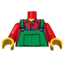{ .lu-ti width="24" loading="lazy" } [Green Coveralls (LOT 4070)](../4070.md) | 1 | No client description | 32 matrices; 0 rewards; 0 community references |
| 4104 | 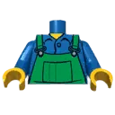{ .lu-ti width="24" loading="lazy" } [Green Coveralls (LOT 4104)](../4104.md) | 1 | No client description | 32 matrices; 0 rewards; 0 community references |
| 4138 | { .lu-ti width="24" loading="lazy" } [Green Coveralls (LOT 4138)](../4138.md) | 1 | No client description | 0 matrices; 0 rewards; 0 community references |
| 4172 | { .lu-ti width="24" loading="lazy" } [Green Coveralls (LOT 4172)](../4172.md) | 1 | No client description | 32 matrices; 0 rewards; 0 community references |
| 4206 | { .lu-ti width="24" loading="lazy" } [Green Coveralls (LOT 4206)](../4206.md) | 1 | No client description | 32 matrices; 0 rewards; 0 community references |
| 4240 | 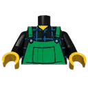{ .lu-ti width="24" loading="lazy" } [Green Coveralls (LOT 4240)](../4240.md) | 1 | No client description | 32 matrices; 0 rewards; 0 community references |
| 4274 | 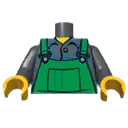{ .lu-ti width="24" loading="lazy" } [Green Coveralls (LOT 4274)](../4274.md) | 1 | No client description | 32 matrices; 0 rewards; 0 community references |
| 4308 | { .lu-ti width="24" loading="lazy" } [Green Coveralls (LOT 4308)](../4308.md) | 1 | No client description | 32 matrices; 0 rewards; 0 community references |
| 4342 | 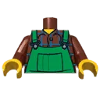{ .lu-ti width="24" loading="lazy" } [Green Coveralls (LOT 4342)](../4342.md) | 1 | No client description | 32 matrices; 0 rewards; 0 community references |
| 4376 | 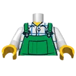{ .lu-ti width="24" loading="lazy" } [Green Coveralls (LOT 4376)](../4376.md) | 1 | No client description | 32 matrices; 0 rewards; 0 community references |
| 4410 | 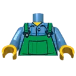{ .lu-ti width="24" loading="lazy" } [Green Coveralls (LOT 4410)](../4410.md) | 1 | No client description | 32 matrices; 0 rewards; 0 community references |
| 4444 | 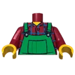{ .lu-ti width="24" loading="lazy" } [Green Coveralls (LOT 4444)](../4444.md) | 1 | No client description | 32 matrices; 0 rewards; 0 community references |
| 4478 | 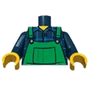{ .lu-ti width="24" loading="lazy" } [Green Coveralls (LOT 4478)](../4478.md) | 1 | No client description | 32 matrices; 0 rewards; 0 community references |
| 4512 | 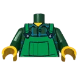{ .lu-ti width="24" loading="lazy" } [Green Coveralls (LOT 4512)](../4512.md) | 1 | No client description | 32 matrices; 0 rewards; 0 community references |
| 4546 | { .lu-ti width="24" loading="lazy" } [Green Coveralls (LOT 4546)](../4546.md) | 1 | No client description | 32 matrices; 0 rewards; 0 community references |
| 4580 | 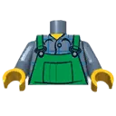{ .lu-ti width="24" loading="lazy" } [Green Coveralls (LOT 4580)](../4580.md) | 1 | No client description | 32 matrices; 0 rewards; 0 community references |
| 4614 | 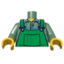{ .lu-ti width="24" loading="lazy" } [Green Coveralls (LOT 4614)](../4614.md) | 1 | No client description | 32 matrices; 0 rewards; 0 community references |
| 8351 | { .lu-ti width="24" loading="lazy" } [Green Dragon Shirt (LOT 8351)](../8351.md) | 2 | No client description | 0 matrices; 1 rewards; 0 community references |
| 10123 | { .lu-ti width="24" loading="lazy" } [Green Soccer Shirt (LOT 10123)](../10123.md) | 2 | No client description | 0 matrices; 1 rewards; 0 community references |
| 13526 | { .lu-ti width="24" loading="lazy" } [Green Tiki Shirt (LOT 13526)](../13526.md) | 4 | No client description | 0 matrices; 1 rewards; 0 community references |
| 16067 | 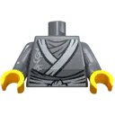{ .lu-ti width="24" loading="lazy" } [Haiiro Gi (LOT 16067)](../16067.md) | 3 | No client description | 0 matrices; 1 rewards; 1 community references |
| 8353 | 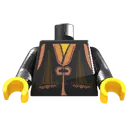{ .lu-ti width="24" loading="lazy" } [Hanbock (LOT 8353)](../8353.md) | 2 | No client description | 0 matrices; 1 rewards; 0 community references |
| 12693 | { .lu-ti width="24" loading="lazy" } [Harlequin Shirt (LOT 12693)](../12693.md) | 2 | No client description | 0 matrices; 0 rewards; 0 community references |
| 5843 | { .lu-ti width="24" loading="lazy" } [Hawaiian Shirt (LOT 5843)](../5843.md) | 3 | No client description | 0 matrices; 1 rewards; 0 community references |
| 4081 | { .lu-ti width="24" loading="lazy" } [Hoodie (LOT 4081)](../4081.md) | 1 | No client description | 32 matrices; 0 rewards; 0 community references |
| 4115 | { .lu-ti width="24" loading="lazy" } [Hoodie (LOT 4115)](../4115.md) | 1 | No client description | 32 matrices; 0 rewards; 0 community references |
| 4149 | { .lu-ti width="24" loading="lazy" } [Hoodie (LOT 4149)](../4149.md) | 1 | No client description | 0 matrices; 0 rewards; 0 community references |
| 4183 | { .lu-ti width="24" loading="lazy" } [Hoodie (LOT 4183)](../4183.md) | 1 | No client description | 32 matrices; 0 rewards; 0 community references |
| 4217 | { .lu-ti width="24" loading="lazy" } [Hoodie (LOT 4217)](../4217.md) | 1 | No client description | 32 matrices; 0 rewards; 0 community references |
| 4251 | { .lu-ti width="24" loading="lazy" } [Hoodie (LOT 4251)](../4251.md) | 1 | No client description | 32 matrices; 0 rewards; 0 community references |
| 4285 | { .lu-ti width="24" loading="lazy" } [Hoodie (LOT 4285)](../4285.md) | 1 | No client description | 32 matrices; 0 rewards; 0 community references |
| 4319 | { .lu-ti width="24" loading="lazy" } [Hoodie (LOT 4319)](../4319.md) | 1 | No client description | 32 matrices; 0 rewards; 0 community references |
| 4353 | { .lu-ti width="24" loading="lazy" } [Hoodie (LOT 4353)](../4353.md) | 1 | No client description | 32 matrices; 0 rewards; 0 community references |
| 4387 | { .lu-ti width="24" loading="lazy" } [Hoodie (LOT 4387)](../4387.md) | 1 | No client description | 32 matrices; 0 rewards; 0 community references |
| 4421 | { .lu-ti width="24" loading="lazy" } [Hoodie (LOT 4421)](../4421.md) | 1 | No client description | 32 matrices; 0 rewards; 0 community references |
| 4455 | { .lu-ti width="24" loading="lazy" } [Hoodie (LOT 4455)](../4455.md) | 1 | No client description | 32 matrices; 0 rewards; 0 community references |
| 4489 | { .lu-ti width="24" loading="lazy" } [Hoodie (LOT 4489)](../4489.md) | 1 | No client description | 32 matrices; 0 rewards; 0 community references |
| 4523 | { .lu-ti width="24" loading="lazy" } [Hoodie (LOT 4523)](../4523.md) | 1 | No client description | 32 matrices; 0 rewards; 0 community references |
| 4557 | { .lu-ti width="24" loading="lazy" } [Hoodie (LOT 4557)](../4557.md) | 1 | No client description | 32 matrices; 0 rewards; 0 community references |
| 4591 | 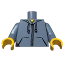{ .lu-ti width="24" loading="lazy" } [Hoodie (LOT 4591)](../4591.md) | 1 | No client description | 32 matrices; 0 rewards; 0 community references |
| 4625 | { .lu-ti width="24" loading="lazy" } [Hoodie (LOT 4625)](../4625.md) | 1 | No client description | 32 matrices; 0 rewards; 0 community references |
| 13761 | [Horseman Disguise Shirt Proxy (LOT 13761)](../13761.md) | 1 | Usedin Nexus Tower Mission Chains | 0 matrices; 0 rewards; 0 community references |
| 12919 | 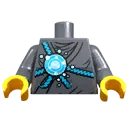{ .lu-ti width="24" loading="lazy" } [Imagination Spinjitzu Shirt (LOT 12919)](../12919.md) | 3 | No client description | 1 matrices; 1 rewards; 0 community references |
| 8616 | { .lu-ti width="24" loading="lazy" } [Inmate Shirt (LOT 8616)](../8616.md) | 3 | No client description | 8 matrices; 0 rewards; 1 community references |
| 7478 | 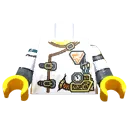{ .lu-ti width="24" loading="lazy" } [Inventor Armor 1 (LOT 7478)](../7478.md) | 4 | Rank 1 Specialty Kit Item | 2 matrices; 0 rewards; 0 community references |
| 7479 | 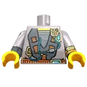{ .lu-ti width="24" loading="lazy" } [Inventor Armor 2 (LOT 7479)](../7479.md) | 4 | Rank 2 Specialty Kit Item | 1 matrices; 0 rewards; 0 community references |
| 7480 | 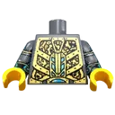{ .lu-ti width="24" loading="lazy" } [Inventor Armor 3 (LOT 7480)](../7480.md) | 4 | Rank 3 Specialty Kit Item | 1 matrices; 0 rewards; 0 community references |
| 10124 | { .lu-ti width="24" loading="lazy" } [Island Dolphin Shirt (LOT 10124)](../10124.md) | 2 | No client description | 0 matrices; 0 rewards; 0 community references |
| 4053 | { .lu-ti width="24" loading="lazy" } [Jacket with Pockets (LOT 4053)](../4053.md) | 1 | No client description | 32 matrices; 0 rewards; 0 community references |
| 4087 | { .lu-ti width="24" loading="lazy" } [Jacket with Pockets (LOT 4087)](../4087.md) | 1 | No client description | 32 matrices; 0 rewards; 0 community references |
| 4121 | { .lu-ti width="24" loading="lazy" } [Jacket with Pockets (LOT 4121)](../4121.md) | 1 | No client description | 0 matrices; 0 rewards; 0 community references |
| 4155 | { .lu-ti width="24" loading="lazy" } [Jacket with Pockets (LOT 4155)](../4155.md) | 1 | No client description | 32 matrices; 0 rewards; 0 community references |
| 4189 | 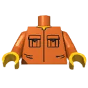{ .lu-ti width="24" loading="lazy" } [Jacket with Pockets (LOT 4189)](../4189.md) | 1 | No client description | 32 matrices; 0 rewards; 0 community references |
| 4223 | { .lu-ti width="24" loading="lazy" } [Jacket with Pockets (LOT 4223)](../4223.md) | 1 | No client description | 32 matrices; 0 rewards; 0 community references |
| 4257 | { .lu-ti width="24" loading="lazy" } [Jacket with Pockets (LOT 4257)](../4257.md) | 1 | No client description | 32 matrices; 0 rewards; 0 community references |
| 4291 | { .lu-ti width="24" loading="lazy" } [Jacket with Pockets (LOT 4291)](../4291.md) | 1 | No client description | 32 matrices; 0 rewards; 0 community references |
| 4325 | { .lu-ti width="24" loading="lazy" } [Jacket with Pockets (LOT 4325)](../4325.md) | 1 | No client description | 32 matrices; 0 rewards; 0 community references |
| 4359 | { .lu-ti width="24" loading="lazy" } [Jacket with Pockets (LOT 4359)](../4359.md) | 1 | No client description | 32 matrices; 0 rewards; 0 community references |
| 4393 | 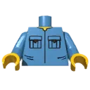{ .lu-ti width="24" loading="lazy" } [Jacket with Pockets (LOT 4393)](../4393.md) | 1 | No client description | 32 matrices; 0 rewards; 0 community references |
| 4427 | { .lu-ti width="24" loading="lazy" } [Jacket with Pockets (LOT 4427)](../4427.md) | 1 | No client description | 32 matrices; 0 rewards; 0 community references |
