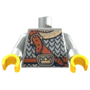
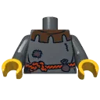
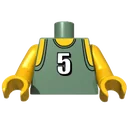
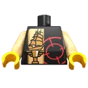

# Chest — page 3/6

[Item database](../README.md)

Pages: [1](type-15-1.md) | [2](type-15-2.md) | [3](type-15-3.md) | [4](type-15-4.md) | [5](type-15-5.md) | [6](type-15-6.md)

| LOT | Item | Rarity | Description | Source evidence |
| --- | --- | --- | --- | --- |
| 4461 | { .lu-ti width="24" loading="lazy" } [Jacket with Pockets (LOT 4461)](../4461.md) | 1 | No client description | 32 matrices; 0 rewards; 0 community references |
| 4495 | { .lu-ti width="24" loading="lazy" } [Jacket with Pockets (LOT 4495)](../4495.md) | 1 | No client description | 32 matrices; 0 rewards; 0 community references |
| 4529 | { .lu-ti width="24" loading="lazy" } [Jacket with Pockets (LOT 4529)](../4529.md) | 1 | No client description | 32 matrices; 0 rewards; 0 community references |
| 4563 | { .lu-ti width="24" loading="lazy" } [Jacket with Pockets (LOT 4563)](../4563.md) | 1 | No client description | 32 matrices; 0 rewards; 0 community references |
| 4597 | { .lu-ti width="24" loading="lazy" } [Jacket with Pockets (LOT 4597)](../4597.md) | 1 | No client description | 32 matrices; 0 rewards; 0 community references |
| 13836 | { .lu-ti width="24" loading="lazy" } [Janitor Shirt Proxy (LOT 13836)](../13836.md) | 1 | No client description | 0 matrices; 0 rewards; 0 community references |
| 16637 | { .lu-ti width="24" loading="lazy" } [Jay's DX Gi of Storms (LOT 16637)](../16637.md) | 4 | Wear this to look like Jay DX! | 2 matrices; 0 rewards; 0 community references |
| 16063 | { .lu-ti width="24" loading="lazy" } [Jay's First Gi (LOT 16063)](../16063.md) | 2 | No client description | 27 matrices; 0 rewards; 1 community references |
| 16609 | { .lu-ti width="24" loading="lazy" } [Jay's Gi of Storms (LOT 16609)](../16609.md) | 3 | Wear this to look like Jay! | 1 matrices; 0 rewards; 1 community references |
| 8624 | { .lu-ti width="24" loading="lazy" } [Jester Shirt (LOT 8624)](../8624.md) | 4 | No client description | 0 matrices; 1 rewards; 0 community references |
| 16634 | { .lu-ti width="24" loading="lazy" } [Kai's DX Gi of Flames (LOT 16634)](../16634.md) | 4 | Wear this to look like Kai DX! | 2 matrices; 0 rewards; 0 community references |
| 15843 | { .lu-ti width="24" loading="lazy" } [Kai's First Gi (LOT 15843)](../15843.md) | 3 | No client description | 1 matrices; 0 rewards; 1 community references |
| 16615 | { .lu-ti width="24" loading="lazy" } [Kai's Gi of Flames (LOT 16615)](../16615.md) | 3 | Wear this to look like Kai! | 1 matrices; 0 rewards; 1 community references |
| 14117 | { .lu-ti width="24" loading="lazy" } [Kinga Hurl Shirt (LOT 14117)](../14117.md) | 3 | No client description | 0 matrices; 0 rewards; 0 community references |
| 7367 | { .lu-ti width="24" loading="lazy" } [Knight Breastplate 1 (LOT 7367)](../7367.md) | 4 | Rank 1 Specialty Kit Item | 2 matrices; 0 rewards; 0 community references |
| 7368 | { .lu-ti width="24" loading="lazy" } [Knight Breastplate 2 (LOT 7368)](../7368.md) | 4 | Rank 2 Specialty Kit Item | 1 matrices; 0 rewards; 0 community references |
| 7369 | { .lu-ti width="24" loading="lazy" } [Knight Breastplate 3 (LOT 7369)](../7369.md) | 4 | Rank 3 Specialty Kit Item | 1 matrices; 0 rewards; 0 community references |
| 12950 | { .lu-ti width="24" loading="lazy" } [Knight Breastplate 3 (LOT 12950)](../12950.md) | 4 | Rank 3 Specialty Kit Item | 1 matrices; 0 rewards; 0 community references |
| 8350 | { .lu-ti width="24" loading="lazy" } [Kung Fu Master Shirt (LOT 8350)](../8350.md) | 4 | No client description | 0 matrices; 1 rewards; 0 community references |
| 9875 | { .lu-ti width="24" loading="lazy" } [LEGO Club Jumpsuit (LOT 9875)](../9875.md) | 3 | Available only to LEGO Club members! | 1 matrices; 0 rewards; 0 community references |
| 7740 | { .lu-ti width="24" loading="lazy" } [LEGO Dice Shirt (LOT 7740)](../7740.md) | 2 | No client description | 0 matrices; 1 rewards; 0 community references |
| 3010 | { .lu-ti width="24" loading="lazy" } [LEGO Universe Shirt (LOT 3010)](../3010.md) | 3 | No client description | 0 matrices; 1 rewards; 1 community references |
| 8622 | { .lu-ti width="24" loading="lazy" } [Light Blue Princess Shirt (LOT 8622)](../8622.md) | 2 | No client description | 1 matrices; 0 rewards; 1 community references |
| 4049 | { .lu-ti width="24" loading="lazy" } [Long Sleeve Shirt (LOT 4049)](../4049.md) | 1 | No client description | 33 matrices; 0 rewards; 0 community references |
| 4083 | { .lu-ti width="24" loading="lazy" } [Long Sleeve Shirt (LOT 4083)](../4083.md) | 1 | No client description | 33 matrices; 0 rewards; 0 community references |
| 4117 | { .lu-ti width="24" loading="lazy" } [Long Sleeve Shirt (LOT 4117)](../4117.md) | 1 | No client description | 0 matrices; 0 rewards; 0 community references |
| 4151 | { .lu-ti width="24" loading="lazy" } [Long Sleeve Shirt (LOT 4151)](../4151.md) | 1 | No client description | 0 matrices; 0 rewards; 0 community references |
| 4185 | { .lu-ti width="24" loading="lazy" } [Long Sleeve Shirt (LOT 4185)](../4185.md) | 1 | No client description | 32 matrices; 0 rewards; 0 community references |
| 4219 | { .lu-ti width="24" loading="lazy" } [Long Sleeve Shirt (LOT 4219)](../4219.md) | 1 | No client description | 33 matrices; 0 rewards; 0 community references |
| 4253 | { .lu-ti width="24" loading="lazy" } [Long Sleeve Shirt (LOT 4253)](../4253.md) | 1 | No client description | 32 matrices; 0 rewards; 0 community references |
| 4287 | { .lu-ti width="24" loading="lazy" } [Long Sleeve Shirt (LOT 4287)](../4287.md) | 1 | No client description | 32 matrices; 0 rewards; 0 community references |
| 4321 | { .lu-ti width="24" loading="lazy" } [Long Sleeve Shirt (LOT 4321)](../4321.md) | 1 | No client description | 33 matrices; 0 rewards; 0 community references |
| 4355 | { .lu-ti width="24" loading="lazy" } [Long Sleeve Shirt (LOT 4355)](../4355.md) | 1 | No client description | 32 matrices; 0 rewards; 0 community references |
| 4389 | { .lu-ti width="24" loading="lazy" } [Long Sleeve Shirt (LOT 4389)](../4389.md) | 1 | No client description | 32 matrices; 0 rewards; 0 community references |
| 4423 | { .lu-ti width="24" loading="lazy" } [Long Sleeve Shirt (LOT 4423)](../4423.md) | 1 | No client description | 32 matrices; 0 rewards; 0 community references |
| 4457 | { .lu-ti width="24" loading="lazy" } [Long Sleeve Shirt (LOT 4457)](../4457.md) | 1 | No client description | 32 matrices; 0 rewards; 0 community references |
| 4491 | { .lu-ti width="24" loading="lazy" } [Long Sleeve Shirt (LOT 4491)](../4491.md) | 1 | No client description | 32 matrices; 0 rewards; 0 community references |
| 4525 | { .lu-ti width="24" loading="lazy" } [Long Sleeve Shirt (LOT 4525)](../4525.md) | 1 | No client description | 32 matrices; 0 rewards; 0 community references |
| 4559 | { .lu-ti width="24" loading="lazy" } [Long Sleeve Shirt (LOT 4559)](../4559.md) | 1 | No client description | 32 matrices; 0 rewards; 0 community references |
| 4593 | { .lu-ti width="24" loading="lazy" } [Long Sleeve Shirt (LOT 4593)](../4593.md) | 1 | No client description | 32 matrices; 0 rewards; 0 community references |
| 8601 | { .lu-ti width="24" loading="lazy" } [Lounge Lizard Shirt (LOT 8601)](../8601.md) | 2 | No client description | 0 matrices; 1 rewards; 0 community references |
| 11429 | { .lu-ti width="24" loading="lazy" } [LUP Starbase Shirt (LOT 11429)](../11429.md) | 2 | NPC for Starbase 3001 | 0 matrices; 0 rewards; 0 community references |
| 13547 | { .lu-ti width="24" loading="lazy" } [Maelstrom Shirt (LOT 13547)](../13547.md) | 2 | No client description | 0 matrices; 1 rewards; 0 community references |
| 8625 | { .lu-ti width="24" loading="lazy" } [Mail Shirt with Belt (LOT 8625)](../8625.md) | 2 | No client description | 4 matrices; 0 rewards; 1 community references |
| 8621 | { .lu-ti width="24" loading="lazy" } [Mail Shirt with Gorget (LOT 8621)](../8621.md) | 2 | No client description | 20 matrices; 0 rewards; 1 community references |
| 8354 | { .lu-ti width="24" loading="lazy" } [Mantis Style Gi (LOT 8354)](../8354.md) | 4 | Masters of Mantis style Kung Fu do not use any weapons! | 0 matrices; 1 rewards; 1 community references |
| 14097 | { .lu-ti width="24" loading="lazy" } [Master Driver Shirt (LOT 14097)](../14097.md) | 3 | No client description | 0 matrices; 0 rewards; 0 community references |
| 4073 | { .lu-ti width="24" loading="lazy" } [Medieval Rags (LOT 4073)](../4073.md) | 1 | No client description | 32 matrices; 0 rewards; 0 community references |
| 4107 | { .lu-ti width="24" loading="lazy" } [Medieval Rags (LOT 4107)](../4107.md) | 1 | No client description | 32 matrices; 0 rewards; 0 community references |
| 4141 | { .lu-ti width="24" loading="lazy" } [Medieval Rags (LOT 4141)](../4141.md) | 1 | No client description | 0 matrices; 0 rewards; 0 community references |
| 4175 | { .lu-ti width="24" loading="lazy" } [Medieval Rags (LOT 4175)](../4175.md) | 1 | No client description | 32 matrices; 0 rewards; 0 community references |
| 4209 | { .lu-ti width="24" loading="lazy" } [Medieval Rags (LOT 4209)](../4209.md) | 1 | No client description | 32 matrices; 0 rewards; 0 community references |
| 4243 | { .lu-ti width="24" loading="lazy" } [Medieval Rags (LOT 4243)](../4243.md) | 1 | No client description | 32 matrices; 0 rewards; 0 community references |
| 4277 | { .lu-ti width="24" loading="lazy" } [Medieval Rags (LOT 4277)](../4277.md) | 1 | No client description | 32 matrices; 0 rewards; 0 community references |
| 4311 | { .lu-ti width="24" loading="lazy" } [Medieval Rags (LOT 4311)](../4311.md) | 1 | No client description | 32 matrices; 0 rewards; 0 community references |
| 4345 | { .lu-ti width="24" loading="lazy" } [Medieval Rags (LOT 4345)](../4345.md) | 1 | No client description | 32 matrices; 0 rewards; 0 community references |
| 4379 | { .lu-ti width="24" loading="lazy" } [Medieval Rags (LOT 4379)](../4379.md) | 1 | No client description | 32 matrices; 0 rewards; 0 community references |
| 4413 | { .lu-ti width="24" loading="lazy" } [Medieval Rags (LOT 4413)](../4413.md) | 1 | No client description | 32 matrices; 0 rewards; 0 community references |
| 4447 | { .lu-ti width="24" loading="lazy" } [Medieval Rags (LOT 4447)](../4447.md) | 1 | No client description | 32 matrices; 0 rewards; 0 community references |
| 4481 | { .lu-ti width="24" loading="lazy" } [Medieval Rags (LOT 4481)](../4481.md) | 1 | No client description | 32 matrices; 0 rewards; 0 community references |
| 4515 | { .lu-ti width="24" loading="lazy" } [Medieval Rags (LOT 4515)](../4515.md) | 1 | No client description | 32 matrices; 0 rewards; 0 community references |
| 4549 | { .lu-ti width="24" loading="lazy" } [Medieval Rags (LOT 4549)](../4549.md) | 1 | No client description | 32 matrices; 0 rewards; 0 community references |
| 4583 | { .lu-ti width="24" loading="lazy" } [Medieval Rags (LOT 4583)](../4583.md) | 1 | No client description | 32 matrices; 0 rewards; 0 community references |
| 4617 | { .lu-ti width="24" loading="lazy" } [Medieval Rags (LOT 4617)](../4617.md) | 1 | No client description | 32 matrices; 0 rewards; 0 community references |
| 4072 | { .lu-ti width="24" loading="lazy" } [Medieval Vest (LOT 4072)](../4072.md) | 1 | No client description | 32 matrices; 0 rewards; 0 community references |
| 4106 | { .lu-ti width="24" loading="lazy" } [Medieval Vest (LOT 4106)](../4106.md) | 1 | No client description | 32 matrices; 0 rewards; 0 community references |
| 4140 | { .lu-ti width="24" loading="lazy" } [Medieval Vest (LOT 4140)](../4140.md) | 1 | No client description | 0 matrices; 0 rewards; 0 community references |
| 4174 | { .lu-ti width="24" loading="lazy" } [Medieval Vest (LOT 4174)](../4174.md) | 1 | No client description | 32 matrices; 0 rewards; 0 community references |
| 4208 | { .lu-ti width="24" loading="lazy" } [Medieval Vest (LOT 4208)](../4208.md) | 1 | No client description | 32 matrices; 0 rewards; 0 community references |
| 4242 | { .lu-ti width="24" loading="lazy" } [Medieval Vest (LOT 4242)](../4242.md) | 1 | No client description | 32 matrices; 0 rewards; 0 community references |
| 4276 | { .lu-ti width="24" loading="lazy" } [Medieval Vest (LOT 4276)](../4276.md) | 1 | No client description | 32 matrices; 0 rewards; 0 community references |
| 4310 | { .lu-ti width="24" loading="lazy" } [Medieval Vest (LOT 4310)](../4310.md) | 1 | No client description | 32 matrices; 0 rewards; 0 community references |
| 4344 | { .lu-ti width="24" loading="lazy" } [Medieval Vest (LOT 4344)](../4344.md) | 1 | No client description | 32 matrices; 0 rewards; 0 community references |
| 4378 | { .lu-ti width="24" loading="lazy" } [Medieval Vest (LOT 4378)](../4378.md) | 1 | No client description | 32 matrices; 0 rewards; 0 community references |
| 4412 | { .lu-ti width="24" loading="lazy" } [Medieval Vest (LOT 4412)](../4412.md) | 1 | No client description | 32 matrices; 0 rewards; 0 community references |
| 4446 | { .lu-ti width="24" loading="lazy" } [Medieval Vest (LOT 4446)](../4446.md) | 1 | No client description | 32 matrices; 0 rewards; 0 community references |
| 4480 | { .lu-ti width="24" loading="lazy" } [Medieval Vest (LOT 4480)](../4480.md) | 1 | No client description | 32 matrices; 0 rewards; 0 community references |
| 4514 | { .lu-ti width="24" loading="lazy" } [Medieval Vest (LOT 4514)](../4514.md) | 1 | No client description | 32 matrices; 0 rewards; 0 community references |
| 4548 | { .lu-ti width="24" loading="lazy" } [Medieval Vest (LOT 4548)](../4548.md) | 1 | No client description | 32 matrices; 0 rewards; 0 community references |
| 4582 | { .lu-ti width="24" loading="lazy" } [Medieval Vest (LOT 4582)](../4582.md) | 1 | No client description | 32 matrices; 0 rewards; 0 community references |
| 4616 | { .lu-ti width="24" loading="lazy" } [Medieval Vest (LOT 4616)](../4616.md) | 1 | No client description | 32 matrices; 0 rewards; 0 community references |
| 16068 | { .lu-ti width="24" loading="lazy" } [Midori Gi (LOT 16068)](../16068.md) | 3 | No client description | 27 matrices; 0 rewards; 1 community references |
| 5733 | { .lu-ti width="24" loading="lazy" } [Minifigure Shirt (LOT 5733)](../5733.md) | 1 | No client description | 32 matrices; 0 rewards; 0 community references |
| 5739 | { .lu-ti width="24" loading="lazy" } [Minifigure Shirt (LOT 5739)](../5739.md) | 1 | No client description | 32 matrices; 0 rewards; 0 community references |
| 5745 | { .lu-ti width="24" loading="lazy" } [Minifigure Shirt (LOT 5745)](../5745.md) | 1 | No client description | 0 matrices; 0 rewards; 0 community references |
| 5751 | { .lu-ti width="24" loading="lazy" } [Minifigure Shirt (LOT 5751)](../5751.md) | 1 | No client description | 32 matrices; 0 rewards; 0 community references |
| 5757 | { .lu-ti width="24" loading="lazy" } [Minifigure Shirt (LOT 5757)](../5757.md) | 1 | No client description | 32 matrices; 0 rewards; 0 community references |
| 5763 | { .lu-ti width="24" loading="lazy" } [Minifigure Shirt (LOT 5763)](../5763.md) | 1 | No client description | 32 matrices; 0 rewards; 0 community references |
| 5769 | { .lu-ti width="24" loading="lazy" } [Minifigure Shirt (LOT 5769)](../5769.md) | 1 | No client description | 32 matrices; 0 rewards; 0 community references |
| 5775 | { .lu-ti width="24" loading="lazy" } [Minifigure Shirt (LOT 5775)](../5775.md) | 1 | No client description | 32 matrices; 0 rewards; 0 community references |
| 5781 | { .lu-ti width="24" loading="lazy" } [Minifigure Shirt (LOT 5781)](../5781.md) | 1 | No client description | 32 matrices; 0 rewards; 0 community references |
| 5787 | { .lu-ti width="24" loading="lazy" } [Minifigure Shirt (LOT 5787)](../5787.md) | 1 | No client description | 32 matrices; 0 rewards; 0 community references |
| 5793 | { .lu-ti width="24" loading="lazy" } [Minifigure Shirt (LOT 5793)](../5793.md) | 1 | No client description | 32 matrices; 0 rewards; 0 community references |
| 5799 | { .lu-ti width="24" loading="lazy" } [Minifigure Shirt (LOT 5799)](../5799.md) | 1 | No client description | 32 matrices; 0 rewards; 0 community references |
| 5805 | { .lu-ti width="24" loading="lazy" } [Minifigure Shirt (LOT 5805)](../5805.md) | 1 | No client description | 32 matrices; 0 rewards; 0 community references |
| 5811 | { .lu-ti width="24" loading="lazy" } [Minifigure Shirt (LOT 5811)](../5811.md) | 1 | No client description | 32 matrices; 0 rewards; 0 community references |
| 5817 | { .lu-ti width="24" loading="lazy" } [Minifigure Shirt (LOT 5817)](../5817.md) | 1 | No client description | 32 matrices; 0 rewards; 0 community references |
| 5823 | { .lu-ti width="24" loading="lazy" } [Minifigure Shirt (LOT 5823)](../5823.md) | 1 | No client description | 32 matrices; 0 rewards; 0 community references |
| 5829 | { .lu-ti width="24" loading="lazy" } [Minifigure Shirt (LOT 5829)](../5829.md) | 1 | No client description | 32 matrices; 0 rewards; 0 community references |
| 5731 | { .lu-ti width="24" loading="lazy" } [Mission Giver Shirt (LOT 5731)](../5731.md) | 1 | No client description | 32 matrices; 0 rewards; 0 community references |
| 5737 | { .lu-ti width="24" loading="lazy" } [Mission Giver Shirt (LOT 5737)](../5737.md) | 1 | No client description | 32 matrices; 0 rewards; 0 community references |
| 5743 | { .lu-ti width="24" loading="lazy" } [Mission Giver Shirt (LOT 5743)](../5743.md) | 1 | No client description | 0 matrices; 0 rewards; 0 community references |
| 5749 | { .lu-ti width="24" loading="lazy" } [Mission Giver Shirt (LOT 5749)](../5749.md) | 1 | No client description | 32 matrices; 0 rewards; 0 community references |
| 5755 | { .lu-ti width="24" loading="lazy" } [Mission Giver Shirt (LOT 5755)](../5755.md) | 1 | No client description | 32 matrices; 0 rewards; 0 community references |
| 5761 | { .lu-ti width="24" loading="lazy" } [Mission Giver Shirt (LOT 5761)](../5761.md) | 1 | No client description | 32 matrices; 0 rewards; 0 community references |
| 5767 | { .lu-ti width="24" loading="lazy" } [Mission Giver Shirt (LOT 5767)](../5767.md) | 1 | No client description | 32 matrices; 0 rewards; 0 community references |
| 5773 | { .lu-ti width="24" loading="lazy" } [Mission Giver Shirt (LOT 5773)](../5773.md) | 1 | No client description | 32 matrices; 0 rewards; 0 community references |
| 5779 | { .lu-ti width="24" loading="lazy" } [Mission Giver Shirt (LOT 5779)](../5779.md) | 1 | No client description | 32 matrices; 0 rewards; 0 community references |
| 5785 | { .lu-ti width="24" loading="lazy" } [Mission Giver Shirt (LOT 5785)](../5785.md) | 1 | No client description | 32 matrices; 0 rewards; 0 community references |
| 5791 | { .lu-ti width="24" loading="lazy" } [Mission Giver Shirt (LOT 5791)](../5791.md) | 1 | No client description | 32 matrices; 0 rewards; 0 community references |
| 5797 | { .lu-ti width="24" loading="lazy" } [Mission Giver Shirt (LOT 5797)](../5797.md) | 1 | No client description | 32 matrices; 0 rewards; 0 community references |
| 5803 | { .lu-ti width="24" loading="lazy" } [Mission Giver Shirt (LOT 5803)](../5803.md) | 1 | No client description | 32 matrices; 0 rewards; 0 community references |
| 5809 | { .lu-ti width="24" loading="lazy" } [Mission Giver Shirt (LOT 5809)](../5809.md) | 1 | No client description | 32 matrices; 0 rewards; 0 community references |
| 5815 | { .lu-ti width="24" loading="lazy" } [Mission Giver Shirt (LOT 5815)](../5815.md) | 1 | No client description | 32 matrices; 0 rewards; 0 community references |
| 5821 | { .lu-ti width="24" loading="lazy" } [Mission Giver Shirt (LOT 5821)](../5821.md) | 1 | No client description | 32 matrices; 0 rewards; 0 community references |
| 5827 | { .lu-ti width="24" loading="lazy" } [Mission Giver Shirt (LOT 5827)](../5827.md) | 1 | No client description | 32 matrices; 0 rewards; 0 community references |
| 2942 | { .lu-ti width="24" loading="lazy" } [Monument Shirt (LOT 2942)](../2942.md) | 2 | No client description | 0 matrices; 1 rewards; 0 community references |
| 12756 | { .lu-ti width="24" loading="lazy" } [Mosaic Shirt (LOT 12756)](../12756.md) | 3 | No client description | 0 matrices; 1 rewards; 1 community references |
| 16065 | { .lu-ti width="24" loading="lazy" } [Murasaki Gi (LOT 16065)](../16065.md) | 4 | No client description | 0 matrices; 1 rewards; 1 community references |
| 14118 | { .lu-ti width="24" loading="lazy" } [Murgle Blotch Shirt (LOT 14118)](../14118.md) | 3 | No client description | 0 matrices; 0 rewards; 0 community references |
| 2943 | { .lu-ti width="24" loading="lazy" } [Musical Notes Shirt (LOT 2943)](../2943.md) | 2 | No client description | 0 matrices; 1 rewards; 0 community references |
| 8355 | { .lu-ti width="24" loading="lazy" } [Narwhal Shirt (LOT 8355)](../8355.md) | 2 | No client description | 0 matrices; 1 rewards; 0 community references |
| 8599 | { .lu-ti width="24" loading="lazy" } [New Western Shirt (LOT 8599)](../8599.md) | 2 | No client description | 1 matrices; 0 rewards; 0 community references |
| 9696 | { .lu-ti width="24" loading="lazy" } [Nexus Astronaut Shirt (LOT 9696)](../9696.md) | 3 | No client description | 1 matrices; 0 rewards; 0 community references |
| 13527 | { .lu-ti width="24" loading="lazy" } [Nexus Tower Shirt (LOT 13527)](../13527.md) | 3 | No client description | 0 matrices; 1 rewards; 0 community references |
| 2955 | { .lu-ti width="24" loading="lazy" } [No Ninjas Shirt (LOT 2955)](../2955.md) | 3 | No client description | 0 matrices; 1 rewards; 0 community references |
| 2960 | { .lu-ti width="24" loading="lazy" } [No Pirates Shirt (LOT 2960)](../2960.md) | 3 | No client description | 0 matrices; 1 rewards; 1 community references |
| 2945 | { .lu-ti width="24" loading="lazy" } [No Robots Shirt (LOT 2945)](../2945.md) | 2 | No client description | 0 matrices; 1 rewards; 0 community references |
| 10158 | { .lu-ti width="24" loading="lazy" } [NPC Duke Exetor Decal (LOT 10158)](../10158.md) | 5 | NPC Duke Exeter Decal | 0 matrices; 0 rewards; 0 community references |
| 14432 | { .lu-ti width="24" loading="lazy" } [NPC Earth Spinjitsu Gi (LOT 14432)](../14432.md) | 3 | No client description | 0 matrices; 0 rewards; 0 community references |
| 12915 | { .lu-ti width="24" loading="lazy" } [NPC Paradox Scout (LOT 12915)](../12915.md) | 5 | No client description | 0 matrices; 0 rewards; 0 community references |
| 12914 | { .lu-ti width="24" loading="lazy" } [NPC Sentinel Scout (LOT 12914)](../12914.md) | 5 | No client description | 0 matrices; 0 rewards; 0 community references |
| 12912 | { .lu-ti width="24" loading="lazy" } [NPC Venture Scout (LOT 12912)](../12912.md) | 5 | No client description | 0 matrices; 0 rewards; 0 community references |
| 12913 | { .lu-ti width="24" loading="lazy" } [NPC Venture Scout (LOT 12913)](../12913.md) | 5 | No client description | 0 matrices; 0 rewards; 0 community references |
| 4079 | { .lu-ti width="24" loading="lazy" } [Number 5 Jersey (LOT 4079)](../4079.md) | 1 | No client description | 32 matrices; 0 rewards; 0 community references |
| 4113 | { .lu-ti width="24" loading="lazy" } [Number 5 Jersey (LOT 4113)](../4113.md) | 1 | No client description | 32 matrices; 0 rewards; 0 community references |
| 4147 | { .lu-ti width="24" loading="lazy" } [Number 5 Jersey (LOT 4147)](../4147.md) | 1 | No client description | 0 matrices; 0 rewards; 0 community references |
| 4181 | { .lu-ti width="24" loading="lazy" } [Number 5 Jersey (LOT 4181)](../4181.md) | 1 | No client description | 32 matrices; 0 rewards; 0 community references |
| 4215 | { .lu-ti width="24" loading="lazy" } [Number 5 Jersey (LOT 4215)](../4215.md) | 1 | No client description | 32 matrices; 0 rewards; 0 community references |
| 4249 | { .lu-ti width="24" loading="lazy" } [Number 5 Jersey (LOT 4249)](../4249.md) | 1 | No client description | 32 matrices; 0 rewards; 0 community references |
| 4283 | { .lu-ti width="24" loading="lazy" } [Number 5 Jersey (LOT 4283)](../4283.md) | 1 | No client description | 32 matrices; 0 rewards; 0 community references |
| 4317 | { .lu-ti width="24" loading="lazy" } [Number 5 Jersey (LOT 4317)](../4317.md) | 1 | No client description | 32 matrices; 0 rewards; 0 community references |
| 4351 | { .lu-ti width="24" loading="lazy" } [Number 5 Jersey (LOT 4351)](../4351.md) | 1 | No client description | 32 matrices; 0 rewards; 0 community references |
| 4385 | { .lu-ti width="24" loading="lazy" } [Number 5 Jersey (LOT 4385)](../4385.md) | 1 | No client description | 32 matrices; 0 rewards; 0 community references |
| 4419 | { .lu-ti width="24" loading="lazy" } [Number 5 Jersey (LOT 4419)](../4419.md) | 1 | No client description | 32 matrices; 0 rewards; 0 community references |
| 4453 | { .lu-ti width="24" loading="lazy" } [Number 5 Jersey (LOT 4453)](../4453.md) | 1 | No client description | 32 matrices; 0 rewards; 0 community references |
| 4487 | { .lu-ti width="24" loading="lazy" } [Number 5 Jersey (LOT 4487)](../4487.md) | 1 | No client description | 32 matrices; 0 rewards; 0 community references |
| 4521 | { .lu-ti width="24" loading="lazy" } [Number 5 Jersey (LOT 4521)](../4521.md) | 1 | No client description | 32 matrices; 0 rewards; 0 community references |
| 4555 | { .lu-ti width="24" loading="lazy" } [Number 5 Jersey (LOT 4555)](../4555.md) | 1 | No client description | 32 matrices; 0 rewards; 0 community references |
| 4589 | { .lu-ti width="24" loading="lazy" } [Number 5 Jersey (LOT 4589)](../4589.md) | 1 | No client description | 32 matrices; 0 rewards; 0 community references |
| 4623 | { .lu-ti width="24" loading="lazy" } [Number 5 Jersey (LOT 4623)](../4623.md) | 1 | No client description | 32 matrices; 0 rewards; 0 community references |
| 16086 | { .lu-ti width="24" loading="lazy" } [Nya's Casual Kimono (LOT 16086)](../16086.md) | 2 | No client description | 0 matrices; 1 rewards; 1 community references |
| 8600 | { .lu-ti width="24" loading="lazy" } [Old Skool Shirt (LOT 8600)](../8600.md) | 3 | No client description | 2 matrices; 0 rewards; 0 community references |
| 14114 | { .lu-ti width="24" loading="lazy" } [One-Eye's Shirt (LOT 14114)](../14114.md) | 3 | No client description | 0 matrices; 0 rewards; 0 community references |
| 4052 | { .lu-ti width="24" loading="lazy" } [Open Collar Shirt (LOT 4052)](../4052.md) | 1 | No client description | 32 matrices; 0 rewards; 0 community references |
| 4086 | { .lu-ti width="24" loading="lazy" } [Open Collar Shirt (LOT 4086)](../4086.md) | 1 | No client description | 32 matrices; 0 rewards; 0 community references |
| 4120 | { .lu-ti width="24" loading="lazy" } [Open Collar Shirt (LOT 4120)](../4120.md) | 1 | No client description | 0 matrices; 0 rewards; 0 community references |
| 4154 | { .lu-ti width="24" loading="lazy" } [Open Collar Shirt (LOT 4154)](../4154.md) | 1 | No client description | 32 matrices; 0 rewards; 0 community references |
| 4188 | { .lu-ti width="24" loading="lazy" } [Open Collar Shirt (LOT 4188)](../4188.md) | 1 | No client description | 32 matrices; 0 rewards; 0 community references |
| 4222 | { .lu-ti width="24" loading="lazy" } [Open Collar Shirt (LOT 4222)](../4222.md) | 1 | No client description | 32 matrices; 0 rewards; 0 community references |
| 4256 | { .lu-ti width="24" loading="lazy" } [Open Collar Shirt (LOT 4256)](../4256.md) | 1 | No client description | 32 matrices; 0 rewards; 0 community references |
| 4290 | { .lu-ti width="24" loading="lazy" } [Open Collar Shirt (LOT 4290)](../4290.md) | 1 | No client description | 32 matrices; 0 rewards; 0 community references |
| 4324 | { .lu-ti width="24" loading="lazy" } [Open Collar Shirt (LOT 4324)](../4324.md) | 1 | No client description | 32 matrices; 0 rewards; 0 community references |
| 4358 | { .lu-ti width="24" loading="lazy" } [Open Collar Shirt (LOT 4358)](../4358.md) | 1 | No client description | 32 matrices; 0 rewards; 0 community references |
| 4392 | { .lu-ti width="24" loading="lazy" } [Open Collar Shirt (LOT 4392)](../4392.md) | 1 | No client description | 32 matrices; 0 rewards; 0 community references |
| 4426 | { .lu-ti width="24" loading="lazy" } [Open Collar Shirt (LOT 4426)](../4426.md) | 1 | No client description | 32 matrices; 0 rewards; 0 community references |
| 4460 | { .lu-ti width="24" loading="lazy" } [Open Collar Shirt (LOT 4460)](../4460.md) | 1 | No client description | 32 matrices; 0 rewards; 0 community references |
| 4494 | { .lu-ti width="24" loading="lazy" } [Open Collar Shirt (LOT 4494)](../4494.md) | 1 | No client description | 32 matrices; 0 rewards; 0 community references |
| 4528 | { .lu-ti width="24" loading="lazy" } [Open Collar Shirt (LOT 4528)](../4528.md) | 1 | No client description | 32 matrices; 0 rewards; 0 community references |
| 4562 | { .lu-ti width="24" loading="lazy" } [Open Collar Shirt (LOT 4562)](../4562.md) | 1 | No client description | 32 matrices; 0 rewards; 0 community references |
| 4596 | { .lu-ti width="24" loading="lazy" } [Open Collar Shirt (LOT 4596)](../4596.md) | 1 | No client description | 32 matrices; 0 rewards; 0 community references |
| 7747 | { .lu-ti width="24" loading="lazy" } [Overalls (LOT 7747)](../7747.md) | 2 | No client description | 0 matrices; 1 rewards; 0 community references |
| 4078 | { .lu-ti width="24" loading="lazy" } [Oxford Sweater (LOT 4078)](../4078.md) | 1 | No client description | 32 matrices; 0 rewards; 0 community references |
| 4112 | { .lu-ti width="24" loading="lazy" } [Oxford Sweater (LOT 4112)](../4112.md) | 1 | No client description | 32 matrices; 0 rewards; 0 community references |
| 4146 | { .lu-ti width="24" loading="lazy" } [Oxford Sweater (LOT 4146)](../4146.md) | 1 | No client description | 0 matrices; 0 rewards; 0 community references |
| 4180 | { .lu-ti width="24" loading="lazy" } [Oxford Sweater (LOT 4180)](../4180.md) | 1 | No client description | 32 matrices; 0 rewards; 0 community references |
| 4214 | { .lu-ti width="24" loading="lazy" } [Oxford Sweater (LOT 4214)](../4214.md) | 1 | No client description | 32 matrices; 0 rewards; 0 community references |
| 4248 | { .lu-ti width="24" loading="lazy" } [Oxford Sweater (LOT 4248)](../4248.md) | 1 | No client description | 32 matrices; 0 rewards; 0 community references |
| 4282 | { .lu-ti width="24" loading="lazy" } [Oxford Sweater (LOT 4282)](../4282.md) | 1 | No client description | 32 matrices; 0 rewards; 0 community references |
| 4316 | { .lu-ti width="24" loading="lazy" } [Oxford Sweater (LOT 4316)](../4316.md) | 1 | No client description | 32 matrices; 0 rewards; 0 community references |
| 4350 | { .lu-ti width="24" loading="lazy" } [Oxford Sweater (LOT 4350)](../4350.md) | 1 | No client description | 32 matrices; 0 rewards; 0 community references |
| 4384 | { .lu-ti width="24" loading="lazy" } [Oxford Sweater (LOT 4384)](../4384.md) | 1 | No client description | 32 matrices; 0 rewards; 0 community references |
| 4418 | { .lu-ti width="24" loading="lazy" } [Oxford Sweater (LOT 4418)](../4418.md) | 1 | No client description | 32 matrices; 0 rewards; 0 community references |
| 4452 | { .lu-ti width="24" loading="lazy" } [Oxford Sweater (LOT 4452)](../4452.md) | 1 | No client description | 32 matrices; 0 rewards; 0 community references |
| 4486 | { .lu-ti width="24" loading="lazy" } [Oxford Sweater (LOT 4486)](../4486.md) | 1 | No client description | 32 matrices; 0 rewards; 0 community references |
| 4520 | { .lu-ti width="24" loading="lazy" } [Oxford Sweater (LOT 4520)](../4520.md) | 1 | No client description | 32 matrices; 0 rewards; 0 community references |
| 4554 | { .lu-ti width="24" loading="lazy" } [Oxford Sweater (LOT 4554)](../4554.md) | 1 | No client description | 32 matrices; 0 rewards; 0 community references |
| 4588 | { .lu-ti width="24" loading="lazy" } [Oxford Sweater (LOT 4588)](../4588.md) | 1 | No client description | 32 matrices; 0 rewards; 0 community references |
| 4622 | { .lu-ti width="24" loading="lazy" } [Oxford Sweater (LOT 4622)](../4622.md) | 1 | No client description | 32 matrices; 0 rewards; 0 community references |
| 12710 | { .lu-ti width="24" loading="lazy" } [Paisley Shirt (LOT 12710)](../12710.md) | 1 | No client description | 40 matrices; 0 rewards; 1 community references |
| 8356 | { .lu-ti width="24" loading="lazy" } [Panda Style Gi (LOT 8356)](../8356.md) | 4 | Masters of Panda style Kung Fu do not use any weapons! | 0 matrices; 1 rewards; 1 community references |
| 14103 | { .lu-ti width="24" loading="lazy" } [Paparazzi Shirt (LOT 14103)](../14103.md) | 3 | No client description | 0 matrices; 0 rewards; 0 community references |
| 14322 | { .lu-ti width="24" loading="lazy" } [Paradox Gear - Space Marauder -chest proxy (LOT 14322)](../14322.md) | 4 | No client description | 0 matrices; 0 rewards; 0 community references |
| 12374 | { .lu-ti width="24" loading="lazy" } [Parka Jacket (LOT 12374)](../12374.md) | 2 | No client description | 0 matrices; 0 rewards; 0 community references |
| 14115 | { .lu-ti width="24" loading="lazy" } [Peg-Leg's Shirt (LOT 14115)](../14115.md) | 3 | No client description | 0 matrices; 0 rewards; 0 community references |
| 6264 | { .lu-ti width="24" loading="lazy" } [Pet Buffalo Shirt (LOT 6264)](../6264.md) | 4 | No client description | 1 matrices; 0 rewards; 1 community references |
| 7735 | { .lu-ti width="24" loading="lazy" } [Pet Bunny Shirt (LOT 7735)](../7735.md) | 4 | No client description | 1 matrices; 0 rewards; 1 community references |
| 7737 | { .lu-ti width="24" loading="lazy" } [Pet Cat Shirt (LOT 7737)](../7737.md) | 4 | No client description | 1 matrices; 0 rewards; 1 community references |
| 8584 | { .lu-ti width="24" loading="lazy" } [Pet Crab Shirt (LOT 8584)](../8584.md) | 4 | No client description | 1 matrices; 0 rewards; 1 community references |
| 8585 | { .lu-ti width="24" loading="lazy" } [Pet Crocodile Shirt (LOT 8585)](../8585.md) | 4 | No client description | 1 matrices; 0 rewards; 1 community references |
