# Chest — page 4/6

[Item database](../README.md)

Pages: [1](type-15-1.md) | [2](type-15-2.md) | [3](type-15-3.md) | [4](type-15-4.md) | [5](type-15-5.md) | [6](type-15-6.md)

| LOT | Item | Rarity | Description | Source evidence |
| --- | --- | --- | --- | --- |
| 6263 | 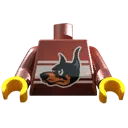{ .lu-ti width="24" loading="lazy" } [Pet Doberman Shirt (LOT 6263)](../6263.md) | 4 | No client description | 1 matrices; 0 rewards; 1 community references |
| 8587 | { .lu-ti width="24" loading="lazy" } [Pet Elephant Shirt (LOT 8587)](../8587.md) | 4 | No client description | 1 matrices; 0 rewards; 1 community references |
| 8588 | 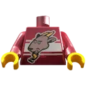{ .lu-ti width="24" loading="lazy" } [Pet Goat Shirt (LOT 8588)](../8588.md) | 4 | No client description | 1 matrices; 0 rewards; 1 community references |
| 8589 | { .lu-ti width="24" loading="lazy" } [Pet Green Dragon Shirt (LOT 8589)](../8589.md) | 4 | No client description | 1 matrices; 0 rewards; 1 community references |
| 8590 | { .lu-ti width="24" loading="lazy" } [Pet Lion Shirt (LOT 8590)](../8590.md) | 4 | No client description | 1 matrices; 0 rewards; 1 community references |
| 8591 | { .lu-ti width="24" loading="lazy" } [Pet Mantis Shirt (LOT 8591)](../8591.md) | 4 | No client description | 1 matrices; 0 rewards; 1 community references |
| 8592 | { .lu-ti width="24" loading="lazy" } [Pet Panda Shirt (LOT 8592)](../8592.md) | 4 | No client description | 1 matrices; 0 rewards; 1 community references |
| 8586 | 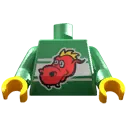{ .lu-ti width="24" loading="lazy" } [Pet Red Dragon Shirt (LOT 8586)](../8586.md) | 4 | No client description | 1 matrices; 0 rewards; 1 community references |
| 8593 | 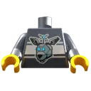{ .lu-ti width="24" loading="lazy" } [Pet Robot Dog Shirt (LOT 8593)](../8593.md) | 4 | No client description | 1 matrices; 0 rewards; 1 community references |
| 8594 | 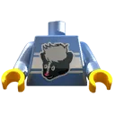{ .lu-ti width="24" loading="lazy" } [Pet Skunk Shirt (LOT 8594)](../8594.md) | 4 | No client description | 1 matrices; 0 rewards; 1 community references |
| 7736 | { .lu-ti width="24" loading="lazy" } [Pet Terrier Shirt (LOT 7736)](../7736.md) | 4 | No client description | 1 matrices; 0 rewards; 1 community references |
| 8595 | { .lu-ti width="24" loading="lazy" } [Pet Tortoise Shirt (LOT 8595)](../8595.md) | 4 | No client description | 1 matrices; 0 rewards; 1 community references |
| 6262 | { .lu-ti width="24" loading="lazy" } [Pet Triceratops Shirt (LOT 6262)](../6262.md) | 4 | No client description | 1 matrices; 0 rewards; 0 community references |
| 8596 | { .lu-ti width="24" loading="lazy" } [Pet Warthog Shirt (LOT 8596)](../8596.md) | 4 | No client description | 1 matrices; 0 rewards; 1 community references |
| 14102 | { .lu-ti width="24" loading="lazy" } [Photojournalist Shirt (LOT 14102)](../14102.md) | 3 | No client description | 0 matrices; 0 rewards; 0 community references |
| 8358 | { .lu-ti width="24" loading="lazy" } [Pink Kimono (LOT 8358)](../8358.md) | 3 | No client description | 11 matrices; 0 rewards; 1 community references |
| 8626 | { .lu-ti width="24" loading="lazy" } [Pirate Princess Dress (LOT 8626)](../8626.md) | 3 | No client description | 8 matrices; 0 rewards; 1 community references |
| 12695 | { .lu-ti width="24" loading="lazy" } [Pit Stop Racing Shirt (LOT 12695)](../12695.md) | 2 | No client description | 1 matrices; 0 rewards; 1 community references |
| 10168 | { .lu-ti width="24" loading="lazy" } [Pod 1 Captain Shirt (LOT 10168)](../10168.md) | 4 | No client description | 1 matrices; 0 rewards; 0 community references |
| 10169 | { .lu-ti width="24" loading="lazy" } [Pod 2 Captain Shirt (LOT 10169)](../10169.md) | 4 | No client description | 1 matrices; 0 rewards; 0 community references |
| 10170 | { .lu-ti width="24" loading="lazy" } [Pod 3 Captain Shirt (LOT 10170)](../10170.md) | 4 | No client description | 1 matrices; 0 rewards; 0 community references |
| 10171 | { .lu-ti width="24" loading="lazy" } [Pod 4 Captain Shirt (LOT 10171)](../10171.md) | 4 | No client description | 1 matrices; 0 rewards; 0 community references |
| 10172 | { .lu-ti width="24" loading="lazy" } [Pod 5 Captain Shirt (LOT 10172)](../10172.md) | 4 | No client description | 1 matrices; 0 rewards; 0 community references |
| 10173 | 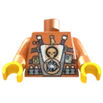{ .lu-ti width="24" loading="lazy" } [Pod 6 Captain Shirt (LOT 10173)](../10173.md) | 4 | No client description | 1 matrices; 0 rewards; 0 community references |
| 10174 | { .lu-ti width="24" loading="lazy" } [Pod 7 Captain Shirt (LOT 10174)](../10174.md) | 4 | No client description | 1 matrices; 0 rewards; 0 community references |
| 6232 | { .lu-ti width="24" loading="lazy" } [Pod Rocket Shirt (LOT 6232)](../6232.md) | 3 | No client description | 0 matrices; 1 rewards; 1 community references |
| 7743 | { .lu-ti width="24" loading="lazy" } [Police Jacket (LOT 7743)](../7743.md) | 2 | No client description | 1 matrices; 0 rewards; 1 community references |
| 4067 | { .lu-ti width="24" loading="lazy" } [Polo Shirt (LOT 4067)](../4067.md) | 1 | No client description | 32 matrices; 0 rewards; 0 community references |
| 4101 | { .lu-ti width="24" loading="lazy" } [Polo Shirt (LOT 4101)](../4101.md) | 1 | No client description | 32 matrices; 0 rewards; 0 community references |
| 4135 | { .lu-ti width="24" loading="lazy" } [Polo Shirt (LOT 4135)](../4135.md) | 1 | No client description | 0 matrices; 0 rewards; 0 community references |
| 4169 | { .lu-ti width="24" loading="lazy" } [Polo Shirt (LOT 4169)](../4169.md) | 1 | No client description | 32 matrices; 0 rewards; 0 community references |
| 4203 | { .lu-ti width="24" loading="lazy" } [Polo Shirt (LOT 4203)](../4203.md) | 1 | No client description | 32 matrices; 0 rewards; 0 community references |
| 4237 | { .lu-ti width="24" loading="lazy" } [Polo Shirt (LOT 4237)](../4237.md) | 1 | No client description | 32 matrices; 0 rewards; 0 community references |
| 4271 | { .lu-ti width="24" loading="lazy" } [Polo Shirt (LOT 4271)](../4271.md) | 1 | No client description | 32 matrices; 0 rewards; 0 community references |
| 4305 | 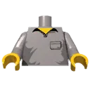{ .lu-ti width="24" loading="lazy" } [Polo Shirt (LOT 4305)](../4305.md) | 1 | No client description | 32 matrices; 0 rewards; 0 community references |
| 4339 | { .lu-ti width="24" loading="lazy" } [Polo Shirt (LOT 4339)](../4339.md) | 1 | No client description | 32 matrices; 0 rewards; 0 community references |
| 4373 | { .lu-ti width="24" loading="lazy" } [Polo Shirt (LOT 4373)](../4373.md) | 1 | No client description | 32 matrices; 0 rewards; 0 community references |
| 4407 | { .lu-ti width="24" loading="lazy" } [Polo Shirt (LOT 4407)](../4407.md) | 1 | No client description | 32 matrices; 0 rewards; 0 community references |
| 4441 | { .lu-ti width="24" loading="lazy" } [Polo Shirt (LOT 4441)](../4441.md) | 1 | No client description | 32 matrices; 0 rewards; 0 community references |
| 4475 | { .lu-ti width="24" loading="lazy" } [Polo Shirt (LOT 4475)](../4475.md) | 1 | No client description | 32 matrices; 0 rewards; 0 community references |
| 4509 | { .lu-ti width="24" loading="lazy" } [Polo Shirt (LOT 4509)](../4509.md) | 1 | No client description | 32 matrices; 0 rewards; 0 community references |
| 4543 | { .lu-ti width="24" loading="lazy" } [Polo Shirt (LOT 4543)](../4543.md) | 1 | No client description | 32 matrices; 0 rewards; 0 community references |
| 4577 | { .lu-ti width="24" loading="lazy" } [Polo Shirt (LOT 4577)](../4577.md) | 1 | No client description | 32 matrices; 0 rewards; 0 community references |
| 4611 | { .lu-ti width="24" loading="lazy" } [Polo Shirt (LOT 4611)](../4611.md) | 1 | No client description | 32 matrices; 0 rewards; 0 community references |
| 12696 | { .lu-ti width="24" loading="lazy" } [Poncho (LOT 12696)](../12696.md) | 2 | No client description | 0 matrices; 1 rewards; 1 community references |
| 10125 | { .lu-ti width="24" loading="lazy" } [Queen Shirt (LOT 10125)](../10125.md) | 3 | No client description | 11 matrices; 0 rewards; 1 community references |
| 8614 | { .lu-ti width="24" loading="lazy" } [Race Ace Shirt (LOT 8614)](../8614.md) | 2 | No client description | 0 matrices; 0 rewards; 0 community references |
| 14096 | { .lu-ti width="24" loading="lazy" } [Race Ace Shirt (LOT 14096)](../14096.md) | 3 | No client description | 0 matrices; 0 rewards; 0 community references |
| 14095 | { .lu-ti width="24" loading="lazy" } [Racemaster Shirt (LOT 14095)](../14095.md) | 4 | No client description | 0 matrices; 0 rewards; 0 community references |
| 5732 | { .lu-ti width="24" loading="lazy" } [Raincloud Shirt (LOT 5732)](../5732.md) | 1 | No client description | 32 matrices; 0 rewards; 0 community references |
| 5738 | { .lu-ti width="24" loading="lazy" } [Raincloud Shirt (LOT 5738)](../5738.md) | 1 | No client description | 32 matrices; 0 rewards; 0 community references |
| 5744 | { .lu-ti width="24" loading="lazy" } [Raincloud Shirt (LOT 5744)](../5744.md) | 1 | No client description | 0 matrices; 0 rewards; 0 community references |
| 5750 | { .lu-ti width="24" loading="lazy" } [Raincloud Shirt (LOT 5750)](../5750.md) | 1 | No client description | 32 matrices; 0 rewards; 0 community references |
| 5756 | { .lu-ti width="24" loading="lazy" } [Raincloud Shirt (LOT 5756)](../5756.md) | 1 | No client description | 32 matrices; 0 rewards; 0 community references |
| 5762 | { .lu-ti width="24" loading="lazy" } [Raincloud Shirt (LOT 5762)](../5762.md) | 1 | No client description | 32 matrices; 0 rewards; 0 community references |
| 5768 | { .lu-ti width="24" loading="lazy" } [Raincloud Shirt (LOT 5768)](../5768.md) | 1 | No client description | 32 matrices; 0 rewards; 0 community references |
| 5774 | { .lu-ti width="24" loading="lazy" } [Raincloud Shirt (LOT 5774)](../5774.md) | 1 | No client description | 32 matrices; 0 rewards; 0 community references |
| 5780 | { .lu-ti width="24" loading="lazy" } [Raincloud Shirt (LOT 5780)](../5780.md) | 1 | No client description | 32 matrices; 0 rewards; 0 community references |
| 5786 | { .lu-ti width="24" loading="lazy" } [Raincloud Shirt (LOT 5786)](../5786.md) | 1 | No client description | 32 matrices; 0 rewards; 0 community references |
| 5792 | { .lu-ti width="24" loading="lazy" } [Raincloud Shirt (LOT 5792)](../5792.md) | 1 | No client description | 32 matrices; 0 rewards; 0 community references |
| 5798 | { .lu-ti width="24" loading="lazy" } [Raincloud Shirt (LOT 5798)](../5798.md) | 1 | No client description | 32 matrices; 0 rewards; 0 community references |
| 5804 | { .lu-ti width="24" loading="lazy" } [Raincloud Shirt (LOT 5804)](../5804.md) | 1 | No client description | 32 matrices; 0 rewards; 0 community references |
| 5810 | { .lu-ti width="24" loading="lazy" } [Raincloud Shirt (LOT 5810)](../5810.md) | 1 | No client description | 32 matrices; 0 rewards; 0 community references |
| 5816 | { .lu-ti width="24" loading="lazy" } [Raincloud Shirt (LOT 5816)](../5816.md) | 1 | No client description | 32 matrices; 0 rewards; 0 community references |
| 5822 | { .lu-ti width="24" loading="lazy" } [Raincloud Shirt (LOT 5822)](../5822.md) | 1 | No client description | 32 matrices; 0 rewards; 0 community references |
| 5828 | { .lu-ti width="24" loading="lazy" } [Raincloud Shirt (LOT 5828)](../5828.md) | 1 | No client description | 32 matrices; 0 rewards; 0 community references |
| 5842 | { .lu-ti width="24" loading="lazy" } [Red Brick Shirt (LOT 5842)](../5842.md) | 2 | No client description | 0 matrices; 1 rewards; 0 community references |
| 6801 | { .lu-ti width="24" loading="lazy" } [Red Captain Shirt (LOT 6801)](../6801.md) | 3 | No client description | 0 matrices; 1 rewards; 0 community references |
| 10121 | { .lu-ti width="24" loading="lazy" } [Red Double Breasted Uniform (LOT 10121)](../10121.md) | 3 | No client description | 0 matrices; 1 rewards; 0 community references |
| 4082 | { .lu-ti width="24" loading="lazy" } [Red Flower Shirt (LOT 4082)](../4082.md) | 1 | No client description | 32 matrices; 0 rewards; 0 community references |
| 4116 | { .lu-ti width="24" loading="lazy" } [Red Flower Shirt (LOT 4116)](../4116.md) | 1 | No client description | 32 matrices; 0 rewards; 0 community references |
| 4150 | { .lu-ti width="24" loading="lazy" } [Red Flower Shirt (LOT 4150)](../4150.md) | 1 | No client description | 0 matrices; 0 rewards; 0 community references |
| 4184 | { .lu-ti width="24" loading="lazy" } [Red Flower Shirt (LOT 4184)](../4184.md) | 1 | No client description | 32 matrices; 0 rewards; 0 community references |
| 4218 | { .lu-ti width="24" loading="lazy" } [Red Flower Shirt (LOT 4218)](../4218.md) | 1 | No client description | 32 matrices; 0 rewards; 0 community references |
| 4252 | { .lu-ti width="24" loading="lazy" } [Red Flower Shirt (LOT 4252)](../4252.md) | 1 | No client description | 32 matrices; 0 rewards; 0 community references |
| 4286 | { .lu-ti width="24" loading="lazy" } [Red Flower Shirt (LOT 4286)](../4286.md) | 1 | No client description | 32 matrices; 0 rewards; 0 community references |
| 4320 | { .lu-ti width="24" loading="lazy" } [Red Flower Shirt (LOT 4320)](../4320.md) | 1 | No client description | 32 matrices; 0 rewards; 0 community references |
| 4354 | { .lu-ti width="24" loading="lazy" } [Red Flower Shirt (LOT 4354)](../4354.md) | 1 | No client description | 32 matrices; 0 rewards; 0 community references |
| 4388 | { .lu-ti width="24" loading="lazy" } [Red Flower Shirt (LOT 4388)](../4388.md) | 1 | No client description | 32 matrices; 0 rewards; 0 community references |
| 4422 | { .lu-ti width="24" loading="lazy" } [Red Flower Shirt (LOT 4422)](../4422.md) | 1 | No client description | 32 matrices; 0 rewards; 0 community references |
| 4456 | { .lu-ti width="24" loading="lazy" } [Red Flower Shirt (LOT 4456)](../4456.md) | 1 | No client description | 32 matrices; 0 rewards; 0 community references |
| 4490 | { .lu-ti width="24" loading="lazy" } [Red Flower Shirt (LOT 4490)](../4490.md) | 1 | No client description | 32 matrices; 0 rewards; 0 community references |
| 4524 | { .lu-ti width="24" loading="lazy" } [Red Flower Shirt (LOT 4524)](../4524.md) | 1 | No client description | 32 matrices; 0 rewards; 0 community references |
| 4558 | { .lu-ti width="24" loading="lazy" } [Red Flower Shirt (LOT 4558)](../4558.md) | 1 | No client description | 32 matrices; 0 rewards; 0 community references |
| 4592 | { .lu-ti width="24" loading="lazy" } [Red Flower Shirt (LOT 4592)](../4592.md) | 1 | No client description | 32 matrices; 0 rewards; 0 community references |
| 4626 | { .lu-ti width="24" loading="lazy" } [Red Flower Shirt (LOT 4626)](../4626.md) | 1 | No client description | 32 matrices; 0 rewards; 0 community references |
| 8086 | { .lu-ti width="24" loading="lazy" } [Red Imperial Shirt (LOT 8086)](../8086.md) | 2 | No client description | 0 matrices; 1 rewards; 0 community references |
| 7592 | { .lu-ti width="24" loading="lazy" } [Red Ninja Gi (LOT 7592)](../7592.md) | 2 | No client description | 0 matrices; 1 rewards; 0 community references |
| 8605 | 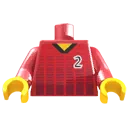{ .lu-ti width="24" loading="lazy" } [Red Soccer Shirt (LOT 8605)](../8605.md) | 3 | No client description | 1 matrices; 0 rewards; 0 community references |
| 2950 | { .lu-ti width="24" loading="lazy" } [Red Striped Crew Shirt (LOT 2950)](../2950.md) | 2 | No client description | 0 matrices; 1 rewards; 0 community references |
| 8603 | { .lu-ti width="24" loading="lazy" } [Red Uniform (LOT 8603)](../8603.md) | 2 | No client description | 15 matrices; 0 rewards; 1 community references |
| 4069 | { .lu-ti width="24" loading="lazy" } [Red Vest (LOT 4069)](../4069.md) | 1 | No client description | 32 matrices; 0 rewards; 0 community references |
| 4103 | { .lu-ti width="24" loading="lazy" } [Red Vest (LOT 4103)](../4103.md) | 1 | No client description | 32 matrices; 0 rewards; 0 community references |
| 4137 | { .lu-ti width="24" loading="lazy" } [Red Vest (LOT 4137)](../4137.md) | 1 | No client description | 0 matrices; 0 rewards; 0 community references |
| 4171 | { .lu-ti width="24" loading="lazy" } [Red Vest (LOT 4171)](../4171.md) | 1 | No client description | 32 matrices; 0 rewards; 0 community references |
| 4205 | { .lu-ti width="24" loading="lazy" } [Red Vest (LOT 4205)](../4205.md) | 1 | No client description | 32 matrices; 0 rewards; 0 community references |
| 4239 | { .lu-ti width="24" loading="lazy" } [Red Vest (LOT 4239)](../4239.md) | 1 | No client description | 32 matrices; 0 rewards; 0 community references |
| 4273 | { .lu-ti width="24" loading="lazy" } [Red Vest (LOT 4273)](../4273.md) | 1 | No client description | 32 matrices; 0 rewards; 0 community references |
| 4307 | { .lu-ti width="24" loading="lazy" } [Red Vest (LOT 4307)](../4307.md) | 1 | No client description | 32 matrices; 0 rewards; 0 community references |
| 4341 | { .lu-ti width="24" loading="lazy" } [Red Vest (LOT 4341)](../4341.md) | 1 | No client description | 32 matrices; 0 rewards; 0 community references |
| 4375 | { .lu-ti width="24" loading="lazy" } [Red Vest (LOT 4375)](../4375.md) | 1 | No client description | 32 matrices; 0 rewards; 0 community references |
| 4409 | { .lu-ti width="24" loading="lazy" } [Red Vest (LOT 4409)](../4409.md) | 1 | No client description | 32 matrices; 0 rewards; 0 community references |
| 4443 | { .lu-ti width="24" loading="lazy" } [Red Vest (LOT 4443)](../4443.md) | 1 | No client description | 32 matrices; 0 rewards; 0 community references |
| 4477 | { .lu-ti width="24" loading="lazy" } [Red Vest (LOT 4477)](../4477.md) | 1 | No client description | 32 matrices; 0 rewards; 0 community references |
| 4511 | { .lu-ti width="24" loading="lazy" } [Red Vest (LOT 4511)](../4511.md) | 1 | No client description | 32 matrices; 0 rewards; 0 community references |
| 4545 | { .lu-ti width="24" loading="lazy" } [Red Vest (LOT 4545)](../4545.md) | 1 | No client description | 32 matrices; 0 rewards; 0 community references |
| 4579 | { .lu-ti width="24" loading="lazy" } [Red Vest (LOT 4579)](../4579.md) | 1 | No client description | 32 matrices; 0 rewards; 0 community references |
| 4613 | { .lu-ti width="24" loading="lazy" } [Red Vest (LOT 4613)](../4613.md) | 1 | No client description | 32 matrices; 0 rewards; 0 community references |
| 8359 | { .lu-ti width="24" loading="lazy" } [Referee Shirt (LOT 8359)](../8359.md) | 2 | No client description | 1 matrices; 0 rewards; 1 community references |
| 8617 | { .lu-ti width="24" loading="lazy" } [Retro Daredevil Shirt (LOT 8617)](../8617.md) | 2 | No client description | 15 matrices; 0 rewards; 1 community references |
| 4068 | { .lu-ti width="24" loading="lazy" } [Ripped Shirt (LOT 4068)](../4068.md) | 1 | No client description | 32 matrices; 0 rewards; 0 community references |
| 4102 | { .lu-ti width="24" loading="lazy" } [Ripped Shirt (LOT 4102)](../4102.md) | 1 | No client description | 32 matrices; 0 rewards; 0 community references |
| 4136 | { .lu-ti width="24" loading="lazy" } [Ripped Shirt (LOT 4136)](../4136.md) | 1 | No client description | 0 matrices; 0 rewards; 0 community references |
| 4170 | { .lu-ti width="24" loading="lazy" } [Ripped Shirt (LOT 4170)](../4170.md) | 1 | No client description | 32 matrices; 0 rewards; 0 community references |
| 4204 | { .lu-ti width="24" loading="lazy" } [Ripped Shirt (LOT 4204)](../4204.md) | 1 | No client description | 32 matrices; 0 rewards; 0 community references |
| 4238 | { .lu-ti width="24" loading="lazy" } [Ripped Shirt (LOT 4238)](../4238.md) | 1 | No client description | 32 matrices; 0 rewards; 0 community references |
| 4272 | { .lu-ti width="24" loading="lazy" } [Ripped Shirt (LOT 4272)](../4272.md) | 1 | No client description | 32 matrices; 0 rewards; 0 community references |
| 4306 | { .lu-ti width="24" loading="lazy" } [Ripped Shirt (LOT 4306)](../4306.md) | 1 | No client description | 32 matrices; 0 rewards; 0 community references |
| 4340 | { .lu-ti width="24" loading="lazy" } [Ripped Shirt (LOT 4340)](../4340.md) | 1 | No client description | 32 matrices; 0 rewards; 0 community references |
| 4374 | { .lu-ti width="24" loading="lazy" } [Ripped Shirt (LOT 4374)](../4374.md) | 1 | No client description | 32 matrices; 0 rewards; 0 community references |
| 4408 | { .lu-ti width="24" loading="lazy" } [Ripped Shirt (LOT 4408)](../4408.md) | 1 | No client description | 32 matrices; 0 rewards; 0 community references |
| 4442 | { .lu-ti width="24" loading="lazy" } [Ripped Shirt (LOT 4442)](../4442.md) | 1 | No client description | 32 matrices; 0 rewards; 0 community references |
| 4476 | { .lu-ti width="24" loading="lazy" } [Ripped Shirt (LOT 4476)](../4476.md) | 1 | No client description | 32 matrices; 0 rewards; 0 community references |
| 4510 | { .lu-ti width="24" loading="lazy" } [Ripped Shirt (LOT 4510)](../4510.md) | 1 | No client description | 32 matrices; 0 rewards; 0 community references |
| 4544 | { .lu-ti width="24" loading="lazy" } [Ripped Shirt (LOT 4544)](../4544.md) | 1 | No client description | 32 matrices; 0 rewards; 0 community references |
| 4578 | { .lu-ti width="24" loading="lazy" } [Ripped Shirt (LOT 4578)](../4578.md) | 1 | No client description | 32 matrices; 0 rewards; 0 community references |
| 4612 | { .lu-ti width="24" loading="lazy" } [Ripped Shirt (LOT 4612)](../4612.md) | 1 | No client description | 32 matrices; 0 rewards; 0 community references |
| 8607 | { .lu-ti width="24" loading="lazy" } [Ruffled and Striped Shirt (LOT 8607)](../8607.md) | 2 | No client description | 20 matrices; 0 rewards; 1 community references |
| 8611 | { .lu-ti width="24" loading="lazy" } [Ruffled Bodice (LOT 8611)](../8611.md) | 1 | No client description | 1 matrices; 0 rewards; 1 community references |
| 12593 | { .lu-ti width="24" loading="lazy" } [Rugby Shirt (LOT 12593)](../12593.md) | 2 | No client description | 0 matrices; 1 rewards; 0 community references |
| 4059 | 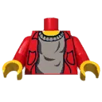{ .lu-ti width="24" loading="lazy" } [Rumpled Jacket (LOT 4059)](../4059.md) | 1 | No client description | 32 matrices; 0 rewards; 0 community references |
| 4093 | { .lu-ti width="24" loading="lazy" } [Rumpled Jacket (LOT 4093)](../4093.md) | 1 | No client description | 32 matrices; 0 rewards; 0 community references |
| 4127 | 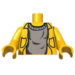{ .lu-ti width="24" loading="lazy" } [Rumpled Jacket (LOT 4127)](../4127.md) | 1 | No client description | 0 matrices; 0 rewards; 0 community references |
| 4161 | { .lu-ti width="24" loading="lazy" } [Rumpled Jacket (LOT 4161)](../4161.md) | 1 | No client description | 32 matrices; 0 rewards; 0 community references |
| 4195 | 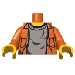{ .lu-ti width="24" loading="lazy" } [Rumpled Jacket (LOT 4195)](../4195.md) | 1 | No client description | 32 matrices; 0 rewards; 0 community references |
| 4229 | { .lu-ti width="24" loading="lazy" } [Rumpled Jacket (LOT 4229)](../4229.md) | 1 | No client description | 32 matrices; 0 rewards; 0 community references |
| 4263 | { .lu-ti width="24" loading="lazy" } [Rumpled Jacket (LOT 4263)](../4263.md) | 1 | No client description | 32 matrices; 0 rewards; 0 community references |
| 4297 | 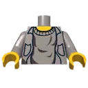{ .lu-ti width="24" loading="lazy" } [Rumpled Jacket (LOT 4297)](../4297.md) | 1 | No client description | 32 matrices; 0 rewards; 0 community references |
| 4331 | { .lu-ti width="24" loading="lazy" } [Rumpled Jacket (LOT 4331)](../4331.md) | 1 | No client description | 32 matrices; 0 rewards; 0 community references |
| 4365 | { .lu-ti width="24" loading="lazy" } [Rumpled Jacket (LOT 4365)](../4365.md) | 1 | No client description | 32 matrices; 0 rewards; 0 community references |
| 4399 | { .lu-ti width="24" loading="lazy" } [Rumpled Jacket (LOT 4399)](../4399.md) | 1 | No client description | 32 matrices; 0 rewards; 0 community references |
| 4433 | { .lu-ti width="24" loading="lazy" } [Rumpled Jacket (LOT 4433)](../4433.md) | 1 | No client description | 32 matrices; 0 rewards; 0 community references |
| 4467 | { .lu-ti width="24" loading="lazy" } [Rumpled Jacket (LOT 4467)](../4467.md) | 1 | No client description | 32 matrices; 0 rewards; 0 community references |
| 4501 | { .lu-ti width="24" loading="lazy" } [Rumpled Jacket (LOT 4501)](../4501.md) | 1 | No client description | 32 matrices; 0 rewards; 0 community references |
| 4535 | 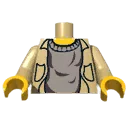{ .lu-ti width="24" loading="lazy" } [Rumpled Jacket (LOT 4535)](../4535.md) | 1 | No client description | 32 matrices; 0 rewards; 0 community references |
| 4569 | { .lu-ti width="24" loading="lazy" } [Rumpled Jacket (LOT 4569)](../4569.md) | 1 | No client description | 32 matrices; 0 rewards; 0 community references |
| 4603 | { .lu-ti width="24" loading="lazy" } [Rumpled Jacket (LOT 4603)](../4603.md) | 1 | No client description | 32 matrices; 0 rewards; 0 community references |
| 12753 | { .lu-ti width="24" loading="lazy" } [Safety Vest (LOT 12753)](../12753.md) | 3 | No client description | 0 matrices; 1 rewards; 1 community references |
| 4062 | { .lu-ti width="24" loading="lazy" } [Sailboat Shirt (LOT 4062)](../4062.md) | 1 | No client description | 32 matrices; 0 rewards; 0 community references |
| 4096 | { .lu-ti width="24" loading="lazy" } [Sailboat Shirt (LOT 4096)](../4096.md) | 1 | No client description | 32 matrices; 0 rewards; 0 community references |
| 4130 | { .lu-ti width="24" loading="lazy" } [Sailboat Shirt (LOT 4130)](../4130.md) | 1 | No client description | 0 matrices; 0 rewards; 0 community references |
| 4164 | { .lu-ti width="24" loading="lazy" } [Sailboat Shirt (LOT 4164)](../4164.md) | 1 | No client description | 32 matrices; 0 rewards; 0 community references |
| 4198 | { .lu-ti width="24" loading="lazy" } [Sailboat Shirt (LOT 4198)](../4198.md) | 1 | No client description | 32 matrices; 0 rewards; 0 community references |
| 4232 | { .lu-ti width="24" loading="lazy" } [Sailboat Shirt (LOT 4232)](../4232.md) | 1 | No client description | 32 matrices; 0 rewards; 0 community references |
| 4266 | { .lu-ti width="24" loading="lazy" } [Sailboat Shirt (LOT 4266)](../4266.md) | 1 | No client description | 32 matrices; 0 rewards; 0 community references |
| 4300 | { .lu-ti width="24" loading="lazy" } [Sailboat Shirt (LOT 4300)](../4300.md) | 1 | No client description | 32 matrices; 0 rewards; 0 community references |
| 4334 | { .lu-ti width="24" loading="lazy" } [Sailboat Shirt (LOT 4334)](../4334.md) | 1 | No client description | 32 matrices; 0 rewards; 0 community references |
| 4368 | { .lu-ti width="24" loading="lazy" } [Sailboat Shirt (LOT 4368)](../4368.md) | 1 | No client description | 32 matrices; 0 rewards; 0 community references |
| 4402 | { .lu-ti width="24" loading="lazy" } [Sailboat Shirt (LOT 4402)](../4402.md) | 1 | No client description | 32 matrices; 0 rewards; 0 community references |
| 4436 | { .lu-ti width="24" loading="lazy" } [Sailboat Shirt (LOT 4436)](../4436.md) | 1 | No client description | 32 matrices; 0 rewards; 0 community references |
| 4470 | { .lu-ti width="24" loading="lazy" } [Sailboat Shirt (LOT 4470)](../4470.md) | 1 | No client description | 32 matrices; 0 rewards; 0 community references |
| 4504 | { .lu-ti width="24" loading="lazy" } [Sailboat Shirt (LOT 4504)](../4504.md) | 1 | No client description | 32 matrices; 0 rewards; 0 community references |
| 4538 | { .lu-ti width="24" loading="lazy" } [Sailboat Shirt (LOT 4538)](../4538.md) | 1 | No client description | 32 matrices; 0 rewards; 0 community references |
| 4572 | { .lu-ti width="24" loading="lazy" } [Sailboat Shirt (LOT 4572)](../4572.md) | 1 | No client description | 32 matrices; 0 rewards; 0 community references |
| 4606 | { .lu-ti width="24" loading="lazy" } [Sailboat Shirt (LOT 4606)](../4606.md) | 1 | No client description | 32 matrices; 0 rewards; 0 community references |
| 16085 | { .lu-ti width="24" loading="lazy" } [Sakura's Festival Kimono (LOT 16085)](../16085.md) | 4 | No client description | 27 matrices; 0 rewards; 1 community references |
| 7469 | 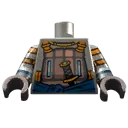{ .lu-ti width="24" loading="lazy" } [Samurai Breastplate 1 (LOT 7469)](../7469.md) | 4 | Rank 1 Specialty Kit Item | 2 matrices; 0 rewards; 0 community references |
| 7470 | 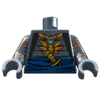{ .lu-ti width="24" loading="lazy" } [Samurai Breastplate 2 (LOT 7470)](../7470.md) | 4 | Rank 2 Specialty Kit Item | 1 matrices; 0 rewards; 0 community references |
| 7471 | 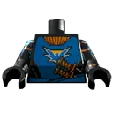{ .lu-ti width="24" loading="lazy" } [Samurai Breastplate 3 (LOT 7471)](../7471.md) | 4 | Rank 3 Specialty Kit Item | 1 matrices; 0 rewards; 0 community references |
| 12952 | { .lu-ti width="24" loading="lazy" } [Samurai Breastplate 3 (LOT 12952)](../12952.md) | 4 | Rank 3 Specialty Kit Item | 1 matrices; 0 rewards; 0 community references |
| 12698 | { .lu-ti width="24" loading="lazy" } [Scale Mail Shirt (LOT 12698)](../12698.md) | 3 | No client description | 40 matrices; 0 rewards; 1 community references |
| 8360 | { .lu-ti width="24" loading="lazy" } [Sensei Shirt (LOT 8360)](../8360.md) | 2 | No client description | 18 matrices; 0 rewards; 1 community references |
| 14316 | { .lu-ti width="24" loading="lazy" } [Sentinel Gear - Knight - chest proxy (LOT 14316)](../14316.md) | 4 | No client description | 0 matrices; 0 rewards; 0 community references |
| 8606 | { .lu-ti width="24" loading="lazy" } [Shabby Ninja Shirt (LOT 8606)](../8606.md) | 3 | No client description | 11 matrices; 0 rewards; 1 community references |
| 12754 | { .lu-ti width="24" loading="lazy" } [Shark Shirt (LOT 12754)](../12754.md) | 3 | No client description | 0 matrices; 1 rewards; 1 community references |
| 7475 | 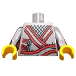{ .lu-ti width="24" loading="lazy" } [Shinobi Gi 1 (LOT 7475)](../7475.md) | 4 | Rank 1 Specialty Kit Item | 2 matrices; 0 rewards; 0 community references |
| 7476 | { .lu-ti width="24" loading="lazy" } [Shinobi Gi 2 (LOT 7476)](../7476.md) | 4 | Rank 2 Specialty Kit Item | 1 matrices; 0 rewards; 0 community references |
| 7477 | 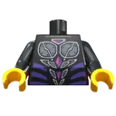{ .lu-ti width="24" loading="lazy" } [Shinobi Gi 3 (LOT 7477)](../7477.md) | 4 | Rank 3 Specialty Kit Item | 1 matrices; 0 rewards; 0 community references |
| 6926 | { .lu-ti width="24" loading="lazy" } [Shirt of Armor (LOT 6926)](../6926.md) | 4 | No client description | 1 matrices; 1 rewards; 0 community references |
| 4063 | { .lu-ti width="24" loading="lazy" } [Shirt with Vest (LOT 4063)](../4063.md) | 1 | No client description | 32 matrices; 0 rewards; 0 community references |
| 4097 | { .lu-ti width="24" loading="lazy" } [Shirt with Vest (LOT 4097)](../4097.md) | 1 | No client description | 32 matrices; 0 rewards; 0 community references |
| 4131 | { .lu-ti width="24" loading="lazy" } [Shirt with Vest (LOT 4131)](../4131.md) | 1 | No client description | 0 matrices; 0 rewards; 0 community references |
| 4165 | { .lu-ti width="24" loading="lazy" } [Shirt with Vest (LOT 4165)](../4165.md) | 1 | No client description | 32 matrices; 0 rewards; 0 community references |
| 4199 | { .lu-ti width="24" loading="lazy" } [Shirt with Vest (LOT 4199)](../4199.md) | 1 | No client description | 32 matrices; 0 rewards; 0 community references |
| 4233 | { .lu-ti width="24" loading="lazy" } [Shirt with Vest (LOT 4233)](../4233.md) | 1 | No client description | 32 matrices; 0 rewards; 0 community references |
| 4267 | { .lu-ti width="24" loading="lazy" } [Shirt with Vest (LOT 4267)](../4267.md) | 1 | No client description | 32 matrices; 0 rewards; 0 community references |
| 4301 | { .lu-ti width="24" loading="lazy" } [Shirt with Vest (LOT 4301)](../4301.md) | 1 | No client description | 32 matrices; 0 rewards; 0 community references |
| 4335 | { .lu-ti width="24" loading="lazy" } [Shirt with Vest (LOT 4335)](../4335.md) | 1 | No client description | 32 matrices; 0 rewards; 0 community references |
| 4369 | { .lu-ti width="24" loading="lazy" } [Shirt with Vest (LOT 4369)](../4369.md) | 1 | No client description | 32 matrices; 0 rewards; 0 community references |
| 4403 | { .lu-ti width="24" loading="lazy" } [Shirt with Vest (LOT 4403)](../4403.md) | 1 | No client description | 32 matrices; 0 rewards; 0 community references |
| 4437 | { .lu-ti width="24" loading="lazy" } [Shirt with Vest (LOT 4437)](../4437.md) | 1 | No client description | 32 matrices; 0 rewards; 0 community references |
| 4471 | { .lu-ti width="24" loading="lazy" } [Shirt with Vest (LOT 4471)](../4471.md) | 1 | No client description | 32 matrices; 0 rewards; 0 community references |
| 4505 | { .lu-ti width="24" loading="lazy" } [Shirt with Vest (LOT 4505)](../4505.md) | 1 | No client description | 32 matrices; 0 rewards; 0 community references |
| 4539 | { .lu-ti width="24" loading="lazy" } [Shirt with Vest (LOT 4539)](../4539.md) | 1 | No client description | 32 matrices; 0 rewards; 0 community references |
| 4573 | { .lu-ti width="24" loading="lazy" } [Shirt with Vest (LOT 4573)](../4573.md) | 1 | No client description | 32 matrices; 0 rewards; 0 community references |
| 4607 | { .lu-ti width="24" loading="lazy" } [Shirt with Vest (LOT 4607)](../4607.md) | 1 | No client description | 32 matrices; 0 rewards; 0 community references |
| 4050 | { .lu-ti width="24" loading="lazy" } [Short Sleeve Shirt (LOT 4050)](../4050.md) | 1 | No client description | 33 matrices; 0 rewards; 0 community references |
| 4084 | { .lu-ti width="24" loading="lazy" } [Short Sleeve Shirt (LOT 4084)](../4084.md) | 1 | No client description | 32 matrices; 0 rewards; 0 community references |
| 4118 | { .lu-ti width="24" loading="lazy" } [Short Sleeve Shirt (LOT 4118)](../4118.md) | 1 | No client description | 0 matrices; 0 rewards; 0 community references |
| 4152 | { .lu-ti width="24" loading="lazy" } [Short Sleeve Shirt (LOT 4152)](../4152.md) | 1 | No client description | 32 matrices; 0 rewards; 0 community references |
