# Chest — page 5/6

[Item database](../README.md)

Pages: [1](type-15-1.md) | [2](type-15-2.md) | [3](type-15-3.md) | [4](type-15-4.md) | [5](type-15-5.md) | [6](type-15-6.md)

| LOT | Item | Rarity | Description | Source evidence |
| --- | --- | --- | --- | --- |
| 4186 | { .lu-ti width="24" loading="lazy" } [Short Sleeve Shirt (LOT 4186)](../4186.md) | 1 | No client description | 32 matrices; 0 rewards; 0 community references |
| 4220 | 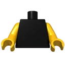{ .lu-ti width="24" loading="lazy" } [Short Sleeve Shirt (LOT 4220)](../4220.md) | 1 | No client description | 32 matrices; 0 rewards; 0 community references |
| 4254 | 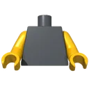{ .lu-ti width="24" loading="lazy" } [Short Sleeve Shirt (LOT 4254)](../4254.md) | 1 | No client description | 32 matrices; 0 rewards; 0 community references |
| 4288 | 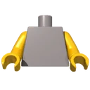{ .lu-ti width="24" loading="lazy" } [Short Sleeve Shirt (LOT 4288)](../4288.md) | 1 | No client description | 32 matrices; 0 rewards; 0 community references |
| 4322 | 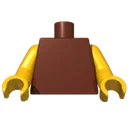{ .lu-ti width="24" loading="lazy" } [Short Sleeve Shirt (LOT 4322)](../4322.md) | 1 | No client description | 32 matrices; 0 rewards; 0 community references |
| 4356 | 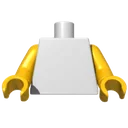{ .lu-ti width="24" loading="lazy" } [Short Sleeve Shirt (LOT 4356)](../4356.md) | 1 | No client description | 32 matrices; 0 rewards; 0 community references |
| 4390 | 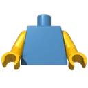{ .lu-ti width="24" loading="lazy" } [Short Sleeve Shirt (LOT 4390)](../4390.md) | 1 | No client description | 32 matrices; 0 rewards; 0 community references |
| 4424 | { .lu-ti width="24" loading="lazy" } [Short Sleeve Shirt (LOT 4424)](../4424.md) | 1 | No client description | 32 matrices; 0 rewards; 0 community references |
| 4458 | { .lu-ti width="24" loading="lazy" } [Short Sleeve Shirt (LOT 4458)](../4458.md) | 1 | No client description | 32 matrices; 0 rewards; 0 community references |
| 4492 | { .lu-ti width="24" loading="lazy" } [Short Sleeve Shirt (LOT 4492)](../4492.md) | 1 | No client description | 32 matrices; 0 rewards; 0 community references |
| 4526 | { .lu-ti width="24" loading="lazy" } [Short Sleeve Shirt (LOT 4526)](../4526.md) | 1 | No client description | 32 matrices; 0 rewards; 0 community references |
| 4560 | 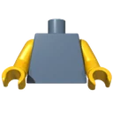{ .lu-ti width="24" loading="lazy" } [Short Sleeve Shirt (LOT 4560)](../4560.md) | 1 | No client description | 32 matrices; 0 rewards; 0 community references |
| 4594 | 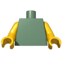{ .lu-ti width="24" loading="lazy" } [Short Sleeve Shirt (LOT 4594)](../4594.md) | 1 | No client description | 32 matrices; 0 rewards; 0 community references |
| 13751 | [Skeleton Disguise Shirt Proxy (LOT 13751)](../13751.md) | 1 | Usedin Nexus Tower Mission Chains | 0 matrices; 0 rewards; 0 community references |
| 14113 | 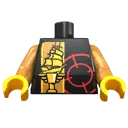{ .lu-ti width="24" loading="lazy" } [Skyme's Shirt (LOT 14113)](../14113.md) | 4 | No client description | 0 matrices; 0 rewards; 0 community references |
| 12298 | { .lu-ti width="24" loading="lazy" } [Snowy Tree Shirt (LOT 12298)](../12298.md) | 2 | No client description | 0 matrices; 1 rewards; 0 community references |
| 7373 | { .lu-ti width="24" loading="lazy" } [Sorcerer Breastplate 1 (LOT 7373)](../7373.md) | 4 | Rank 1 Specialty Kit Item | 2 matrices; 0 rewards; 0 community references |
| 7374 | 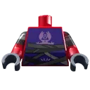{ .lu-ti width="24" loading="lazy" } [Sorcerer Breastplate 2 (LOT 7374)](../7374.md) | 4 | Rank 2 Specialty Kit Item | 1 matrices; 0 rewards; 0 community references |
| 7375 | 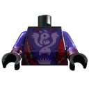{ .lu-ti width="24" loading="lazy" } [Sorcerer Breastplate 3 (LOT 7375)](../7375.md) | 4 | Rank 3 Specialty Kit Item | 1 matrices; 0 rewards; 0 community references |
| 12958 | 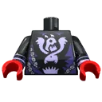{ .lu-ti width="24" loading="lazy" } [Sorcerer Breastplate 3 (LOT 12958)](../12958.md) | 4 | Rank 3 Specialty Kit Item | 1 matrices; 0 rewards; 0 community references |
| 5734 | { .lu-ti width="24" loading="lazy" } [Space Jacket (LOT 5734)](../5734.md) | 1 | No client description | 32 matrices; 0 rewards; 0 community references |
| 5740 | { .lu-ti width="24" loading="lazy" } [Space Jacket (LOT 5740)](../5740.md) | 1 | No client description | 32 matrices; 0 rewards; 0 community references |
| 5746 | { .lu-ti width="24" loading="lazy" } [Space Jacket (LOT 5746)](../5746.md) | 1 | No client description | 0 matrices; 0 rewards; 0 community references |
| 5752 | { .lu-ti width="24" loading="lazy" } [Space Jacket (LOT 5752)](../5752.md) | 1 | No client description | 32 matrices; 0 rewards; 0 community references |
| 5758 | { .lu-ti width="24" loading="lazy" } [Space Jacket (LOT 5758)](../5758.md) | 1 | No client description | 32 matrices; 0 rewards; 0 community references |
| 5764 | { .lu-ti width="24" loading="lazy" } [Space Jacket (LOT 5764)](../5764.md) | 1 | No client description | 32 matrices; 0 rewards; 0 community references |
| 5770 | { .lu-ti width="24" loading="lazy" } [Space Jacket (LOT 5770)](../5770.md) | 1 | No client description | 32 matrices; 0 rewards; 0 community references |
| 5776 | { .lu-ti width="24" loading="lazy" } [Space Jacket (LOT 5776)](../5776.md) | 1 | No client description | 32 matrices; 0 rewards; 0 community references |
| 5782 | { .lu-ti width="24" loading="lazy" } [Space Jacket (LOT 5782)](../5782.md) | 1 | No client description | 32 matrices; 0 rewards; 0 community references |
| 5788 | { .lu-ti width="24" loading="lazy" } [Space Jacket (LOT 5788)](../5788.md) | 1 | No client description | 32 matrices; 0 rewards; 0 community references |
| 5794 | { .lu-ti width="24" loading="lazy" } [Space Jacket (LOT 5794)](../5794.md) | 1 | No client description | 32 matrices; 0 rewards; 0 community references |
| 5800 | { .lu-ti width="24" loading="lazy" } [Space Jacket (LOT 5800)](../5800.md) | 1 | No client description | 32 matrices; 0 rewards; 0 community references |
| 5806 | { .lu-ti width="24" loading="lazy" } [Space Jacket (LOT 5806)](../5806.md) | 1 | No client description | 32 matrices; 0 rewards; 0 community references |
| 5812 | { .lu-ti width="24" loading="lazy" } [Space Jacket (LOT 5812)](../5812.md) | 1 | No client description | 32 matrices; 0 rewards; 0 community references |
| 5818 | { .lu-ti width="24" loading="lazy" } [Space Jacket (LOT 5818)](../5818.md) | 1 | No client description | 32 matrices; 0 rewards; 0 community references |
| 5824 | { .lu-ti width="24" loading="lazy" } [Space Jacket (LOT 5824)](../5824.md) | 1 | No client description | 32 matrices; 0 rewards; 0 community references |
| 5830 | { .lu-ti width="24" loading="lazy" } [Space Jacket (LOT 5830)](../5830.md) | 1 | No client description | 32 matrices; 0 rewards; 0 community references |
| 7472 | 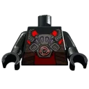{ .lu-ti width="24" loading="lazy" } [Space Marauder Jacket 1 (LOT 7472)](../7472.md) | 4 | Rank 1 Specialty Kit Item | 2 matrices; 0 rewards; 0 community references |
| 7473 | { .lu-ti width="24" loading="lazy" } [Space Marauder Jacket 2 (LOT 7473)](../7473.md) | 4 | Rank 2 Specialty Kit Item | 1 matrices; 0 rewards; 0 community references |
| 7474 | 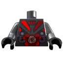{ .lu-ti width="24" loading="lazy" } [Space Marauder Jacket 3 (LOT 7474)](../7474.md) | 4 | Rank 3 Specialty Kit Item | 1 matrices; 0 rewards; 0 community references |
| 12960 | { .lu-ti width="24" loading="lazy" } [Space Marauder Jacket 3 (LOT 12960)](../12960.md) | 4 | Rank 3 Specialty Kit Item | 1 matrices; 0 rewards; 0 community references |
| 7466 | { .lu-ti width="24" loading="lazy" } [Space Ranger Armor 1 (LOT 7466)](../7466.md) | 4 | Rank 1 Specialty Kit Item | 2 matrices; 0 rewards; 0 community references |
| 7467 | 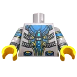{ .lu-ti width="24" loading="lazy" } [Space Ranger Armor 2 (LOT 7467)](../7467.md) | 4 | Rank 2 Specialty Kit Item | 1 matrices; 0 rewards; 0 community references |
| 7468 | 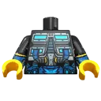{ .lu-ti width="24" loading="lazy" } [Space Ranger Armor 3 (LOT 7468)](../7468.md) | 4 | Rank 3 Specialty Kit Item | 1 matrices; 0 rewards; 0 community references |
| 4066 | { .lu-ti width="24" loading="lazy" } [Sparkle Tank Top (LOT 4066)](../4066.md) | 1 | No client description | 32 matrices; 0 rewards; 0 community references |
| 4100 | { .lu-ti width="24" loading="lazy" } [Sparkle Tank Top (LOT 4100)](../4100.md) | 1 | No client description | 32 matrices; 0 rewards; 0 community references |
| 4134 | 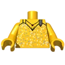{ .lu-ti width="24" loading="lazy" } [Sparkle Tank Top (LOT 4134)](../4134.md) | 1 | No client description | 0 matrices; 0 rewards; 0 community references |
| 4168 | { .lu-ti width="24" loading="lazy" } [Sparkle Tank Top (LOT 4168)](../4168.md) | 1 | No client description | 32 matrices; 0 rewards; 0 community references |
| 4202 | { .lu-ti width="24" loading="lazy" } [Sparkle Tank Top (LOT 4202)](../4202.md) | 1 | No client description | 32 matrices; 0 rewards; 0 community references |
| 4236 | { .lu-ti width="24" loading="lazy" } [Sparkle Tank Top (LOT 4236)](../4236.md) | 1 | No client description | 32 matrices; 0 rewards; 0 community references |
| 4270 | { .lu-ti width="24" loading="lazy" } [Sparkle Tank Top (LOT 4270)](../4270.md) | 1 | No client description | 32 matrices; 0 rewards; 0 community references |
| 4304 | { .lu-ti width="24" loading="lazy" } [Sparkle Tank Top (LOT 4304)](../4304.md) | 1 | No client description | 32 matrices; 0 rewards; 0 community references |
| 4338 | { .lu-ti width="24" loading="lazy" } [Sparkle Tank Top (LOT 4338)](../4338.md) | 1 | No client description | 32 matrices; 0 rewards; 0 community references |
| 4372 | { .lu-ti width="24" loading="lazy" } [Sparkle Tank Top (LOT 4372)](../4372.md) | 1 | No client description | 32 matrices; 0 rewards; 0 community references |
| 4406 | { .lu-ti width="24" loading="lazy" } [Sparkle Tank Top (LOT 4406)](../4406.md) | 1 | No client description | 32 matrices; 0 rewards; 0 community references |
| 4440 | { .lu-ti width="24" loading="lazy" } [Sparkle Tank Top (LOT 4440)](../4440.md) | 1 | No client description | 32 matrices; 0 rewards; 0 community references |
| 4474 | { .lu-ti width="24" loading="lazy" } [Sparkle Tank Top (LOT 4474)](../4474.md) | 1 | No client description | 32 matrices; 0 rewards; 0 community references |
| 4508 | { .lu-ti width="24" loading="lazy" } [Sparkle Tank Top (LOT 4508)](../4508.md) | 1 | No client description | 32 matrices; 0 rewards; 0 community references |
| 4542 | { .lu-ti width="24" loading="lazy" } [Sparkle Tank Top (LOT 4542)](../4542.md) | 1 | No client description | 32 matrices; 0 rewards; 0 community references |
| 4576 | { .lu-ti width="24" loading="lazy" } [Sparkle Tank Top (LOT 4576)](../4576.md) | 1 | No client description | 32 matrices; 0 rewards; 0 community references |
| 4610 | { .lu-ti width="24" loading="lazy" } [Sparkle Tank Top (LOT 4610)](../4610.md) | 1 | No client description | 32 matrices; 0 rewards; 0 community references |
| 14105 | { .lu-ti width="24" loading="lazy" } [Spiderling Shirt (LOT 14105)](../14105.md) | 3 | No client description | 0 matrices; 0 rewards; 0 community references |
| 4080 | { .lu-ti width="24" loading="lazy" } [Starry Tank Top (LOT 4080)](../4080.md) | 1 | No client description | 32 matrices; 0 rewards; 0 community references |
| 4114 | { .lu-ti width="24" loading="lazy" } [Starry Tank Top (LOT 4114)](../4114.md) | 1 | No client description | 32 matrices; 0 rewards; 0 community references |
| 4148 | { .lu-ti width="24" loading="lazy" } [Starry Tank Top (LOT 4148)](../4148.md) | 1 | No client description | 0 matrices; 0 rewards; 0 community references |
| 4182 | { .lu-ti width="24" loading="lazy" } [Starry Tank Top (LOT 4182)](../4182.md) | 1 | No client description | 32 matrices; 0 rewards; 0 community references |
| 4216 | { .lu-ti width="24" loading="lazy" } [Starry Tank Top (LOT 4216)](../4216.md) | 1 | No client description | 32 matrices; 0 rewards; 0 community references |
| 4250 | { .lu-ti width="24" loading="lazy" } [Starry Tank Top (LOT 4250)](../4250.md) | 1 | No client description | 32 matrices; 0 rewards; 0 community references |
| 4284 | 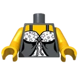{ .lu-ti width="24" loading="lazy" } [Starry Tank Top (LOT 4284)](../4284.md) | 1 | No client description | 32 matrices; 0 rewards; 0 community references |
| 4318 | { .lu-ti width="24" loading="lazy" } [Starry Tank Top (LOT 4318)](../4318.md) | 1 | No client description | 32 matrices; 0 rewards; 0 community references |
| 4352 | { .lu-ti width="24" loading="lazy" } [Starry Tank Top (LOT 4352)](../4352.md) | 1 | No client description | 32 matrices; 0 rewards; 0 community references |
| 4420 | { .lu-ti width="24" loading="lazy" } [Starry Tank Top (LOT 4420)](../4420.md) | 1 | No client description | 32 matrices; 0 rewards; 0 community references |
| 4454 | { .lu-ti width="24" loading="lazy" } [Starry Tank Top (LOT 4454)](../4454.md) | 1 | No client description | 32 matrices; 0 rewards; 0 community references |
| 4488 | { .lu-ti width="24" loading="lazy" } [Starry Tank Top (LOT 4488)](../4488.md) | 1 | No client description | 32 matrices; 0 rewards; 0 community references |
| 4522 | { .lu-ti width="24" loading="lazy" } [Starry Tank Top (LOT 4522)](../4522.md) | 1 | No client description | 32 matrices; 0 rewards; 0 community references |
| 4556 | { .lu-ti width="24" loading="lazy" } [Starry Tank Top (LOT 4556)](../4556.md) | 1 | No client description | 32 matrices; 0 rewards; 0 community references |
| 4590 | { .lu-ti width="24" loading="lazy" } [Starry Tank Top (LOT 4590)](../4590.md) | 1 | No client description | 32 matrices; 0 rewards; 0 community references |
| 4624 | 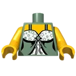{ .lu-ti width="24" loading="lazy" } [Starry Tank Top (LOT 4624)](../4624.md) | 1 | No client description | 32 matrices; 0 rewards; 0 community references |
| 6230 | { .lu-ti width="24" loading="lazy" } [Steampunk Rocket Shirt (LOT 6230)](../6230.md) | 3 | No client description | 0 matrices; 1 rewards; 1 community references |
| 5735 | { .lu-ti width="24" loading="lazy" } [Striped Shirt (LOT 5735)](../5735.md) | 1 | No client description | 32 matrices; 0 rewards; 0 community references |
| 5741 | { .lu-ti width="24" loading="lazy" } [Striped Shirt (LOT 5741)](../5741.md) | 1 | No client description | 32 matrices; 0 rewards; 0 community references |
| 5747 | { .lu-ti width="24" loading="lazy" } [Striped Shirt (LOT 5747)](../5747.md) | 1 | No client description | 0 matrices; 0 rewards; 0 community references |
| 5753 | { .lu-ti width="24" loading="lazy" } [Striped Shirt (LOT 5753)](../5753.md) | 1 | No client description | 32 matrices; 0 rewards; 0 community references |
| 5759 | { .lu-ti width="24" loading="lazy" } [Striped Shirt (LOT 5759)](../5759.md) | 1 | No client description | 32 matrices; 0 rewards; 0 community references |
| 5765 | { .lu-ti width="24" loading="lazy" } [Striped Shirt (LOT 5765)](../5765.md) | 1 | No client description | 32 matrices; 0 rewards; 0 community references |
| 5771 | 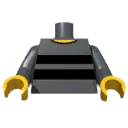{ .lu-ti width="24" loading="lazy" } [Striped Shirt (LOT 5771)](../5771.md) | 1 | No client description | 32 matrices; 0 rewards; 0 community references |
| 5777 | { .lu-ti width="24" loading="lazy" } [Striped Shirt (LOT 5777)](../5777.md) | 1 | No client description | 32 matrices; 0 rewards; 0 community references |
| 5783 | { .lu-ti width="24" loading="lazy" } [Striped Shirt (LOT 5783)](../5783.md) | 1 | No client description | 32 matrices; 0 rewards; 0 community references |
| 5789 | { .lu-ti width="24" loading="lazy" } [Striped Shirt (LOT 5789)](../5789.md) | 1 | No client description | 32 matrices; 0 rewards; 0 community references |
| 5795 | { .lu-ti width="24" loading="lazy" } [Striped Shirt (LOT 5795)](../5795.md) | 1 | No client description | 32 matrices; 0 rewards; 0 community references |
| 5801 | { .lu-ti width="24" loading="lazy" } [Striped Shirt (LOT 5801)](../5801.md) | 1 | No client description | 32 matrices; 0 rewards; 0 community references |
| 5807 | { .lu-ti width="24" loading="lazy" } [Striped Shirt (LOT 5807)](../5807.md) | 1 | No client description | 32 matrices; 0 rewards; 0 community references |
| 5813 | { .lu-ti width="24" loading="lazy" } [Striped Shirt (LOT 5813)](../5813.md) | 1 | No client description | 32 matrices; 0 rewards; 0 community references |
| 5819 | { .lu-ti width="24" loading="lazy" } [Striped Shirt (LOT 5819)](../5819.md) | 1 | No client description | 32 matrices; 0 rewards; 0 community references |
| 5825 | { .lu-ti width="24" loading="lazy" } [Striped Shirt (LOT 5825)](../5825.md) | 1 | No client description | 32 matrices; 0 rewards; 0 community references |
| 5831 | { .lu-ti width="24" loading="lazy" } [Striped Shirt (LOT 5831)](../5831.md) | 1 | No client description | 32 matrices; 0 rewards; 0 community references |
| 3863 | { .lu-ti width="24" loading="lazy" } [Striped Skunk Shirt (LOT 3863)](../3863.md) | 2 | No client description | 1 matrices; 0 rewards; 1 community references |
| 4058 | { .lu-ti width="24" loading="lazy" } [Striped Zipper Jacket (LOT 4058)](../4058.md) | 1 | No client description | 32 matrices; 0 rewards; 0 community references |
| 4092 | { .lu-ti width="24" loading="lazy" } [Striped Zipper Jacket (LOT 4092)](../4092.md) | 1 | No client description | 32 matrices; 0 rewards; 0 community references |
| 4126 | { .lu-ti width="24" loading="lazy" } [Striped Zipper Jacket (LOT 4126)](../4126.md) | 1 | No client description | 0 matrices; 0 rewards; 0 community references |
| 4160 | { .lu-ti width="24" loading="lazy" } [Striped Zipper Jacket (LOT 4160)](../4160.md) | 1 | No client description | 32 matrices; 0 rewards; 0 community references |
| 4194 | { .lu-ti width="24" loading="lazy" } [Striped Zipper Jacket (LOT 4194)](../4194.md) | 1 | No client description | 32 matrices; 0 rewards; 0 community references |
| 4228 | { .lu-ti width="24" loading="lazy" } [Striped Zipper Jacket (LOT 4228)](../4228.md) | 1 | No client description | 32 matrices; 0 rewards; 0 community references |
| 4262 | { .lu-ti width="24" loading="lazy" } [Striped Zipper Jacket (LOT 4262)](../4262.md) | 1 | No client description | 32 matrices; 0 rewards; 0 community references |
| 4296 | { .lu-ti width="24" loading="lazy" } [Striped Zipper Jacket (LOT 4296)](../4296.md) | 1 | No client description | 32 matrices; 0 rewards; 0 community references |
| 4330 | { .lu-ti width="24" loading="lazy" } [Striped Zipper Jacket (LOT 4330)](../4330.md) | 1 | No client description | 32 matrices; 0 rewards; 0 community references |
| 4364 | { .lu-ti width="24" loading="lazy" } [Striped Zipper Jacket (LOT 4364)](../4364.md) | 1 | No client description | 32 matrices; 0 rewards; 0 community references |
| 4398 | { .lu-ti width="24" loading="lazy" } [Striped Zipper Jacket (LOT 4398)](../4398.md) | 1 | No client description | 32 matrices; 0 rewards; 0 community references |
| 4432 | { .lu-ti width="24" loading="lazy" } [Striped Zipper Jacket (LOT 4432)](../4432.md) | 1 | No client description | 32 matrices; 0 rewards; 0 community references |
| 4466 | { .lu-ti width="24" loading="lazy" } [Striped Zipper Jacket (LOT 4466)](../4466.md) | 1 | No client description | 32 matrices; 0 rewards; 0 community references |
| 4500 | { .lu-ti width="24" loading="lazy" } [Striped Zipper Jacket (LOT 4500)](../4500.md) | 1 | No client description | 32 matrices; 0 rewards; 0 community references |
| 4534 | { .lu-ti width="24" loading="lazy" } [Striped Zipper Jacket (LOT 4534)](../4534.md) | 1 | No client description | 32 matrices; 0 rewards; 0 community references |
| 4568 | { .lu-ti width="24" loading="lazy" } [Striped Zipper Jacket (LOT 4568)](../4568.md) | 1 | No client description | 32 matrices; 0 rewards; 0 community references |
| 4602 | { .lu-ti width="24" loading="lazy" } [Striped Zipper Jacket (LOT 4602)](../4602.md) | 1 | No client description | 32 matrices; 0 rewards; 0 community references |
| 5844 | { .lu-ti width="24" loading="lazy" } [Stromling Defeater Shirt (LOT 5844)](../5844.md) | 3 | No client description | 0 matrices; 1 rewards; 0 community references |
| 14106 | { .lu-ti width="24" loading="lazy" } [Stromling Shirt (LOT 14106)](../14106.md) | 3 | No client description | 0 matrices; 0 rewards; 0 community references |
| 7481 | { .lu-ti width="24" loading="lazy" } [Summoner Robe 1 (LOT 7481)](../7481.md) | 4 | Rank 1 Specialty Kit Item | 2 matrices; 0 rewards; 0 community references |
| 7482 | { .lu-ti width="24" loading="lazy" } [Summoner Robe 2 (LOT 7482)](../7482.md) | 4 | Rank 2 Specialty Kit Item | 1 matrices; 0 rewards; 0 community references |
| 7483 | { .lu-ti width="24" loading="lazy" } [Summoner Robe 3 (LOT 7483)](../7483.md) | 4 | Rank 3 Specialty Kit Item | 1 matrices; 0 rewards; 0 community references |
| 12945 | 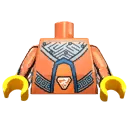{ .lu-ti width="24" loading="lazy" } [Summoner Robe 3 (LOT 12945)](../12945.md) | 4 | Rank 3 Specialty Kit Item | 1 matrices; 0 rewards; 0 community references |
| 14104 | 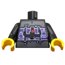{ .lu-ti width="24" loading="lazy" } [Survival Mech Shirt (LOT 14104)](../14104.md) | 4 | No client description | 0 matrices; 0 rewards; 0 community references |
| 12630 | { .lu-ti width="24" loading="lazy" } [T-Rex Shirt (LOT 12630)](../12630.md) | 3 | No client description | 0 matrices; 1 rewards; 1 community references |
| 6928 | { .lu-ti width="24" loading="lazy" } [T-Shirt of Protection (LOT 6928)](../6928.md) | 2 | No client description | 1 matrices; 1 rewards; 0 community references |
| 7739 | { .lu-ti width="24" loading="lazy" } [Target Duck Shirt (LOT 7739)](../7739.md) | 2 | No client description | 0 matrices; 1 rewards; 0 community references |
| 2855 | [Test Contest Board (LOT 2855)](../2855.md) | 5 | No client description | 0 matrices; 0 rewards; 0 community references |
| 7635 | { .lu-ti width="24" loading="lazy" } [Test NPC Assembly Grunt Shirt (LOT 7635)](../7635.md) | 5 | For Demo purposes only | 0 matrices; 0 rewards; 0 community references |
| 7632 | { .lu-ti width="24" loading="lazy" } [Test NPC Beck Shirt (LOT 7632)](../7632.md) | 5 | For Demo purposes only | 0 matrices; 0 rewards; 0 community references |
| 7633 | { .lu-ti width="24" loading="lazy" } [Test NPC Epsilon Shirt (LOT 7633)](../7633.md) | 5 | For Demo purposes only | 0 matrices; 0 rewards; 0 community references |
| 7628 | { .lu-ti width="24" loading="lazy" } [Test NPC Grunt Shirt (LOT 7628)](../7628.md) | 5 | For Demo purposes only | 0 matrices; 0 rewards; 0 community references |
| 7634 | { .lu-ti width="24" loading="lazy" } [Test NPC Rene Shirt (LOT 7634)](../7634.md) | 5 | For Demo purposes only | 0 matrices; 0 rewards; 0 community references |
| 7631 | { .lu-ti width="24" loading="lazy" } [Test NPC Sentinel Scout Shirt (LOT 7631)](../7631.md) | 5 | For Demo purposes only | 0 matrices; 0 rewards; 0 community references |
| 7629 | { .lu-ti width="24" loading="lazy" } [Test NPC Skylane Shirt (LOT 7629)](../7629.md) | 5 | For Demo purposes only | 0 matrices; 0 rewards; 0 community references |
| 7636 | { .lu-ti width="24" loading="lazy" } [Test NPC Venture Grunt Shirt (LOT 7636)](../7636.md) | 5 | For Demo purposes only | 0 matrices; 0 rewards; 0 community references |
| 7630 | { .lu-ti width="24" loading="lazy" } [Test NPC Wisp Shirt (LOT 7630)](../7630.md) | 5 | For Demo purposes only | 0 matrices; 0 rewards; 0 community references |
| 13979 | { .lu-ti width="24" loading="lazy" } [Test Rank 1 Shirt (LOT 13979)](../13979.md) | 4 | No client description | 0 matrices; 0 rewards; 0 community references |
| 13980 | { .lu-ti width="24" loading="lazy" } [Test Rank 2 Shirt (LOT 13980)](../13980.md) | 4 | No client description | 0 matrices; 0 rewards; 0 community references |
| 13991 | { .lu-ti width="24" loading="lazy" } [Test Rank 3 Shirt (LOT 13991)](../13991.md) | 4 | No client description | 0 matrices; 0 rewards; 0 community references |
| 7627 | { .lu-ti width="24" loading="lazy" } [Test Rusty's Pantsuit (LOT 7627)](../7627.md) | 5 | For Demo purposes only | 0 matrices; 0 rewards; 0 community references |
| 10045 | { .lu-ti width="24" loading="lazy" } [TEST Shirt (LOT 10045)](../10045.md) | 5 | Brett test object | 0 matrices; 0 rewards; 0 community references |
| 6645 | { .lu-ti width="24" loading="lazy" } [Test Shirt of Uber Armor - 15pts (LOT 6645)](../6645.md) | 5 | Gives 15 points of armor | 0 matrices; 0 rewards; 0 community references |
| 4065 | { .lu-ti width="24" loading="lazy" } [Textured Polo Shirt (LOT 4065)](../4065.md) | 1 | No client description | 32 matrices; 0 rewards; 0 community references |
| 4099 | { .lu-ti width="24" loading="lazy" } [Textured Polo Shirt (LOT 4099)](../4099.md) | 1 | No client description | 32 matrices; 0 rewards; 0 community references |
| 4133 | { .lu-ti width="24" loading="lazy" } [Textured Polo Shirt (LOT 4133)](../4133.md) | 1 | No client description | 0 matrices; 0 rewards; 0 community references |
| 4167 | { .lu-ti width="24" loading="lazy" } [Textured Polo Shirt (LOT 4167)](../4167.md) | 1 | No client description | 32 matrices; 0 rewards; 0 community references |
| 4201 | { .lu-ti width="24" loading="lazy" } [Textured Polo Shirt (LOT 4201)](../4201.md) | 1 | No client description | 32 matrices; 0 rewards; 0 community references |
| 4235 | { .lu-ti width="24" loading="lazy" } [Textured Polo Shirt (LOT 4235)](../4235.md) | 1 | No client description | 32 matrices; 0 rewards; 0 community references |
| 4269 | { .lu-ti width="24" loading="lazy" } [Textured Polo Shirt (LOT 4269)](../4269.md) | 1 | No client description | 32 matrices; 0 rewards; 0 community references |
| 4303 | { .lu-ti width="24" loading="lazy" } [Textured Polo Shirt (LOT 4303)](../4303.md) | 1 | No client description | 32 matrices; 0 rewards; 0 community references |
| 4337 | { .lu-ti width="24" loading="lazy" } [Textured Polo Shirt (LOT 4337)](../4337.md) | 1 | No client description | 32 matrices; 0 rewards; 0 community references |
| 4371 | { .lu-ti width="24" loading="lazy" } [Textured Polo Shirt (LOT 4371)](../4371.md) | 1 | No client description | 32 matrices; 0 rewards; 0 community references |
| 4405 | { .lu-ti width="24" loading="lazy" } [Textured Polo Shirt (LOT 4405)](../4405.md) | 1 | No client description | 32 matrices; 0 rewards; 0 community references |
| 4439 | { .lu-ti width="24" loading="lazy" } [Textured Polo Shirt (LOT 4439)](../4439.md) | 1 | No client description | 32 matrices; 0 rewards; 0 community references |
| 4473 | { .lu-ti width="24" loading="lazy" } [Textured Polo Shirt (LOT 4473)](../4473.md) | 1 | No client description | 32 matrices; 0 rewards; 0 community references |
| 4507 | { .lu-ti width="24" loading="lazy" } [Textured Polo Shirt (LOT 4507)](../4507.md) | 1 | No client description | 32 matrices; 0 rewards; 0 community references |
| 4541 | { .lu-ti width="24" loading="lazy" } [Textured Polo Shirt (LOT 4541)](../4541.md) | 1 | No client description | 32 matrices; 0 rewards; 0 community references |
| 4575 | { .lu-ti width="24" loading="lazy" } [Textured Polo Shirt (LOT 4575)](../4575.md) | 1 | No client description | 32 matrices; 0 rewards; 0 community references |
| 4609 | { .lu-ti width="24" loading="lazy" } [Textured Polo Shirt (LOT 4609)](../4609.md) | 1 | No client description | 32 matrices; 0 rewards; 0 community references |
| 2959 | { .lu-ti width="24" loading="lazy" } [Throwing Star Shirt (LOT 2959)](../2959.md) | 2 | No client description | 18 matrices; 0 rewards; 1 community references |
| 12312 | { .lu-ti width="24" loading="lazy" } [Tie Dye Shirt (LOT 12312)](../12312.md) | 1 | No client description | 4 matrices; 0 rewards; 1 community references |
| 12715 | { .lu-ti width="24" loading="lazy" } [Tiki Batik Shirt (LOT 12715)](../12715.md) | 4 | No client description | 40 matrices; 0 rewards; 1 community references |
| 12709 | { .lu-ti width="24" loading="lazy" } [Tire Tracks shirt (LOT 12709)](../12709.md) | 3 | No client description | 1 matrices; 0 rewards; 1 community references |
| 12755 | { .lu-ti width="24" loading="lazy" } [Tribal Shirt (LOT 12755)](../12755.md) | 2 | No client description | 0 matrices; 1 rewards; 0 community references |
| 8347 | 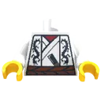{ .lu-ti width="24" loading="lazy" } [Twin Dragons Kimono (LOT 8347)](../8347.md) | 3 | No client description | 0 matrices; 1 rewards; 0 community references |
| 8630 | { .lu-ti width="24" loading="lazy" } [Union Shirt (LOT 8630)](../8630.md) | 3 | No client description | 11 matrices; 0 rewards; 1 community references |
| 10128 | 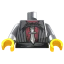{ .lu-ti width="24" loading="lazy" } [Vampire Shirt (LOT 10128)](../10128.md) | 3 | No client description | 0 matrices; 1 rewards; 0 community references |
| 14360 | { .lu-ti width="24" loading="lazy" } [Venture Gear - Daredevil - chest proxy (LOT 14360)](../14360.md) | 4 | No client description | 0 matrices; 0 rewards; 0 community references |
| 8620 | { .lu-ti width="24" loading="lazy" } [Viking Barbarian Shirt (LOT 8620)](../8620.md) | 2 | No client description | 19 matrices; 0 rewards; 1 community references |
| 12702 | 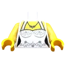{ .lu-ti width="24" loading="lazy" } [Wedding Dress (LOT 12702)](../12702.md) | 3 | No client description | 1 matrices; 0 rewards; 1 community references |
| 10130 | { .lu-ti width="24" loading="lazy" } [Weightlifter Shirt (LOT 10130)](../10130.md) | 2 | No client description | 1 matrices; 0 rewards; 1 community references |
| 6798 | { .lu-ti width="24" loading="lazy" } [White First Mate's Shirt (LOT 6798)](../6798.md) | 2 | No client description | 0 matrices; 1 rewards; 0 community references |
| 2957 | { .lu-ti width="24" loading="lazy" } [White Ninja Gi (LOT 2957)](../2957.md) | 2 | No client description | 0 matrices; 1 rewards; 1 community references |
| 2953 | { .lu-ti width="24" loading="lazy" } [White Pirate Ship Shirt (LOT 2953)](../2953.md) | 3 | No client description | 0 matrices; 1 rewards; 1 community references |
| 4386 | { .lu-ti width="24" loading="lazy" } [White Tank Top (LOT 4386)](../4386.md) | 1 | No client description | 32 matrices; 0 rewards; 0 community references |
| 10127 | { .lu-ti width="24" loading="lazy" } [Winged Wrench Shirt (LOT 10127)](../10127.md) | 2 | No client description | 0 matrices; 0 rewards; 0 community references |
| 12297 | { .lu-ti width="24" loading="lazy" } [Winter Sweater (LOT 12297)](../12297.md) | 3 | No client description | 1 matrices; 0 rewards; 0 community references |
| 7744 | { .lu-ti width="24" loading="lazy" } [Witch Robe (LOT 7744)](../7744.md) | 2 | No client description | 1 matrices; 0 rewards; 1 community references |
| 7749 | { .lu-ti width="24" loading="lazy" } [Wizard Tunic (LOT 7749)](../7749.md) | 2 | No client description | 1 matrices; 0 rewards; 1 community references |
| 7741 | 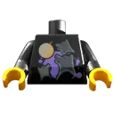{ .lu-ti width="24" loading="lazy" } [Wolves Shirt (LOT 7741)](../7741.md) | 2 | No client description | 0 matrices; 1 rewards; 0 community references |
| 16070 | 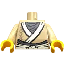{ .lu-ti width="24" loading="lazy" } [Worn Gi (LOT 16070)](../16070.md) | 2 | No client description | 27 matrices; 0 rewards; 1 community references |
| 4061 | { .lu-ti width="24" loading="lazy" } [Yellow Flower Shirt (LOT 4061)](../4061.md) | 1 | No client description | 32 matrices; 0 rewards; 0 community references |
| 4095 | { .lu-ti width="24" loading="lazy" } [Yellow Flower Shirt (LOT 4095)](../4095.md) | 1 | No client description | 32 matrices; 0 rewards; 0 community references |
| 4129 | { .lu-ti width="24" loading="lazy" } [Yellow Flower Shirt (LOT 4129)](../4129.md) | 1 | No client description | 0 matrices; 0 rewards; 0 community references |
| 4163 | { .lu-ti width="24" loading="lazy" } [Yellow Flower Shirt (LOT 4163)](../4163.md) | 1 | No client description | 32 matrices; 0 rewards; 0 community references |
| 4197 | { .lu-ti width="24" loading="lazy" } [Yellow Flower Shirt (LOT 4197)](../4197.md) | 1 | No client description | 32 matrices; 0 rewards; 0 community references |
| 4231 | { .lu-ti width="24" loading="lazy" } [Yellow Flower Shirt (LOT 4231)](../4231.md) | 1 | No client description | 32 matrices; 0 rewards; 0 community references |
| 4265 | { .lu-ti width="24" loading="lazy" } [Yellow Flower Shirt (LOT 4265)](../4265.md) | 1 | No client description | 32 matrices; 0 rewards; 0 community references |
| 4299 | { .lu-ti width="24" loading="lazy" } [Yellow Flower Shirt (LOT 4299)](../4299.md) | 1 | No client description | 32 matrices; 0 rewards; 0 community references |
| 4333 | { .lu-ti width="24" loading="lazy" } [Yellow Flower Shirt (LOT 4333)](../4333.md) | 1 | No client description | 32 matrices; 0 rewards; 0 community references |
| 4367 | { .lu-ti width="24" loading="lazy" } [Yellow Flower Shirt (LOT 4367)](../4367.md) | 1 | No client description | 32 matrices; 0 rewards; 0 community references |
| 4401 | { .lu-ti width="24" loading="lazy" } [Yellow Flower Shirt (LOT 4401)](../4401.md) | 1 | No client description | 32 matrices; 0 rewards; 0 community references |
| 4435 | { .lu-ti width="24" loading="lazy" } [Yellow Flower Shirt (LOT 4435)](../4435.md) | 1 | No client description | 32 matrices; 0 rewards; 0 community references |
| 4469 | { .lu-ti width="24" loading="lazy" } [Yellow Flower Shirt (LOT 4469)](../4469.md) | 1 | No client description | 32 matrices; 0 rewards; 0 community references |
| 4503 | { .lu-ti width="24" loading="lazy" } [Yellow Flower Shirt (LOT 4503)](../4503.md) | 1 | No client description | 32 matrices; 0 rewards; 0 community references |
| 4537 | { .lu-ti width="24" loading="lazy" } [Yellow Flower Shirt (LOT 4537)](../4537.md) | 1 | No client description | 32 matrices; 0 rewards; 0 community references |
| 4571 | { .lu-ti width="24" loading="lazy" } [Yellow Flower Shirt (LOT 4571)](../4571.md) | 1 | No client description | 32 matrices; 0 rewards; 0 community references |
| 4605 | { .lu-ti width="24" loading="lazy" } [Yellow Flower Shirt (LOT 4605)](../4605.md) | 1 | No client description | 32 matrices; 0 rewards; 0 community references |
| 2952 | { .lu-ti width="24" loading="lazy" } [Yellow Striped Crew Shirt (LOT 2952)](../2952.md) | 2 | No client description | 0 matrices; 1 rewards; 0 community references |
| 16635 | 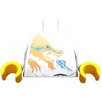{ .lu-ti width="24" loading="lazy" } [Zane's DX Gi of Frost (LOT 16635)](../16635.md) | 4 | Wear this to look like Zane DX! | 2 matrices; 0 rewards; 0 community references |
| 16064 | 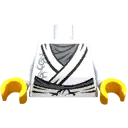{ .lu-ti width="24" loading="lazy" } [Zane's First Gi (LOT 16064)](../16064.md) | 2 | No client description | 0 matrices; 1 rewards; 1 community references |
| 16612 | 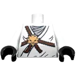{ .lu-ti width="24" loading="lazy" } [Zane's Gi of Frost (LOT 16612)](../16612.md) | 3 | Wear this to look like Zane! | 1 matrices; 0 rewards; 1 community references |
