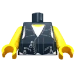

# Chest — page 6/6

[Item database](../README.md)

Pages: [1](type-15-1.md) | [2](type-15-2.md) | [3](type-15-3.md) | [4](type-15-4.md) | [5](type-15-5.md) | [6](type-15-6.md)

| LOT | Item | Rarity | Description | Source evidence |
| --- | --- | --- | --- | --- |
| 4064 | { .lu-ti width="24" loading="lazy" } [Zipper Jacket (LOT 4064)](../4064.md) | 1 | No client description | 32 matrices; 0 rewards; 0 community references |
| 4098 | { .lu-ti width="24" loading="lazy" } [Zipper Jacket (LOT 4098)](../4098.md) | 1 | No client description | 32 matrices; 0 rewards; 0 community references |
| 4132 | { .lu-ti width="24" loading="lazy" } [Zipper Jacket (LOT 4132)](../4132.md) | 1 | No client description | 0 matrices; 0 rewards; 0 community references |
| 4166 | { .lu-ti width="24" loading="lazy" } [Zipper Jacket (LOT 4166)](../4166.md) | 1 | No client description | 32 matrices; 0 rewards; 0 community references |
| 4200 | { .lu-ti width="24" loading="lazy" } [Zipper Jacket (LOT 4200)](../4200.md) | 1 | No client description | 32 matrices; 0 rewards; 0 community references |
| 4234 | { .lu-ti width="24" loading="lazy" } [Zipper Jacket (LOT 4234)](../4234.md) | 1 | No client description | 32 matrices; 0 rewards; 0 community references |
| 4268 | { .lu-ti width="24" loading="lazy" } [Zipper Jacket (LOT 4268)](../4268.md) | 1 | No client description | 32 matrices; 0 rewards; 0 community references |
| 4302 | { .lu-ti width="24" loading="lazy" } [Zipper Jacket (LOT 4302)](../4302.md) | 1 | No client description | 32 matrices; 0 rewards; 0 community references |
| 4336 | { .lu-ti width="24" loading="lazy" } [Zipper Jacket (LOT 4336)](../4336.md) | 1 | No client description | 32 matrices; 0 rewards; 0 community references |
| 4370 | { .lu-ti width="24" loading="lazy" } [Zipper Jacket (LOT 4370)](../4370.md) | 1 | No client description | 32 matrices; 0 rewards; 0 community references |
| 4404 | { .lu-ti width="24" loading="lazy" } [Zipper Jacket (LOT 4404)](../4404.md) | 1 | No client description | 32 matrices; 0 rewards; 0 community references |
| 4438 | { .lu-ti width="24" loading="lazy" } [Zipper Jacket (LOT 4438)](../4438.md) | 1 | No client description | 32 matrices; 0 rewards; 0 community references |
| 4472 | { .lu-ti width="24" loading="lazy" } [Zipper Jacket (LOT 4472)](../4472.md) | 1 | No client description | 32 matrices; 0 rewards; 0 community references |
| 4506 | { .lu-ti width="24" loading="lazy" } [Zipper Jacket (LOT 4506)](../4506.md) | 1 | No client description | 32 matrices; 0 rewards; 0 community references |
| 4540 | { .lu-ti width="24" loading="lazy" } [Zipper Jacket (LOT 4540)](../4540.md) | 1 | No client description | 32 matrices; 0 rewards; 0 community references |
| 4574 | { .lu-ti width="24" loading="lazy" } [Zipper Jacket (LOT 4574)](../4574.md) | 1 | No client description | 32 matrices; 0 rewards; 0 community references |
| 4608 | { .lu-ti width="24" loading="lazy" } [Zipper Jacket (LOT 4608)](../4608.md) | 1 | No client description | 32 matrices; 0 rewards; 0 community references |
| 8598 | { .lu-ti width="24" loading="lazy" } [Zippered Leather Jacket (LOT 8598)](../8598.md) | 3 | No client description | 0 matrices; 1 rewards; 1 community references |
