# Quest object — page 1/1

[Item database](../README.md)

Pages: [1](type-18-1.md)

| LOT | Item | Rarity | Description | Source evidence |
| --- | --- | --- | --- | --- |
| 7091 | { .lu-ti width="24" loading="lazy" } [Assembly Approval (LOT 7091)](../7091.md) | 1 | No client description | 0 matrices; 1 rewards; 0 community references |
| 7610 | { .lu-ti width="24" loading="lazy" } [Assembly Package (LOT 7610)](../7610.md) | 1 | No client description | 1 matrices; 0 rewards; 0 community references |
| 9641 | { .lu-ti width="24" loading="lazy" } [Broken Pirate Rocket Cockpit (LOT 9641)](../9641.md) | 1 | No client description | 1 matrices; 0 rewards; 0 community references |
| 9642 | { .lu-ti width="24" loading="lazy" } [Broken Pirate Rocket Engine (LOT 9642)](../9642.md) | 1 | No client description | 1 matrices; 0 rewards; 0 community references |
| 9640 | 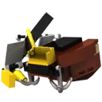{ .lu-ti width="24" loading="lazy" } [Broken Pirate Rocket Nose Cone (LOT 9640)](../9640.md) | 1 | No client description | 1 matrices; 0 rewards; 0 community references |
| 10507 | { .lu-ti width="24" loading="lazy" } [Carrot (LOT 10507)](../10507.md) | 3 | Carrot | 2 matrices; 0 rewards; 0 community references |
| 3981 | { .lu-ti width="24" loading="lazy" } [Coalessa's Flying Disc (LOT 3981)](../3981.md) | 1 | Return this to Coalessa! | 1 matrices; 0 rewards; 0 community references |
| 9701 | { .lu-ti width="24" loading="lazy" } [Concert flyers from Johnny Thunder (LOT 9701)](../9701.md) | 1 | No client description | 0 matrices; 0 rewards; 0 community references |
| 8686 | { .lu-ti width="24" loading="lazy" } [Dragon's Tooth (LOT 8686)](../8686.md) | 1 | Return this to Numb Chuck! | 4 matrices; 0 rewards; 0 community references |
| 7436 | 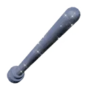{ .lu-ti width="24" loading="lazy" } [Hammer Brick 1 (LOT 7436)](../7436.md) | 1 | No client description | 1 matrices; 0 rewards; 0 community references |
| 7437 | 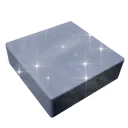{ .lu-ti width="24" loading="lazy" } [Hammer Brick 2 (LOT 7437)](../7437.md) | 1 | No client description | 1 matrices; 0 rewards; 0 community references |
| 7438 | 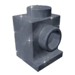{ .lu-ti width="24" loading="lazy" } [Hammer Brick 3 (LOT 7438)](../7438.md) | 1 | No client description | 1 matrices; 0 rewards; 0 community references |
| 7439 | 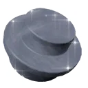{ .lu-ti width="24" loading="lazy" } [Hammer Brick 4 (LOT 7439)](../7439.md) | 1 | No client description | 1 matrices; 0 rewards; 0 community references |
| 11210 | 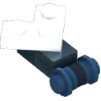{ .lu-ti width="24" loading="lazy" } [Jadeoria Fly (LOT 11210)](../11210.md) | 1 | Jadeoria Fly | 0 matrices; 0 rewards; 0 community references |
| 9715 | { .lu-ti width="24" loading="lazy" } [Maelstrom Goo (LOT 9715)](../9715.md) | 1 | Return this to Epsilon Starcracker! | 0 matrices; 0 rewards; 0 community references |
| 9931 | 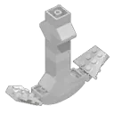{ .lu-ti width="24" loading="lazy" } [Maelstrom Infected Anchor (LOT 9931)](../9931.md) | 1 | No client description | 4 matrices; 0 rewards; 0 community references |
| 8652 | { .lu-ti width="24" loading="lazy" } [Map Piece 1 (LOT 8652)](../8652.md) | 1 | No client description | 0 matrices; 1 rewards; 0 community references |
| 8653 | { .lu-ti width="24" loading="lazy" } [Map Piece 2 (LOT 8653)](../8653.md) | 1 | No client description | 0 matrices; 1 rewards; 0 community references |
| 8654 | { .lu-ti width="24" loading="lazy" } [Map Piece 3 (LOT 8654)](../8654.md) | 1 | No client description | 0 matrices; 1 rewards; 0 community references |
| 11211 | 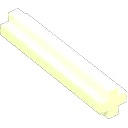{ .lu-ti width="24" loading="lazy" } [Moonbase Fuel Rod (LOT 11211)](../11211.md) | 3 | Moonbase Fuel Rod | 1 matrices; 0 rewards; 0 community references |
| 11300 | { .lu-ti width="24" loading="lazy" } [Nate the Snake (LOT 11300)](../11300.md) | 1 | Return Nate to Peppy Slapbiscuit | 2 matrices; 0 rewards; 0 community references |
| 6978 | { .lu-ti width="24" loading="lazy" } [Nexus Force Commendation (LOT 6978)](../6978.md) | 5 | Return this to your Faction Representative to get a Specialty Kit | 0 matrices; 1 rewards; 0 community references |
| 6979 | { .lu-ti width="24" loading="lazy" } [Nexus Force Commendation (LOT 6979)](../6979.md) | 5 | Return this to your Faction Representative to get a Specialty Kit | 0 matrices; 1 rewards; 0 community references |
| 6980 | { .lu-ti width="24" loading="lazy" } [Nexus Force Commendation (LOT 6980)](../6980.md) | 5 | Return this to your Faction Representative to get a Specialty Kit | 0 matrices; 1 rewards; 0 community references |
| 6981 | { .lu-ti width="24" loading="lazy" } [Nexus Force Commendation (LOT 6981)](../6981.md) | 5 | Return this to your Faction Representative to get a Specialty Kit | 0 matrices; 1 rewards; 0 community references |
| 8662 | { .lu-ti width="24" loading="lazy" } [Numb Chuck's Treasure (LOT 8662)](../8662.md) | 1 | A treasure looted by Captain Jack long ago! | 1 matrices; 0 rewards; 0 community references |
| 7092 | { .lu-ti width="24" loading="lazy" } [Paradox Approval (LOT 7092)](../7092.md) | 1 | No client description | 0 matrices; 1 rewards; 0 community references |
| 9275 | { .lu-ti width="24" loading="lazy" } [Picture of Jack Knife's Mom (LOT 9275)](../9275.md) | 1 | Return this to Captain Jack Knife! | 1 matrices; 0 rewards; 0 community references |
| 11209 | 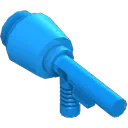{ .lu-ti width="24" loading="lazy" } [Robot City Welder (LOT 11209)](../11209.md) | 1 | Robot City Welder | 0 matrices; 1 rewards; 0 community references |
| 7093 | { .lu-ti width="24" loading="lazy" } [Sentinel Faction Approval (LOT 7093)](../7093.md) | 1 | No client description | 0 matrices; 1 rewards; 0 community references |
| 10508 | 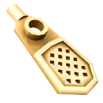{ .lu-ti width="24" loading="lazy" } [Snowshoe (LOT 10508)](../10508.md) | 3 | Snowshoe | 2 matrices; 0 rewards; 0 community references |
| 7433 | { .lu-ti width="24" loading="lazy" } [Story Tablet 1 (LOT 7433)](../7433.md) | 1 | Mission Item - Unused | 0 matrices; 0 rewards; 0 community references |
| 7434 | 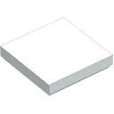{ .lu-ti width="24" loading="lazy" } [Story Tablet 2 (LOT 7434)](../7434.md) | 1 | Mission Item - Unused | 0 matrices; 0 rewards; 0 community references |
| 7435 | { .lu-ti width="24" loading="lazy" } [Story Tablet 3 (LOT 7435)](../7435.md) | 1 | Mission Item - Unused | 0 matrices; 0 rewards; 0 community references |
| 3907 | [unused Inventor's Widget (LOT 3907)](../3907.md) | 1 | Mission Item - Unused | 0 matrices; 0 rewards; 0 community references |
| 3480 | 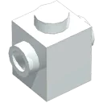{ .lu-ti width="24" loading="lazy" } [unused Quest Brick - 1x1 headlight brick (LOT 3480)](../3480.md) | 1 | Mission Item - Unused | 0 matrices; 0 rewards; 0 community references |
| 3479 | { .lu-ti width="24" loading="lazy" } [unused Quest Brick - 1x1 plate (LOT 3479)](../3479.md) | 1 | Mission Item - Unused | 0 matrices; 0 rewards; 0 community references |
| 3478 | { .lu-ti width="24" loading="lazy" } [unused Quest Brick - Plate 1x1 round (LOT 3478)](../3478.md) | 1 | Mission Item - Unused | 0 matrices; 0 rewards; 0 community references |
| 3508 | 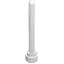{ .lu-ti width="24" loading="lazy" } [unused Quest Brick - Whip/Aerial (LOT 3508)](../3508.md) | 1 | Mission Item - Unused | 0 matrices; 0 rewards; 0 community references |
| 12547 | 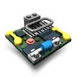{ .lu-ti width="24" loading="lazy" } [Venture Explorer Datacard (LOT 12547)](../12547.md) | 1 | Return this item to Epsilon Starcracker | 0 matrices; 0 rewards; 0 community references |
| 7090 | { .lu-ti width="24" loading="lazy" } [Venture League Approval (LOT 7090)](../7090.md) | 1 | No client description | 0 matrices; 1 rewards; 0 community references |
