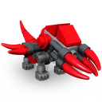
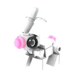
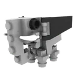
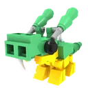
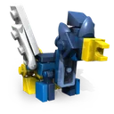
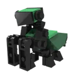
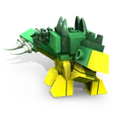
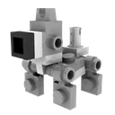
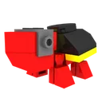

# Pet inventory item — page 1/1

[Item database](../README.md)

Pages: [1](type-19-1.md)

| LOT | Item | Rarity | Description | Source evidence |
| --- | --- | --- | --- | --- |
| 16479 | { .lu-ti width="24" loading="lazy" } [Unnamed LOT 16479 (LOT 16479)](../16479.md) | 1 | No client description | 0 matrices; 0 rewards; 0 community references |
| 6554 | [AG - Min Spec Pets (LOT 6554)](../6554.md) | 1 | Min spec test | 0 matrices; 0 rewards; 0 community references |
| 12434 | { .lu-ti width="24" loading="lazy" } [Alien Pet (LOT 12434)](../12434.md) | 1 | Tamable Pet | 0 matrices; 0 rewards; 0 community references |
| 5636 | { .lu-ti width="24" loading="lazy" } [Buffalo Pet (LOT 5636)](../5636.md) | 1 | Tamable Pet | 0 matrices; 0 rewards; 0 community references |
| 3672 | { .lu-ti width="24" loading="lazy" } [Bunny Pet (LOT 3672)](../3672.md) | 1 | Tamable Pet | 0 matrices; 0 rewards; 0 community references |
| 3054 | { .lu-ti width="24" loading="lazy" } [Cat Pet (LOT 3054)](../3054.md) | 1 | Tamable Pet | 0 matrices; 0 rewards; 0 community references |
| 7694 | { .lu-ti width="24" loading="lazy" } [Crab Pet (LOT 7694)](../7694.md) | 1 | Tamable Pet | 0 matrices; 0 rewards; 0 community references |
| 3994 | { .lu-ti width="24" loading="lazy" } [Crocodile Pet (LOT 3994)](../3994.md) | 1 | Tamable Pet | 0 matrices; 0 rewards; 0 community references |
| 5635 | { .lu-ti width="24" loading="lazy" } [Doberman Pet (LOT 5635)](../5635.md) | 1 | Tamable Pet | 0 matrices; 0 rewards; 0 community references |
| 16210 | { .lu-ti width="24" loading="lazy" } [Earth Dragon Pet (LOT 16210)](../16210.md) | 1 | Tamable Pet | 0 matrices; 0 rewards; 0 community references |
| 3050 | { .lu-ti width="24" loading="lazy" } [Elephant Pet (LOT 3050)](../3050.md) | 1 | Tamable Pet | 0 matrices; 0 rewards; 0 community references |
| 7638 | { .lu-ti width="24" loading="lazy" } [Goat Pet (LOT 7638)](../7638.md) | 1 | Tamable Pet | 0 matrices; 0 rewards; 0 community references |
| 5641 | { .lu-ti width="24" loading="lazy" } [Green Dragon Pet (LOT 5641)](../5641.md) | 1 | Tamable Pet | 0 matrices; 0 rewards; 0 community references |
| 12433 | { .lu-ti width="24" loading="lazy" } [Gryphon Pet (LOT 12433)](../12433.md) | 1 | Tamable Pet | 0 matrices; 0 rewards; 0 community references |
| 3520 | { .lu-ti width="24" loading="lazy" } [Lion Pet (LOT 3520)](../3520.md) | 1 | Tamable Pet | 0 matrices; 0 rewards; 0 community references |
| 5642 | { .lu-ti width="24" loading="lazy" } [Mantis Pet (LOT 5642)](../5642.md) | 1 | Tamable Pet | 0 matrices; 0 rewards; 0 community references |
| 5643 | { .lu-ti width="24" loading="lazy" } [Panda Pet (LOT 5643)](../5643.md) | 1 | Tamable Pet | 0 matrices; 0 rewards; 0 community references |
| 3903 | [Pet Inventory Item (LOT 3903)](../3903.md) | 1 | Template object for all tamable pets | 0 matrices; 0 rewards; 0 community references |
| 5639 | { .lu-ti width="24" loading="lazy" } [Red Dragon Pet (LOT 5639)](../5639.md) | 1 | Tamable Pet | 0 matrices; 0 rewards; 0 community references |
| 12294 | { .lu-ti width="24" loading="lazy" } [Reindeer (LOT 12294)](../12294.md) | 1 | Tamable Pet | 0 matrices; 0 rewards; 0 community references |
| 5637 | { .lu-ti width="24" loading="lazy" } [Robot Dog Pet (LOT 5637)](../5637.md) | 1 | Tamable Pet | 0 matrices; 0 rewards; 0 community references |
| 12432 | { .lu-ti width="24" loading="lazy" } [Saber Cat Pet (LOT 12432)](../12432.md) | 1 | Tamable Pet | 0 matrices; 0 rewards; 0 community references |
| 13067 | { .lu-ti width="24" loading="lazy" } [Skeleton Dragon Pet (LOT 13067)](../13067.md) | 1 | Tamable Pet | 0 matrices; 0 rewards; 0 community references |
| 3261 | { .lu-ti width="24" loading="lazy" } [Skunk Pet (LOT 3261)](../3261.md) | 1 | Tamable Pet | 0 matrices; 0 rewards; 0 community references |
| 4826 | [Special Pet (LOT 4826)](../4826.md) | 1 | Don't use | 0 matrices; 0 rewards; 0 community references |
| 12431 | { .lu-ti width="24" loading="lazy" } [Stegosaurus Pet (LOT 12431)](../12431.md) | 1 | Tamable Pet | 0 matrices; 0 rewards; 0 community references |
| 3254 | { .lu-ti width="24" loading="lazy" } [Terrier Pet (LOT 3254)](../3254.md) | 1 | Tamable Pet | 0 matrices; 0 rewards; 0 community references |
| 12806 | { .lu-ti width="24" loading="lazy" } [TEST Shane Pet (LOT 12806)](../12806.md) | 1 | No client description | 0 matrices; 0 rewards; 0 community references |
| 5640 | { .lu-ti width="24" loading="lazy" } [Tortoise Pet (LOT 5640)](../5640.md) | 1 | Tamable Pet | 0 matrices; 0 rewards; 0 community references |
| 3195 | { .lu-ti width="24" loading="lazy" } [Triceratops Pet (LOT 3195)](../3195.md) | 1 | Tamable Pet | 0 matrices; 0 rewards; 0 community references |
| 6720 | { .lu-ti width="24" loading="lazy" } [Warthog Pet (LOT 6720)](../6720.md) | 1 | Tamable Pet | 0 matrices; 0 rewards; 0 community references |
