# Hat — page 1/2

[Item database](../README.md)

Pages: [1](type-2-1.md) | [2](type-2-2.md)

| LOT | Item | Rarity | Description | Source evidence |
| --- | --- | --- | --- | --- |
| 1849 | [Unnamed LOT 1849 (LOT 1849)](../1849.md) | 1 | No client description | 0 matrices; 0 rewards; 0 community references |
| 1877 | 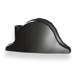{ .lu-ti width="24" loading="lazy" } [Unnamed LOT 1877 (LOT 1877)](../1877.md) | 1 | No client description | 0 matrices; 0 rewards; 0 community references |
| 1887 | 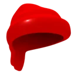{ .lu-ti width="24" loading="lazy" } [Unnamed LOT 1887 (LOT 1887)](../1887.md) | 1 | No client description | 0 matrices; 0 rewards; 0 community references |
| 2947 | { .lu-ti width="24" loading="lazy" } [Unnamed LOT 2947 (LOT 2947)](../2947.md) | 1 | No client description | 0 matrices; 0 rewards; 0 community references |
| 3068 | 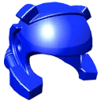{ .lu-ti width="24" loading="lazy" } [Unnamed LOT 3068 (LOT 3068)](../3068.md) | 4 | No client description | 0 matrices; 0 rewards; 0 community references |
| 4874 | { .lu-ti width="24" loading="lazy" } [Unnamed LOT 4874 (LOT 4874)](../4874.md) | 1 | No client description | 0 matrices; 0 rewards; 0 community references |
| 4875 | 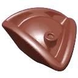{ .lu-ti width="24" loading="lazy" } [Unnamed LOT 4875 (LOT 4875)](../4875.md) | 1 | No client description | 0 matrices; 0 rewards; 0 community references |
| 6471 | [Unnamed LOT 6471 (LOT 6471)](../6471.md) | 1 | No client description | 0 matrices; 0 rewards; 0 community references |
| 7791 | { .lu-ti width="24" loading="lazy" } [Unnamed LOT 7791 (LOT 7791)](../7791.md) | 5 | No client description | 0 matrices; 0 rewards; 0 community references |
| 8046 | { .lu-ti width="24" loading="lazy" } [Unnamed LOT 8046 (LOT 8046)](../8046.md) | 5 | No client description | 0 matrices; 0 rewards; 0 community references |
| 12736 | { .lu-ti width="24" loading="lazy" } [Unnamed LOT 12736 (LOT 12736)](../12736.md) | 4 | No client description | 0 matrices; 0 rewards; 0 community references |
| 12738 | { .lu-ti width="24" loading="lazy" } [Unnamed LOT 12738 (LOT 12738)](../12738.md) | 4 | No client description | 0 matrices; 0 rewards; 0 community references |
| 12739 | { .lu-ti width="24" loading="lazy" } [Unnamed LOT 12739 (LOT 12739)](../12739.md) | 2 | No client description | 0 matrices; 0 rewards; 0 community references |
| 12887 | { .lu-ti width="24" loading="lazy" } [Unnamed LOT 12887 (LOT 12887)](../12887.md) | 1 | No client description | 0 matrices; 0 rewards; 0 community references |
| 12888 | 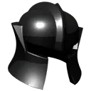{ .lu-ti width="24" loading="lazy" } [Unnamed LOT 12888 (LOT 12888)](../12888.md) | 1 | No client description | 0 matrices; 0 rewards; 0 community references |
| 12902 | { .lu-ti width="24" loading="lazy" } [Unnamed LOT 12902 (LOT 12902)](../12902.md) | 4 | No client description | 0 matrices; 0 rewards; 0 community references |
| 14140 | 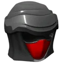{ .lu-ti width="24" loading="lazy" } [Unnamed LOT 14140 (LOT 14140)](../14140.md) | 4 | No client description | 0 matrices; 0 rewards; 0 community references |
| 14483 | { .lu-ti width="24" loading="lazy" } [Unnamed LOT 14483 (LOT 14483)](../14483.md) | 3 | No client description | 0 matrices; 0 rewards; 0 community references |
| 15921 | { .lu-ti width="24" loading="lazy" } [Unnamed LOT 15921 (LOT 15921)](../15921.md) | 3 | No client description | 0 matrices; 0 rewards; 0 community references |
| 15923 | { .lu-ti width="24" loading="lazy" } [Unnamed LOT 15923 (LOT 15923)](../15923.md) | 3 | No client description | 0 matrices; 0 rewards; 0 community references |
| 15925 | { .lu-ti width="24" loading="lazy" } [Unnamed LOT 15925 (LOT 15925)](../15925.md) | 3 | No client description | 0 matrices; 0 rewards; 0 community references |
| 15928 | { .lu-ti width="24" loading="lazy" } [Unnamed LOT 15928 (LOT 15928)](../15928.md) | 3 | No client description | 0 matrices; 0 rewards; 0 community references |
| 15930 | { .lu-ti width="24" loading="lazy" } [Unnamed LOT 15930 (LOT 15930)](../15930.md) | 3 | No client description | 0 matrices; 0 rewards; 0 community references |
| 15931 | 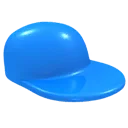{ .lu-ti width="24" loading="lazy" } [Unnamed LOT 15931 (LOT 15931)](../15931.md) | 3 | No client description | 0 matrices; 0 rewards; 0 community references |
| 15932 | { .lu-ti width="24" loading="lazy" } [Unnamed LOT 15932 (LOT 15932)](../15932.md) | 3 | No client description | 0 matrices; 0 rewards; 0 community references |
| 15933 | { .lu-ti width="24" loading="lazy" } [Unnamed LOT 15933 (LOT 15933)](../15933.md) | 3 | No client description | 0 matrices; 0 rewards; 0 community references |
| 15934 | { .lu-ti width="24" loading="lazy" } [Unnamed LOT 15934 (LOT 15934)](../15934.md) | 3 | No client description | 0 matrices; 0 rewards; 0 community references |
| 15938 | { .lu-ti width="24" loading="lazy" } [Unnamed LOT 15938 (LOT 15938)](../15938.md) | 3 | No client description | 0 matrices; 0 rewards; 0 community references |
| 15939 | { .lu-ti width="24" loading="lazy" } [Unnamed LOT 15939 (LOT 15939)](../15939.md) | 3 | No client description | 0 matrices; 0 rewards; 0 community references |
| 15964 | 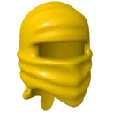{ .lu-ti width="24" loading="lazy" } [Unnamed LOT 15964 (LOT 15964)](../15964.md) | 3 | No client description | 0 matrices; 0 rewards; 0 community references |
| 15967 | { .lu-ti width="24" loading="lazy" } [Unnamed LOT 15967 (LOT 15967)](../15967.md) | 3 | No client description | 0 matrices; 0 rewards; 0 community references |
| 15970 | 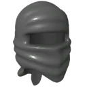{ .lu-ti width="24" loading="lazy" } [Unnamed LOT 15970 (LOT 15970)](../15970.md) | 3 | No client description | 0 matrices; 0 rewards; 0 community references |
| 15973 | { .lu-ti width="24" loading="lazy" } [Unnamed LOT 15973 (LOT 15973)](../15973.md) | 3 | No client description | 0 matrices; 0 rewards; 0 community references |
| 15986 | { .lu-ti width="24" loading="lazy" } [Unnamed LOT 15986 (LOT 15986)](../15986.md) | 3 | No client description | 0 matrices; 0 rewards; 0 community references |
| 15989 | { .lu-ti width="24" loading="lazy" } [Unnamed LOT 15989 (LOT 15989)](../15989.md) | 3 | No client description | 0 matrices; 0 rewards; 0 community references |
| 2291 | 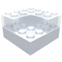{ .lu-ti width="24" loading="lazy" } [? - ModelTestObj (LOT 2291)](../2291.md) | 1 | No client description | 0 matrices; 0 rewards; 0 community references |
| 6646 | { .lu-ti width="24" loading="lazy" } [30 pts imagination hat (LOT 6646)](../6646.md) | 5 | Gives 30 points of imagination | 0 matrices; 0 rewards; 0 community references |
| 7225 | [6789 (LOT 7225)](../7225.md) | 1 | No client description | 0 matrices; 0 rewards; 0 community references |
| 6795 | { .lu-ti width="24" loading="lazy" } [Admiral Hat (LOT 6795)](../6795.md) | 4 | Wear this in Nimbus Station to launch your rocket to the Pirate Camp | 0 matrices; 1 rewards; 1 community references |
| 7460 | { .lu-ti width="24" loading="lazy" } [Adventurer Hat 1 (LOT 7460)](../7460.md) | 4 | Rank 1 Specialty Kit Item | 2 matrices; 0 rewards; 0 community references |
| 7461 | { .lu-ti width="24" loading="lazy" } [Adventurer Hat 2 (LOT 7461)](../7461.md) | 4 | Rank 2 Specialty Kit Item | 1 matrices; 0 rewards; 0 community references |
| 7462 | { .lu-ti width="24" loading="lazy" } [Adventurer Hat 3 (LOT 7462)](../7462.md) | 4 | Rank 3 Specialty Kit Item | 1 matrices; 0 rewards; 0 community references |
| 8304 | { .lu-ti width="24" loading="lazy" } [AG Survival Zone Control Object (LOT 8304)](../8304.md) | 4 | AG Zone Control Object for Survival | 0 matrices; 0 rewards; 0 community references |
| 15935 | { .lu-ti width="24" loading="lazy" } [Apothecary's Hood (LOT 15935)](../15935.md) | 3 | No client description | 27 matrices; 0 rewards; 1 community references |
| 6880 | { .lu-ti width="24" loading="lazy" } [Armored Viking Helmet (LOT 6880)](../6880.md) | 3 | No client description | 8 matrices; 0 rewards; 1 community references |
| 6200 | { .lu-ti width="24" loading="lazy" } [Astronaut Helmet (LOT 6200)](../6200.md) | 3 | No client description | 0 matrices; 1 rewards; 1 community references |
| 15918 | { .lu-ti width="24" loading="lazy" } [Athlete's Shade (LOT 15918)](../15918.md) | 4 | No client description | 1 matrices; 0 rewards; 0 community references |
| 14128 | { .lu-ti width="24" loading="lazy" } [Atlantis Squid Helm (LOT 14128)](../14128.md) | 3 | No client description | 0 matrices; 1 rewards; 0 community references |
| 7731 | { .lu-ti width="24" loading="lazy" } [Aussie Hat (LOT 7731)](../7731.md) | 2 | No client description | 23 matrices; 0 rewards; 1 community references |
| 7781 | 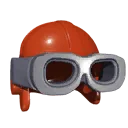{ .lu-ti width="24" loading="lazy" } [Aviator Hat with Goggles (LOT 7781)](../7781.md) | 2 | No client description | 0 matrices; 1 rewards; 1 community references |
| 6198 | 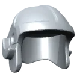{ .lu-ti width="24" loading="lazy" } [Aviator Helmet (LOT 6198)](../6198.md) | 2 | No client description | 0 matrices; 1 rewards; 1 community references |
| 12308 | { .lu-ti width="24" loading="lazy" } [Banneret's Helm (LOT 12308)](../12308.md) | 3 | No client description | 4 matrices; 0 rewards; 1 community references |
| 12768 | 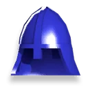{ .lu-ti width="24" loading="lazy" } [Bassinet Helm (LOT 12768)](../12768.md) | 2 | No client description | 1 matrices; 0 rewards; 1 community references |
| 12781 | 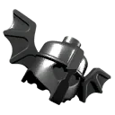{ .lu-ti width="24" loading="lazy" } [Bat Lord Helmet (LOT 12781)](../12781.md) | 4 | No client description | 0 matrices; 1 rewards; 1 community references |
| 9615 | { .lu-ti width="24" loading="lazy" } [Black Aussie Hat (LOT 9615)](../9615.md) | 2 | No client description | 15 matrices; 0 rewards; 1 community references |
| 3868 | { .lu-ti width="24" loading="lazy" } [Black Baseball Cap (LOT 3868)](../3868.md) | 2 | No client description | 23 matrices; 0 rewards; 1 community references |
| 8424 | 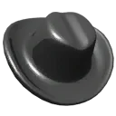{ .lu-ti width="24" loading="lazy" } [Black Cowboy Hat (LOT 8424)](../8424.md) | 4 | No client description | 0 matrices; 1 rewards; 0 community references |
| 7133 | { .lu-ti width="24" loading="lazy" } [Black Firefighter Helmet (LOT 7133)](../7133.md) | 1 | No client description | 4 matrices; 0 rewards; 1 community references |
| 2648 | 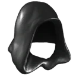{ .lu-ti width="24" loading="lazy" } [Black Hood (LOT 2648)](../2648.md) | 2 | No client description | 0 matrices; 1 rewards; 0 community references |
| 2627 | 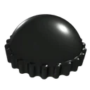{ .lu-ti width="24" loading="lazy" } [Black Knit Cap (LOT 2627)](../2627.md) | 2 | No client description | 2 matrices; 0 rewards; 1 community references |
| 2633 | 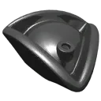{ .lu-ti width="24" loading="lazy" } [Black Pirate Hat (LOT 2633)](../2633.md) | 3 | Wear this in Nimbus Station to launch your rocket to the Pirate Camp | 1 matrices; 0 rewards; 1 community references |
| 1890 | 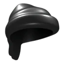{ .lu-ti width="24" loading="lazy" } [Black Pirate Scarf (LOT 1890)](../1890.md) | 2 | No client description | 0 matrices; 1 rewards; 1 community references |
| 7991 | 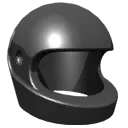{ .lu-ti width="24" loading="lazy" } [Black Racing Helmet (LOT 7991)](../7991.md) | 2 | No client description | 1 matrices; 0 rewards; 1 community references |
| 8084 | 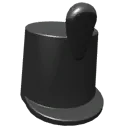{ .lu-ti width="24" loading="lazy" } [Black Shako Hat (LOT 8084)](../8084.md) | 3 | No client description | 0 matrices; 1 rewards; 1 community references |
| 6803 | { .lu-ti width="24" loading="lazy" } [Blue Baseball Cap (LOT 6803)](../6803.md) | 2 | No client description | 24 matrices; 0 rewards; 1 community references |
| 7990 | { .lu-ti width="24" loading="lazy" } [Blue Kepi Hat (LOT 7990)](../7990.md) | 4 | No client description | 8 matrices; 0 rewards; 1 community references |
| 6746 | 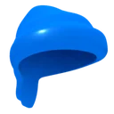{ .lu-ti width="24" loading="lazy" } [Blue Pirate Scarf (LOT 6746)](../6746.md) | 2 | No client description | 0 matrices; 1 rewards; 1 community references |
| 7992 | { .lu-ti width="24" loading="lazy" } [Blue Racing Helmet (LOT 7992)](../7992.md) | 2 | No client description | 3 matrices; 1 rewards; 1 community references |
| 6850 | { .lu-ti width="24" loading="lazy" } [Blue Space Helmet (LOT 6850)](../6850.md) | 2 | No client description | 3 matrices; 0 rewards; 1 community references |
| 2290 | [Blueprint in inventory (LOT 2290)](../2290.md) | 1 | No client description | 0 matrices; 0 rewards; 0 community references |
| 13551 | { .lu-ti width="24" loading="lazy" } [Bone Daddy Hat (LOT 13551)](../13551.md) | 5 | No client description | 0 matrices; 0 rewards; 0 community references |
| 12997 | { .lu-ti width="24" loading="lazy" } [Bone Suit Helm (LOT 12997)](../12997.md) | 4 | No client description | 0 matrices; 1 rewards; 1 community references |
| 2632 | { .lu-ti width="24" loading="lazy" } [Brown Pirate Hat (LOT 2632)](../2632.md) | 3 | Wear this in Nimbus Station to launch your rocket to the Pirate Camp | 1 matrices; 1 rewards; 1 community references |
| 7366 | { .lu-ti width="24" loading="lazy" } [Buccaneer Hat 3 (LOT 7366)](../7366.md) | 4 | Rank 3 Specialty Kit Item | 1 matrices; 0 rewards; 0 community references |
| 12981 | { .lu-ti width="24" loading="lazy" } [Buccaneer Hat 3 (LOT 12981)](../12981.md) | 4 | Rank 3 Specialty Kit Item | 1 matrices; 0 rewards; 0 community references |
| 7358 | 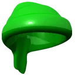{ .lu-ti width="24" loading="lazy" } [Buccaneer Scarf 1 (LOT 7358)](../7358.md) | 4 | Rank 1 Specialty Kit Item | 2 matrices; 0 rewards; 0 community references |
| 7365 | { .lu-ti width="24" loading="lazy" } [Buccaneer Scarf 2 (LOT 7365)](../7365.md) | 4 | Rank 2 Specialty Kit Item | 1 matrices; 0 rewards; 0 community references |
| 8676 | { .lu-ti width="24" loading="lazy" } [Cadet Helm (LOT 8676)](../8676.md) | 4 | No client description | 17 matrices; 0 rewards; 1 community references |
| 2588 | { .lu-ti width="24" loading="lazy" } [Chef Hat (LOT 2588)](../2588.md) | 2 | No client description | 23 matrices; 0 rewards; 1 community references |
| 16605 | { .lu-ti width="24" loading="lazy" } [Cole's Hood of Quakes (LOT 16605)](../16605.md) | 3 | Wear this to look like Cole! | 1 matrices; 0 rewards; 1 community references |
| 13744 | [Crate Disguise Head Proxy (LOT 13744)](../13744.md) | 1 | No client description | 0 matrices; 0 rewards; 0 community references |
| 15914 | { .lu-ti width="24" loading="lazy" } [Crimson Kabuto (LOT 15914)](../15914.md) | 4 | No client description | 1 matrices; 0 rewards; 1 community references |
| 12886 | { .lu-ti width="24" loading="lazy" } [Cyborg Helmet (LOT 12886)](../12886.md) | 2 | No client description | 0 matrices; 0 rewards; 0 community references |
| 12779 | { .lu-ti width="24" loading="lazy" } [Dancin' Hat (LOT 12779)](../12779.md) | 3 | No client description | 40 matrices; 0 rewards; 1 community references |
| 7463 | 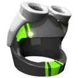{ .lu-ti width="24" loading="lazy" } [Daredevil Helmet 1 (LOT 7463)](../7463.md) | 4 | Rank 1 Specialty Kit Item | 2 matrices; 0 rewards; 0 community references |
| 7464 | 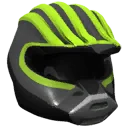{ .lu-ti width="24" loading="lazy" } [Daredevil Helmet 2 (LOT 7464)](../7464.md) | 4 | Rank 2 Specialty Kit Item | 1 matrices; 0 rewards; 0 community references |
| 7465 | 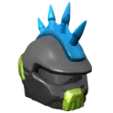{ .lu-ti width="24" loading="lazy" } [Daredevil Helmet 3 (LOT 7465)](../7465.md) | 4 | Rank 3 Specialty Kit Item | 1 matrices; 0 rewards; 0 community references |
| 12993 | 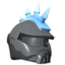{ .lu-ti width="24" loading="lazy" } [Daredevil Helmet 3 (LOT 12993)](../12993.md) | 4 | Rank 3 Specialty Kit Item | 1 matrices; 0 rewards; 0 community references |
| 8040 | 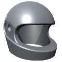{ .lu-ti width="24" loading="lazy" } [Dark Grey Racing Helmet (LOT 8040)](../8040.md) | 2 | No client description | 0 matrices; 0 rewards; 0 community references |
| 3861 | { .lu-ti width="24" loading="lazy" } [Diver Helmet (LOT 3861)](../3861.md) | 2 | No client description | 4 matrices; 0 rewards; 1 community references |
| 12512 | { .lu-ti width="24" loading="lazy" } [DO NOT DELETE - Animation Test 1 (LOT 12512)](../12512.md) | 4 | No client description | 0 matrices; 0 rewards; 0 community references |
| 13753 | [Dragon Disguise Head Proxy (LOT 13753)](../13753.md) | 1 | Used in the nexus tower mission chain | 0 matrices; 0 rewards; 0 community references |
| 8548 | 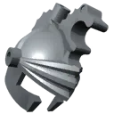{ .lu-ti width="24" loading="lazy" } [Dragon Helm MK I (LOT 8548)](../8548.md) | 3 | No client description | 0 matrices; 1 rewards; 1 community references |
| 12741 | 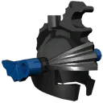{ .lu-ti width="24" loading="lazy" } [Dragon Helm MK II (LOT 12741)](../12741.md) | 3 | No client description | 0 matrices; 1 rewards; 1 community references |
| 12786 | 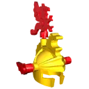{ .lu-ti width="24" loading="lazy" } [Dragon Helm MK III (LOT 12786)](../12786.md) | 4 | No client description | 40 matrices; 0 rewards; 1 community references |
| 14499 | { .lu-ti width="24" loading="lazy" } [Dragon Mask (LOT 14499)](../14499.md) | 1 | A most mysterious Mask! | 1 matrices; 0 rewards; 0 community references |
| 16644 | 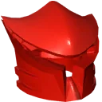{ .lu-ti width="24" loading="lazy" } [Dragon Mask (LOT 16644)](../16644.md) | 1 | A most mysterious Mask! | 0 matrices; 0 rewards; 0 community references |
| 8678 | 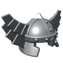{ .lu-ti width="24" loading="lazy" } [Dwarf Helmet (LOT 8678)](../8678.md) | 3 | No client description | 0 matrices; 1 rewards; 1 community references |
| 12780 | { .lu-ti width="24" loading="lazy" } [Egyptian Headdress (LOT 12780)](../12780.md) | 3 | No client description | 40 matrices; 1 rewards; 1 community references |
| 12782 | { .lu-ti width="24" loading="lazy" } [Eisenhut (LOT 12782)](../12782.md) | 3 | No client description | 40 matrices; 0 rewards; 1 community references |
| 7356 | { .lu-ti width="24" loading="lazy" } [Engineer Helmet 1 (LOT 7356)](../7356.md) | 4 | Rank 1 Specialty Kit Item | 2 matrices; 0 rewards; 0 community references |
| 7363 | { .lu-ti width="24" loading="lazy" } [Engineer Helmet 2 (LOT 7363)](../7363.md) | 4 | Rank 2 Specialty Kit Item | 1 matrices; 0 rewards; 0 community references |
| 7364 | { .lu-ti width="24" loading="lazy" } [Engineer Helmet 3 (LOT 7364)](../7364.md) | 4 | Rank 3 Specialty Kit Item | 1 matrices; 0 rewards; 0 community references |
| 12962 | 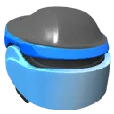{ .lu-ti width="24" loading="lazy" } [Engineer Helmet 3 (LOT 12962)](../12962.md) | 4 | Rank 3 Specialty Kit Item | 1 matrices; 0 rewards; 0 community references |
| 12472 | 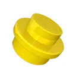{ .lu-ti width="24" loading="lazy" } [Explorien Bot Helm (LOT 12472)](../12472.md) | 3 | No client description | 40 matrices; 0 rewards; 1 community references |
| 8540 | 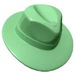{ .lu-ti width="24" loading="lazy" } [Fedora (LOT 8540)](../8540.md) | 2 | No client description | 1 matrices; 0 rewards; 1 community references |
| 3852 | { .lu-ti width="24" loading="lazy" } [Firefighter Helmet (LOT 3852)](../3852.md) | 2 | No client description | 0 matrices; 1 rewards; 0 community references |
| 7792 | { .lu-ti width="24" loading="lazy" } [Fish Hat (LOT 7792)](../7792.md) | 3 | No client description | 0 matrices; 1 rewards; 0 community references |
| 12435 | 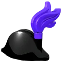{ .lu-ti width="24" loading="lazy" } [Flogmore's Hat (LOT 12435)](../12435.md) | 4 | No client description | 40 matrices; 0 rewards; 1 community references |
| 3858 | { .lu-ti width="24" loading="lazy" } [Flower Hat (LOT 3858)](../3858.md) | 2 | No client description | 23 matrices; 0 rewards; 1 community references |
| 12783 | { .lu-ti width="24" loading="lazy" } [Forester's Hood (LOT 12783)](../12783.md) | 3 | No client description | 0 matrices; 1 rewards; 1 community references |
| 6407 | { .lu-ti width="24" loading="lazy" } [GM Only - Hat of Pwnage (LOT 6407)](../6407.md) | 5 | No client description | 0 matrices; 0 rewards; 0 community references |
| 5873 | 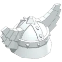{ .lu-ti width="24" loading="lazy" } [GM Only - Winged Helm of Speed (LOT 5873)](../5873.md) | 5 | gives run speed increase | 0 matrices; 0 rewards; 0 community references |
| 8037 | 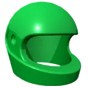{ .lu-ti width="24" loading="lazy" } [Green Racing Helmet (LOT 8037)](../8037.md) | 2 | No client description | 3 matrices; 0 rewards; 1 community references |
| 7793 | 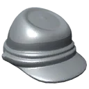{ .lu-ti width="24" loading="lazy" } [Grey Kepi Hat (LOT 7793)](../7793.md) | 1 | No client description | 23 matrices; 0 rewards; 1 community references |
| 3013 | 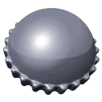{ .lu-ti width="24" loading="lazy" } [Grey Knit Cap (LOT 3013)](../3013.md) | 1 | No client description | 4 matrices; 0 rewards; 0 community references |
| 9947 | { .lu-ti width="24" loading="lazy" } [Grunt Helmet (LOT 9947)](../9947.md) | 4 | NPC Grunt Helmet | 0 matrices; 0 rewards; 0 community references |
| 3860 | { .lu-ti width="24" loading="lazy" } [Hard Hat (LOT 3860)](../3860.md) | 2 | No client description | 23 matrices; 0 rewards; 1 community references |
| 11385 | 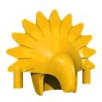{ .lu-ti width="24" loading="lazy" } [Hat of Grid Lines GM ONLY (LOT 11385)](../11385.md) | 5 | Used by PR to set up composites | 0 matrices; 0 rewards; 0 community references |
| 13912 | 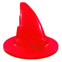{ .lu-ti width="24" loading="lazy" } [Hat of Magecraft (LOT 13912)](../13912.md) | 3 | No client description | 0 matrices; 0 rewards; 0 community references |
| 7780 | { .lu-ti width="24" loading="lazy" } [Hat of Sprouting Imagination (LOT 7780)](../7780.md) | 3 | No client description | 11 matrices; 1 rewards; 1 community references |
| 13913 | 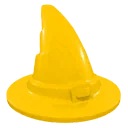{ .lu-ti width="24" loading="lazy" } [Hat of the Adept (LOT 13913)](../13913.md) | 3 | No client description | 0 matrices; 0 rewards; 0 community references |
| 13911 | { .lu-ti width="24" loading="lazy" } [Hat of Wizardry (LOT 13911)](../13911.md) | 3 | No client description | 0 matrices; 0 rewards; 0 community references |
| 13549 | [Head Proxy  - Releases imagination (LOT 13549)](../13549.md) | 2 | No client description | 0 matrices; 0 rewards; 0 community references |
| 12530 | { .lu-ti width="24" loading="lazy" } [Headbash Helmet (LOT 12530)](../12530.md) | 4 | No client description | 0 matrices; 1 rewards; 0 community references |
| 6925 | { .lu-ti width="24" loading="lazy" } [Helm Of Entrapment (LOT 6925)](../6925.md) | 2 | No client description | 1 matrices; 1 rewards; 1 community references |
| 13915 | 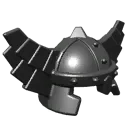{ .lu-ti width="24" loading="lazy" } [Helm of the Blacksmith (LOT 13915)](../13915.md) | 3 | No client description | 0 matrices; 0 rewards; 0 community references |
| 13914 | 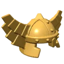{ .lu-ti width="24" loading="lazy" } [Helm of the Mountain King (LOT 13914)](../13914.md) | 3 | No client description | 0 matrices; 0 rewards; 0 community references |
| 15936 | { .lu-ti width="24" loading="lazy" } [Hobby Hood (LOT 15936)](../15936.md) | 2 | No client description | 0 matrices; 1 rewards; 1 community references |
| 16277 | { .lu-ti width="24" loading="lazy" } [Hood of Flames (LOT 16277)](../16277.md) | 3 | Wear this to look like a Ninja of Fire and rocket directly to the Ninjago Caves! | 2 matrices; 1 rewards; 1 community references |
| 16276 | 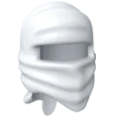{ .lu-ti width="24" loading="lazy" } [Hood of Frost (LOT 16276)](../16276.md) | 3 | Wear this to look like a Ninja of Ice and rocket directly to the Ninjago Caves! | 2 matrices; 1 rewards; 1 community references |
| 6933 | 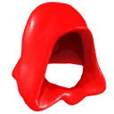{ .lu-ti width="24" loading="lazy" } [Hood of Healing (LOT 6933)](../6933.md) | 3 | No client description | 1 matrices; 1 rewards; 1 community references |
| 14136 | { .lu-ti width="24" loading="lazy" } [Hood of Quakes (LOT 14136)](../14136.md) | 3 | Wear this to look like a Ninja of Earth and rocket directly to the Ninjago Caves! | 2 matrices; 1 rewards; 1 community references |
| 16272 | 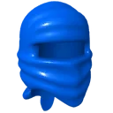{ .lu-ti width="24" loading="lazy" } [Hood of Storms (LOT 16272)](../16272.md) | 3 | Wear this to look like a Ninja of Lightning and rocket directly to the Ninjago Caves! | 2 matrices; 1 rewards; 1 community references |
| 13916 | { .lu-ti width="24" loading="lazy" } [Hood of the Mystic (LOT 13916)](../13916.md) | 3 | No client description | 0 matrices; 0 rewards; 0 community references |
| 13917 | { .lu-ti width="24" loading="lazy" } [Hood of the Sage (LOT 13917)](../13917.md) | 3 | No client description | 0 matrices; 0 rewards; 0 community references |
| 13758 | [Horseman Disguise Head Proxy (LOT 13758)](../13758.md) | 1 | Used in the nexus tower mission chain | 0 matrices; 0 rewards; 0 community references |
| 12546 | { .lu-ti width="24" loading="lazy" } [Howdy Cowboy Hat (LOT 12546)](../12546.md) | 4 | No client description | 0 matrices; 1 rewards; 1 community references |
| 12918 | { .lu-ti width="24" loading="lazy" } [Imagination Spinjitzu Hood (LOT 12918)](../12918.md) | 3 | No client description | 1 matrices; 1 rewards; 0 community references |
| 7454 | { .lu-ti width="24" loading="lazy" } [Inventor Goggles 1 (LOT 7454)](../7454.md) | 4 | Rank 1 Specialty Kit Item | 2 matrices; 0 rewards; 0 community references |
| 7455 | { .lu-ti width="24" loading="lazy" } [Inventor Goggles 2 (LOT 7455)](../7455.md) | 4 | Rank 2 Specialty Kit Item | 1 matrices; 0 rewards; 0 community references |
| 7456 | { .lu-ti width="24" loading="lazy" } [Inventor Goggles 3 (LOT 7456)](../7456.md) | 4 | Rank 3 Specialty Kit Item | 1 matrices; 0 rewards; 0 community references |
| 12784 | { .lu-ti width="24" loading="lazy" } [Iron Barbute (LOT 12784)](../12784.md) | 1 | No client description | 40 matrices; 0 rewards; 1 community references |
| 13840 | [Janitor Head Proxy (LOT 13840)](../13840.md) | 1 | Used in the nexus tower mission chain | 0 matrices; 0 rewards; 0 community references |
| 16608 | { .lu-ti width="24" loading="lazy" } [Jay's Hood of Storms (LOT 16608)](../16608.md) | 3 | Wear this to look like Jay! | 1 matrices; 0 rewards; 1 community references |
| 7790 | { .lu-ti width="24" loading="lazy" } [Jester Hat (LOT 7790)](../7790.md) | 4 | No client description | 0 matrices; 1 rewards; 0 community references |
| 12283 | { .lu-ti width="24" loading="lazy" } [Jolly Beard (LOT 12283)](../12283.md) | 3 | No client description | 1 matrices; 0 rewards; 1 community references |
| 16614 | { .lu-ti width="24" loading="lazy" } [Kai's Hood of Flames (LOT 16614)](../16614.md) | 3 | Wear this to look like Kai! | 1 matrices; 0 rewards; 1 community references |
| 2624 | { .lu-ti width="24" loading="lazy" } [Kettle Helmet (LOT 2624)](../2624.md) | 2 | No client description | 5 matrices; 0 rewards; 0 community references |
| 8673 | { .lu-ti width="24" loading="lazy" } [Kettle Helmet (LOT 8673)](../8673.md) | 4 | No client description | 8 matrices; 0 rewards; 0 community references |
| 15937 | { .lu-ti width="24" loading="lazy" } [Ki Filled Hood (LOT 15937)](../15937.md) | 1 | No client description | 28 matrices; 0 rewards; 1 community references |
| 12561 | { .lu-ti width="24" loading="lazy" } [King Bling Crown (LOT 12561)](../12561.md) | 4 | No client description | 0 matrices; 1 rewards; 0 community references |
| 8544 | { .lu-ti width="24" loading="lazy" } [King's Crown (LOT 8544)](../8544.md) | 4 | No client description | 11 matrices; 0 rewards; 1 community references |
| 15947 | { .lu-ti width="24" loading="lazy" } [Kiro Swordsman's Hood (LOT 15947)](../15947.md) | 4 | No client description | 27 matrices; 0 rewards; 0 community references |
| 7355 | { .lu-ti width="24" loading="lazy" } [Knight Helm 1 (LOT 7355)](../7355.md) | 4 | Rank 1 Specialty Kit Item | 2 matrices; 0 rewards; 0 community references |
| 7359 | { .lu-ti width="24" loading="lazy" } [Knight Helm 2 (LOT 7359)](../7359.md) | 4 | Rank 2 Specialty Kit Item | 1 matrices; 0 rewards; 0 community references |
| 7360 | { .lu-ti width="24" loading="lazy" } [Knight Helm 3 (LOT 7360)](../7360.md) | 4 | Rank 3 Specialty Kit Item | 1 matrices; 0 rewards; 0 community references |
| 12966 | { .lu-ti width="24" loading="lazy" } [Knight Helm 3 (LOT 12966)](../12966.md) | 4 | Rank 3 Specialty Kit Item | 1 matrices; 0 rewards; 0 community references |
| 6935 | { .lu-ti width="24" loading="lazy" } [Knit Cap of Stunning (LOT 6935)](../6935.md) | 3 | No client description | 1 matrices; 1 rewards; 1 community references |
| 8041 | { .lu-ti width="24" loading="lazy" } [Light Grey Racing Helmet (LOT 8041)](../8041.md) | 2 | No client description | 0 matrices; 0 rewards; 0 community references |
| 8541 | { .lu-ti width="24" loading="lazy" } [Lockjaw Helm (LOT 8541)](../8541.md) | 2 | No client description | 0 matrices; 1 rewards; 0 community references |
| 2642 | { .lu-ti width="24" loading="lazy" } [Maelstrom-Infused Black Ninja Hood (LOT 2642)](../2642.md) | 3 | Pass Paradox Force Fields, Rocket to the Great Tree | 0 matrices; 1 rewards; 0 community references |
| 2641 | { .lu-ti width="24" loading="lazy" } [Maelstrom-Infused White Ninja Hood (LOT 2641)](../2641.md) | 3 | Pass Paradox Force Fields, Rocket to the Great Tree | 0 matrices; 1 rewards; 0 community references |
| 14100 | { .lu-ti width="24" loading="lazy" } [Master Driver Helmet (LOT 14100)](../14100.md) | 3 | No client description | 0 matrices; 0 rewards; 0 community references |
| 7786 | { .lu-ti width="24" loading="lazy" } [Mega Helm (LOT 7786)](../7786.md) | 4 | No client description | 0 matrices; 1 rewards; 0 community references |
| 9533 | { .lu-ti width="24" loading="lazy" } [metal Helmet (LOT 9533)](../9533.md) | 5 | Standard Knight Helmet | 0 matrices; 0 rewards; 0 community references |
| 12785 | { .lu-ti width="24" loading="lazy" } [Miners' Helm (LOT 12785)](../12785.md) | 3 | No client description | 40 matrices; 0 rewards; 0 community references |
| 6853 | { .lu-ti width="24" loading="lazy" } [Morion Helmet (LOT 6853)](../6853.md) | 2 | No client description | 18 matrices; 0 rewards; 0 community references |
| 12901 | { .lu-ti width="24" loading="lazy" } [Mosaic Jester Cap (LOT 12901)](../12901.md) | 4 | No client description | 40 matrices; 0 rewards; 1 community references |
| 8035 | { .lu-ti width="24" loading="lazy" } [Nemesis Helm (LOT 8035)](../8035.md) | 2 | No client description | 1 matrices; 0 rewards; 1 community references |
| 9806 | { .lu-ti width="24" loading="lazy" } [Nexus Astronaut Helmet (LOT 9806)](../9806.md) | 3 | No client description | 1 matrices; 0 rewards; 1 community references |
| 1726 | { .lu-ti width="24" loading="lazy" } [Nexus Force Helmet (LOT 1726)](../1726.md) | 2 | No client description | 1 matrices; 1 rewards; 1 community references |
| 9951 | { .lu-ti width="24" loading="lazy" } [Nexus Jay Helmet (LOT 9951)](../9951.md) | 4 | NPC Nexus jay Helmet | 0 matrices; 0 rewards; 0 community references |
| 12563 | { .lu-ti width="24" loading="lazy" } [NPC Assembly Scout Helmet (LOT 12563)](../12563.md) | 5 | Assembly Scout Helmet | 0 matrices; 0 rewards; 0 community references |
| 6496 | { .lu-ti width="24" loading="lazy" } [NPC Beck Hair (LOT 6496)](../6496.md) | 5 | NPC Beck Hair | 0 matrices; 0 rewards; 0 community references |
| 16623 | { .lu-ti width="24" loading="lazy" } [NPC Black Samurai Helm (LOT 16623)](../16623.md) | 5 | No client description | 0 matrices; 0 rewards; 0 community references |
| 16625 | { .lu-ti width="24" loading="lazy" } [NPC Blue Samurai Helm (LOT 16625)](../16625.md) | 5 | No client description | 0 matrices; 0 rewards; 0 community references |
| 13888 | { .lu-ti width="24" loading="lazy" } [NPC Cap (LOT 13888)](../13888.md) | 2 | No client description | 0 matrices; 0 rewards; 0 community references |
| 13357 | { .lu-ti width="24" loading="lazy" } [NPC Caveman Hair Vendor (LOT 13357)](../13357.md) | 5 | No client description | 0 matrices; 0 rewards; 0 community references |
| 13356 | { .lu-ti width="24" loading="lazy" } [NPC CheerLeader Hair Vendor (LOT 13356)](../13356.md) | 5 | No client description | 0 matrices; 0 rewards; 0 community references |
| 13352 | { .lu-ti width="24" loading="lazy" } [NPC Clown Hair Vendor (LOT 13352)](../13352.md) | 5 | No client description | 0 matrices; 0 rewards; 0 community references |
| 10133 | { .lu-ti width="24" loading="lazy" } [NPC Club Lego Max Hair (LOT 10133)](../10133.md) | 4 | No client description | 0 matrices; 0 rewards; 0 community references |
| 14724 | { .lu-ti width="24" loading="lazy" } [NPC Cole Black Ninja hood (LOT 14724)](../14724.md) | 5 | NPC Cole Black Ninja hood | 0 matrices; 0 rewards; 0 community references |
| 14804 | { .lu-ti width="24" loading="lazy" } [NPC Coolie hat (LOT 14804)](../14804.md) | 5 | NPC Coolie hat | 0 matrices; 0 rewards; 0 community references |
| 13350 | { .lu-ti width="24" loading="lazy" } [NPC Cowboy Hat Vendor (LOT 13350)](../13350.md) | 5 | No client description | 0 matrices; 0 rewards; 0 community references |
| 13347 | { .lu-ti width="24" loading="lazy" } [NPC Crash Dummy  Hair Vendor (LOT 13347)](../13347.md) | 5 | No client description | 0 matrices; 0 rewards; 0 community references |
| 13390 | { .lu-ti width="24" loading="lazy" } [NPC DiscoDJ Hair Vendor (LOT 13390)](../13390.md) | 5 | No client description | 0 matrices; 0 rewards; 0 community references |
| 13302 | { .lu-ti width="24" loading="lazy" } [NPC Doc Overbuild Helm (LOT 13302)](../13302.md) | 4 | NPC Overbuild Helm | 0 matrices; 0 rewards; 0 community references |
| 10155 | { .lu-ti width="24" loading="lazy" } [NPC Duke Exetor Hair (LOT 10155)](../10155.md) | 4 | NPC Duke Hair | 0 matrices; 0 rewards; 0 community references |
| 14431 | { .lu-ti width="24" loading="lazy" } [NPC Earth Hood (LOT 14431)](../14431.md) | 3 | Earth NJ acolyte hood | 0 matrices; 0 rewards; 0 community references |
| 6499 | { .lu-ti width="24" loading="lazy" } [NPC Epsilon Helmet (LOT 6499)](../6499.md) | 5 | NPC Epsilon Helm | 0 matrices; 0 rewards; 0 community references |
| 9829 | { .lu-ti width="24" loading="lazy" } [NPC Gangway Kelly Hat (LOT 9829)](../9829.md) | 4 | NPC Gangway Kelly Hat | 0 matrices; 0 rewards; 0 community references |
| 9948 | { .lu-ti width="24" loading="lazy" } [NPC Grunt Helmet Green (LOT 9948)](../9948.md) | 4 | NPC Grunt Helmet Green | 0 matrices; 0 rewards; 0 community references |
| 9949 | { .lu-ti width="24" loading="lazy" } [NPC Grunt Helmet Orange (LOT 9949)](../9949.md) | 4 | NPC Grunt Helmet Orange | 0 matrices; 0 rewards; 0 community references |
| 9950 | { .lu-ti width="24" loading="lazy" } [NPC Grunt Helmet Purple (LOT 9950)](../9950.md) | 4 | NPC Grunt Helmet Purple | 0 matrices; 0 rewards; 0 community references |
| 11292 | { .lu-ti width="24" loading="lazy" } [NPC Grunt Helmet Red (LOT 11292)](../11292.md) | 4 | NPC Grunt Red | 0 matrices; 0 rewards; 0 community references |
| 10052 | { .lu-ti width="24" loading="lazy" } [NPC Hael Storm Dread locks (LOT 10052)](../10052.md) | 4 | NPC Hael Storm Dread locks | 0 matrices; 0 rewards; 0 community references |
| 13346 | { .lu-ti width="24" loading="lazy" } [NPC Indian  Hair Vendor (LOT 13346)](../13346.md) | 5 | No client description | 0 matrices; 0 rewards; 0 community references |
| 13344 | { .lu-ti width="24" loading="lazy" } [NPC Jiu Jitsu Master Hair Vendor (LOT 13344)](../13344.md) | 5 | No client description | 0 matrices; 0 rewards; 0 community references |
| 14726 | { .lu-ti width="24" loading="lazy" } [NPC Kai Red Ninja hood (LOT 14726)](../14726.md) | 5 | NPC Kai Red Ninja hood | 0 matrices; 0 rewards; 0 community references |
