# Hat — page 2/2

[Item database](../README.md)

Pages: [1](type-2-1.md) | [2](type-2-2.md)

| LOT | Item | Rarity | Description | Source evidence |
| --- | --- | --- | --- | --- |
| 13342 | { .lu-ti width="24" loading="lazy" } [NPC LifeGuard Hair Vendor (LOT 13342)](../13342.md) | 5 | No client description | 0 matrices; 0 rewards; 0 community references |
| 10067 | { .lu-ti width="24" loading="lazy" } [NPC LUP Worker Helmet (LOT 10067)](../10067.md) | 4 | No client description | 0 matrices; 0 rewards; 0 community references |
| 13341 | { .lu-ti width="24" loading="lazy" } [NPC Magician Hat Vendor (LOT 13341)](../13341.md) | 5 | No client description | 0 matrices; 0 rewards; 0 community references |
| 5707 | { .lu-ti width="24" loading="lazy" } [NPC Medieval Soldier Helm (LOT 5707)](../5707.md) | 5 | needs icon | 0 matrices; 0 rewards; 0 community references |
| 13779 | 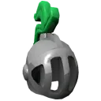{ .lu-ti width="24" loading="lazy" } [NPC Nexus Naomi Helmet (LOT 13779)](../13779.md) | 5 | NPC Nexus Niaomi Helmet | 0 matrices; 0 rewards; 0 community references |
| 14730 | 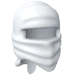{ .lu-ti width="24" loading="lazy" } [NPC Nya Ninja Hair (LOT 14730)](../14730.md) | 5 | NPC Nya Ninja Hair | 0 matrices; 0 rewards; 0 community references |
| 12091 | { .lu-ti width="24" loading="lazy" } [NPC Old Man Winter Hair (LOT 12091)](../12091.md) | 4 | NPC Old Man Winter Hair | 0 matrices; 0 rewards; 0 community references |
| 15845 | { .lu-ti width="24" loading="lazy" } [NPC Old Peasant Hat (LOT 15845)](../15845.md) | 5 | NPC Old Peasant Hat | 0 matrices; 0 rewards; 0 community references |
| 12606 | { .lu-ti width="24" loading="lazy" } [NPC Paradox Scout Helmet (LOT 12606)](../12606.md) | 5 | Paradox Scout Helmet | 0 matrices; 0 rewards; 0 community references |
| 12092 | { .lu-ti width="24" loading="lazy" } [NPC Peppermint Lane Hair (LOT 12092)](../12092.md) | 4 | NPC Peppermint Lane Hair | 0 matrices; 0 rewards; 0 community references |
| 13335 | { .lu-ti width="24" loading="lazy" } [NPC Pharaoh Hat Vendor (LOT 13335)](../13335.md) | 5 | No client description | 0 matrices; 0 rewards; 0 community references |
| 14833 | 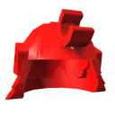{ .lu-ti width="24" loading="lazy" } [NPC Red Samurai Helm (LOT 14833)](../14833.md) | 5 | NPC Red Samurai Helm | 0 matrices; 0 rewards; 0 community references |
| 16587 | { .lu-ti width="24" loading="lazy" } [NPC Red Top Hat (LOT 16587)](../16587.md) | 5 | NPC Red Top Hat | 0 matrices; 0 rewards; 0 community references |
| 14725 | { .lu-ti width="24" loading="lazy" } [NPC Ren Blue Ninja hood (LOT 14725)](../14725.md) | 5 | NPC Ren Blue Ninja hood | 0 matrices; 0 rewards; 0 community references |
| 7113 | { .lu-ti width="24" loading="lazy" } [NPC Renee Hair (LOT 7113)](../7113.md) | 5 | NPC Renee Hair | 0 matrices; 0 rewards; 0 community references |
| 3368 | [NPC Reporter's Hair (LOT 3368)](../3368.md) | 5 | No client description | 0 matrices; 0 rewards; 0 community references |
| 13334 | { .lu-ti width="24" loading="lazy" } [NPC Robot Helm Vendor (LOT 13334)](../13334.md) | 5 | No client description | 0 matrices; 0 rewards; 0 community references |
| 13332 | { .lu-ti width="24" loading="lazy" } [NPC Scuba Helm Vendor (LOT 13332)](../13332.md) | 5 | No client description | 0 matrices; 0 rewards; 0 community references |
| 13101 | { .lu-ti width="24" loading="lazy" } [NPC Sensei Wu Helmet (LOT 13101)](../13101.md) | 5 | No client description | 0 matrices; 0 rewards; 0 community references |
| 12648 | { .lu-ti width="24" loading="lazy" } [NPC Sentinel Scout Helmet (LOT 12648)](../12648.md) | 5 | NPC Sentinel  Scout Helmet | 0 matrices; 0 rewards; 0 community references |
| 16624 | 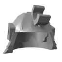{ .lu-ti width="24" loading="lazy" } [NPC Silver Samurai Helm (LOT 16624)](../16624.md) | 5 | No client description | 0 matrices; 0 rewards; 0 community references |
| 13331 | { .lu-ti width="24" loading="lazy" } [NPC Singer Hair Vendor (LOT 13331)](../13331.md) | 5 | No client description | 0 matrices; 0 rewards; 0 community references |
| 13327 | { .lu-ti width="24" loading="lazy" } [NPC Skater Helm Vendor (LOT 13327)](../13327.md) | 5 | No client description | 0 matrices; 0 rewards; 0 community references |
| 12564 | { .lu-ti width="24" loading="lazy" } [NPC Skeleton Head Engineer (LOT 12564)](../12564.md) | 5 | NPC Skeleton Head Engineer | 0 matrices; 0 rewards; 0 community references |
| 14021 | { .lu-ti width="24" loading="lazy" } [NPC Skeleton Maelstrom helmet Head Small 1 (LOT 14021)](../14021.md) | 5 | Small maelstrom helmet Head for NJ Skeleton | 0 matrices; 0 rewards; 0 community references |
| 12304 | { .lu-ti width="24" loading="lazy" } [NPC Skeleton Small 1 (LOT 12304)](../12304.md) | 5 | Small Head for NJ Skeleton | 0 matrices; 0 rewards; 0 community references |
| 13324 | { .lu-ti width="24" loading="lazy" } [NPC Skier Hat Vendor (LOT 13324)](../13324.md) | 5 | No client description | 0 matrices; 0 rewards; 0 community references |
| 6497 | { .lu-ti width="24" loading="lazy" } [NPC Skylane Hair (LOT 6497)](../6497.md) | 5 | NPC Skylane Hair | 0 matrices; 0 rewards; 0 community references |
| 13322 | { .lu-ti width="24" loading="lazy" } [NPC Spaceman Helmet Vendor (LOT 13322)](../13322.md) | 5 | No client description | 0 matrices; 0 rewards; 0 community references |
| 13320 | { .lu-ti width="24" loading="lazy" } [NPC Spartan Helmet Vendor (LOT 13320)](../13320.md) | 5 | No client description | 0 matrices; 0 rewards; 0 community references |
| 10429 | { .lu-ti width="24" loading="lazy" } [NPC Strombie Hair (LOT 10429)](../10429.md) | 4 | No client description | 0 matrices; 0 rewards; 0 community references |
| 10466 | { .lu-ti width="24" loading="lazy" } [NPC Strombie Jaw Helmet (LOT 10466)](../10466.md) | 4 | No client description | 0 matrices; 0 rewards; 0 community references |
| 9790 | { .lu-ti width="24" loading="lazy" } [NPC Swifty McGurk Hat (LOT 9790)](../9790.md) | 5 | No client description | 0 matrices; 0 rewards; 0 community references |
| 2848 | { .lu-ti width="24" loading="lazy" } [NPC Tan Outback Hat (LOT 2848)](../2848.md) | 5 | No client description | 0 matrices; 0 rewards; 0 community references |
| 6655 | { .lu-ti width="24" loading="lazy" } [NPC The Stig's Helmet (LOT 6655)](../6655.md) | 5 | No client description | 0 matrices; 0 rewards; 0 community references |
| 12128 | { .lu-ti width="24" loading="lazy" } [NPC Toy Assember Hat (LOT 12128)](../12128.md) | 4 | NPC Toy Assember Hat | 0 matrices; 0 rewards; 0 community references |
| 13389 | { .lu-ti width="24" loading="lazy" } [NPC Vampire Hair Vendor (LOT 13389)](../13389.md) | 5 | No client description | 0 matrices; 0 rewards; 0 community references |
| 13301 | { .lu-ti width="24" loading="lazy" } [NPC Vanda Darkflame Hair (LOT 13301)](../13301.md) | 4 | NPC Vanda Hair | 0 matrices; 0 rewards; 0 community references |
| 14083 | 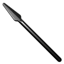{ .lu-ti width="24" loading="lazy" } [NPC Vanda Hair  2.0 (LOT 14083)](../14083.md) | 1 | NPC Vanda Hair  2.0 | 0 matrices; 0 rewards; 0 community references |
| 9791 | { .lu-ti width="24" loading="lazy" } [NPC Velocity Lane Hair (LOT 9791)](../9791.md) | 5 | No client description | 0 matrices; 0 rewards; 0 community references |
| 12622 | { .lu-ti width="24" loading="lazy" } [NPC Venture Scout Helmet (LOT 12622)](../12622.md) | 5 | Venture Scout Helmet | 0 matrices; 0 rewards; 0 community references |
| 14802 | { .lu-ti width="24" loading="lazy" } [NPC Wan Wan Wolf Helm (LOT 14802)](../14802.md) | 5 | No client description | 0 matrices; 0 rewards; 0 community references |
| 12131 | { .lu-ti width="24" loading="lazy" } [NPC Wen Whatzit Hat (LOT 12131)](../12131.md) | 4 | NPC Wen Whatzit Hat | 0 matrices; 0 rewards; 0 community references |
| 5711 | 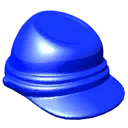{ .lu-ti width="24" loading="lazy" } [NPC Western Cap (LOT 5711)](../5711.md) | 5 | needs icon | 0 matrices; 0 rewards; 0 community references |
| 5695 | { .lu-ti width="24" loading="lazy" } [NPC Winged Helmet (LOT 5695)](../5695.md) | 5 | needs icon | 0 matrices; 0 rewards; 0 community references |
| 6498 | { .lu-ti width="24" loading="lazy" } [NPC Wisp Hair (LOT 6498)](../6498.md) | 5 | NPC Wisp Hair | 0 matrices; 0 rewards; 0 community references |
| 8288 | { .lu-ti width="24" loading="lazy" } [NPC Wisp Lee Hair (LOT 8288)](../8288.md) | 1 | NPC Wisp Lee Hair | 0 matrices; 0 rewards; 0 community references |
| 14723 | { .lu-ti width="24" loading="lazy" } [NPC Zane White Ninja hood (LOT 14723)](../14723.md) | 5 | NPC Zane White Ninja hood | 0 matrices; 0 rewards; 0 community references |
| 12043 | { .lu-ti width="24" loading="lazy" } [NPC Zip Lash Helmet (LOT 12043)](../12043.md) | 4 | Zip Lash Helmet | 0 matrices; 0 rewards; 0 community references |
| 9792 | { .lu-ti width="24" loading="lazy" } [NPCClub Lego Max hat (LOT 9792)](../9792.md) | 5 | No client description | 0 matrices; 0 rewards; 0 community references |
| 13337 | { .lu-ti width="24" loading="lazy" } [NPCNurse Hair Vendor (LOT 13337)](../13337.md) | 5 | No client description | 0 matrices; 0 rewards; 0 community references |
| 11940 | { .lu-ti width="24" loading="lazy" } [NS Waves Zone Control Object (LOT 11940)](../11940.md) | 4 | NS Zone Control Object for Waves | 0 matrices; 0 rewards; 0 community references |
| 3869 | { .lu-ti width="24" loading="lazy" } [Orange Baseball Cap (LOT 3869)](../3869.md) | 2 | No client description | 23 matrices; 0 rewards; 1 community references |
| 12601 | { .lu-ti width="24" loading="lazy" } [Padded Toque of Healing (LOT 12601)](../12601.md) | 2 | No client description | 0 matrices; 1 rewards; 1 community references |
| 7834 | { .lu-ti width="24" loading="lazy" } [Pharaoh's Hat (LOT 7834)](../7834.md) | 4 | No client description | 1 matrices; 0 rewards; 1 community references |
| 15960 | 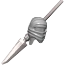{ .lu-ti width="24" loading="lazy" } [Piercing Patch Hood (LOT 15960)](../15960.md) | 3 | No client description | 0 matrices; 1 rewards; 1 community references |
| 2635 | { .lu-ti width="24" loading="lazy" } [Pirate Captain Hat (LOT 2635)](../2635.md) | 3 | Wear this in Nimbus Station to launch your rocket to the Pirate Camp | 0 matrices; 1 rewards; 1 community references |
| 6199 | 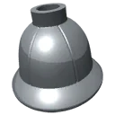{ .lu-ti width="24" loading="lazy" } [Pith Helmet (LOT 6199)](../6199.md) | 2 | No client description | 0 matrices; 1 rewards; 1 community references |
| 9532 | { .lu-ti width="24" loading="lazy" } [plastic Helmet (LOT 9532)](../9532.md) | 5 | Standard Knight Helmet Metal | 0 matrices; 0 rewards; 0 community references |
| 12740 | 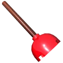{ .lu-ti width="24" loading="lazy" } [Plunger Hat (LOT 12740)](../12740.md) | 3 | No client description | 0 matrices; 1 rewards; 1 community references |
| 3859 | { .lu-ti width="24" loading="lazy" } [Police Hat (LOT 3859)](../3859.md) | 2 | No client description | 23 matrices; 0 rewards; 1 community references |
| 15917 | { .lu-ti width="24" loading="lazy" } [Practice Kabuto (LOT 15917)](../15917.md) | 2 | No client description | 27 matrices; 0 rewards; 1 community references |
| 4924 | { .lu-ti width="24" loading="lazy" } [Prismatic Baseball Cap (LOT 4924)](../4924.md) | 3 | Changes color with your mood! | 0 matrices; 1 rewards; 1 community references |
| 4923 | 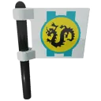{ .lu-ti width="24" loading="lazy" } [PvP Blue Flag Loot (LOT 4923)](../4923.md) | 5 | No client description | 0 matrices; 0 rewards; 0 community references |
| 2247 | 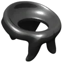{ .lu-ti width="24" loading="lazy" } [PvP Slow Scarf (LOT 2247)](../2247.md) | 5 | No client description | 0 matrices; 0 rewards; 0 community references |
| 14098 | 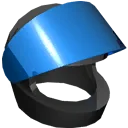{ .lu-ti width="24" loading="lazy" } [Race Ace Helmet (LOT 14098)](../14098.md) | 3 | No client description | 0 matrices; 0 rewards; 0 community references |
| 14099 | 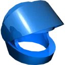{ .lu-ti width="24" loading="lazy" } [Racemaster Helmet (LOT 14099)](../14099.md) | 4 | No client description | 0 matrices; 0 rewards; 0 community references |
| 2988 | 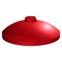{ .lu-ti width="24" loading="lazy" } [Red Conical Hat (LOT 2988)](../2988.md) | 2 | No client description | 0 matrices; 0 rewards; 0 community references |
| 1889 | { .lu-ti width="24" loading="lazy" } [Red Ninja Hood - Maelstrom Infused (LOT 1889)](../1889.md) | 3 | Pass Paradox Force Fields, Rocket to the Great Tree | 0 matrices; 1 rewards; 1 community references |
| 2979 | 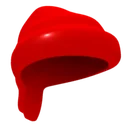{ .lu-ti width="24" loading="lazy" } [Red Pirate Scarf (LOT 2979)](../2979.md) | 2 | No client description | 0 matrices; 1 rewards; 1 community references |
| 7730 | 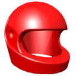{ .lu-ti width="24" loading="lazy" } [Red Racing Helmet (LOT 7730)](../7730.md) | 2 | No client description | 3 matrices; 1 rewards; 1 community references |
| 8085 | { .lu-ti width="24" loading="lazy" } [Red Shako Hat (LOT 8085)](../8085.md) | 3 | No client description | 11 matrices; 0 rewards; 1 community references |
| 8675 | 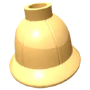{ .lu-ti width="24" loading="lazy" } [Reinforced Pith Helmet (LOT 8675)](../8675.md) | 3 | No client description | 17 matrices; 0 rewards; 1 community references |
| 11909 | { .lu-ti width="24" loading="lazy" } [Ribbit's Top Hat (LOT 11909)](../11909.md) | 4 | No client description | 1 matrices; 0 rewards; 0 community references |
| 15926 | { .lu-ti width="24" loading="lazy" } [Rice Hat (LOT 15926)](../15926.md) | 2 | No client description | 0 matrices; 1 rewards; 1 community references |
| 8679 | 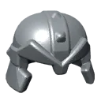{ .lu-ti width="24" loading="lazy" } [Rounded Helm (LOT 8679)](../8679.md) | 2 | No client description | 0 matrices; 1 rewards; 1 community references |
| 8685 | 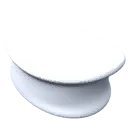{ .lu-ti width="24" loading="lazy" } [Sailor Hat (LOT 8685)](../8685.md) | 3 | No client description | 8 matrices; 0 rewards; 1 community references |
| 7445 | 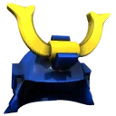{ .lu-ti width="24" loading="lazy" } [Samurai Helm 1 (LOT 7445)](../7445.md) | 4 | Rank 1 Specialty Kit Item | 2 matrices; 0 rewards; 0 community references |
| 7446 | 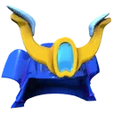{ .lu-ti width="24" loading="lazy" } [Samurai Helm 2 (LOT 7446)](../7446.md) | 4 | Rank 2 Specialty Kit Item | 1 matrices; 0 rewards; 0 community references |
| 7447 | 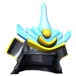{ .lu-ti width="24" loading="lazy" } [Samurai Helm 3 (LOT 7447)](../7447.md) | 4 | Rank 3 Specialty Kit Item | 1 matrices; 0 rewards; 0 community references |
| 12976 | 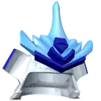{ .lu-ti width="24" loading="lazy" } [Samurai Helm 3 (LOT 12976)](../12976.md) | 4 | Rank 3 Specialty Kit Item | 1 matrices; 0 rewards; 0 community references |
| 13525 | 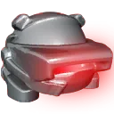{ .lu-ti width="24" loading="lazy" } [Scanning Helm (LOT 13525)](../13525.md) | 4 | No client description | 0 matrices; 1 rewards; 1 community references |
| 15920 | { .lu-ti width="24" loading="lazy" } [Scholar's Travel Hat (LOT 15920)](../15920.md) | 4 | No client description | 27 matrices; 0 rewards; 1 community references |
| 8547 | 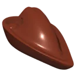{ .lu-ti width="24" loading="lazy" } [Scoundrel Cap (LOT 8547)](../8547.md) | 2 | No client description | 15 matrices; 0 rewards; 1 community references |
| 7451 | 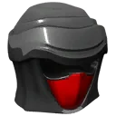{ .lu-ti width="24" loading="lazy" } [Shinobi Hood 1 (LOT 7451)](../7451.md) | 4 | Rank 1 Specialty Kit Item | 2 matrices; 0 rewards; 0 community references |
| 7452 | 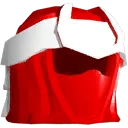{ .lu-ti width="24" loading="lazy" } [Shinobi Hood 2 (LOT 7452)](../7452.md) | 4 | Rank 2 Specialty Kit Item | 1 matrices; 0 rewards; 0 community references |
| 7453 | 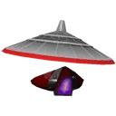{ .lu-ti width="24" loading="lazy" } [Shinobi Hood 3 (LOT 7453)](../7453.md) | 4 | Rank 3 Specialty Kit Item | 1 matrices; 0 rewards; 0 community references |
| 6794 | 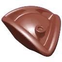{ .lu-ti width="24" loading="lazy" } [Sideways Pirate Hat (LOT 6794)](../6794.md) | 3 | No client description | 0 matrices; 1 rewards; 0 community references |
| 7728 | { .lu-ti width="24" loading="lazy" } [Skater Helmet (LOT 7728)](../7728.md) | 2 | No client description | 23 matrices; 0 rewards; 1 community references |
| 15954 | 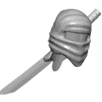{ .lu-ti width="24" loading="lazy" } [Slash and Stitch (LOT 15954)](../15954.md) | 4 | No client description | 27 matrices; 0 rewards; 1 community references |
| 7357 | 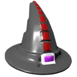{ .lu-ti width="24" loading="lazy" } [Sorcerer Hat 1 (LOT 7357)](../7357.md) | 4 | Rank 1 Specialty Kit Item | 2 matrices; 0 rewards; 0 community references |
| 7361 | 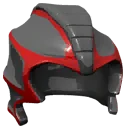{ .lu-ti width="24" loading="lazy" } [Sorcerer Hat 2 (LOT 7361)](../7361.md) | 4 | Rank 2 Specialty Kit Item | 1 matrices; 0 rewards; 0 community references |
| 7362 | 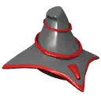{ .lu-ti width="24" loading="lazy" } [Sorcerer Hat 3 (LOT 7362)](../7362.md) | 4 | Rank 3 Specialty Kit Item | 1 matrices; 0 rewards; 0 community references |
| 12983 | 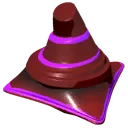{ .lu-ti width="24" loading="lazy" } [Sorcerer Hat 3 (LOT 12983)](../12983.md) | 4 | Rank 3 Specialty Kit Item | 1 matrices; 0 rewards; 0 community references |
| 8546 | 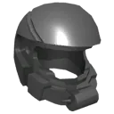{ .lu-ti width="24" loading="lazy" } [Space Headgear (LOT 8546)](../8546.md) | 3 | No client description | 17 matrices; 0 rewards; 1 community references |
| 7448 | 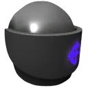{ .lu-ti width="24" loading="lazy" } [Space Marauder Helm 1 (LOT 7448)](../7448.md) | 4 | Rank 1 Specialty Kit Item | 2 matrices; 0 rewards; 0 community references |
| 7449 | 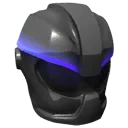{ .lu-ti width="24" loading="lazy" } [Space Marauder Helm 2 (LOT 7449)](../7449.md) | 4 | Rank 2 Specialty Kit Item | 1 matrices; 0 rewards; 0 community references |
| 7450 | 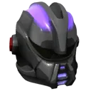{ .lu-ti width="24" loading="lazy" } [Space Marauder Helm 3 (LOT 7450)](../7450.md) | 4 | Rank 3 Specialty Kit Item | 1 matrices; 0 rewards; 0 community references |
| 12986 | { .lu-ti width="24" loading="lazy" } [Space Marauder Helm 3 (LOT 12986)](../12986.md) | 4 | Rank 3 Specialty Kit Item | 1 matrices; 0 rewards; 0 community references |
| 7442 | 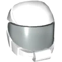{ .lu-ti width="24" loading="lazy" } [Space Ranger Helmet 1 (LOT 7442)](../7442.md) | 4 | Rank 1 Specialty Kit Item | 2 matrices; 0 rewards; 0 community references |
| 7443 | 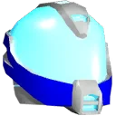{ .lu-ti width="24" loading="lazy" } [Space Ranger Helmet 2 (LOT 7443)](../7443.md) | 4 | Rank 2 Specialty Kit Item | 1 matrices; 0 rewards; 0 community references |
| 7444 | 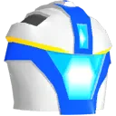{ .lu-ti width="24" loading="lazy" } [Space Ranger Helmet 3 (LOT 7444)](../7444.md) | 4 | Rank 3 Specialty Kit Item | 1 matrices; 0 rewards; 0 community references |
| 15959 | 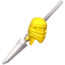{ .lu-ti width="24" loading="lazy" } [Spearman's Healing Hood (LOT 15959)](../15959.md) | 3 | No client description | 27 matrices; 0 rewards; 1 community references |
| 5995 | 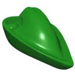{ .lu-ti width="24" loading="lazy" } [Speedy Cap (LOT 5995)](../5995.md) | 3 | No client description | 0 matrices; 1 rewards; 1 community references |
| 8636 | { .lu-ti width="24" loading="lazy" } [Squire's Helm (LOT 8636)](../8636.md) | 3 | No client description | 13 matrices; 0 rewards; 1 community references |
| 10465 | { .lu-ti width="24" loading="lazy" } [Strombie Spike Helmet (LOT 10465)](../10465.md) | 4 | No client description | 0 matrices; 0 rewards; 0 community references |
| 13748 | [Stromling Disguise Head Proxy (LOT 13748)](../13748.md) | 1 | Used in the nexus tower mission chain | 0 matrices; 0 rewards; 0 community references |
| 7457 | { .lu-ti width="24" loading="lazy" } [Summoner Hat 1 (LOT 7457)](../7457.md) | 4 | Rank 1 Specialty Kit Item | 2 matrices; 0 rewards; 0 community references |
| 7458 | { .lu-ti width="24" loading="lazy" } [Summoner Hat 2 (LOT 7458)](../7458.md) | 4 | Rank 2 Specialty Kit Item | 1 matrices; 0 rewards; 0 community references |
| 7459 | 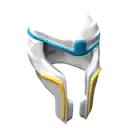{ .lu-ti width="24" loading="lazy" } [Summoner Hat 3 (LOT 7459)](../7459.md) | 4 | Rank 3 Specialty Kit Item | 1 matrices; 0 rewards; 0 community references |
| 12924 | 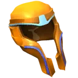{ .lu-ti width="24" loading="lazy" } [Summoner Hat 3 (LOT 12924)](../12924.md) | 4 | Rank 3 Specialty Kit Item | 1 matrices; 0 rewards; 0 community references |
| 7789 | 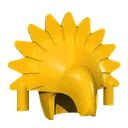{ .lu-ti width="24" loading="lazy" } [Sun Headdress (LOT 7789)](../7789.md) | 3 | No client description | 1 matrices; 0 rewards; 1 community references |
| 6197 | { .lu-ti width="24" loading="lazy" } [Tan Aussie Hat (LOT 6197)](../6197.md) | 2 | No client description | 0 matrices; 1 rewards; 1 community references |
| 8426 | 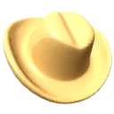{ .lu-ti width="24" loading="lazy" } [Tan Cowboy Hat (LOT 8426)](../8426.md) | 1 | No client description | 4 matrices; 0 rewards; 1 community references |
| 15916 | { .lu-ti width="24" loading="lazy" } [Tarnished Kabuto (LOT 15916)](../15916.md) | 3 | No client description | 27 matrices; 0 rewards; 1 community references |
| 2844 | [Test Brown Aviator Hat (LOT 2844)](../2844.md) | 5 | bad offset, needs icon | 0 matrices; 0 rewards; 0 community references |
| 7994 | { .lu-ti width="24" loading="lazy" } [Test Chris' Hat (LOT 7994)](../7994.md) | 5 | for test purposes only | 0 matrices; 0 rewards; 0 community references |
| 2246 | [Test Conical Hat (LOT 2246)](../2246.md) | 5 | No client description | 0 matrices; 0 rewards; 0 community references |
| 12517 | { .lu-ti width="24" loading="lazy" } [TEST DELETE ME (LOT 12517)](../12517.md) | 4 | No client description | 0 matrices; 0 rewards; 0 community references |
| 14174 | 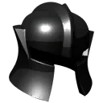{ .lu-ti width="24" loading="lazy" } [test hael hair (LOT 14174)](../14174.md) | 1 | test hael hair | 0 matrices; 0 rewards; 0 community references |
| 6248 | { .lu-ti width="24" loading="lazy" } [Test Hat of Attacking (LOT 6248)](../6248.md) | 5 | for testing the action bar - bad offset | 0 matrices; 0 rewards; 0 community references |
| 6970 | { .lu-ti width="24" loading="lazy" } [Test Hat of Damage Absorption for Nic (LOT 6970)](../6970.md) | 5 | For Nic to test the skill | 0 matrices; 0 rewards; 0 community references |
| 6971 | 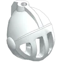{ .lu-ti width="24" loading="lazy" } [Test Hat of Damage Buff for Nic (LOT 6971)](../6971.md) | 5 | For Nic to test the skill | 0 matrices; 0 rewards; 0 community references |
| 6969 | { .lu-ti width="24" loading="lazy" } [Test Hat of Immunity for Nic (LOT 6969)](../6969.md) | 5 | For Nic to test the skill | 0 matrices; 0 rewards; 0 community references |
| 13603 | 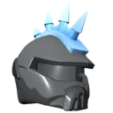{ .lu-ti width="24" loading="lazy" } [Test Hat of Skill Testing (LOT 13603)](../13603.md) | 4 | Used to test non main hand skills | 0 matrices; 0 rewards; 0 community references |
| 12219 | { .lu-ti width="24" loading="lazy" } [Test Item with Precondition for Vendor (LOT 12219)](../12219.md) | 1 | For UI Testing | 1 matrices; 0 rewards; 0 community references |
| 1723 | [Test Knight Helmet (LOT 1723)](../1723.md) | 5 | No client description | 0 matrices; 0 rewards; 0 community references |
| 14305 | { .lu-ti width="24" loading="lazy" } [TEST Maelstrom Item (LOT 14305)](../14305.md) | 2 | No client description | 0 matrices; 0 rewards; 0 community references |
| 10005 | { .lu-ti width="24" loading="lazy" } [Test Minifigure&#95;26 (LOT 10005)](../10005.md) | 5 | Test Minifigure&#95;26 | 0 matrices; 0 rewards; 0 community references |
| 10066 | { .lu-ti width="24" loading="lazy" } [Test NPC Hael Storm Dread locks (LOT 10066)](../10066.md) | 5 | NPC Hael Storm Dread locks | 0 matrices; 0 rewards; 0 community references |
| 12490 | [Test Object (LOT 12490)](../12490.md) | 3 | No client description | 0 matrices; 0 rewards; 0 community references |
| 6288 | { .lu-ti width="24" loading="lazy" } [Test Object for demo (LOT 6288)](../6288.md) | 5 | test data | 0 matrices; 0 rewards; 0 community references |
| 2846 | { .lu-ti width="24" loading="lazy" } [Test Orange Space Helmet (LOT 2846)](../2846.md) | 5 | needs orange icon | 0 matrices; 0 rewards; 0 community references |
| 8273 | { .lu-ti width="24" loading="lazy" } [Test Performance Test Helmet (LOT 8273)](../8273.md) | 5 | For performance testing accessories | 0 matrices; 0 rewards; 0 community references |
| 2843 | { .lu-ti width="24" loading="lazy" } [Test Pink Wizard Hat (LOT 2843)](../2843.md) | 5 | No client description | 0 matrices; 0 rewards; 0 community references |
| 9788 | { .lu-ti width="24" loading="lazy" } [Test Player won't see this item (LOT 9788)](../9788.md) | 5 | Test for Yegge | 0 matrices; 0 rewards; 0 community references |
| 5964 | { .lu-ti width="24" loading="lazy" } [Test prereq system - pet turban (LOT 5964)](../5964.md) | 5 | Put this on to start building | 0 matrices; 0 rewards; 0 community references |
| 13977 | { .lu-ti width="24" loading="lazy" } [Test Rank 1 Hat (LOT 13977)](../13977.md) | 4 | No client description | 0 matrices; 0 rewards; 0 community references |
| 13978 | { .lu-ti width="24" loading="lazy" } [Test Rank 2 Hat (LOT 13978)](../13978.md) | 4 | No client description | 0 matrices; 0 rewards; 0 community references |
| 13992 | { .lu-ti width="24" loading="lazy" } [Test Rank 3 Hat (LOT 13992)](../13992.md) | 4 | No client description | 0 matrices; 0 rewards; 0 community references |
| 10019 | { .lu-ti width="24" loading="lazy" } [Test Ryans Helmet (LOT 10019)](../10019.md) | 5 | No client description | 0 matrices; 0 rewards; 0 community references |
| 5950 | { .lu-ti width="24" loading="lazy" } [Test Set ninja1 - Head (LOT 5950)](../5950.md) | 5 | hat/helmet for item set test | 0 matrices; 0 rewards; 0 community references |
| 13949 | { .lu-ti width="24" loading="lazy" } [TEST Tower Grid Hat (LOT 13949)](../13949.md) | 3 | No client description | 0 matrices; 0 rewards; 0 community references |
| 13968 | { .lu-ti width="24" loading="lazy" } [TEST Tower Grid Hat B (LOT 13968)](../13968.md) | 3 | No client description | 0 matrices; 0 rewards; 0 community references |
| 10288 | { .lu-ti width="24" loading="lazy" } [Test Will test Hat (LOT 10288)](../10288.md) | 5 | No client description | 0 matrices; 0 rewards; 0 community references |
| 7936 | { .lu-ti width="24" loading="lazy" } [Test&#95;Acc&#95;Helmet1 (LOT 7936)](../7936.md) | 5 | Test object for brett | 0 matrices; 0 rewards; 0 community references |
| 7999 | { .lu-ti width="24" loading="lazy" } [Test&#95;Acc&#95;ProxyHelmet (LOT 7999)](../7999.md) | 5 | Test object for brett | 0 matrices; 0 rewards; 0 community references |
| 15961 | { .lu-ti width="24" loading="lazy" } [Think and Throw (LOT 15961)](../15961.md) | 3 | No client description | 27 matrices; 0 rewards; 1 community references |
| 6086 | { .lu-ti width="24" loading="lazy" } [Thinking Hat (LOT 6086)](../6086.md) | 2 | Wear this hat to start building! | 0 matrices; 1 rewards; 1 community references |
| 7009 | { .lu-ti width="24" loading="lazy" } [Thinking Hat Level 2 (LOT 7009)](../7009.md) | 1 | No client description | 0 matrices; 0 rewards; 0 community references |
| 7010 | { .lu-ti width="24" loading="lazy" } [Thinking Hat Level 3 (LOT 7010)](../7010.md) | 1 | No client description | 0 matrices; 0 rewards; 0 community references |
| 15955 | { .lu-ti width="24" loading="lazy" } [Thought Blade (LOT 15955)](../15955.md) | 3 | No client description | 0 matrices; 1 rewards; 1 community references |
| 14353 | { .lu-ti width="24" loading="lazy" } [Trial Assembly Gear (LOT 14353)](../14353.md) | 1 | The Summoner wields a Gnarled Staff and summons a Thwok creature to aid in battle! | 0 matrices; 2 rewards; 0 community references |
| 14321 | { .lu-ti width="24" loading="lazy" } [Trial Paradox Gear (LOT 14321)](../14321.md) | 1 | The Space Marauder blasts enemies with a Blaster Master and Maelstrom Rockets! | 0 matrices; 2 rewards; 0 community references |
| 14315 | { .lu-ti width="24" loading="lazy" } [Trial Sentinel Gear (LOT 14315)](../14315.md) | 1 | The Knight charges enemies with a Shield Slam and slashes with a Knight's Blade! | 0 matrices; 2 rewards; 0 community references |
| 14359 | { .lu-ti width="24" loading="lazy" } [Trial Venture League Gear (LOT 14359)](../14359.md) | 1 | The Daredevil blasts enemies with Flare Guns and sets them ablaze with Fig on Fire! | 0 matrices; 2 rewards; 0 community references |
| 6922 | { .lu-ti width="24" loading="lazy" } [Turban of Healing (LOT 6922)](../6922.md) | 3 | No client description | 1 matrices; 1 rewards; 1 community references |
| 10022 | { .lu-ti width="24" loading="lazy" } [VFX Thinking Cap Tester (LOT 10022)](../10022.md) | 4 | VFX Thinking Cap Tester | 0 matrices; 0 rewards; 0 community references |
| 7729 | { .lu-ti width="24" loading="lazy" } [Viking Helm (LOT 7729)](../7729.md) | 2 | No client description | 23 matrices; 0 rewards; 0 community references |
| 12769 | { .lu-ti width="24" loading="lazy" } [Visored Racing Helmet (LOT 12769)](../12769.md) | 2 | No client description | 1 matrices; 0 rewards; 1 community references |
| 12737 | { .lu-ti width="24" loading="lazy" } [Visored Space Helm (LOT 12737)](../12737.md) | 2 | No client description | 0 matrices; 1 rewards; 1 community references |
| 8036 | { .lu-ti width="24" loading="lazy" } [Warlord Helm (LOT 8036)](../8036.md) | 2 | No client description | 1 matrices; 0 rewards; 1 community references |
| 12242 | { .lu-ti width="24" loading="lazy" } [Warm Cap (LOT 12242)](../12242.md) | 2 | No client description | 2 matrices; 0 rewards; 1 community references |
| 2587 | { .lu-ti width="24" loading="lazy" } [White Baseball Cap (LOT 2587)](../2587.md) | 1 | No client description | 4 matrices; 0 rewards; 1 community references |
| 2647 | { .lu-ti width="24" loading="lazy" } [White Conical Hat (LOT 2647)](../2647.md) | 2 | No client description | 1 matrices; 1 rewards; 1 community references |
| 8425 | { .lu-ti width="24" loading="lazy" } [White Cowboy Hat (LOT 8425)](../8425.md) | 3 | No client description | 4 matrices; 0 rewards; 1 community references |
| 14675 | { .lu-ti width="24" loading="lazy" } [White Ninja Hood (LOT 14675)](../14675.md) | 5 | White Ninja Hood Ninjago NPC Zane | 0 matrices; 0 rewards; 0 community references |
| 8038 | { .lu-ti width="24" loading="lazy" } [White Racing Helmet (LOT 8038)](../8038.md) | 2 | No client description | 2 matrices; 0 rewards; 1 community references |
| 11291 | { .lu-ti width="24" loading="lazy" } [White Top Hat (LOT 11291)](../11291.md) | 3 | No client description | 0 matrices; 1 rewards; 1 community references |
| 12289 | { .lu-ti width="24" loading="lazy" } [Winter Parka (LOT 12289)](../12289.md) | 2 | No client description | 0 matrices; 1 rewards; 1 community references |
| 3853 | { .lu-ti width="24" loading="lazy" } [Witch Hat (LOT 3853)](../3853.md) | 2 | No client description | 23 matrices; 0 rewards; 1 community references |
| 2623 | { .lu-ti width="24" loading="lazy" } [Wizard Hat (LOT 2623)](../2623.md) | 2 | No client description | 24 matrices; 0 rewards; 1 community references |
| 6932 | { .lu-ti width="24" loading="lazy" } [Wizard's Hat of Whirlwind (LOT 6932)](../6932.md) | 2 | No client description | 1 matrices; 1 rewards; 0 community references |
| 7782 | { .lu-ti width="24" loading="lazy" } [Wolf Head Helmet (LOT 7782)](../7782.md) | 4 | No client description | 0 matrices; 1 rewards; 0 community references |
| 15919 | { .lu-ti width="24" loading="lazy" } [Workman's Rice Hat (LOT 15919)](../15919.md) | 3 | No client description | 0 matrices; 1 rewards; 1 community references |
| 8039 | { .lu-ti width="24" loading="lazy" } [Yellow Racing Helmet (LOT 8039)](../8039.md) | 2 | No client description | 2 matrices; 1 rewards; 1 community references |
| 16611 | { .lu-ti width="24" loading="lazy" } [Zane's Hood of Frost (LOT 16611)](../16611.md) | 3 | Wear this to look like Zane! | 1 matrices; 0 rewards; 1 community references |
