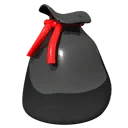
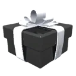
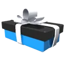
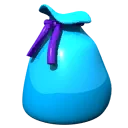

# Package — page 1/1

[Item database](../README.md)

Pages: [1](type-20-1.md)

| LOT | Item | Rarity | Description | Source evidence |
| --- | --- | --- | --- | --- |
| 13638 | { .lu-ti width="24" loading="lazy" } [Unnamed LOT 13638 (LOT 13638)](../13638.md) | 4 | No client description | 0 matrices; 0 rewards; 0 community references |
| 14147 | { .lu-ti width="24" loading="lazy" } [12 Month Membership Reward (LOT 14147)](../14147.md) | 1 | Double-click to get your reward! | 0 matrices; 1 rewards; 0 community references |
| 11316 | { .lu-ti width="24" loading="lazy" } [12 Month Subscriber Reward Pack (LOT 11316)](../11316.md) | 3 | Double-click to open this pack of rewards! | 0 matrices; 1 rewards; 0 community references |
| 14148 | { .lu-ti width="24" loading="lazy" } [6 Month Membership Reward (LOT 14148)](../14148.md) | 1 | Double-click to get your reward! | 0 matrices; 1 rewards; 0 community references |
| 11312 | { .lu-ti width="24" loading="lazy" } [Amazon Reward Pack (LOT 11312)](../11312.md) | 3 | Double-click to open this pack of rewards! | 0 matrices; 1 rewards; 0 community references |
| 14680 | { .lu-ti width="24" loading="lazy" } [Armor Repair Kit (LOT 14680)](../14680.md) | 3 | Double-click to use! | 149 matrices; 4 rewards; 0 community references |
| 9775 | { .lu-ti width="24" loading="lazy" } [Basic Tree Model Pack (LOT 9775)](../9775.md) | 1 | Double-click to open this pack of models! | 0 matrices; 1 rewards; 0 community references |
| 12524 | { .lu-ti width="24" loading="lazy" } [Behavior Model Pack 1 (LOT 12524)](../12524.md) | 1 | Double-click to use! | 0 matrices; 0 rewards; 0 community references |
| 12525 | { .lu-ti width="24" loading="lazy" } [Behavior Model Pack 2 (LOT 12525)](../12525.md) | 1 | Double-click to use! | 0 matrices; 0 rewards; 0 community references |
| 12526 | { .lu-ti width="24" loading="lazy" } [Behavior Model Pack 3 (LOT 12526)](../12526.md) | 1 | Double-click to use! | 0 matrices; 0 rewards; 0 community references |
| 11311 | { .lu-ti width="24" loading="lazy" } [Best Buy Reward Pack (LOT 11311)](../11311.md) | 3 | Double-click to open this pack of rewards! | 0 matrices; 1 rewards; 0 community references |
| 11309 | { .lu-ti width="24" loading="lazy" } [BestBuy Reward Pack (LOT 11309)](../11309.md) | 3 | Double-click to open this pack of rewards! | 0 matrices; 0 rewards; 0 community references |
| 11181 | { .lu-ti width="24" loading="lazy" } [Beta Testing Gear Pack (LOT 11181)](../11181.md) | 1 | Double-click to open this pack of gear! | 0 matrices; 1 rewards; 0 community references |
| 9468 | { .lu-ti width="24" loading="lazy" } [Blue Hyperstarter Package (LOT 9468)](../9468.md) | 1 | Double-click to get the blue Hyperstarter Car modules! | 0 matrices; 1 rewards; 0 community references |
| 5834 | { .lu-ti width="24" loading="lazy" } [Brick Booster Pack (LOT 5834)](../5834.md) | 1 | Double-click to open this pack of bricks! | 125 matrices; 4 rewards; 1 community references |
| 10700 | { .lu-ti width="24" loading="lazy" } [Brickmaster Model Pack (LOT 10700)](../10700.md) | 1 | Double-click to open this pack of models! | 0 matrices; 1 rewards; 0 community references |
| 10458 | { .lu-ti width="24" loading="lazy" } [Build Event Rocket Pack (LOT 10458)](../10458.md) | 2 | Double-click to open this pack of rocket parts! | 0 matrices; 1 rewards; 0 community references |
| 9469 | { .lu-ti width="24" loading="lazy" } [Burst Tamale Package (LOT 9469)](../9469.md) | 3 | Double-click to open this pack of car modules! | 0 matrices; 1 rewards; 0 community references |
| 9721 | { .lu-ti width="24" loading="lazy" } [Castle Model Pack 1 (LOT 9721)](../9721.md) | 1 | Double-click to open this pack of models! | 0 matrices; 1 rewards; 0 community references |
| 9722 | { .lu-ti width="24" loading="lazy" } [Castle Model Pack 2 (LOT 9722)](../9722.md) | 1 | Double-click to open this pack of models! | 0 matrices; 1 rewards; 0 community references |
| 9723 | { .lu-ti width="24" loading="lazy" } [Castle Model Pack 3 (LOT 9723)](../9723.md) | 1 | Double-click to open this pack of models! | 0 matrices; 1 rewards; 0 community references |
| 9724 | { .lu-ti width="24" loading="lazy" } [Castle Model Pack 4 (LOT 9724)](../9724.md) | 1 | Double-click to open this pack of models! | 0 matrices; 1 rewards; 0 community references |
| 9725 | { .lu-ti width="24" loading="lazy" } [Castle Model Pack 5 (LOT 9725)](../9725.md) | 1 | Double-click to open this pack of models! | 0 matrices; 2 rewards; 0 community references |
| 9726 | { .lu-ti width="24" loading="lazy" } [Castle Model Pack 6 (LOT 9726)](../9726.md) | 1 | Double-click to open this pack of models! | 0 matrices; 1 rewards; 0 community references |
| 11256 | { .lu-ti width="24" loading="lazy" } [Daily Token Pack (LOT 11256)](../11256.md) | 3 | Double-click to open this pack of tokens! | 0 matrices; 0 rewards; 0 community references |
| 12527 | { .lu-ti width="24" loading="lazy" } [Doom Star Model Pack 1 (LOT 12527)](../12527.md) | 1 | Double-click to use! | 0 matrices; 1 rewards; 0 community references |
| 12528 | { .lu-ti width="24" loading="lazy" } [Doom Star Model Pack 2 (LOT 12528)](../12528.md) | 1 | Double-click to use! | 0 matrices; 1 rewards; 0 community references |
| 12529 | { .lu-ti width="24" loading="lazy" } [Doom Star Model Pack 3 (LOT 12529)](../12529.md) | 1 | Double-click to use! | 0 matrices; 1 rewards; 0 community references |
| 15976 | { .lu-ti width="24" loading="lazy" } [Duck Car Reward Pack (LOT 15976)](../15976.md) | 1 | Double-click to open! | 0 matrices; 1 rewards; 0 community references |
| 15979 | { .lu-ti width="24" loading="lazy" } [Duck Rocket Reward Pack (LOT 15979)](../15979.md) | 1 | Double-click to open! | 0 matrices; 1 rewards; 0 community references |
| 15980 | { .lu-ti width="24" loading="lazy" } [Dune Buggy Reward Pack (LOT 15980)](../15980.md) | 1 | Double-click to open! | 0 matrices; 1 rewards; 0 community references |
| 14486 | { .lu-ti width="24" loading="lazy" } [Earth Key (LOT 14486)](../14486.md) | 1 | Use this to open the treasure chest in the Dojo of Earth. | 0 matrices; 1 rewards; 0 community references |
| 14552 | { .lu-ti width="24" loading="lazy" } [Earth Ninja Kit (LOT 14552)](../14552.md) | 1 | Return this to Cole in the Monastery. | 1 matrices; 0 rewards; 0 community references |
| 12425 | { .lu-ti width="24" loading="lazy" } [Extra Large Bag of Faction Tokens (LOT 12425)](../12425.md) | 1 | Double-click to get 20 Faction Tokens! | 0 matrices; 25 rewards; 0 community references |
| 10417 | { .lu-ti width="24" loading="lazy" } [Fancy Tree Model Pack (LOT 10417)](../10417.md) | 1 | Double-click to open this pack of models! | 0 matrices; 1 rewards; 0 community references |
| 12521 | { .lu-ti width="24" loading="lazy" } [Farm Model Pack 1 (LOT 12521)](../12521.md) | 1 | Double-click to use! | 0 matrices; 1 rewards; 0 community references |
| 12522 | { .lu-ti width="24" loading="lazy" } [Farm Model Pack 2 (LOT 12522)](../12522.md) | 1 | Double-click to use! | 0 matrices; 1 rewards; 0 community references |
| 12523 | { .lu-ti width="24" loading="lazy" } [Farm Model Pack 3 (LOT 12523)](../12523.md) | 1 | Double-click to use! | 0 matrices; 1 rewards; 0 community references |
| 14487 | { .lu-ti width="24" loading="lazy" } [Fire Key (LOT 14487)](../14487.md) | 4 | Use this to open the treasure chest in the Dojo of Fire. | 0 matrices; 1 rewards; 0 community references |
| 16497 | { .lu-ti width="24" loading="lazy" } [Fire Ninja Kit (LOT 16497)](../16497.md) | 1 | Return this to Kai in the Monastery. | 1 matrices; 0 rewards; 0 community references |
| 11315 | { .lu-ti width="24" loading="lazy" } [Founder's Reward Pack (LOT 11315)](../11315.md) | 3 | Double-click to open this pack of rewards! | 0 matrices; 1 rewards; 0 community references |
| 13073 | { .lu-ti width="24" loading="lazy" } [Fright Speed Car Part Pack (LOT 13073)](../13073.md) | 2 | Double-click to use! | 0 matrices; 3 rewards; 0 community references |
| 14195 | { .lu-ti width="24" loading="lazy" } [Game Card Reward Pack (LOT 14195)](../14195.md) | 1 | Double-click to open! | 0 matrices; 1 rewards; 0 community references |
| 14196 | { .lu-ti width="24" loading="lazy" } [Game Card Reward Pack (LOT 14196)](../14196.md) | 1 | Double-click to open! | 0 matrices; 1 rewards; 0 community references |
| 14197 | { .lu-ti width="24" loading="lazy" } [Game Card Reward Pack (LOT 14197)](../14197.md) | 1 | Double-click to open! | 0 matrices; 1 rewards; 0 community references |
| 14198 | { .lu-ti width="24" loading="lazy" } [Game Card Reward Pack (LOT 14198)](../14198.md) | 1 | Double-click to open! | 0 matrices; 1 rewards; 0 community references |
| 14767 | { .lu-ti width="24" loading="lazy" } [Game Card Reward Pack (LOT 14767)](../14767.md) | 1 | Double-click to open! | 0 matrices; 1 rewards; 0 community references |
| 14768 | { .lu-ti width="24" loading="lazy" } [Game Card Reward Pack (LOT 14768)](../14768.md) | 1 | Double-click to open! | 0 matrices; 1 rewards; 0 community references |
| 14769 | { .lu-ti width="24" loading="lazy" } [Game Card Reward Pack (LOT 14769)](../14769.md) | 1 | Double-click to open! | 0 matrices; 1 rewards; 0 community references |
| 14770 | { .lu-ti width="24" loading="lazy" } [Game Card Reward Pack (LOT 14770)](../14770.md) | 1 | Double-click to open! | 0 matrices; 1 rewards; 0 community references |
| 14771 | { .lu-ti width="24" loading="lazy" } [Game Card Reward Pack (LOT 14771)](../14771.md) | 1 | Double-click to open! | 0 matrices; 1 rewards; 0 community references |
| 14772 | { .lu-ti width="24" loading="lazy" } [Game Card Reward Pack (LOT 14772)](../14772.md) | 1 | Double-click to open! | 0 matrices; 1 rewards; 0 community references |
| 14773 | { .lu-ti width="24" loading="lazy" } [Game Card Reward Pack (LOT 14773)](../14773.md) | 1 | Double-click to open! | 0 matrices; 1 rewards; 0 community references |
| 14774 | { .lu-ti width="24" loading="lazy" } [Game Card Reward Pack (LOT 14774)](../14774.md) | 1 | Double-click to open! | 0 matrices; 1 rewards; 0 community references |
| 14775 | { .lu-ti width="24" loading="lazy" } [Game Card Reward Pack (LOT 14775)](../14775.md) | 1 | Double-click to open! | 0 matrices; 1 rewards; 0 community references |
| 14776 | { .lu-ti width="24" loading="lazy" } [Game Card Reward Pack (LOT 14776)](../14776.md) | 1 | Double-click to open! | 0 matrices; 1 rewards; 0 community references |
| 14777 | { .lu-ti width="24" loading="lazy" } [Game Card Reward Pack (LOT 14777)](../14777.md) | 1 | Double-click to open! | 0 matrices; 1 rewards; 0 community references |
| 14778 | { .lu-ti width="24" loading="lazy" } [Game Card Reward Pack (LOT 14778)](../14778.md) | 1 | Double-click to open! | 0 matrices; 1 rewards; 0 community references |
| 11313 | { .lu-ti width="24" loading="lazy" } [GameStop Reward Pack (LOT 11313)](../11313.md) | 3 | Double-click to open this pack of rewards! | 0 matrices; 1 rewards; 0 community references |
| 13110 | { .lu-ti width="24" loading="lazy" } [Gem Pack (LOT 13110)](../13110.md) | 2 | Double-click to use! | 0 matrices; 112 rewards; 0 community references |
| 10396 | { .lu-ti width="24" loading="lazy" } [House Model Pack 1 (LOT 10396)](../10396.md) | 1 | Double-click to open this pack of models! | 0 matrices; 1 rewards; 0 community references |
| 10397 | { .lu-ti width="24" loading="lazy" } [House Model Pack 2 (LOT 10397)](../10397.md) | 1 | Double-click to open this pack of models! | 0 matrices; 1 rewards; 0 community references |
| 10398 | { .lu-ti width="24" loading="lazy" } [House Model Pack 3 (LOT 10398)](../10398.md) | 1 | Double-click to open this pack of models! | 0 matrices; 1 rewards; 0 community references |
| 10399 | { .lu-ti width="24" loading="lazy" } [House Model Pack 4 (LOT 10399)](../10399.md) | 1 | Double-click to open this pack of models! | 0 matrices; 1 rewards; 0 community references |
| 10400 | { .lu-ti width="24" loading="lazy" } [House Model Pack 5 (LOT 10400)](../10400.md) | 1 | Double-click to open this pack of models! | 0 matrices; 1 rewards; 0 community references |
| 10401 | { .lu-ti width="24" loading="lazy" } [House Model Pack 6 (LOT 10401)](../10401.md) | 1 | Double-click to open this pack of models! | 0 matrices; 1 rewards; 0 community references |
| 9955 | { .lu-ti width="24" loading="lazy" } [Hyperstarter Blue Pack for Beta (LOT 9955)](../9955.md) | 1 | Double-click to get the blue Starter Car modules! | 0 matrices; 0 rewards; 0 community references |
| 9953 | { .lu-ti width="24" loading="lazy" } [Hyperstarter Red Pack for Beta (LOT 9953)](../9953.md) | 1 | Double-click to get the red Starter Car modules! | 0 matrices; 0 rewards; 0 community references |
| 9954 | { .lu-ti width="24" loading="lazy" } [Hyperstarter Yellow Pack for Beta (LOT 9954)](../9954.md) | 1 | Double-click to get the yellow Starter Car modules! | 0 matrices; 0 rewards; 0 community references |
| 14488 | { .lu-ti width="24" loading="lazy" } [Ice Key (LOT 14488)](../14488.md) | 4 | Use this to open the treasure chest in the Dojo of Ice. | 0 matrices; 1 rewards; 0 community references |
| 16498 | { .lu-ti width="24" loading="lazy" } [Ice Ninja Kit (LOT 16498)](../16498.md) | 1 | Return this to Zane in the Monastery. | 1 matrices; 0 rewards; 0 community references |
| 10096 | { .lu-ti width="24" loading="lazy" } [Large Bag of Faction Tokens (LOT 10096)](../10096.md) | 1 | Double-click to get 10 Faction Tokens! | 0 matrices; 105 rewards; 0 community references |
| 13134 | { .lu-ti width="24" loading="lazy" } [Large Bag of Green Imaginite (LOT 13134)](../13134.md) | 2 | Contains 50 Green Imaginite | 2 matrices; 0 rewards; 0 community references |
| 13135 | { .lu-ti width="24" loading="lazy" } [Large Bag of Green Imaginite (LOT 13135)](../13135.md) | 2 | Contains 50 Green Imaginite | 2 matrices; 0 rewards; 0 community references |
| 13136 | { .lu-ti width="24" loading="lazy" } [Large Bag of Green Imaginite (LOT 13136)](../13136.md) | 2 | Contains 50 Green Imaginite | 2 matrices; 0 rewards; 0 community references |
| 13137 | { .lu-ti width="24" loading="lazy" } [Large Bag of Green Imaginite (LOT 13137)](../13137.md) | 2 | Contains 50 Green Imaginite | 2 matrices; 0 rewards; 0 community references |
| 12339 | { .lu-ti width="24" loading="lazy" } [Large Candy Cane Giftbox (LOT 12339)](../12339.md) | 4 | Double-click to use! | 2 matrices; 7 rewards; 0 community references |
| 11317 | { .lu-ti width="24" loading="lazy" } [LEGO Universe Experience Reward Pack (LOT 11317)](../11317.md) | 3 | Double-click to open this pack of rewards! | 0 matrices; 1 rewards; 0 community references |
| 14489 | { .lu-ti width="24" loading="lazy" } [Lightning Key (LOT 14489)](../14489.md) | 4 | Use this to open the treasure chest in the Dojo of Lightning. | 0 matrices; 1 rewards; 0 community references |
| 16496 | { .lu-ti width="24" loading="lazy" } [Lightning Ninja Kit (LOT 16496)](../16496.md) | 1 | Return this to Jay in the Monastery. | 1 matrices; 0 rewards; 0 community references |
| 12462 | { .lu-ti width="24" loading="lazy" } [Mach Lava Car Pack (LOT 12462)](../12462.md) | 4 | Double-click to open this pack of rewards! | 0 matrices; 1 rewards; 0 community references |
| 6194 | { .lu-ti width="24" loading="lazy" } [Maelstrom-Infected Brick (LOT 6194)](../6194.md) | 1 | Return this to Paradox! | 124 matrices; 0 rewards; 0 community references |
| 14679 | { .lu-ti width="24" loading="lazy" } [Med Pack (LOT 14679)](../14679.md) | 3 | Double-click to use! | 149 matrices; 4 rewards; 0 community references |
| 9773 | { .lu-ti width="24" loading="lazy" } [Medieval Model Pack 1 (LOT 9773)](../9773.md) | 1 | Double-click to open this pack of models! | 0 matrices; 1 rewards; 0 community references |
| 9774 | { .lu-ti width="24" loading="lazy" } [Medieval Village Pack 2 (LOT 9774)](../9774.md) | 1 | Double-click to open this pack of models! | 0 matrices; 1 rewards; 0 community references |
| 10095 | { .lu-ti width="24" loading="lazy" } [Medium Bag of Faction Tokens (LOT 10095)](../10095.md) | 1 | Double-click to get 5 Faction Tokens! | 0 matrices; 145 rewards; 0 community references |
| 13138 | { .lu-ti width="24" loading="lazy" } [Medium Bag of Red Imaginite (LOT 13138)](../13138.md) | 3 | Contains 10 Red Imaginite | 2 matrices; 0 rewards; 0 community references |
| 13139 | { .lu-ti width="24" loading="lazy" } [Medium Bag of Red Imaginite (LOT 13139)](../13139.md) | 3 | Contains 10 Red Imaginite | 2 matrices; 1 rewards; 0 community references |
| 13140 | { .lu-ti width="24" loading="lazy" } [Medium Bag of Red Imaginite (LOT 13140)](../13140.md) | 3 | Contains 10 Red Imaginite | 2 matrices; 0 rewards; 0 community references |
| 13141 | { .lu-ti width="24" loading="lazy" } [Medium Bag of Red Imaginite (LOT 13141)](../13141.md) | 3 | Contains 10 Red Imaginite | 2 matrices; 0 rewards; 0 community references |
| 14125 | { .lu-ti width="24" loading="lazy" } [Mega Bag of Faction Tokens (LOT 14125)](../14125.md) | 1 | Double-click to get 50 Faction Tokens! | 16 matrices; 16 rewards; 0 community references |
| 10165 | { .lu-ti width="24" loading="lazy" } [Mega Brick Booster Pack (LOT 10165)](../10165.md) | 4 | Double-click to open this pack of bricks! | 0 matrices; 7 rewards; 1 community references |
| 13623 | { .lu-ti width="24" loading="lazy" } [Micro City Model Pack 1 (LOT 13623)](../13623.md) | 2 | Double-click to use! | 0 matrices; 1 rewards; 0 community references |
| 13624 | { .lu-ti width="24" loading="lazy" } [Micro City Model Pack 2 (LOT 13624)](../13624.md) | 2 | Double-click to use! | 0 matrices; 1 rewards; 0 community references |
| 13625 | { .lu-ti width="24" loading="lazy" } [Micro City Model Pack 3 (LOT 13625)](../13625.md) | 2 | Double-click to use! | 0 matrices; 1 rewards; 0 community references |
| 11160 | { .lu-ti width="24" loading="lazy" } [Ninja Fortress Model Pack 1 (LOT 11160)](../11160.md) | 1 | Double-click to open this pack of models! | 0 matrices; 2 rewards; 0 community references |
| 11161 | { .lu-ti width="24" loading="lazy" } [Ninja Fortress Model Pack 2 (LOT 11161)](../11161.md) | 1 | Double-click to open this pack of models! | 0 matrices; 2 rewards; 0 community references |
| 11162 | { .lu-ti width="24" loading="lazy" } [Ninja Garden Model Pack 1 (LOT 11162)](../11162.md) | 1 | Double-click to open this pack of models! | 0 matrices; 2 rewards; 0 community references |
| 14397 | { .lu-ti width="24" loading="lazy" } [Ninjago in a Box (LOT 14397)](../14397.md) | 1 | Return this to Rocco Sirocco in Avant Gardens! | 0 matrices; 1 rewards; 0 community references |
| 9471 | { .lu-ti width="24" loading="lazy" } [Paragon Warp Package (LOT 9471)](../9471.md) | 3 | Double-click to open this pack of car modules! | 0 matrices; 1 rewards; 0 community references |
| 15978 | { .lu-ti width="24" loading="lazy" } [Pencil Rocket Reward Pack (LOT 15978)](../15978.md) | 1 | Double-click to open! | 0 matrices; 1 rewards; 0 community references |
| 10513 | { .lu-ti width="24" loading="lazy" } [Pirate Fort Model Pack 1 (LOT 10513)](../10513.md) | 1 | Double-click to open this pack of models! | 0 matrices; 2 rewards; 0 community references |
| 10514 | { .lu-ti width="24" loading="lazy" } [Pirate Fort Model Pack 2 (LOT 10514)](../10514.md) | 1 | Double-click to open this pack of models! | 0 matrices; 2 rewards; 0 community references |
| 10515 | { .lu-ti width="24" loading="lazy" } [Pirate Fort Model Pack 3 (LOT 10515)](../10515.md) | 1 | Double-click to open this pack of models! | 0 matrices; 2 rewards; 0 community references |
| 10516 | { .lu-ti width="24" loading="lazy" } [Pirate Fort Model Pack 4 (LOT 10516)](../10516.md) | 1 | Double-click to open this pack of models! | 0 matrices; 1 rewards; 0 community references |
| 12220 | { .lu-ti width="24" loading="lazy" } [Pod Captain 1 Pack (LOT 12220)](../12220.md) | 4 | Double-click to open this pack of rewards! | 0 matrices; 1 rewards; 0 community references |
| 12221 | { .lu-ti width="24" loading="lazy" } [Pod Captain 2 Pack (LOT 12221)](../12221.md) | 4 | Double-click to open this pack of rewards! | 0 matrices; 1 rewards; 0 community references |
| 12222 | { .lu-ti width="24" loading="lazy" } [Pod Captain 3 Pack (LOT 12222)](../12222.md) | 4 | Double-click to open this pack of rewards! | 0 matrices; 1 rewards; 0 community references |
| 12223 | { .lu-ti width="24" loading="lazy" } [Pod Captain 4 Pack (LOT 12223)](../12223.md) | 4 | Double-click to open this pack of rewards! | 0 matrices; 1 rewards; 0 community references |
| 12224 | { .lu-ti width="24" loading="lazy" } [Pod Captain 5 Pack (LOT 12224)](../12224.md) | 4 | Double-click to open this pack of rewards! | 0 matrices; 1 rewards; 0 community references |
| 12225 | { .lu-ti width="24" loading="lazy" } [Pod Captain 6 Pack (LOT 12225)](../12225.md) | 4 | Double-click to open this pack of rewards! | 0 matrices; 1 rewards; 0 community references |
| 12226 | { .lu-ti width="24" loading="lazy" } [Pod Captain 7 Pack (LOT 12226)](../12226.md) | 4 | Double-click to open this pack of rewards! | 0 matrices; 1 rewards; 0 community references |
| 10312 | { .lu-ti width="24" loading="lazy" } [Pre-Order Astronaut Pack (LOT 10312)](../10312.md) | 2 | Double-click to open! | 0 matrices; 1 rewards; 0 community references |
| 13109 | { .lu-ti width="24" loading="lazy" } [Premium Gem Pack (LOT 13109)](../13109.md) | 3 | Double-click to use! | 0 matrices; 114 rewards; 0 community references |
| 13097 | { .lu-ti width="24" loading="lazy" } [Premium Surprise Pack (LOT 13097)](../13097.md) | 3 | Double-click to use! | 1 matrices; 2 rewards; 1 community references |
| 13112 | { .lu-ti width="24" loading="lazy" } [Quality Gem Pack (LOT 13112)](../13112.md) | 3 | Double-click to use! | 0 matrices; 115 rewards; 0 community references |
| 13102 | { .lu-ti width="24" loading="lazy" } [Quality Surprise Pack (LOT 13102)](../13102.md) | 3 | Double-click to use! | 0 matrices; 14 rewards; 1 community references |
| 8034 | { .lu-ti width="24" loading="lazy" } [Rank 1 Adventurer Kit Package (LOT 8034)](../8034.md) | 4 | Double-click to get the Rank 1 Adventurer Specialty Gear! | 0 matrices; 1 rewards; 0 community references |
| 7586 | { .lu-ti width="24" loading="lazy" } [Rank 1 Buccaneer Kit Package (LOT 7586)](../7586.md) | 4 | Double-click to get the Rank 1 Buccaneer Specialty Gear! | 0 matrices; 1 rewards; 0 community references |
| 8032 | { .lu-ti width="24" loading="lazy" } [Rank 1 Daredevil Kit Package (LOT 8032)](../8032.md) | 4 | Double-click to get the Rank 1 Daredevil Specialty Gear! | 0 matrices; 1 rewards; 0 community references |
| 7591 | { .lu-ti width="24" loading="lazy" } [Rank 1 Engineer Kit Package (LOT 7591)](../7591.md) | 4 | Double-click to get the Rank 1 Engineer Specialty Gear! | 0 matrices; 1 rewards; 0 community references |
| 8031 | { .lu-ti width="24" loading="lazy" } [Rank 1 Inventor Kit Package (LOT 8031)](../8031.md) | 4 | Double-click to get the Rank 1 Inventor Specialty Gear! | 0 matrices; 1 rewards; 0 community references |
| 7590 | { .lu-ti width="24" loading="lazy" } [Rank 1 Knight Kit Package (LOT 7590)](../7590.md) | 4 | Double-click to get the Rank 1 Knight Specialty Gear! | 0 matrices; 1 rewards; 0 community references |
| 8028 | { .lu-ti width="24" loading="lazy" } [Rank 1 Samurai Kit Package (LOT 8028)](../8028.md) | 4 | Double-click to get the Rank 1 Samurai Specialty Gear! | 0 matrices; 1 rewards; 0 community references |
| 8030 | { .lu-ti width="24" loading="lazy" } [Rank 1 Shinobi Kit Package (LOT 8030)](../8030.md) | 4 | Double-click to get the Rank 1 Shinobi Specialty Gear! | 0 matrices; 1 rewards; 0 community references |
| 7589 | { .lu-ti width="24" loading="lazy" } [Rank 1 Sorcerer Kit Package (LOT 7589)](../7589.md) | 4 | Double-click to get the Rank 1 Sorcerer Specialty Gear! | 0 matrices; 1 rewards; 0 community references |
| 8029 | { .lu-ti width="24" loading="lazy" } [Rank 1 Space Marauder Kit Package (LOT 8029)](../8029.md) | 4 | Double-click to get the Rank 1 Space Marauder Specialty Gear! | 0 matrices; 1 rewards; 0 community references |
| 8027 | { .lu-ti width="24" loading="lazy" } [Rank 1 Space Ranger Kit Package (LOT 8027)](../8027.md) | 4 | Double-click to get the Rank 1 Space Ranger Specialty Gear! | 0 matrices; 1 rewards; 0 community references |
| 8033 | { .lu-ti width="24" loading="lazy" } [Rank 1 Summoner Kit Package (LOT 8033)](../8033.md) | 4 | Double-click to get the Rank 1 Summoner Specialty Gear! | 0 matrices; 1 rewards; 0 community references |
| 9466 | { .lu-ti width="24" loading="lazy" } [Red Hyperstarter Package (LOT 9466)](../9466.md) | 1 | Double-click to get the red Hyperstarter Car modules! | 0 matrices; 1 rewards; 0 community references |
| 11310 | { .lu-ti width="24" loading="lazy" } [Sears Reward Pack (LOT 11310)](../11310.md) | 3 | Double-click to open this pack of rewards! | 0 matrices; 1 rewards; 0 community references |
| 15977 | { .lu-ti width="24" loading="lazy" } [Shark Rocket Reward Pack (LOT 15977)](../15977.md) | 1 | Double-click to open! | 0 matrices; 1 rewards; 0 community references |
| 9603 | { .lu-ti width="24" loading="lazy" } [Shipwreck Hideout Pack (LOT 9603)](../9603.md) | 1 | Double-click to open this pack of models! | 18 matrices; 1 rewards; 0 community references |
| 12557 | { .lu-ti width="24" loading="lazy" } [Skeleton Model Pack 1 (LOT 12557)](../12557.md) | 1 | Double-click to use! | 0 matrices; 1 rewards; 0 community references |
| 12558 | { .lu-ti width="24" loading="lazy" } [Skeleton Model Pack 2 (LOT 12558)](../12558.md) | 1 | Double-click to use! | 0 matrices; 0 rewards; 0 community references |
| 12559 | { .lu-ti width="24" loading="lazy" } [Skeleton Model Pack 3 (LOT 12559)](../12559.md) | 1 | Double-click to use! | 0 matrices; 1 rewards; 0 community references |
| 12560 | { .lu-ti width="24" loading="lazy" } [Skeleton Model Pack 4 (LOT 12560)](../12560.md) | 1 | Double-click to use! | 0 matrices; 1 rewards; 0 community references |
| 12890 | { .lu-ti width="24" loading="lazy" } [Skeleton Rocket Cockpit Package (LOT 12890)](../12890.md) | 1 | Double-click to use! | 0 matrices; 3 rewards; 0 community references |
| 12891 | { .lu-ti width="24" loading="lazy" } [Skeleton Rocket Engine Package (LOT 12891)](../12891.md) | 1 | Double-click to use! | 0 matrices; 3 rewards; 0 community references |
| 12889 | { .lu-ti width="24" loading="lazy" } [Skeleton Rocket Nose Cone Package (LOT 12889)](../12889.md) | 1 | Double-click to use! | 0 matrices; 3 rewards; 0 community references |
| 13143 | { .lu-ti width="24" loading="lazy" } [Small Bag of Blue Imaginite (LOT 13143)](../13143.md) | 4 | Contains 5 Blue Imaginite | 2 matrices; 0 rewards; 0 community references |
| 13144 | { .lu-ti width="24" loading="lazy" } [Small Bag of Blue Imaginite (LOT 13144)](../13144.md) | 4 | Contains 5 Blue Imaginite | 2 matrices; 0 rewards; 0 community references |
| 13145 | { .lu-ti width="24" loading="lazy" } [Small Bag of Blue Imaginite (LOT 13145)](../13145.md) | 4 | Contains 5 Blue Imaginite | 2 matrices; 0 rewards; 0 community references |
| 13146 | { .lu-ti width="24" loading="lazy" } [Small Bag of Blue Imaginite (LOT 13146)](../13146.md) | 4 | Contains 5 Blue Imaginite | 2 matrices; 0 rewards; 0 community references |
| 10012 | { .lu-ti width="24" loading="lazy" } [Small Bag of Faction Tokens (LOT 10012)](../10012.md) | 1 | Double-click to get 2 Faction Tokens! | 0 matrices; 4 rewards; 0 community references |
| 12338 | { .lu-ti width="24" loading="lazy" } [Small Candy Cane Giftbox (LOT 12338)](../12338.md) | 3 | Double-click to use! | 2 matrices; 0 rewards; 0 community references |
| 9776 | { .lu-ti width="24" loading="lazy" } [Space Model Pack (LOT 9776)](../9776.md) | 1 | Double-click to open this pack of models! | 0 matrices; 0 rewards; 0 community references |
| 15982 | { .lu-ti width="24" loading="lazy" } [Subscription Reward Pack (LOT 15982)](../15982.md) | 1 | Double-click to open! | 0 matrices; 0 rewards; 0 community references |
| 15983 | { .lu-ti width="24" loading="lazy" } [Subscription Reward Pack (LOT 15983)](../15983.md) | 1 | Double-click to open! | 0 matrices; 0 rewards; 0 community references |
| 5835 | { .lu-ti width="24" loading="lazy" } [Super Brick Booster Pack (LOT 5835)](../5835.md) | 2 | Double-click to open this pack of bricks! | 126 matrices; 9 rewards; 1 community references |
| 13113 | { .lu-ti width="24" loading="lazy" } [Superior Gem Pack (LOT 13113)](../13113.md) | 3 | Double-click to use! | 0 matrices; 11 rewards; 0 community references |
| 13103 | { .lu-ti width="24" loading="lazy" } [Superior Surprise Pack (LOT 13103)](../13103.md) | 3 | Double-click to use! | 0 matrices; 6 rewards; 1 community references |
| 10316 | { .lu-ti width="24" loading="lazy" } [Surprise Model Pack (LOT 10316)](../10316.md) | 4 | Double-click to open this pack of models! | 0 matrices; 1 rewards; 0 community references |
| 13117 | { .lu-ti width="24" loading="lazy" } [Surprise Model Pack (LOT 13117)](../13117.md) | 3 | Double-click to use! | 0 matrices; 46 rewards; 0 community references |
| 13604 | { .lu-ti width="24" loading="lazy" } [Surprise Model Pack (LOT 13604)](../13604.md) | 2 | Double-click to use! | 0 matrices; 108 rewards; 0 community references |
| 13099 | { .lu-ti width="24" loading="lazy" } [Surprise Pack (LOT 13099)](../13099.md) | 2 | Double-click to use! | 0 matrices; 107 rewards; 1 community references |
| 11314 | { .lu-ti width="24" loading="lazy" } [Target Reward Pack (LOT 11314)](../11314.md) | 3 | Double-click to open this pack of rewards! | 0 matrices; 1 rewards; 0 community references |
| 5710 | { .lu-ti width="24" loading="lazy" } [Test Package (LOT 5710)](../5710.md) | 5 | No client description | 0 matrices; 0 rewards; 0 community references |
| 9470 | { .lu-ti width="24" loading="lazy" } [Thrust Bucket Package (LOT 9470)](../9470.md) | 3 | Double-click to open this pack of car modules! | 0 matrices; 1 rewards; 0 community references |
| 14126 | { .lu-ti width="24" loading="lazy" } [Ultra Bag of Faction Tokens (LOT 14126)](../14126.md) | 1 | Double-click to get 100 Faction Tokens! | 3 matrices; 9 rewards; 0 community references |
| 14127 | { .lu-ti width="24" loading="lazy" } [Ultra-Mega Bag of Faction Tokens (LOT 14127)](../14127.md) | 1 | Double-click to get 200 Faction Tokens! | 1 matrices; 2 rewards; 0 community references |
| 9472 | { .lu-ti width="24" loading="lazy" } [Vertigo Blur Package (LOT 9472)](../9472.md) | 3 | Double-click to open this pack of car modules! | 0 matrices; 1 rewards; 0 community references |
| 12424 | { .lu-ti width="24" loading="lazy" } [Very Large Bag of Faction Tokens (LOT 12424)](../12424.md) | 1 | Double-click to get 15 Faction Tokens! | 0 matrices; 17 rewards; 0 community references |
| 12282 | { .lu-ti width="24" loading="lazy" } [Winter Model Giftbox (LOT 12282)](../12282.md) | 2 | Double-click to use! | 0 matrices; 1 rewards; 0 community references |
| 12231 | { .lu-ti width="24" loading="lazy" } [Winter Model Surprise Giftbox (LOT 12231)](../12231.md) | 3 | Double-click to use! | 0 matrices; 1 rewards; 0 community references |
| 9467 | { .lu-ti width="24" loading="lazy" } [Yellow Hyperstarter Package (LOT 9467)](../9467.md) | 1 | Double-click to get the yellow Hyperstarter Car modules! | 0 matrices; 1 rewards; 0 community references |
