# Loot model — page 2/8

[Item database](../README.md)

Pages: [1](type-21-1.md) | [2](type-21-2.md) | [3](type-21-3.md) | [4](type-21-4.md) | [5](type-21-5.md) | [6](type-21-6.md) | [7](type-21-7.md) | [8](type-21-8.md)

| LOT | Item | Rarity | Description | Source evidence |
| --- | --- | --- | --- | --- |
| 6774 | 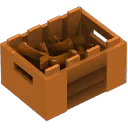{ .lu-ti width="24" loading="lazy" } [Box of Pistols Model (LOT 6774)](../6774.md) | 1 | A model for your Property! | 19 matrices; 0 rewards; 0 community references |
| 6045 | { .lu-ti width="24" loading="lazy" } [Brig Model (LOT 6045)](../6045.md) | 2 | A model for your Property! | 21 matrices; 0 rewards; 0 community references |
| 10423 | { .lu-ti width="24" loading="lazy" } [Broombot (LOT 10423)](../10423.md) | 1 | Punk Cleaner | 0 matrices; 0 rewards; 0 community references |
| 9484 | { .lu-ti width="24" loading="lazy" } [Brown Bench Model (LOT 9484)](../9484.md) | 1 | A model for your Property! | 23 matrices; 0 rewards; 0 community references |
| 10790 | 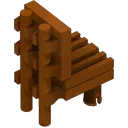{ .lu-ti width="24" loading="lazy" } [Brown Chair Model (LOT 10790)](../10790.md) | 1 | A model for your property! | 3 matrices; 0 rewards; 0 community references |
| 10791 | 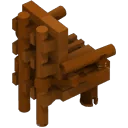{ .lu-ti width="24" loading="lazy" } [Brown Chair With Arms Model (LOT 10791)](../10791.md) | 1 | A model for your property! | 3 matrices; 0 rewards; 0 community references |
| 10792 | 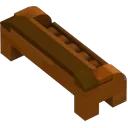{ .lu-ti width="24" loading="lazy" } [Brown Couch Model (LOT 10792)](../10792.md) | 2 | A model for your property! | 3 matrices; 0 rewards; 0 community references |
| 10793 | 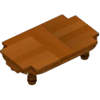{ .lu-ti width="24" loading="lazy" } [Brown Dining Table Model (LOT 10793)](../10793.md) | 2 | A model for your property! | 3 matrices; 0 rewards; 0 community references |
| 10794 | 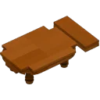{ .lu-ti width="24" loading="lazy" } [Brown Dining Table With Chair Model (LOT 10794)](../10794.md) | 2 | A model for your property! | 3 matrices; 0 rewards; 0 community references |
| 10813 | 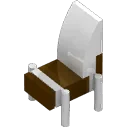{ .lu-ti width="24" loading="lazy" } [Brown Silver Chair Model (LOT 10813)](../10813.md) | 1 | A model for your property! | 3 matrices; 0 rewards; 0 community references |
| 10814 | 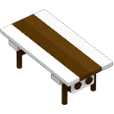{ .lu-ti width="24" loading="lazy" } [Brown Silver Dining Table Model (LOT 10814)](../10814.md) | 1 | A model for your property! | 3 matrices; 0 rewards; 0 community references |
| 10796 | 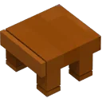{ .lu-ti width="24" loading="lazy" } [Brown Table Model 1 (LOT 10796)](../10796.md) | 1 | A model for your property! | 3 matrices; 0 rewards; 0 community references |
| 10795 | 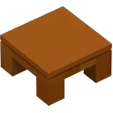{ .lu-ti width="24" loading="lazy" } [Brown Table Model 2 (LOT 10795)](../10795.md) | 1 | A model for your property! | 3 matrices; 0 rewards; 0 community references |
| 10454 | 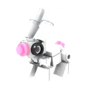{ .lu-ti width="24" loading="lazy" } [Bunny Property Pet (LOT 10454)](../10454.md) | 1 | TEST Property bunny | 0 matrices; 0 rewards; 0 community references |
| 9438 | 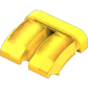{ .lu-ti width="24" loading="lazy" } [Burst Tamale Engine Panel (LOT 9438)](../9438.md) | 1 | No client description | 1 matrices; 0 rewards; 0 community references |
| 9435 | 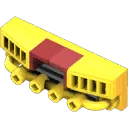{ .lu-ti width="24" loading="lazy" } [Burst Tamale Front Bumper (LOT 9435)](../9435.md) | 1 | No client description | 1 matrices; 0 rewards; 0 community references |
| 9447 | 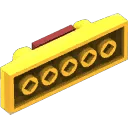{ .lu-ti width="24" loading="lazy" } [Burst Tamale Rear Bumper (LOT 9447)](../9447.md) | 1 | No client description | 1 matrices; 0 rewards; 0 community references |
| 9444 | 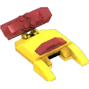{ .lu-ti width="24" loading="lazy" } [Burst Tamale Rear Panel (LOT 9444)](../9444.md) | 1 | No client description | 1 matrices; 0 rewards; 0 community references |
| 9441 | 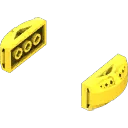{ .lu-ti width="24" loading="lazy" } [Burst Tamale Side Panels (LOT 9441)](../9441.md) | 1 | No client description | 1 matrices; 0 rewards; 0 community references |
| 7134 | { .lu-ti width="24" loading="lazy" } [Cabinet Model (LOT 7134)](../7134.md) | 2 | A model for your Property! | 46 matrices; 0 rewards; 0 community references |
| 8066 | 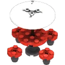{ .lu-ti width="24" loading="lazy" } [Café Table Model (LOT 8066)](../8066.md) | 1 | A model for your Property! | 0 matrices; 1 rewards; 0 community references |
| 7122 | 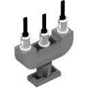{ .lu-ti width="24" loading="lazy" } [Candle Holder Model (LOT 7122)](../7122.md) | 1 | A model for your Property! | 45 matrices; 0 rewards; 0 community references |
| 8129 | { .lu-ti width="24" loading="lazy" } [Car Chassis (LOT 8129)](../8129.md) | 1 | No client description | 4 matrices; 0 rewards; 0 community references |
| 8230 | { .lu-ti width="24" loading="lazy" } [Car Chassis (LOT 8230)](../8230.md) | 1 | Don't use this - no one knows what its for | 0 matrices; 0 rewards; 0 community references |
| 6065 | { .lu-ti width="24" loading="lazy" } [Cart Model (LOT 6065)](../6065.md) | 1 | A model for your Property! | 46 matrices; 0 rewards; 0 community references |
| 7818 | { .lu-ti width="24" loading="lazy" } [Cash Register Model (LOT 7818)](../7818.md) | 1 | A model for your Property! | 27 matrices; 0 rewards; 0 community references |
| 9652 | { .lu-ti width="24" loading="lazy" } [Castle Arbalest Model (LOT 9652)](../9652.md) | 2 | A model for your Property! | 27 matrices; 0 rewards; 0 community references |
| 9653 | { .lu-ti width="24" loading="lazy" } [Castle Barrel Gun Model (LOT 9653)](../9653.md) | 2 | A model for your Property! | 27 matrices; 0 rewards; 0 community references |
| 9654 | { .lu-ti width="24" loading="lazy" } [Castle Catapult Model (LOT 9654)](../9654.md) | 2 | A model for your Property! | 27 matrices; 0 rewards; 0 community references |
| 9655 | 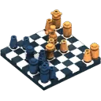{ .lu-ti width="24" loading="lazy" } [Castle Chessboard Model (LOT 9655)](../9655.md) | 3 | A model for your Property! | 0 matrices; 1 rewards; 0 community references |
| 9659 | { .lu-ti width="24" loading="lazy" } [Castle Crossing Model (LOT 9659)](../9659.md) | 3 | A model for your Property! | 28 matrices; 0 rewards; 0 community references |
| 9660 | 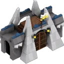{ .lu-ti width="24" loading="lazy" } [Castle Gate Model (LOT 9660)](../9660.md) | 4 | A model for your Property! | 29 matrices; 0 rewards; 0 community references |
| 16249 | 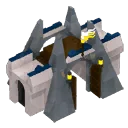{ .lu-ti width="24" loading="lazy" } [Castle Gate Model (LOT 16249)](../16249.md) | 1 | A model for your Property! | 0 matrices; 1 rewards; 0 community references |
| 9656 | { .lu-ti width="24" loading="lazy" } [Castle Inner Corner Model (LOT 9656)](../9656.md) | 4 | A model for your Property! | 28 matrices; 0 rewards; 0 community references |
| 16247 | 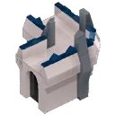{ .lu-ti width="24" loading="lazy" } [Castle Inner Corner Model (LOT 16247)](../16247.md) | 1 | A model for your Property! | 0 matrices; 1 rewards; 0 community references |
| 9673 | { .lu-ti width="24" loading="lazy" } [Castle Medium Spikes Wall Model (LOT 9673)](../9673.md) | 3 | A model for your Property! | 28 matrices; 0 rewards; 0 community references |
| 9672 | { .lu-ti width="24" loading="lazy" } [Castle Medium Straight Wall Model (LOT 9672)](../9672.md) | 3 | A model for your Property! | 30 matrices; 0 rewards; 0 community references |
| 9661 | { .lu-ti width="24" loading="lazy" } [Castle Outhouse Model (LOT 9661)](../9661.md) | 3 | A model for your Property! | 28 matrices; 0 rewards; 0 community references |
| 9657 | 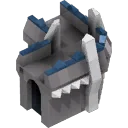{ .lu-ti width="24" loading="lazy" } [Castle Outside Corner Model (LOT 9657)](../9657.md) | 4 | A model for your Property! | 29 matrices; 0 rewards; 0 community references |
| 9662 | { .lu-ti width="24" loading="lazy" } [Castle Ramp Model (LOT 9662)](../9662.md) | 4 | A model for your Property! | 29 matrices; 0 rewards; 0 community references |
| 16250 | 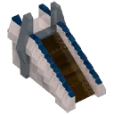{ .lu-ti width="24" loading="lazy" } [Castle Ramp Model (LOT 16250)](../16250.md) | 1 | A model for your Property! | 0 matrices; 1 rewards; 0 community references |
| 9658 | { .lu-ti width="24" loading="lazy" } [Castle Small Corner Model (LOT 9658)](../9658.md) | 3 | A model for your Property! | 30 matrices; 0 rewards; 0 community references |
| 16248 | 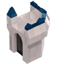{ .lu-ti width="24" loading="lazy" } [Castle Small Corner Model (LOT 16248)](../16248.md) | 1 | A model for your Property! | 0 matrices; 1 rewards; 0 community references |
| 13887 | 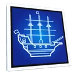{ .lu-ti width="24" loading="lazy" } [Castle Small Corner Pattern (LOT 13887)](../13887.md) | 3 | Build this pattern on your property! | 0 matrices; 0 rewards; 0 community references |
| 9667 | { .lu-ti width="24" loading="lazy" } [Castle Small Wall Model 1 (LOT 9667)](../9667.md) | 2 | A model for your Property! | 27 matrices; 0 rewards; 0 community references |
| 9668 | { .lu-ti width="24" loading="lazy" } [Castle Small Wall Model 2 (LOT 9668)](../9668.md) | 2 | A model for your Property! | 27 matrices; 0 rewards; 0 community references |
| 9669 | { .lu-ti width="24" loading="lazy" } [Castle Small Wall Model 3 (LOT 9669)](../9669.md) | 2 | A model for your Property! | 27 matrices; 0 rewards; 0 community references |
| 9670 | { .lu-ti width="24" loading="lazy" } [Castle Small Wall Model 4 (LOT 9670)](../9670.md) | 2 | A model for your Property! | 27 matrices; 0 rewards; 0 community references |
| 9663 | { .lu-ti width="24" loading="lazy" } [Castle Staircase Model (LOT 9663)](../9663.md) | 3 | A model for your Property! | 29 matrices; 0 rewards; 0 community references |
| 9671 | { .lu-ti width="24" loading="lazy" } [Castle Straight Wall Model (LOT 9671)](../9671.md) | 3 | A model for your Property! | 30 matrices; 0 rewards; 0 community references |
| 9674 | { .lu-ti width="24" loading="lazy" } [Castle T-Wall Model (LOT 9674)](../9674.md) | 4 | A model for your Property! | 30 matrices; 0 rewards; 0 community references |
| 9664 | 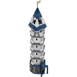{ .lu-ti width="24" loading="lazy" } [Castle Tower Model (LOT 9664)](../9664.md) | 4 | A model for your Property! | 28 matrices; 0 rewards; 0 community references |
| 9675 | { .lu-ti width="24" loading="lazy" } [Castle Tower Wall With No Top Model (LOT 9675)](../9675.md) | 4 | A model for your Property! | 28 matrices; 0 rewards; 0 community references |
| 9676 | { .lu-ti width="24" loading="lazy" } [Castle Tower Wall With Top Model (LOT 9676)](../9676.md) | 4 | A model for your Property! | 28 matrices; 0 rewards; 0 community references |
| 9665 | { .lu-ti width="24" loading="lazy" } [Castle Wall Bridge Model (LOT 9665)](../9665.md) | 4 | A model for your Property! | 28 matrices; 0 rewards; 0 community references |
| 9666 | 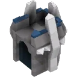{ .lu-ti width="24" loading="lazy" } [Castle Wall End Model (LOT 9666)](../9666.md) | 3 | A model for your Property! | 28 matrices; 0 rewards; 0 community references |
| 9678 | { .lu-ti width="24" loading="lazy" } [Castle Wall With Stairs Model (LOT 9678)](../9678.md) | 3 | A model for your Property! | 28 matrices; 0 rewards; 0 community references |
| 9493 | { .lu-ti width="24" loading="lazy" } [Castle Weapon Rack Model (LOT 9493)](../9493.md) | 1 | A model for your Property! | 27 matrices; 0 rewards; 0 community references |
| 9677 | { .lu-ti width="24" loading="lazy" } [Castle Widening Wall Model (LOT 9677)](../9677.md) | 4 | A model for your Property! | 28 matrices; 0 rewards; 0 community references |
| 6840 | { .lu-ti width="24" loading="lazy" } [Cat Model (LOT 6840)](../6840.md) | 1 | Place this animated creature model on your Property! | 18 matrices; 0 rewards; 0 community references |
| 9333 | { .lu-ti width="24" loading="lazy" } [Chase Cutter Engine Panel 1 (LOT 9333)](../9333.md) | 2 | No client description | 1 matrices; 0 rewards; 0 community references |
| 9334 | 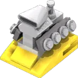{ .lu-ti width="24" loading="lazy" } [Chase Cutter Engine Panel 1 (LOT 9334)](../9334.md) | 2 | No client description | 1 matrices; 0 rewards; 0 community references |
| 9335 | { .lu-ti width="24" loading="lazy" } [Chase Cutter Engine Panel 1 (LOT 9335)](../9335.md) | 2 | No client description | 1 matrices; 0 rewards; 0 community references |
| 9336 | 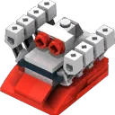{ .lu-ti width="24" loading="lazy" } [Chase Cutter Engine Panel 2 (LOT 9336)](../9336.md) | 3 | No client description | 7 matrices; 0 rewards; 0 community references |
| 9337 | { .lu-ti width="24" loading="lazy" } [Chase Cutter Engine Panel 2 (LOT 9337)](../9337.md) | 1 | No client description | 1 matrices; 0 rewards; 0 community references |
| 9338 | { .lu-ti width="24" loading="lazy" } [Chase Cutter Engine Panel 2 (LOT 9338)](../9338.md) | 1 | No client description | 1 matrices; 0 rewards; 0 community references |
| 9339 | 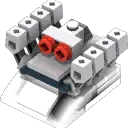{ .lu-ti width="24" loading="lazy" } [Chase Cutter Engine Panel 2 (LOT 9339)](../9339.md) | 3 | No client description | 7 matrices; 0 rewards; 0 community references |
| 9340 | { .lu-ti width="24" loading="lazy" } [Chase Cutter Engine Panel 2 (LOT 9340)](../9340.md) | 1 | No client description | 0 matrices; 1 rewards; 0 community references |
| 9341 | 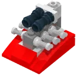{ .lu-ti width="24" loading="lazy" } [Chase Cutter Engine Panel 3 (LOT 9341)](../9341.md) | 1 | No client description | 1 matrices; 0 rewards; 0 community references |
| 9342 | 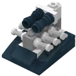{ .lu-ti width="24" loading="lazy" } [Chase Cutter Engine Panel 3 (LOT 9342)](../9342.md) | 3 | No client description | 0 matrices; 1 rewards; 0 community references |
| 8134 | { .lu-ti width="24" loading="lazy" } [Chase Cutter Front Bumper 1 (LOT 8134)](../8134.md) | 1 | No client description | 1 matrices; 0 rewards; 0 community references |
| 9321 | 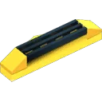{ .lu-ti width="24" loading="lazy" } [Chase Cutter Front Bumper 1 (LOT 9321)](../9321.md) | 1 | No client description | 1 matrices; 0 rewards; 0 community references |
| 9322 | 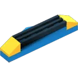{ .lu-ti width="24" loading="lazy" } [Chase Cutter Front Bumper 1 (LOT 9322)](../9322.md) | 1 | No client description | 1 matrices; 0 rewards; 0 community references |
| 9323 | 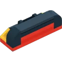{ .lu-ti width="24" loading="lazy" } [Chase Cutter Front Bumper 2 (LOT 9323)](../9323.md) | 1 | No client description | 1 matrices; 0 rewards; 0 community references |
| 9324 | 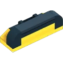{ .lu-ti width="24" loading="lazy" } [Chase Cutter Front Bumper 2 (LOT 9324)](../9324.md) | 1 | No client description | 1 matrices; 0 rewards; 0 community references |
| 9325 | 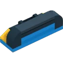{ .lu-ti width="24" loading="lazy" } [Chase Cutter Front Bumper 2 (LOT 9325)](../9325.md) | 1 | No client description | 1 matrices; 1 rewards; 0 community references |
| 9326 | 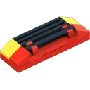{ .lu-ti width="24" loading="lazy" } [Chase Cutter Front Bumper 3 (LOT 9326)](../9326.md) | 2 | No client description | 1 matrices; 1 rewards; 0 community references |
| 9327 | 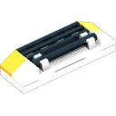{ .lu-ti width="24" loading="lazy" } [Chase Cutter Front Bumper 3 (LOT 9327)](../9327.md) | 2 | No client description | 1 matrices; 0 rewards; 0 community references |
| 9328 | 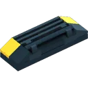{ .lu-ti width="24" loading="lazy" } [Chase Cutter Front Bumper 3 (LOT 9328)](../9328.md) | 1 | No client description | 1 matrices; 0 rewards; 0 community references |
| 9368 | 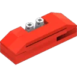{ .lu-ti width="24" loading="lazy" } [Chase Cutter Rear Bumper 1 (LOT 9368)](../9368.md) | 1 | No client description | 1 matrices; 0 rewards; 0 community references |
| 9369 | 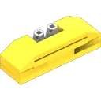{ .lu-ti width="24" loading="lazy" } [Chase Cutter Rear Bumper 1 (LOT 9369)](../9369.md) | 1 | No client description | 1 matrices; 0 rewards; 0 community references |
| 9370 | 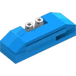{ .lu-ti width="24" loading="lazy" } [Chase Cutter Rear Bumper 1 (LOT 9370)](../9370.md) | 1 | No client description | 1 matrices; 0 rewards; 0 community references |
| 8135 | 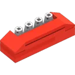{ .lu-ti width="24" loading="lazy" } [Chase Cutter Rear Bumper 2 (LOT 8135)](../8135.md) | 1 | No client description | 0 matrices; 1 rewards; 0 community references |
| 9371 | 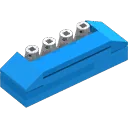{ .lu-ti width="24" loading="lazy" } [Chase Cutter Rear Bumper 2 (LOT 9371)](../9371.md) | 3 | No client description | 6 matrices; 0 rewards; 0 community references |
| 9372 | 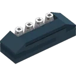{ .lu-ti width="24" loading="lazy" } [Chase Cutter Rear Bumper 2 (LOT 9372)](../9372.md) | 1 | No client description | 0 matrices; 1 rewards; 0 community references |
| 9356 | { .lu-ti width="24" loading="lazy" } [Chase Cutter Rear Panel 1 (LOT 9356)](../9356.md) | 1 | No client description | 1 matrices; 0 rewards; 0 community references |
| 9357 | 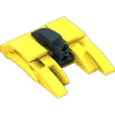{ .lu-ti width="24" loading="lazy" } [Chase Cutter Rear Panel 1 (LOT 9357)](../9357.md) | 1 | No client description | 1 matrices; 0 rewards; 0 community references |
| 9358 | 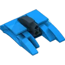{ .lu-ti width="24" loading="lazy" } [Chase Cutter Rear Panel 1 (LOT 9358)](../9358.md) | 1 | No client description | 1 matrices; 0 rewards; 0 community references |
| 8132 | { .lu-ti width="24" loading="lazy" } [Chase Cutter Rear Panel 2 (LOT 8132)](../8132.md) | 2 | No client description | 1 matrices; 0 rewards; 0 community references |
| 9359 | 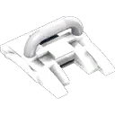{ .lu-ti width="24" loading="lazy" } [Chase Cutter Rear Panel 2 (LOT 9359)](../9359.md) | 2 | No client description | 1 matrices; 0 rewards; 0 community references |
| 9360 | { .lu-ti width="24" loading="lazy" } [Chase Cutter Rear Panel 2 (LOT 9360)](../9360.md) | 2 | No client description | 1 matrices; 0 rewards; 0 community references |
| 9361 | { .lu-ti width="24" loading="lazy" } [Chase Cutter Rear Panel 3 (LOT 9361)](../9361.md) | 1 | No client description | 0 matrices; 1 rewards; 0 community references |
| 9362 | { .lu-ti width="24" loading="lazy" } [Chase Cutter Rear Panel 3 (LOT 9362)](../9362.md) | 3 | No client description | 7 matrices; 0 rewards; 0 community references |
| 8235 | { .lu-ti width="24" loading="lazy" } [Chase Cutter Side Panels 1 (LOT 8235)](../8235.md) | 1 | No client description | 1 matrices; 0 rewards; 0 community references |
| 9348 | { .lu-ti width="24" loading="lazy" } [Chase Cutter Side Panels 1 (LOT 9348)](../9348.md) | 2 | No client description | 1 matrices; 0 rewards; 0 community references |
| 9349 | { .lu-ti width="24" loading="lazy" } [Chase Cutter Side Panels 1 (LOT 9349)](../9349.md) | 2 | No client description | 1 matrices; 0 rewards; 0 community references |
| 9350 | { .lu-ti width="24" loading="lazy" } [Chase Cutter Side Panels 2 (LOT 9350)](../9350.md) | 1 | No client description | 1 matrices; 0 rewards; 0 community references |
| 9351 | { .lu-ti width="24" loading="lazy" } [Chase Cutter Side Panels 2 (LOT 9351)](../9351.md) | 1 | No client description | 1 matrices; 0 rewards; 0 community references |
| 9352 | { .lu-ti width="24" loading="lazy" } [Chase Cutter Side Panels 2 (LOT 9352)](../9352.md) | 1 | No client description | 1 matrices; 1 rewards; 0 community references |
| 10705 | { .lu-ti width="24" loading="lazy" } [Chicken Model (LOT 10705)](../10705.md) | 1 | No client description | 0 matrices; 0 rewards; 0 community references |
| 10797 | { .lu-ti width="24" loading="lazy" } [China Cabinet Model (LOT 10797)](../10797.md) | 2 | A model for your property! | 3 matrices; 0 rewards; 0 community references |
| 11505 | { .lu-ti width="24" loading="lazy" } [Choo-Choo Charger Engine Panel (LOT 11505)](../11505.md) | 1 | No client description | 1 matrices; 0 rewards; 0 community references |
| 11507 | { .lu-ti width="24" loading="lazy" } [Choo-Choo Charger Front Bumper (LOT 11507)](../11507.md) | 1 | No client description | 1 matrices; 0 rewards; 0 community references |
| 11508 | { .lu-ti width="24" loading="lazy" } [Choo-Choo Charger Rear Bumper (LOT 11508)](../11508.md) | 1 | No client description | 1 matrices; 0 rewards; 0 community references |
| 11509 | { .lu-ti width="24" loading="lazy" } [Choo-Choo Charger Rear Panel (LOT 11509)](../11509.md) | 1 | No client description | 1 matrices; 0 rewards; 0 community references |
| 11510 | { .lu-ti width="24" loading="lazy" } [Choo-Choo Charger Side Panels (LOT 11510)](../11510.md) | 1 | No client description | 1 matrices; 0 rewards; 0 community references |
| 6869 | { .lu-ti width="24" loading="lazy" } [Clamshell Model (LOT 6869)](../6869.md) | 1 | Place this animated creature model on your Property! | 18 matrices; 1 rewards; 0 community references |
| 14445 | { .lu-ti width="24" loading="lazy" } [Classic Blue Rocket Cockpit (LOT 14445)](../14445.md) | 1 | Modular Build Rocket Cockpit | 3 matrices; 0 rewards; 0 community references |
| 14446 | { .lu-ti width="24" loading="lazy" } [Classic Blue Rocket Engine (LOT 14446)](../14446.md) | 1 | Modular Build Rocket Engine | 4 matrices; 0 rewards; 0 community references |
| 14444 | { .lu-ti width="24" loading="lazy" } [Classic Blue Rocket Nose Cone (LOT 14444)](../14444.md) | 1 | Modular Build Rocket Nose Cone | 3 matrices; 0 rewards; 0 community references |
| 14452 | { .lu-ti width="24" loading="lazy" } [Classic Pink Rocket Cockpit (LOT 14452)](../14452.md) | 1 | Modular Build Rocket Cockpit | 3 matrices; 0 rewards; 0 community references |
| 14453 | { .lu-ti width="24" loading="lazy" } [Classic Pink Rocket Engine (LOT 14453)](../14453.md) | 1 | Modular Build Rocket Engine | 4 matrices; 0 rewards; 0 community references |
| 14451 | { .lu-ti width="24" loading="lazy" } [Classic Pink Rocket Nose Cone (LOT 14451)](../14451.md) | 1 | Modular Build Rocket Nose Cone | 3 matrices; 0 rewards; 0 community references |
| 4714 | { .lu-ti width="24" loading="lazy" } [Classic Rocket Cockpit (LOT 4714)](../4714.md) | 1 | Modular Build rocket cockpit | 3 matrices; 0 rewards; 0 community references |
| 4715 | { .lu-ti width="24" loading="lazy" } [Classic Rocket Engine (LOT 4715)](../4715.md) | 1 | Modular Build rocket engine | 4 matrices; 0 rewards; 0 community references |
| 4713 | { .lu-ti width="24" loading="lazy" } [Classic Rocket Nose Cone (LOT 4713)](../4713.md) | 1 | Modular Build rocket Nose Cone | 3 matrices; 0 rewards; 0 community references |
| 14455 | { .lu-ti width="24" loading="lazy" } [Classic Yellow Rocket Cockpit (LOT 14455)](../14455.md) | 1 | Modular Build Rocket Cockpit | 3 matrices; 0 rewards; 0 community references |
| 14456 | { .lu-ti width="24" loading="lazy" } [Classic Yellow Rocket Engine (LOT 14456)](../14456.md) | 1 | Modular Build Rocket Engine | 3 matrices; 0 rewards; 0 community references |
| 14454 | { .lu-ti width="24" loading="lazy" } [Classic Yellow Rocket Nose Cone (LOT 14454)](../14454.md) | 1 | Modular Build Rocket Nose Cone | 3 matrices; 0 rewards; 0 community references |
| 10318 | { .lu-ti width="24" loading="lazy" } [Classical Corner Model (LOT 10318)](../10318.md) | 4 | A model for your Property! | 1 matrices; 0 rewards; 0 community references |
| 10320 | { .lu-ti width="24" loading="lazy" } [Classical Exterior Gate Model (LOT 10320)](../10320.md) | 3 | A model for your Property! | 1 matrices; 0 rewards; 0 community references |
| 10319 | { .lu-ti width="24" loading="lazy" } [Classical Gate Model (LOT 10319)](../10319.md) | 4 | A model for your Property! | 1 matrices; 0 rewards; 0 community references |
| 10322 | { .lu-ti width="24" loading="lazy" } [Classical Short Wall Model 1 (LOT 10322)](../10322.md) | 3 | A model for your Property! | 1 matrices; 0 rewards; 0 community references |
| 10323 | { .lu-ti width="24" loading="lazy" } [Classical Short Wall Model 2 (LOT 10323)](../10323.md) | 3 | A model for your Property! | 1 matrices; 0 rewards; 0 community references |
| 10324 | { .lu-ti width="24" loading="lazy" } [Classical Short Wall Model 3 (LOT 10324)](../10324.md) | 3 | A model for your Property! | 1 matrices; 0 rewards; 0 community references |
| 10325 | { .lu-ti width="24" loading="lazy" } [Classical Short Wall Model 4 (LOT 10325)](../10325.md) | 3 | A model for your Property! | 1 matrices; 0 rewards; 0 community references |
| 10326 | { .lu-ti width="24" loading="lazy" } [Classical Short Wall Model 5 (LOT 10326)](../10326.md) | 3 | A model for your Property! | 1 matrices; 0 rewards; 0 community references |
| 10327 | { .lu-ti width="24" loading="lazy" } [Classical Short Wall Model 6 (LOT 10327)](../10327.md) | 2 | A model for your Property! | 1 matrices; 0 rewards; 0 community references |
| 10321 | { .lu-ti width="24" loading="lazy" } [Classical Wall Model (LOT 10321)](../10321.md) | 4 | A model for your Property! | 1 matrices; 0 rewards; 0 community references |
| 6064 | { .lu-ti width="24" loading="lazy" } [Coffee Table Model (LOT 6064)](../6064.md) | 1 | A model for your Property! | 46 matrices; 0 rewards; 0 community references |
| 10815 | { .lu-ti width="24" loading="lazy" } [Coffee Table Model (LOT 10815)](../10815.md) | 1 | A model for your property! | 3 matrices; 0 rewards; 0 community references |
| 7769 | { .lu-ti width="24" loading="lazy" } [Computer Model (LOT 7769)](../7769.md) | 1 | A model for your Property! | 1 matrices; 0 rewards; 0 community references |
| 8068 | { .lu-ti width="24" loading="lazy" } [Console Model (LOT 8068)](../8068.md) | 1 | A model for your Property! | 26 matrices; 0 rewards; 0 community references |
| 11621 | { .lu-ti width="24" loading="lazy" } [Construction Barricade 1 Model (LOT 11621)](../11621.md) | 1 | A model for your property! | 1 matrices; 0 rewards; 0 community references |
| 11622 | { .lu-ti width="24" loading="lazy" } [Construction Barricade 2 Model (LOT 11622)](../11622.md) | 2 | A model for your property! | 1 matrices; 0 rewards; 0 community references |
| 11623 | { .lu-ti width="24" loading="lazy" } [Construction Barricade 3 Model (LOT 11623)](../11623.md) | 1 | A model for your property! | 1 matrices; 0 rewards; 0 community references |
| 11627 | { .lu-ti width="24" loading="lazy" } [Construction Closed Container 2 Model (LOT 11627)](../11627.md) | 4 | A model for your property! | 1 matrices; 0 rewards; 0 community references |
| 11628 | { .lu-ti width="24" loading="lazy" } [Construction Closed Container 3 Model (LOT 11628)](../11628.md) | 4 | A model for your property! | 1 matrices; 0 rewards; 0 community references |
| 11626 | { .lu-ti width="24" loading="lazy" } [Construction Closed Container Model (LOT 11626)](../11626.md) | 4 | A model for your property! | 1 matrices; 0 rewards; 0 community references |
| 11624 | { .lu-ti width="24" loading="lazy" } [Construction Compactor Model (LOT 11624)](../11624.md) | 1 | A model for your property! | 1 matrices; 0 rewards; 0 community references |
| 11625 | { .lu-ti width="24" loading="lazy" } [Construction Cone Model (LOT 11625)](../11625.md) | 1 | A model for your property! | 1 matrices; 0 rewards; 0 community references |
| 11632 | { .lu-ti width="24" loading="lazy" } [Construction Crane 1 Model (LOT 11632)](../11632.md) | 4 | A model for your property! | 1 matrices; 0 rewards; 0 community references |
| 11633 | { .lu-ti width="24" loading="lazy" } [Construction Crane 2 Model (LOT 11633)](../11633.md) | 4 | A model for your property! | 1 matrices; 0 rewards; 0 community references |
| 11634 | { .lu-ti width="24" loading="lazy" } [Construction Fence 1 Model (LOT 11634)](../11634.md) | 2 | A model for your property! | 1 matrices; 0 rewards; 0 community references |
| 11635 | { .lu-ti width="24" loading="lazy" } [Construction Fence 2 Model (LOT 11635)](../11635.md) | 1 | A model for your property! | 1 matrices; 0 rewards; 0 community references |
| 11636 | { .lu-ti width="24" loading="lazy" } [Construction Fence 3 Model (LOT 11636)](../11636.md) | 1 | A model for your property! | 1 matrices; 0 rewards; 0 community references |
| 11637 | { .lu-ti width="24" loading="lazy" } [Construction Generator Model (LOT 11637)](../11637.md) | 3 | A model for your property! | 1 matrices; 0 rewards; 0 community references |
| 11638 | { .lu-ti width="24" loading="lazy" } [Construction Lift 1 Model (LOT 11638)](../11638.md) | 3 | A model for your property! | 1 matrices; 0 rewards; 0 community references |
| 11639 | { .lu-ti width="24" loading="lazy" } [Construction Lift 2 Model (LOT 11639)](../11639.md) | 3 | A model for your property! | 1 matrices; 0 rewards; 0 community references |
| 11640 | { .lu-ti width="24" loading="lazy" } [Construction Lift 3 Model (LOT 11640)](../11640.md) | 3 | A model for your property! | 1 matrices; 0 rewards; 0 community references |
| 11641 | { .lu-ti width="24" loading="lazy" } [Construction Lift 4 Model (LOT 11641)](../11641.md) | 3 | A model for your property! | 1 matrices; 0 rewards; 0 community references |
| 11642 | { .lu-ti width="24" loading="lazy" } [Construction Light Trailer Model (LOT 11642)](../11642.md) | 3 | A model for your property! | 1 matrices; 0 rewards; 0 community references |
| 11643 | { .lu-ti width="24" loading="lazy" } [Construction Loader 1 Model (LOT 11643)](../11643.md) | 4 | A model for your property! | 1 matrices; 0 rewards; 0 community references |
| 11644 | { .lu-ti width="24" loading="lazy" } [Construction Loader 2 Model (LOT 11644)](../11644.md) | 4 | A model for your property! | 1 matrices; 0 rewards; 0 community references |
| 11629 | { .lu-ti width="24" loading="lazy" } [Construction Open Container 1 Model (LOT 11629)](../11629.md) | 4 | A model for your property! | 1 matrices; 0 rewards; 0 community references |
| 11630 | { .lu-ti width="24" loading="lazy" } [Construction Open Container 2 Model (LOT 11630)](../11630.md) | 4 | A model for your property! | 1 matrices; 0 rewards; 0 community references |
| 11631 | { .lu-ti width="24" loading="lazy" } [Construction Open Container 3 Model (LOT 11631)](../11631.md) | 4 | A model for your property! | 1 matrices; 0 rewards; 0 community references |
| 11645 | { .lu-ti width="24" loading="lazy" } [Construction Rock Model (LOT 11645)](../11645.md) | 1 | A model for your property! | 1 matrices; 0 rewards; 0 community references |
| 11646 | { .lu-ti width="24" loading="lazy" } [Construction Scaffold 1 Model (LOT 11646)](../11646.md) | 2 | A model for your property! | 1 matrices; 0 rewards; 0 community references |
| 11647 | { .lu-ti width="24" loading="lazy" } [Construction Scaffold 2 Model (LOT 11647)](../11647.md) | 3 | A model for your property! | 1 matrices; 0 rewards; 0 community references |
| 11648 | { .lu-ti width="24" loading="lazy" } [Construction Scaffold 3 Model (LOT 11648)](../11648.md) | 3 | A model for your property! | 1 matrices; 0 rewards; 0 community references |
| 11649 | { .lu-ti width="24" loading="lazy" } [Construction Shovel Model (LOT 11649)](../11649.md) | 3 | A model for your property! | 1 matrices; 0 rewards; 0 community references |
| 11650 | { .lu-ti width="24" loading="lazy" } [Construction Sign 1 Model (LOT 11650)](../11650.md) | 1 | A model for your property! | 1 matrices; 0 rewards; 0 community references |
| 11651 | { .lu-ti width="24" loading="lazy" } [Construction Sign 2 Model (LOT 11651)](../11651.md) | 1 | A model for your property! | 1 matrices; 0 rewards; 0 community references |
| 11652 | { .lu-ti width="24" loading="lazy" } [Construction Stairs 1 Model (LOT 11652)](../11652.md) | 3 | A model for your property! | 1 matrices; 0 rewards; 0 community references |
| 11653 | { .lu-ti width="24" loading="lazy" } [Construction Steamroller Model (LOT 11653)](../11653.md) | 3 | A model for your property! | 1 matrices; 0 rewards; 0 community references |
| 11654 | { .lu-ti width="24" loading="lazy" } [Construction Supplies 1 Model (LOT 11654)](../11654.md) | 2 | A model for your property! | 1 matrices; 0 rewards; 0 community references |
| 11655 | { .lu-ti width="24" loading="lazy" } [Construction Supplies 2 Model (LOT 11655)](../11655.md) | 2 | A model for your property! | 1 matrices; 0 rewards; 0 community references |
| 11656 | { .lu-ti width="24" loading="lazy" } [Construction Trailer 1 Model (LOT 11656)](../11656.md) | 4 | A model for your property! | 1 matrices; 0 rewards; 0 community references |
| 11657 | { .lu-ti width="24" loading="lazy" } [Construction Trailer 2 Model (LOT 11657)](../11657.md) | 4 | A model for your property! | 1 matrices; 0 rewards; 0 community references |
| 11658 | { .lu-ti width="24" loading="lazy" } [Construction Truck 1 Model (LOT 11658)](../11658.md) | 3 | A model for your property! | 1 matrices; 0 rewards; 0 community references |
| 11659 | { .lu-ti width="24" loading="lazy" } [Construction Truck 2 Model (LOT 11659)](../11659.md) | 4 | A model for your property! | 1 matrices; 0 rewards; 0 community references |
| 11660 | { .lu-ti width="24" loading="lazy" } [Construction Truck 3 Model (LOT 11660)](../11660.md) | 4 | A model for your property! | 1 matrices; 0 rewards; 0 community references |
| 11661 | { .lu-ti width="24" loading="lazy" } [Construction Truck 4 Model (LOT 11661)](../11661.md) | 4 | A model for your property! | 1 matrices; 0 rewards; 0 community references |
| 11662 | { .lu-ti width="24" loading="lazy" } [Construction Truck 5 Model (LOT 11662)](../11662.md) | 4 | A model for your property! | 1 matrices; 0 rewards; 0 community references |
| 11663 | { .lu-ti width="24" loading="lazy" } [Construction Truck 6 Model (LOT 11663)](../11663.md) | 3 | A model for your property! | 1 matrices; 0 rewards; 0 community references |
| 11664 | { .lu-ti width="24" loading="lazy" } [Construction Truck 7 Model (LOT 11664)](../11664.md) | 4 | A model for your property! | 1 matrices; 0 rewards; 0 community references |
| 11665 | { .lu-ti width="24" loading="lazy" } [Construction Truck 8 Model (LOT 11665)](../11665.md) | 4 | A model for your property! | 1 matrices; 0 rewards; 0 community references |
| 11666 | { .lu-ti width="24" loading="lazy" } [Construction Truck 9 Model (LOT 11666)](../11666.md) | 4 | A model for your property! | 1 matrices; 0 rewards; 0 community references |
| 7771 | { .lu-ti width="24" loading="lazy" } [Cooler Model (LOT 7771)](../7771.md) | 1 | A model for your Property! | 27 matrices; 0 rewards; 0 community references |
| 6066 | { .lu-ti width="24" loading="lazy" } [Cot Model (LOT 6066)](../6066.md) | 1 | A model for your Property! | 19 matrices; 0 rewards; 0 community references |
| 6841 | { .lu-ti width="24" loading="lazy" } [Crab Model (LOT 6841)](../6841.md) | 1 | Place this animated creature model on your Property! | 0 matrices; 2 rewards; 0 community references |
| 10853 | { .lu-ti width="24" loading="lazy" } [Crane Game Model (LOT 10853)](../10853.md) | 2 | A model for your property! | 3 matrices; 0 rewards; 0 community references |
| 6040 | { .lu-ti width="24" loading="lazy" } [Crate of Bananas Model (LOT 6040)](../6040.md) | 1 | A model for your Property! | 19 matrices; 0 rewards; 0 community references |
| 10473 | { .lu-ti width="24" loading="lazy" } [Croc Property Pet (LOT 10473)](../10473.md) | 1 | TEST property Croc | 0 matrices; 0 rewards; 0 community references |
| 9575 | { .lu-ti width="24" loading="lazy" } [Danger Cone Model (LOT 9575)](../9575.md) | 1 | A model for your Property! | 1 matrices; 0 rewards; 0 community references |
| 10816 | { .lu-ti width="24" loading="lazy" } [Deck Chair Model (LOT 10816)](../10816.md) | 1 | A model for your property! | 3 matrices; 0 rewards; 0 community references |
| 8296 | { .lu-ti width="24" loading="lazy" } [Deep Freeze Rocket Cockpit (LOT 8296)](../8296.md) | 2 | Deep Freeze Modular Build Rocket Cockpit | 0 matrices; 1 rewards; 0 community references |
| 8298 | { .lu-ti width="24" loading="lazy" } [Deep Freeze Rocket Engine (LOT 8298)](../8298.md) | 1 | Deep Freeze Modular Build Rocket Engine | 0 matrices; 1 rewards; 0 community references |
| 8295 | { .lu-ti width="24" loading="lazy" } [Deep Freeze Rocket Nose Cone (LOT 8295)](../8295.md) | 2 | Deep Freeze Modular Build Rocket Nose Cone | 0 matrices; 1 rewards; 0 community references |
| 10798 | { .lu-ti width="24" loading="lazy" } [Deer Head Model (LOT 10798)](../10798.md) | 2 | A model for your property! | 3 matrices; 0 rewards; 0 community references |
| 6525 | { .lu-ti width="24" loading="lazy" } [Deluxe Raft Model (LOT 6525)](../6525.md) | 3 | A model for your Property! | 21 matrices; 0 rewards; 0 community references |
| 6037 | { .lu-ti width="24" loading="lazy" } [Desk Model (LOT 6037)](../6037.md) | 2 | A model for your Property! | 45 matrices; 0 rewards; 0 community references |
| 10289 | { .lu-ti width="24" loading="lazy" } [Disk thing (LOT 10289)](../10289.md) | 1 | Place this model on your property! | 0 matrices; 0 rewards; 0 community references |
| 7822 | { .lu-ti width="24" loading="lazy" } [DJ Table Model (LOT 7822)](../7822.md) | 1 | A model for your Property! | 27 matrices; 0 rewards; 0 community references |
| 8231 | { .lu-ti width="24" loading="lazy" } [Do Not Use These Wheels (LOT 8231)](../8231.md) | 1 | don't use | 0 matrices; 0 rewards; 0 community references |
| 7123 | { .lu-ti width="24" loading="lazy" } [Dock Model (LOT 7123)](../7123.md) | 2 | A model for your Property! | 47 matrices; 0 rewards; 0 community references |
| 10817 | { .lu-ti width="24" loading="lazy" } [Dog House Model (LOT 10817)](../10817.md) | 2 | A model for your property! | 0 matrices; 1 rewards; 0 community references |
| 10818 | { .lu-ti width="24" loading="lazy" } [Dollhouse Model (LOT 10818)](../10818.md) | 2 | A model for your property! | 3 matrices; 0 rewards; 0 community references |
| 7827 | { .lu-ti width="24" loading="lazy" } [Dolly Model (LOT 7827)](../7827.md) | 1 | A model for your Property! | 27 matrices; 0 rewards; 0 community references |
