# Loot model — page 3/8

[Item database](../README.md)

Pages: [1](type-21-1.md) | [2](type-21-2.md) | [3](type-21-3.md) | [4](type-21-4.md) | [5](type-21-5.md) | [6](type-21-6.md) | [7](type-21-7.md) | [8](type-21-8.md)

| LOT | Item | Rarity | Description | Source evidence |
| --- | --- | --- | --- | --- |
| 11667 | 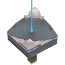{ .lu-ti width="24" loading="lazy" } [Doom Star Module Model 1 (LOT 11667)](../11667.md) | 3 | A model for your property! | 1 matrices; 0 rewards; 0 community references |
| 11676 | 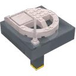{ .lu-ti width="24" loading="lazy" } [Doom Star Module Model 10 (LOT 11676)](../11676.md) | 3 | A model for your property! | 1 matrices; 0 rewards; 0 community references |
| 11677 | 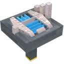{ .lu-ti width="24" loading="lazy" } [Doom Star Module Model 11 (LOT 11677)](../11677.md) | 3 | A model for your property! | 1 matrices; 0 rewards; 0 community references |
| 11678 | 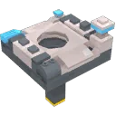{ .lu-ti width="24" loading="lazy" } [Doom Star Module Model 12 (LOT 11678)](../11678.md) | 4 | A model for your property! | 1 matrices; 0 rewards; 0 community references |
| 11679 | 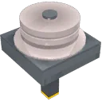{ .lu-ti width="24" loading="lazy" } [Doom Star Module Model 13 (LOT 11679)](../11679.md) | 3 | A model for your property! | 1 matrices; 0 rewards; 0 community references |
| 11680 | { .lu-ti width="24" loading="lazy" } [Doom Star Module Model 14 (LOT 11680)](../11680.md) | 4 | A model for your property! | 1 matrices; 0 rewards; 0 community references |
| 11681 | 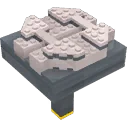{ .lu-ti width="24" loading="lazy" } [Doom Star Module Model 15 (LOT 11681)](../11681.md) | 3 | A model for your property! | 1 matrices; 0 rewards; 0 community references |
| 11682 | 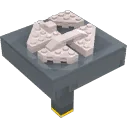{ .lu-ti width="24" loading="lazy" } [Doom Star Module Model 16 (LOT 11682)](../11682.md) | 3 | A model for your property! | 1 matrices; 0 rewards; 0 community references |
| 11668 | { .lu-ti width="24" loading="lazy" } [Doom Star Module Model 2 (LOT 11668)](../11668.md) | 4 | A model for your property! | 1 matrices; 0 rewards; 0 community references |
| 11669 | 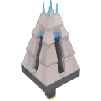{ .lu-ti width="24" loading="lazy" } [Doom Star Module Model 3 (LOT 11669)](../11669.md) | 4 | A model for your property! | 1 matrices; 0 rewards; 0 community references |
| 11670 | 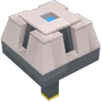{ .lu-ti width="24" loading="lazy" } [Doom Star Module Model 4 (LOT 11670)](../11670.md) | 4 | A model for your property! | 1 matrices; 0 rewards; 0 community references |
| 11671 | { .lu-ti width="24" loading="lazy" } [Doom Star Module Model 5 (LOT 11671)](../11671.md) | 4 | A model for your property! | 1 matrices; 0 rewards; 0 community references |
| 11672 | { .lu-ti width="24" loading="lazy" } [Doom Star Module Model 6 (LOT 11672)](../11672.md) | 4 | A model for your property! | 0 matrices; 0 rewards; 0 community references |
| 11673 | 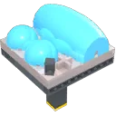{ .lu-ti width="24" loading="lazy" } [Doom Star Module Model 7 (LOT 11673)](../11673.md) | 3 | A model for your property! | 1 matrices; 0 rewards; 0 community references |
| 11674 | 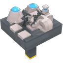{ .lu-ti width="24" loading="lazy" } [Doom Star Module Model 8 (LOT 11674)](../11674.md) | 4 | A model for your property! | 1 matrices; 0 rewards; 0 community references |
| 11675 | 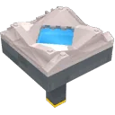{ .lu-ti width="24" loading="lazy" } [Doom Star Module Model 9 (LOT 11675)](../11675.md) | 3 | A model for your property! | 1 matrices; 0 rewards; 0 community references |
| 11691 | 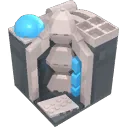{ .lu-ti width="24" loading="lazy" } [Doom Star Trench Inside Corner Model (LOT 11691)](../11691.md) | 4 | A model for your property! | 1 matrices; 0 rewards; 0 community references |
| 11683 | 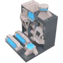{ .lu-ti width="24" loading="lazy" } [Doom Star Trench Model 1 (LOT 11683)](../11683.md) | 4 | A model for your property! | 1 matrices; 0 rewards; 0 community references |
| 11684 | 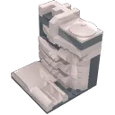{ .lu-ti width="24" loading="lazy" } [Doom Star Trench Model 2 (LOT 11684)](../11684.md) | 4 | A model for your property! | 1 matrices; 0 rewards; 0 community references |
| 11685 | 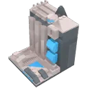{ .lu-ti width="24" loading="lazy" } [Doom Star Trench Model 3 (LOT 11685)](../11685.md) | 4 | A model for your property! | 1 matrices; 0 rewards; 0 community references |
| 11686 | 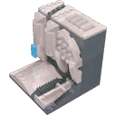{ .lu-ti width="24" loading="lazy" } [Doom Star Trench Model 4 (LOT 11686)](../11686.md) | 3 | A model for your property! | 1 matrices; 0 rewards; 0 community references |
| 11687 | 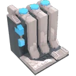{ .lu-ti width="24" loading="lazy" } [Doom Star Trench Model 5 (LOT 11687)](../11687.md) | 3 | A model for your property! | 1 matrices; 0 rewards; 0 community references |
| 11688 | 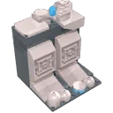{ .lu-ti width="24" loading="lazy" } [Doom Star Trench Model 6 (LOT 11688)](../11688.md) | 3 | A model for your property! | 1 matrices; 0 rewards; 0 community references |
| 11689 | 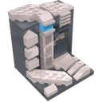{ .lu-ti width="24" loading="lazy" } [Doom Star Trench Model 7 (LOT 11689)](../11689.md) | 4 | A model for your property! | 1 matrices; 0 rewards; 0 community references |
| 11690 | 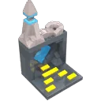{ .lu-ti width="24" loading="lazy" } [Doom Star Trench Model 8 (LOT 11690)](../11690.md) | 4 | A model for your property! | 1 matrices; 0 rewards; 0 community references |
| 11692 | { .lu-ti width="24" loading="lazy" } [Doom Star Trench Outside Corner Model (LOT 11692)](../11692.md) | 3 | A model for your property! | 1 matrices; 0 rewards; 0 community references |
| 10819 | 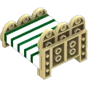{ .lu-ti width="24" loading="lazy" } [Double Bed Model (LOT 10819)](../10819.md) | 2 | A model for your property! | 3 matrices; 0 rewards; 0 community references |
| 8270 | { .lu-ti width="24" loading="lazy" } [Double Lamppost Model (LOT 8270)](../8270.md) | 1 | A model for your Property! | 25 matrices; 0 rewards; 0 community references |
| 7759 | { .lu-ti width="24" loading="lazy" } [Double Trash Can Model (LOT 7759)](../7759.md) | 1 | A model for your Property! | 49 matrices; 0 rewards; 0 community references |
| 10750 | 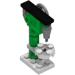{ .lu-ti width="24" loading="lazy" } [Drill Press Model (LOT 10750)](../10750.md) | 1 | A model for your property! | 2 matrices; 0 rewards; 0 community references |
| 10799 | 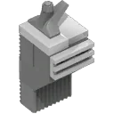{ .lu-ti width="24" loading="lazy" } [Drinking Fountain Model 1 (LOT 10799)](../10799.md) | 1 | A model for your property! | 3 matrices; 0 rewards; 0 community references |
| 10848 | { .lu-ti width="24" loading="lazy" } [Drinking Fountain Model 2 (LOT 10848)](../10848.md) | 1 | A model for your property! | 3 matrices; 0 rewards; 0 community references |
| 7813 | { .lu-ti width="24" loading="lazy" } [Drumset Model (LOT 7813)](../7813.md) | 3 | A model for your Property! | 24 matrices; 0 rewards; 0 community references |
| 14709 | { .lu-ti width="24" loading="lazy" } [Duck Car Engine Panel (LOT 14709)](../14709.md) | 3 | No client description | 1 matrices; 0 rewards; 0 community references |
| 14708 | 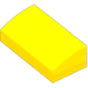{ .lu-ti width="24" loading="lazy" } [Duck Car Front Bumper (LOT 14708)](../14708.md) | 3 | No client description | 1 matrices; 0 rewards; 0 community references |
| 14712 | 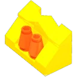{ .lu-ti width="24" loading="lazy" } [Duck Car Rear Bumper (LOT 14712)](../14712.md) | 3 | No client description | 1 matrices; 0 rewards; 0 community references |
| 14711 | 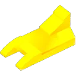{ .lu-ti width="24" loading="lazy" } [Duck Car Rear Panel (LOT 14711)](../14711.md) | 3 | No client description | 1 matrices; 0 rewards; 0 community references |
| 14710 | 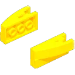{ .lu-ti width="24" loading="lazy" } [Duck Car Side Panels (LOT 14710)](../14710.md) | 3 | No client description | 1 matrices; 0 rewards; 0 community references |
| 7812 | { .lu-ti width="24" loading="lazy" } [Duck Model (LOT 7812)](../7812.md) | 3 | A model for your Property! | 0 matrices; 1 rewards; 0 community references |
| 14702 | 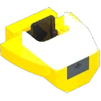{ .lu-ti width="24" loading="lazy" } [Duck Rocket Cockpit (LOT 14702)](../14702.md) | 3 | Modular Build Rocket Cockpit | 1 matrices; 0 rewards; 0 community references |
| 14703 | { .lu-ti width="24" loading="lazy" } [Duck Rocket Engine (LOT 14703)](../14703.md) | 3 | Modular Build Rocket Engine | 1 matrices; 0 rewards; 0 community references |
| 14701 | { .lu-ti width="24" loading="lazy" } [Duck Rocket Nose Cone (LOT 14701)](../14701.md) | 3 | Modular Build Rocket Nose Cone | 1 matrices; 0 rewards; 0 community references |
| 10849 | { .lu-ti width="24" loading="lazy" } [Dumpster Model (LOT 10849)](../10849.md) | 3 | A model for your property! | 1 matrices; 0 rewards; 0 community references |
| 14740 | 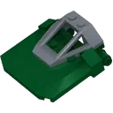{ .lu-ti width="24" loading="lazy" } [Dune Buggy Engine Panel (LOT 14740)](../14740.md) | 3 | No client description | 1 matrices; 0 rewards; 0 community references |
| 14739 | 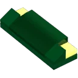{ .lu-ti width="24" loading="lazy" } [Dune Buggy Front Bumper (LOT 14739)](../14739.md) | 3 | No client description | 1 matrices; 0 rewards; 0 community references |
| 14743 | 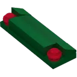{ .lu-ti width="24" loading="lazy" } [Dune Buggy Rear Bumper (LOT 14743)](../14743.md) | 3 | No client description | 1 matrices; 0 rewards; 0 community references |
| 14742 | 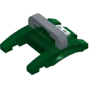{ .lu-ti width="24" loading="lazy" } [Dune Buggy Rear Panel (LOT 14742)](../14742.md) | 3 | No client description | 1 matrices; 0 rewards; 0 community references |
| 14741 | 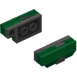{ .lu-ti width="24" loading="lazy" } [Dune Buggy Side Panels (LOT 14741)](../14741.md) | 3 | No client description | 1 matrices; 0 rewards; 0 community references |
| 9495 | { .lu-ti width="24" loading="lazy" } [Dustbin Model (LOT 9495)](../9495.md) | 1 | A model for your Property! | 23 matrices; 0 rewards; 0 community references |
| 10706 | { .lu-ti width="24" loading="lazy" } [E3 Model Block (LOT 10706)](../10706.md) | 1 | No client description | 0 matrices; 0 rewards; 0 community references |
| 10709 | { .lu-ti width="24" loading="lazy" } [E3 Model Dinosaur (LOT 10709)](../10709.md) | 1 | No client description | 0 matrices; 0 rewards; 0 community references |
| 10707 | { .lu-ti width="24" loading="lazy" } [E3 Model Jellyfish (LOT 10707)](../10707.md) | 1 | No client description | 0 matrices; 0 rewards; 0 community references |
| 10708 | { .lu-ti width="24" loading="lazy" } [E3 Model Question Block (LOT 10708)](../10708.md) | 1 | No client description | 0 matrices; 0 rewards; 0 community references |
| 10710 | { .lu-ti width="24" loading="lazy" } [E3 Model Turtle (LOT 10710)](../10710.md) | 1 | No client description | 0 matrices; 0 rewards; 0 community references |
| 10854 | 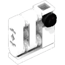{ .lu-ti width="24" loading="lazy" } [Electric Radiator Model (LOT 10854)](../10854.md) | 1 | A model for your property! | 3 matrices; 0 rewards; 0 community references |
| 10455 | 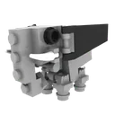{ .lu-ti width="24" loading="lazy" } [Elephant Property Pet (LOT 10455)](../10455.md) | 1 | TEST Property Elephant | 0 matrices; 0 rewards; 0 community references |
| 7829 | { .lu-ti width="24" loading="lazy" } [Engine Model (LOT 7829)](../7829.md) | 2 | A model for your Property! | 29 matrices; 0 rewards; 0 community references |
| 10855 | { .lu-ti width="24" loading="lazy" } [Espresso Machine Model (LOT 10855)](../10855.md) | 1 | A model for your property! | 3 matrices; 0 rewards; 0 community references |
| 10820 | { .lu-ti width="24" loading="lazy" } [Evergreen Plant Model (LOT 10820)](../10820.md) | 1 | A model for your property! | 3 matrices; 0 rewards; 0 community references |
| 11704 | 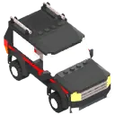{ .lu-ti width="24" loading="lazy" } [Farm 4WD Model (LOT 11704)](../11704.md) | 4 | A model for your property! | 1 matrices; 0 rewards; 0 community references |
| 11693 | { .lu-ti width="24" loading="lazy" } [Farm Bale Model (LOT 11693)](../11693.md) | 3 | A model for your property! | 1 matrices; 0 rewards; 0 community references |
| 11694 | 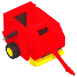{ .lu-ti width="24" loading="lazy" } [Farm Baler Model (LOT 11694)](../11694.md) | 4 | A model for your property! | 0 matrices; 0 rewards; 0 community references |
| 10366 | 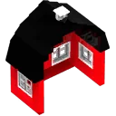{ .lu-ti width="24" loading="lazy" } [Farm Barn Back Model (LOT 10366)](../10366.md) | 3 | A model for your Property! | 0 matrices; 0 rewards; 0 community references |
| 11695 | { .lu-ti width="24" loading="lazy" } [Farm Barn Back Model (LOT 11695)](../11695.md) | 3 | A model for your property! | 2 matrices; 0 rewards; 0 community references |
| 11592 | { .lu-ti width="24" loading="lazy" } [Farm Barn Door Model 1 (LOT 11592)](../11592.md) | 2 | A model for your property! | 1 matrices; 0 rewards; 0 community references |
| 11593 | 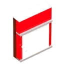{ .lu-ti width="24" loading="lazy" } [Farm Barn Door Model 2 (LOT 11593)](../11593.md) | 2 | A model for your property! | 1 matrices; 0 rewards; 0 community references |
| 11594 | { .lu-ti width="24" loading="lazy" } [Farm Barn Door Model 3 (LOT 11594)](../11594.md) | 1 | A model for your property! | 1 matrices; 0 rewards; 0 community references |
| 11595 | 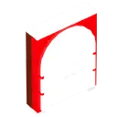{ .lu-ti width="24" loading="lazy" } [Farm Barn Door Model 4 (LOT 11595)](../11595.md) | 2 | A model for your property! | 1 matrices; 0 rewards; 0 community references |
| 11596 | { .lu-ti width="24" loading="lazy" } [Farm Barn Door Model 5 (LOT 11596)](../11596.md) | 2 | A model for your property! | 1 matrices; 0 rewards; 0 community references |
| 11597 | 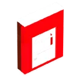{ .lu-ti width="24" loading="lazy" } [Farm Barn Door Model 6 (LOT 11597)](../11597.md) | 2 | A model for your property! | 1 matrices; 0 rewards; 0 community references |
| 11598 | 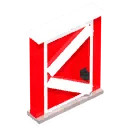{ .lu-ti width="24" loading="lazy" } [Farm Barn Door Model 7 (LOT 11598)](../11598.md) | 4 | A model for your property! | 1 matrices; 0 rewards; 0 community references |
| 11599 | { .lu-ti width="24" loading="lazy" } [Farm Barn Door Model 8 (LOT 11599)](../11599.md) | 1 | A model for your property! | 1 matrices; 0 rewards; 0 community references |
| 10367 | 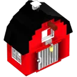{ .lu-ti width="24" loading="lazy" } [Farm Barn Front Model (LOT 10367)](../10367.md) | 3 | A model for your Property! | 0 matrices; 0 rewards; 0 community references |
| 11696 | { .lu-ti width="24" loading="lazy" } [Farm Barn Front Model (LOT 11696)](../11696.md) | 3 | A model for your property! | 2 matrices; 0 rewards; 0 community references |
| 10368 | 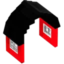{ .lu-ti width="24" loading="lazy" } [Farm Barn Middle Model (LOT 10368)](../10368.md) | 2 | A model for your Property! | 0 matrices; 0 rewards; 0 community references |
| 11697 | { .lu-ti width="24" loading="lazy" } [Farm Barn Middle Model (LOT 11697)](../11697.md) | 2 | A model for your property! | 2 matrices; 0 rewards; 0 community references |
| 11603 | { .lu-ti width="24" loading="lazy" } [Farm Barn Porch Corner Model (LOT 11603)](../11603.md) | 1 | A model for your property! | 1 matrices; 0 rewards; 0 community references |
| 11602 | { .lu-ti width="24" loading="lazy" } [Farm Barn Porch Model (LOT 11602)](../11602.md) | 2 | A model for your property! | 1 matrices; 0 rewards; 0 community references |
| 11605 | { .lu-ti width="24" loading="lazy" } [Farm Barn Shed End Left Model (LOT 11605)](../11605.md) | 2 | A model for your property! | 1 matrices; 0 rewards; 0 community references |
| 11604 | { .lu-ti width="24" loading="lazy" } [Farm Barn Shed End Model (LOT 11604)](../11604.md) | 2 | A model for your property! | 1 matrices; 0 rewards; 0 community references |
| 11606 | { .lu-ti width="24" loading="lazy" } [Farm Barn Shed End Right Model (LOT 11606)](../11606.md) | 2 | A model for your property! | 1 matrices; 0 rewards; 0 community references |
| 11607 | 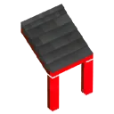{ .lu-ti width="24" loading="lazy" } [Farm Barn Shed Side Model (LOT 11607)](../11607.md) | 2 | A model for your property! | 1 matrices; 0 rewards; 0 community references |
| 11600 | { .lu-ti width="24" loading="lazy" } [Farm Barn Short End Model (LOT 11600)](../11600.md) | 1 | A model for your property! | 1 matrices; 0 rewards; 0 community references |
| 11608 | 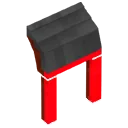{ .lu-ti width="24" loading="lazy" } [Farm Barn Side Short Model (LOT 11608)](../11608.md) | 2 | A model for your property! | 1 matrices; 0 rewards; 0 community references |
| 11609 | 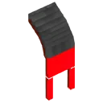{ .lu-ti width="24" loading="lazy" } [Farm Barn Side Tall Model (LOT 11609)](../11609.md) | 1 | A model for your property! | 1 matrices; 0 rewards; 0 community references |
| 11610 | 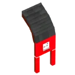{ .lu-ti width="24" loading="lazy" } [Farm Barn Side Tall Window Model (LOT 11610)](../11610.md) | 2 | A model for your property! | 1 matrices; 0 rewards; 0 community references |
| 11601 | { .lu-ti width="24" loading="lazy" } [Farm Barn Tall End Model (LOT 11601)](../11601.md) | 2 | A model for your property! | 1 matrices; 0 rewards; 0 community references |
| 11611 | { .lu-ti width="24" loading="lazy" } [Farm Barn Wall Arch Model (LOT 11611)](../11611.md) | 2 | A model for your property! | 1 matrices; 0 rewards; 0 community references |
| 11612 | 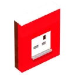{ .lu-ti width="24" loading="lazy" } [Farm Barn Window Model 1 (LOT 11612)](../11612.md) | 2 | A model for your property! | 1 matrices; 0 rewards; 0 community references |
| 11613 | { .lu-ti width="24" loading="lazy" } [Farm Barn Window Model 2 (LOT 11613)](../11613.md) | 1 | A model for your property! | 1 matrices; 0 rewards; 0 community references |
| 11614 | { .lu-ti width="24" loading="lazy" } [Farm Barn Window Model 3 (LOT 11614)](../11614.md) | 1 | A model for your property! | 1 matrices; 0 rewards; 0 community references |
| 11615 | { .lu-ti width="24" loading="lazy" } [Farm Barn Window Model 4 (LOT 11615)](../11615.md) | 3 | A model for your property! | 1 matrices; 0 rewards; 0 community references |
| 11616 | { .lu-ti width="24" loading="lazy" } [Farm Barn Window Model 5 (LOT 11616)](../11616.md) | 3 | A model for your property! | 1 matrices; 0 rewards; 0 community references |
| 11617 | { .lu-ti width="24" loading="lazy" } [Farm Barn Window Model 6 (LOT 11617)](../11617.md) | 3 | A model for your property! | 1 matrices; 0 rewards; 0 community references |
| 11618 | { .lu-ti width="24" loading="lazy" } [Farm Barn Window Model 7 (LOT 11618)](../11618.md) | 3 | A model for your property! | 1 matrices; 0 rewards; 0 community references |
| 11619 | { .lu-ti width="24" loading="lazy" } [Farm Barn Window Model 8 (LOT 11619)](../11619.md) | 3 | A model for your property! | 1 matrices; 0 rewards; 0 community references |
| 11620 | { .lu-ti width="24" loading="lazy" } [Farm Barn Window Model 9 (LOT 11620)](../11620.md) | 3 | A model for your property! | 1 matrices; 0 rewards; 0 community references |
| 11699 | { .lu-ti width="24" loading="lazy" } [Farm Chicken Coop Model (LOT 11699)](../11699.md) | 3 | A model for your property! | 2 matrices; 0 rewards; 0 community references |
| 11698 | { .lu-ti width="24" loading="lazy" } [Farm Chicken Model (LOT 11698)](../11698.md) | 1 | A model for your property! | 2 matrices; 0 rewards; 0 community references |
| 11700 | { .lu-ti width="24" loading="lazy" } [Farm Chopper Model (LOT 11700)](../11700.md) | 3 | A model for your property! | 1 matrices; 0 rewards; 0 community references |
| 11701 | { .lu-ti width="24" loading="lazy" } [Farm Clothesline Model (LOT 11701)](../11701.md) | 2 | A model for your property! | 1 matrices; 0 rewards; 0 community references |
| 11702 | { .lu-ti width="24" loading="lazy" } [Farm Disc Model (LOT 11702)](../11702.md) | 3 | A model for your property! | 1 matrices; 0 rewards; 0 community references |
| 11703 | { .lu-ti width="24" loading="lazy" } [Farm Feed Trough Model (LOT 11703)](../11703.md) | 1 | A model for your property! | 1 matrices; 0 rewards; 0 community references |
| 10373 | { .lu-ti width="24" loading="lazy" } [Farm Fence Gate Model (LOT 10373)](../10373.md) | 1 | A model for your Property! | 0 matrices; 0 rewards; 0 community references |
| 11717 | { .lu-ti width="24" loading="lazy" } [Farm Fence Gate Model (LOT 11717)](../11717.md) | 1 | A model for your property! | 2 matrices; 0 rewards; 0 community references |
| 10374 | { .lu-ti width="24" loading="lazy" } [Farm Fence Short Model (LOT 10374)](../10374.md) | 1 | A model for your Property! | 0 matrices; 0 rewards; 0 community references |
| 11718 | { .lu-ti width="24" loading="lazy" } [Farm Fence Short Model (LOT 11718)](../11718.md) | 1 | A model for your property! | 2 matrices; 0 rewards; 0 community references |
| 10375 | { .lu-ti width="24" loading="lazy" } [Farm Fence Tall Model (LOT 10375)](../10375.md) | 1 | A model for your Property! | 0 matrices; 0 rewards; 0 community references |
| 11719 | { .lu-ti width="24" loading="lazy" } [Farm Fence Tall Model (LOT 11719)](../11719.md) | 1 | A model for your property! | 2 matrices; 0 rewards; 0 community references |
| 11705 | { .lu-ti width="24" loading="lazy" } [Farm Garden Model 1 (LOT 11705)](../11705.md) | 3 | A model for your property! | 1 matrices; 0 rewards; 0 community references |
| 11706 | { .lu-ti width="24" loading="lazy" } [Farm Garden Model 2 (LOT 11706)](../11706.md) | 3 | A model for your property! | 1 matrices; 0 rewards; 0 community references |
| 11707 | { .lu-ti width="24" loading="lazy" } [Farm Harvest Wagon Model (LOT 11707)](../11707.md) | 4 | A model for your property! | 1 matrices; 0 rewards; 0 community references |
| 11708 | { .lu-ti width="24" loading="lazy" } [Farm Horse Trailer Model (LOT 11708)](../11708.md) | 3 | A model for your property! | 1 matrices; 0 rewards; 0 community references |
| 11709 | { .lu-ti width="24" loading="lazy" } [Farm Pickup Model (LOT 11709)](../11709.md) | 4 | A model for your property! | 1 matrices; 0 rewards; 0 community references |
| 11802 | { .lu-ti width="24" loading="lazy" } [Farm Shed Door Model 1 (LOT 11802)](../11802.md) | 3 | A model for your property! | 1 matrices; 0 rewards; 0 community references |
| 11803 | { .lu-ti width="24" loading="lazy" } [Farm Shed Door Model 2 (LOT 11803)](../11803.md) | 2 | A model for your property! | 1 matrices; 0 rewards; 0 community references |
| 11804 | { .lu-ti width="24" loading="lazy" } [Farm Shed Door Model 3 (LOT 11804)](../11804.md) | 2 | A model for your property! | 1 matrices; 0 rewards; 0 community references |
| 11805 | { .lu-ti width="24" loading="lazy" } [Farm Shed Door Model 4 (LOT 11805)](../11805.md) | 2 | A model for your property! | 1 matrices; 0 rewards; 0 community references |
| 11806 | { .lu-ti width="24" loading="lazy" } [Farm Shed Door Model 5 (LOT 11806)](../11806.md) | 2 | A model for your property! | 1 matrices; 0 rewards; 0 community references |
| 11807 | { .lu-ti width="24" loading="lazy" } [Farm Shed End Left Double Model (LOT 11807)](../11807.md) | 4 | A model for your property! | 1 matrices; 0 rewards; 0 community references |
| 11808 | { .lu-ti width="24" loading="lazy" } [Farm Shed End Left Single Model (LOT 11808)](../11808.md) | 3 | A model for your property! | 1 matrices; 0 rewards; 0 community references |
| 11813 | { .lu-ti width="24" loading="lazy" } [Farm Shed End Model (LOT 11813)](../11813.md) | 4 | A model for your property! | 1 matrices; 0 rewards; 0 community references |
| 11811 | { .lu-ti width="24" loading="lazy" } [Farm Shed End Narrow Model (LOT 11811)](../11811.md) | 3 | A model for your property! | 1 matrices; 0 rewards; 0 community references |
| 11809 | { .lu-ti width="24" loading="lazy" } [Farm Shed End Right Double Model (LOT 11809)](../11809.md) | 4 | A model for your property! | 1 matrices; 0 rewards; 0 community references |
| 11810 | { .lu-ti width="24" loading="lazy" } [Farm Shed End Right Model (LOT 11810)](../11810.md) | 3 | A model for your property! | 1 matrices; 0 rewards; 0 community references |
| 11812 | { .lu-ti width="24" loading="lazy" } [Farm Shed End Wide Model (LOT 11812)](../11812.md) | 4 | A model for your property! | 1 matrices; 0 rewards; 0 community references |
| 11814 | { .lu-ti width="24" loading="lazy" } [Farm Shed Wall Short Model 1 (LOT 11814)](../11814.md) | 3 | A model for your property! | 1 matrices; 0 rewards; 0 community references |
| 11815 | { .lu-ti width="24" loading="lazy" } [Farm Shed Wall Short Model 2 (LOT 11815)](../11815.md) | 4 | A model for your property! | 1 matrices; 0 rewards; 0 community references |
| 11816 | { .lu-ti width="24" loading="lazy" } [Farm Shed Wall Short Model 3 (LOT 11816)](../11816.md) | 4 | A model for your property! | 1 matrices; 0 rewards; 0 community references |
| 11817 | { .lu-ti width="24" loading="lazy" } [Farm Shed Window Model 1 (LOT 11817)](../11817.md) | 3 | A model for your property! | 1 matrices; 0 rewards; 0 community references |
| 11818 | { .lu-ti width="24" loading="lazy" } [Farm Shed Window Model 2 (LOT 11818)](../11818.md) | 2 | A model for your property! | 1 matrices; 0 rewards; 0 community references |
| 11819 | { .lu-ti width="24" loading="lazy" } [Farm Shed Window Model 3 (LOT 11819)](../11819.md) | 2 | A model for your property! | 1 matrices; 0 rewards; 0 community references |
| 11820 | { .lu-ti width="24" loading="lazy" } [Farm Shed Window Model 4 (LOT 11820)](../11820.md) | 3 | A model for your property! | 1 matrices; 0 rewards; 0 community references |
| 11821 | { .lu-ti width="24" loading="lazy" } [Farm Shed Window Model 5 (LOT 11821)](../11821.md) | 3 | A model for your property! | 1 matrices; 0 rewards; 0 community references |
| 11710 | { .lu-ti width="24" loading="lazy" } [Farm Sheep Model (LOT 11710)](../11710.md) | 2 | A model for your property! | 2 matrices; 0 rewards; 0 community references |
| 10369 | { .lu-ti width="24" loading="lazy" } [Farm Silo Model 1 (LOT 10369)](../10369.md) | 3 | A model for your Property! | 0 matrices; 0 rewards; 0 community references |
| 11711 | { .lu-ti width="24" loading="lazy" } [Farm Silo Model 1 (LOT 11711)](../11711.md) | 3 | A model for your property! | 2 matrices; 0 rewards; 0 community references |
| 10370 | { .lu-ti width="24" loading="lazy" } [Farm Silo Model 2 (LOT 10370)](../10370.md) | 2 | A model for your Property! | 0 matrices; 0 rewards; 0 community references |
| 11712 | { .lu-ti width="24" loading="lazy" } [Farm Silo Model 2 (LOT 11712)](../11712.md) | 2 | A model for your property! | 0 matrices; 0 rewards; 0 community references |
| 10371 | { .lu-ti width="24" loading="lazy" } [Farm Tractor Model (LOT 10371)](../10371.md) | 3 | A model for your Property! | 0 matrices; 1 rewards; 0 community references |
| 11713 | { .lu-ti width="24" loading="lazy" } [Farm Tractor Model 1 (LOT 11713)](../11713.md) | 3 | A model for your property! | 1 matrices; 0 rewards; 0 community references |
| 10372 | { .lu-ti width="24" loading="lazy" } [Farm Trailer Model (LOT 10372)](../10372.md) | 3 | A model for your Property! | 0 matrices; 0 rewards; 0 community references |
| 11714 | { .lu-ti width="24" loading="lazy" } [Farm Trailer Model (LOT 11714)](../11714.md) | 3 | A model for your property! | 1 matrices; 0 rewards; 0 community references |
| 11715 | { .lu-ti width="24" loading="lazy" } [Farm Truck Model (LOT 11715)](../11715.md) | 4 | A model for your property! | 0 matrices; 0 rewards; 0 community references |
| 11716 | { .lu-ti width="24" loading="lazy" } [Farm Windmill Model (LOT 11716)](../11716.md) | 3 | A model for your property! | 1 matrices; 0 rewards; 0 community references |
| 6071 | { .lu-ti width="24" loading="lazy" } [Fence Model (LOT 6071)](../6071.md) | 1 | A model for your Property! | 45 matrices; 0 rewards; 0 community references |
| 12022 | { .lu-ti width="24" loading="lazy" } [Fire Brawl Engine Panel (LOT 12022)](../12022.md) | 1 | No client description | 0 matrices; 1 rewards; 0 community references |
| 12023 | { .lu-ti width="24" loading="lazy" } [Fire Brawl Engine Panel (LOT 12023)](../12023.md) | 1 | No client description | 1 matrices; 0 rewards; 0 community references |
| 12020 | { .lu-ti width="24" loading="lazy" } [Fire Brawl Front Bumper (LOT 12020)](../12020.md) | 1 | No client description | 0 matrices; 1 rewards; 0 community references |
| 12021 | { .lu-ti width="24" loading="lazy" } [Fire Brawl Front Bumper (LOT 12021)](../12021.md) | 1 | No client description | 1 matrices; 0 rewards; 0 community references |
| 12024 | { .lu-ti width="24" loading="lazy" } [Fire Brawl Rear Bumper (LOT 12024)](../12024.md) | 1 | No client description | 0 matrices; 1 rewards; 0 community references |
| 12025 | { .lu-ti width="24" loading="lazy" } [Fire Brawl Rear Bumper (LOT 12025)](../12025.md) | 1 | No client description | 1 matrices; 0 rewards; 0 community references |
| 12026 | { .lu-ti width="24" loading="lazy" } [Fire Brawl Rear Panel (LOT 12026)](../12026.md) | 1 | No client description | 0 matrices; 1 rewards; 0 community references |
| 12027 | { .lu-ti width="24" loading="lazy" } [Fire Brawl Rear Panel (LOT 12027)](../12027.md) | 1 | No client description | 1 matrices; 0 rewards; 0 community references |
| 12028 | { .lu-ti width="24" loading="lazy" } [Fire Brawl Side Panels (LOT 12028)](../12028.md) | 1 | No client description | 0 matrices; 1 rewards; 0 community references |
| 12029 | { .lu-ti width="24" loading="lazy" } [Fire Brawl Side Panels (LOT 12029)](../12029.md) | 1 | No client description | 1 matrices; 0 rewards; 0 community references |
| 7768 | { .lu-ti width="24" loading="lazy" } [Fire Extinguisher Model (LOT 7768)](../7768.md) | 1 | A model for your Property! | 1 matrices; 0 rewards; 0 community references |
| 7808 | { .lu-ti width="24" loading="lazy" } [Fire Hydrant Model (LOT 7808)](../7808.md) | 1 | A model for your Property! | 25 matrices; 0 rewards; 0 community references |
| 10856 | { .lu-ti width="24" loading="lazy" } [Fireplace Model (LOT 10856)](../10856.md) | 3 | A model for your property! | 1 matrices; 0 rewards; 0 community references |
| 9545 | { .lu-ti width="24" loading="lazy" } [Fish Statue Model (LOT 9545)](../9545.md) | 3 | A model for your Property! | 23 matrices; 0 rewards; 0 community references |
| 10840 | { .lu-ti width="24" loading="lazy" } [Flamingo Model (LOT 10840)](../10840.md) | 1 | A model for your property! | 3 matrices; 0 rewards; 0 community references |
| 10857 | { .lu-ti width="24" loading="lazy" } [Flower Model (LOT 10857)](../10857.md) | 1 | A model for your property! | 3 matrices; 0 rewards; 0 community references |
| 10850 | { .lu-ti width="24" loading="lazy" } [Flower Statue Model (LOT 10850)](../10850.md) | 1 | A model for your property! | 3 matrices; 0 rewards; 0 community references |
| 9919 | { .lu-ti width="24" loading="lazy" } [Fort Corner Model (LOT 9919)](../9919.md) | 3 | A model for your Property! | 1 matrices; 0 rewards; 0 community references |
| 9914 | { .lu-ti width="24" loading="lazy" } [Fort Gate Model (LOT 9914)](../9914.md) | 3 | A model for your Property! | 1 matrices; 0 rewards; 0 community references |
| 9920 | { .lu-ti width="24" loading="lazy" } [Fort Guardshack Model (LOT 9920)](../9920.md) | 4 | A model for your Property! | 1 matrices; 0 rewards; 0 community references |
| 9915 | { .lu-ti width="24" loading="lazy" } [Fort Jail Model (LOT 9915)](../9915.md) | 1 | A model for your Property! | 1 matrices; 0 rewards; 0 community references |
| 9922 | { .lu-ti width="24" loading="lazy" } [Fort Small Wall Model 1 (LOT 9922)](../9922.md) | 1 | A model for your Property! | 1 matrices; 0 rewards; 0 community references |
| 9923 | { .lu-ti width="24" loading="lazy" } [Fort Small Wall Model 2 (LOT 9923)](../9923.md) | 2 | A model for your Property! | 1 matrices; 0 rewards; 0 community references |
| 9924 | { .lu-ti width="24" loading="lazy" } [Fort Stable Model (LOT 9924)](../9924.md) | 3 | A model for your Property! | 1 matrices; 0 rewards; 0 community references |
| 9916 | { .lu-ti width="24" loading="lazy" } [Fort Stairs Model (LOT 9916)](../9916.md) | 2 | A model for your Property! | 1 matrices; 0 rewards; 0 community references |
| 9917 | { .lu-ti width="24" loading="lazy" } [Fort Tower Model (LOT 9917)](../9917.md) | 3 | A model for your Property! | 1 matrices; 0 rewards; 0 community references |
| 9918 | { .lu-ti width="24" loading="lazy" } [Fort Walkway Model (LOT 9918)](../9918.md) | 2 | A model for your Property! | 1 matrices; 0 rewards; 0 community references |
| 9921 | { .lu-ti width="24" loading="lazy" } [Fort Wall Rock Model (LOT 9921)](../9921.md) | 3 | A model for your Property! | 1 matrices; 0 rewards; 0 community references |
| 10751 | { .lu-ti width="24" loading="lazy" } [Fortress Archway Model (LOT 10751)](../10751.md) | 2 | A model for your property! | 21 matrices; 0 rewards; 0 community references |
| 10752 | { .lu-ti width="24" loading="lazy" } [Fortress Big Bonsai Model (LOT 10752)](../10752.md) | 2 | A model for your property! | 21 matrices; 0 rewards; 0 community references |
| 10763 | { .lu-ti width="24" loading="lazy" } [Fortress Big Lizard Shrine Model (LOT 10763)](../10763.md) | 1 | A model for your property! | 21 matrices; 1 rewards; 0 community references |
| 10753 | { .lu-ti width="24" loading="lazy" } [Fortress Cart Model (LOT 10753)](../10753.md) | 1 | A model for your property! | 22 matrices; 0 rewards; 0 community references |
| 10754 | { .lu-ti width="24" loading="lazy" } [Fortress Dojo Part Model (LOT 10754)](../10754.md) | 4 | A model for your property! | 21 matrices; 0 rewards; 0 community references |
| 10755 | { .lu-ti width="24" loading="lazy" } [Fortress Dragon Kite Model (LOT 10755)](../10755.md) | 1 | A model for your property! | 21 matrices; 0 rewards; 0 community references |
| 10756 | { .lu-ti width="24" loading="lazy" } [Fortress Dragon Statue Model (LOT 10756)](../10756.md) | 2 | A model for your property! | 21 matrices; 0 rewards; 0 community references |
| 10757 | { .lu-ti width="24" loading="lazy" } [Fortress Elevator Model (LOT 10757)](../10757.md) | 1 | A model for your property! | 22 matrices; 0 rewards; 0 community references |
| 10758 | { .lu-ti width="24" loading="lazy" } [Fortress Gong Model (LOT 10758)](../10758.md) | 1 | A model for your property! | 22 matrices; 0 rewards; 0 community references |
| 10759 | { .lu-ti width="24" loading="lazy" } [Fortress Inside Corner Model (LOT 10759)](../10759.md) | 4 | A model for your property! | 23 matrices; 0 rewards; 0 community references |
| 10760 | { .lu-ti width="24" loading="lazy" } [Fortress Lantern Model (LOT 10760)](../10760.md) | 1 | A model for your property! | 22 matrices; 0 rewards; 0 community references |
| 10761 | { .lu-ti width="24" loading="lazy" } [Fortress Large Outside Corner Model (LOT 10761)](../10761.md) | 4 | A model for your property! | 24 matrices; 0 rewards; 0 community references |
| 10762 | { .lu-ti width="24" loading="lazy" } [Fortress Large Wall Model (LOT 10762)](../10762.md) | 4 | A model for your property! | 24 matrices; 0 rewards; 0 community references |
| 10764 | { .lu-ti width="24" loading="lazy" } [Fortress Pond Model (LOT 10764)](../10764.md) | 4 | A model for your property! | 22 matrices; 0 rewards; 0 community references |
| 10765 | { .lu-ti width="24" loading="lazy" } [Fortress Ramp Model (LOT 10765)](../10765.md) | 3 | A model for your property! | 23 matrices; 0 rewards; 0 community references |
| 10766 | { .lu-ti width="24" loading="lazy" } [Fortress Small Outside Corner Model (LOT 10766)](../10766.md) | 4 | A model for your property! | 24 matrices; 0 rewards; 0 community references |
| 10767 | { .lu-ti width="24" loading="lazy" } [Fortress Small Wall Model (LOT 10767)](../10767.md) | 3 | A model for your property! | 24 matrices; 0 rewards; 0 community references |
| 10768 | { .lu-ti width="24" loading="lazy" } [Fortress Sun Dial Model (LOT 10768)](../10768.md) | 2 | A model for your property! | 21 matrices; 0 rewards; 0 community references |
| 10769 | { .lu-ti width="24" loading="lazy" } [Fortress Wall Gate Model (LOT 10769)](../10769.md) | 4 | A model for your property! | 23 matrices; 0 rewards; 0 community references |
| 10770 | { .lu-ti width="24" loading="lazy" } [Fortress Wall Gate Sliding Door Model (LOT 10770)](../10770.md) | 1 | A model for your property! | 22 matrices; 0 rewards; 0 community references |
| 10771 | { .lu-ti width="24" loading="lazy" } [Fortress Watch Tower Model (LOT 10771)](../10771.md) | 4 | A model for your property! | 23 matrices; 0 rewards; 0 community references |
| 10772 | { .lu-ti width="24" loading="lazy" } [Fortress Zen Garden Model 1 (LOT 10772)](../10772.md) | 2 | A model for your property! | 22 matrices; 0 rewards; 0 community references |
| 10773 | { .lu-ti width="24" loading="lazy" } [Fortress Zen Garden Model 2 (LOT 10773)](../10773.md) | 2 | A model for your property! | 22 matrices; 0 rewards; 0 community references |
| 10774 | { .lu-ti width="24" loading="lazy" } [Fortress Zen Garden Model 3 (LOT 10774)](../10774.md) | 2 | A model for your property! | 22 matrices; 0 rewards; 0 community references |
| 10775 | { .lu-ti width="24" loading="lazy" } [Fortress Zen Garden Model 4 (LOT 10775)](../10775.md) | 1 | A model for your property! | 22 matrices; 0 rewards; 0 community references |
| 10776 | { .lu-ti width="24" loading="lazy" } [Fortress Zen Garden Model 5 (LOT 10776)](../10776.md) | 2 | A model for your property! | 22 matrices; 0 rewards; 0 community references |
