# Loot model — page 4/8

[Item database](../README.md)

Pages: [1](type-21-1.md) | [2](type-21-2.md) | [3](type-21-3.md) | [4](type-21-4.md) | [5](type-21-5.md) | [6](type-21-6.md) | [7](type-21-7.md) | [8](type-21-8.md)

| LOT | Item | Rarity | Description | Source evidence |
| --- | --- | --- | --- | --- |
| 10777 | 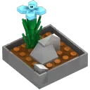{ .lu-ti width="24" loading="lazy" } [Fortress Zen Garden Model 6 (LOT 10777)](../10777.md) | 2 | A model for your property! | 21 matrices; 0 rewards; 0 community references |
| 10778 | 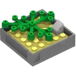{ .lu-ti width="24" loading="lazy" } [Fortress Zen Garden Model 7 (LOT 10778)](../10778.md) | 2 | A model for your property! | 21 matrices; 0 rewards; 0 community references |
| 10779 | { .lu-ti width="24" loading="lazy" } [Fortress Zen Garden Model 8 (LOT 10779)](../10779.md) | 2 | A model for your property! | 21 matrices; 1 rewards; 0 community references |
| 10780 | 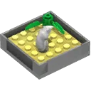{ .lu-ti width="24" loading="lazy" } [Fortress Zen Garden Model 9 (LOT 10780)](../10780.md) | 1 | A model for your property! | 21 matrices; 1 rewards; 0 community references |
| 10858 | 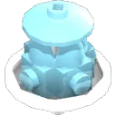{ .lu-ti width="24" loading="lazy" } [Fountain Model (LOT 10858)](../10858.md) | 1 | A model for your property! | 3 matrices; 0 rewards; 0 community references |
| 10859 | 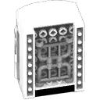{ .lu-ti width="24" loading="lazy" } [Fridge Model (LOT 10859)](../10859.md) | 3 | A model for your property! | 1 matrices; 0 rewards; 0 community references |
| 13063 | 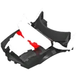{ .lu-ti width="24" loading="lazy" } [Fright Speed Engine Panel (LOT 13063)](../13063.md) | 2 | No client description | 1 matrices; 0 rewards; 0 community references |
| 13062 | 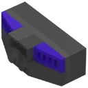{ .lu-ti width="24" loading="lazy" } [Fright Speed Front Bumper (LOT 13062)](../13062.md) | 2 | No client description | 1 matrices; 0 rewards; 0 community references |
| 13064 | 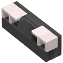{ .lu-ti width="24" loading="lazy" } [Fright Speed Rear Bumper (LOT 13064)](../13064.md) | 2 | No client description | 1 matrices; 0 rewards; 0 community references |
| 13065 | 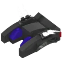{ .lu-ti width="24" loading="lazy" } [Fright Speed Rear Panel (LOT 13065)](../13065.md) | 2 | No client description | 1 matrices; 0 rewards; 0 community references |
| 13066 | 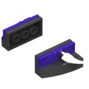{ .lu-ti width="24" loading="lazy" } [Fright Speed Side Panels (LOT 13066)](../13066.md) | 2 | No client description | 1 matrices; 0 rewards; 0 community references |
| 7057 | { .lu-ti width="24" loading="lazy" } [Frog Model (LOT 7057)](../7057.md) | 1 | Place this animated creature model on your Property! | 18 matrices; 1 rewards; 0 community references |
| 10842 | { .lu-ti width="24" loading="lazy" } [Fruit Cart Model (LOT 10842)](../10842.md) | 2 | A model for your property! | 0 matrices; 1 rewards; 0 community references |
| 10860 | 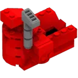{ .lu-ti width="24" loading="lazy" } [Furnace Model (LOT 10860)](../10860.md) | 3 | A model for your property! | 1 matrices; 0 rewards; 0 community references |
| 11011 | { .lu-ti width="24" loading="lazy" } [FV Property Pushback Model - Spike Platform (LOT 11011)](../11011.md) | 1 | NS Property Pushback Model - Spike Platform - REBUILD password s3kratK1ttN | 0 matrices; 0 rewards; 0 community references |
| 10287 | { .lu-ti width="24" loading="lazy" } [Galleon with behaviors (LOT 10287)](../10287.md) | 1 | Place this model on your property! | 0 matrices; 0 rewards; 0 community references |
| 9564 | 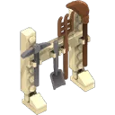{ .lu-ti width="24" loading="lazy" } [Garden Tool Rack Model (LOT 9564)](../9564.md) | 2 | A model for your Property! | 2 matrices; 0 rewards; 0 community references |
| 10800 | { .lu-ti width="24" loading="lazy" } [Generator Model (LOT 10800)](../10800.md) | 2 | A model for your property! | 3 matrices; 0 rewards; 0 community references |
| 11025 | { .lu-ti width="24" loading="lazy" } [GF Property Pushback - Platform (LOT 11025)](../11025.md) | 1 | GF Property Pushback - Platform | 0 matrices; 0 rewards; 0 community references |
| 11005 | { .lu-ti width="24" loading="lazy" } [GF Property Pushback Model - Fire Beast (LOT 11005)](../11005.md) | 1 | GF Property Pushback Model - Fire Beast | 0 matrices; 0 rewards; 0 community references |
| 10999 | { .lu-ti width="24" loading="lazy" } [GF Property Pushback Model - Ice Barrier (LOT 10999)](../10999.md) | 1 | GF Property Pushback Model - Ice Barrier | 0 matrices; 0 rewards; 0 community references |
| 11001 | { .lu-ti width="24" loading="lazy" } [GF Property Pushback Model - Tombstone (LOT 11001)](../11001.md) | 1 | GF Property Pushback Model - Tombstone | 0 matrices; 0 rewards; 0 community references |
| 10851 | { .lu-ti width="24" loading="lazy" } [Gnome Model (LOT 10851)](../10851.md) | 1 | A model for your property! | 3 matrices; 0 rewards; 0 community references |
| 8055 | { .lu-ti width="24" loading="lazy" } [Goblet Box Model (LOT 8055)](../8055.md) | 1 | A model for your Property! | 47 matrices; 0 rewards; 0 community references |
| 10801 | 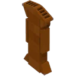{ .lu-ti width="24" loading="lazy" } [Grandfather Clock Model (LOT 10801)](../10801.md) | 1 | A model for your property! | 3 matrices; 0 rewards; 0 community references |
| 10802 | 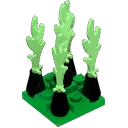{ .lu-ti width="24" loading="lazy" } [Green Flames Model (LOT 10802)](../10802.md) | 1 | A model for your property! | 3 matrices; 0 rewards; 0 community references |
| 9600 | 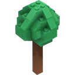{ .lu-ti width="24" loading="lazy" } [Green Tree Model 3 (LOT 9600)](../9600.md) | 2 | A model for your Property! | 1 matrices; 0 rewards; 0 community references |
| 10861 | { .lu-ti width="24" loading="lazy" } [Guide Model (LOT 10861)](../10861.md) | 1 | A model for your property! | 3 matrices; 0 rewards; 0 community references |
| 7774 | { .lu-ti width="24" loading="lazy" } [Guitar Model (LOT 7774)](../7774.md) | 1 | A model for your Property! | 27 matrices; 0 rewards; 0 community references |
| 10862 | { .lu-ti width="24" loading="lazy" } [Gum Dispenser Model (LOT 10862)](../10862.md) | 1 | A model for your property! | 3 matrices; 0 rewards; 0 community references |
| 6053 | 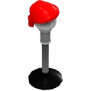{ .lu-ti width="24" loading="lazy" } [Hat Stand Model 1 (LOT 6053)](../6053.md) | 1 | A model for your Property! | 19 matrices; 0 rewards; 0 community references |
| 6054 | 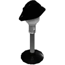{ .lu-ti width="24" loading="lazy" } [Hat Stand Model 2 (LOT 6054)](../6054.md) | 1 | A model for your Property! | 19 matrices; 0 rewards; 0 community references |
| 6055 | { .lu-ti width="24" loading="lazy" } [Hat Stand Model 3 (LOT 6055)](../6055.md) | 1 | A model for your Property! | 21 matrices; 0 rewards; 0 community references |
| 9485 | 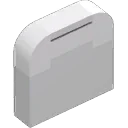{ .lu-ti width="24" loading="lazy" } [Headstone Model 1 (LOT 9485)](../9485.md) | 1 | A model for your Property! | 22 matrices; 0 rewards; 0 community references |
| 9486 | 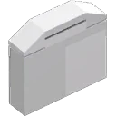{ .lu-ti width="24" loading="lazy" } [Headstone Model 2 (LOT 9486)](../9486.md) | 1 | A model for your Property! | 22 matrices; 0 rewards; 0 community references |
| 9491 | { .lu-ti width="24" loading="lazy" } [Hotdog Cart Model (LOT 9491)](../9491.md) | 2 | A model for your Property! | 23 matrices; 0 rewards; 0 community references |
| 9540 | { .lu-ti width="24" loading="lazy" } [Hotdog Cart Model (LOT 9540)](../9540.md) | 2 | A model for your Property! | 0 matrices; 1 rewards; 0 community references |
| 9492 | 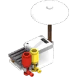{ .lu-ti width="24" loading="lazy" } [Hotdog Stand Model (LOT 9492)](../9492.md) | 1 | A model for your Property! | 23 matrices; 0 rewards; 0 community references |
| 10328 | 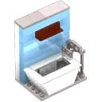{ .lu-ti width="24" loading="lazy" } [House Bathtub Model 1 (LOT 10328)](../10328.md) | 2 | A model for your Property! | 27 matrices; 0 rewards; 0 community references |
| 10329 | { .lu-ti width="24" loading="lazy" } [House Bathtub Model 2 (LOT 10329)](../10329.md) | 2 | A model for your Property! | 27 matrices; 0 rewards; 0 community references |
| 10330 | { .lu-ti width="24" loading="lazy" } [House Closed Door Model 1 (LOT 10330)](../10330.md) | 1 | A model for your Property! | 28 matrices; 0 rewards; 0 community references |
| 10332 | { .lu-ti width="24" loading="lazy" } [House Closed Door Model 2 (LOT 10332)](../10332.md) | 2 | A model for your Property! | 27 matrices; 0 rewards; 0 community references |
| 10334 | { .lu-ti width="24" loading="lazy" } [House Closed Door Model 3 (LOT 10334)](../10334.md) | 1 | A model for your Property! | 28 matrices; 0 rewards; 0 community references |
| 10336 | { .lu-ti width="24" loading="lazy" } [House Kitchen Model 1 (LOT 10336)](../10336.md) | 3 | A model for your Property! | 29 matrices; 0 rewards; 0 community references |
| 10337 | { .lu-ti width="24" loading="lazy" } [House Kitchen Model 2 (LOT 10337)](../10337.md) | 2 | A model for your Property! | 28 matrices; 0 rewards; 0 community references |
| 10338 | { .lu-ti width="24" loading="lazy" } [House Kitchen Model 3 (LOT 10338)](../10338.md) | 2 | A model for your Property! | 29 matrices; 0 rewards; 0 community references |
| 10339 | { .lu-ti width="24" loading="lazy" } [House Laundry Model 1 (LOT 10339)](../10339.md) | 2 | A model for your Property! | 27 matrices; 0 rewards; 0 community references |
| 10340 | { .lu-ti width="24" loading="lazy" } [House Laundry Model 2 (LOT 10340)](../10340.md) | 2 | A model for your Property! | 28 matrices; 0 rewards; 0 community references |
| 10341 | { .lu-ti width="24" loading="lazy" } [House Library Model 1 (LOT 10341)](../10341.md) | 3 | A model for your Property! | 28 matrices; 0 rewards; 0 community references |
| 10342 | { .lu-ti width="24" loading="lazy" } [House Library Model 2 (LOT 10342)](../10342.md) | 2 | A model for your Property! | 28 matrices; 0 rewards; 0 community references |
| 10343 | { .lu-ti width="24" loading="lazy" } [House Library Model 3 (LOT 10343)](../10343.md) | 2 | A model for your Property! | 27 matrices; 0 rewards; 0 community references |
| 10344 | { .lu-ti width="24" loading="lazy" } [House Library Model 4 (LOT 10344)](../10344.md) | 2 | A model for your Property! | 28 matrices; 0 rewards; 0 community references |
| 10331 | { .lu-ti width="24" loading="lazy" } [House Open Door Model 1 (LOT 10331)](../10331.md) | 1 | A model for your Property! | 28 matrices; 0 rewards; 0 community references |
| 10333 | 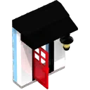{ .lu-ti width="24" loading="lazy" } [House Open Door Model 2 (LOT 10333)](../10333.md) | 2 | A model for your Property! | 27 matrices; 0 rewards; 0 community references |
| 10335 | 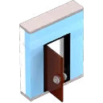{ .lu-ti width="24" loading="lazy" } [House Open Door Model 3 (LOT 10335)](../10335.md) | 1 | A model for your Property! | 28 matrices; 0 rewards; 0 community references |
| 10345 | { .lu-ti width="24" loading="lazy" } [House Toilet Model 2 (LOT 10345)](../10345.md) | 2 | A model for your Property! | 29 matrices; 0 rewards; 0 community references |
| 10346 | 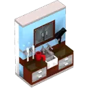{ .lu-ti width="24" loading="lazy" } [House Vanity Model 1 (LOT 10346)](../10346.md) | 2 | A model for your Property! | 27 matrices; 0 rewards; 0 community references |
| 10347 | { .lu-ti width="24" loading="lazy" } [House Vanity Model 2 (LOT 10347)](../10347.md) | 2 | A model for your Property! | 28 matrices; 0 rewards; 0 community references |
| 10348 | { .lu-ti width="24" loading="lazy" } [House Vanity Model 3 (LOT 10348)](../10348.md) | 3 | A model for your Property! | 29 matrices; 0 rewards; 0 community references |
| 10349 | { .lu-ti width="24" loading="lazy" } [House Vanity Model 4 (LOT 10349)](../10349.md) | 2 | A model for your Property! | 27 matrices; 0 rewards; 0 community references |
| 10350 | { .lu-ti width="24" loading="lazy" } [House Wall Arch Model (LOT 10350)](../10350.md) | 1 | A model for your Property! | 29 matrices; 0 rewards; 0 community references |
| 10351 | 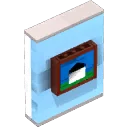{ .lu-ti width="24" loading="lazy" } [House Wall Art Model 1 (LOT 10351)](../10351.md) | 2 | A model for your Property! | 27 matrices; 0 rewards; 0 community references |
| 10352 | { .lu-ti width="24" loading="lazy" } [House Wall Art Model 2 (LOT 10352)](../10352.md) | 2 | A model for your Property! | 28 matrices; 0 rewards; 0 community references |
| 10353 | { .lu-ti width="24" loading="lazy" } [House Wall Blank Model 1 (LOT 10353)](../10353.md) | 1 | A model for your Property! | 27 matrices; 0 rewards; 0 community references |
| 10354 | { .lu-ti width="24" loading="lazy" } [House Wall Blank Model 2 (LOT 10354)](../10354.md) | 1 | A model for your Property! | 30 matrices; 0 rewards; 0 community references |
| 10355 | { .lu-ti width="24" loading="lazy" } [House Wall Blank Model 3 (LOT 10355)](../10355.md) | 1 | A model for your Property! | 29 matrices; 0 rewards; 0 community references |
| 10356 | { .lu-ti width="24" loading="lazy" } [House Wall Corner Model 1 (LOT 10356)](../10356.md) | 2 | A model for your Property! | 29 matrices; 0 rewards; 0 community references |
| 10357 | { .lu-ti width="24" loading="lazy" } [House Wall Corner Model 2 (LOT 10357)](../10357.md) | 2 | A model for your Property! | 27 matrices; 0 rewards; 0 community references |
| 10358 | 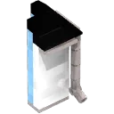{ .lu-ti width="24" loading="lazy" } [House Wall Corner Model 3 (LOT 10358)](../10358.md) | 2 | A model for your Property! | 28 matrices; 0 rewards; 0 community references |
| 10359 | { .lu-ti width="24" loading="lazy" } [House Wall Fireplace Model 1 (LOT 10359)](../10359.md) | 3 | A model for your Property! | 29 matrices; 0 rewards; 0 community references |
| 10360 | { .lu-ti width="24" loading="lazy" } [House Window Model 1 (LOT 10360)](../10360.md) | 2 | A model for your Property! | 28 matrices; 0 rewards; 0 community references |
| 10361 | { .lu-ti width="24" loading="lazy" } [House Window Model 2 (LOT 10361)](../10361.md) | 2 | A model for your Property! | 27 matrices; 0 rewards; 0 community references |
| 10362 | { .lu-ti width="24" loading="lazy" } [House Window Model 3 (LOT 10362)](../10362.md) | 3 | A model for your Property! | 28 matrices; 0 rewards; 0 community references |
| 10363 | { .lu-ti width="24" loading="lazy" } [House Window Model 4 (LOT 10363)](../10363.md) | 3 | A model for your Property! | 29 matrices; 0 rewards; 0 community references |
| 10364 | { .lu-ti width="24" loading="lazy" } [House Window Model 5 (LOT 10364)](../10364.md) | 3 | A model for your Property! | 28 matrices; 0 rewards; 0 community references |
| 10365 | { .lu-ti width="24" loading="lazy" } [House Window Model 6 (LOT 10365)](../10365.md) | 3 | A model for your Property! | 29 matrices; 0 rewards; 0 community references |
| 6060 | { .lu-ti width="24" loading="lazy" } [Hut Model (LOT 6060)](../6060.md) | 2 | A model for your Property! | 47 matrices; 0 rewards; 0 community references |
| 8131 | 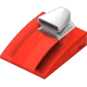{ .lu-ti width="24" loading="lazy" } [Hyperstarter Engine Panel (LOT 8131)](../8131.md) | 1 | No client description | 3 matrices; 0 rewards; 0 community references |
| 9329 | { .lu-ti width="24" loading="lazy" } [Hyperstarter Engine Panel (LOT 9329)](../9329.md) | 1 | No client description | 3 matrices; 0 rewards; 0 community references |
| 9330 | { .lu-ti width="24" loading="lazy" } [Hyperstarter Engine Panel (LOT 9330)](../9330.md) | 1 | No client description | 3 matrices; 0 rewards; 0 community references |
| 9331 | 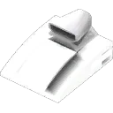{ .lu-ti width="24" loading="lazy" } [Hyperstarter Engine Panel (LOT 9331)](../9331.md) | 1 | No client description | 1 matrices; 1 rewards; 0 community references |
| 9332 | 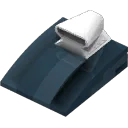{ .lu-ti width="24" loading="lazy" } [Hyperstarter Engine Panel (LOT 9332)](../9332.md) | 2 | No client description | 0 matrices; 1 rewards; 0 community references |
| 9318 | 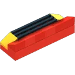{ .lu-ti width="24" loading="lazy" } [Hyperstarter Front Bumper (LOT 9318)](../9318.md) | 1 | No client description | 3 matrices; 0 rewards; 0 community references |
| 9319 | 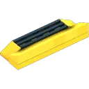{ .lu-ti width="24" loading="lazy" } [Hyperstarter Front Bumper (LOT 9319)](../9319.md) | 1 | No client description | 3 matrices; 0 rewards; 0 community references |
| 9320 | 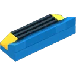{ .lu-ti width="24" loading="lazy" } [Hyperstarter Front Bumper (LOT 9320)](../9320.md) | 1 | No client description | 3 matrices; 0 rewards; 0 community references |
| 9363 | { .lu-ti width="24" loading="lazy" } [Hyperstarter Rear Bumper (LOT 9363)](../9363.md) | 1 | No client description | 3 matrices; 0 rewards; 0 community references |
| 9364 | { .lu-ti width="24" loading="lazy" } [Hyperstarter Rear Bumper (LOT 9364)](../9364.md) | 1 | No client description | 3 matrices; 0 rewards; 0 community references |
| 9365 | 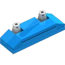{ .lu-ti width="24" loading="lazy" } [Hyperstarter Rear Bumper (LOT 9365)](../9365.md) | 1 | No client description | 3 matrices; 0 rewards; 0 community references |
| 9366 | 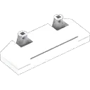{ .lu-ti width="24" loading="lazy" } [Hyperstarter Rear Bumper (LOT 9366)](../9366.md) | 1 | No client description | 0 matrices; 1 rewards; 0 community references |
| 9367 | 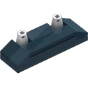{ .lu-ti width="24" loading="lazy" } [Hyperstarter Rear Bumper (LOT 9367)](../9367.md) | 1 | No client description | 1 matrices; 0 rewards; 0 community references |
| 9353 | 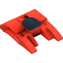{ .lu-ti width="24" loading="lazy" } [Hyperstarter Rear Panel (LOT 9353)](../9353.md) | 1 | No client description | 3 matrices; 0 rewards; 0 community references |
| 9354 | 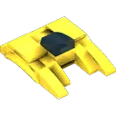{ .lu-ti width="24" loading="lazy" } [Hyperstarter Rear Panel (LOT 9354)](../9354.md) | 1 | No client description | 3 matrices; 0 rewards; 0 community references |
| 9355 | 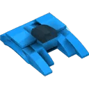{ .lu-ti width="24" loading="lazy" } [Hyperstarter Rear Panel (LOT 9355)](../9355.md) | 1 | No client description | 3 matrices; 0 rewards; 0 community references |
| 9343 | { .lu-ti width="24" loading="lazy" } [Hyperstarter Side Panels (LOT 9343)](../9343.md) | 1 | No client description | 3 matrices; 0 rewards; 0 community references |
| 9344 | { .lu-ti width="24" loading="lazy" } [Hyperstarter Side Panels (LOT 9344)](../9344.md) | 1 | No client description | 3 matrices; 0 rewards; 0 community references |
| 9345 | { .lu-ti width="24" loading="lazy" } [Hyperstarter Side Panels (LOT 9345)](../9345.md) | 1 | No client description | 3 matrices; 0 rewards; 0 community references |
| 9346 | { .lu-ti width="24" loading="lazy" } [Hyperstarter Side Panels (LOT 9346)](../9346.md) | 1 | No client description | 1 matrices; 0 rewards; 0 community references |
| 9347 | 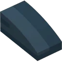{ .lu-ti width="24" loading="lazy" } [Hyperstarter Side Panels (LOT 9347)](../9347.md) | 1 | No client description | 0 matrices; 1 rewards; 0 community references |
| 10864 | 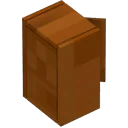{ .lu-ti width="24" loading="lazy" } [Ice Cabinet Model (LOT 10864)](../10864.md) | 2 | A model for your property! | 3 matrices; 0 rewards; 0 community references |
| 10865 | 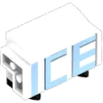{ .lu-ti width="24" loading="lazy" } [Ice Cooler Model (LOT 10865)](../10865.md) | 2 | A model for your property! | 3 matrices; 0 rewards; 0 community references |
| 6520 | { .lu-ti width="24" loading="lazy" } [Island Fort Model (LOT 6520)](../6520.md) | 3 | A model for your Property! | 21 matrices; 0 rewards; 0 community references |
| 6518 | 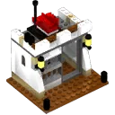{ .lu-ti width="24" loading="lazy" } [Island Jail Model (LOT 6518)](../6518.md) | 3 | A model for your Property! | 20 matrices; 0 rewards; 0 community references |
| 6524 | { .lu-ti width="24" loading="lazy" } [Island Plant Model (LOT 6524)](../6524.md) | 1 | A model for your Property! | 21 matrices; 0 rewards; 0 community references |
| 11193 | 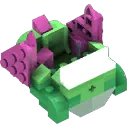{ .lu-ti width="24" loading="lazy" } [Jadeoria Rocket Cockpit (LOT 11193)](../11193.md) | 2 | Jadeoria Modular Build Rocket Cockpit | 0 matrices; 1 rewards; 0 community references |
| 11194 | 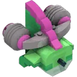{ .lu-ti width="24" loading="lazy" } [Jadeoria Rocket Engine (LOT 11194)](../11194.md) | 2 | Jadeoria Modular Build Rocket Engine | 0 matrices; 1 rewards; 0 community references |
| 11192 | { .lu-ti width="24" loading="lazy" } [Jadeoria Rocket Nose Cone (LOT 11192)](../11192.md) | 2 | Jadeoria Modular Build Rocket Nose Cone | 0 matrices; 1 rewards; 0 community references |
| 9607 | { .lu-ti width="24" loading="lazy" } [Jet Ski Model (LOT 9607)](../9607.md) | 1 | A model for your Property! | 0 matrices; 1 rewards; 0 community references |
| 11498 | { .lu-ti width="24" loading="lazy" } [Jingle Blazer Engine Panel (LOT 11498)](../11498.md) | 1 | No client description | 0 matrices; 0 rewards; 0 community references |
| 11499 | { .lu-ti width="24" loading="lazy" } [Jingle Blazer Front Bumper (LOT 11499)](../11499.md) | 1 | No client description | 0 matrices; 0 rewards; 0 community references |
| 11501 | { .lu-ti width="24" loading="lazy" } [Jingle Blazer Rear Bumper (LOT 11501)](../11501.md) | 1 | No client description | 0 matrices; 0 rewards; 0 community references |
| 11502 | { .lu-ti width="24" loading="lazy" } [Jingle Blazer Rear Panel (LOT 11502)](../11502.md) | 1 | No client description | 0 matrices; 0 rewards; 0 community references |
| 11503 | { .lu-ti width="24" loading="lazy" } [Jingle Blazer Side Panels (LOT 11503)](../11503.md) | 1 | No client description | 0 matrices; 0 rewards; 0 community references |
| 9439 | 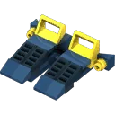{ .lu-ti width="24" loading="lazy" } [Just Dashing Engine Panel (LOT 9439)](../9439.md) | 1 | No client description | 0 matrices; 1 rewards; 0 community references |
| 9436 | 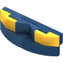{ .lu-ti width="24" loading="lazy" } [Just Dashing Front Bumper (LOT 9436)](../9436.md) | 1 | No client description | 0 matrices; 1 rewards; 0 community references |
| 9448 | 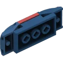{ .lu-ti width="24" loading="lazy" } [Just Dashing Rear Bumper (LOT 9448)](../9448.md) | 1 | No client description | 0 matrices; 1 rewards; 0 community references |
| 9445 | 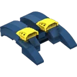{ .lu-ti width="24" loading="lazy" } [Just Dashing Rear Panel (LOT 9445)](../9445.md) | 1 | No client description | 0 matrices; 1 rewards; 0 community references |
| 9442 | 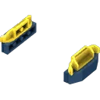{ .lu-ti width="24" loading="lazy" } [Just Dashing Side Panels (LOT 9442)](../9442.md) | 1 | No client description | 0 matrices; 1 rewards; 0 community references |
| 10821 | 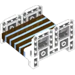{ .lu-ti width="24" loading="lazy" } [King Bed Model (LOT 10821)](../10821.md) | 2 | A model for your property! | 3 matrices; 0 rewards; 0 community references |
| 9629 | { .lu-ti width="24" loading="lazy" } [King Leo's Castle Model (LOT 9629)](../9629.md) | 4 | A model for your Property! | 0 matrices; 1 rewards; 0 community references |
| 10467 | { .lu-ti width="24" loading="lazy" } [Kitten Property Pet (LOT 10467)](../10467.md) | 1 | TEST Property Kitten | 0 matrices; 0 rewards; 0 community references |
| 10844 | { .lu-ti width="24" loading="lazy" } [Lamp Model (LOT 10844)](../10844.md) | 1 | A model for your property! | 3 matrices; 0 rewards; 0 community references |
| 8049 | { .lu-ti width="24" loading="lazy" } [Lantern Model (LOT 8049)](../8049.md) | 1 | A model for your Property! | 22 matrices; 0 rewards; 0 community references |
| 8401 | { .lu-ti width="24" loading="lazy" } [Large Arch Model (LOT 8401)](../8401.md) | 4 | A model for your Property! | 0 matrices; 1 rewards; 0 community references |
| 6526 | { .lu-ti width="24" loading="lazy" } [Large Cannon Model (LOT 6526)](../6526.md) | 1 | A model for your Property! | 19 matrices; 1 rewards; 0 community references |
| 6034 | { .lu-ti width="24" loading="lazy" } [Large Crate Model (LOT 6034)](../6034.md) | 3 | A model for your Property! | 48 matrices; 1 rewards; 0 community references |
| 6030 | { .lu-ti width="24" loading="lazy" } [Large Mushroom Model (LOT 6030)](../6030.md) | 1 | A model for your Property! | 45 matrices; 0 rewards; 0 community references |
| 10822 | { .lu-ti width="24" loading="lazy" } [Large Plant Model (LOT 10822)](../10822.md) | 1 | A model for your property! | 3 matrices; 0 rewards; 0 community references |
| 14760 | { .lu-ti width="24" loading="lazy" } [LEGO Club Engine Panel (LOT 14760)](../14760.md) | 2 | No client description | 1 matrices; 0 rewards; 0 community references |
| 14759 | { .lu-ti width="24" loading="lazy" } [LEGO Club Front Bumper (LOT 14759)](../14759.md) | 2 | No client description | 1 matrices; 0 rewards; 0 community references |
| 14763 | { .lu-ti width="24" loading="lazy" } [LEGO Club Rear Bumper (LOT 14763)](../14763.md) | 2 | No client description | 1 matrices; 0 rewards; 0 community references |
| 14762 | { .lu-ti width="24" loading="lazy" } [LEGO Club Rear Panel (LOT 14762)](../14762.md) | 2 | No client description | 1 matrices; 0 rewards; 0 community references |
| 14699 | { .lu-ti width="24" loading="lazy" } [LEGO Club Rocket Cockpit (LOT 14699)](../14699.md) | 2 | Modular Build Rocket Cockpit | 1 matrices; 0 rewards; 0 community references |
| 14700 | { .lu-ti width="24" loading="lazy" } [LEGO Club Rocket Engine (LOT 14700)](../14700.md) | 2 | Modular Build Rocket Engine | 1 matrices; 0 rewards; 0 community references |
| 14698 | { .lu-ti width="24" loading="lazy" } [LEGO Club Rocket Nose Cone (LOT 14698)](../14698.md) | 2 | Modular Build Rocket Nose Cone | 1 matrices; 0 rewards; 0 community references |
| 14761 | { .lu-ti width="24" loading="lazy" } [LEGO Club Side Panels (LOT 14761)](../14761.md) | 2 | No client description | 1 matrices; 0 rewards; 0 community references |
| 9608 | { .lu-ti width="24" loading="lazy" } [Life Guard Tower Model (LOT 9608)](../9608.md) | 1 | A model for your Property! | 0 matrices; 0 rewards; 0 community references |
| 10823 | { .lu-ti width="24" loading="lazy" } [Lime Blue Table Model (LOT 10823)](../10823.md) | 2 | A model for your property! | 3 matrices; 0 rewards; 0 community references |
| 10828 | { .lu-ti width="24" loading="lazy" } [Lime Polka Dot Chair Model (LOT 10828)](../10828.md) | 1 | A model for your property! | 3 matrices; 0 rewards; 0 community references |
| 10470 | { .lu-ti width="24" loading="lazy" } [Lion Property Pet (LOT 10470)](../10470.md) | 1 | TEST property lion | 0 matrices; 0 rewards; 0 community references |
| 6519 | { .lu-ti width="24" loading="lazy" } [Lookout Post Model (LOT 6519)](../6519.md) | 2 | A model for your Property! | 20 matrices; 0 rewards; 0 community references |
| 10824 | { .lu-ti width="24" loading="lazy" } [Lounge Chair Model 1 (LOT 10824)](../10824.md) | 1 | A model for your property! | 3 matrices; 0 rewards; 0 community references |
| 10890 | { .lu-ti width="24" loading="lazy" } [Lounge Chair Model 2 (LOT 10890)](../10890.md) | 1 | A model for your property! | 3 matrices; 0 rewards; 0 community references |
| 10826 | { .lu-ti width="24" loading="lazy" } [Love Seat Model 1 (LOT 10826)](../10826.md) | 1 | A model for your property! | 3 matrices; 0 rewards; 0 community references |
| 10825 | { .lu-ti width="24" loading="lazy" } [Love Seat Model 2 (LOT 10825)](../10825.md) | 1 | A model for your property! | 3 matrices; 0 rewards; 0 community references |
| 12032 | { .lu-ti width="24" loading="lazy" } [Mach Lava Engine Panel (LOT 12032)](../12032.md) | 2 | No client description | 1 matrices; 0 rewards; 0 community references |
| 12033 | { .lu-ti width="24" loading="lazy" } [Mach Lava Engine Panel (LOT 12033)](../12033.md) | 2 | No client description | 1 matrices; 0 rewards; 0 community references |
| 12030 | { .lu-ti width="24" loading="lazy" } [Mach Lava Front Bumper (LOT 12030)](../12030.md) | 2 | No client description | 1 matrices; 0 rewards; 0 community references |
| 12031 | { .lu-ti width="24" loading="lazy" } [Mach Lava Front Bumper (LOT 12031)](../12031.md) | 2 | No client description | 1 matrices; 0 rewards; 0 community references |
| 12034 | { .lu-ti width="24" loading="lazy" } [Mach Lava Rear Bumper (LOT 12034)](../12034.md) | 2 | No client description | 1 matrices; 0 rewards; 0 community references |
| 12035 | { .lu-ti width="24" loading="lazy" } [Mach Lava Rear Bumper (LOT 12035)](../12035.md) | 2 | No client description | 1 matrices; 0 rewards; 0 community references |
| 12036 | { .lu-ti width="24" loading="lazy" } [Mach Lava Rear Panel (LOT 12036)](../12036.md) | 2 | No client description | 1 matrices; 0 rewards; 0 community references |
| 12037 | { .lu-ti width="24" loading="lazy" } [Mach Lava Rear Panel (LOT 12037)](../12037.md) | 2 | No client description | 1 matrices; 0 rewards; 0 community references |
| 12038 | { .lu-ti width="24" loading="lazy" } [Mach Lava Side Panels (LOT 12038)](../12038.md) | 2 | No client description | 1 matrices; 0 rewards; 0 community references |
| 12039 | { .lu-ti width="24" loading="lazy" } [Mach Lava Side Panels (LOT 12039)](../12039.md) | 2 | No client description | 1 matrices; 0 rewards; 0 community references |
| 9574 | { .lu-ti width="24" loading="lazy" } [Mailbox Model (LOT 9574)](../9574.md) | 1 | A model for your Property! | 23 matrices; 0 rewards; 0 community references |
| 9559 | { .lu-ti width="24" loading="lazy" } [Mantis Butterfly Model (LOT 9559)](../9559.md) | 1 | A model for your Property! | 22 matrices; 0 rewards; 0 community references |
| 10475 | { .lu-ti width="24" loading="lazy" } [Mantis Property Pet (LOT 10475)](../10475.md) | 1 | TEST property Mantis | 0 matrices; 0 rewards; 0 community references |
| 14755 | { .lu-ti width="24" loading="lazy" } [Master Driver Engine Panel (LOT 14755)](../14755.md) | 2 | No client description | 0 matrices; 0 rewards; 0 community references |
| 14754 | { .lu-ti width="24" loading="lazy" } [Master Driver Front Bumper (LOT 14754)](../14754.md) | 2 | No client description | 0 matrices; 0 rewards; 0 community references |
| 14758 | { .lu-ti width="24" loading="lazy" } [Master Driver Rear Bumper (LOT 14758)](../14758.md) | 2 | No client description | 0 matrices; 0 rewards; 0 community references |
| 14757 | { .lu-ti width="24" loading="lazy" } [Master Driver Rear Panel (LOT 14757)](../14757.md) | 2 | No client description | 0 matrices; 0 rewards; 0 community references |
| 14756 | { .lu-ti width="24" loading="lazy" } [Master Driver Side Panels (LOT 14756)](../14756.md) | 2 | No client description | 0 matrices; 0 rewards; 0 community references |
| 11721 | { .lu-ti width="24" loading="lazy" } [Mech Bay Ball-Bot Base Corner Model (LOT 11721)](../11721.md) | 4 | A model for your property! | 1 matrices; 0 rewards; 0 community references |
| 11722 | { .lu-ti width="24" loading="lazy" } [Mech Bay Ball-Bot Base Elevator Model (LOT 11722)](../11722.md) | 2 | A model for your property! | 1 matrices; 0 rewards; 0 community references |
| 11723 | { .lu-ti width="24" loading="lazy" } [Mech Bay Ball-Bot Base Energy Fence Model (LOT 11723)](../11723.md) | 4 | A model for your property! | 1 matrices; 0 rewards; 0 community references |
| 11724 | { .lu-ti width="24" loading="lazy" } [Mech Bay Ball-Bot Base Gate Model (LOT 11724)](../11724.md) | 4 | A model for your property! | 1 matrices; 0 rewards; 0 community references |
| 11725 | { .lu-ti width="24" loading="lazy" } [Mech Bay Ball-Bot Base Power Generator Model (LOT 11725)](../11725.md) | 4 | A model for your property! | 1 matrices; 0 rewards; 0 community references |
| 11726 | { .lu-ti width="24" loading="lazy" } [Mech Bay Ball-Bot Base Sensor Tower Model (LOT 11726)](../11726.md) | 4 | A model for your property! | 1 matrices; 0 rewards; 0 community references |
| 11727 | { .lu-ti width="24" loading="lazy" } [Mech Bay Ball-Bot Base Spare Part Model (LOT 11727)](../11727.md) | 3 | A model for your property! | 1 matrices; 0 rewards; 0 community references |
| 11728 | { .lu-ti width="24" loading="lazy" } [Mech Bay Ball-Bot Base Tall Corner Model (LOT 11728)](../11728.md) | 4 | A model for your property! | 1 matrices; 0 rewards; 0 community references |
| 11729 | { .lu-ti width="24" loading="lazy" } [Mech Bay Ball-Bot Bay Model (LOT 11729)](../11729.md) | 4 | A model for your property! | 1 matrices; 0 rewards; 0 community references |
| 11730 | { .lu-ti width="24" loading="lazy" } [Mech Bay Ball-Bot Boss Model (LOT 11730)](../11730.md) | 4 | A model for your property! | 1 matrices; 0 rewards; 0 community references |
| 11720 | { .lu-ti width="24" loading="lazy" } [Mech Bay Ball-Bot Model (LOT 11720)](../11720.md) | 4 | A model for your property! | 1 matrices; 0 rewards; 0 community references |
| 11731 | { .lu-ti width="24" loading="lazy" } [Mech Bay Service Ball-Bot Model (LOT 11731)](../11731.md) | 2 | A model for your property! | 1 matrices; 0 rewards; 0 community references |
| 9596 | { .lu-ti width="24" loading="lazy" } [Medieval Vendor Model (LOT 9596)](../9596.md) | 2 | A model for your Property! | 27 matrices; 0 rewards; 0 community references |
| 9649 | { .lu-ti width="24" loading="lazy" } [Medieval Village Forge Model (LOT 9649)](../9649.md) | 4 | A model for your Property! | 28 matrices; 0 rewards; 0 community references |
| 9651 | { .lu-ti width="24" loading="lazy" } [Medieval Village House Model (LOT 9651)](../9651.md) | 4 | A model for your Property! | 27 matrices; 0 rewards; 0 community references |
| 9650 | { .lu-ti width="24" loading="lazy" } [Medieval Village Inn Model (LOT 9650)](../9650.md) | 4 | A model for your Property! | 27 matrices; 0 rewards; 0 community references |
| 9648 | { .lu-ti width="24" loading="lazy" } [Medieval Village Stable Model (LOT 9648)](../9648.md) | 4 | A model for your Property! | 28 matrices; 0 rewards; 0 community references |
| 9591 | { .lu-ti width="24" loading="lazy" } [Medieval Wagon Model (LOT 9591)](../9591.md) | 2 | A model for your Property! | 27 matrices; 0 rewards; 0 community references |
| 6033 | { .lu-ti width="24" loading="lazy" } [Medium Crate Model (LOT 6033)](../6033.md) | 3 | A model for your Property! | 48 matrices; 1 rewards; 0 community references |
| 6029 | { .lu-ti width="24" loading="lazy" } [Medium Mushroom Model (LOT 6029)](../6029.md) | 1 | A model for your Property! | 45 matrices; 0 rewards; 0 community references |
| 15949 | { .lu-ti width="24" loading="lazy" } [Micro Castle Model 1 (LOT 15949)](../15949.md) | 2 | A model for your Property! | 2 matrices; 0 rewards; 0 community references |
| 15950 | { .lu-ti width="24" loading="lazy" } [Micro Castle Model 2 (LOT 15950)](../15950.md) | 2 | A model for your Property! | 2 matrices; 0 rewards; 0 community references |
| 15951 | { .lu-ti width="24" loading="lazy" } [Micro Castle Model 3 (LOT 15951)](../15951.md) | 2 | A model for your Property! | 2 matrices; 0 rewards; 0 community references |
| 15952 | { .lu-ti width="24" loading="lazy" } [Micro Castle Model 4 (LOT 15952)](../15952.md) | 2 | A model for your Property! | 2 matrices; 0 rewards; 0 community references |
| 11732 | { .lu-ti width="24" loading="lazy" } [Micro City Block 1 Model (LOT 11732)](../11732.md) | 4 | A model for your property! | 2 matrices; 0 rewards; 0 community references |
| 11733 | { .lu-ti width="24" loading="lazy" } [Micro City Block 2 Model (LOT 11733)](../11733.md) | 4 | A model for your property! | 2 matrices; 0 rewards; 0 community references |
| 11734 | { .lu-ti width="24" loading="lazy" } [Micro City Block 3 Model (LOT 11734)](../11734.md) | 4 | A model for your property! | 2 matrices; 0 rewards; 0 community references |
| 11735 | { .lu-ti width="24" loading="lazy" } [Micro City Block 4 Model (LOT 11735)](../11735.md) | 4 | A model for your property! | 2 matrices; 0 rewards; 0 community references |
| 11736 | { .lu-ti width="24" loading="lazy" } [Micro City Block Corner 1 Model (LOT 11736)](../11736.md) | 4 | A model for your property! | 1 matrices; 0 rewards; 0 community references |
| 11737 | { .lu-ti width="24" loading="lazy" } [Micro City Block Corner 2 Model (LOT 11737)](../11737.md) | 4 | A model for your property! | 2 matrices; 0 rewards; 0 community references |
| 11738 | { .lu-ti width="24" loading="lazy" } [Micro City Block Corner 3 Model (LOT 11738)](../11738.md) | 4 | A model for your property! | 2 matrices; 0 rewards; 0 community references |
| 11739 | { .lu-ti width="24" loading="lazy" } [Micro City Block Corner 4 Model (LOT 11739)](../11739.md) | 4 | A model for your property! | 2 matrices; 0 rewards; 0 community references |
| 11753 | { .lu-ti width="24" loading="lazy" } [Micro City Car 1 Model (LOT 11753)](../11753.md) | 2 | A model for your property! | 1 matrices; 0 rewards; 0 community references |
| 11754 | { .lu-ti width="24" loading="lazy" } [Micro City Car 2 Model (LOT 11754)](../11754.md) | 2 | A model for your property! | 1 matrices; 0 rewards; 0 community references |
| 11755 | { .lu-ti width="24" loading="lazy" } [Micro City Car 3 Model (LOT 11755)](../11755.md) | 2 | A model for your property! | 1 matrices; 0 rewards; 0 community references |
| 11756 | { .lu-ti width="24" loading="lazy" } [Micro City Car 4 Model (LOT 11756)](../11756.md) | 2 | A model for your property! | 1 matrices; 0 rewards; 0 community references |
| 11757 | { .lu-ti width="24" loading="lazy" } [Micro City Car 5 Model (LOT 11757)](../11757.md) | 2 | A model for your property! | 1 matrices; 0 rewards; 0 community references |
| 11758 | { .lu-ti width="24" loading="lazy" } [Micro City Crane Truck Model (LOT 11758)](../11758.md) | 3 | A model for your property! | 1 matrices; 0 rewards; 0 community references |
