# Loot model — page 5/8

[Item database](../README.md)

Pages: [1](type-21-1.md) | [2](type-21-2.md) | [3](type-21-3.md) | [4](type-21-4.md) | [5](type-21-5.md) | [6](type-21-6.md) | [7](type-21-7.md) | [8](type-21-8.md)

| LOT | Item | Rarity | Description | Source evidence |
| --- | --- | --- | --- | --- |
| 11759 | { .lu-ti width="24" loading="lazy" } [Micro City Crawler Crane Model (LOT 11759)](../11759.md) | 3 | A model for your property! | 2 matrices; 0 rewards; 0 community references |
| 11760 | { .lu-ti width="24" loading="lazy" } [Micro City Defense Force 1 Model (LOT 11760)](../11760.md) | 3 | A model for your property! | 1 matrices; 0 rewards; 0 community references |
| 11761 | { .lu-ti width="24" loading="lazy" } [Micro City Defense Force 2 Model (LOT 11761)](../11761.md) | 3 | A model for your property! | 2 matrices; 0 rewards; 0 community references |
| 11762 | { .lu-ti width="24" loading="lazy" } [Micro City Defense Force 3 Model (LOT 11762)](../11762.md) | 3 | A model for your property! | 1 matrices; 0 rewards; 0 community references |
| 11763 | { .lu-ti width="24" loading="lazy" } [Micro City Fire Truck 1 Model (LOT 11763)](../11763.md) | 3 | A model for your property! | 1 matrices; 0 rewards; 0 community references |
| 11764 | { .lu-ti width="24" loading="lazy" } [Micro City Fire Truck 2 Model (LOT 11764)](../11764.md) | 3 | A model for your property! | 1 matrices; 0 rewards; 0 community references |
| 11765 | { .lu-ti width="24" loading="lazy" } [Micro City Fire Truck 3 Model (LOT 11765)](../11765.md) | 3 | A model for your property! | 2 matrices; 0 rewards; 0 community references |
| 11766 | { .lu-ti width="24" loading="lazy" } [Micro City Fire Truck 4 Model (LOT 11766)](../11766.md) | 3 | A model for your property! | 1 matrices; 0 rewards; 0 community references |
| 11767 | { .lu-ti width="24" loading="lazy" } [Micro City Fire Truck 5 Model (LOT 11767)](../11767.md) | 2 | A model for your property! | 2 matrices; 0 rewards; 0 community references |
| 11749 | 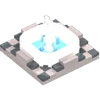{ .lu-ti width="24" loading="lazy" } [Micro City Fountain Model (LOT 11749)](../11749.md) | 3 | A model for your property! | 2 matrices; 0 rewards; 0 community references |
| 11768 | { .lu-ti width="24" loading="lazy" } [Micro City Garbage Truck Model (LOT 11768)](../11768.md) | 3 | A model for your property! | 1 matrices; 0 rewards; 0 community references |
| 11740 | 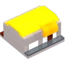{ .lu-ti width="24" loading="lazy" } [Micro City Gas Station 1 Model (LOT 11740)](../11740.md) | 4 | A model for your property! | 2 matrices; 0 rewards; 0 community references |
| 11741 | 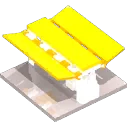{ .lu-ti width="24" loading="lazy" } [Micro City Gas Station 2 Model (LOT 11741)](../11741.md) | 3 | A model for your property! | 1 matrices; 0 rewards; 0 community references |
| 11742 | 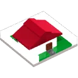{ .lu-ti width="24" loading="lazy" } [Micro City House 1 Model (LOT 11742)](../11742.md) | 3 | A model for your property! | 2 matrices; 0 rewards; 0 community references |
| 11743 | { .lu-ti width="24" loading="lazy" } [Micro City House 2 Model (LOT 11743)](../11743.md) | 3 | A model for your property! | 2 matrices; 0 rewards; 0 community references |
| 11744 | 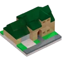{ .lu-ti width="24" loading="lazy" } [Micro City House 3 Model (LOT 11744)](../11744.md) | 3 | A model for your property! | 1 matrices; 0 rewards; 0 community references |
| 11748 | { .lu-ti width="24" loading="lazy" } [Micro City Monster with Car Model (LOT 11748)](../11748.md) | 4 | A model for your property! | 2 matrices; 0 rewards; 0 community references |
| 11745 | 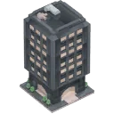{ .lu-ti width="24" loading="lazy" } [Micro City Office Building Model (LOT 11745)](../11745.md) | 4 | A model for your property! | 1 matrices; 0 rewards; 0 community references |
| 11750 | 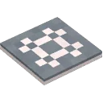{ .lu-ti width="24" loading="lazy" } [Micro City Plain Model (LOT 11750)](../11750.md) | 3 | A model for your property! | 1 matrices; 0 rewards; 0 community references |
| 11769 | { .lu-ti width="24" loading="lazy" } [Micro City Police Car Model (LOT 11769)](../11769.md) | 2 | A model for your property! | 1 matrices; 0 rewards; 0 community references |
| 11770 | { .lu-ti width="24" loading="lazy" } [Micro City Semi Truck and Trailer Model (LOT 11770)](../11770.md) | 3 | A model for your property! | 2 matrices; 0 rewards; 0 community references |
| 11771 | { .lu-ti width="24" loading="lazy" } [Micro City Semi Truck Cab Model (LOT 11771)](../11771.md) | 3 | A model for your property! | 1 matrices; 0 rewards; 0 community references |
| 11746 | 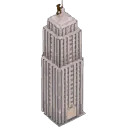{ .lu-ti width="24" loading="lazy" } [Micro City Skyscraper with Monkey Model (LOT 11746)](../11746.md) | 4 | A model for your property! | 0 matrices; 0 rewards; 0 community references |
| 11751 | { .lu-ti width="24" loading="lazy" } [Micro City Statue Model (LOT 11751)](../11751.md) | 3 | A model for your property! | 2 matrices; 0 rewards; 0 community references |
| 11747 | 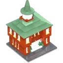{ .lu-ti width="24" loading="lazy" } [Micro City Town Hall Model (LOT 11747)](../11747.md) | 4 | A model for your property! | 2 matrices; 0 rewards; 0 community references |
| 11752 | { .lu-ti width="24" loading="lazy" } [Micro City Trees Model (LOT 11752)](../11752.md) | 4 | A model for your property! | 2 matrices; 0 rewards; 0 community references |
| 11772 | { .lu-ti width="24" loading="lazy" } [Micro City Truck 1 Model (LOT 11772)](../11772.md) | 2 | A model for your property! | 1 matrices; 0 rewards; 0 community references |
| 11773 | 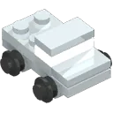{ .lu-ti width="24" loading="lazy" } [Micro City Truck 2 Model (LOT 11773)](../11773.md) | 2 | A model for your property! | 1 matrices; 0 rewards; 0 community references |
| 11774 | { .lu-ti width="24" loading="lazy" } [Micro City Van 1 Model (LOT 11774)](../11774.md) | 2 | A model for your property! | 1 matrices; 0 rewards; 0 community references |
| 11775 | { .lu-ti width="24" loading="lazy" } [Micro City Van 2 Model (LOT 11775)](../11775.md) | 2 | A model for your property! | 1 matrices; 0 rewards; 0 community references |
| 11776 | { .lu-ti width="24" loading="lazy" } [Micro City Van 3 Model (LOT 11776)](../11776.md) | 2 | A model for your property! | 2 matrices; 0 rewards; 0 community references |
| 9605 | { .lu-ti width="24" loading="lazy" } [Mini Car Model (LOT 9605)](../9605.md) | 2 | A model for your Property! | 1 matrices; 1 rewards; 0 community references |
| 6781 | { .lu-ti width="24" loading="lazy" } [Mini Galleon Model (LOT 6781)](../6781.md) | 4 | A model for your Property! | 18 matrices; 1 rewards; 0 community references |
| 6521 | { .lu-ti width="24" loading="lazy" } [Mini Raft Model (LOT 6521)](../6521.md) | 2 | A model for your Property! | 19 matrices; 0 rewards; 0 community references |
| 9587 | { .lu-ti width="24" loading="lazy" } [Mini Train Model (LOT 9587)](../9587.md) | 3 | A model for your Property! | 0 matrices; 1 rewards; 0 community references |
| 6782 | { .lu-ti width="24" loading="lazy" } [Mini Windrunner Model (LOT 6782)](../6782.md) | 3 | A model for your Property! | 20 matrices; 0 rewards; 0 community references |
| 12934 | { .lu-ti width="24" loading="lazy" } [Mint Condition Engine Panel (LOT 12934)](../12934.md) | 2 | No client description | 1 matrices; 0 rewards; 0 community references |
| 12933 | { .lu-ti width="24" loading="lazy" } [Mint Condition Front Bumper (LOT 12933)](../12933.md) | 2 | No client description | 1 matrices; 0 rewards; 0 community references |
| 12935 | 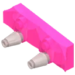{ .lu-ti width="24" loading="lazy" } [Mint Condition Rear Bumper (LOT 12935)](../12935.md) | 2 | No client description | 1 matrices; 0 rewards; 0 community references |
| 12936 | 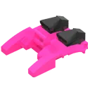{ .lu-ti width="24" loading="lazy" } [Mint Condition Rear Panel (LOT 12936)](../12936.md) | 2 | No client description | 1 matrices; 0 rewards; 0 community references |
| 12937 | 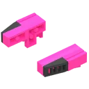{ .lu-ti width="24" loading="lazy" } [Mint Condition Side Panels (LOT 12937)](../12937.md) | 2 | No client description | 1 matrices; 0 rewards; 0 community references |
| 6588 | [Modular Car Back Bumper #1 (LOT 6588)](../6588.md) | 5 | Modular Car Back Bumper | 0 matrices; 0 rewards; 0 community references |
| 6589 | [Modular Car Back Bumper #2 (LOT 6589)](../6589.md) | 5 | Modular Car Back Bumper | 0 matrices; 0 rewards; 0 community references |
| 6785 | [Modular Car Body #1 (LOT 6785)](../6785.md) | 5 | Modular Car Body | 0 matrices; 0 rewards; 0 community references |
| 6584 | [Modular Car Bumper #1 (LOT 6584)](../6584.md) | 5 | Modular Car Bumper | 0 matrices; 0 rewards; 0 community references |
| 6594 | [Modular Car Bumper #2 (LOT 6594)](../6594.md) | 5 | Modular Car Bumper | 0 matrices; 0 rewards; 0 community references |
| 6581 | [Modular Car Chassis #1 (LOT 6581)](../6581.md) | 5 | Old don't use | 0 matrices; 0 rewards; 0 community references |
| 6750 | [Modular Car Chassis #1a (LOT 6750)](../6750.md) | 5 | Old don't use | 0 matrices; 0 rewards; 0 community references |
| 6591 | [Modular Car Chassis #2 (LOT 6591)](../6591.md) | 5 | Old don't use | 0 matrices; 0 rewards; 0 community references |
| 8241 | [Modular Car Engine - Level 2 (LOT 8241)](../8241.md) |  | Modular Car Engine - Level 2 | 0 matrices; 0 rewards; 0 community references |
| 6582 | [Modular Car Engine #1 (LOT 6582)](../6582.md) | 5 | Modular Car Engine | 0 matrices; 0 rewards; 0 community references |
| 6751 | [Modular Car Engine #1 (LOT 6751)](../6751.md) | 5 | Modular Car Engine | 0 matrices; 0 rewards; 0 community references |
| 6592 | [Modular Car Engine #2 (LOT 6592)](../6592.md) | 5 | Modular Car Engine | 0 matrices; 0 rewards; 0 community references |
| 6752 | [Modular Car Engine #2 (LOT 6752)](../6752.md) | 5 | Modular Car Engine | 0 matrices; 0 rewards; 0 community references |
| 6753 | [Modular Car Engine #3 (LOT 6753)](../6753.md) | 5 | Modular Car Engine | 0 matrices; 0 rewards; 0 community references |
| 6754 | [Modular Car Engine #4 (LOT 6754)](../6754.md) | 5 | Modular Car Engine | 0 matrices; 0 rewards; 0 community references |
| 6755 | [Modular Car Engine #5 (LOT 6755)](../6755.md) | 5 | Modular Car Engine | 0 matrices; 0 rewards; 0 community references |
| 6583 | [Modular Car Front #1 (LOT 6583)](../6583.md) | 5 | Modular Car Front | 0 matrices; 0 rewards; 0 community references |
| 6593 | [Modular Car Front #2 (LOT 6593)](../6593.md) | 5 | Modular Car Front | 0 matrices; 0 rewards; 0 community references |
| 6756 | [Modular Car Front Bumper #1 (LOT 6756)](../6756.md) | 5 | Modular Car F Bumper | 0 matrices; 0 rewards; 0 community references |
| 6757 | [Modular Car Front Bumper #2 (LOT 6757)](../6757.md) | 5 | Modular Car F Bumper | 0 matrices; 0 rewards; 0 community references |
| 6758 | [Modular Car Front Bumper #3 (LOT 6758)](../6758.md) | 5 | Modular Car F Bumper | 0 matrices; 0 rewards; 0 community references |
| 6759 | [Modular Car Front Bumper #4 (LOT 6759)](../6759.md) | 5 | Modular Car F Bumper | 0 matrices; 0 rewards; 0 community references |
| 6760 | [Modular Car Front Bumper #5 (LOT 6760)](../6760.md) | 5 | Modular Car F Bumper | 0 matrices; 0 rewards; 0 community references |
| 6761 | [Modular Car Imagination Tank #1 (LOT 6761)](../6761.md) | 5 | Modular Car Tank | 0 matrices; 0 rewards; 0 community references |
| 6762 | [Modular Car Imagination Tank #2 (LOT 6762)](../6762.md) | 5 | Modular Car Tank | 0 matrices; 0 rewards; 0 community references |
| 6763 | [Modular Car Imagination Tank #3 (LOT 6763)](../6763.md) | 5 | Modular Car Tank | 0 matrices; 0 rewards; 0 community references |
| 6764 | [Modular Car Imagination Tank #4 (LOT 6764)](../6764.md) | 5 | Modular Car Tank | 0 matrices; 0 rewards; 0 community references |
| 6585 | [Modular Car Main Body #1 (LOT 6585)](../6585.md) | 5 | Modular Car Main Body | 0 matrices; 0 rewards; 0 community references |
| 6595 | [Modular Car Main Body #2 (LOT 6595)](../6595.md) | 5 | Modular Car Main Body | 0 matrices; 0 rewards; 0 community references |
| 6586 | [Modular Car Rear #1 (LOT 6586)](../6586.md) | 5 | Modular Car Rear | 0 matrices; 0 rewards; 0 community references |
| 6596 | [Modular Car Rear #2 (LOT 6596)](../6596.md) | 5 | Modular Car Rear | 0 matrices; 0 rewards; 0 community references |
| 6765 | [Modular Car Rear Bumper #1 (LOT 6765)](../6765.md) | 5 | Modular Car R Bumper | 0 matrices; 0 rewards; 0 community references |
| 6766 | [Modular Car Rear Bumper #2 (LOT 6766)](../6766.md) | 5 | Modular Car R Bumper | 0 matrices; 0 rewards; 0 community references |
| 6767 | [Modular Car Rear Bumper #3 (LOT 6767)](../6767.md) | 5 | Modular Car R Bumper | 0 matrices; 0 rewards; 0 community references |
| 6768 | [Modular Car Spoiler #1 (LOT 6768)](../6768.md) | 5 | Modular Car Spoiler | 0 matrices; 0 rewards; 0 community references |
| 6769 | [Modular Car Spoiler #2 (LOT 6769)](../6769.md) | 5 | Modular Car Spoiler | 0 matrices; 0 rewards; 0 community references |
| 6770 | [Modular Car Spoiler #3 (LOT 6770)](../6770.md) | 5 | Modular Car Spoiler | 0 matrices; 0 rewards; 0 community references |
| 6771 | [Modular Car Spoiler #4 (LOT 6771)](../6771.md) | 5 | Modular Car Spoiler | 0 matrices; 0 rewards; 0 community references |
| 6772 | [Modular Car Spoiler #5 (LOT 6772)](../6772.md) | 5 | Modular Car Spoiler | 0 matrices; 0 rewards; 0 community references |
| 6587 | [Modular Car Wheels #1 (LOT 6587)](../6587.md) | 5 | don't use | 0 matrices; 0 rewards; 0 community references |
| 6786 | [Modular Car Wheels #1 (LOT 6786)](../6786.md) | 5 | don't use | 0 matrices; 0 rewards; 0 community references |
| 6597 | [Modular Car Wheels #2 (LOT 6597)](../6597.md) | 5 | don't use | 0 matrices; 0 rewards; 0 community references |
| 9812 | 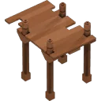{ .lu-ti width="24" loading="lazy" } [Modular Dock Model 1 (LOT 9812)](../9812.md) | 2 | A model for your Property! | 20 matrices; 0 rewards; 0 community references |
| 9813 | 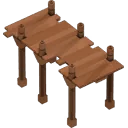{ .lu-ti width="24" loading="lazy" } [Modular Dock Model 2 (LOT 9813)](../9813.md) | 2 | A model for your Property! | 20 matrices; 0 rewards; 0 community references |
| 9814 | 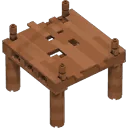{ .lu-ti width="24" loading="lazy" } [Modular Dock Model 3 (LOT 9814)](../9814.md) | 3 | A model for your Property! | 20 matrices; 0 rewards; 0 community references |
| 16517 | 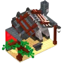{ .lu-ti width="24" loading="lazy" } [Monastery Blacksmith Model (LOT 16517)](../16517.md) | 2 | A model for your Property! | 34 matrices; 0 rewards; 0 community references |
| 16518 | 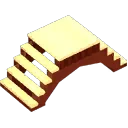{ .lu-ti width="24" loading="lazy" } [Monastery Bridge Model (LOT 16518)](../16518.md) | 1 | A model for your Property! | 34 matrices; 0 rewards; 0 community references |
| 16519 | { .lu-ti width="24" loading="lazy" } [Monastery Drum Model (LOT 16519)](../16519.md) | 1 | A model for your Property! | 34 matrices; 0 rewards; 0 community references |
| 16523 | { .lu-ti width="24" loading="lazy" } [Monastery Flag Banner Model (LOT 16523)](../16523.md) | 1 | A model for your Property! | 1 matrices; 0 rewards; 0 community references |
| 16542 | 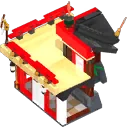{ .lu-ti width="24" loading="lazy" } [Monastery Inside Wall Corner Model (LOT 16542)](../16542.md) | 3 | A model for your Property! | 35 matrices; 0 rewards; 0 community references |
| 16525 | { .lu-ti width="24" loading="lazy" } [Monastery Large Gate Model (LOT 16525)](../16525.md) | 2 | A model for your Property! | 34 matrices; 0 rewards; 0 community references |
| 16520 | 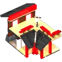{ .lu-ti width="24" loading="lazy" } [Monastery Left Entrance Model (LOT 16520)](../16520.md) | 3 | A model for your Property! | 35 matrices; 0 rewards; 0 community references |
| 16528 | 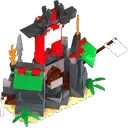{ .lu-ti width="24" loading="lazy" } [Monastery Mountain Shrine Model (LOT 16528)](../16528.md) | 2 | A model for your Property! | 34 matrices; 0 rewards; 0 community references |
| 16543 | 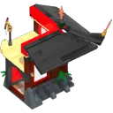{ .lu-ti width="24" loading="lazy" } [Monastery Outside Wall Corner Model 1 (LOT 16543)](../16543.md) | 3 | A model for your Property! | 35 matrices; 0 rewards; 0 community references |
| 16544 | 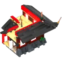{ .lu-ti width="24" loading="lazy" } [Monastery Outside Wall Corner Model 2 (LOT 16544)](../16544.md) | 4 | A model for your Property! | 35 matrices; 0 rewards; 0 community references |
| 16529 | { .lu-ti width="24" loading="lazy" } [Monastery Railing Model (LOT 16529)](../16529.md) | 1 | A model for your Property! | 35 matrices; 0 rewards; 0 community references |
| 16521 | 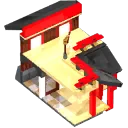{ .lu-ti width="24" loading="lazy" } [Monastery Right Entrance Model (LOT 16521)](../16521.md) | 3 | A model for your Property! | 35 matrices; 0 rewards; 0 community references |
| 16530 | { .lu-ti width="24" loading="lazy" } [Monastery Rock Chunk Model (LOT 16530)](../16530.md) | 1 | A model for your Property! | 35 matrices; 0 rewards; 0 community references |
| 16531 | { .lu-ti width="24" loading="lazy" } [Monastery Screen Model (LOT 16531)](../16531.md) | 1 | A model for your Property! | 34 matrices; 0 rewards; 0 community references |
| 16532 | 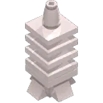{ .lu-ti width="24" loading="lazy" } [Monastery Shrine Model (LOT 16532)](../16532.md) | 1 | A model for your Property! | 34 matrices; 0 rewards; 0 community references |
| 16524 | { .lu-ti width="24" loading="lazy" } [Monastery Single Flag Model (LOT 16524)](../16524.md) | 1 | A model for your Property! | 34 matrices; 0 rewards; 0 community references |
| 16527 | { .lu-ti width="24" loading="lazy" } [Monastery Small Gate Model (LOT 16527)](../16527.md) | 1 | A model for your Property! | 35 matrices; 0 rewards; 0 community references |
| 16536 | 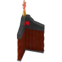{ .lu-ti width="24" loading="lazy" } [Monastery Thin Wall Corner Model (LOT 16536)](../16536.md) | 1 | A model for your Property! | 35 matrices; 0 rewards; 0 community references |
| 16534 | 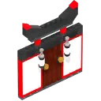{ .lu-ti width="24" loading="lazy" } [Monastery Thin Wall Model 1 (LOT 16534)](../16534.md) | 1 | A model for your Property! | 35 matrices; 0 rewards; 0 community references |
| 16535 | 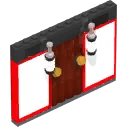{ .lu-ti width="24" loading="lazy" } [Monastery Thin Wall Model 2 (LOT 16535)](../16535.md) | 1 | A model for your Property! | 35 matrices; 0 rewards; 0 community references |
| 16533 | 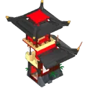{ .lu-ti width="24" loading="lazy" } [Monastery Tower Model (LOT 16533)](../16533.md) | 4 | A model for your Property! | 34 matrices; 0 rewards; 0 community references |
| 16537 | 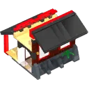{ .lu-ti width="24" loading="lazy" } [Monastery Wall Model 1 (LOT 16537)](../16537.md) | 3 | A model for your Property! | 35 matrices; 0 rewards; 0 community references |
| 16538 | 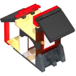{ .lu-ti width="24" loading="lazy" } [Monastery Wall Model 2 (LOT 16538)](../16538.md) | 2 | A model for your Property! | 35 matrices; 0 rewards; 0 community references |
| 16539 | { .lu-ti width="24" loading="lazy" } [Monastery Wall Model 3 (LOT 16539)](../16539.md) | 2 | A model for your Property! | 35 matrices; 0 rewards; 0 community references |
| 16540 | 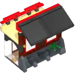{ .lu-ti width="24" loading="lazy" } [Monastery Wall Model 4 (LOT 16540)](../16540.md) | 2 | A model for your Property! | 35 matrices; 0 rewards; 0 community references |
| 16541 | { .lu-ti width="24" loading="lazy" } [Monastery Wall Model 5 (LOT 16541)](../16541.md) | 1 | A model for your Property! | 34 matrices; 0 rewards; 0 community references |
| 16526 | { .lu-ti width="24" loading="lazy" } [Monastery Wall with Gate Model (LOT 16526)](../16526.md) | 3 | A model for your Property! | 34 matrices; 0 rewards; 0 community references |
| 16545 | { .lu-ti width="24" loading="lazy" } [Monastery Wall with Stairs Model (LOT 16545)](../16545.md) | 3 | A model for your Property! | 34 matrices; 0 rewards; 0 community references |
| 16546 | { .lu-ti width="24" loading="lazy" } [Monastery Water Tower Model (LOT 16546)](../16546.md) | 1 | A model for your Property! | 34 matrices; 0 rewards; 0 community references |
| 8300 | { .lu-ti width="24" loading="lazy" } [Moonbase Rocket Cockpit (LOT 8300)](../8300.md) | 2 | Moonbase Modular Build Rocket cockpit | 0 matrices; 1 rewards; 0 community references |
| 8301 | 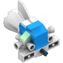{ .lu-ti width="24" loading="lazy" } [Moonbase Rocket Engine (LOT 8301)](../8301.md) | 1 | Moonbase Modular Build Rocket Engine | 0 matrices; 1 rewards; 0 community references |
| 8299 | 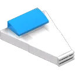{ .lu-ti width="24" loading="lazy" } [Moonbase Rocket Nose Cone (LOT 8299)](../8299.md) | 2 | Moonbase Modular Build Rocket Nose Cone | 0 matrices; 1 rewards; 0 community references |
| 12839 | 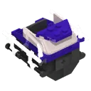{ .lu-ti width="24" loading="lazy" } [Morbid Orbit Rocket Cockpit (LOT 12839)](../12839.md) | 2 | Modular Build Rocket Cockpit | 1 matrices; 0 rewards; 0 community references |
| 12840 | { .lu-ti width="24" loading="lazy" } [Morbid Orbit Rocket Engine (LOT 12840)](../12840.md) | 2 | Modular Build Rocket Engine | 1 matrices; 0 rewards; 0 community references |
| 12838 | { .lu-ti width="24" loading="lazy" } [Morbid Orbit Rocket Nose Cone (LOT 12838)](../12838.md) | 2 | Modular Build Rocket Nose Cone | 1 matrices; 0 rewards; 0 community references |
| 14311 | 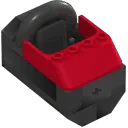{ .lu-ti width="24" loading="lazy" } [Musclenaut GT Rocket Cockpit (LOT 14311)](../14311.md) | 2 | Designed by Gotheria! | 1 matrices; 0 rewards; 0 community references |
| 14312 | 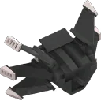{ .lu-ti width="24" loading="lazy" } [Musclenaut GT Rocket Engine (LOT 14312)](../14312.md) | 2 | Designed by Gotheria! | 1 matrices; 0 rewards; 0 community references |
| 14310 | { .lu-ti width="24" loading="lazy" } [Musclenaut GT Rocket Nose Cone (LOT 14310)](../14310.md) | 2 | Designed by Gotheria! | 1 matrices; 0 rewards; 0 community references |
| 10866 | { .lu-ti width="24" loading="lazy" } [Mushroom Model (LOT 10866)](../10866.md) | 1 | A model for your property! | 3 matrices; 0 rewards; 0 community references |
| 9537 | 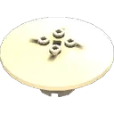{ .lu-ti width="24" loading="lazy" } [Mushroom Model 5 (LOT 9537)](../9537.md) | 1 | A model for your Property! | 19 matrices; 0 rewards; 0 community references |
| 10867 | { .lu-ti width="24" loading="lazy" } [Newspaper Stand Model (LOT 10867)](../10867.md) | 1 | A model for your property! | 3 matrices; 0 rewards; 0 community references |
| 13591 | 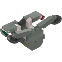{ .lu-ti width="24" loading="lazy" } [Nexus Dropship Rocket Cockpit (LOT 13591)](../13591.md) | 2 | Modular Build Rocket Cockpit | 1 matrices; 0 rewards; 0 community references |
| 13592 | { .lu-ti width="24" loading="lazy" } [Nexus Dropship Rocket Engine (LOT 13592)](../13592.md) | 2 | Modular Build Rocket Engine | 1 matrices; 0 rewards; 0 community references |
| 13590 | { .lu-ti width="24" loading="lazy" } [Nexus Dropship Rocket Nose Cone (LOT 13590)](../13590.md) | 2 | Modular Build Rocket Nose Cone | 1 matrices; 0 rewards; 0 community references |
| 8338 | 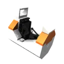{ .lu-ti width="24" loading="lazy" } [Nexus Force Rocket Cockpit (LOT 8338)](../8338.md) | 1 | Promo Modular Build rocket cockpit | 1 matrices; 0 rewards; 0 community references |
| 8339 | 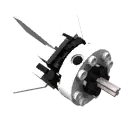{ .lu-ti width="24" loading="lazy" } [Nexus Force Rocket Engine (LOT 8339)](../8339.md) | 1 | Promo Modular Build rocket engine | 1 matrices; 0 rewards; 0 community references |
| 8337 | 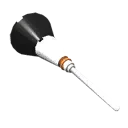{ .lu-ti width="24" loading="lazy" } [Nexus Force Rocket Nose Cone (LOT 8337)](../8337.md) | 1 | Promo Modular Build rocket Nose Cone | 1 matrices; 0 rewards; 0 community references |
| 14203 | 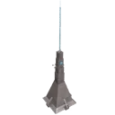{ .lu-ti width="24" loading="lazy" } [Nexus Tower Model (LOT 14203)](../14203.md) | 4 | A model for your Property! | 0 matrices; 1 rewards; 0 community references |
| 13594 | 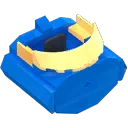{ .lu-ti width="24" loading="lazy" } [Nexus Tower Rocket Cockpit (LOT 13594)](../13594.md) | 2 | Modular Build Rocket Cockpit | 1 matrices; 0 rewards; 0 community references |
| 13595 | { .lu-ti width="24" loading="lazy" } [Nexus Tower Rocket Engine (LOT 13595)](../13595.md) | 2 | Modular Build Rocket Engine | 1 matrices; 0 rewards; 0 community references |
| 13593 | 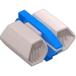{ .lu-ti width="24" loading="lazy" } [Nexus Tower Rocket Nose Cone (LOT 13593)](../13593.md) | 2 | Modular Build Rocket Nose Cone | 1 matrices; 0 rewards; 0 community references |
| 14459 | { .lu-ti width="24" loading="lazy" } [Nic's Test Item for Post Mission Selling (LOT 14459)](../14459.md) | 1 | Nic's Test Item for Post Mission Selling | 1 matrices; 0 rewards; 0 community references |
| 9517 | 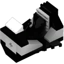{ .lu-ti width="24" loading="lazy" } [Nimbus Rocket Cockpit (LOT 9517)](../9517.md) | 1 | Nimbus Modular Build rocket cockpit | 2 matrices; 1 rewards; 0 community references |
| 9518 | { .lu-ti width="24" loading="lazy" } [Nimbus Rocket Engine (LOT 9518)](../9518.md) | 1 | Nimbus Modular Build rocket engine | 2 matrices; 1 rewards; 0 community references |
| 9516 | { .lu-ti width="24" loading="lazy" } [Nimbus Rocket Nose Cone (LOT 9516)](../9516.md) | 1 | Nimbus Modular Build rocket Nose Cone | 2 matrices; 1 rewards; 0 community references |
| 9747 | 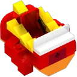{ .lu-ti width="24" loading="lazy" } [Ninja Dragon Rocket Cockpit (LOT 9747)](../9747.md) | 1 | Modular Build rocket cockpit | 0 matrices; 1 rewards; 0 community references |
| 9748 | 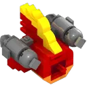{ .lu-ti width="24" loading="lazy" } [Ninja Dragon Rocket Engine (LOT 9748)](../9748.md) | 1 | Modular Build rocket engine | 1 matrices; 0 rewards; 0 community references |
| 9746 | 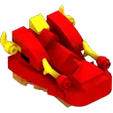{ .lu-ti width="24" loading="lazy" } [Ninja Dragon Rocket Nose Cone (LOT 9746)](../9746.md) | 1 | Modular Build rocket Nose Cone | 0 matrices; 1 rewards; 0 community references |
| 9561 | 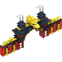{ .lu-ti width="24" loading="lazy" } [Ninja Gate Model (LOT 9561)](../9561.md) | 4 | A model for your Property! | 22 matrices; 1 rewards; 0 community references |
| 9549 | { .lu-ti width="24" loading="lazy" } [Ninja Platform Model (LOT 9549)](../9549.md) | 4 | A model for your Property! | 22 matrices; 0 rewards; 0 community references |
| 9557 | { .lu-ti width="24" loading="lazy" } [Ninja Vendor Hut Model (LOT 9557)](../9557.md) | 3 | A model for your Property! | 1 matrices; 0 rewards; 0 community references |
| 14766 | { .lu-ti width="24" loading="lazy" } [Ninjago Fire Temple Model (LOT 14766)](../14766.md) | 2 | A model for your Property! | 0 matrices; 1 rewards; 0 community references |
| 11029 | { .lu-ti width="24" loading="lazy" } [NS Property Pushback - Platform (LOT 11029)](../11029.md) | 1 | NS Property Pushback - Platform | 0 matrices; 0 rewards; 0 community references |
| 11111 | { .lu-ti width="24" loading="lazy" } [NS Property Pushback Model - Blocker (LOT 11111)](../11111.md) | 1 | NS Property Pushback Model - Blocker | 0 matrices; 0 rewards; 0 community references |
| 11007 | { .lu-ti width="24" loading="lazy" } [NS Property Pushback Model - Cage (LOT 11007)](../11007.md) | 1 | NS Property Pushback Model - Cage | 0 matrices; 0 rewards; 0 community references |
| 11009 | { .lu-ti width="24" loading="lazy" } [NS Property Pushback Model - Rhino (LOT 11009)](../11009.md) | 1 | NS Property Pushback Model - Rhino - REBUILD password 1n0R1n0 | 0 matrices; 0 rewards; 0 community references |
| 11777 | { .lu-ti width="24" loading="lazy" } [Office Chair 1 Model (LOT 11777)](../11777.md) | 1 | A model for your property! | 1 matrices; 0 rewards; 0 community references |
| 11778 | { .lu-ti width="24" loading="lazy" } [Office Chair 2 Model (LOT 11778)](../11778.md) | 1 | A model for your property! | 1 matrices; 0 rewards; 0 community references |
| 11779 | { .lu-ti width="24" loading="lazy" } [Office Copier Model (LOT 11779)](../11779.md) | 2 | A model for your property! | 1 matrices; 0 rewards; 0 community references |
| 11780 | { .lu-ti width="24" loading="lazy" } [Office Credenza 1 Model (LOT 11780)](../11780.md) | 3 | A model for your property! | 1 matrices; 0 rewards; 0 community references |
| 11781 | { .lu-ti width="24" loading="lazy" } [Office Credenza 2 Model (LOT 11781)](../11781.md) | 3 | A model for your property! | 1 matrices; 0 rewards; 0 community references |
| 11782 | { .lu-ti width="24" loading="lazy" } [Office Desk 1 Model (LOT 11782)](../11782.md) | 3 | A model for your property! | 1 matrices; 0 rewards; 0 community references |
| 11783 | { .lu-ti width="24" loading="lazy" } [Office Desk 2 Model (LOT 11783)](../11783.md) | 3 | A model for your property! | 1 matrices; 0 rewards; 0 community references |
| 11784 | { .lu-ti width="24" loading="lazy" } [Office Desk 3 Model (LOT 11784)](../11784.md) | 2 | A model for your property! | 1 matrices; 0 rewards; 0 community references |
| 11785 | { .lu-ti width="24" loading="lazy" } [Office Desk 4 Model (LOT 11785)](../11785.md) | 2 | A model for your property! | 1 matrices; 0 rewards; 0 community references |
| 11786 | { .lu-ti width="24" loading="lazy" } [Office Desk 5 Model (LOT 11786)](../11786.md) | 2 | A model for your property! | 1 matrices; 0 rewards; 0 community references |
| 11787 | { .lu-ti width="24" loading="lazy" } [Office Desk 6 Model (LOT 11787)](../11787.md) | 1 | A model for your property! | 1 matrices; 0 rewards; 0 community references |
| 11788 | { .lu-ti width="24" loading="lazy" } [Office File Cabinet 1 Model (LOT 11788)](../11788.md) | 2 | A model for your property! | 1 matrices; 0 rewards; 0 community references |
| 11789 | { .lu-ti width="24" loading="lazy" } [Office File Cabinet 2 Model (LOT 11789)](../11789.md) | 1 | A model for your property! | 1 matrices; 0 rewards; 0 community references |
| 11790 | { .lu-ti width="24" loading="lazy" } [Office Partition 1 Model (LOT 11790)](../11790.md) | 2 | A model for your property! | 1 matrices; 0 rewards; 0 community references |
| 11791 | { .lu-ti width="24" loading="lazy" } [Office Partition 2 Model (LOT 11791)](../11791.md) | 2 | A model for your property! | 1 matrices; 0 rewards; 0 community references |
| 11792 | { .lu-ti width="24" loading="lazy" } [Office Plant 1 Model (LOT 11792)](../11792.md) | 1 | A model for your property! | 1 matrices; 0 rewards; 0 community references |
| 11793 | { .lu-ti width="24" loading="lazy" } [Office Plant 2 Model (LOT 11793)](../11793.md) | 1 | A model for your property! | 1 matrices; 0 rewards; 0 community references |
| 11794 | { .lu-ti width="24" loading="lazy" } [Office Plant 3 Model (LOT 11794)](../11794.md) | 1 | A model for your property! | 1 matrices; 0 rewards; 0 community references |
| 11795 | { .lu-ti width="24" loading="lazy" } [Office Shelf 1 Model (LOT 11795)](../11795.md) | 3 | A model for your property! | 1 matrices; 0 rewards; 0 community references |
| 11796 | { .lu-ti width="24" loading="lazy" } [Office Shelf 2 Model (LOT 11796)](../11796.md) | 3 | A model for your property! | 1 matrices; 0 rewards; 0 community references |
| 11797 | { .lu-ti width="24" loading="lazy" } [Office Shelf 3 Model (LOT 11797)](../11797.md) | 3 | A model for your property! | 1 matrices; 0 rewards; 0 community references |
| 11798 | { .lu-ti width="24" loading="lazy" } [Office Stapler Model (LOT 11798)](../11798.md) | 2 | A model for your property! | 1 matrices; 0 rewards; 0 community references |
| 11799 | { .lu-ti width="24" loading="lazy" } [Office Table 1 Model (LOT 11799)](../11799.md) | 1 | A model for your property! | 1 matrices; 0 rewards; 0 community references |
| 11800 | { .lu-ti width="24" loading="lazy" } [Office Table 2 Model (LOT 11800)](../11800.md) | 2 | A model for your property! | 1 matrices; 0 rewards; 0 community references |
| 11801 | { .lu-ti width="24" loading="lazy" } [Office Water Cooler Model (LOT 11801)](../11801.md) | 1 | A model for your property! | 1 matrices; 1 rewards; 0 community references |
| 7826 | { .lu-ti width="24" loading="lazy" } [Oil Drum Model (LOT 7826)](../7826.md) | 1 | A model for your Property! | 27 matrices; 0 rewards; 0 community references |
| 7124 | { .lu-ti width="24" loading="lazy" } [Organ Model (LOT 7124)](../7124.md) | 4 | A model for your Property! | 18 matrices; 0 rewards; 0 community references |
| 9535 | { .lu-ti width="24" loading="lazy" } [Pagoda Model (LOT 9535)](../9535.md) | 4 | A model for your Property!! | 23 matrices; 0 rewards; 0 community references |
| 7830 | { .lu-ti width="24" loading="lazy" } [Pallet Model (LOT 7830)](../7830.md) | 1 | A model for your Property! | 27 matrices; 0 rewards; 0 community references |
| 6523 | { .lu-ti width="24" loading="lazy" } [Palm Tree Model (LOT 6523)](../6523.md) | 1 | A model for your Property! | 21 matrices; 0 rewards; 0 community references |
| 10072 | { .lu-ti width="24" loading="lazy" } [Palm Tree Model 2 (LOT 10072)](../10072.md) | 2 | A model for your Property! | 21 matrices; 0 rewards; 0 community references |
| 13501 | { .lu-ti width="24" loading="lazy" } [Paradox Blindsider Engine Panel (LOT 13501)](../13501.md) | 2 | No client description | 1 matrices; 0 rewards; 0 community references |
| 13500 | { .lu-ti width="24" loading="lazy" } [Paradox Blindsider Front Bumper (LOT 13500)](../13500.md) | 2 | No client description | 1 matrices; 0 rewards; 0 community references |
| 13504 | { .lu-ti width="24" loading="lazy" } [Paradox Blindsider Rear Bumper (LOT 13504)](../13504.md) | 2 | No client description | 1 matrices; 0 rewards; 0 community references |
| 13503 | { .lu-ti width="24" loading="lazy" } [Paradox Blindsider Rear Panel (LOT 13503)](../13503.md) | 3 | No client description | 1 matrices; 0 rewards; 0 community references |
| 13502 | { .lu-ti width="24" loading="lazy" } [Paradox Blindsider Side Panels (LOT 13502)](../13502.md) | 3 | No client description | 1 matrices; 0 rewards; 0 community references |
| 13259 | { .lu-ti width="24" loading="lazy" } [Paradox Darkwarp Rocket Cockpit (LOT 13259)](../13259.md) | 4 | Modular Build Rocket Cockpit | 1 matrices; 0 rewards; 0 community references |
| 13260 | { .lu-ti width="24" loading="lazy" } [Paradox Darkwarp Rocket Engine (LOT 13260)](../13260.md) | 4 | Modular Build Rocket Engine | 1 matrices; 0 rewards; 0 community references |
| 13258 | { .lu-ti width="24" loading="lazy" } [Paradox Darkwarp Rocket Nose Cone (LOT 13258)](../13258.md) | 4 | Modular Build Rocket Nose Cone | 1 matrices; 0 rewards; 0 community references |
| 9410 | { .lu-ti width="24" loading="lazy" } [Paragon Warp Engine Panel 1 (LOT 9410)](../9410.md) | 1 | No client description | 1 matrices; 0 rewards; 0 community references |
| 9411 | { .lu-ti width="24" loading="lazy" } [Paragon Warp Engine Panel 1 (LOT 9411)](../9411.md) | 2 | No client description | 1 matrices; 0 rewards; 0 community references |
| 9412 | { .lu-ti width="24" loading="lazy" } [Paragon Warp Engine Panel 1 (LOT 9412)](../9412.md) | 1 | No client description | 0 matrices; 1 rewards; 0 community references |
| 9413 | { .lu-ti width="24" loading="lazy" } [Paragon Warp Engine Panel 2 (LOT 9413)](../9413.md) | 1 | No client description | 1 matrices; 0 rewards; 0 community references |
| 9414 | { .lu-ti width="24" loading="lazy" } [Paragon Warp Engine Panel 2 (LOT 9414)](../9414.md) | 1 | No client description | 1 matrices; 0 rewards; 0 community references |
| 9415 | { .lu-ti width="24" loading="lazy" } [Paragon Warp Engine Panel 3 (LOT 9415)](../9415.md) | 1 | No client description | 1 matrices; 0 rewards; 0 community references |
| 8236 | { .lu-ti width="24" loading="lazy" } [Paragon Warp Front Bumper 1 (LOT 8236)](../8236.md) | 1 | No client description | 1 matrices; 0 rewards; 0 community references |
| 9404 | { .lu-ti width="24" loading="lazy" } [Paragon Warp Front Bumper 1 (LOT 9404)](../9404.md) | 3 | No client description | 6 matrices; 0 rewards; 0 community references |
| 9405 | { .lu-ti width="24" loading="lazy" } [Paragon Warp Front Bumper 2 (LOT 9405)](../9405.md) | 1 | No client description | 1 matrices; 1 rewards; 0 community references |
