# Loot model — page 6/8

[Item database](../README.md)

Pages: [1](type-21-1.md) | [2](type-21-2.md) | [3](type-21-3.md) | [4](type-21-4.md) | [5](type-21-5.md) | [6](type-21-6.md) | [7](type-21-7.md) | [8](type-21-8.md)

| LOT | Item | Rarity | Description | Source evidence |
| --- | --- | --- | --- | --- |
| 9406 | 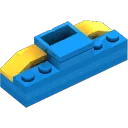{ .lu-ti width="24" loading="lazy" } [Paragon Warp Front Bumper 2 (LOT 9406)](../9406.md) | 1 | No client description | 1 matrices; 1 rewards; 0 community references |
| 9407 | 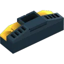{ .lu-ti width="24" loading="lazy" } [Paragon Warp Front Bumper 2 (LOT 9407)](../9407.md) | 1 | No client description | 1 matrices; 1 rewards; 0 community references |
| 9408 | { .lu-ti width="24" loading="lazy" } [Paragon Warp Front Bumper 3 (LOT 9408)](../9408.md) | 1 | No client description | 1 matrices; 0 rewards; 0 community references |
| 9409 | 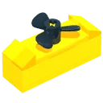{ .lu-ti width="24" loading="lazy" } [Paragon Warp Front Bumper 4 (LOT 9409)](../9409.md) | 1 | No client description | 0 matrices; 1 rewards; 0 community references |
| 9430 | 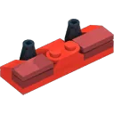{ .lu-ti width="24" loading="lazy" } [Paragon Warp Rear Bumper 1 (LOT 9430)](../9430.md) | 1 | No client description | 1 matrices; 0 rewards; 0 community references |
| 9431 | 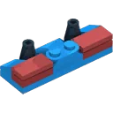{ .lu-ti width="24" loading="lazy" } [Paragon Warp Rear Bumper 1 (LOT 9431)](../9431.md) | 1 | No client description | 1 matrices; 0 rewards; 0 community references |
| 9432 | 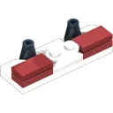{ .lu-ti width="24" loading="lazy" } [Paragon Warp Rear Bumper 1 (LOT 9432)](../9432.md) | 2 | No client description | 1 matrices; 0 rewards; 0 community references |
| 8237 | 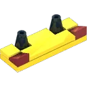{ .lu-ti width="24" loading="lazy" } [Paragon Warp Rear Bumper 2 (LOT 8237)](../8237.md) | 1 | No client description | 1 matrices; 1 rewards; 0 community references |
| 9433 | 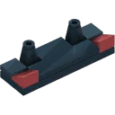{ .lu-ti width="24" loading="lazy" } [Paragon Warp Rear Bumper 2 (LOT 9433)](../9433.md) | 2 | No client description | 0 matrices; 1 rewards; 0 community references |
| 9434 | 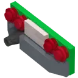{ .lu-ti width="24" loading="lazy" } [Paragon Warp Rear Bumper 3 (LOT 9434)](../9434.md) | 1 | No client description | 1 matrices; 0 rewards; 0 community references |
| 9422 | 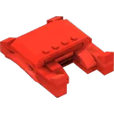{ .lu-ti width="24" loading="lazy" } [Paragon Warp Rear Panel 1 (LOT 9422)](../9422.md) | 1 | No client description | 1 matrices; 0 rewards; 0 community references |
| 9423 | { .lu-ti width="24" loading="lazy" } [Paragon Warp Rear Panel 1 (LOT 9423)](../9423.md) | 1 | No client description | 1 matrices; 0 rewards; 0 community references |
| 9424 | 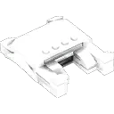{ .lu-ti width="24" loading="lazy" } [Paragon Warp Rear Panel 1 (LOT 9424)](../9424.md) | 3 | No client description | 6 matrices; 1 rewards; 0 community references |
| 9425 | { .lu-ti width="24" loading="lazy" } [Paragon Warp Rear Panel 2 (LOT 9425)](../9425.md) | 1 | No client description | 1 matrices; 0 rewards; 0 community references |
| 9426 | 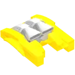{ .lu-ti width="24" loading="lazy" } [Paragon Warp Rear Panel 2 (LOT 9426)](../9426.md) | 3 | No client description | 7 matrices; 0 rewards; 0 community references |
| 9427 | 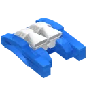{ .lu-ti width="24" loading="lazy" } [Paragon Warp Rear Panel 2 (LOT 9427)](../9427.md) | 1 | No client description | 1 matrices; 0 rewards; 0 community references |
| 9428 | 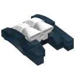{ .lu-ti width="24" loading="lazy" } [Paragon Warp Rear Panel 2 (LOT 9428)](../9428.md) | 1 | No client description | 0 matrices; 1 rewards; 0 community references |
| 9429 | 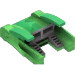{ .lu-ti width="24" loading="lazy" } [Paragon Warp Rear Panel 3 (LOT 9429)](../9429.md) | 1 | No client description | 1 matrices; 0 rewards; 0 community references |
| 8133 | 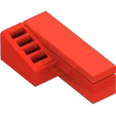{ .lu-ti width="24" loading="lazy" } [Paragon Warp Side Panels 1 (LOT 8133)](../8133.md) | 1 | No client description | 1 matrices; 0 rewards; 0 community references |
| 9416 | 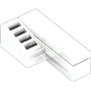{ .lu-ti width="24" loading="lazy" } [Paragon Warp Side Panels 1 (LOT 9416)](../9416.md) | 1 | No client description | 1 matrices; 1 rewards; 0 community references |
| 9417 | 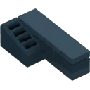{ .lu-ti width="24" loading="lazy" } [Paragon Warp Side Panels 1 (LOT 9417)](../9417.md) | 1 | No client description | 0 matrices; 1 rewards; 0 community references |
| 9418 | 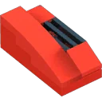{ .lu-ti width="24" loading="lazy" } [Paragon Warp Side Panels 2 (LOT 9418)](../9418.md) | 1 | No client description | 0 matrices; 1 rewards; 0 community references |
| 9419 | 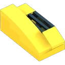{ .lu-ti width="24" loading="lazy" } [Paragon Warp Side Panels 2 (LOT 9419)](../9419.md) | 2 | No client description | 1 matrices; 0 rewards; 0 community references |
| 9420 | 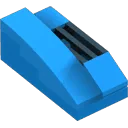{ .lu-ti width="24" loading="lazy" } [Paragon Warp Side Panels 2 (LOT 9420)](../9420.md) | 1 | No client description | 1 matrices; 0 rewards; 0 community references |
| 9421 | 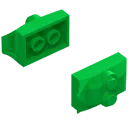{ .lu-ti width="24" loading="lazy" } [Paragon Warp Side Panels 3 (LOT 9421)](../9421.md) | 1 | No client description | 1 matrices; 0 rewards; 0 community references |
| 10868 | 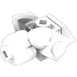{ .lu-ti width="24" loading="lazy" } [Park Bunny Model (LOT 10868)](../10868.md) | 1 | A model for your property! | 3 matrices; 0 rewards; 0 community references |
| 6836 | { .lu-ti width="24" loading="lazy" } [Parrot Model (LOT 6836)](../6836.md) | 1 | Place this animated creature model on your Property! | 0 matrices; 1 rewards; 0 community references |
| 9489 | 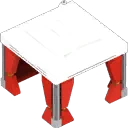{ .lu-ti width="24" loading="lazy" } [Pavilion Model (LOT 9489)](../9489.md) | 3 | A model for your property! | 1 matrices; 0 rewards; 0 community references |
| 14696 | 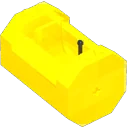{ .lu-ti width="24" loading="lazy" } [Pencil Rocket Cockpit (LOT 14696)](../14696.md) | 3 | Modular Build Rocket Cockpit | 1 matrices; 0 rewards; 0 community references |
| 14697 | { .lu-ti width="24" loading="lazy" } [Pencil Rocket Engine (LOT 14697)](../14697.md) | 3 | Modular Build Rocket Engine | 1 matrices; 0 rewards; 0 community references |
| 14695 | { .lu-ti width="24" loading="lazy" } [Pencil Rocket Nose Cone (LOT 14695)](../14695.md) | 3 | Modular Build Rocket Nose Cone | 1 matrices; 0 rewards; 0 community references |
| 6024 | [PERF MON Polys (LOT 6024)](../6024.md) | 3 | DO NOT DELETE | 0 matrices; 0 rewards; 0 community references |
| 10869 | 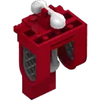{ .lu-ti width="24" loading="lazy" } [Phone Booth Model (LOT 10869)](../10869.md) | 2 | A model for your property! | 3 matrices; 0 rewards; 0 community references |
| 7773 | { .lu-ti width="24" loading="lazy" } [Piano Model (LOT 7773)](../7773.md) | 3 | A model for your Property! | 29 matrices; 0 rewards; 0 community references |
| 8067 | 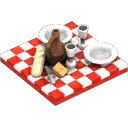{ .lu-ti width="24" loading="lazy" } [Picnic Blanket Model (LOT 8067)](../8067.md) | 3 | A model for your Property! | 0 matrices; 1 rewards; 0 community references |
| 10870 | { .lu-ti width="24" loading="lazy" } [Picnic Model (LOT 10870)](../10870.md) | 1 | A model for your property! | 3 matrices; 0 rewards; 0 community references |
| 7758 | { .lu-ti width="24" loading="lazy" } [Picnic Table Model (LOT 7758)](../7758.md) | 1 | A model for your Property! | 27 matrices; 0 rewards; 0 community references |
| 9598 | 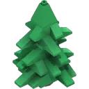{ .lu-ti width="24" loading="lazy" } [Pine Tree Model 1 (LOT 9598)](../9598.md) | 2 | A model for your Property! | 1 matrices; 0 rewards; 0 community references |
| 9599 | 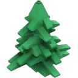{ .lu-ti width="24" loading="lazy" } [Pine Tree Model 2 (LOT 9599)](../9599.md) | 2 | A model for your Property! | 1 matrices; 0 rewards; 0 community references |
| 10829 | 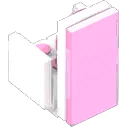{ .lu-ti width="24" loading="lazy" } [Pink Polka Dot Chair Model (LOT 10829)](../10829.md) | 1 | A model for your property! | 3 matrices; 0 rewards; 0 community references |
| 9567 | 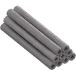{ .lu-ti width="24" loading="lazy" } [Pipestack Model (LOT 9567)](../9567.md) | 3 | A model for your Property! | 22 matrices; 0 rewards; 0 community references |
| 10081 | 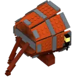{ .lu-ti width="24" loading="lazy" } [Pirate Barrel Hut Model 1 (LOT 10081)](../10081.md) | 3 | A model for your Property! | 20 matrices; 0 rewards; 0 community references |
| 10082 | 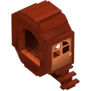{ .lu-ti width="24" loading="lazy" } [Pirate Barrel Hut Model 2 (LOT 10082)](../10082.md) | 3 | A model for your Property! | 20 matrices; 0 rewards; 0 community references |
| 10083 | 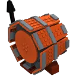{ .lu-ti width="24" loading="lazy" } [Pirate Barrel Hut Model 3 (LOT 10083)](../10083.md) | 3 | A model for your Property! | 19 matrices; 0 rewards; 0 community references |
| 10069 | 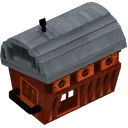{ .lu-ti width="24" loading="lazy" } [Pirate Captain's Hut Model (LOT 10069)](../10069.md) | 4 | A model for your Property! | 19 matrices; 0 rewards; 0 community references |
| 10085 | 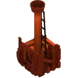{ .lu-ti width="24" loading="lazy" } [Pirate Corner Lookout Model (LOT 10085)](../10085.md) | 3 | A model for your Property! | 20 matrices; 0 rewards; 0 community references |
| 10084 | 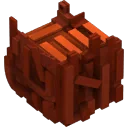{ .lu-ti width="24" loading="lazy" } [Pirate Corner Wall Model (LOT 10084)](../10084.md) | 3 | A model for your Property! | 21 matrices; 0 rewards; 0 community references |
| 6941 | { .lu-ti width="24" loading="lazy" } [Pirate Duck Model (LOT 6941)](../6941.md) | 3 | A model for your Property! | 20 matrices; 0 rewards; 0 community references |
| 10074 | { .lu-ti width="24" loading="lazy" } [Pirate Gate Model (LOT 10074)](../10074.md) | 3 | A model for your Property! | 20 matrices; 0 rewards; 0 community references |
| 10071 | { .lu-ti width="24" loading="lazy" } [Pirate Idol Model (LOT 10071)](../10071.md) | 2 | A model for your Property! | 20 matrices; 0 rewards; 0 community references |
| 6041 | 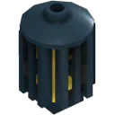{ .lu-ti width="24" loading="lazy" } [Pirate Lantern Model (LOT 6041)](../6041.md) | 1 | A model for your Property! | 19 matrices; 0 rewards; 0 community references |
| 10086 | { .lu-ti width="24" loading="lazy" } [Pirate Medium Wall Model (LOT 10086)](../10086.md) | 2 | A model for your Property! | 21 matrices; 0 rewards; 0 community references |
| 9296 | 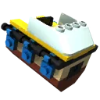{ .lu-ti width="24" loading="lazy" } [Pirate Rocket Cockpit (LOT 9296)](../9296.md) | 4 | Modular Build Rocket Nose Cone | 0 matrices; 1 rewards; 0 community references |
| 9297 | 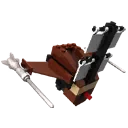{ .lu-ti width="24" loading="lazy" } [Pirate Rocket Engine (LOT 9297)](../9297.md) | 1 | Modular Build Rocket Nose Cone | 0 matrices; 1 rewards; 0 community references |
| 9295 | 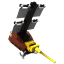{ .lu-ti width="24" loading="lazy" } [Pirate Rocket Nose Cone (LOT 9295)](../9295.md) | 4 | Modular Build rocket Nose Cone | 0 matrices; 1 rewards; 0 community references |
| 10091 | 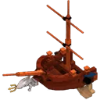{ .lu-ti width="24" loading="lazy" } [Pirate Ship Model 1 (LOT 10091)](../10091.md) | 3 | A model for your Property! | 19 matrices; 0 rewards; 0 community references |
| 10093 | 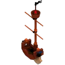{ .lu-ti width="24" loading="lazy" } [Pirate Ship Model 2 (LOT 10093)](../10093.md) | 3 | A model for your Property! | 19 matrices; 0 rewards; 0 community references |
| 10092 | 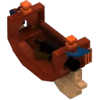{ .lu-ti width="24" loading="lazy" } [Pirate Ship Model 3 (LOT 10092)](../10092.md) | 3 | A model for your Property! | 19 matrices; 0 rewards; 0 community references |
| 10094 | 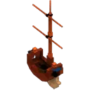{ .lu-ti width="24" loading="lazy" } [Pirate Ship Model 4 (LOT 10094)](../10094.md) | 3 | A model for your Property! | 19 matrices; 0 rewards; 0 community references |
| 10090 | 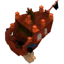{ .lu-ti width="24" loading="lazy" } [Pirate Ship Model 5 (LOT 10090)](../10090.md) | 4 | A model for your Property! | 19 matrices; 0 rewards; 0 community references |
| 10087 | { .lu-ti width="24" loading="lazy" } [Pirate Small Wall Model (LOT 10087)](../10087.md) | 2 | A model for your Property! | 21 matrices; 0 rewards; 0 community references |
| 10073 | 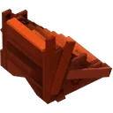{ .lu-ti width="24" loading="lazy" } [Pirate Staircase Model (LOT 10073)](../10073.md) | 3 | A model for your Property! | 19 matrices; 0 rewards; 0 community references |
| 10871 | { .lu-ti width="24" loading="lazy" } [Pirate Steering Wheel Toy Model (LOT 10871)](../10871.md) | 1 | A model for your property! | 1 matrices; 0 rewards; 0 community references |
| 10088 | { .lu-ti width="24" loading="lazy" } [Pirate T-Wall Model (LOT 10088)](../10088.md) | 3 | A model for your Property! | 22 matrices; 0 rewards; 0 community references |
| 10089 | { .lu-ti width="24" loading="lazy" } [Pirate T-Wall With Stairs Model (LOT 10089)](../10089.md) | 3 | A model for your Property! | 21 matrices; 0 rewards; 0 community references |
| 10070 | 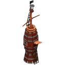{ .lu-ti width="24" loading="lazy" } [Pirate Tower Model (LOT 10070)](../10070.md) | 4 | A model for your Property! | 19 matrices; 0 rewards; 0 community references |
| 10080 | 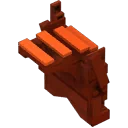{ .lu-ti width="24" loading="lazy" } [Pirate Wall Bridge Model (LOT 10080)](../10080.md) | 3 | A model for your Property! | 20 matrices; 0 rewards; 0 community references |
| 10078 | 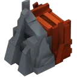{ .lu-ti width="24" loading="lazy" } [Pirate Wall End Model (LOT 10078)](../10078.md) | 3 | A model for your Property! | 21 matrices; 0 rewards; 0 community references |
| 10075 | { .lu-ti width="24" loading="lazy" } [Pirate Wall Model 1 (LOT 10075)](../10075.md) | 3 | A model for your Property! | 22 matrices; 0 rewards; 0 community references |
| 10076 | { .lu-ti width="24" loading="lazy" } [Pirate Wall Model 2 (LOT 10076)](../10076.md) | 3 | A model for your Property! | 22 matrices; 0 rewards; 0 community references |
| 10077 | { .lu-ti width="24" loading="lazy" } [Pirate Wall Model 3 (LOT 10077)](../10077.md) | 3 | A model for your Property! | 21 matrices; 0 rewards; 0 community references |
| 10079 | { .lu-ti width="24" loading="lazy" } [Pirate Wall With Gunport Model (LOT 10079)](../10079.md) | 3 | A model for your Property! | 20 matrices; 0 rewards; 0 community references |
| 10845 | { .lu-ti width="24" loading="lazy" } [Plant Model (LOT 10845)](../10845.md) | 1 | A model for your property! | 0 matrices; 1 rewards; 0 community references |
| 10803 | { .lu-ti width="24" loading="lazy" } [Playground Pig Ride Model (LOT 10803)](../10803.md) | 2 | A model for your property! | 3 matrices; 0 rewards; 0 community references |
| 10804 | { .lu-ti width="24" loading="lazy" } [Playground Ride Model (LOT 10804)](../10804.md) | 1 | A model for your property! | 3 matrices; 0 rewards; 0 community references |
| 9577 | { .lu-ti width="24" loading="lazy" } [Pod 1 Model (LOT 9577)](../9577.md) | 4 | A model for your Property! | 1 matrices; 0 rewards; 0 community references |
| 9578 | { .lu-ti width="24" loading="lazy" } [Pod 2 Model (LOT 9578)](../9578.md) | 4 | A model for your Property! | 1 matrices; 0 rewards; 0 community references |
| 9579 | { .lu-ti width="24" loading="lazy" } [Pod 3 Model (LOT 9579)](../9579.md) | 4 | A model for your Property! | 1 matrices; 0 rewards; 0 community references |
| 9580 | { .lu-ti width="24" loading="lazy" } [Pod 4 Model (LOT 9580)](../9580.md) | 4 | A model for your Property!! | 1 matrices; 0 rewards; 0 community references |
| 9581 | { .lu-ti width="24" loading="lazy" } [Pod 5 Model (LOT 9581)](../9581.md) | 4 | A model for your Property! | 1 matrices; 0 rewards; 0 community references |
| 9582 | { .lu-ti width="24" loading="lazy" } [Pod 6 Model (LOT 9582)](../9582.md) | 4 | A model for your Property! | 1 matrices; 0 rewards; 0 community references |
| 9583 | { .lu-ti width="24" loading="lazy" } [Pod 7 Model (LOT 9583)](../9583.md) | 4 | A model for your Property! | 1 matrices; 1 rewards; 0 community references |
| 4720 | { .lu-ti width="24" loading="lazy" } [Pod Rocket Cockpit (LOT 4720)](../4720.md) | 1 | Modular Build rocket cockpit | 2 matrices; 0 rewards; 0 community references |
| 4721 | { .lu-ti width="24" loading="lazy" } [Pod Rocket Engine (LOT 4721)](../4721.md) | 1 | Modular Build rocket engine | 3 matrices; 0 rewards; 0 community references |
| 4719 | { .lu-ti width="24" loading="lazy" } [Pod Rocket Nose Cone (LOT 4719)](../4719.md) | 1 | Modular Build rocket Nose Cone | 2 matrices; 0 rewards; 0 community references |
| 14750 | { .lu-ti width="24" loading="lazy" } [Race Ace Engine Panel (LOT 14750)](../14750.md) | 3 | No client description | 0 matrices; 0 rewards; 0 community references |
| 14749 | { .lu-ti width="24" loading="lazy" } [Race Ace Front Bumper (LOT 14749)](../14749.md) | 3 | No client description | 0 matrices; 0 rewards; 0 community references |
| 14753 | { .lu-ti width="24" loading="lazy" } [Race Ace Rear Bumper (LOT 14753)](../14753.md) | 3 | No client description | 0 matrices; 0 rewards; 0 community references |
| 14752 | { .lu-ti width="24" loading="lazy" } [Race Ace Rear Panel (LOT 14752)](../14752.md) | 3 | No client description | 0 matrices; 0 rewards; 0 community references |
| 14751 | { .lu-ti width="24" loading="lazy" } [Race Ace Side Panels (LOT 14751)](../14751.md) | 3 | No client description | 0 matrices; 0 rewards; 0 community references |
| 14745 | { .lu-ti width="24" loading="lazy" } [Racemaster Engine Panel (LOT 14745)](../14745.md) | 4 | No client description | 0 matrices; 0 rewards; 0 community references |
| 14744 | { .lu-ti width="24" loading="lazy" } [Racemaster Front Bumper (LOT 14744)](../14744.md) | 4 | No client description | 0 matrices; 0 rewards; 0 community references |
| 14748 | { .lu-ti width="24" loading="lazy" } [Racemaster Rear Bumper (LOT 14748)](../14748.md) | 4 | No client description | 0 matrices; 0 rewards; 0 community references |
| 14747 | { .lu-ti width="24" loading="lazy" } [Racemaster Rear Panel (LOT 14747)](../14747.md) | 4 | No client description | 0 matrices; 0 rewards; 0 community references |
| 14746 | { .lu-ti width="24" loading="lazy" } [Racemaster Side Panels (LOT 14746)](../14746.md) | 4 | No client description | 0 matrices; 0 rewards; 0 community references |
| 9604 | { .lu-ti width="24" loading="lazy" } [Radar Truck Model (LOT 9604)](../9604.md) | 2 | A model for your Property! | 2 matrices; 0 rewards; 0 community references |
| 6068 | { .lu-ti width="24" loading="lazy" } [Raft with Sails Model (LOT 6068)](../6068.md) | 2 | A model for your Property! | 19 matrices; 0 rewards; 0 community references |
| 6839 | { .lu-ti width="24" loading="lazy" } [Rat Model (LOT 6839)](../6839.md) | 1 | Place this animated creature model on your Property! | 0 matrices; 1 rewards; 0 community references |
| 10872 | { .lu-ti width="24" loading="lazy" } [Record Player Model (LOT 10872)](../10872.md) | 2 | A model for your property! | 3 matrices; 0 rewards; 0 community references |
| 10833 | { .lu-ti width="24" loading="lazy" } [Red and White Sofa Model (LOT 10833)](../10833.md) | 2 | A model for your property! | 3 matrices; 0 rewards; 0 community references |
| 10472 | { .lu-ti width="24" loading="lazy" } [Red Dragon Property Pet (LOT 10472)](../10472.md) | 1 | TEST property Red Dragon | 0 matrices; 0 rewards; 0 community references |
| 9546 | { .lu-ti width="24" loading="lazy" } [Red Ninja Fence Model (LOT 9546)](../9546.md) | 1 | A model for your Property! | 23 matrices; 1 rewards; 0 community references |
| 9450 | { .lu-ti width="24" loading="lazy" } [Red Rim Wheels (LOT 9450)](../9450.md) | 1 | No client description | 3 matrices; 0 rewards; 0 community references |
| 9908 | { .lu-ti width="24" loading="lazy" } [Red Tree Model 3 (LOT 9908)](../9908.md) | 2 | A model for your Property! | 1 matrices; 0 rewards; 0 community references |
| 13534 | { .lu-ti width="24" loading="lazy" } [Reward Anglerfish Imagination Dispenser (LOT 13534)](../13534.md) | 1 | A model with Behaviors for your property. | 0 matrices; 0 rewards; 0 community references |
| 13609 | { .lu-ti width="24" loading="lazy" } [Reward Burger (LOT 13609)](../13609.md) | 1 | A model with Behaviors for your property. | 0 matrices; 0 rewards; 0 community references |
| 13619 | { .lu-ti width="24" loading="lazy" } [Reward Cage (LOT 13619)](../13619.md) | 1 | A model with Behaviors for your property. | 0 matrices; 0 rewards; 0 community references |
| 13450 | { .lu-ti width="24" loading="lazy" } [Reward Charging Rhino (LOT 13450)](../13450.md) | 1 | This model contains behaviors! | 0 matrices; 0 rewards; 0 community references |
| 13511 | { .lu-ti width="24" loading="lazy" } [Reward Chicken (LOT 13511)](../13511.md) | 1 | A model with Behaviors for your property. | 0 matrices; 0 rewards; 0 community references |
| 13561 | { .lu-ti width="24" loading="lazy" } [Reward Crabloth Enemy (LOT 13561)](../13561.md) | 1 | A model with Behaviors for your property. | 0 matrices; 0 rewards; 0 community references |
| 13614 | { .lu-ti width="24" loading="lazy" } [Reward Dynamite (LOT 13614)](../13614.md) | 1 | A model with Behaviors for your property. | 0 matrices; 0 rewards; 0 community references |
| 13612 | { .lu-ti width="24" loading="lazy" } [Reward Dynamite Plunger (LOT 13612)](../13612.md) | 1 | A model with Behaviors for your property. | 0 matrices; 0 rewards; 0 community references |
| 13616 | { .lu-ti width="24" loading="lazy" } [Reward Flowers (LOT 13616)](../13616.md) | 1 | A model with Behaviors for your property. | 0 matrices; 0 rewards; 0 community references |
| 13562 | { .lu-ti width="24" loading="lazy" } [Reward Gooble Enemy (LOT 13562)](../13562.md) | 1 | A model with Behaviors for your property. | 0 matrices; 0 rewards; 0 community references |
| 13420 | { .lu-ti width="24" loading="lazy" } [Reward Hot Air Balloon (LOT 13420)](../13420.md) | 1 | This model contains behaviors! | 0 matrices; 0 rewards; 0 community references |
| 13440 | { .lu-ti width="24" loading="lazy" } [Reward Imagination Fountain (LOT 13440)](../13440.md) | 1 | This model contains behaviors! | 0 matrices; 0 rewards; 0 community references |
| 13496 | { .lu-ti width="24" loading="lazy" } [Reward Micro Spider (LOT 13496)](../13496.md) | 1 | A model with Behaviors for your property. | 0 matrices; 0 rewards; 0 community references |
| 13498 | { .lu-ti width="24" loading="lazy" } [Reward Pteranodon (LOT 13498)](../13498.md) | 1 | A model with Behaviors for your property. | 0 matrices; 0 rewards; 0 community references |
| 13532 | { .lu-ti width="24" loading="lazy" } [Reward Rat (LOT 13532)](../13532.md) | 1 | A model with Behaviors for your property. | 0 matrices; 0 rewards; 0 community references |
| 13543 | [Reward Salamunky (LOT 13543)](../13543.md) | 1 | A model with Behaviors for your property. | 0 matrices; 0 rewards; 0 community references |
| 13536 | { .lu-ti width="24" loading="lazy" } [Reward Scared Rock Beast (LOT 13536)](../13536.md) | 1 | A model with Behaviors for your property. | 0 matrices; 0 rewards; 0 community references |
| 13621 | { .lu-ti width="24" loading="lazy" } [Reward Snowman (LOT 13621)](../13621.md) | 1 | A model with Behaviors for your property. | 0 matrices; 0 rewards; 0 community references |
| 13629 | { .lu-ti width="24" loading="lazy" } [Reward Spike Platform (LOT 13629)](../13629.md) | 1 | A model with Behaviors for your property. | 0 matrices; 0 rewards; 0 community references |
| 13567 | { .lu-ti width="24" loading="lazy" } [Reward Thropper Enemy (LOT 13567)](../13567.md) | 1 | A model with Behaviors for your property. | 0 matrices; 0 rewards; 0 community references |
| 13432 | { .lu-ti width="24" loading="lazy" } [Reward Trophy (LOT 13432)](../13432.md) | 1 | This model contains behaviors! | 0 matrices; 0 rewards; 0 community references |
| 13610 | { .lu-ti width="24" loading="lazy" } [Reward Turkey (LOT 13610)](../13610.md) | 1 | A model with Behaviors for your property. | 0 matrices; 0 rewards; 0 community references |
| 13474 | { .lu-ti width="24" loading="lazy" } [Reward Turtle (LOT 13474)](../13474.md) | 1 | A model with Behaviors for your property. | 0 matrices; 0 rewards; 0 community references |
| 10843 | { .lu-ti width="24" loading="lazy" } [Rickshaw Model (LOT 10843)](../10843.md) | 1 | A model for your property! | 3 matrices; 0 rewards; 0 community references |
| 10474 | { .lu-ti width="24" loading="lazy" } [Robo Dog Property Pet (LOT 10474)](../10474.md) | 1 | TEST property Robo Dog | 0 matrices; 0 rewards; 0 community references |
| 11190 | { .lu-ti width="24" loading="lazy" } [Robot City Rocket Cockpit (LOT 11190)](../11190.md) | 2 | Robot City Modular Build Rocket Cockpit | 0 matrices; 1 rewards; 0 community references |
| 11191 | { .lu-ti width="24" loading="lazy" } [Robot City Rocket Engine (LOT 11191)](../11191.md) | 2 | Robot City Modular Build Rocket Engine | 0 matrices; 1 rewards; 0 community references |
| 11189 | { .lu-ti width="24" loading="lazy" } [Robot City Rocket Nose Cone (LOT 11189)](../11189.md) | 2 | Robot City Modular Build Rocket Nose Cone | 0 matrices; 1 rewards; 0 community references |
| 9646 | { .lu-ti width="24" loading="lazy" } [Rover Model 1 (LOT 9646)](../9646.md) | 1 | A model for your Property! | 1 matrices; 0 rewards; 0 community references |
| 9647 | { .lu-ti width="24" loading="lazy" } [Rover Model 2 (LOT 9647)](../9647.md) | 2 | A model for your Property! | 2 matrices; 0 rewards; 0 community references |
| 13728 | { .lu-ti width="24" loading="lazy" } [Safari Baobab Tree Model (LOT 13728)](../13728.md) | 4 | A model for your property! | 1 matrices; 0 rewards; 0 community references |
| 13727 | { .lu-ti width="24" loading="lazy" } [Safari Bench Model  (LOT 13727)](../13727.md) | 1 | A model for your property! | 1 matrices; 0 rewards; 0 community references |
| 13726 | { .lu-ti width="24" loading="lazy" } [Safari Cooking Place Model  (LOT 13726)](../13726.md) | 1 | A model for your property! | 1 matrices; 0 rewards; 0 community references |
| 13725 | { .lu-ti width="24" loading="lazy" } [Safari Gate Model  (LOT 13725)](../13725.md) | 4 | A model for your property! | 1 matrices; 0 rewards; 0 community references |
| 13724 | { .lu-ti width="24" loading="lazy" } [Safari Lion Rock Model (LOT 13724)](../13724.md) | 1 | A model for your property! | 1 matrices; 0 rewards; 0 community references |
| 13723 | { .lu-ti width="24" loading="lazy" } [Safari Plane Model  (LOT 13723)](../13723.md) | 3 | A model for your property! | 1 matrices; 0 rewards; 0 community references |
| 13722 | { .lu-ti width="24" loading="lazy" } [Safari Rover Model  (LOT 13722)](../13722.md) | 3 | A model for your property! | 1 matrices; 0 rewards; 0 community references |
| 13721 | { .lu-ti width="24" loading="lazy" } [Safari Tent Model 1 (LOT 13721)](../13721.md) | 3 | A model for your property! | 1 matrices; 0 rewards; 0 community references |
| 13720 | { .lu-ti width="24" loading="lazy" } [Safari Tent Model 2 (LOT 13720)](../13720.md) | 1 | A model for your property! | 1 matrices; 0 rewards; 0 community references |
| 13719 | { .lu-ti width="24" loading="lazy" } [Safari Termite Mound Model  (LOT 13719)](../13719.md) | 1 | A model for your property! | 1 matrices; 0 rewards; 0 community references |
| 13718 | { .lu-ti width="24" loading="lazy" } [Safari Umbrella Model  (LOT 13718)](../13718.md) | 1 | A model for your property! | 1 matrices; 0 rewards; 0 community references |
| 13717 | { .lu-ti width="24" loading="lazy" } [Safari Waterhole Model  (LOT 13717)](../13717.md) | 4 | A model for your property! | 1 matrices; 0 rewards; 0 community references |
| 13427 | { .lu-ti width="24" loading="lazy" } [Samurai Statue Model (LOT 13427)](../13427.md) | 2 | A model for your Property! | 0 matrices; 1 rewards; 0 community references |
| 10873 | { .lu-ti width="24" loading="lazy" } [Sand Castle Model (LOT 10873)](../10873.md) | 1 | A model for your property! | 3 matrices; 0 rewards; 0 community references |
| 10805 | { .lu-ti width="24" loading="lazy" } [See Saw Model (LOT 10805)](../10805.md) | 2 | A model for your property! | 3 matrices; 0 rewards; 0 community references |
| 13506 | { .lu-ti width="24" loading="lazy" } [Sentinel Stalwart Engine Panel (LOT 13506)](../13506.md) | 2 | No client description | 1 matrices; 0 rewards; 0 community references |
| 13505 | { .lu-ti width="24" loading="lazy" } [Sentinel Stalwart Front Bumper (LOT 13505)](../13505.md) | 2 | No client description | 1 matrices; 0 rewards; 0 community references |
| 13509 | { .lu-ti width="24" loading="lazy" } [Sentinel Stalwart Rear Bumper (LOT 13509)](../13509.md) | 2 | No client description | 1 matrices; 0 rewards; 0 community references |
| 13508 | { .lu-ti width="24" loading="lazy" } [Sentinel Stalwart Rear Panel (LOT 13508)](../13508.md) | 3 | No client description | 1 matrices; 0 rewards; 0 community references |
| 13507 | { .lu-ti width="24" loading="lazy" } [Sentinel Stalwart Side Panels (LOT 13507)](../13507.md) | 3 | No client description | 1 matrices; 0 rewards; 0 community references |
| 13262 | { .lu-ti width="24" loading="lazy" } [Sentinel Startalon Rocket Cockpit (LOT 13262)](../13262.md) | 4 | Modular Build Rocket Cockpit | 1 matrices; 0 rewards; 0 community references |
| 13263 | { .lu-ti width="24" loading="lazy" } [Sentinel Startalon Rocket Engine (LOT 13263)](../13263.md) | 4 | Modular Build Rocket Engine | 1 matrices; 0 rewards; 0 community references |
| 13261 | { .lu-ti width="24" loading="lazy" } [Sentinel Startalon Rocket Nose Cone (LOT 13261)](../13261.md) | 4 | Modular Build Rocket Nose Cone | 1 matrices; 0 rewards; 0 community references |
| 7125 | { .lu-ti width="24" loading="lazy" } [Shack Model (LOT 7125)](../7125.md) | 4 | A model for your Property! | 20 matrices; 0 rewards; 0 community references |
| 6942 | { .lu-ti width="24" loading="lazy" } [Shark Model (LOT 6942)](../6942.md) | 1 | A model for your Property! | 19 matrices; 1 rewards; 0 community references |
| 14693 | { .lu-ti width="24" loading="lazy" } [Shark Rocket Cockpit (LOT 14693)](../14693.md) | 3 | Modular Build Rocket Cockpit | 1 matrices; 0 rewards; 0 community references |
| 14694 | { .lu-ti width="24" loading="lazy" } [Shark Rocket Engine (LOT 14694)](../14694.md) | 3 | Modular Build Rocket Engine | 1 matrices; 0 rewards; 0 community references |
| 14692 | { .lu-ti width="24" loading="lazy" } [Shark Rocket Nose Cone (LOT 14692)](../14692.md) | 3 | Modular Build Rocket Nose Cone | 1 matrices; 0 rewards; 0 community references |
| 11197 | { .lu-ti width="24" loading="lazy" } [Shipwreck Hideout Model 1 (LOT 11197)](../11197.md) | 2 | A model for your property! | 1 matrices; 0 rewards; 0 community references |
| 11198 | { .lu-ti width="24" loading="lazy" } [Shipwreck Hideout Model 2 (LOT 11198)](../11198.md) | 2 | A model for your property! | 1 matrices; 0 rewards; 0 community references |
| 11199 | { .lu-ti width="24" loading="lazy" } [Shipwreck Hideout Model 3 (LOT 11199)](../11199.md) | 3 | A model for your property! | 1 matrices; 0 rewards; 0 community references |
| 11200 | { .lu-ti width="24" loading="lazy" } [Shipwreck Hideout Model 4 (LOT 11200)](../11200.md) | 4 | A model for your property! | 1 matrices; 0 rewards; 0 community references |
| 10831 | { .lu-ti width="24" loading="lazy" } [Sink Model (LOT 10831)](../10831.md) | 1 | A model for your property! | 3 matrices; 0 rewards; 0 community references |
| 13151 | { .lu-ti width="24" loading="lazy" } [Skeleton Chair Model (LOT 13151)](../13151.md) | 2 | A model for your property! | 1 matrices; 0 rewards; 0 community references |
| 12497 | { .lu-ti width="24" loading="lazy" } [Skeleton Corner Wall Model (LOT 12497)](../12497.md) | 3 | A model for your Property! | 46 matrices; 0 rewards; 0 community references |
| 12508 | { .lu-ti width="24" loading="lazy" } [Skeleton Elevator Model (LOT 12508)](../12508.md) | 3 | A model for your Property! | 46 matrices; 0 rewards; 0 community references |
| 13152 | { .lu-ti width="24" loading="lazy" } [Skeleton Fountain Model (LOT 13152)](../13152.md) | 3 | A model for your property! | 1 matrices; 0 rewards; 0 community references |
| 12507 | { .lu-ti width="24" loading="lazy" } [Skeleton Gate Model (LOT 12507)](../12507.md) | 4 | A model for your Property! | 46 matrices; 0 rewards; 0 community references |
| 12506 | { .lu-ti width="24" loading="lazy" } [Skeleton Hover Drone Model (LOT 12506)](../12506.md) | 4 | A model for your Property! | 45 matrices; 0 rewards; 0 community references |
| 12818 | { .lu-ti width="24" loading="lazy" } [Skeleton Idol Model (LOT 12818)](../12818.md) | 3 | A model for your Property! | 0 matrices; 0 rewards; 0 community references |
| 13153 | { .lu-ti width="24" loading="lazy" } [Skeleton Lamp Model (LOT 13153)](../13153.md) | 2 | A model for your property! | 1 matrices; 0 rewards; 0 community references |
| 13154 | { .lu-ti width="24" loading="lazy" } [Skeleton Lamp Stand Model (LOT 13154)](../13154.md) | 2 | A model for your property! | 1 matrices; 0 rewards; 0 community references |
| 12505 | { .lu-ti width="24" loading="lazy" } [Skeleton Mobile Drilling Rig Model (LOT 12505)](../12505.md) | 4 | A model for your Property! | 46 matrices; 0 rewards; 0 community references |
| 16575 | { .lu-ti width="24" loading="lazy" } [Skeleton Outpost Corner 1 Model (LOT 16575)](../16575.md) | 3 | A model for your Property! | 34 matrices; 0 rewards; 0 community references |
| 16576 | { .lu-ti width="24" loading="lazy" } [Skeleton Outpost Corner 2 Model (LOT 16576)](../16576.md) | 4 | A model for your Property! | 34 matrices; 0 rewards; 0 community references |
| 16565 | { .lu-ti width="24" loading="lazy" } [Skeleton Outpost Flag Model (LOT 16565)](../16565.md) | 1 | A model for your Property! | 34 matrices; 0 rewards; 0 community references |
| 16568 | { .lu-ti width="24" loading="lazy" } [Skeleton Outpost Guard Model (LOT 16568)](../16568.md) | 1 | A model for your Property! | 34 matrices; 0 rewards; 0 community references |
| 16569 | { .lu-ti width="24" loading="lazy" } [Skeleton Outpost Keep Model (LOT 16569)](../16569.md) | 4 | A model for your Property! | 34 matrices; 0 rewards; 0 community references |
| 16566 | { .lu-ti width="24" loading="lazy" } [Skeleton Outpost Large Gate Model (LOT 16566)](../16566.md) | 4 | A model for your Property! | 34 matrices; 0 rewards; 0 community references |
| 16570 | { .lu-ti width="24" loading="lazy" } [Skeleton Outpost Patroller Model (LOT 16570)](../16570.md) | 1 | A model for your Property! | 34 matrices; 0 rewards; 0 community references |
| 16577 | { .lu-ti width="24" loading="lazy" } [Skeleton Outpost Short Wall 1 Model (LOT 16577)](../16577.md) | 1 | A model for your Property! | 34 matrices; 0 rewards; 0 community references |
| 16578 | { .lu-ti width="24" loading="lazy" } [Skeleton Outpost Short Wall 2 Model (LOT 16578)](../16578.md) | 2 | A model for your Property! | 34 matrices; 0 rewards; 0 community references |
| 16567 | { .lu-ti width="24" loading="lazy" } [Skeleton Outpost Small Gate Model (LOT 16567)](../16567.md) | 3 | A model for your Property! | 34 matrices; 0 rewards; 0 community references |
| 16571 | { .lu-ti width="24" loading="lazy" } [Skeleton Outpost Spire Model (LOT 16571)](../16571.md) | 3 | A model for your Property! | 34 matrices; 0 rewards; 0 community references |
| 16572 | { .lu-ti width="24" loading="lazy" } [Skeleton Outpost Stable Model (LOT 16572)](../16572.md) | 1 | A model for your Property! | 34 matrices; 0 rewards; 0 community references |
| 16579 | { .lu-ti width="24" loading="lazy" } [Skeleton Outpost T-Wall Model (LOT 16579)](../16579.md) | 3 | A model for your Property! | 34 matrices; 0 rewards; 0 community references |
| 16580 | { .lu-ti width="24" loading="lazy" } [Skeleton Outpost Tall Wall Model (LOT 16580)](../16580.md) | 2 | A model for your Property! | 34 matrices; 0 rewards; 0 community references |
| 16573 | { .lu-ti width="24" loading="lazy" } [Skeleton Outpost Tower Model (LOT 16573)](../16573.md) | 2 | A model for your Property! | 34 matrices; 0 rewards; 0 community references |
| 16581 | { .lu-ti width="24" loading="lazy" } [Skeleton Outpost Wall Arch Model (LOT 16581)](../16581.md) | 2 | A model for your Property! | 34 matrices; 0 rewards; 0 community references |
| 16574 | { .lu-ti width="24" loading="lazy" } [Skeleton Outpost Wall Model (LOT 16574)](../16574.md) | 3 | A model for your Property! | 34 matrices; 0 rewards; 0 community references |
| 16582 | { .lu-ti width="24" loading="lazy" } [Skeleton Outpost Wall with Skull Model (LOT 16582)](../16582.md) | 3 | A model for your Property! | 34 matrices; 0 rewards; 0 community references |
| 16583 | { .lu-ti width="24" loading="lazy" } [Skeleton Outpost Wall with Stairs 1 Model (LOT 16583)](../16583.md) | 2 | A model for your Property! | 34 matrices; 0 rewards; 0 community references |
| 16584 | { .lu-ti width="24" loading="lazy" } [Skeleton Outpost Wall with Stairs 2 Model (LOT 16584)](../16584.md) | 3 | A model for your Property! | 34 matrices; 0 rewards; 0 community references |
| 16585 | { .lu-ti width="24" loading="lazy" } [Skeleton Outpost Weapon Rack Model (LOT 16585)](../16585.md) | 1 | A model for your Property! | 34 matrices; 0 rewards; 0 community references |
| 13155 | { .lu-ti width="24" loading="lazy" } [Skeleton Pet Model (LOT 13155)](../13155.md) | 2 | A model for your property! | 1 matrices; 0 rewards; 0 community references |
| 12503 | { .lu-ti width="24" loading="lazy" } [Skeleton Repair Facility Model (LOT 12503)](../12503.md) | 4 | A model for your Property! | 46 matrices; 0 rewards; 0 community references |
