# Loot model — page 7/8

[Item database](../README.md)

Pages: [1](type-21-1.md) | [2](type-21-2.md) | [3](type-21-3.md) | [4](type-21-4.md) | [5](type-21-5.md) | [6](type-21-6.md) | [7](type-21-7.md) | [8](type-21-8.md)

| LOT | Item | Rarity | Description | Source evidence |
| --- | --- | --- | --- | --- |
| 12502 | { .lu-ti width="24" loading="lazy" } [Skeleton Ribcage Bridge Model (LOT 12502)](../12502.md) | 4 | A model for your Property! | 46 matrices; 0 rewards; 0 community references |
| 13156 | 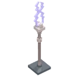{ .lu-ti width="24" loading="lazy" } [Skeleton Scepter Stand Model (LOT 13156)](../13156.md) | 2 | A model for your property! | 1 matrices; 0 rewards; 0 community references |
| 12501 | { .lu-ti width="24" loading="lazy" } [Skeleton Short Wall Model (LOT 12501)](../12501.md) | 3 | A model for your Property! | 46 matrices; 0 rewards; 0 community references |
| 12500 | { .lu-ti width="24" loading="lazy" } [Skeleton Skull Tower Model (LOT 12500)](../12500.md) | 4 | A model for your Property! | 46 matrices; 0 rewards; 0 community references |
| 13157 | 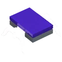{ .lu-ti width="24" loading="lazy" } [Skeleton Small Table Model (LOT 13157)](../13157.md) | 2 | A model for your property! | 1 matrices; 0 rewards; 0 community references |
| 13158 | 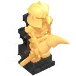{ .lu-ti width="24" loading="lazy" } [Skeleton Statue Model (LOT 13158)](../13158.md) | 3 | A model for your property! | 1 matrices; 0 rewards; 0 community references |
| 12499 | { .lu-ti width="24" loading="lazy" } [Skeleton T-Wall Model (LOT 12499)](../12499.md) | 4 | A model for your Property! | 46 matrices; 0 rewards; 0 community references |
| 13159 | 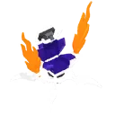{ .lu-ti width="24" loading="lazy" } [Skeleton Throne Model (LOT 13159)](../13159.md) | 3 | A model for your property! | 1 matrices; 0 rewards; 0 community references |
| 12498 | { .lu-ti width="24" loading="lazy" } [Skeleton Wall Model (LOT 12498)](../12498.md) | 3 | A model for your Property! | 46 matrices; 0 rewards; 0 community references |
| 12504 | { .lu-ti width="24" loading="lazy" } [Skeleton Wall Pillars Model (LOT 12504)](../12504.md) | 2 | A model for your Property! | 46 matrices; 0 rewards; 0 community references |
| 12496 | { .lu-ti width="24" loading="lazy" } [Skeleton Watchtower Wall Model (LOT 12496)](../12496.md) | 4 | A model for your Property! | 46 matrices; 0 rewards; 0 community references |
| 13160 | 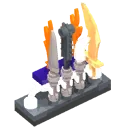{ .lu-ti width="24" loading="lazy" } [Skeleton Weapon Rack Model 1 (LOT 13160)](../13160.md) | 2 | A model for your property! | 1 matrices; 0 rewards; 0 community references |
| 13161 | 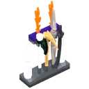{ .lu-ti width="24" loading="lazy" } [Skeleton Weapon Rack Model 2 (LOT 13161)](../13161.md) | 3 | A model for your property! | 1 matrices; 0 rewards; 0 community references |
| 12495 | { .lu-ti width="24" loading="lazy" } [Skeleton Ziggurat Model (LOT 12495)](../12495.md) | 4 | A model for your Property! | 46 matrices; 0 rewards; 0 community references |
| 10469 | 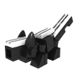{ .lu-ti width="24" loading="lazy" } [Skunk Property Pet (LOT 10469)](../10469.md) | 1 | TEST property skunk | 0 matrices; 0 rewards; 0 community references |
| 9496 | { .lu-ti width="24" loading="lazy" } [Sleek Sofa Model (LOT 9496)](../9496.md) | 1 | A model for your Property! | 23 matrices; 0 rewards; 0 community references |
| 9538 | { .lu-ti width="24" loading="lazy" } [Small Arch Model (LOT 9538)](../9538.md) | 1 | A model for your Property! | 23 matrices; 0 rewards; 0 community references |
| 6776 | 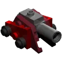{ .lu-ti width="24" loading="lazy" } [Small Cannon Model (LOT 6776)](../6776.md) | 1 | A model for your Property! | 19 matrices; 0 rewards; 0 community references |
| 6032 | { .lu-ti width="24" loading="lazy" } [Small Crate Model (LOT 6032)](../6032.md) | 2 | A model for your Property! | 46 matrices; 1 rewards; 0 community references |
| 6028 | { .lu-ti width="24" loading="lazy" } [Small Mushroom Model (LOT 6028)](../6028.md) | 1 | A model for your Property! | 45 matrices; 0 rewards; 0 community references |
| 10832 | { .lu-ti width="24" loading="lazy" } [Small Plant Model (LOT 10832)](../10832.md) | 1 | A model for your property! | 3 matrices; 0 rewards; 0 community references |
| 9910 | 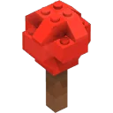{ .lu-ti width="24" loading="lazy" } [Small Red Tree Model 1 (LOT 9910)](../9910.md) | 1 | A model for your Property! | 1 matrices; 0 rewards; 0 community references |
| 9912 | { .lu-ti width="24" loading="lazy" } [Small Red Tree Model 2 (LOT 9912)](../9912.md) | 2 | A model for your Property! | 1 matrices; 0 rewards; 0 community references |
| 8050 | { .lu-ti width="24" loading="lazy" } [Small Shrine Model (LOT 8050)](../8050.md) | 2 | A model for your Property! | 22 matrices; 0 rewards; 0 community references |
| 6044 | { .lu-ti width="24" loading="lazy" } [Small Table Model (LOT 6044)](../6044.md) | 1 | A model for your Property! | 46 matrices; 0 rewards; 0 community references |
| 9911 | 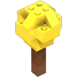{ .lu-ti width="24" loading="lazy" } [Small Yellow Tree Model 1 (LOT 9911)](../9911.md) | 1 | A model for your Property! | 1 matrices; 0 rewards; 0 community references |
| 9913 | { .lu-ti width="24" loading="lazy" } [Small Yellow Tree Model 2 (LOT 9913)](../9913.md) | 2 | A model for your Property! | 1 matrices; 0 rewards; 0 community references |
| 6870 | { .lu-ti width="24" loading="lazy" } [Snake Model (LOT 6870)](../6870.md) | 1 | Place this animated creature model on your Property! | 18 matrices; 1 rewards; 0 community references |
| 7126 | 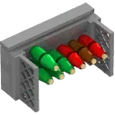{ .lu-ti width="24" loading="lazy" } [Soda Rack Model (LOT 7126)](../7126.md) | 2 | A model for your Property! | 20 matrices; 0 rewards; 0 community references |
| 10834 | 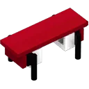{ .lu-ti width="24" loading="lazy" } [Sofa Table Model (LOT 10834)](../10834.md) | 1 | A model for your property! | 3 matrices; 0 rewards; 0 community references |
| 9585 | 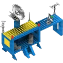{ .lu-ti width="24" loading="lazy" } [Space Command Center Model (LOT 9585)](../9585.md) | 3 | A model for your Property! | 1 matrices; 0 rewards; 0 community references |
| 10874 | 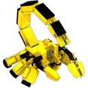{ .lu-ti width="24" loading="lazy" } [Space Crane Model (LOT 10874)](../10874.md) | 4 | A model for your property! | 0 matrices; 0 rewards; 0 community references |
| 11836 | 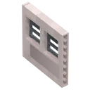{ .lu-ti width="24" loading="lazy" } [Space Fort Barricade Door Model (LOT 11836)](../11836.md) | 2 | A model for your property! | 1 matrices; 0 rewards; 0 community references |
| 11851 | 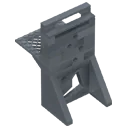{ .lu-ti width="24" loading="lazy" } [Space Fort Battle-Damaged Short Wall Model (LOT 11851)](../11851.md) | 3 | A model for your property! | 1 matrices; 0 rewards; 0 community references |
| 11822 | 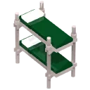{ .lu-ti width="24" loading="lazy" } [Space Fort Bunk Model (LOT 11822)](../11822.md) | 2 | A model for your property! | 1 matrices; 0 rewards; 0 community references |
| 11839 | 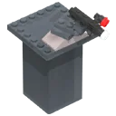{ .lu-ti width="24" loading="lazy" } [Space Fort Camera Model (LOT 11839)](../11839.md) | 3 | A model for your property! | 1 matrices; 0 rewards; 0 community references |
| 11840 | 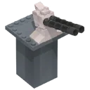{ .lu-ti width="24" loading="lazy" } [Space Fort Cannon Model (LOT 11840)](../11840.md) | 3 | A model for your property! | 1 matrices; 0 rewards; 0 community references |
| 11823 | 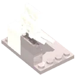{ .lu-ti width="24" loading="lazy" } [Space Fort Computer Model (LOT 11823)](../11823.md) | 2 | A model for your property! | 1 matrices; 0 rewards; 0 community references |
| 11824 | 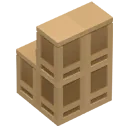{ .lu-ti width="24" loading="lazy" } [Space Fort Crate Stack Model (LOT 11824)](../11824.md) | 1 | A model for your property! | 1 matrices; 0 rewards; 0 community references |
| 11841 | 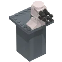{ .lu-ti width="24" loading="lazy" } [Space Fort Flak Model (LOT 11841)](../11841.md) | 3 | A model for your property! | 1 matrices; 0 rewards; 0 community references |
| 11825 | 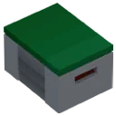{ .lu-ti width="24" loading="lazy" } [Space Fort Footlocker Model (LOT 11825)](../11825.md) | 1 | A model for your property! | 1 matrices; 0 rewards; 0 community references |
| 11837 | 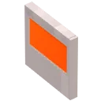{ .lu-ti width="24" loading="lazy" } [Space Fort Forcefield Door Model (LOT 11837)](../11837.md) | 2 | A model for your property! | 1 matrices; 0 rewards; 0 community references |
| 11826 | 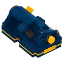{ .lu-ti width="24" loading="lazy" } [Space Fort Generator Model (LOT 11826)](../11826.md) | 4 | A model for your property! | 1 matrices; 0 rewards; 0 community references |
| 11827 | 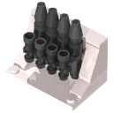{ .lu-ti width="24" loading="lazy" } [Space Fort Gun Rack Model 1 (LOT 11827)](../11827.md) | 3 | A model for your property! | 1 matrices; 0 rewards; 0 community references |
| 11828 | 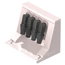{ .lu-ti width="24" loading="lazy" } [Space Fort Gun Rack Model 2 (LOT 11828)](../11828.md) | 2 | A model for your property! | 1 matrices; 0 rewards; 0 community references |
| 11845 | { .lu-ti width="24" loading="lazy" } [Space Fort Invader Model (LOT 11845)](../11845.md) | 3 | A model for your property! | 1 matrices; 0 rewards; 0 community references |
| 11842 | 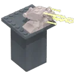{ .lu-ti width="24" loading="lazy" } [Space Fort Lightning Model (LOT 11842)](../11842.md) | 3 | A model for your property! | 1 matrices; 0 rewards; 0 community references |
| 11829 | 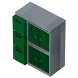{ .lu-ti width="24" loading="lazy" } [Space Fort Locker Model 1 (LOT 11829)](../11829.md) | 2 | A model for your property! | 1 matrices; 0 rewards; 0 community references |
| 11830 | 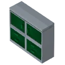{ .lu-ti width="24" loading="lazy" } [Space Fort Locker Model 2 (LOT 11830)](../11830.md) | 2 | A model for your property! | 1 matrices; 0 rewards; 0 community references |
| 11831 | 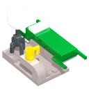{ .lu-ti width="24" loading="lazy" } [Space Fort Medical Stretcher Model 1 (LOT 11831)](../11831.md) | 2 | A model for your property! | 1 matrices; 0 rewards; 0 community references |
| 11847 | 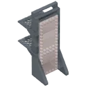{ .lu-ti width="24" loading="lazy" } [Space Fort Medium Wall Model (LOT 11847)](../11847.md) | 3 | A model for your property! | 1 matrices; 0 rewards; 0 community references |
| 11843 | { .lu-ti width="24" loading="lazy" } [Space Fort Missiles Model (LOT 11843)](../11843.md) | 3 | A model for your property! | 1 matrices; 0 rewards; 0 community references |
| 11844 | 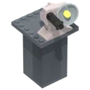{ .lu-ti width="24" loading="lazy" } [Space Fort Searchlight Defender Model (LOT 11844)](../11844.md) | 3 | A model for your property! | 1 matrices; 0 rewards; 0 community references |
| 11849 | 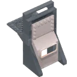{ .lu-ti width="24" loading="lazy" } [Space Fort Short Armored Wall Model (LOT 11849)](../11849.md) | 3 | A model for your property! | 1 matrices; 0 rewards; 0 community references |
| 11852 | 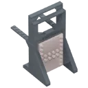{ .lu-ti width="24" loading="lazy" } [Space Fort Short Gunport Wall Model (LOT 11852)](../11852.md) | 3 | A model for your property! | 1 matrices; 0 rewards; 0 community references |
| 11853 | 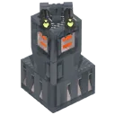{ .lu-ti width="24" loading="lazy" } [Space Fort Short Inside Corner Wall Model (LOT 11853)](../11853.md) | 4 | A model for your property! | 1 matrices; 0 rewards; 0 community references |
| 11854 | 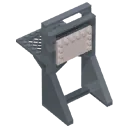{ .lu-ti width="24" loading="lazy" } [Space Fort Short Opening Wall Model (LOT 11854)](../11854.md) | 3 | A model for your property! | 1 matrices; 0 rewards; 0 community references |
| 11855 | 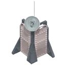{ .lu-ti width="24" loading="lazy" } [Space Fort Short Outside Corner Wall Model (LOT 11855)](../11855.md) | 4 | A model for your property! | 1 matrices; 0 rewards; 0 community references |
| 11848 | 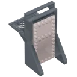{ .lu-ti width="24" loading="lazy" } [Space Fort Short Wall Model (LOT 11848)](../11848.md) | 3 | A model for your property! | 1 matrices; 0 rewards; 0 community references |
| 11850 | 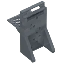{ .lu-ti width="24" loading="lazy" } [Space Fort Short Wall with Bulletholes Model (LOT 11850)](../11850.md) | 3 | A model for your property! | 1 matrices; 0 rewards; 0 community references |
| 11838 | 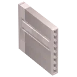{ .lu-ti width="24" loading="lazy" } [Space Fort Slotted Door Model (LOT 11838)](../11838.md) | 2 | A model for your property! | 1 matrices; 0 rewards; 0 community references |
| 11832 | 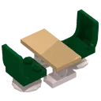{ .lu-ti width="24" loading="lazy" } [Space Fort Table Model 1 (LOT 11832)](../11832.md) | 2 | A model for your property! | 1 matrices; 0 rewards; 0 community references |
| 11856 | 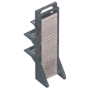{ .lu-ti width="24" loading="lazy" } [Space Fort Tall Wall Model (LOT 11856)](../11856.md) | 4 | A model for your property! | 1 matrices; 0 rewards; 0 community references |
| 11857 | 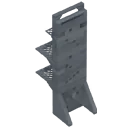{ .lu-ti width="24" loading="lazy" } [Space Fort Tall Wall with Bulletholes Model (LOT 11857)](../11857.md) | 4 | A model for your property! | 1 matrices; 0 rewards; 0 community references |
| 11833 | 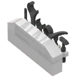{ .lu-ti width="24" loading="lazy" } [Space Fort Tool Rack Model 1 (LOT 11833)](../11833.md) | 2 | A model for your property! | 1 matrices; 0 rewards; 0 community references |
| 11834 | 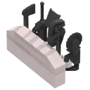{ .lu-ti width="24" loading="lazy" } [Space Fort Tool Rack Model 2 (LOT 11834)](../11834.md) | 2 | A model for your property! | 1 matrices; 0 rewards; 0 community references |
| 11835 | 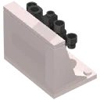{ .lu-ti width="24" loading="lazy" } [Space Fort Tool Rack Model 3 (LOT 11835)](../11835.md) | 2 | A model for your property! | 1 matrices; 0 rewards; 0 community references |
| 11846 | 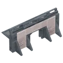{ .lu-ti width="24" loading="lazy" } [Space Fort Wide Wall Gate Model (LOT 11846)](../11846.md) | 4 | A model for your property! | 1 matrices; 0 rewards; 0 community references |
| 7061 | { .lu-ti width="24" loading="lazy" } [Spider Model (LOT 7061)](../7061.md) | 1 | Place this animated creature model on your Property! | 0 matrices; 1 rewards; 0 community references |
| 7060 | { .lu-ti width="24" loading="lazy" } [Starfish Model (LOT 7060)](../7060.md) | 1 | Place this animated creature model on your Property! | 18 matrices; 1 rewards; 0 community references |
| 12849 | 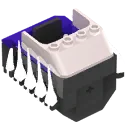{ .lu-ti width="24" loading="lazy" } [Starskull Rocket Cockpit (LOT 12849)](../12849.md) | 2 | Modular Build Rocket Cockpit | 1 matrices; 0 rewards; 0 community references |
| 12850 | 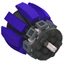{ .lu-ti width="24" loading="lazy" } [Starskull Rocket Engine (LOT 12850)](../12850.md) | 2 | Modular Build Rocket Engine | 1 matrices; 0 rewards; 0 community references |
| 12848 | { .lu-ti width="24" loading="lazy" } [Starskull Rocket Nose Cone (LOT 12848)](../12848.md) | 2 | Modular Build Rocket Nose Cone | 1 matrices; 0 rewards; 0 community references |
| 4717 | { .lu-ti width="24" loading="lazy" } [Steampunk Rocket Cockpit (LOT 4717)](../4717.md) | 1 | Modular Build rocket cockpit | 2 matrices; 0 rewards; 0 community references |
| 4718 | { .lu-ti width="24" loading="lazy" } [Steampunk Rocket Engine (LOT 4718)](../4718.md) | 1 | Modular Build rocket engine | 3 matrices; 0 rewards; 0 community references |
| 4716 | { .lu-ti width="24" loading="lazy" } [Steampunk Rocket Nose Cone (LOT 4716)](../4716.md) | 1 | Modular Build rocket Nose Cone | 2 matrices; 0 rewards; 0 community references |
| 8130 | { .lu-ti width="24" loading="lazy" } [Steel Rim Wheels (LOT 8130)](../8130.md) | 1 | No client description | 9 matrices; 0 rewards; 0 community references |
| 10835 | { .lu-ti width="24" loading="lazy" } [Step Stool Model (LOT 10835)](../10835.md) | 2 | A model for your property! | 3 matrices; 0 rewards; 0 community references |
| 9565 | { .lu-ti width="24" loading="lazy" } [Submarine Model (LOT 9565)](../9565.md) | 1 | A model for your Property! | 18 matrices; 0 rewards; 0 community references |
| 10841 | { .lu-ti width="24" loading="lazy" } [Sun Dial Model (LOT 10841)](../10841.md) | 1 | A model for your property! | 3 matrices; 0 rewards; 0 community references |
| 9597 | { .lu-ti width="24" loading="lazy" } [Swamp Tree Model (LOT 9597)](../9597.md) | 3 | A model for your Property! | 1 matrices; 0 rewards; 0 community references |
| 6058 | { .lu-ti width="24" loading="lazy" } [Sword Barrel Model (LOT 6058)](../6058.md) | 1 | A model for your Property! | 21 matrices; 0 rewards; 0 community references |
| 10875 | { .lu-ti width="24" loading="lazy" } [Table Saw Model (LOT 10875)](../10875.md) | 2 | A model for your property! | 3 matrices; 0 rewards; 0 community references |
| 10836 | { .lu-ti width="24" loading="lazy" } [Tan Chair Model (LOT 10836)](../10836.md) | 1 | A model for your property! | 3 matrices; 0 rewards; 0 community references |
| 7825 | { .lu-ti width="24" loading="lazy" } [Tank Pallet Model (LOT 7825)](../7825.md) | 2 | A model for your Property! | 29 matrices; 0 rewards; 0 community references |
| 9488 | { .lu-ti width="24" loading="lazy" } [Television Model (LOT 9488)](../9488.md) | 2 | A model for your Property! | 26 matrices; 0 rewards; 0 community references |
| 9550 | { .lu-ti width="24" loading="lazy" } [Temple Model 1 (LOT 9550)](../9550.md) | 3 | A model for your Property! | 23 matrices; 0 rewards; 0 community references |
| 9551 | { .lu-ti width="24" loading="lazy" } [Temple Model 2 (LOT 9551)](../9551.md) | 3 | A model for your Property! | 22 matrices; 0 rewards; 0 community references |
| 6036 | { .lu-ti width="24" loading="lazy" } [Tent Model (LOT 6036)](../6036.md) | 3 | A model for your Property! | 47 matrices; 0 rewards; 0 community references |
| 10457 | { .lu-ti width="24" loading="lazy" } [Terrier Property Pet (LOT 10457)](../10457.md) | 1 | TEST Property Terrier | 0 matrices; 0 rewards; 0 community references |
| 12852 | { .lu-ti width="24" loading="lazy" } [Terror Comet Rocket Cockpit (LOT 12852)](../12852.md) | 2 | Modular Build Rocket Cockpit | 1 matrices; 0 rewards; 0 community references |
| 12853 | { .lu-ti width="24" loading="lazy" } [Terror Comet Rocket Engine (LOT 12853)](../12853.md) | 2 | Modular Build Rocket Engine | 1 matrices; 0 rewards; 0 community references |
| 12851 | { .lu-ti width="24" loading="lazy" } [Terror Comet Rocket Nose Cone (LOT 12851)](../12851.md) | 2 | Modular Build Rocket Nose Cone | 1 matrices; 0 rewards; 0 community references |
| 10280 | [Test (LOT 10280)](../10280.md) | 1 | A model for your Property! | 0 matrices; 0 rewards; 0 community references |
| 13273 | [TEST   Cockpit (LOT 13273)](../13273.md) | 2 | Modular Build Rocket Cockpit | 0 matrices; 0 rewards; 0 community references |
| 13274 | [TEST   Engine (LOT 13274)](../13274.md) | 2 | Modular Build Rocket Engine | 0 matrices; 0 rewards; 0 community references |
| 13272 | [TEST   Nose Cone (LOT 13272)](../13272.md) | 2 | Modular Build Rocket Nose Cone | 0 matrices; 0 rewards; 0 community references |
| 9735 | { .lu-ti width="24" loading="lazy" } [TEST COP Medieval Village Forge (LOT 9735)](../9735.md) | 5 | Place this model on your property! | 0 matrices; 0 rewards; 0 community references |
| 9733 | { .lu-ti width="24" loading="lazy" } [TEST COP Medieval Village House (LOT 9733)](../9733.md) | 5 | Place this model on your property! | 0 matrices; 0 rewards; 0 community references |
| 9734 | { .lu-ti width="24" loading="lazy" } [TEST COP Medieval Village Inn (LOT 9734)](../9734.md) | 5 | Place this model on your property! | 0 matrices; 0 rewards; 0 community references |
| 9736 | { .lu-ti width="24" loading="lazy" } [TEST COP Medieval Village Stable (LOT 9736)](../9736.md) | 5 | Place this model on your property! | 0 matrices; 0 rewards; 0 community references |
| 7137 | [Test for Media team (LOT 7137)](../7137.md) | 5 | Test Model | 0 matrices; 0 rewards; 0 community references |
| 7145 | [Test for Media team 2 (LOT 7145)](../7145.md) | 5 | Test Model 2 | 0 matrices; 0 rewards; 0 community references |
| 7146 | [Test for Media team 3 (LOT 7146)](../7146.md) | 5 | Test Model 3 | 0 matrices; 0 rewards; 0 community references |
| 13246 | { .lu-ti width="24" loading="lazy" } [TEST IAN HALL FOR SUBMIT Cockpit (LOT 13246)](../13246.md) | 2 | Modular Build Rocket Cockpit | 0 matrices; 0 rewards; 0 community references |
| 13249 | { .lu-ti width="24" loading="lazy" } [TEST IAN HALL FOR SUBMIT Cockpit (LOT 13249)](../13249.md) | 2 | Modular Build Rocket Cockpit | 0 matrices; 0 rewards; 0 community references |
| 13252 | { .lu-ti width="24" loading="lazy" } [TEST IAN HALL FOR SUBMIT Cockpit (LOT 13252)](../13252.md) | 2 | Modular Build Rocket Cockpit | 0 matrices; 0 rewards; 0 community references |
| 13247 | { .lu-ti width="24" loading="lazy" } [TEST IAN HALL FOR SUBMIT Engine (LOT 13247)](../13247.md) | 2 | Modular Build Rocket Engine | 0 matrices; 0 rewards; 0 community references |
| 13250 | { .lu-ti width="24" loading="lazy" } [TEST IAN HALL FOR SUBMIT Engine (LOT 13250)](../13250.md) | 2 | Modular Build Rocket Engine | 0 matrices; 0 rewards; 0 community references |
| 13253 | { .lu-ti width="24" loading="lazy" } [TEST IAN HALL FOR SUBMIT Engine (LOT 13253)](../13253.md) | 2 | Modular Build Rocket Engine | 0 matrices; 0 rewards; 0 community references |
| 13245 | { .lu-ti width="24" loading="lazy" } [TEST IAN HALL FOR SUBMIT Nose Cone (LOT 13245)](../13245.md) | 2 | Modular Build Rocket Nose Cone | 0 matrices; 0 rewards; 0 community references |
| 13248 | { .lu-ti width="24" loading="lazy" } [TEST IAN HALL FOR SUBMIT Nose Cone (LOT 13248)](../13248.md) | 2 | Modular Build Rocket Nose Cone | 0 matrices; 0 rewards; 0 community references |
| 13251 | { .lu-ti width="24" loading="lazy" } [TEST IAN HALL FOR SUBMIT Nose Cone (LOT 13251)](../13251.md) | 2 | Modular Build Rocket Nose Cone | 0 matrices; 0 rewards; 0 community references |
| 4766 | { .lu-ti width="24" loading="lazy" } [Test LUP Reward Object (LOT 4766)](../4766.md) | 5 | No client description | 0 matrices; 0 rewards; 0 community references |
| 7757 | { .lu-ti width="24" loading="lazy" } [Test One More Creator Test (LOT 7757)](../7757.md) | 5 | Place this model on your property! | 0 matrices; 0 rewards; 0 community references |
| 13178 | { .lu-ti width="24" loading="lazy" } [TEST ROCKET Ian Hall Nose Cone (LOT 13178)](../13178.md) | 1 | Modular Build Rocket Nose Cone | 0 matrices; 0 rewards; 0 community references |
| 13195 | { .lu-ti width="24" loading="lazy" } [TEST ROCKET IHALL Cockpit (LOT 13195)](../13195.md) | 2 | Modular Build Rocket Cockpit | 0 matrices; 0 rewards; 0 community references |
| 13196 | { .lu-ti width="24" loading="lazy" } [TEST ROCKET IHALL Engine (LOT 13196)](../13196.md) | 2 | Modular Build Rocket Engine | 0 matrices; 0 rewards; 0 community references |
| 13194 | { .lu-ti width="24" loading="lazy" } [TEST ROCKET IHALL Nose Cone (LOT 13194)](../13194.md) | 2 | Modular Build Rocket Nose Cone | 0 matrices; 0 rewards; 0 community references |
| 13189 | [Test Rocket Jan 14 Cockpit (LOT 13189)](../13189.md) | 2 | Modular Build Rocket Cockpit | 0 matrices; 0 rewards; 0 community references |
| 13190 | { .lu-ti width="24" loading="lazy" } [Test Rocket Jan 14 Engine (LOT 13190)](../13190.md) | 2 | Modular Build Rocket Engine | 0 matrices; 0 rewards; 0 community references |
| 13188 | { .lu-ti width="24" loading="lazy" } [Test Rocket Jan 14 Nose Cone (LOT 13188)](../13188.md) | 2 | Modular Build Rocket Nose Cone | 0 matrices; 0 rewards; 0 community references |
| 12814 | { .lu-ti width="24" loading="lazy" } [TEST Shane NPC (LOT 12814)](../12814.md) | 2 | No client description | 0 matrices; 0 rewards; 0 community references |
| 7970 | { .lu-ti width="24" loading="lazy" } [Test UGC Model - Café Corner (LOT 7970)](../7970.md) | 5 | For testing only | 0 matrices; 0 rewards; 0 community references |
| 7971 | { .lu-ti width="24" loading="lazy" } [Test UGC Model - Ninja Arch (LOT 7971)](../7971.md) | 5 | For testing only | 0 matrices; 0 rewards; 0 community references |
| 10806 | { .lu-ti width="24" loading="lazy" } [Throne Model (LOT 10806)](../10806.md) | 2 | A model for your property! | 3 matrices; 0 rewards; 0 community references |
| 9377 | { .lu-ti width="24" loading="lazy" } [Thrust Bucket Engine Panel 1 (LOT 9377)](../9377.md) | 1 | No client description | 1 matrices; 0 rewards; 0 community references |
| 9378 | { .lu-ti width="24" loading="lazy" } [Thrust Bucket Engine Panel 1 (LOT 9378)](../9378.md) | 2 | No client description | 1 matrices; 0 rewards; 0 community references |
| 9379 | { .lu-ti width="24" loading="lazy" } [Thrust Bucket Engine Panel 1 (LOT 9379)](../9379.md) | 1 | No client description | 1 matrices; 0 rewards; 0 community references |
| 8232 | { .lu-ti width="24" loading="lazy" } [Thrust Bucket Engine Panel 2 (LOT 8232)](../8232.md) | 1 | No client description | 0 matrices; 1 rewards; 0 community references |
| 9373 | { .lu-ti width="24" loading="lazy" } [Thrust Bucket Front Bumper 1 (LOT 9373)](../9373.md) | 1 | No client description | 1 matrices; 0 rewards; 0 community references |
| 9374 | { .lu-ti width="24" loading="lazy" } [Thrust Bucket Front Bumper 2 (LOT 9374)](../9374.md) | 2 | No client description | 0 matrices; 1 rewards; 0 community references |
| 9401 | { .lu-ti width="24" loading="lazy" } [Thrust Bucket Rear Bumper (LOT 9401)](../9401.md) | 1 | No client description | 1 matrices; 0 rewards; 0 community references |
| 8234 | { .lu-ti width="24" loading="lazy" } [Thrust Bucket Rear Panel (LOT 8234)](../8234.md) | 1 | No client description | 1 matrices; 0 rewards; 0 community references |
| 9396 | { .lu-ti width="24" loading="lazy" } [Thrust Bucket Rear Panel (LOT 9396)](../9396.md) | 2 | No client description | 1 matrices; 0 rewards; 0 community references |
| 9397 | { .lu-ti width="24" loading="lazy" } [Thrust Bucket Rear Panel (LOT 9397)](../9397.md) | 1 | No client description | 1 matrices; 0 rewards; 0 community references |
| 9386 | { .lu-ti width="24" loading="lazy" } [Thrust Bucket Side Panels (LOT 9386)](../9386.md) | 1 | No client description | 1 matrices; 0 rewards; 0 community references |
| 9387 | { .lu-ti width="24" loading="lazy" } [Thrust Bucket Side Panels (LOT 9387)](../9387.md) | 1 | No client description | 1 matrices; 0 rewards; 0 community references |
| 9388 | { .lu-ti width="24" loading="lazy" } [Thrust Bucket Side Panels (LOT 9388)](../9388.md) | 1 | No client description | 1 matrices; 0 rewards; 0 community references |
| 9389 | { .lu-ti width="24" loading="lazy" } [Thrust Bucket Side Panels (LOT 9389)](../9389.md) | 2 | No client description | 0 matrices; 1 rewards; 0 community references |
| 9390 | { .lu-ti width="24" loading="lazy" } [Thrust Bucket Side Panels (LOT 9390)](../9390.md) | 1 | No client description | 0 matrices; 1 rewards; 0 community references |
| 6779 | { .lu-ti width="24" loading="lazy" } [Tiki Torch Model (LOT 6779)](../6779.md) | 1 | A model for your Property! | 19 matrices; 1 rewards; 0 community references |
| 6043 | { .lu-ti width="24" loading="lazy" } [Timeclock Model (LOT 6043)](../6043.md) | 1 | A model for your Property! | 19 matrices; 0 rewards; 0 community references |
| 6031 | { .lu-ti width="24" loading="lazy" } [Tiny Crate Model (LOT 6031)](../6031.md) | 2 | A model for your Property! | 46 matrices; 1 rewards; 0 community references |
| 6027 | { .lu-ti width="24" loading="lazy" } [Tiny Mushroom Model (LOT 6027)](../6027.md) | 1 | A model for your Property! | 45 matrices; 0 rewards; 0 community references |
| 13716 | { .lu-ti width="24" loading="lazy" } [Toaster Model 1 (LOT 13716)](../13716.md) | 3 | A model for your property! | 0 matrices; 1 rewards; 0 community references |
| 13715 | { .lu-ti width="24" loading="lazy" } [Toaster Model 2 (LOT 13715)](../13715.md) | 1 | A model for your property! | 0 matrices; 0 rewards; 0 community references |
| 10837 | { .lu-ti width="24" loading="lazy" } [Toilet Model (LOT 10837)](../10837.md) | 1 | A model for your property! | 3 matrices; 0 rewards; 0 community references |
| 10781 | { .lu-ti width="24" loading="lazy" } [Toolchest Model 1 (LOT 10781)](../10781.md) | 2 | A model for your property! | 21 matrices; 0 rewards; 0 community references |
| 10782 | { .lu-ti width="24" loading="lazy" } [Toolchest Model 2 (LOT 10782)](../10782.md) | 2 | A model for your property! | 21 matrices; 0 rewards; 0 community references |
| 7828 | { .lu-ti width="24" loading="lazy" } [Torch Cart Model (LOT 7828)](../7828.md) | 1 | A model for your Property! | 27 matrices; 0 rewards; 0 community references |
| 10471 | { .lu-ti width="24" loading="lazy" } [Tortoise Property Pet (LOT 10471)](../10471.md) | 1 | TEST property tortoise | 0 matrices; 0 rewards; 0 community references |
| 10877 | { .lu-ti width="24" loading="lazy" } [Toy Duck Model (LOT 10877)](../10877.md) | 1 | A model for your property! | 3 matrices; 0 rewards; 0 community references |
| 10878 | { .lu-ti width="24" loading="lazy" } [Toy Excavator Model (LOT 10878)](../10878.md) | 1 | A model for your property! | 3 matrices; 0 rewards; 0 community references |
| 10879 | { .lu-ti width="24" loading="lazy" } [Toy Push Car Model (LOT 10879)](../10879.md) | 1 | A model for your property! | 3 matrices; 0 rewards; 0 community references |
| 10880 | { .lu-ti width="24" loading="lazy" } [Toy Tractor Model (LOT 10880)](../10880.md) | 1 | A model for your property! | 3 matrices; 0 rewards; 0 community references |
| 9606 | { .lu-ti width="24" loading="lazy" } [Tractor Model (LOT 9606)](../9606.md) | 2 | A model for your Property! | 1 matrices; 1 rewards; 0 community references |
| 9497 | { .lu-ti width="24" loading="lazy" } [Traffic Light Model (LOT 9497)](../9497.md) | 1 | A model for your Property! | 23 matrices; 0 rewards; 0 community references |
| 9586 | { .lu-ti width="24" loading="lazy" } [Train Station Model (LOT 9586)](../9586.md) | 4 | A model for your Property! | 0 matrices; 1 rewards; 0 community references |
| 7761 | { .lu-ti width="24" loading="lazy" } [Trash Can Model (LOT 7761)](../7761.md) | 1 | A model for your Property! | 49 matrices; 0 rewards; 0 community references |
| 10876 | { .lu-ti width="24" loading="lazy" } [Tread Mill Model (LOT 10876)](../10876.md) | 2 | A model for your property! | 3 matrices; 0 rewards; 0 community references |
| 7127 | { .lu-ti width="24" loading="lazy" } [Treasure Chest Model (LOT 7127)](../7127.md) | 2 | A model for your Property! | 21 matrices; 0 rewards; 0 community references |
| 9601 | { .lu-ti width="24" loading="lazy" } [Tree Model 4 (LOT 9601)](../9601.md) | 1 | A model for your Property! | 0 matrices; 0 rewards; 0 community references |
| 9602 | { .lu-ti width="24" loading="lazy" } [Tree Model 5 (LOT 9602)](../9602.md) | 2 | A model for your Property! | 0 matrices; 0 rewards; 0 community references |
| 11860 | { .lu-ti width="24" loading="lazy" } [Treehouse Elevator Platform Model (LOT 11860)](../11860.md) | 3 | A model for your property! | 1 matrices; 0 rewards; 0 community references |
| 11861 | { .lu-ti width="24" loading="lazy" } [Treehouse Elevator Tree Model (LOT 11861)](../11861.md) | 4 | A model for your property! | 1 matrices; 0 rewards; 0 community references |
| 11863 | { .lu-ti width="24" loading="lazy" } [Treehouse Ground Rock Pool Model (LOT 11863)](../11863.md) | 4 | A model for your property! | 1 matrices; 0 rewards; 0 community references |
| 11867 | { .lu-ti width="24" loading="lazy" } [Treehouse Hut Model (LOT 11867)](../11867.md) | 4 | A model for your property! | 1 matrices; 0 rewards; 0 community references |
| 11870 | { .lu-ti width="24" loading="lazy" } [Treehouse Large Tree Model (LOT 11870)](../11870.md) | 4 | A model for your property! | 1 matrices; 0 rewards; 0 community references |
| 11871 | { .lu-ti width="24" loading="lazy" } [Treehouse Medium Tree Model (LOT 11871)](../11871.md) | 4 | A model for your property! | 1 matrices; 0 rewards; 0 community references |
| 11858 | { .lu-ti width="24" loading="lazy" } [Treehouse No Bridge Corner Model (LOT 11858)](../11858.md) | 4 | A model for your property! | 1 matrices; 0 rewards; 0 community references |
| 11862 | { .lu-ti width="24" loading="lazy" } [Treehouse No Bridges Four Way Model (LOT 11862)](../11862.md) | 4 | A model for your property! | 1 matrices; 0 rewards; 0 community references |
| 11868 | { .lu-ti width="24" loading="lazy" } [Treehouse Observation Platform Model (LOT 11868)](../11868.md) | 4 | A model for your property! | 1 matrices; 0 rewards; 0 community references |
| 11864 | { .lu-ti width="24" loading="lazy" } [Treehouse Rocks Model 1 (LOT 11864)](../11864.md) | 3 | A model for your property! | 1 matrices; 0 rewards; 0 community references |
| 11865 | { .lu-ti width="24" loading="lazy" } [Treehouse Rocks Model 2 (LOT 11865)](../11865.md) | 3 | A model for your property! | 1 matrices; 0 rewards; 0 community references |
| 11866 | { .lu-ti width="24" loading="lazy" } [Treehouse Rocks Model 3 (LOT 11866)](../11866.md) | 3 | A model for your property! | 1 matrices; 0 rewards; 0 community references |
| 11872 | { .lu-ti width="24" loading="lazy" } [Treehouse Small Tree Model (LOT 11872)](../11872.md) | 4 | A model for your property! | 1 matrices; 0 rewards; 0 community references |
| 11869 | { .lu-ti width="24" loading="lazy" } [Treehouse Straight Bridge Model (LOT 11869)](../11869.md) | 4 | A model for your property! | 1 matrices; 0 rewards; 0 community references |
| 11859 | { .lu-ti width="24" loading="lazy" } [Treehouse Two Bridges Corner Model (LOT 11859)](../11859.md) | 4 | A model for your property! | 1 matrices; 0 rewards; 0 community references |
| 10456 | { .lu-ti width="24" loading="lazy" } [Triceratops Property Pet (LOT 10456)](../10456.md) | 1 | TEST Property Triceratops | 0 matrices; 0 rewards; 0 community references |
| 9490 | { .lu-ti width="24" loading="lazy" } [Troll Cart Model (LOT 9490)](../9490.md) | 1 | A model for your Property! | 26 matrices; 0 rewards; 0 community references |
| 10807 | { .lu-ti width="24" loading="lazy" } [Trough and Horses Model (LOT 10807)](../10807.md) | 2 | A model for your property! | 0 matrices; 1 rewards; 0 community references |
| 10846 | { .lu-ti width="24" loading="lazy" } [TV Set Model (LOT 10846)](../10846.md) | 1 | A model for your property! | 3 matrices; 0 rewards; 0 community references |
| 7832 | { .lu-ti width="24" loading="lazy" } [Vendor Rack Model (LOT 7832)](../7832.md) | 2 | A model for your Property! | 29 matrices; 0 rewards; 0 community references |
| 13597 | { .lu-ti width="24" loading="lazy" } [Venture Koi Rocket Cockpit (LOT 13597)](../13597.md) | 2 | Modular Build Rocket Cockpit | 1 matrices; 0 rewards; 0 community references |
| 13598 | { .lu-ti width="24" loading="lazy" } [Venture Koi Rocket Engine (LOT 13598)](../13598.md) | 2 | Modular Build Rocket Engine | 1 matrices; 0 rewards; 0 community references |
| 13596 | { .lu-ti width="24" loading="lazy" } [Venture Koi Rocket Nose Cone (LOT 13596)](../13596.md) | 2 | Modular Build Rocket Nose Cone | 1 matrices; 0 rewards; 0 community references |
| 13265 | { .lu-ti width="24" loading="lazy" } [Venture League Astroscout Rocket Cockpit (LOT 13265)](../13265.md) | 4 | Modular Build Rocket Cockpit | 1 matrices; 0 rewards; 0 community references |
| 13266 | { .lu-ti width="24" loading="lazy" } [Venture League Astroscout Rocket Engine (LOT 13266)](../13266.md) | 4 | Modular Build Rocket Engine | 1 matrices; 0 rewards; 0 community references |
| 13264 | { .lu-ti width="24" loading="lazy" } [Venture League Astroscout Rocket Nose Cone (LOT 13264)](../13264.md) | 4 | Modular Build Rocket Nose Cone | 1 matrices; 0 rewards; 0 community references |
| 13518 | { .lu-ti width="24" loading="lazy" } [Venture League Hinterlander Engine Panel (LOT 13518)](../13518.md) | 2 | No client description | 1 matrices; 0 rewards; 0 community references |
| 13517 | { .lu-ti width="24" loading="lazy" } [Venture League Hinterlander Front Bumper (LOT 13517)](../13517.md) | 2 | No client description | 1 matrices; 0 rewards; 0 community references |
| 13521 | { .lu-ti width="24" loading="lazy" } [Venture League Hinterlander Rear Bumper (LOT 13521)](../13521.md) | 2 | No client description | 1 matrices; 0 rewards; 0 community references |
| 13520 | { .lu-ti width="24" loading="lazy" } [Venture League Hinterlander Rear Panel (LOT 13520)](../13520.md) | 3 | No client description | 1 matrices; 0 rewards; 0 community references |
| 13519 | { .lu-ti width="24" loading="lazy" } [Venture League Hinterlander Side Panels (LOT 13519)](../13519.md) | 3 | No client description | 1 matrices; 0 rewards; 0 community references |
| 9440 | { .lu-ti width="24" loading="lazy" } [Vertigo Blur Engine Panel (LOT 9440)](../9440.md) | 1 | No client description | 1 matrices; 0 rewards; 0 community references |
| 9437 | { .lu-ti width="24" loading="lazy" } [Vertigo Blur Front Bumper (LOT 9437)](../9437.md) | 1 | No client description | 1 matrices; 0 rewards; 0 community references |
| 9449 | { .lu-ti width="24" loading="lazy" } [Vertigo Blur Rear Bumper (LOT 9449)](../9449.md) | 1 | No client description | 1 matrices; 0 rewards; 0 community references |
| 9446 | { .lu-ti width="24" loading="lazy" } [Vertigo Blur Rear Panel (LOT 9446)](../9446.md) | 1 | No client description | 1 matrices; 0 rewards; 0 community references |
| 9443 | { .lu-ti width="24" loading="lazy" } [Vertigo Blur Side Panels (LOT 9443)](../9443.md) | 1 | No client description | 1 matrices; 0 rewards; 0 community references |
