# Loot model — page 8/8

[Item database](../README.md)

Pages: [1](type-21-1.md) | [2](type-21-2.md) | [3](type-21-3.md) | [4](type-21-4.md) | [5](type-21-5.md) | [6](type-21-6.md) | [7](type-21-7.md) | [8](type-21-8.md)

| LOT | Item | Rarity | Description | Source evidence |
| --- | --- | --- | --- | --- |
| 13714 | { .lu-ti width="24" loading="lazy" } [Vintage Ballista Model  (LOT 13714)](../13714.md) | 3 | A model for your property! | 0 matrices; 0 rewards; 0 community references |
| 13713 | 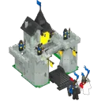{ .lu-ti width="24" loading="lazy" } [Vintage Fortress Model  (LOT 13713)](../13713.md) | 1 | A model for your property! | 0 matrices; 0 rewards; 0 community references |
| 13712 | 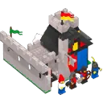{ .lu-ti width="24" loading="lazy" } [Vintage Guard House Model  (LOT 13712)](../13712.md) | 1 | A model for your property! | 0 matrices; 0 rewards; 0 community references |
| 13711 | { .lu-ti width="24" loading="lazy" } [Vintage Sentry Hut Model  (LOT 13711)](../13711.md) | 1 | A model for your property! | 0 matrices; 0 rewards; 0 community references |
| 6522 | { .lu-ti width="24" loading="lazy" } [Volley Gun Model (LOT 6522)](../6522.md) | 2 | A model for your Property! | 19 matrices; 0 rewards; 0 community references |
| 9568 | { .lu-ti width="24" loading="lazy" } [Wagon Model (LOT 9568)](../9568.md) | 1 | A model for your Property! | 23 matrices; 0 rewards; 0 community references |
| 10882 | 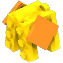{ .lu-ti width="24" loading="lazy" } [Warning Sign Model (LOT 10882)](../10882.md) | 1 | A model for your property! | 3 matrices; 0 rewards; 0 community references |
| 6039 | { .lu-ti width="24" loading="lazy" } [Water Cooler Model (LOT 6039)](../6039.md) | 1 | A model for your Property! | 45 matrices; 0 rewards; 0 community references |
| 10883 | 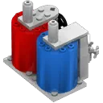{ .lu-ti width="24" loading="lazy" } [Water Heater Model (LOT 10883)](../10883.md) | 2 | A model for your property! | 3 matrices; 0 rewards; 0 community references |
| 10808 | { .lu-ti width="24" loading="lazy" } [Water Pump Model (LOT 10808)](../10808.md) | 1 | A model for your property! | 3 matrices; 0 rewards; 0 community references |
| 10884 | 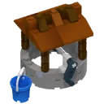{ .lu-ti width="24" loading="lazy" } [Water Well Model (LOT 10884)](../10884.md) | 2 | A model for your property! | 4 matrices; 0 rewards; 0 community references |
| 6056 | { .lu-ti width="24" loading="lazy" } [Weapon Rack Model (LOT 6056)](../6056.md) | 2 | A model for your Property! | 47 matrices; 0 rewards; 0 community references |
| 7767 | 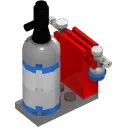{ .lu-ti width="24" loading="lazy" } [Welder Model (LOT 7767)](../7767.md) | 1 | A model for your Property! | 1 matrices; 0 rewards; 0 community references |
| 9452 | 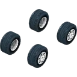{ .lu-ti width="24" loading="lazy" } [White Rim Wheels (LOT 9452)](../9452.md) | 1 | No client description | 1 matrices; 1 rewards; 0 community references |
| 12349 | 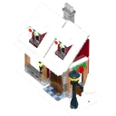{ .lu-ti width="24" loading="lazy" } [Winter Bakery Model 1 (LOT 12349)](../12349.md) | 4 | A model for your property! | 1 matrices; 0 rewards; 0 community references |
| 12350 | { .lu-ti width="24" loading="lazy" } [Winter Bakery Model 2 (LOT 12350)](../12350.md) | 3 | A model for your property! | 3 matrices; 0 rewards; 0 community references |
| 12351 | { .lu-ti width="24" loading="lazy" } [Winter Bakery Model 3 (LOT 12351)](../12351.md) | 3 | A model for your property! | 3 matrices; 0 rewards; 0 community references |
| 11873 | 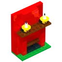{ .lu-ti width="24" loading="lazy" } [Winter Fireplace Model (LOT 11873)](../11873.md) | 1 | A model for your property! | 5 matrices; 0 rewards; 0 community references |
| 11874 | { .lu-ti width="24" loading="lazy" } [Winter Gingerbread House Door Model 1 (LOT 11874)](../11874.md) | 1 | A model for your property! | 5 matrices; 0 rewards; 0 community references |
| 11875 | 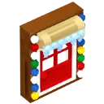{ .lu-ti width="24" loading="lazy" } [Winter Gingerbread House Door Model 2 (LOT 11875)](../11875.md) | 1 | A model for your property! | 5 matrices; 0 rewards; 0 community references |
| 11876 | { .lu-ti width="24" loading="lazy" } [Winter Gingerbread House End Model 1 (LOT 11876)](../11876.md) | 1 | A model for your property! | 5 matrices; 0 rewards; 0 community references |
| 11877 | { .lu-ti width="24" loading="lazy" } [Winter Gingerbread House End Model 2 (LOT 11877)](../11877.md) | 1 | A model for your property! | 5 matrices; 0 rewards; 0 community references |
| 11878 | { .lu-ti width="24" loading="lazy" } [Winter Gingerbread House Side Model 1 (LOT 11878)](../11878.md) | 1 | A model for your property! | 5 matrices; 0 rewards; 0 community references |
| 11879 | 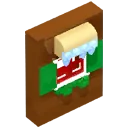{ .lu-ti width="24" loading="lazy" } [Winter Gingerbread House Window Model 1 (LOT 11879)](../11879.md) | 1 | A model for your Property! | 5 matrices; 0 rewards; 0 community references |
| 11880 | { .lu-ti width="24" loading="lazy" } [Winter Northpole Model (LOT 11880)](../11880.md) | 1 | A model for your property! | 5 matrices; 0 rewards; 0 community references |
| 11881 | { .lu-ti width="24" loading="lazy" } [Winter Penguin Model (LOT 11881)](../11881.md) | 1 | A model for your property! | 5 matrices; 0 rewards; 0 community references |
| 11882 | 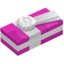{ .lu-ti width="24" loading="lazy" } [Winter Present Model 1 (LOT 11882)](../11882.md) | 1 | A model for your property! | 5 matrices; 0 rewards; 0 community references |
| 11883 | { .lu-ti width="24" loading="lazy" } [Winter Present Model 2 (LOT 11883)](../11883.md) | 1 | A model for your property! | 5 matrices; 0 rewards; 0 community references |
| 11884 | { .lu-ti width="24" loading="lazy" } [Winter Present Model 3 (LOT 11884)](../11884.md) | 1 | A model for your property! | 5 matrices; 0 rewards; 0 community references |
| 11885 | { .lu-ti width="24" loading="lazy" } [Winter Reindeer Model (LOT 11885)](../11885.md) | 1 | A model for your property! | 5 matrices; 0 rewards; 0 community references |
| 11886 | { .lu-ti width="24" loading="lazy" } [Winter Sleigh Model (LOT 11886)](../11886.md) | 1 | A model for your property! | 5 matrices; 0 rewards; 0 community references |
| 11887 | { .lu-ti width="24" loading="lazy" } [Winter Snowman Model (LOT 11887)](../11887.md) | 1 | A model for your property! | 4 matrices; 1 rewards; 0 community references |
| 11888 | { .lu-ti width="24" loading="lazy" } [Winter Snowmobile Model (LOT 11888)](../11888.md) | 1 | A model for your property! | 5 matrices; 0 rewards; 0 community references |
| 12352 | 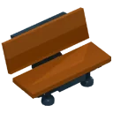{ .lu-ti width="24" loading="lazy" } [Winter Toy Shop Bench Model (LOT 12352)](../12352.md) | 2 | A model for your property! | 1 matrices; 0 rewards; 0 community references |
| 12353 | 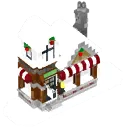{ .lu-ti width="24" loading="lazy" } [Winter Toy Shop Building Model (LOT 12353)](../12353.md) | 4 | A model for your property! | 1 matrices; 0 rewards; 0 community references |
| 12354 | { .lu-ti width="24" loading="lazy" } [Winter Toy Shop Jack-in-the-Box Model (LOT 12354)](../12354.md) | 2 | A model for your property! | 3 matrices; 0 rewards; 0 community references |
| 12355 | 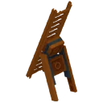{ .lu-ti width="24" loading="lazy" } [Winter Toy Shop Ladder Model (LOT 12355)](../12355.md) | 2 | A model for your property! | 3 matrices; 0 rewards; 0 community references |
| 12356 | { .lu-ti width="24" loading="lazy" } [Winter Toy Shop Lamp Post Model (LOT 12356)](../12356.md) | 3 | A model for your property! | 1 matrices; 0 rewards; 0 community references |
| 12357 | 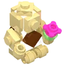{ .lu-ti width="24" loading="lazy" } [Winter Toy Shop Teddybear Model (LOT 12357)](../12357.md) | 2 | A model for your property! | 3 matrices; 0 rewards; 0 community references |
| 11889 | 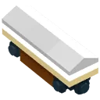{ .lu-ti width="24" loading="lazy" } [Winter Train Car Model (LOT 11889)](../11889.md) | 1 | A model for your property! | 5 matrices; 0 rewards; 0 community references |
| 11890 | { .lu-ti width="24" loading="lazy" } [Winter Train Engine Model (LOT 11890)](../11890.md) | 1 | A model for your property! | 5 matrices; 0 rewards; 0 community references |
| 11891 | { .lu-ti width="24" loading="lazy" } [Winter Train Tender Model (LOT 11891)](../11891.md) | 1 | A model for your property! | 5 matrices; 0 rewards; 0 community references |
| 11892 | 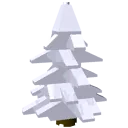{ .lu-ti width="24" loading="lazy" } [Winter Tree Model 1 (LOT 11892)](../11892.md) | 1 | A model for your property! | 5 matrices; 0 rewards; 0 community references |
| 11893 | 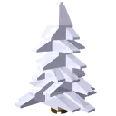{ .lu-ti width="24" loading="lazy" } [Winter Tree Model 2 (LOT 11893)](../11893.md) | 1 | A model for your property! | 5 matrices; 0 rewards; 0 community references |
| 6072 | { .lu-ti width="24" loading="lazy" } [Wood Pile Model (LOT 6072)](../6072.md) | 1 | A model for your Property! | 45 matrices; 0 rewards; 0 community references |
| 6035 | { .lu-ti width="24" loading="lazy" } [Wooden Barrel Model (LOT 6035)](../6035.md) | 1 | A model for your Property! | 47 matrices; 0 rewards; 0 community references |
| 10838 | { .lu-ti width="24" loading="lazy" } [Wooden Chair Model (LOT 10838)](../10838.md) | 1 | A model for your property! | 3 matrices; 0 rewards; 0 community references |
| 10839 | 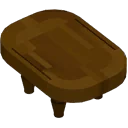{ .lu-ti width="24" loading="lazy" } [Wooden Dining Table Model (LOT 10839)](../10839.md) | 2 | A model for your property! | 3 matrices; 0 rewards; 0 community references |
| 10783 | 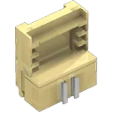{ .lu-ti width="24" loading="lazy" } [Workbench Model (LOT 10783)](../10783.md) | 2 | A model for your property! | 21 matrices; 0 rewards; 0 community references |
| 10887 | 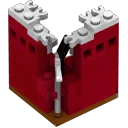{ .lu-ti width="24" loading="lazy" } [Workbench Model (LOT 10887)](../10887.md) | 2 | A model for your property! | 3 matrices; 0 rewards; 0 community references |
| 7766 | { .lu-ti width="24" loading="lazy" } [Workbench with Toolbox Model (LOT 7766)](../7766.md) | 1 | A model for your Property! | 1 matrices; 0 rewards; 0 community references |
| 8069 | { .lu-ti width="24" loading="lazy" } [Yellow Barricade Model (LOT 8069)](../8069.md) | 1 | A model for your Property! | 26 matrices; 4 rewards; 0 community references |
| 9547 | 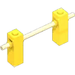{ .lu-ti width="24" loading="lazy" } [Yellow Ninja Fence Model (LOT 9547)](../9547.md) | 1 | A model for your Property! | 23 matrices; 1 rewards; 0 community references |
| 10830 | 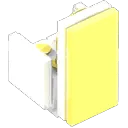{ .lu-ti width="24" loading="lazy" } [Yellow Polka Dot Chair Model (LOT 10830)](../10830.md) | 1 | A model for your property! | 3 matrices; 0 rewards; 0 community references |
| 9451 | 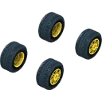{ .lu-ti width="24" loading="lazy" } [Yellow Rim Wheels (LOT 9451)](../9451.md) | 1 | No client description | 2 matrices; 0 rewards; 0 community references |
| 9909 | { .lu-ti width="24" loading="lazy" } [Yellow Tree Model 3 (LOT 9909)](../9909.md) | 2 | A model for your Property! | 1 matrices; 0 rewards; 0 community references |
| 9552 | 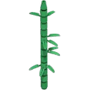{ .lu-ti width="24" loading="lazy" } [Zen Bamboo Large Model (LOT 9552)](../9552.md) | 1 | A model for your Property! | 22 matrices; 0 rewards; 0 community references |
| 9553 | { .lu-ti width="24" loading="lazy" } [Zen Bamboo Medium Model (LOT 9553)](../9553.md) | 1 | A model for your Property! | 23 matrices; 0 rewards; 0 community references |
| 9554 | { .lu-ti width="24" loading="lazy" } [Zen Bamboo Small Model (LOT 9554)](../9554.md) | 1 | A model for your Property! | 23 matrices; 0 rewards; 0 community references |
| 13652 | { .lu-ti width="24" loading="lazy" } [Zoo Angled Bridge Pathway Model 1 (LOT 13652)](../13652.md) | 1 | A model for your property! | 1 matrices; 0 rewards; 0 community references |
| 13651 | 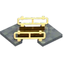{ .lu-ti width="24" loading="lazy" } [Zoo Angled Bridge Pathway Model 2 (LOT 13651)](../13651.md) | 2 | A model for your property! | 1 matrices; 0 rewards; 0 community references |
| 13710 | 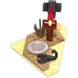{ .lu-ti width="24" loading="lazy" } [Zoo Aviary Floor Corner Model 1 (LOT 13710)](../13710.md) | 1 | A model for your property! | 1 matrices; 0 rewards; 0 community references |
| 13709 | { .lu-ti width="24" loading="lazy" } [Zoo Aviary Floor Corner Model 2 (LOT 13709)](../13709.md) | 1 | A model for your property! | 1 matrices; 0 rewards; 0 community references |
| 13708 | { .lu-ti width="24" loading="lazy" } [Zoo Aviary Floor Corner Model 3 (LOT 13708)](../13708.md) | 1 | A model for your property! | 1 matrices; 0 rewards; 0 community references |
| 13707 | { .lu-ti width="24" loading="lazy" } [Zoo Aviary Floor Corner Model 4 (LOT 13707)](../13707.md) | 1 | A model for your property! | 1 matrices; 0 rewards; 0 community references |
| 13702 | 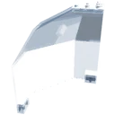{ .lu-ti width="24" loading="lazy" } [Zoo Aviary Wall Corner Model  (LOT 13702)](../13702.md) | 1 | A model for your property! | 1 matrices; 0 rewards; 0 community references |
| 13701 | 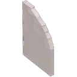{ .lu-ti width="24" loading="lazy" } [Zoo Aviary Wall End Cap Model  (LOT 13701)](../13701.md) | 1 | A model for your property! | 1 matrices; 0 rewards; 0 community references |
| 13682 | 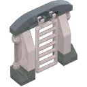{ .lu-ti width="24" loading="lazy" } [Zoo Barred Fence with Closed Gate Model (LOT 13682)](../13682.md) | 2 | A model for your property! | 1 matrices; 0 rewards; 0 community references |
| 13681 | 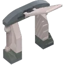{ .lu-ti width="24" loading="lazy" } [Zoo Barred Fence with Open Gate Model (LOT 13681)](../13681.md) | 1 | A model for your property! | 1 matrices; 0 rewards; 0 community references |
| 13684 | 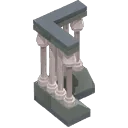{ .lu-ti width="24" loading="lazy" } [Zoo Barred Inside Fence Corner Model (LOT 13684)](../13684.md) | 1 | A model for your property! | 1 matrices; 0 rewards; 0 community references |
| 13683 | 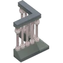{ .lu-ti width="24" loading="lazy" } [Zoo Barred Outside Fence Corner Model (LOT 13683)](../13683.md) | 1 | A model for your property! | 1 matrices; 0 rewards; 0 community references |
| 13680 | 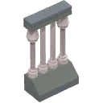{ .lu-ti width="24" loading="lazy" } [Zoo Barred Straight Fence Model (LOT 13680)](../13680.md) | 1 | A model for your property! | 1 matrices; 0 rewards; 0 community references |
| 13699 | 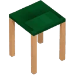{ .lu-ti width="24" loading="lazy" } [Zoo Building Roof Model  (LOT 13699)](../13699.md) | 1 | A model for your property! | 1 matrices; 0 rewards; 0 community references |
| 13698 | 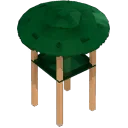{ .lu-ti width="24" loading="lazy" } [Zoo Building Roof with Tower Model (LOT 13698)](../13698.md) | 2 | A model for your property! | 1 matrices; 0 rewards; 0 community references |
| 13697 | 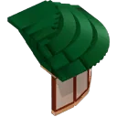{ .lu-ti width="24" loading="lazy" } [Zoo Building Wall Corner Model  (LOT 13697)](../13697.md) | 2 | A model for your property! | 1 matrices; 0 rewards; 0 community references |
| 13696 | 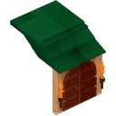{ .lu-ti width="24" loading="lazy" } [Zoo Building Wall with Closed Doors Model (LOT 13696)](../13696.md) | 3 | A model for your property! | 1 matrices; 0 rewards; 0 community references |
| 13695 | 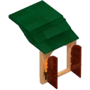{ .lu-ti width="24" loading="lazy" } [Zoo Building Wall with Open Doors Model (LOT 13695)](../13695.md) | 3 | A model for your property! | 1 matrices; 0 rewards; 0 community references |
| 13691 | 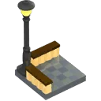{ .lu-ti width="24" loading="lazy" } [Zoo Courtyard Edge Corner Model  (LOT 13691)](../13691.md) | 1 | A model for your property! | 1 matrices; 0 rewards; 0 community references |
| 13692 | 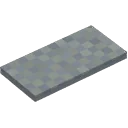{ .lu-ti width="24" loading="lazy" } [Zoo Courtyard Model Long (LOT 13692)](../13692.md) | 2 | A model for your property! | 1 matrices; 0 rewards; 0 community references |
| 13693 | 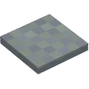{ .lu-ti width="24" loading="lazy" } [Zoo Courtyard Model Short (LOT 13693)](../13693.md) | 1 | A model for your property! | 1 matrices; 0 rewards; 0 community references |
| 13688 | 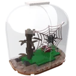{ .lu-ti width="24" loading="lazy" } [Zoo Critter House End Model 1 (LOT 13688)](../13688.md) | 1 | A model for your property! | 1 matrices; 0 rewards; 0 community references |
| 13687 | 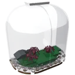{ .lu-ti width="24" loading="lazy" } [Zoo Critter House End Model 2 (LOT 13687)](../13687.md) | 1 | A model for your property! | 1 matrices; 0 rewards; 0 community references |
| 13686 | 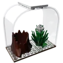{ .lu-ti width="24" loading="lazy" } [Zoo Critter House Middle Model 1 (LOT 13686)](../13686.md) | 1 | A model for your property! | 1 matrices; 0 rewards; 0 community references |
| 13685 | 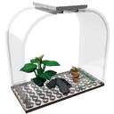{ .lu-ti width="24" loading="lazy" } [Zoo Critter House Middle Model 2 (LOT 13685)](../13685.md) | 1 | A model for your property! | 1 matrices; 0 rewards; 0 community references |
| 13677 | 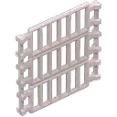{ .lu-ti width="24" loading="lazy" } [Zoo Electrified Gate Model (LOT 13677)](../13677.md) | 1 | A model for your property! | 1 matrices; 0 rewards; 0 community references |
| 13676 | { .lu-ti width="24" loading="lazy" } [Zoo Electrified Gatehouse Model (LOT 13676)](../13676.md) | 3 | A model for your property! | 1 matrices; 0 rewards; 0 community references |
| 13679 | 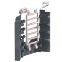{ .lu-ti width="24" loading="lazy" } [Zoo Electrified Inside Fence Corner Model (LOT 13679)](../13679.md) | 1 | A model for your property! | 1 matrices; 0 rewards; 0 community references |
| 13678 | 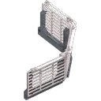{ .lu-ti width="24" loading="lazy" } [Zoo Electrified Outside Fence Corner Model (LOT 13678)](../13678.md) | 3 | A model for your property! | 1 matrices; 0 rewards; 0 community references |
| 13675 | { .lu-ti width="24" loading="lazy" } [Zoo Electrified Straight Fence Model (LOT 13675)](../13675.md) | 1 | A model for your property! | 1 matrices; 0 rewards; 0 community references |
| 13656 | { .lu-ti width="24" loading="lazy" } [Zoo Gift Stand Model (LOT 13656)](../13656.md) | 2 | A model for your property! | 1 matrices; 0 rewards; 0 community references |
| 13655 | { .lu-ti width="24" loading="lazy" } [Zoo Hot Dog Cart Model (LOT 13655)](../13655.md) | 1 | A model for your property! | 1 matrices; 0 rewards; 0 community references |
| 13653 | { .lu-ti width="24" loading="lazy" } [Zoo Long Pathway Model (LOT 13653)](../13653.md) | 1 | A model for your property! | 1 matrices; 0 rewards; 0 community references |
| 13650 | { .lu-ti width="24" loading="lazy" } [Zoo Pathway Corner Model 1 (LOT 13650)](../13650.md) | 1 | A model for your property! | 1 matrices; 0 rewards; 0 community references |
| 13649 | { .lu-ti width="24" loading="lazy" } [Zoo Pathway Corner Model 2 (LOT 13649)](../13649.md) | 1 | A model for your property! | 1 matrices; 0 rewards; 0 community references |
| 13674 | { .lu-ti width="24" loading="lazy" } [Zoo Petting Zoo Fence Corner Model (LOT 13674)](../13674.md) | 1 | A model for your property! | 1 matrices; 0 rewards; 0 community references |
| 13673 | { .lu-ti width="24" loading="lazy" } [Zoo Petting Zoo Fence with Closed Gate Model (LOT 13673)](../13673.md) | 1 | A model for your property! | 1 matrices; 0 rewards; 0 community references |
| 13672 | { .lu-ti width="24" loading="lazy" } [Zoo Petting Zoo Fence with Open Gate Model (LOT 13672)](../13672.md) | 1 | A model for your property! | 1 matrices; 0 rewards; 0 community references |
| 13648 | { .lu-ti width="24" loading="lazy" } [Zoo Raised Pathway Model (LOT 13648)](../13648.md) | 1 | A model for your property! | 1 matrices; 0 rewards; 0 community references |
| 13647 | { .lu-ti width="24" loading="lazy" } [Zoo Raised Pathway with Railing Model (LOT 13647)](../13647.md) | 2 | A model for your property! | 1 matrices; 0 rewards; 0 community references |
| 13646 | { .lu-ti width="24" loading="lazy" } [Zoo Ramped Path Model (LOT 13646)](../13646.md) | 1 | A model for your property! | 1 matrices; 0 rewards; 0 community references |
| 13669 | { .lu-ti width="24" loading="lazy" } [Zoo Rock Fence Corner Model (LOT 13669)](../13669.md) | 2 | A model for your property! | 1 matrices; 0 rewards; 0 community references |
| 13668 | { .lu-ti width="24" loading="lazy" } [Zoo Rock Fence Pillar with Torches Model (LOT 13668)](../13668.md) | 2 | A model for your property! | 1 matrices; 0 rewards; 0 community references |
| 13654 | { .lu-ti width="24" loading="lazy" } [Zoo Short Pathway Model (LOT 13654)](../13654.md) | 1 | A model for your property! | 1 matrices; 0 rewards; 0 community references |
| 13645 | { .lu-ti width="24" loading="lazy" } [Zoo Sign Model 1 (LOT 13645)](../13645.md) | 2 | A model for your property! | 1 matrices; 0 rewards; 0 community references |
| 13644 | { .lu-ti width="24" loading="lazy" } [Zoo Sign Model 2 (LOT 13644)](../13644.md) | 1 | A model for your property! | 1 matrices; 0 rewards; 0 community references |
| 13663 | { .lu-ti width="24" loading="lazy" } [Zoo Sloped Fence with Closed Gate Model (LOT 13663)](../13663.md) | 1 | A model for your property! | 1 matrices; 0 rewards; 0 community references |
| 13662 | { .lu-ti width="24" loading="lazy" } [Zoo Sloped Fence with Open Gate Model (LOT 13662)](../13662.md) | 1 | A model for your property! | 1 matrices; 0 rewards; 0 community references |
| 13665 | { .lu-ti width="24" loading="lazy" } [Zoo Sloped Inside Fence Corner Model (LOT 13665)](../13665.md) | 1 | A model for your property! | 1 matrices; 0 rewards; 0 community references |
| 13664 | { .lu-ti width="24" loading="lazy" } [Zoo Sloped Outside Corner Fence Model (LOT 13664)](../13664.md) | 1 | A model for your property! | 1 matrices; 0 rewards; 0 community references |
| 13706 | { .lu-ti width="24" loading="lazy" } [Zoo Straight Aviary Floor Model 1 (LOT 13706)](../13706.md) | 1 | A model for your property! | 1 matrices; 0 rewards; 0 community references |
| 13705 | { .lu-ti width="24" loading="lazy" } [Zoo Straight Aviary Floor Model 2 (LOT 13705)](../13705.md) | 1 | A model for your property! | 1 matrices; 0 rewards; 0 community references |
| 13704 | { .lu-ti width="24" loading="lazy" } [Zoo Straight Aviary Floor Model 3 (LOT 13704)](../13704.md) | 2 | A model for your property! | 1 matrices; 0 rewards; 0 community references |
| 13703 | { .lu-ti width="24" loading="lazy" } [Zoo Straight Aviary Floor Model 4 (LOT 13703)](../13703.md) | 1 | A model for your property! | 1 matrices; 0 rewards; 0 community references |
| 13700 | { .lu-ti width="24" loading="lazy" } [Zoo Straight Aviary Wall Model (LOT 13700)](../13700.md) | 1 | A model for your property! | 1 matrices; 0 rewards; 0 community references |
| 13694 | { .lu-ti width="24" loading="lazy" } [Zoo Straight Building Wall Model (LOT 13694)](../13694.md) | 1 | A model for your property! | 1 matrices; 0 rewards; 0 community references |
| 13689 | { .lu-ti width="24" loading="lazy" } [Zoo Straight Courtyard Edge Model Long (LOT 13689)](../13689.md) | 2 | A model for your property! | 1 matrices; 0 rewards; 0 community references |
| 13690 | { .lu-ti width="24" loading="lazy" } [Zoo Straight Courtyard Edge Model Short (LOT 13690)](../13690.md) | 1 | A model for your property! | 1 matrices; 0 rewards; 0 community references |
| 13671 | { .lu-ti width="24" loading="lazy" } [Zoo Straight Petting Zoo Fence Model 1 (LOT 13671)](../13671.md) | 1 | A model for your property! | 1 matrices; 0 rewards; 0 community references |
| 13670 | { .lu-ti width="24" loading="lazy" } [Zoo Straight Petting Zoo Fence Model 2 (LOT 13670)](../13670.md) | 1 | A model for your property! | 1 matrices; 0 rewards; 0 community references |
| 13667 | { .lu-ti width="24" loading="lazy" } [Zoo Straight Rock Fence Model 1 (LOT 13667)](../13667.md) | 1 | A model for your property! | 1 matrices; 0 rewards; 0 community references |
| 13666 | { .lu-ti width="24" loading="lazy" } [Zoo Straight Rock Fence Model 2 (LOT 13666)](../13666.md) | 1 | A model for your property! | 1 matrices; 0 rewards; 0 community references |
| 13661 | { .lu-ti width="24" loading="lazy" } [Zoo Straight Sloped Fence Model (LOT 13661)](../13661.md) | 1 | A model for your property! | 1 matrices; 0 rewards; 0 community references |
| 13657 | { .lu-ti width="24" loading="lazy" } [Zoo Straight Wooden Fence Model (LOT 13657)](../13657.md) | 1 | A model for your property! | 1 matrices; 0 rewards; 0 community references |
| 13641 | { .lu-ti width="24" loading="lazy" } [Zoo Wall Corner Pillar Model (LOT 13641)](../13641.md) | 1 | A model for your property! | 1 matrices; 0 rewards; 0 community references |
| 13643 | { .lu-ti width="24" loading="lazy" } [Zoo Wall Gate Model  (LOT 13643)](../13643.md) | 2 | A model for your property! | 1 matrices; 0 rewards; 0 community references |
| 13642 | { .lu-ti width="24" loading="lazy" } [Zoo Wall Panel Model  (LOT 13642)](../13642.md) | 1 | A model for your property! | 1 matrices; 0 rewards; 0 community references |
| 13640 | { .lu-ti width="24" loading="lazy" } [Zoo Wall Pillar Gate Support Model  (LOT 13640)](../13640.md) | 2 | A model for your property! | 1 matrices; 0 rewards; 0 community references |
| 13639 | { .lu-ti width="24" loading="lazy" } [Zoo Wall Straight Pillar Model (LOT 13639)](../13639.md) | 1 | A model for your property! | 1 matrices; 0 rewards; 0 community references |
| 13660 | { .lu-ti width="24" loading="lazy" } [Zoo Wooden Fence Corner Model (LOT 13660)](../13660.md) | 1 | A model for your property! | 1 matrices; 0 rewards; 0 community references |
| 13659 | { .lu-ti width="24" loading="lazy" } [Zoo Wooden Fence Corner with Gate Model (LOT 13659)](../13659.md) | 3 | A model for your property! | 1 matrices; 0 rewards; 0 community references |
| 13658 | { .lu-ti width="24" loading="lazy" } [Zoo Wooden Fence Gate Model (LOT 13658)](../13658.md) | 1 | A model for your property! | 1 matrices; 0 rewards; 0 community references |
