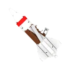
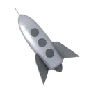
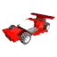

# Vehicle — page 1/1

[Item database](../README.md)

Pages: [1](type-22-1.md)

| LOT | Item | Rarity | Description | Source evidence |
| --- | --- | --- | --- | --- |
| 8053 | { .lu-ti width="24" loading="lazy" } [Unnamed LOT 8053 (LOT 8053)](../8053.md) |  | No client description | 0 matrices; 0 rewards; 0 community references |
| 8092 | { .lu-ti width="24" loading="lazy" } [Custom Racing Car (LOT 8092)](../8092.md) |  | Your custom racing car | 0 matrices; 0 rewards; 0 community references |
| 6416 | { .lu-ti width="24" loading="lazy" } [Custom Rocket (LOT 6416)](../6416.md) |  | Your Own Custom Rocket | 0 matrices; 0 rewards; 0 community references |
| 8522 | { .lu-ti width="24" loading="lazy" } [NPC Coalessa Hair (LOT 8522)](../8522.md) | 1 | NPC Coalessa Hair | 0 matrices; 0 rewards; 0 community references |
| 8065 | { .lu-ti width="24" loading="lazy" } [NPC Epsilon Starcracker Helmet (LOT 8065)](../8065.md) |  | NPC Epsilon Starcracker Helmet | 0 matrices; 0 rewards; 0 community references |
| 8079 | { .lu-ti width="24" loading="lazy" } [NPC Epsilon Starcracker Rocketpack (LOT 8079)](../8079.md) |  | No client description | 0 matrices; 0 rewards; 0 community references |
| 8517 | { .lu-ti width="24" loading="lazy" } [NPC Johnny Thunder Hat (LOT 8517)](../8517.md) | 1 | NPC Johnny Thunder Hat | 0 matrices; 0 rewards; 0 community references |
| 8514 | { .lu-ti width="24" loading="lazy" } [NPC Mardolf Hat (LOT 8514)](../8514.md) | 1 | NPC Mardolf Hat | 0 matrices; 0 rewards; 0 community references |
| 8109 | { .lu-ti width="24" loading="lazy" } [NPC Melodie Foxtrot Hair (LOT 8109)](../8109.md) |  | NPCSky Lane Hair | 0 matrices; 0 rewards; 0 community references |
| 8520 | { .lu-ti width="24" loading="lazy" } [NPC Numbchuck Helmet (LOT 8520)](../8520.md) | 1 | NPC Numbchuck Helmet | 0 matrices; 0 rewards; 0 community references |
| 8056 | { .lu-ti width="24" loading="lazy" } [NPC Sky Lane Hair (LOT 8056)](../8056.md) |  | NPCSky Lane Hair | 0 matrices; 0 rewards; 0 community references |
| 8061 | { .lu-ti width="24" loading="lazy" } [NPC Sky Lane Helmet (LOT 8061)](../8061.md) |  | NPCSky Lane Helmet | 0 matrices; 0 rewards; 0 community references |
| 8057 | { .lu-ti width="24" loading="lazy" } [NPC Sky Lane ShoulderPads (LOT 8057)](../8057.md) |  | NPC Sky Lane ShoulderPads | 0 matrices; 0 rewards; 0 community references |
| 4684 | { .lu-ti width="24" loading="lazy" } [re&#95;nim&#95;ag&#95;rocket-classic-classic-classic (LOT 4684)](../4684.md) |  | Choice Build result | 0 matrices; 0 rewards; 0 community references |
| 4686 | { .lu-ti width="24" loading="lazy" } [re&#95;nim&#95;ag&#95;rocket-classic-classic-pod (LOT 4686)](../4686.md) |  | Choice Build result | 0 matrices; 0 rewards; 0 community references |
| 4685 | { .lu-ti width="24" loading="lazy" } [re&#95;nim&#95;ag&#95;rocket-classic-classic-steam (LOT 4685)](../4685.md) |  | Choice Build result | 0 matrices; 0 rewards; 0 community references |
| 4690 | { .lu-ti width="24" loading="lazy" } [re&#95;nim&#95;ag&#95;rocket-classic-pod-classic (LOT 4690)](../4690.md) |  | Choice Build result | 0 matrices; 0 rewards; 0 community references |
| 4692 | { .lu-ti width="24" loading="lazy" } [re&#95;nim&#95;ag&#95;rocket-classic-pod-pod (LOT 4692)](../4692.md) |  | Choice Build result | 0 matrices; 0 rewards; 0 community references |
| 4691 | { .lu-ti width="24" loading="lazy" } [re&#95;nim&#95;ag&#95;rocket-classic-pod-steam (LOT 4691)](../4691.md) |  | Choice Build result | 0 matrices; 0 rewards; 0 community references |
| 4687 | { .lu-ti width="24" loading="lazy" } [re&#95;nim&#95;ag&#95;rocket-classic-steam-classic (LOT 4687)](../4687.md) |  | Choice Build result | 0 matrices; 0 rewards; 0 community references |
| 4689 | { .lu-ti width="24" loading="lazy" } [re&#95;nim&#95;ag&#95;rocket-classic-steam-pod (LOT 4689)](../4689.md) |  | Choice Build result | 0 matrices; 0 rewards; 0 community references |
| 4688 | { .lu-ti width="24" loading="lazy" } [re&#95;nim&#95;ag&#95;rocket-classic-steam-steam (LOT 4688)](../4688.md) |  | Choice Build result | 0 matrices; 0 rewards; 0 community references |
| 4702 | { .lu-ti width="24" loading="lazy" } [re&#95;nim&#95;ag&#95;rocket-pod-classic-classic (LOT 4702)](../4702.md) |  | Choice Build result | 0 matrices; 0 rewards; 0 community references |
| 4704 | { .lu-ti width="24" loading="lazy" } [re&#95;nim&#95;ag&#95;rocket-pod-classic-pod (LOT 4704)](../4704.md) |  | Choice Build result | 0 matrices; 0 rewards; 0 community references |
| 4703 | { .lu-ti width="24" loading="lazy" } [re&#95;nim&#95;ag&#95;rocket-pod-classic-steam (LOT 4703)](../4703.md) |  | Choice Build result | 0 matrices; 0 rewards; 0 community references |
| 4708 | { .lu-ti width="24" loading="lazy" } [re&#95;nim&#95;ag&#95;rocket-pod-pod-classic (LOT 4708)](../4708.md) |  | Choice Build result | 0 matrices; 0 rewards; 0 community references |
| 4709 | { .lu-ti width="24" loading="lazy" } [re&#95;nim&#95;ag&#95;rocket-pod-pod-steam (LOT 4709)](../4709.md) |  | Choice Build result | 0 matrices; 0 rewards; 0 community references |
| 4705 | { .lu-ti width="24" loading="lazy" } [re&#95;nim&#95;ag&#95;rocket-pod-steam-classic (LOT 4705)](../4705.md) |  | Choice Build result | 0 matrices; 0 rewards; 0 community references |
| 4707 | { .lu-ti width="24" loading="lazy" } [re&#95;nim&#95;ag&#95;rocket-pod-steam-pod (LOT 4707)](../4707.md) |  | Choice Build result | 0 matrices; 0 rewards; 0 community references |
| 4706 | { .lu-ti width="24" loading="lazy" } [re&#95;nim&#95;ag&#95;rocket-pod-steam-steam (LOT 4706)](../4706.md) |  | Choice Build result | 0 matrices; 0 rewards; 0 community references |
| 4693 | { .lu-ti width="24" loading="lazy" } [re&#95;nim&#95;ag&#95;rocket-steam-classic-classic (LOT 4693)](../4693.md) |  | Choice Build result | 0 matrices; 0 rewards; 0 community references |
| 4695 | { .lu-ti width="24" loading="lazy" } [re&#95;nim&#95;ag&#95;rocket-steam-classic-pod (LOT 4695)](../4695.md) |  | Choice Build result | 0 matrices; 0 rewards; 0 community references |
| 4694 | { .lu-ti width="24" loading="lazy" } [re&#95;nim&#95;ag&#95;rocket-steam-classic-steam (LOT 4694)](../4694.md) |  | Choice Build result | 0 matrices; 0 rewards; 0 community references |
| 4699 | { .lu-ti width="24" loading="lazy" } [re&#95;nim&#95;ag&#95;rocket-steam-pod-classic (LOT 4699)](../4699.md) |  | Choice Build result | 0 matrices; 0 rewards; 0 community references |
| 4701 | { .lu-ti width="24" loading="lazy" } [re&#95;nim&#95;ag&#95;rocket-steam-pod-pod (LOT 4701)](../4701.md) |  | Choice Build result | 0 matrices; 0 rewards; 0 community references |
| 4700 | { .lu-ti width="24" loading="lazy" } [re&#95;nim&#95;ag&#95;rocket-steam-pod-steam (LOT 4700)](../4700.md) |  | Choice Build result | 0 matrices; 0 rewards; 0 community references |
| 4696 | { .lu-ti width="24" loading="lazy" } [re&#95;nim&#95;ag&#95;rocket-steam-steam-classic (LOT 4696)](../4696.md) |  | Choice Build result | 0 matrices; 0 rewards; 0 community references |
| 4698 | { .lu-ti width="24" loading="lazy" } [re&#95;nim&#95;ag&#95;rocket-steam-steam-pod (LOT 4698)](../4698.md) |  | Choice Build result | 0 matrices; 0 rewards; 0 community references |
| 4697 | { .lu-ti width="24" loading="lazy" } [re&#95;nim&#95;ag&#95;rocket-steam-steam-steam (LOT 4697)](../4697.md) |  | Choice Build result | 0 matrices; 0 rewards; 0 community references |
| 4710 | { .lu-ti width="24" loading="lazy" } [Rocket Ship PPP (LOT 4710)](../4710.md) |  | Choice Build result | 0 matrices; 0 rewards; 0 community references |
| 9827 | { .lu-ti width="24" loading="lazy" } [Test Modular Car 6 (LOT 9827)](../9827.md) |  | Test Modular Car | 0 matrices; 0 rewards; 0 community references |
| 8143 | { .lu-ti width="24" loading="lazy" } [Test Samurai KIT Helmet (LOT 8143)](../8143.md) | 5 | Test Samurai KIT Helmet | 0 matrices; 0 rewards; 0 community references |
| 8155 | { .lu-ti width="24" loading="lazy" } [Test Will&#95;L kit Helmet (LOT 8155)](../8155.md) | 5 | Test Will&#95;L kit Helmet | 0 matrices; 0 rewards; 0 community references |
| 6577 | { .lu-ti width="24" loading="lazy" } [UGG - Modular Car (LOT 6577)](../6577.md) |  | Your Own Custom Car | 0 matrices; 0 rewards; 0 community references |
