# Neck — page 1/2

[Item database](../README.md)

Pages: [1](type-4-1.md) | [2](type-4-2.md)

| LOT | Item | Rarity | Description | Source evidence |
| --- | --- | --- | --- | --- |
| 9865 | { .lu-ti width="24" loading="lazy" } [Unnamed LOT 9865 (LOT 9865)](../9865.md) | 4 | No client description | 0 matrices; 0 rewards; 0 community references |
| 9866 | { .lu-ti width="24" loading="lazy" } [Unnamed LOT 9866 (LOT 9866)](../9866.md) | 4 | No client description | 0 matrices; 0 rewards; 0 community references |
| 9867 | { .lu-ti width="24" loading="lazy" } [Unnamed LOT 9867 (LOT 9867)](../9867.md) | 4 | No client description | 0 matrices; 0 rewards; 0 community references |
| 9868 | { .lu-ti width="24" loading="lazy" } [Unnamed LOT 9868 (LOT 9868)](../9868.md) | 4 | No client description | 0 matrices; 0 rewards; 0 community references |
| 12097 | 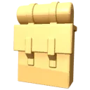{ .lu-ti width="24" loading="lazy" } [Unnamed LOT 12097 (LOT 12097)](../12097.md) | 1 | No client description | 0 matrices; 0 rewards; 0 community references |
| 12099 | 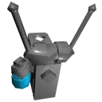{ .lu-ti width="24" loading="lazy" } [Unnamed LOT 12099 (LOT 12099)](../12099.md) | 3 | No client description | 0 matrices; 0 rewards; 0 community references |
| 12100 | 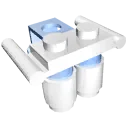{ .lu-ti width="24" loading="lazy" } [Unnamed LOT 12100 (LOT 12100)](../12100.md) | 2 | No client description | 0 matrices; 0 rewards; 0 community references |
| 13740 | 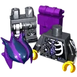{ .lu-ti width="24" loading="lazy" } [Unnamed LOT 13740 (LOT 13740)](../13740.md) | 2 | No client description | 0 matrices; 0 rewards; 0 community references |
| 13742 | 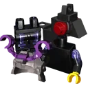{ .lu-ti width="24" loading="lazy" } [Unnamed LOT 13742 (LOT 13742)](../13742.md) | 2 | No client description | 0 matrices; 0 rewards; 0 community references |
| 14135 | 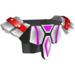{ .lu-ti width="24" loading="lazy" } [Unnamed LOT 14135 (LOT 14135)](../14135.md) | 4 | No client description | 0 matrices; 0 rewards; 0 community references |
| 15962 | 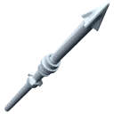{ .lu-ti width="24" loading="lazy" } [Unnamed LOT 15962 (LOT 15962)](../15962.md) | 4 | No client description | 0 matrices; 0 rewards; 0 community references |
| 15963 | [Unnamed LOT 15963 (LOT 15963)](../15963.md) | 5 | No client description | 0 matrices; 0 rewards; 0 community references |
| 15965 | [Unnamed LOT 15965 (LOT 15965)](../15965.md) | 5 | No client description | 0 matrices; 0 rewards; 0 community references |
| 15966 | { .lu-ti width="24" loading="lazy" } [Unnamed LOT 15966 (LOT 15966)](../15966.md) | 4 | No client description | 0 matrices; 0 rewards; 0 community references |
| 15968 | { .lu-ti width="24" loading="lazy" } [Unnamed LOT 15968 (LOT 15968)](../15968.md) | 4 | No client description | 0 matrices; 0 rewards; 0 community references |
| 15969 | [Unnamed LOT 15969 (LOT 15969)](../15969.md) | 5 | No client description | 0 matrices; 0 rewards; 0 community references |
| 15971 | { .lu-ti width="24" loading="lazy" } [Unnamed LOT 15971 (LOT 15971)](../15971.md) | 4 | No client description | 0 matrices; 0 rewards; 0 community references |
| 15972 | [Unnamed LOT 15972 (LOT 15972)](../15972.md) | 5 | No client description | 0 matrices; 0 rewards; 0 community references |
| 15984 | [Unnamed LOT 15984 (LOT 15984)](../15984.md) | 4 | No client description | 0 matrices; 0 rewards; 0 community references |
| 15985 | [Unnamed LOT 15985 (LOT 15985)](../15985.md) | 5 | No client description | 0 matrices; 0 rewards; 0 community references |
| 15987 | { .lu-ti width="24" loading="lazy" } [Unnamed LOT 15987 (LOT 15987)](../15987.md) | 4 | No client description | 0 matrices; 0 rewards; 0 community references |
| 15988 | [Unnamed LOT 15988 (LOT 15988)](../15988.md) | 5 | No client description | 0 matrices; 0 rewards; 0 community references |
| 15996 | { .lu-ti width="24" loading="lazy" } [Unnamed LOT 15996 (LOT 15996)](../15996.md) | 5 | No client description | 0 matrices; 0 rewards; 0 community references |
| 15997 | { .lu-ti width="24" loading="lazy" } [Unnamed LOT 15997 (LOT 15997)](../15997.md) | 5 | No client description | 0 matrices; 0 rewards; 0 community references |
| 15998 | 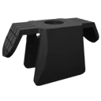{ .lu-ti width="24" loading="lazy" } [Unnamed LOT 15998 (LOT 15998)](../15998.md) | 5 | No client description | 0 matrices; 0 rewards; 0 community references |
| 15999 | { .lu-ti width="24" loading="lazy" } [Unnamed LOT 15999 (LOT 15999)](../15999.md) | 5 | No client description | 0 matrices; 0 rewards; 0 community references |
| 16000 | { .lu-ti width="24" loading="lazy" } [Unnamed LOT 16000 (LOT 16000)](../16000.md) | 5 | No client description | 0 matrices; 0 rewards; 0 community references |
| 16001 | { .lu-ti width="24" loading="lazy" } [Unnamed LOT 16001 (LOT 16001)](../16001.md) | 5 | No client description | 0 matrices; 0 rewards; 0 community references |
| 16002 | 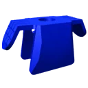{ .lu-ti width="24" loading="lazy" } [Unnamed LOT 16002 (LOT 16002)](../16002.md) | 5 | No client description | 0 matrices; 0 rewards; 0 community references |
| 16003 | { .lu-ti width="24" loading="lazy" } [Unnamed LOT 16003 (LOT 16003)](../16003.md) | 5 | No client description | 0 matrices; 0 rewards; 0 community references |
| 16004 | { .lu-ti width="24" loading="lazy" } [Unnamed LOT 16004 (LOT 16004)](../16004.md) | 5 | No client description | 0 matrices; 0 rewards; 0 community references |
| 16005 | { .lu-ti width="24" loading="lazy" } [Unnamed LOT 16005 (LOT 16005)](../16005.md) | 5 | No client description | 0 matrices; 0 rewards; 0 community references |
| 16007 | { .lu-ti width="24" loading="lazy" } [Unnamed LOT 16007 (LOT 16007)](../16007.md) | 5 | No client description | 0 matrices; 0 rewards; 0 community references |
| 16008 | { .lu-ti width="24" loading="lazy" } [Unnamed LOT 16008 (LOT 16008)](../16008.md) | 5 | No client description | 0 matrices; 0 rewards; 0 community references |
| 16009 | { .lu-ti width="24" loading="lazy" } [Unnamed LOT 16009 (LOT 16009)](../16009.md) | 5 | No client description | 0 matrices; 0 rewards; 0 community references |
| 16010 | 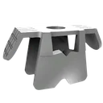{ .lu-ti width="24" loading="lazy" } [Unnamed LOT 16010 (LOT 16010)](../16010.md) | 5 | No client description | 0 matrices; 0 rewards; 0 community references |
| 16011 | { .lu-ti width="24" loading="lazy" } [Unnamed LOT 16011 (LOT 16011)](../16011.md) | 5 | No client description | 0 matrices; 0 rewards; 0 community references |
| 16051 | { .lu-ti width="24" loading="lazy" } [Unnamed LOT 16051 (LOT 16051)](../16051.md) | 5 | No client description | 0 matrices; 0 rewards; 0 community references |
| 16200 | { .lu-ti width="24" loading="lazy" } [Unnamed LOT 16200 (LOT 16200)](../16200.md) | 4 | No client description | 0 matrices; 0 rewards; 0 community references |
| 8465 | 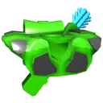{ .lu-ti width="24" loading="lazy" } [Adventurer Backpack 2 (LOT 8465)](../8465.md) | 4 | Rank 2 Specialty Kit Item | 1 matrices; 0 rewards; 0 community references |
| 7558 | 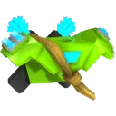{ .lu-ti width="24" loading="lazy" } [Adventurer Backpack 3 (LOT 7558)](../7558.md) | 4 | Rank 3 Specialty Kit Item | 1 matrices; 0 rewards; 0 community references |
| 13891 | 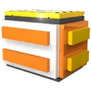{ .lu-ti width="24" loading="lazy" } [Assembly Box Disguise (LOT 13891)](../13891.md) | 2 | No client description | 1 matrices; 0 rewards; 0 community references |
| 14358 | 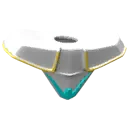{ .lu-ti width="24" loading="lazy" } [Assembly Gear - Summoner - shoulder  proxy (LOT 14358)](../14358.md) | 4 | No client description | 0 matrices; 0 rewards; 0 community references |
| 14808 | 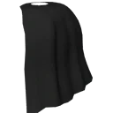{ .lu-ti width="24" loading="lazy" } [Black Cape (LOT 14808)](../14808.md) | 4 | No client description | 1 matrices; 0 rewards; 1 community references |
| 10296 | { .lu-ti width="24" loading="lazy" } [Black Cat Backpack (LOT 10296)](../10296.md) | 4 | No client description | 0 matrices; 0 rewards; 0 community references |
| 5682 | 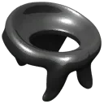{ .lu-ti width="24" loading="lazy" } [Black Neck Scarf (LOT 5682)](../5682.md) | 2 | No client description | 3 matrices; 0 rewards; 1 community references |
| 14818 | { .lu-ti width="24" loading="lazy" } [Black Shoulder Owl (LOT 14818)](../14818.md) | 4 | No client description | 0 matrices; 0 rewards; 0 community references |
| 14806 | { .lu-ti width="24" loading="lazy" } [Blue Cape (LOT 14806)](../14806.md) | 4 | No client description | 1 matrices; 0 rewards; 1 community references |
| 15991 | { .lu-ti width="24" loading="lazy" } [Blue O-Yoroi (LOT 15991)](../15991.md) | 3 | No client description | 0 matrices; 1 rewards; 1 community references |
| 6792 | { .lu-ti width="24" loading="lazy" } [Blue Shoulder Parrot (LOT 6792)](../6792.md) | 3 | No client description | 0 matrices; 1 rewards; 1 community references |
| 14737 | { .lu-ti width="24" loading="lazy" } [Bone Axe Proxy (LOT 14737)](../14737.md) | 4 | Bone Axe Proxy | 0 matrices; 0 rewards; 0 community references |
| 6921 | 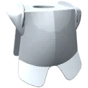{ .lu-ti width="24" loading="lazy" } [Breastplate of Armor 1 (LOT 6921)](../6921.md) | 2 | No client description | 1 matrices; 1 rewards; 1 community references |
| 8637 | { .lu-ti width="24" loading="lazy" } [Breastplate of Armored Inspiration (LOT 8637)](../8637.md) | 4 | No client description | 0 matrices; 1 rewards; 1 community references |
| 14811 | { .lu-ti width="24" loading="lazy" } [Brown Cape (LOT 14811)](../14811.md) | 2 | No client description | 0 matrices; 0 rewards; 0 community references |
| 10313 | { .lu-ti width="24" loading="lazy" } [Brown Owl Backpack (LOT 10313)](../10313.md) | 4 | No client description | 1 matrices; 0 rewards; 0 community references |
| 14816 | { .lu-ti width="24" loading="lazy" } [Brown Shoulder Owl (LOT 14816)](../14816.md) | 2 | No client description | 0 matrices; 0 rewards; 1 community references |
| 8467 | 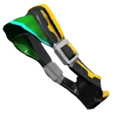{ .lu-ti width="24" loading="lazy" } [Buccaneer Bandolier 2 (LOT 8467)](../8467.md) | 4 | Rank 2 Specialty Kit Item | 1 matrices; 0 rewards; 0 community references |
| 7416 | 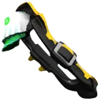{ .lu-ti width="24" loading="lazy" } [Buccaneer Bandolier 3 (LOT 7416)](../7416.md) | 4 | Rank 3 Specialty Kit Item | 1 matrices; 0 rewards; 0 community references |
| 12990 | 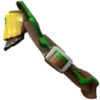{ .lu-ti width="24" loading="lazy" } [Buccaneer Bandolier 3 (LOT 12990)](../12990.md) | 4 | Rank 3 Specialty Kit Item | 1 matrices; 0 rewards; 0 community references |
| 10702 | { .lu-ti width="24" loading="lazy" } [Clug Lego Back/Neck Proxy (LOT 10702)](../10702.md) | 5 | Backneck object created dynamically for Club Lego Shirt: 9875 | 0 matrices; 0 rewards; 0 community references |
| 13839 | [Crate Disguise Back/Neck Proxy (LOT 13839)](../13839.md) | 1 | No client description | 0 matrices; 0 rewards; 0 community references |
| 15990 | 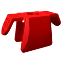{ .lu-ti width="24" loading="lazy" } [Crimson Guard (LOT 15990)](../15990.md) | 2 | No client description | 1 matrices; 1 rewards; 1 community references |
| 12095 | 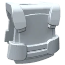{ .lu-ti width="24" loading="lazy" } [Crux Prime Armor (LOT 12095)](../12095.md) | 4 | No client description | 40 matrices; 0 rewards; 1 community references |
| 8466 | 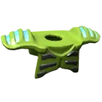{ .lu-ti width="24" loading="lazy" } [Daredevil Shoulderpads 2 (LOT 8466)](../8466.md) | 4 | Rank 2 Specialty Kit Item | 1 matrices; 0 rewards; 0 community references |
| 7543 | 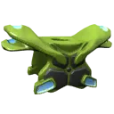{ .lu-ti width="24" loading="lazy" } [Daredevil Shoulderpads 3 (LOT 7543)](../7543.md) | 4 | Rank 3 Specialty Kit Item | 1 matrices; 0 rewards; 0 community references |
| 12995 | 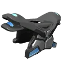{ .lu-ti width="24" loading="lazy" } [Daredevil Shoulderpads 3 (LOT 12995)](../12995.md) | 4 | Rank 3 Specialty Kit Item | 1 matrices; 0 rewards; 0 community references |
| 15992 | { .lu-ti width="24" loading="lazy" } [Dark Defense (LOT 15992)](../15992.md) | 4 | No client description | 1 matrices; 0 rewards; 1 community references |
| 11286 | { .lu-ti width="24" loading="lazy" } [Dino-Pack (LOT 11286)](../11286.md) | 4 | No client description | 1 matrices; 0 rewards; 1 community references |
| 8536 | 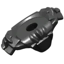{ .lu-ti width="24" loading="lazy" } [Dox Shoulderpads (LOT 8536)](../8536.md) | 2 | No client description | 19 matrices; 0 rewards; 1 community references |
| 13741 | 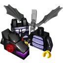{ .lu-ti width="24" loading="lazy" } [Dragon Disguise (LOT 13741)](../13741.md) | 2 | &#91;TEMP&#93;Dress up like a dragon | 0 matrices; 0 rewards; 0 community references |
| 8462 | 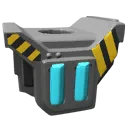{ .lu-ti width="24" loading="lazy" } [Engineer Vest 2 (LOT 8462)](../8462.md) | 4 | Rank 2 Specialty Kit Item | 1 matrices; 0 rewards; 0 community references |
| 7417 | 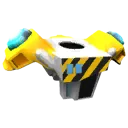{ .lu-ti width="24" loading="lazy" } [Engineer Vest 3 (LOT 7417)](../7417.md) | 4 | Rank 3 Specialty Kit Item | 1 matrices; 0 rewards; 0 community references |
| 12963 | 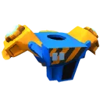{ .lu-ti width="24" loading="lazy" } [Engineer Vest 3 (LOT 12963)](../12963.md) | 4 | Rank 3 Specialty Kit Item | 1 matrices; 0 rewards; 0 community references |
| 8683 | { .lu-ti width="24" loading="lazy" } [Epaulets of Authority (LOT 8683)](../8683.md) | 4 | No client description | 9 matrices; 0 rewards; 1 community references |
| 8684 | 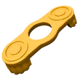{ .lu-ti width="24" loading="lazy" } [Epaulets of Extravagance (LOT 8684)](../8684.md) | 2 | No client description | 1 matrices; 0 rewards; 1 community references |
| 8535 | 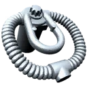{ .lu-ti width="24" loading="lazy" } [Explorer Air Tank (LOT 8535)](../8535.md) | 2 | No client description | 1 matrices; 0 rewards; 1 community references |
| 1727 | 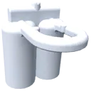{ .lu-ti width="24" loading="lazy" } [GM Only - JetPack (LOT 1727)](../1727.md) | 5 | No client description | 0 matrices; 0 rewards; 0 community references |
| 3735 | { .lu-ti width="24" loading="lazy" } [GM Only - Large Jetpack (LOT 3735)](../3735.md) | 5 | No client description | 0 matrices; 0 rewards; 0 community references |
| 14810 | { .lu-ti width="24" loading="lazy" } [Green Cape (LOT 14810)](../14810.md) | 4 | No client description | 1 matrices; 0 rewards; 1 community references |
| 6854 | { .lu-ti width="24" loading="lazy" } [Green Shoulder Parrot (LOT 6854)](../6854.md) | 3 | No client description | 8 matrices; 0 rewards; 1 community references |
| 11287 | { .lu-ti width="24" loading="lazy" } [Grey T-Rex Backpack (LOT 11287)](../11287.md) | 4 | No client description | 0 matrices; 0 rewards; 0 community references |
| 9943 | { .lu-ti width="24" loading="lazy" } [Grunt Armor (LOT 9943)](../9943.md) | 1 | NPC Grunt Armor Orange | 0 matrices; 0 rewards; 0 community references |
| 9944 | { .lu-ti width="24" loading="lazy" } [Grunt Armor (LOT 9944)](../9944.md) | 1 | NPC Grunt Armor Purple | 0 matrices; 0 rewards; 0 community references |
| 9945 | { .lu-ti width="24" loading="lazy" } [Grunt Armor (LOT 9945)](../9945.md) | 1 | NPC Grunt Armor Green | 0 matrices; 0 rewards; 0 community references |
| 9946 | { .lu-ti width="24" loading="lazy" } [Grunt Armor (LOT 9946)](../9946.md) | 1 | NPC Grunt Armor Blue | 0 matrices; 0 rewards; 0 community references |
| 13544 | 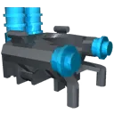{ .lu-ti width="24" loading="lazy" } [Imagination Backpack (LOT 13544)](../13544.md) | 1 | No client description | 0 matrices; 1 rewards; 1 community references |
| 8530 | { .lu-ti width="24" loading="lazy" } [Imagination Tanks (LOT 8530)](../8530.md) | 4 | No client description | 1 matrices; 1 rewards; 1 community references |
| 15975 | { .lu-ti width="24" loading="lazy" } [Imaginite Pack (LOT 15975)](../15975.md) | 4 | No client description | 3 matrices; 0 rewards; 1 community references |
| 8463 | { .lu-ti width="24" loading="lazy" } [Inventor Shoulderpads 2 (LOT 8463)](../8463.md) | 4 | Rank 2 Specialty Kit Item | 1 matrices; 0 rewards; 0 community references |
| 7542 | { .lu-ti width="24" loading="lazy" } [Inventor Shoulderpads 3 (LOT 7542)](../7542.md) | 4 | Rank 3 Specialty Kit Item | 1 matrices; 0 rewards; 0 community references |
| 13838 | [Janitor Costume Back/Neck Proxy (LOT 13838)](../13838.md) | 2 | No client description | 0 matrices; 0 rewards; 0 community references |
| 12284 | { .lu-ti width="24" loading="lazy" } [Jolly Beard Back/Neck Proxy (LOT 12284)](../12284.md) | 3 | Automatically equiped when Jolly Beard is worn | 0 matrices; 0 rewards; 0 community references |
| 15946 | 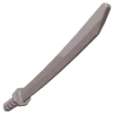{ .lu-ti width="24" loading="lazy" } [Katana Proxy Ninjago (LOT 15946)](../15946.md) | 4 | Katana Proxy Ninjago | 0 matrices; 0 rewards; 0 community references |
| 9883 | { .lu-ti width="24" loading="lazy" } [Kitty Cat Backpack (LOT 9883)](../9883.md) | 4 | No client description | 0 matrices; 0 rewards; 0 community references |
| 8682 | { .lu-ti width="24" loading="lazy" } [Knapsack (LOT 8682)](../8682.md) | 3 | No client description | 0 matrices; 1 rewards; 0 community references |
| 8456 | { .lu-ti width="24" loading="lazy" } [Knight Shoulderpads 2 (LOT 8456)](../8456.md) | 4 | Rank 2 Specialty Kit Item | 1 matrices; 0 rewards; 0 community references |
| 7409 | 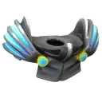{ .lu-ti width="24" loading="lazy" } [Knight Shoulderpads 3 (LOT 7409)](../7409.md) | 4 | Rank 3 Specialty Kit Item | 1 matrices; 0 rewards; 0 community references |
| 12967 | { .lu-ti width="24" loading="lazy" } [Knight Shoulderpads 3 (LOT 12967)](../12967.md) | 4 | Rank 3 Specialty Kit Item | 1 matrices; 0 rewards; 0 community references |
| 11303 | { .lu-ti width="24" loading="lazy" } [Login Red Car Equippable (LOT 11303)](../11303.md) | 4 | No client description | 0 matrices; 0 rewards; 0 community references |
| 11304 | { .lu-ti width="24" loading="lazy" } [Login Yellow Car Equippable (LOT 11304)](../11304.md) | 4 | No client description | 0 matrices; 0 rewards; 0 community references |
| 10991 | { .lu-ti width="24" loading="lazy" } [m62408 (LOT 10991)](../10991.md) | 5 | No client description | 0 matrices; 0 rewards; 0 community references |
| 7784 | 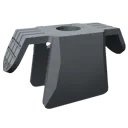{ .lu-ti width="24" loading="lazy" } [Mega Chest Armor (LOT 7784)](../7784.md) | 4 | No client description | 0 matrices; 1 rewards; 1 community references |
| 8539 | 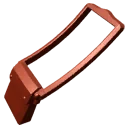{ .lu-ti width="24" loading="lazy" } [Messenger Bag (LOT 8539)](../8539.md) | 3 | No client description | 11 matrices; 0 rewards; 1 community references |
| 12101 | 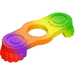{ .lu-ti width="24" loading="lazy" } [Mosaic Shoulderpads (LOT 12101)](../12101.md) | 2 | No client description | 0 matrices; 1 rewards; 1 community references |
| 12098 | { .lu-ti width="24" loading="lazy" } [Nexus Airtanks (LOT 12098)](../12098.md) | 1 | No client description | 40 matrices; 0 rewards; 1 community references |
| 9856 | 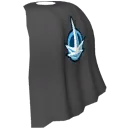{ .lu-ti width="24" loading="lazy" } [Nexus Force Cape (LOT 9856)](../9856.md) | 3 | No client description | 1 matrices; 0 rewards; 1 community references |
| 13471 | [NJ-Mon&#95;Ice&#95;Transition&#95;01 (LOT 13471)](../13471.md) | 1 | No client description | 0 matrices; 0 rewards; 0 community references |
| 13472 | [NJ-Mon&#95;Ice&#95;Transition&#95;02 (LOT 13472)](../13472.md) | 1 | No client description | 0 matrices; 0 rewards; 0 community references |
| 12565 | { .lu-ti width="24" loading="lazy" } [NPC Assembly Scout Armor (LOT 12565)](../12565.md) | 5 | Assembly Scout Armor | 0 matrices; 0 rewards; 0 community references |
| 5676 | { .lu-ti width="24" loading="lazy" } [NPC Backpack (LOT 5676)](../5676.md) | 5 | Venture style backpack | 0 matrices; 0 rewards; 0 community references |
| 7115 | { .lu-ti width="24" loading="lazy" } [NPC Beck Breastplate (LOT 7115)](../7115.md) | 5 | NPC Chest piece | 0 matrices; 0 rewards; 0 community references |
| 16620 | { .lu-ti width="24" loading="lazy" } [NPC Black Samurai Armor (LOT 16620)](../16620.md) | 5 | NPC Red Samurai Armor | 0 matrices; 0 rewards; 0 community references |
| 16622 | { .lu-ti width="24" loading="lazy" } [NPC Blue Samurai Armor (LOT 16622)](../16622.md) | 5 | NPC Red Samurai Armor | 0 matrices; 0 rewards; 0 community references |
| 11283 | { .lu-ti width="24" loading="lazy" } [NPC Brick Fury HoloHUD1 (LOT 11283)](../11283.md) | 5 | NPC Brick Fury HoloHUD1 | 0 matrices; 0 rewards; 0 community references |
| 8523 | { .lu-ti width="24" loading="lazy" } [NPC Coalessa Skirt (LOT 8523)](../8523.md) | 5 | NPC Coalessa Skirt | 0 matrices; 0 rewards; 0 community references |
| 13312 | { .lu-ti width="24" loading="lazy" } [NPC Doc Overbuild Armor (LOT 13312)](../13312.md) | 5 | No client description | 0 matrices; 0 rewards; 0 community references |
| 10156 | { .lu-ti width="24" loading="lazy" } [NPC Duke Exetor Armor (LOT 10156)](../10156.md) | 1 | NPC Grunt Armor Green | 0 matrices; 0 rewards; 0 community references |
| 5694 | { .lu-ti width="24" loading="lazy" } [NPC Dwarf Beard 01 (LOT 5694)](../5694.md) | 5 | No client description | 0 matrices; 0 rewards; 0 community references |
| 11293 | { .lu-ti width="24" loading="lazy" } [NPC Grunt Armor Red (LOT 11293)](../11293.md) | 1 | NPC Grunt Armor Red | 0 matrices; 0 rewards; 0 community references |
| 13304 | { .lu-ti width="24" loading="lazy" } [NPC Hael Storm Armor (LOT 13304)](../13304.md) | 5 | No client description | 0 matrices; 0 rewards; 0 community references |
| 10053 | { .lu-ti width="24" loading="lazy" } [NPC Hael Storm Epaulets (LOT 10053)](../10053.md) | 1 | NPC Hael Storm Epaulets | 0 matrices; 0 rewards; 0 community references |
| 3849 | [NPC Hazmat Backpack (LOT 3849)](../3849.md) | 4 | No client description | 0 matrices; 0 rewards; 0 community references |
| 5674 | 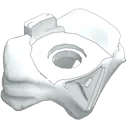{ .lu-ti width="24" loading="lazy" } [NPC Hi Tech Armor (LOT 5674)](../5674.md) | 5 | Hi tech looking breastplate | 0 matrices; 0 rewards; 0 community references |
| 8518 | { .lu-ti width="24" loading="lazy" } [NPC Johnny Thunder Bag (LOT 8518)](../8518.md) | 5 | NPC Johnny Thunder Bag | 0 matrices; 0 rewards; 0 community references |
| 14112 | { .lu-ti width="24" loading="lazy" } [NPC Maelstrom Armor for NJ Skeleton (LOT 14112)](../14112.md) | 5 | Maelstrom Armor for NJ Skeleton | 0 matrices; 0 rewards; 0 community references |
| 12607 | { .lu-ti width="24" loading="lazy" } [NPC Paradox Scout Armor (LOT 12607)](../12607.md) | 5 | Paradox Scout Armor | 0 matrices; 0 rewards; 0 community references |
| 14834 | { .lu-ti width="24" loading="lazy" } [NPC Red Samurai Armor (LOT 14834)](../14834.md) | 5 | NPC Red Samurai Armor | 0 matrices; 0 rewards; 0 community references |
| 7116 | { .lu-ti width="24" loading="lazy" } [NPC Renee Belt Breastplate (LOT 7116)](../7116.md) | 5 | NPC Belt piece | 0 matrices; 0 rewards; 0 community references |
| 8286 | { .lu-ti width="24" loading="lazy" } [NPC Rusty Steele Belt (LOT 8286)](../8286.md) | 5 | NPC Rusty Steele Belt | 0 matrices; 0 rewards; 0 community references |
| 13333 | { .lu-ti width="24" loading="lazy" } [NPC Scuba Tank Vendor (LOT 13333)](../13333.md) | 5 | No client description | 0 matrices; 0 rewards; 0 community references |
| 1725 | { .lu-ti width="24" loading="lazy" } [NPC Sentinel Breastplate of Armor (LOT 1725)](../1725.md) | 5 | No client description | 1 matrices; 0 rewards; 0 community references |
| 12649 | { .lu-ti width="24" loading="lazy" } [NPC Sentinel Scout Armor (LOT 12649)](../12649.md) | 5 | NPC Sentinel Scout Armor | 0 matrices; 0 rewards; 0 community references |
| 16621 | { .lu-ti width="24" loading="lazy" } [NPC Silver Samurai Armor (LOT 16621)](../16621.md) | 5 | NPC Red Samurai Armor | 0 matrices; 0 rewards; 0 community references |
| 12303 | { .lu-ti width="24" loading="lazy" } [NPC Skeleton Armor 1 (LOT 12303)](../12303.md) | 5 | Armor for NJ Skeleton | 0 matrices; 0 rewards; 0 community references |
| 12305 | { .lu-ti width="24" loading="lazy" } [NPC Skeleton Big 1 (LOT 12305)](../12305.md) | 5 | Big Head for NJ Skeleton | 0 matrices; 0 rewards; 0 community references |
| 16055 | { .lu-ti width="24" loading="lazy" } [NPC Skeleton Head Bonezai (LOT 16055)](../16055.md) | 5 | NPC Skeleton Head Bonezai | 0 matrices; 0 rewards; 0 community references |
| 16052 | { .lu-ti width="24" loading="lazy" } [NPC Skeleton Head Chopov (LOT 16052)](../16052.md) | 5 | NPC Skeleton Head Chopov | 0 matrices; 0 rewards; 0 community references |
| 16053 | { .lu-ti width="24" loading="lazy" } [NPC Skeleton Head Frakjaw (LOT 16053)](../16053.md) | 5 | NPC Skeleton Head Frakjaw | 0 matrices; 0 rewards; 0 community references |
| 16054 | { .lu-ti width="24" loading="lazy" } [NPC Skeleton Head Krazi (LOT 16054)](../16054.md) | 5 | NPC Skeleton Head Krazi | 0 matrices; 0 rewards; 0 community references |
| 14022 | { .lu-ti width="24" loading="lazy" } [NPC Skeleton Head Maelstrom helm on Big 1 (LOT 14022)](../14022.md) | 5 | Big Head with mealstrom helm for NJ Skeleton | 0 matrices; 0 rewards; 0 community references |
| 14020 | { .lu-ti width="24" loading="lazy" } [NPC Skeleton Maelstrom Armor 1 (LOT 14020)](../14020.md) | 5 | Maelstrom Armor for NJ Skeleton | 0 matrices; 0 rewards; 0 community references |
| 6502 | { .lu-ti width="24" loading="lazy" } [NPC Skylane Shoulders (LOT 6502)](../6502.md) | 5 | NPC Skylane shoulder pieces | 0 matrices; 0 rewards; 0 community references |
| 6339 | { .lu-ti width="24" loading="lazy" } [NPC Space chestpiece (LOT 6339)](../6339.md) | 5 | No client description | 0 matrices; 0 rewards; 0 community references |
| 10476 | { .lu-ti width="24" loading="lazy" } [NPC Strombie Backpack (LOT 10476)](../10476.md) | 1 | No client description | 0 matrices; 0 rewards; 0 community references |
| 5687 | 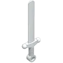{ .lu-ti width="24" loading="lazy" } [NPC Sword - Back Slung (LOT 5687)](../5687.md) | 5 | Large sword worn on the Minifigure's back | 0 matrices; 0 rewards; 0 community references |
| 12129 | { .lu-ti width="24" loading="lazy" } [NPC Toy Assember Back Crank (LOT 12129)](../12129.md) | 5 | NPC Toy Assember Back Crank | 0 matrices; 0 rewards; 0 community references |
| 13115 | 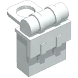{ .lu-ti width="24" loading="lazy" } [NPC Vendor Backpack (LOT 13115)](../13115.md) | 5 | No client description | 0 matrices; 0 rewards; 0 community references |
| 7111 | { .lu-ti width="24" loading="lazy" } [NPC Venture Grunt Breastplate (LOT 7111)](../7111.md) | 5 | NPC Chest piece | 0 matrices; 0 rewards; 0 community references |
| 12623 | { .lu-ti width="24" loading="lazy" } [NPC Venture Scout Armor (LOT 12623)](../12623.md) | 5 | Venture Scout Armor | 0 matrices; 0 rewards; 0 community references |
| 12130 | { .lu-ti width="24" loading="lazy" } [NPC Wen Whatzit Clock Armor (LOT 12130)](../12130.md) | 5 | NPC Wen Whatzit Clock Armor | 0 matrices; 0 rewards; 0 community references |
| 8287 | { .lu-ti width="24" loading="lazy" } [NPC Wisp Lee Scarf (LOT 8287)](../8287.md) | 1 | NPC Wisp Lee Scarf | 0 matrices; 0 rewards; 0 community references |
| 8639 | { .lu-ti width="24" loading="lazy" } [Obsidian Armor (LOT 8639)](../8639.md) | 2 | No client description | 1 matrices; 0 rewards; 1 community references |
| 14088 | { .lu-ti width="24" loading="lazy" } [Obsolete NJ SJ Whirlwind Earth equiped (LOT 14088)](../14088.md) | 4 | No client description | 0 matrices; 0 rewards; 0 community references |
| 12470 | { .lu-ti width="24" loading="lazy" } [Obsolete NJ SJ Whirlwind Imagination (LOT 12470)](../12470.md) | 4 | No client description | 0 matrices; 0 rewards; 0 community references |
| 14813 | { .lu-ti width="24" loading="lazy" } [Orange Cape (LOT 14813)](../14813.md) | 4 | No client description | 1 matrices; 0 rewards; 1 community references |
| 9805 | { .lu-ti width="24" loading="lazy" } [Orange Oxygen Bottles (LOT 9805)](../9805.md) | 5 | No client description | 0 matrices; 0 rewards; 0 community references |
| 6856 | { .lu-ti width="24" loading="lazy" } [Orange Shoulder Parrot (LOT 6856)](../6856.md) | 3 | No client description | 8 matrices; 0 rewards; 1 community references |
| 14326 | 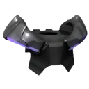{ .lu-ti width="24" loading="lazy" } [Paradox Gear - Space Marauder - shoulder proxy (LOT 14326)](../14326.md) | 4 | No client description | 0 matrices; 0 rewards; 0 community references |
| 14809 | { .lu-ti width="24" loading="lazy" } [Pink Cape (LOT 14809)](../14809.md) | 4 | No client description | 1 matrices; 0 rewards; 1 community references |
| 8638 | { .lu-ti width="24" loading="lazy" } [Powered Armor (LOT 8638)](../8638.md) | 3 | No client description | 11 matrices; 0 rewards; 1 community references |
| 8302 | [Property Claim Marker (LOT 8302)](../8302.md) | 5 | claim marker in property | 0 matrices; 0 rewards; 0 community references |
| 14814 | { .lu-ti width="24" loading="lazy" } [Purple Cape (LOT 14814)](../14814.md) | 4 | No client description | 1 matrices; 0 rewards; 1 community references |
| 6600 | { .lu-ti width="24" loading="lazy" } [PvP Carry Barrel (LOT 6600)](../6600.md) | 5 | Carried by the player during a Siege match | 0 matrices; 0 rewards; 0 community references |
| 8533 | 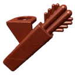{ .lu-ti width="24" loading="lazy" } [Quiver (LOT 8533)](../8533.md) | 4 | No client description | 9 matrices; 0 rewards; 0 community references |
| 14805 | { .lu-ti width="24" loading="lazy" } [Red Cape (LOT 14805)](../14805.md) | 4 | No client description | 1 matrices; 0 rewards; 1 community references |
| 7570 | { .lu-ti width="24" loading="lazy" } [Red Shoulder Parrot (LOT 7570)](../7570.md) | 4 | No client description | 9 matrices; 0 rewards; 1 community references |
| 8458 | { .lu-ti width="24" loading="lazy" } [Samurai Shoulderpads 2 (LOT 8458)](../8458.md) | 4 | Rank 2 Specialty Kit Item | 1 matrices; 0 rewards; 0 community references |
| 7539 | 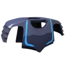{ .lu-ti width="24" loading="lazy" } [Samurai Shoulderpads 3 (LOT 7539)](../7539.md) | 4 | Rank 3 Specialty Kit Item | 1 matrices; 0 rewards; 0 community references |
| 12992 | 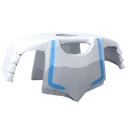{ .lu-ti width="24" loading="lazy" } [Samurai Shoulderpads 3 (LOT 12992)](../12992.md) | 4 | Rank 3 Specialty Kit Item | 1 matrices; 0 rewards; 0 community references |
| 15993 | 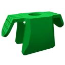{ .lu-ti width="24" loading="lazy" } [Scale Mail (LOT 15993)](../15993.md) | 3 | No client description | 0 matrices; 1 rewards; 1 community references |
| 13548 | 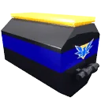{ .lu-ti width="24" loading="lazy" } [Sentinel Box Disguise (LOT 13548)](../13548.md) | 2 | No client description | 1 matrices; 0 rewards; 0 community references |
| 14320 | { .lu-ti width="24" loading="lazy" } [Sentinel Gear - Knight - shoulder proxy (LOT 14320)](../14320.md) | 4 | No client description | 0 matrices; 0 rewards; 0 community references |
| 13617 | 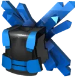{ .lu-ti width="24" loading="lazy" } [Shard Armor (LOT 13617)](../13617.md) | 4 | No client description | 1 matrices; 0 rewards; 1 community references |
| 15994 | { .lu-ti width="24" loading="lazy" } [Shimmering O-Yoroi (LOT 15994)](../15994.md) | 4 | No client description | 27 matrices; 0 rewards; 1 community references |
| 8461 | { .lu-ti width="24" loading="lazy" } [Shinobi Shoulderpads 2 (LOT 8461)](../8461.md) | 4 | Rank 2 Specialty Kit Item | 1 matrices; 0 rewards; 0 community references |
| 7541 | { .lu-ti width="24" loading="lazy" } [Shinobi Shoulderpads 3 (LOT 7541)](../7541.md) | 4 | Rank 3 Specialty Kit Item | 1 matrices; 0 rewards; 0 community references |
| 12290 | { .lu-ti width="24" loading="lazy" } [Snow Parka Back/Neck Proxy (LOT 12290)](../12290.md) | 2 | No client description | 0 matrices; 0 rewards; 0 community references |
| 8459 | { .lu-ti width="24" loading="lazy" } [Sorcerer Shoulderpads 2 (LOT 8459)](../8459.md) | 4 | Rank 2 Specialty Kit Item | 1 matrices; 0 rewards; 0 community references |
| 7415 | { .lu-ti width="24" loading="lazy" } [Sorcerer Shoulderpads 3 (LOT 7415)](../7415.md) | 4 | Rank 3 Specialty Kit Item | 1 matrices; 0 rewards; 0 community references |
| 12989 | { .lu-ti width="24" loading="lazy" } [Sorcerer Shoulderpads 3 (LOT 12989)](../12989.md) | 4 | Rank 3 Specialty Kit Item | 1 matrices; 0 rewards; 0 community references |
| 8460 | { .lu-ti width="24" loading="lazy" } [Space Marauder Shoulderpads 2 (LOT 8460)](../8460.md) | 4 | Rank 2 Specialty Kit Item | 1 matrices; 0 rewards; 0 community references |
| 7540 | { .lu-ti width="24" loading="lazy" } [Space Marauder Shoulderpads 3 (LOT 7540)](../7540.md) | 4 | Rank 3 Specialty Kit Item | 1 matrices; 0 rewards; 0 community references |
| 12991 | { .lu-ti width="24" loading="lazy" } [Space Marauder Shoulderpads 3 (LOT 12991)](../12991.md) | 4 | Rank 3 Specialty Kit Item | 1 matrices; 0 rewards; 0 community references |
| 8457 | { .lu-ti width="24" loading="lazy" } [Space Ranger Pack 2 (LOT 8457)](../8457.md) | 4 | Rank 2 Specialty Kit Item | 1 matrices; 0 rewards; 0 community references |
| 7538 | { .lu-ti width="24" loading="lazy" } [Space Ranger Pack 3 (LOT 7538)](../7538.md) | 4 | Rank 3 Specialty Kit Item | 1 matrices; 0 rewards; 0 community references |
| 15957 | { .lu-ti width="24" loading="lazy" } [Spear Proxy Ninjago (LOT 15957)](../15957.md) | 4 | Spear Proxy Ninjago | 0 matrices; 0 rewards; 0 community references |
| 8464 | { .lu-ti width="24" loading="lazy" } [Summoner Shoulderpads 2 (LOT 8464)](../8464.md) | 4 | Rank 2 Specialty Kit Item | 1 matrices; 0 rewards; 0 community references |
| 7555 | { .lu-ti width="24" loading="lazy" } [Summoner Shoulderpads 3 (LOT 7555)](../7555.md) | 4 | Rank 3 Specialty Kit Item | 1 matrices; 0 rewards; 0 community references |
| 12923 | { .lu-ti width="24" loading="lazy" } [Summoner Shoulderpads 3 (LOT 12923)](../12923.md) | 4 | Rank 3 Specialty Kit Item | 1 matrices; 0 rewards; 0 community references |
| 8537 | { .lu-ti width="24" loading="lazy" } [Tech Armor (LOT 8537)](../8537.md) | 2 | No client description | 18 matrices; 0 rewards; 1 community references |
| 9864 | { .lu-ti width="24" loading="lazy" } [Test Blue Cape (LOT 9864)](../9864.md) | 5 | No client description | 0 matrices; 0 rewards; 0 community references |
| 14484 | { .lu-ti width="24" loading="lazy" } [TEST Bone Axe Proxy (LOT 14484)](../14484.md) | 5 | Bone Axe Proxy | 0 matrices; 0 rewards; 0 community references |
| 7150 | { .lu-ti width="24" loading="lazy" } [Test Breastplate of Gravity (LOT 7150)](../7150.md) | 5 | TEST Chest piece | 0 matrices; 0 rewards; 0 community references |
| 7690 | { .lu-ti width="24" loading="lazy" } [Test Breastplate of Scripting (LOT 7690)](../7690.md) | 5 | TEST Chest piece for scripting exploration | 0 matrices; 0 rewards; 0 community references |
| 7148 | { .lu-ti width="24" loading="lazy" } [Test Breastplate of Taunting (LOT 7148)](../7148.md) | 5 | TEST Chest piece | 0 matrices; 0 rewards; 0 community references |
| 9869 | { .lu-ti width="24" loading="lazy" } [Test Cape (LOT 9869)](../9869.md) | 5 | No client description | 0 matrices; 0 rewards; 0 community references |
| 9870 | { .lu-ti width="24" loading="lazy" } [Test Cape (LOT 9870)](../9870.md) | 5 | No client description | 0 matrices; 0 rewards; 0 community references |
| 9871 | { .lu-ti width="24" loading="lazy" } [Test Cape (LOT 9871)](../9871.md) | 5 | No client description | 0 matrices; 0 rewards; 0 community references |
| 9872 | { .lu-ti width="24" loading="lazy" } [Test Cape (LOT 9872)](../9872.md) | 5 | No client description | 0 matrices; 0 rewards; 0 community references |
| 9873 | { .lu-ti width="24" loading="lazy" } [Test Cape (LOT 9873)](../9873.md) | 5 | No client description | 0 matrices; 0 rewards; 0 community references |
