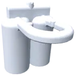
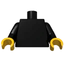
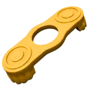
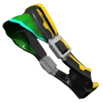
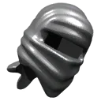
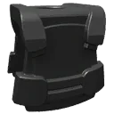
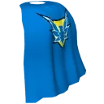
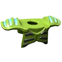
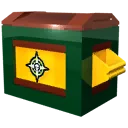

# Neck — page 2/2

[Item database](../README.md)

Pages: [1](type-4-1.md) | [2](type-4-2.md)

| LOT | Item | Rarity | Description | Source evidence |
| --- | --- | --- | --- | --- |
| 9874 | { .lu-ti width="24" loading="lazy" } [Test Cape (LOT 9874)](../9874.md) | 5 | No client description | 0 matrices; 0 rewards; 0 community references |
| 2867 | [Test Contest Parachute (LOT 2867)](../2867.md) | 5 | Team 11 | 0 matrices; 0 rewards; 0 community references |
| 4015 | [Test Contest Parachute (LOT 4015)](../4015.md) | 5 | Lupowski | 0 matrices; 0 rewards; 0 community references |
| 6622 | [Test Equippable Turret (LOT 6622)](../6622.md) | 5 | Test for turrets | 0 matrices; 0 rewards; 0 community references |
| 7292 | { .lu-ti width="24" loading="lazy" } [Test Jet Pack Hover (LOT 7292)](../7292.md) | 5 | Jet Pack that hovers Use for Property Editing | 0 matrices; 0 rewards; 0 community references |
| 8344 | { .lu-ti width="24" loading="lazy" } [TEST Kitty Backpack (LOT 8344)](../8344.md) | 5 | No client description | 0 matrices; 0 rewards; 0 community references |
| 14442 | { .lu-ti width="24" loading="lazy" } [TEST Launcher Jetpack (LOT 14442)](../14442.md) | 5 | No client description | 0 matrices; 0 rewards; 0 community references |
| 16553 | { .lu-ti width="24" loading="lazy" } [TEST OwlPack (LOT 16553)](../16553.md) | 5 | No client description | 0 matrices; 0 rewards; 0 community references |
| 6556 | [Test Pantomime Bunny Back (LOT 6556)](../6556.md) | 5 | No client description | 0 matrices; 0 rewards; 0 community references |
| 6555 | [Test Pantomime Bunny Front (LOT 6555)](../6555.md) | 5 | No client description | 0 matrices; 0 rewards; 0 community references |
| 8275 | { .lu-ti width="24" loading="lazy" } [Test Performance Test Armor (LOT 8275)](../8275.md) | 5 | For performance testing accessories | 0 matrices; 0 rewards; 0 community references |
| 13986 | { .lu-ti width="24" loading="lazy" } [Test Rank 2 Shoulders (LOT 13986)](../13986.md) | 4 | No client description | 0 matrices; 0 rewards; 0 community references |
| 13987 | { .lu-ti width="24" loading="lazy" } [Test Rank 3 Shoulders (LOT 13987)](../13987.md) | 4 | No client description | 0 matrices; 0 rewards; 0 community references |
| 8144 | { .lu-ti width="24" loading="lazy" } [Test Samurai KIT Armor (LOT 8144)](../8144.md) | 5 | Test Samurai KIT Armor | 0 matrices; 0 rewards; 0 community references |
| 16647 | { .lu-ti width="24" loading="lazy" } [TEST SKILL SET OWL (LOT 16647)](../16647.md) | 2 | TEST SKILL SET OWL | 0 matrices; 0 rewards; 0 community references |
| 9531 | [Test Spider Boss Shield (LOT 9531)](../9531.md) | 5 | Prototype asset for Spider Boss Shield | 0 matrices; 0 rewards; 0 community references |
| 13965 | { .lu-ti width="24" loading="lazy" } [TEST Tower Grid Shoulder A (LOT 13965)](../13965.md) | 4 | TEST Tower Grid Shoulder A | 0 matrices; 0 rewards; 0 community references |
| 13966 | { .lu-ti width="24" loading="lazy" } [TEST Tower Grid Shoulder B (LOT 13966)](../13966.md) | 4 | TEST Tower Grid Shoulder B | 0 matrices; 0 rewards; 0 community references |
| 8156 | { .lu-ti width="24" loading="lazy" } [Test Will&#95;L Test Chest (LOT 8156)](../8156.md) | 5 | Test Will&#95;L Test Chest | 0 matrices; 0 rewards; 0 community references |
| 7985 | { .lu-ti width="24" loading="lazy" } [Test&#95;Acc&#95;Armor1 (LOT 7985)](../7985.md) | 5 | Test object for brett | 0 matrices; 0 rewards; 0 community references |
| 7998 | { .lu-ti width="24" loading="lazy" } [Test&#95;Acc&#95;ProxyArmor (LOT 7998)](../7998.md) | 5 | Test object for brett | 0 matrices; 0 rewards; 0 community references |
| 15974 | { .lu-ti width="24" loading="lazy" } [Turtle Pack (LOT 15974)](../15974.md) | 4 | No client description | 5 matrices; 0 rewards; 1 community references |
| 10482 | [Used to consume the back neck slot of the player when the ninja hood is equipped (LOT 10482)](../10482.md) | 5 | Used to consume the back neck slot of the player when the ninja hood is equipped | 0 matrices; 0 rewards; 0 community references |
| 14185 | [Used to consume the back neck slot of the player when the ninja hood is equipped (LOT 14185)](../14185.md) | 5 | Used to consume the back neck slot of the player when the ninja hood is equipped | 0 matrices; 0 rewards; 0 community references |
| 14490 | [Used to consume the back neck slot of the player when the ninja hood is equipped (LOT 14490)](../14490.md) | 5 | Used to consume the back neck slot of the player when the ninja hood is equipped | 0 matrices; 0 rewards; 0 community references |
| 15948 | [Used to consume the back neck slot of the player when the ninja hood is equipped (LOT 15948)](../15948.md) | 5 | Used to consume the back neck slot of the player when the ninja hood is equipped | 0 matrices; 0 rewards; 0 community references |
| 15956 | [Used to consume the back neck slot of the player when the ninja hood is equipped (LOT 15956)](../15956.md) | 5 | Used to consume the back neck slot of the player when the ninja hood is equipped | 0 matrices; 0 rewards; 0 community references |
| 16134 | { .lu-ti width="24" loading="lazy" } [Used to consume the back neck slot of the player when the ninja hood is equipped (LOT 16134)](../16134.md) | 5 | Used to consume the back neck slot of the player when the ninja hood is equipped | 0 matrices; 0 rewards; 0 community references |
| 16273 | [Used to consume the back neck slot of the player when the ninja hood is equipped (LOT 16273)](../16273.md) | 5 | Used to consume the back neck slot of the player when the ninja hood is equipped | 0 matrices; 0 rewards; 0 community references |
| 16274 | [Used to consume the back neck slot of the player when the ninja hood is equipped (LOT 16274)](../16274.md) | 5 | Used to consume the back neck slot of the player when the ninja hood is equipped | 0 matrices; 0 rewards; 0 community references |
| 16275 | [Used to consume the back neck slot of the player when the ninja hood is equipped (LOT 16275)](../16275.md) | 5 | Used to consume the back neck slot of the player when the ninja hood is equipped | 0 matrices; 0 rewards; 0 community references |
| 8534 | { .lu-ti width="24" loading="lazy" } [Utility Harness (LOT 8534)](../8534.md) | 4 | No client description | 9 matrices; 0 rewards; 1 community references |
| 16187 | { .lu-ti width="24" loading="lazy" } [Valiant Adventurer's Cape (LOT 16187)](../16187.md) | 4 | Rank 3 Specialty Kit Item | 1 matrices; 0 rewards; 0 community references |
| 16186 | { .lu-ti width="24" loading="lazy" } [Valiant Buccaneer's Cape (LOT 16186)](../16186.md) | 4 | Rank 3 Specialty Kit Item | 1 matrices; 0 rewards; 0 community references |
| 16185 | { .lu-ti width="24" loading="lazy" } [Valiant Daredevil's Cape (LOT 16185)](../16185.md) | 4 | Rank 3 Specialty Kit Item | 1 matrices; 0 rewards; 0 community references |
| 16182 | { .lu-ti width="24" loading="lazy" } [Valiant Engineer's Cape (LOT 16182)](../16182.md) | 4 | Rank 3 Specialty Kit Item | 1 matrices; 0 rewards; 0 community references |
| 16184 | { .lu-ti width="24" loading="lazy" } [Valiant Inventor's Cape (LOT 16184)](../16184.md) | 4 | Rank 3 Specialty Kit Item | 1 matrices; 0 rewards; 0 community references |
| 16179 | { .lu-ti width="24" loading="lazy" } [Valiant Knight's Cape (LOT 16179)](../16179.md) | 4 | Rank 3 Specialty Kit Item | 1 matrices; 0 rewards; 0 community references |
| 16180 | { .lu-ti width="24" loading="lazy" } [Valiant Samurai's Cape (LOT 16180)](../16180.md) | 4 | Rank 3 Specialty Kit Item | 1 matrices; 0 rewards; 0 community references |
| 16190 | { .lu-ti width="24" loading="lazy" } [Valiant Shinobi's Cape (LOT 16190)](../16190.md) | 4 | Rank 3 Specialty Kit Item | 1 matrices; 0 rewards; 0 community references |
| 16189 | { .lu-ti width="24" loading="lazy" } [Valiant Sorcerer's Cape (LOT 16189)](../16189.md) | 4 | Rank 3 Specialty Kit Item | 1 matrices; 0 rewards; 0 community references |
| 16188 | { .lu-ti width="24" loading="lazy" } [Valiant Space Marauder's Cape (LOT 16188)](../16188.md) | 4 | Rank 3 Specialty Kit Item | 1 matrices; 0 rewards; 0 community references |
| 16181 | { .lu-ti width="24" loading="lazy" } [Valiant Space Ranger's Cape (LOT 16181)](../16181.md) | 4 | Rank 3 Specialty Kit Item | 1 matrices; 0 rewards; 0 community references |
| 16183 | { .lu-ti width="24" loading="lazy" } [Valiant Summoner's Cape (LOT 16183)](../16183.md) | 4 | Rank 3 Specialty Kit Item | 1 matrices; 0 rewards; 0 community references |
| 14364 | { .lu-ti width="24" loading="lazy" } [Venture Gear - Daredevil - shoulder proxy (LOT 14364)](../14364.md) | 4 | No client description | 0 matrices; 0 rewards; 0 community references |
| 13892 | { .lu-ti width="24" loading="lazy" } [Venture League Box Disguise (LOT 13892)](../13892.md) | 2 | No client description | 1 matrices; 0 rewards; 0 community references |
| 14807 | { .lu-ti width="24" loading="lazy" } [White Cape (LOT 14807)](../14807.md) | 4 | No client description | 1 matrices; 0 rewards; 1 community references |
| 10295 | { .lu-ti width="24" loading="lazy" } [White Cat Backpack (LOT 10295)](../10295.md) | 4 | No client description | 0 matrices; 0 rewards; 0 community references |
| 12094 | { .lu-ti width="24" loading="lazy" } [White Neckerchief (LOT 12094)](../12094.md) | 2 | No client description | 0 matrices; 1 rewards; 1 community references |
| 11207 | { .lu-ti width="24" loading="lazy" } [White Owl Backpack (LOT 11207)](../11207.md) | 4 | No client description | 0 matrices; 0 rewards; 0 community references |
| 14817 | { .lu-ti width="24" loading="lazy" } [White Shoulder Owl (LOT 14817)](../14817.md) | 3 | No client description | 1 matrices; 0 rewards; 1 community references |
| 14812 | { .lu-ti width="24" loading="lazy" } [Yellow Cape (LOT 14812)](../14812.md) | 4 | No client description | 1 matrices; 0 rewards; 1 community references |
| 6855 | { .lu-ti width="24" loading="lazy" } [Yellow Shoulder Parrot (LOT 6855)](../6855.md) | 3 | No client description | 8 matrices; 0 rewards; 1 community references |
