# Left hand — page 1/2

[Item database](../README.md)

Pages: [1](type-5-1.md) | [2](type-5-2.md)

| LOT | Item | Rarity | Description | Source evidence |
| --- | --- | --- | --- | --- |
| 7551 | { .lu-ti width="24" loading="lazy" } [Unnamed LOT 7551 (LOT 7551)](../7551.md) | 4 | No client description | 0 matrices; 0 rewards; 0 community references |
| 7552 | { .lu-ti width="24" loading="lazy" } [Unnamed LOT 7552 (LOT 7552)](../7552.md) | 4 | No client description | 0 matrices; 0 rewards; 0 community references |
| 7553 | { .lu-ti width="24" loading="lazy" } [Unnamed LOT 7553 (LOT 7553)](../7553.md) | 4 | No client description | 0 matrices; 0 rewards; 0 community references |
| 7554 | { .lu-ti width="24" loading="lazy" } [Unnamed LOT 7554 (LOT 7554)](../7554.md) | 4 | No client description | 0 matrices; 0 rewards; 0 community references |
| 7713 | { .lu-ti width="24" loading="lazy" } [Unnamed LOT 7713 (LOT 7713)](../7713.md) | 5 | No client description | 0 matrices; 0 rewards; 0 community references |
| 12666 | { .lu-ti width="24" loading="lazy" } [Unnamed LOT 12666 (LOT 12666)](../12666.md) | 4 | No client description | 0 matrices; 0 rewards; 0 community references |
| 12668 | { .lu-ti width="24" loading="lazy" } [Unnamed LOT 12668 (LOT 12668)](../12668.md) | 3 | No client description | 0 matrices; 0 rewards; 0 community references |
| 12670 | { .lu-ti width="24" loading="lazy" } [Unnamed LOT 12670 (LOT 12670)](../12670.md) | 3 | No client description | 0 matrices; 0 rewards; 0 community references |
| 12671 | { .lu-ti width="24" loading="lazy" } [Unnamed LOT 12671 (LOT 12671)](../12671.md) | 4 | No client description | 0 matrices; 0 rewards; 0 community references |
| 12673 | { .lu-ti width="24" loading="lazy" } [Unnamed LOT 12673 (LOT 12673)](../12673.md) | 3 | No client description | 0 matrices; 0 rewards; 0 community references |
| 12674 | { .lu-ti width="24" loading="lazy" } [Unnamed LOT 12674 (LOT 12674)](../12674.md) | 3 | No client description | 0 matrices; 0 rewards; 0 community references |
| 12676 | { .lu-ti width="24" loading="lazy" } [Unnamed LOT 12676 (LOT 12676)](../12676.md) | 3 | No client description | 0 matrices; 0 rewards; 0 community references |
| 12679 | 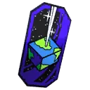{ .lu-ti width="24" loading="lazy" } [Unnamed LOT 12679 (LOT 12679)](../12679.md) | 3 | No client description | 0 matrices; 0 rewards; 0 community references |
| 12680 | { .lu-ti width="24" loading="lazy" } [Unnamed LOT 12680 (LOT 12680)](../12680.md) | 3 | No client description | 0 matrices; 0 rewards; 0 community references |
| 12745 | [Unnamed LOT 12745 (LOT 12745)](../12745.md) | 1 | No client description | 0 matrices; 0 rewards; 0 community references |
| 13126 | { .lu-ti width="24" loading="lazy" } [Unnamed LOT 13126 (LOT 13126)](../13126.md) | 4 | No client description | 0 matrices; 0 rewards; 0 community references |
| 13127 | { .lu-ti width="24" loading="lazy" } [Unnamed LOT 13127 (LOT 13127)](../13127.md) | 4 | No client description | 0 matrices; 0 rewards; 0 community references |
| 13280 | [Unnamed LOT 13280 (LOT 13280)](../13280.md) | 4 | No client description | 0 matrices; 0 rewards; 0 community references |
| 14111 | [Unnamed LOT 14111 (LOT 14111)](../14111.md) | 1 | No client description | 0 matrices; 0 rewards; 0 community references |
| 14605 | [Unnamed LOT 14605 (LOT 14605)](../14605.md) | 1 | No client description | 0 matrices; 0 rewards; 0 community references |
| 14795 | 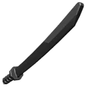{ .lu-ti width="24" loading="lazy" } [Unnamed LOT 14795 (LOT 14795)](../14795.md) | 4 | No client description | 0 matrices; 0 rewards; 0 community references |
| 14799 | { .lu-ti width="24" loading="lazy" } [Unnamed LOT 14799 (LOT 14799)](../14799.md) | 4 | No client description | 0 matrices; 0 rewards; 0 community references |
| 14800 | { .lu-ti width="24" loading="lazy" } [Unnamed LOT 14800 (LOT 14800)](../14800.md) | 4 | No client description | 0 matrices; 0 rewards; 0 community references |
| 14803 | { .lu-ti width="24" loading="lazy" } [Unnamed LOT 14803 (LOT 14803)](../14803.md) | 4 | No client description | 0 matrices; 0 rewards; 0 community references |
| 14822 | { .lu-ti width="24" loading="lazy" } [Unnamed LOT 14822 (LOT 14822)](../14822.md) | 4 | No client description | 0 matrices; 0 rewards; 0 community references |
| 14823 | { .lu-ti width="24" loading="lazy" } [Unnamed LOT 14823 (LOT 14823)](../14823.md) | 4 | No client description | 0 matrices; 0 rewards; 0 community references |
| 14825 | { .lu-ti width="24" loading="lazy" } [Unnamed LOT 14825 (LOT 14825)](../14825.md) | 4 | No client description | 0 matrices; 0 rewards; 0 community references |
| 14826 | { .lu-ti width="24" loading="lazy" } [Unnamed LOT 14826 (LOT 14826)](../14826.md) | 4 | No client description | 0 matrices; 0 rewards; 0 community references |
| 14827 | { .lu-ti width="24" loading="lazy" } [Unnamed LOT 14827 (LOT 14827)](../14827.md) | 4 | No client description | 0 matrices; 0 rewards; 0 community references |
| 14831 | { .lu-ti width="24" loading="lazy" } [Unnamed LOT 14831 (LOT 14831)](../14831.md) | 4 | No client description | 0 matrices; 0 rewards; 0 community references |
| 14839 | 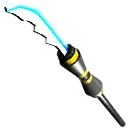{ .lu-ti width="24" loading="lazy" } [Unnamed LOT 14839 (LOT 14839)](../14839.md) | 4 | No client description | 0 matrices; 0 rewards; 0 community references |
| 16732 | { .lu-ti width="24" loading="lazy" } [Unnamed LOT 16732 (LOT 16732)](../16732.md) | 4 | No client description | 0 matrices; 0 rewards; 0 community references |
| 16733 | { .lu-ti width="24" loading="lazy" } [Unnamed LOT 16733 (LOT 16733)](../16733.md) | 4 | No client description | 0 matrices; 0 rewards; 0 community references |
| 16734 | { .lu-ti width="24" loading="lazy" } [Unnamed LOT 16734 (LOT 16734)](../16734.md) | 4 | No client description | 0 matrices; 0 rewards; 0 community references |
| 16735 | { .lu-ti width="24" loading="lazy" } [Unnamed LOT 16735 (LOT 16735)](../16735.md) | 4 | No client description | 0 matrices; 0 rewards; 0 community references |
| 13289 | [Adventurer Valiant Weapon Proxy (LOT 13289)](../13289.md) | 4 | No client description | 0 matrices; 0 rewards; 0 community references |
| 11458 | { .lu-ti width="24" loading="lazy" } [Adventurer Whip 2 (LOT 11458)](../11458.md) | 4 | Rank 2 Specialty Kit Item | 1 matrices; 0 rewards; 0 community references |
| 11459 | { .lu-ti width="24" loading="lazy" } [Adventurer Whip 3 (LOT 11459)](../11459.md) | 4 | Rank 3 Specialty Kit Item | 1 matrices; 0 rewards; 0 community references |
| 14357 | { .lu-ti width="24" loading="lazy" } [Assembly Gear - Summoner - offhand  proxy (LOT 14357)](../14357.md) | 4 | No client description | 0 matrices; 0 rewards; 0 community references |
| 2160 | { .lu-ti width="24" loading="lazy" } [Banana (LOT 2160)](../2160.md) | 1 | No client description | 1 matrices; 0 rewards; 0 community references |
| 12772 | { .lu-ti width="24" loading="lazy" } [Banana-Wrang (LOT 12772)](../12772.md) | 2 | No client description | 1 matrices; 0 rewards; 1 community references |
| 12678 | { .lu-ti width="24" loading="lazy" } [Bat Lord Shield (LOT 12678)](../12678.md) | 4 | No client description | 40 matrices; 0 rewards; 1 community references |
| 2634 | { .lu-ti width="24" loading="lazy" } [Binoculars (LOT 2634)](../2634.md) | 2 | No client description | 15 matrices; 0 rewards; 1 community references |
| 14562 | { .lu-ti width="24" loading="lazy" } [Black Cat's Fish (LOT 14562)](../14562.md) | 3 | No client description | 1 matrices; 0 rewards; 0 community references |
| 14798 | { .lu-ti width="24" loading="lazy" } [Black Katana with Ninja Speed - Proxy (LOT 14798)](../14798.md) | 4 | offhand for dual wield katana with ninja speed | 0 matrices; 0 rewards; 0 community references |
| 8532 | { .lu-ti width="24" loading="lazy" } [Briefcase (LOT 8532)](../8532.md) | 4 | No client description | 8 matrices; 0 rewards; 1 community references |
| 14194 | { .lu-ti width="24" loading="lazy" } [Brown Dog's Bone (LOT 14194)](../14194.md) | 3 | No client description | 1 matrices; 0 rewards; 0 community references |
| 14566 | { .lu-ti width="24" loading="lazy" } [Brown Mouse's Cheese (LOT 14566)](../14566.md) | 3 | No client description | 1 matrices; 0 rewards; 0 community references |
| 9815 | { .lu-ti width="24" loading="lazy" } [Buccaneer Offhand 1 - Proxy (LOT 9815)](../9815.md) | 4 | Rank 1 Specialty Kit Item. Tied to Buccaneer weapon 1 | 0 matrices; 0 rewards; 0 community references |
| 9816 | { .lu-ti width="24" loading="lazy" } [Buccaneer Offhand 2 - Proxy (LOT 9816)](../9816.md) | 4 | Rank 2 Specialty Kit Item. Tied to Buccaneer weapon 2 | 0 matrices; 0 rewards; 0 community references |
| 9817 | { .lu-ti width="24" loading="lazy" } [Buccaneer Offhand 3 - Proxy (LOT 9817)](../9817.md) | 4 | Rank 3 Specialty Kit Item. Tied to Buccaneer weapon 3 | 0 matrices; 0 rewards; 0 community references |
| 13310 | { .lu-ti width="24" loading="lazy" } [Buccaneer Offhand 3 Variant - Proxy (LOT 13310)](../13310.md) | 4 | Rank 3 Specialty Kit Item. -variant- Tied to Buccaneer weapon 3 | 0 matrices; 0 rewards; 0 community references |
| 13281 | { .lu-ti width="24" loading="lazy" } [Buccaneer Valiant Weapon Proxy (LOT 13281)](../13281.md) | 4 | No client description | 0 matrices; 0 rewards; 0 community references |
| 6849 | { .lu-ti width="24" loading="lazy" } [Buckler Shield (LOT 6849)](../6849.md) | 2 | No client description | 3 matrices; 0 rewards; 1 community references |
| 2617 | { .lu-ti width="24" loading="lazy" } [Bullhorn (LOT 2617)](../2617.md) | 3 | No client description | 9 matrices; 0 rewards; 1 community references |
| 6882 | { .lu-ti width="24" loading="lazy" } [Compass (LOT 6882)](../6882.md) | 2 | No client description | 0 matrices; 1 rewards; 1 community references |
| 12744 | { .lu-ti width="24" loading="lazy" } [Construction Shield (LOT 12744)](../12744.md) | 3 | No client description | 1 matrices; 0 rewards; 1 community references |
| 13745 | [Crate Disguise Left Hand Proxy (LOT 13745)](../13745.md) | 1 | No client description | 0 matrices; 0 rewards; 0 community references |
| 12599 | { .lu-ti width="24" loading="lazy" } [Crux Planet Shield (LOT 12599)](../12599.md) | 3 | No client description | 0 matrices; 1 rewards; 1 community references |
| 9818 | { .lu-ti width="24" loading="lazy" } [Daredevil Offhand 1 - Proxy (LOT 9818)](../9818.md) | 4 | Rank 1 Specialty Kit Item. Tied to Daredevil weapon 1 | 0 matrices; 0 rewards; 0 community references |
| 9819 | { .lu-ti width="24" loading="lazy" } [Daredevil Offhand 2 - Proxy (LOT 9819)](../9819.md) | 4 | Rank 2 Specialty Kit Item. Tied to Daredevil weapon 2 | 0 matrices; 0 rewards; 0 community references |
| 9820 | { .lu-ti width="24" loading="lazy" } [Daredevil Offhand 3 - Proxy (LOT 9820)](../9820.md) | 4 | Rank 3 Specialty Kit Item. Tied to Daredevil weapon 3 | 0 matrices; 0 rewards; 0 community references |
| 13311 | { .lu-ti width="24" loading="lazy" } [Daredevil Offhand 3 Variant - Proxy (LOT 13311)](../13311.md) | 4 | Rank 3 Specialty Kit Item. -variant- Tied to Daredevil weapon 3 | 0 matrices; 0 rewards; 0 community references |
| 13284 | { .lu-ti width="24" loading="lazy" } [Daredevil Valiant Weapon Proxy (LOT 13284)](../13284.md) | 4 | No client description | 0 matrices; 0 rewards; 0 community references |
| 14568 | { .lu-ti width="24" loading="lazy" } [Dark Gray Dog's Bone (LOT 14568)](../14568.md) | 3 | No client description | 1 matrices; 0 rewards; 0 community references |
| 14559 | { .lu-ti width="24" loading="lazy" } [Dark Gray Frog's Egg (LOT 14559)](../14559.md) | 3 | No client description | 1 matrices; 0 rewards; 0 community references |
| 14567 | { .lu-ti width="24" loading="lazy" } [Dark Gray Mouse's Cheese (LOT 14567)](../14567.md) | 3 | No client description | 1 matrices; 0 rewards; 0 community references |
| 11318 | { .lu-ti width="24" loading="lazy" } [DJ Microphone (LOT 11318)](../11318.md) | 5 | The DJ wants this | 0 matrices; 0 rewards; 0 community references |
| 13754 | [Dragon Disguise Left Hand Proxy (LOT 13754)](../13754.md) | 1 | Used with the nexus tower mission chains | 0 matrices; 0 rewards; 0 community references |
| 10483 | [Dragon Style - Left Hand Proxy (LOT 10483)](../10483.md) | 5 | Used to fill the left hand with the Dragon style shirt | 0 matrices; 0 rewards; 0 community references |
| 14110 | [Earth Staff Left Hand Proxy (LOT 14110)](../14110.md) | 1 | No client description | 0 matrices; 0 rewards; 0 community references |
| 7405 | { .lu-ti width="24" loading="lazy" } [Engineer Controller 2 (LOT 7405)](../7405.md) | 4 | Rank 2 Specialty Kit Item | 1 matrices; 0 rewards; 0 community references |
| 7406 | { .lu-ti width="24" loading="lazy" } [Engineer Controller 3 (LOT 7406)](../7406.md) | 4 | Rank 3 Specialty Kit Item | 1 matrices; 0 rewards; 0 community references |
| 12965 | { .lu-ti width="24" loading="lazy" } [Engineer Controller 3 (LOT 12965)](../12965.md) | 4 | Rank 3 Specialty Kit Item | 1 matrices; 0 rewards; 0 community references |
| 13279 | { .lu-ti width="24" loading="lazy" } [Engineer Valiant Weapon Proxy (LOT 13279)](../13279.md) | 4 | No client description | 0 matrices; 0 rewards; 0 community references |
| 12562 | { .lu-ti width="24" loading="lazy" } [Evergiving Goblet (LOT 12562)](../12562.md) | 2 | No client description | 40 matrices; 1 rewards; 1 community references |
| 16263 | [Fire Swords Left Hand Proxy (LOT 16263)](../16263.md) | 1 | No client description | 0 matrices; 0 rewards; 0 community references |
| 12675 | { .lu-ti width="24" loading="lazy" } [Fleur-de-Lis Shield (LOT 12675)](../12675.md) | 4 | No client description | 1 matrices; 0 rewards; 1 community references |
| 13580 | { .lu-ti width="24" loading="lazy" } [Foreman Radio (LOT 13580)](../13580.md) | 4 | No client description | 1 matrices; 0 rewards; 0 community references |
| 8681 | { .lu-ti width="24" loading="lazy" } [Gem Scepter (LOT 8681)](../8681.md) | 4 | No client description | 0 matrices; 1 rewards; 1 community references |
| 13814 | { .lu-ti width="24" loading="lazy" } [Golden Telescope (LOT 13814)](../13814.md) | 3 | No client description | 0 matrices; 1 rewards; 1 community references |
| 8680 | 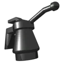{ .lu-ti width="24" loading="lazy" } [Grease Can (LOT 8680)](../8680.md) | 3 | No client description | 11 matrices; 0 rewards; 1 community references |
| 14191 | { .lu-ti width="24" loading="lazy" } [Green Frog's Egg (LOT 14191)](../14191.md) | 3 | No client description | 1 matrices; 0 rewards; 0 community references |
| 11299 | { .lu-ti width="24" loading="lazy" } [Handsome Mug (LOT 11299)](../11299.md) | 2 | It can make someone pretty. | 4 matrices; 0 rewards; 0 community references |
| 12667 | { .lu-ti width="24" loading="lazy" } [Handy Spanner (LOT 12667)](../12667.md) | 3 | No client description | 0 matrices; 0 rewards; 0 community references |
| 8531 | { .lu-ti width="24" loading="lazy" } [Heater Shield (LOT 8531)](../8531.md) | 3 | No client description | 8 matrices; 0 rewards; 1 community references |
| 13804 | [Heavy Staff Left Hand Proxy (LOT 13804)](../13804.md) | 1 | No client description | 0 matrices; 0 rewards; 0 community references |
| 13759 | [Horseman Disguise Left Hand Proxy (LOT 13759)](../13759.md) | 1 | Used with the nexus tower mission chains | 0 matrices; 0 rewards; 0 community references |
| 16262 | [Ice Shuriken Left Hand Proxy (LOT 16262)](../16262.md) | 1 | No client description | 0 matrices; 0 rewards; 0 community references |
| 13606 | [Imagination Backpack Left Hand Proxy (LOT 13606)](../13606.md) | 5 | Used with the Imagination Backpack | 0 matrices; 0 rewards; 0 community references |
| 12597 | 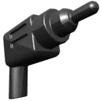{ .lu-ti width="24" loading="lazy" } [Impact Wrench (LOT 12597)](../12597.md) | 3 | No client description | 0 matrices; 1 rewards; 1 community references |
| 14181 | [Inmproved Scythe Left Hand Proxy (LOT 14181)](../14181.md) | 1 | No client description | 0 matrices; 0 rewards; 0 community references |
| 11460 | { .lu-ti width="24" loading="lazy" } [Inventor Offhand 2 - Proxy (LOT 11460)](../11460.md) | 4 | Rank 2 Specialty Kit Item. Tied to Inventor Weapon 2 | 0 matrices; 0 rewards; 0 community references |
| 11461 | { .lu-ti width="24" loading="lazy" } [Inventor Offhand 3 - Proxy (LOT 11461)](../11461.md) | 4 | Rank 3 Specialty Kit Item. Tied to Inventor Weapon 3 | 0 matrices; 0 rewards; 0 community references |
| 13291 | [Inventor Valiant Weapon Proxy (LOT 13291)](../13291.md) | 4 | No client description | 0 matrices; 0 rewards; 0 community references |
| 6797 | { .lu-ti width="24" loading="lazy" } [Jack Knife's Treasure Map (LOT 6797)](../6797.md) | 3 | No client description | 0 matrices; 1 rewards; 0 community references |
| 13841 | [Janitor Left Hand Proxy (LOT 13841)](../13841.md) | 1 | Used in nexus tower missions | 0 matrices; 0 rewards; 0 community references |
| 8543 | { .lu-ti width="24" loading="lazy" } [Key of Imagination (LOT 8543)](../8543.md) | 2 | No client description | 1 matrices; 0 rewards; 1 community references |
| 7403 | { .lu-ti width="24" loading="lazy" } [Knight Shield 2 (LOT 7403)](../7403.md) | 4 | Rank 2 Specialty Kit Item | 1 matrices; 0 rewards; 0 community references |
| 7404 | { .lu-ti width="24" loading="lazy" } [Knight Shield 3 (LOT 7404)](../7404.md) | 4 | Rank 3 Specialty Kit Item | 1 matrices; 0 rewards; 0 community references |
| 12969 | { .lu-ti width="24" loading="lazy" } [Knight Shield 3 (LOT 12969)](../12969.md) | 4 | Rank 3 Specialty Kit Item | 1 matrices; 0 rewards; 0 community references |
| 13282 | 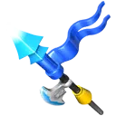{ .lu-ti width="24" loading="lazy" } [Knight Valiant Weapon Proxy (LOT 13282)](../13282.md) | 4 | No client description | 0 matrices; 0 rewards; 0 community references |
| 12672 | 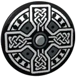{ .lu-ti width="24" loading="lazy" } [Knotwork Shield (LOT 12672)](../12672.md) | 1 | No client description | 40 matrices; 0 rewards; 1 community references |
| 4995 | [Left Drumstick (LOT 4995)](../4995.md) | 1 | Drum equip for AG scene 3 | 0 matrices; 0 rewards; 0 community references |
| 14193 | { .lu-ti width="24" loading="lazy" } [Light Gray Mouse's Cheese (LOT 14193)](../14193.md) | 3 | No client description | 1 matrices; 0 rewards; 0 community references |
| 16261 | [Lightning Nunchucks Left Hand Proxy (LOT 16261)](../16261.md) | 1 | No client description | 0 matrices; 0 rewards; 0 community references |
| 13784 | [Little Friend Left Hand Proxy (LOT 13784)](../13784.md) | 1 | No client description | 0 matrices; 0 rewards; 0 community references |
| 12309 | { .lu-ti width="24" loading="lazy" } [Maelstrom Eye Shield (LOT 12309)](../12309.md) | 3 | No client description | 0 matrices; 1 rewards; 1 community references |
| 10484 | [Mantis Style - Left Hand Proxy (LOT 10484)](../10484.md) | 5 | Used to fill the left hand with the Mantis style shirt | 0 matrices; 0 rewards; 0 community references |
| 13803 | [Massive Spear Left Hand Proxy (LOT 13803)](../13803.md) | 1 | No client description | 0 matrices; 0 rewards; 0 community references |
| 14606 | [Master Fire Spinjitzu Left Hand Proxy (LOT 14606)](../14606.md) | 1 | NJ Master Fire Kit | 0 matrices; 0 rewards; 0 community references |
| 14604 | [Master Lightning Spinjitzu Left Hand Proxy (LOT 14604)](../14604.md) | 1 | NJ Master Lightning Kit | 0 matrices; 0 rewards; 0 community references |
| 12742 | { .lu-ti width="24" loading="lazy" } [Medic Shield (LOT 12742)](../12742.md) | 3 | No client description | 0 matrices; 1 rewards; 1 community references |
| 13934 | [molewacker Left Hand Proxy (LOT 13934)](../13934.md) | 1 | No client description | 0 matrices; 0 rewards; 0 community references |
| 4977 | { .lu-ti width="24" loading="lazy" } [Money Magnet (LOT 4977)](../4977.md) | 3 | No client description | 0 matrices; 1 rewards; 0 community references |
| 12743 | 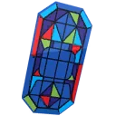{ .lu-ti width="24" loading="lazy" } [Mosaic Shield (LOT 12743)](../12743.md) | 3 | No client description | 0 matrices; 1 rewards; 1 community references |
| 14121 | { .lu-ti width="24" loading="lazy" } [Nexus Force Shield MK I (LOT 14121)](../14121.md) | 3 | No client description | 0 matrices; 0 rewards; 0 community references |
| 14120 | { .lu-ti width="24" loading="lazy" } [Nexus Force Shield MK II (LOT 14120)](../14120.md) | 3 | No client description | 0 matrices; 0 rewards; 0 community references |
| 14119 | { .lu-ti width="24" loading="lazy" } [Nexus Force Shield MK III (LOT 14119)](../14119.md) | 4 | No client description | 0 matrices; 0 rewards; 0 community references |
| 2962 | { .lu-ti width="24" loading="lazy" } [Ninja Buckler Shield (LOT 2962)](../2962.md) | 2 | No client description | 0 matrices; 1 rewards; 1 community references |
| 2209 | { .lu-ti width="24" loading="lazy" } [Ninja Flag (LOT 2209)](../2209.md) | 3 | No client description | 0 matrices; 1 rewards; 0 community references |
| 2961 | { .lu-ti width="24" loading="lazy" } [Ninja Flag (LOT 2961)](../2961.md) | 5 | No client description | 0 matrices; 0 rewards; 0 community references |
| 3392 | { .lu-ti width="24" loading="lazy" } [NPC Apple for Ants (LOT 3392)](../3392.md) | 5 | No client description | 0 matrices; 0 rewards; 0 community references |
| 2978 | { .lu-ti width="24" loading="lazy" } [NPC Black Mug (LOT 2978)](../2978.md) | 5 | No client description | 0 matrices; 0 rewards; 0 community references |
| 2621 | { .lu-ti width="24" loading="lazy" } [NPC Bug Net (LOT 2621)](../2621.md) | 5 | No client description | 0 matrices; 0 rewards; 0 community references |
| 13355 | { .lu-ti width="24" loading="lazy" } [NPC CheerLeader Pom 2 Vendor (LOT 13355)](../13355.md) | 5 | No client description | 0 matrices; 0 rewards; 0 community references |
| 7641 | { .lu-ti width="24" loading="lazy" } [NPC Coalessa Staff (LOT 7641)](../7641.md) | 5 | Special NPC Left Hand Staff 2/3/3 Short Smashing | 0 matrices; 0 rewards; 0 community references |
| 13349 | { .lu-ti width="24" loading="lazy" } [NPC Crash Dummy Sign Vendor (LOT 13349)](../13349.md) | 5 | No client description | 0 matrices; 0 rewards; 0 community references |
| 10157 | { .lu-ti width="24" loading="lazy" } [NPC Duke Exetor Shield (LOT 10157)](../10157.md) | 5 | NPC Duke Exetor Shield | 0 matrices; 0 rewards; 0 community references |
| 13328 | { .lu-ti width="24" loading="lazy" } [NPC Hael Storm Knife (LOT 13328)](../13328.md) | 5 | No client description | 0 matrices; 0 rewards; 0 community references |
| 3390 | [NPC Hot Cross Bun (LOT 3390)](../3390.md) | 5 | No client description | 0 matrices; 0 rewards; 0 community references |
| 8111 | { .lu-ti width="24" loading="lazy" } [NPC Melodie Foxtrot Weapon L (LOT 8111)](../8111.md) | 5 | NPC Melodie Foxtrot Weapon L | 0 matrices; 0 rewards; 0 community references |
| 12541 | [NPC Nexus Jay Pencil (LOT 12541)](../12541.md) | 5 | NPC Nexus Jay Pencil | 0 matrices; 0 rewards; 0 community references |
| 13339 | { .lu-ti width="24" loading="lazy" } [NPC Nurse Sign Vendor (LOT 13339)](../13339.md) | 5 | No client description | 0 matrices; 0 rewards; 0 community references |
| 5693 | 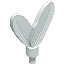{ .lu-ti width="24" loading="lazy" } [NPC Quill (LOT 5693)](../5693.md) | 5 | needs icon | 0 matrices; 0 rewards; 0 community references |
| 2618 | { .lu-ti width="24" loading="lazy" } [NPC Red Hairbrush (LOT 2618)](../2618.md) | 5 | No client description | 0 matrices; 0 rewards; 0 community references |
| 12651 | { .lu-ti width="24" loading="lazy" } [NPC Sentinel Scout Gun (LOT 12651)](../12651.md) | 5 | NPC Sentinel Scout Gun | 0 matrices; 0 rewards; 0 community references |
| 1722 | { .lu-ti width="24" loading="lazy" } [NPC Sentinel Shield (LOT 1722)](../1722.md) | 5 | No client description | 1 matrices; 0 rewards; 0 community references |
| 13326 | { .lu-ti width="24" loading="lazy" } [NPC Skier Pole Vendor (LOT 13326)](../13326.md) | 5 | No client description | 0 matrices; 0 rewards; 0 community references |
| 13319 | { .lu-ti width="24" loading="lazy" } [NPC Spartan Shield Vendor (LOT 13319)](../13319.md) | 5 | No client description | 0 matrices; 0 rewards; 0 community references |
| 10430 | { .lu-ti width="24" loading="lazy" } [NPC Strombie Blade (LOT 10430)](../10430.md) | 5 | No client description | 0 matrices; 0 rewards; 0 community references |
| 3391 | [NPC Turkey Leg (LOT 3391)](../3391.md) | 5 | No client description | 0 matrices; 0 rewards; 0 community references |
| 13375 | { .lu-ti width="24" loading="lazy" } [NPC Vanda Darkflame Sword Left (LOT 13375)](../13375.md) | 5 | No client description | 0 matrices; 0 rewards; 0 community references |
| 2619 | { .lu-ti width="24" loading="lazy" } [NPC White Mug (LOT 2619)](../2619.md) | 5 | No client description | 0 matrices; 0 rewards; 0 community references |
| 2977 | { .lu-ti width="24" loading="lazy" } [NPC Yellow Mug (LOT 2977)](../2977.md) | 5 | No client description | 0 matrices; 0 rewards; 0 community references |
| 12310 | { .lu-ti width="24" loading="lazy" } [Ogre Buckler (LOT 12310)](../12310.md) | 3 | No client description | 0 matrices; 1 rewards; 0 community references |
| 12681 | { .lu-ti width="24" loading="lazy" } [Ogre-Jaw Shield (LOT 12681)](../12681.md) | 1 | No client description | 0 matrices; 1 rewards; 1 community references |
| 13579 | { .lu-ti width="24" loading="lazy" } [Oil Can (LOT 13579)](../13579.md) | 4 | No client description | 1 matrices; 0 rewards; 0 community references |
| 14564 | { .lu-ti width="24" loading="lazy" } [Orange Cat's Fish (LOT 14564)](../14564.md) | 3 | No client description | 1 matrices; 0 rewards; 0 community references |
| 12471 | { .lu-ti width="24" loading="lazy" } [Overstuffed Briefcase (LOT 12471)](../12471.md) | 3 | No client description | 0 matrices; 1 rewards; 1 community references |
| 10485 | [Panda Style - Left Hand Proxy (LOT 10485)](../10485.md) | 5 | Used to fill the left hand with the Panda style shirt | 0 matrices; 0 rewards; 0 community references |
| 14325 | { .lu-ti width="24" loading="lazy" } [Paradox Gear - Space Marauder - offhand proxy (LOT 14325)](../14325.md) | 4 | No client description | 0 matrices; 0 rewards; 0 community references |
| 11298 | { .lu-ti width="24" loading="lazy" } [Peppy's Black Mug (LOT 11298)](../11298.md) | 3 | No client description | 0 matrices; 1 rewards; 0 community references |
| 2208 | { .lu-ti width="24" loading="lazy" } [Pirate Flag (LOT 2208)](../2208.md) | 3 | No client description | 0 matrices; 1 rewards; 1 community references |
| 12296 | { .lu-ti width="24" loading="lazy" } [Present Shield (LOT 12296)](../12296.md) | 3 | No client description | 1 matrices; 0 rewards; 1 community references |
| 4992 | [QB Bass (LOT 4992)](../4992.md) | 1 | Bass guitar the equips for AG scene 3 | 0 matrices; 0 rewards; 0 community references |
| 4991 | [QB Guitar (LOT 4991)](../4991.md) | 1 | Guitar that equips for AG scene 3 | 0 matrices; 0 rewards; 0 community references |
| 14569 | { .lu-ti width="24" loading="lazy" } [Red Dog's Bone (LOT 14569)](../14569.md) | 3 | No client description | 1 matrices; 0 rewards; 0 community references |
| 14560 | { .lu-ti width="24" loading="lazy" } [Red Frog's Egg (LOT 14560)](../14560.md) | 3 | No client description | 1 matrices; 0 rewards; 0 community references |
| 14571 | { .lu-ti width="24" loading="lazy" } [Red Scorpion's Stinger (LOT 14571)](../14571.md) | 3 | No client description | 1 matrices; 0 rewards; 0 community references |
| 14570 | { .lu-ti width="24" loading="lazy" } [Reddish Brown Dog's Bone (LOT 14570)](../14570.md) | 3 | No client description | 1 matrices; 0 rewards; 0 community references |
| 7783 | { .lu-ti width="24" loading="lazy" } [Retro Movie Camera (LOT 7783)](../7783.md) | 4 | No client description | 0 matrices; 1 rewards; 1 community references |
| 12613 | 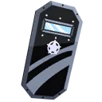{ .lu-ti width="24" loading="lazy" } [Riot Shield (LOT 12613)](../12613.md) | 3 | No client description | 0 matrices; 1 rewards; 1 community references |
| 12627 | { .lu-ti width="24" loading="lazy" } [Ripsaw (LOT 12627)](../12627.md) | 3 | No client description | 0 matrices; 1 rewards; 1 community references |
| 7546 | { .lu-ti width="24" loading="lazy" } [Samurai Bow 2 (LOT 7546)](../7546.md) | 4 | Rank 2 Specialty Kit Item | 1 matrices; 0 rewards; 0 community references |
| 7547 | 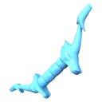{ .lu-ti width="24" loading="lazy" } [Samurai Bow 3 (LOT 7547)](../7547.md) | 4 | Rank 3 Specialty Kit Item | 1 matrices; 0 rewards; 0 community references |
| 12978 | 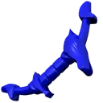{ .lu-ti width="24" loading="lazy" } [Samurai Bow 3 (LOT 12978)](../12978.md) | 4 | Rank 3 Specialty Kit Item | 1 matrices; 0 rewards; 0 community references |
| 13283 | { .lu-ti width="24" loading="lazy" } [Samurai Valiant Weapon Proxy (LOT 13283)](../13283.md) | 4 | No client description | 0 matrices; 0 rewards; 0 community references |
| 12669 | 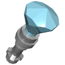{ .lu-ti width="24" loading="lazy" } [Sapphire Scepter (LOT 12669)](../12669.md) | 4 | No client description | 1 matrices; 0 rewards; 1 community references |
| 12926 | [Savage Club Proxy (LOT 12926)](../12926.md) | 4 | No client description | 0 matrices; 0 rewards; 0 community references |
| 13781 | [Scarlet Scythe Left Hand Proxy (LOT 13781)](../13781.md) | 1 | No client description | 0 matrices; 0 rewards; 0 community references |
| 8529 | { .lu-ti width="24" loading="lazy" } [Scorpion Shield (LOT 8529)](../8529.md) | 2 | No client description | 19 matrices; 0 rewards; 1 community references |
| 15907 | { .lu-ti width="24" loading="lazy" } [Scorpion Whip (LOT 15907)](../15907.md) | 4 | No client description | 6 matrices; 0 rewards; 1 community references |
| 8538 | 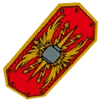{ .lu-ti width="24" loading="lazy" } [Scutum Shield (LOT 8538)](../8538.md) | 3 | No client description | 11 matrices; 0 rewards; 1 community references |
| 14319 | { .lu-ti width="24" loading="lazy" } [Sentinel Gear - Knight - shield proxy (LOT 14319)](../14319.md) | 4 | No client description | 0 matrices; 0 rewards; 0 community references |
| 11272 | { .lu-ti width="24" loading="lazy" } [Sentinel Shield (LOT 11272)](../11272.md) | 3 | No client description | 1 matrices; 0 rewards; 1 community references |
| 15911 | { .lu-ti width="24" loading="lazy" } [Sharp Kunai (LOT 15911)](../15911.md) | 2 | Throws 3 Kunai | 29 matrices; 0 rewards; 1 community references |
| 6924 | { .lu-ti width="24" loading="lazy" } [Shield of Armor (LOT 6924)](../6924.md) | 3 | No client description | 1 matrices; 1 rewards; 1 community references |
| 8333 | { .lu-ti width="24" loading="lazy" } [Shield of Blocking (LOT 8333)](../8333.md) | 3 | No client description | 8 matrices; 0 rewards; 1 community references |
| 6931 | { .lu-ti width="24" loading="lazy" } [Shield of Shielding (LOT 6931)](../6931.md) | 3 | No client description | 1 matrices; 1 rewards; 1 community references |
| 11462 | [Shinobi Offhand 2 - Proxy (LOT 11462)](../11462.md) | 4 | Rank 2 Specialty Kit Item. Tied to Shinobi Weapon 2 | 0 matrices; 0 rewards; 0 community references |
| 11463 | [Shinobi Offhand 3 - Proxy (LOT 11463)](../11463.md) | 4 | Rank 3 Specialty Kit Item. Tied to Shinobi Weapon 3 | 0 matrices; 0 rewards; 0 community references |
| 13288 | [Shinobi Valiant Weapon Proxy (LOT 13288)](../13288.md) | 4 | No client description | 0 matrices; 0 rewards; 0 community references |
| 6796 | { .lu-ti width="24" loading="lazy" } [Ship Blueprint (LOT 6796)](../6796.md) | 2 | No client description | 0 matrices; 1 rewards; 0 community references |
| 13749 | [Skeleton Disguise Left Hand Proxy (LOT 13749)](../13749.md) | 1 | Used with the nexus tower mission chains | 0 matrices; 0 rewards; 0 community references |
| 13581 | { .lu-ti width="24" loading="lazy" } [Skeleton Key (LOT 13581)](../13581.md) | 4 | No client description | 1 matrices; 0 rewards; 1 community references |
| 12295 | { .lu-ti width="24" loading="lazy" } [Snow Flake Shield (LOT 12295)](../12295.md) | 2 | No client description | 1 matrices; 0 rewards; 1 community references |
| 7407 | { .lu-ti width="24" loading="lazy" } [Sorcerer Orb 2 (LOT 7407)](../7407.md) | 4 | Rank 2 Specialty Kit Item | 1 matrices; 0 rewards; 0 community references |
| 7408 | 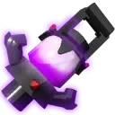{ .lu-ti width="24" loading="lazy" } [Sorcerer Orb 3 (LOT 7408)](../7408.md) | 4 | Rank 3 Specialty Kit Item | 1 matrices; 0 rewards; 0 community references |
| 12985 | { .lu-ti width="24" loading="lazy" } [Sorcerer Orb 3 (LOT 12985)](../12985.md) | 4 | Rank 3 Specialty Kit Item | 1 matrices; 0 rewards; 0 community references |
| 13286 | 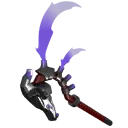{ .lu-ti width="24" loading="lazy" } [Sorcerer Valiant Weapon Proxy (LOT 13286)](../13286.md) | 4 | No client description | 0 matrices; 0 rewards; 0 community references |
| 7548 | { .lu-ti width="24" loading="lazy" } [Space Marauder Launcher 2 (LOT 7548)](../7548.md) | 4 | Rank 2 Specialty Kit Item | 1 matrices; 0 rewards; 0 community references |
| 7550 | { .lu-ti width="24" loading="lazy" } [Space Marauder Launcher 3 (LOT 7550)](../7550.md) | 4 | Rank 3 Specialty Kit Item | 1 matrices; 0 rewards; 0 community references |
| 12988 | { .lu-ti width="24" loading="lazy" } [Space Marauder Launcher 3 (LOT 12988)](../12988.md) | 4 | Rank 3 Specialty Kit Item | 1 matrices; 0 rewards; 0 community references |
| 13285 | { .lu-ti width="24" loading="lazy" } [Space Marauder Valiant Weapon Proxy (LOT 13285)](../13285.md) | 4 | No client description | 0 matrices; 0 rewards; 0 community references |
| 7544 | { .lu-ti width="24" loading="lazy" } [Space Ranger Launcher 2 (LOT 7544)](../7544.md) | 4 | Rank 2 Specialty Kit Item | 1 matrices; 0 rewards; 0 community references |
| 7545 | { .lu-ti width="24" loading="lazy" } [Space Ranger Launcher 3 (LOT 7545)](../7545.md) | 4 | Rank 3 Specialty Kit Item | 1 matrices; 0 rewards; 0 community references |
| 13290 | [Space Ranger Valiant Weapon Proxy (LOT 13290)](../13290.md) | 4 | No client description | 0 matrices; 0 rewards; 0 community references |
| 15909 | { .lu-ti width="24" loading="lazy" } [Stinger (LOT 15909)](../15909.md) | 4 | Fires a powerful shot | 28 matrices; 0 rewards; 1 community references |
| 10462 | { .lu-ti width="24" loading="lazy" } [Strombie Chainsaw (LOT 10462)](../10462.md) | 5 | No client description | 0 matrices; 0 rewards; 0 community references |
