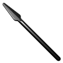
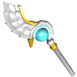
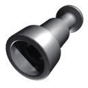
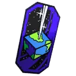
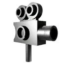
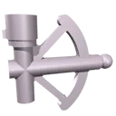

# Left hand — page 2/2

[Item database](../README.md)

Pages: [1](type-5-1.md) | [2](type-5-2.md)

| LOT | Item | Rarity | Description | Source evidence |
| --- | --- | --- | --- | --- |
| 10463 | { .lu-ti width="24" loading="lazy" } [Strombie Hammer (LOT 10463)](../10463.md) | 5 | No client description | 0 matrices; 0 rewards; 0 community references |
| 10464 | { .lu-ti width="24" loading="lazy" } [Strombie Mace (LOT 10464)](../10464.md) | 5 | No client description | 0 matrices; 0 rewards; 0 community references |
| 7556 | { .lu-ti width="24" loading="lazy" } [Summoner Orb 2 (LOT 7556)](../7556.md) | 4 | Rank 2 Specialty Kit Item | 1 matrices; 0 rewards; 0 community references |
| 7557 | { .lu-ti width="24" loading="lazy" } [Summoner Orb 3 (LOT 7557)](../7557.md) | 4 | Rank 3 Specialty Kit Item | 1 matrices; 0 rewards; 0 community references |
| 12922 | { .lu-ti width="24" loading="lazy" } [Summoner Orb 3 (LOT 12922)](../12922.md) | 4 | Rank 3 Specialty Kit Item | 1 matrices; 0 rewards; 0 community references |
| 13287 | { .lu-ti width="24" loading="lazy" } [Summoner Valiant Weapon Proxy (LOT 13287)](../13287.md) | 4 | No client description | 0 matrices; 0 rewards; 0 community references |
| 14841 | { .lu-ti width="24" loading="lazy" } [Superior Black heavy Spear Proxy (LOT 14841)](../14841.md) | 5 | No client description | 0 matrices; 0 rewards; 0 community references |
| 14830 | { .lu-ti width="24" loading="lazy" } [Superior Brown Ninjago Staff Proxy (LOT 14830)](../14830.md) | 5 | No client description | 0 matrices; 0 rewards; 0 community references |
| 14563 | { .lu-ti width="24" loading="lazy" } [Tan Cat's Fish (LOT 14563)](../14563.md) | 3 | No client description | 1 matrices; 0 rewards; 0 community references |
| 6883 | { .lu-ti width="24" loading="lazy" } [Telescope (LOT 6883)](../6883.md) | 2 | No client description | 0 matrices; 1 rewards; 0 community references |
| 12491 | { .lu-ti width="24" loading="lazy" } [TEST (LOT 12491)](../12491.md) | 3 | No client description | 0 matrices; 0 rewards; 0 community references |
| 12619 | { .lu-ti width="24" loading="lazy" } [TEST (LOT 12619)](../12619.md) | 3 | No client description | 0 matrices; 0 rewards; 0 community references |
| 12632 | { .lu-ti width="24" loading="lazy" } [TEST (LOT 12632)](../12632.md) | 3 | No client description | 0 matrices; 0 rewards; 0 community references |
| 12633 | { .lu-ti width="24" loading="lazy" } [TEST (LOT 12633)](../12633.md) | 3 | No client description | 0 matrices; 0 rewards; 0 community references |
| 12639 | { .lu-ti width="24" loading="lazy" } [TEST (LOT 12639)](../12639.md) | 3 | No client description | 0 matrices; 0 rewards; 0 community references |
| 12646 | { .lu-ti width="24" loading="lazy" } [TEST (LOT 12646)](../12646.md) | 3 | No client description | 0 matrices; 0 rewards; 0 community references |
| 12665 | { .lu-ti width="24" loading="lazy" } [TEST (LOT 12665)](../12665.md) | 3 | No client description | 0 matrices; 0 rewards; 0 community references |
| 12805 | { .lu-ti width="24" loading="lazy" } [TEST (LOT 12805)](../12805.md) | 3 | No client description | 0 matrices; 0 rewards; 0 community references |
| 12808 | { .lu-ti width="24" loading="lazy" } [TEST (LOT 12808)](../12808.md) | 3 | No client description | 0 matrices; 0 rewards; 0 community references |
| 3825 | { .lu-ti width="24" loading="lazy" } [Test Beard and Hair (LOT 3825)](../3825.md) | 5 | we can't use this; it's from Harry Potter | 0 matrices; 0 rewards; 0 community references |
| 10479 | { .lu-ti width="24" loading="lazy" } [TEST Enchanted Dragon Tooth (LOT 10479)](../10479.md) | 5 | No client description | 0 matrices; 0 rewards; 0 community references |
| 5726 | [Test Flag for waving - Left Hand (LOT 5726)](../5726.md) | 5 | No client description | 0 matrices; 0 rewards; 0 community references |
| 9614 | { .lu-ti width="24" loading="lazy" } [TEST Left Hand Buccaneer pistol 1 (LOT 9614)](../9614.md) | 5 | No client description | 0 matrices; 0 rewards; 0 community references |
| 9619 | { .lu-ti width="24" loading="lazy" } [TEST Left Hand Buccaneer pistol 2 (LOT 9619)](../9619.md) | 5 | No client description | 0 matrices; 0 rewards; 0 community references |
| 9620 | { .lu-ti width="24" loading="lazy" } [TEST Left Hand Buccaneer pistol 3 (LOT 9620)](../9620.md) | 5 | No client description | 0 matrices; 0 rewards; 0 community references |
| 14240 | { .lu-ti width="24" loading="lazy" } [Test offhand of Testing (LOT 14240)](../14240.md) | 4 | No client description | 0 matrices; 0 rewards; 0 community references |
| 8276 | { .lu-ti width="24" loading="lazy" } [Test Performance Test Shield (LOT 8276)](../8276.md) | 5 | For performance testing accessories | 0 matrices; 0 rewards; 0 community references |
| 13983 | { .lu-ti width="24" loading="lazy" } [Test Rank 2 Shield (LOT 13983)](../13983.md) | 4 | No client description | 0 matrices; 0 rewards; 0 community references |
| 13988 | { .lu-ti width="24" loading="lazy" } [Test Rank 3 Shield (LOT 13988)](../13988.md) | 4 | No client description | 0 matrices; 0 rewards; 0 community references |
| 5955 | { .lu-ti width="24" loading="lazy" } [Test Set ninja1 - shield (LOT 5955)](../5955.md) | 5 | off-hand shield for item set test | 0 matrices; 0 rewards; 0 community references |
| 12592 | { .lu-ti width="24" loading="lazy" } [Test Tak Camera (LOT 12592)](../12592.md) | 4 | No client description | 0 matrices; 0 rewards; 0 community references |
| 1882 | [Test Torch (LOT 1882)](../1882.md) | 5 | No client description | 0 matrices; 0 rewards; 0 community references |
| 13950 | { .lu-ti width="24" loading="lazy" } [test Tower Grid Offhand (LOT 13950)](../13950.md) | 4 | test Tower Grid Offhand | 0 matrices; 0 rewards; 0 community references |
| 13967 | { .lu-ti width="24" loading="lazy" } [test Tower Grid Offhand B (LOT 13967)](../13967.md) | 4 | test Tower Grid Offhand B | 0 matrices; 0 rewards; 0 community references |
| 7661 | { .lu-ti width="24" loading="lazy" } [Test Yegge Banana (LOT 7661)](../7661.md) | 5 | No client description | 0 matrices; 0 rewards; 0 community references |
| 8017 | { .lu-ti width="24" loading="lazy" } [Test&#95;Acc&#95;Epsilon Gun&#95;L (LOT 8017)](../8017.md) | 5 | Test object for brett | 0 matrices; 0 rewards; 0 community references |
| 8009 | { .lu-ti width="24" loading="lazy" } [Test&#95;Acc&#95;ProxyHand2 (LOT 8009)](../8009.md) | 5 | Test object for brett | 0 matrices; 0 rewards; 0 community references |
| 8528 | { .lu-ti width="24" loading="lazy" } [Troll Shield (LOT 8528)](../8528.md) | 2 | No client description | 1 matrices; 0 rewards; 1 community references |
| 8545 | { .lu-ti width="24" loading="lazy" } [Trophy (LOT 8545)](../8545.md) | 5 | Brick is too big to be carried!!! | 0 matrices; 0 rewards; 0 community references |
| 14363 | { .lu-ti width="24" loading="lazy" } [Venture Gear - Daredevil - weapon proxy (LOT 14363)](../14363.md) | 4 | No client description | 0 matrices; 0 rewards; 0 community references |
| 7732 | { .lu-ti width="24" loading="lazy" } [Walkie Talkie (LOT 7732)](../7732.md) | 2 | No client description | 23 matrices; 0 rewards; 1 community references |
| 14192 | { .lu-ti width="24" loading="lazy" } [White Cat's Fish (LOT 14192)](../14192.md) | 3 | No client description | 1 matrices; 0 rewards; 0 community references |
| 14565 | { .lu-ti width="24" loading="lazy" } [White Mouse's Cheese (LOT 14565)](../14565.md) | 3 | No client description | 1 matrices; 0 rewards; 0 community references |
| 12677 | { .lu-ti width="24" loading="lazy" } [Wolf Shield (LOT 12677)](../12677.md) | 4 | No client description | 40 matrices; 1 rewards; 1 community references |
| 12773 | { .lu-ti width="24" loading="lazy" } [Wooden Shield (LOT 12773)](../12773.md) | 2 | No client description | 1 matrices; 0 rewards; 1 community references |
| 8674 | { .lu-ti width="24" loading="lazy" } [Wrench (LOT 8674)](../8674.md) | 3 | No client description | 13 matrices; 0 rewards; 1 community references |
| 3066 | { .lu-ti width="24" loading="lazy" } [Yar Har Har Sextant (LOT 3066)](../3066.md) | 3 | No client description | 0 matrices; 1 rewards; 0 community references |
| 14561 | { .lu-ti width="24" loading="lazy" } [Yellow Frog's Egg (LOT 14561)](../14561.md) | 3 | No client description | 1 matrices; 0 rewards; 0 community references |
| 13805 | [Zwiehander Left Hand Proxy (LOT 13805)](../13805.md) | 1 | No client description | 0 matrices; 0 rewards; 0 community references |
