# Right hand — page 1/3

[Item database](../README.md)

Pages: [1](type-6-1.md) | [2](type-6-2.md) | [3](type-6-3.md)

| LOT | Item | Rarity | Description | Source evidence |
| --- | --- | --- | --- | --- |
| 1846 | [Unnamed LOT 1846 (LOT 1846)](../1846.md) | 1 | No client description | 0 matrices; 0 rewards; 0 community references |
| 1847 | [Unnamed LOT 1847 (LOT 1847)](../1847.md) | 2 | No client description | 0 matrices; 0 rewards; 0 community references |
| 1848 | [Unnamed LOT 1848 (LOT 1848)](../1848.md) | 2 | No client description | 0 matrices; 0 rewards; 0 community references |
| 1850 | [Unnamed LOT 1850 (LOT 1850)](../1850.md) | 1 | No client description | 0 matrices; 0 rewards; 0 community references |
| 2948 | { .lu-ti width="24" loading="lazy" } [Unnamed LOT 2948 (LOT 2948)](../2948.md) | 1 | No client description | 0 matrices; 0 rewards; 0 community references |
| 4876 | 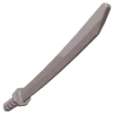{ .lu-ti width="24" loading="lazy" } [Unnamed LOT 4876 (LOT 4876)](../4876.md) | 1 | No client description | 0 matrices; 0 rewards; 0 community references |
| 4877 | 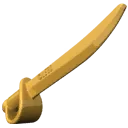{ .lu-ti width="24" loading="lazy" } [Unnamed LOT 4877 (LOT 4877)](../4877.md) | 1 | No client description | 0 matrices; 0 rewards; 0 community references |
| 8146 | { .lu-ti width="24" loading="lazy" } [Unnamed LOT 8146 (LOT 8146)](../8146.md) | 5 | No client description | 0 matrices; 0 rewards; 0 community references |
| 12727 | { .lu-ti width="24" loading="lazy" } [Unnamed LOT 12727 (LOT 12727)](../12727.md) | 4 | No client description | 0 matrices; 0 rewards; 0 community references |
| 13275 | { .lu-ti width="24" loading="lazy" } [Unnamed LOT 13275 (LOT 13275)](../13275.md) | 4 | No client description | 0 matrices; 0 rewards; 0 community references |
| 13276 | { .lu-ti width="24" loading="lazy" } [Unnamed LOT 13276 (LOT 13276)](../13276.md) | 4 | No client description | 0 matrices; 0 rewards; 0 community references |
| 13277 | { .lu-ti width="24" loading="lazy" } [Unnamed LOT 13277 (LOT 13277)](../13277.md) | 4 | No client description | 0 matrices; 0 rewards; 0 community references |
| 13278 | { .lu-ti width="24" loading="lazy" } [Unnamed LOT 13278 (LOT 13278)](../13278.md) | 4 | No client description | 0 matrices; 0 rewards; 0 community references |
| 14090 | { .lu-ti width="24" loading="lazy" } [Unnamed LOT 14090 (LOT 14090)](../14090.md) | 4 | No client description | 0 matrices; 0 rewards; 0 community references |
| 14188 | { .lu-ti width="24" loading="lazy" } [Unnamed LOT 14188 (LOT 14188)](../14188.md) | 3 | No client description | 0 matrices; 0 rewards; 0 community references |
| 14228 | { .lu-ti width="24" loading="lazy" } [Unnamed LOT 14228 (LOT 14228)](../14228.md) | 3 | No client description | 0 matrices; 0 rewards; 0 community references |
| 14548 | { .lu-ti width="24" loading="lazy" } [Unnamed LOT 14548 (LOT 14548)](../14548.md) | 4 | No client description | 0 matrices; 0 rewards; 0 community references |
| 14686 | { .lu-ti width="24" loading="lazy" } [Unnamed LOT 14686 (LOT 14686)](../14686.md) | 2 | No client description | 0 matrices; 0 rewards; 0 community references |
| 14687 | { .lu-ti width="24" loading="lazy" } [Unnamed LOT 14687 (LOT 14687)](../14687.md) | 2 | No client description | 0 matrices; 0 rewards; 0 community references |
| 14688 | { .lu-ti width="24" loading="lazy" } [Unnamed LOT 14688 (LOT 14688)](../14688.md) | 2 | No client description | 0 matrices; 0 rewards; 0 community references |
| 14689 | { .lu-ti width="24" loading="lazy" } [Unnamed LOT 14689 (LOT 14689)](../14689.md) | 2 | No client description | 0 matrices; 0 rewards; 0 community references |
| 14690 | { .lu-ti width="24" loading="lazy" } [Unnamed LOT 14690 (LOT 14690)](../14690.md) | 2 | No client description | 0 matrices; 0 rewards; 0 community references |
| 14704 | 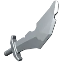{ .lu-ti width="24" loading="lazy" } [Unnamed LOT 14704 (LOT 14704)](../14704.md) | 2 | No client description | 0 matrices; 0 rewards; 0 community references |
| 14706 | { .lu-ti width="24" loading="lazy" } [Unnamed LOT 14706 (LOT 14706)](../14706.md) | 2 | No client description | 0 matrices; 0 rewards; 0 community references |
| 14707 | { .lu-ti width="24" loading="lazy" } [Unnamed LOT 14707 (LOT 14707)](../14707.md) | 2 | No client description | 0 matrices; 0 rewards; 0 community references |
| 14716 | 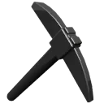{ .lu-ti width="24" loading="lazy" } [Unnamed LOT 14716 (LOT 14716)](../14716.md) | 1 | No client description | 0 matrices; 0 rewards; 0 community references |
| 14717 | { .lu-ti width="24" loading="lazy" } [Unnamed LOT 14717 (LOT 14717)](../14717.md) | 2 | No client description | 0 matrices; 0 rewards; 0 community references |
| 14721 | { .lu-ti width="24" loading="lazy" } [Unnamed LOT 14721 (LOT 14721)](../14721.md) | 2 | No client description | 0 matrices; 0 rewards; 0 community references |
| 14722 | { .lu-ti width="24" loading="lazy" } [Unnamed LOT 14722 (LOT 14722)](../14722.md) | 2 | No client description | 0 matrices; 0 rewards; 0 community references |
| 14727 | { .lu-ti width="24" loading="lazy" } [Unnamed LOT 14727 (LOT 14727)](../14727.md) | 2 | No client description | 0 matrices; 0 rewards; 0 community references |
| 14728 | { .lu-ti width="24" loading="lazy" } [Unnamed LOT 14728 (LOT 14728)](../14728.md) | 2 | No client description | 0 matrices; 0 rewards; 0 community references |
| 14729 | 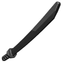{ .lu-ti width="24" loading="lazy" } [Unnamed LOT 14729 (LOT 14729)](../14729.md) | 2 | No client description | 0 matrices; 0 rewards; 0 community references |
| 14779 | { .lu-ti width="24" loading="lazy" } [Unnamed LOT 14779 (LOT 14779)](../14779.md) | 2 | No client description | 0 matrices; 0 rewards; 0 community references |
| 14815 | { .lu-ti width="24" loading="lazy" } [Unnamed LOT 14815 (LOT 14815)](../14815.md) | 2 | No client description | 0 matrices; 0 rewards; 0 community references |
| 14820 | { .lu-ti width="24" loading="lazy" } [Unnamed LOT 14820 (LOT 14820)](../14820.md) | 1 | No client description | 0 matrices; 0 rewards; 0 community references |
| 14821 | { .lu-ti width="24" loading="lazy" } [Unnamed LOT 14821 (LOT 14821)](../14821.md) | 1 | No client description | 0 matrices; 0 rewards; 0 community references |
| 14824 | { .lu-ti width="24" loading="lazy" } [Unnamed LOT 14824 (LOT 14824)](../14824.md) | 4 | No client description | 0 matrices; 0 rewards; 0 community references |
| 14832 | { .lu-ti width="24" loading="lazy" } [Unnamed LOT 14832 (LOT 14832)](../14832.md) | 3 | No client description | 0 matrices; 0 rewards; 0 community references |
| 14838 | { .lu-ti width="24" loading="lazy" } [Unnamed LOT 14838 (LOT 14838)](../14838.md) | 3 | No client description | 0 matrices; 0 rewards; 0 community references |
| 15893 | { .lu-ti width="24" loading="lazy" } [Unnamed LOT 15893 (LOT 15893)](../15893.md) | 3 | No client description | 0 matrices; 0 rewards; 0 community references |
| 16648 | { .lu-ti width="24" loading="lazy" } [Unnamed LOT 16648 (LOT 16648)](../16648.md) | 3 | No client description | 0 matrices; 0 rewards; 0 community references |
| 16680 | { .lu-ti width="24" loading="lazy" } [Unnamed LOT 16680 (LOT 16680)](../16680.md) | 3 | No client description | 0 matrices; 0 rewards; 0 community references |
| 16681 | { .lu-ti width="24" loading="lazy" } [Unnamed LOT 16681 (LOT 16681)](../16681.md) | 3 | No client description | 0 matrices; 0 rewards; 0 community references |
| 16714 | { .lu-ti width="24" loading="lazy" } [Unnamed LOT 16714 (LOT 16714)](../16714.md) | 2 | No client description | 0 matrices; 0 rewards; 0 community references |
| 16718 | { .lu-ti width="24" loading="lazy" } [Unnamed LOT 16718 (LOT 16718)](../16718.md) | 2 | No client description | 0 matrices; 0 rewards; 0 community references |
| 16719 | { .lu-ti width="24" loading="lazy" } [Unnamed LOT 16719 (LOT 16719)](../16719.md) | 2 | No client description | 0 matrices; 0 rewards; 0 community references |
| 16720 | 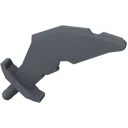{ .lu-ti width="24" loading="lazy" } [Unnamed LOT 16720 (LOT 16720)](../16720.md) | 3 | No client description | 0 matrices; 0 rewards; 0 community references |
| 16629 | { .lu-ti width="24" loading="lazy" } [2011 Championship Sparkler (LOT 16629)](../16629.md) | 1 | No client description | 0 matrices; 1 rewards; 0 community references |
| 7532 | { .lu-ti width="24" loading="lazy" } [Adventurer Crossbow 1 (LOT 7532)](../7532.md) | 4 | Rank 1 Specialty Kit Item | 2 matrices; 0 rewards; 0 community references |
| 7533 | 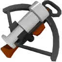{ .lu-ti width="24" loading="lazy" } [Adventurer Crossbow 2 (LOT 7533)](../7533.md) | 4 | Rank 2 Specialty Kit Item | 1 matrices; 0 rewards; 0 community references |
| 7534 | 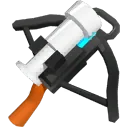{ .lu-ti width="24" loading="lazy" } [Adventurer Crossbow 3 (LOT 7534)](../7534.md) | 4 | Rank 3 Specialty Kit Item | 1 matrices; 0 rewards; 0 community references |
| 14734 | 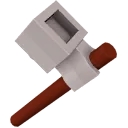{ .lu-ti width="24" loading="lazy" } [Artisan's Hammer (LOT 14734)](../14734.md) | 4 | No client description | 5 matrices; 0 rewards; 1 community references |
| 14356 | { .lu-ti width="24" loading="lazy" } [Assembly Gear - Summoner - weapon proxy (LOT 14356)](../14356.md) | 4 | No client description | 0 matrices; 0 rewards; 0 community references |
| 12437 | { .lu-ti width="24" loading="lazy" } [Banana Gun (LOT 12437)](../12437.md) | 2 | Requires Imagination to fire. | 0 matrices; 1 rewards; 1 community references |
| 8217 | { .lu-ti width="24" loading="lazy" } [Basic Dagger (LOT 8217)](../8217.md) | 1 | No client description | 40 matrices; 0 rewards; 1 community references |
| 6937 | { .lu-ti width="24" loading="lazy" } [Basic Flintlock Pistol (LOT 6937)](../6937.md) | 2 | Requires Imagination to fire. | 1 matrices; 1 rewards; 1 community references |
| 8505 | { .lu-ti width="24" loading="lazy" } [Basic Force Blade (LOT 8505)](../8505.md) | 1 | No client description | 41 matrices; 0 rewards; 1 community references |
| 4883 | { .lu-ti width="24" loading="lazy" } [Basic Hammer (LOT 4883)](../4883.md) | 1 | No client description | 0 matrices; 1 rewards; 0 community references |
| 10433 | { .lu-ti width="24" loading="lazy" } [Basic Hammer (LOT 10433)](../10433.md) | 1 | No client description | 43 matrices; 0 rewards; 0 community references |
| 8219 | { .lu-ti width="24" loading="lazy" } [Basic Javelin (LOT 8219)](../8219.md) | 1 | No client description | 40 matrices; 0 rewards; 1 community references |
| 8218 | { .lu-ti width="24" loading="lazy" } [Basic Pickaxe (LOT 8218)](../8218.md) | 1 | No client description | 40 matrices; 0 rewards; 1 community references |
| 4880 | { .lu-ti width="24" loading="lazy" } [Basic Shortsword (LOT 4880)](../4880.md) | 1 | No client description | 0 matrices; 1 rewards; 0 community references |
| 10431 | { .lu-ti width="24" loading="lazy" } [Basic Shortsword (LOT 10431)](../10431.md) | 1 | No client description | 43 matrices; 0 rewards; 0 community references |
| 5948 | { .lu-ti width="24" loading="lazy" } [Basic Shortsword of Knockback (LOT 5948)](../5948.md) | 2 | No client description | 41 matrices; 0 rewards; 1 community references |
| 3872 | { .lu-ti width="24" loading="lazy" } [Basic Shovel (LOT 3872)](../3872.md) | 1 | No client description | 39 matrices; 0 rewards; 1 community references |
| 4881 | { .lu-ti width="24" loading="lazy" } [Basic Spear (LOT 4881)](../4881.md) | 1 | No client description | 0 matrices; 1 rewards; 0 community references |
| 10432 | { .lu-ti width="24" loading="lazy" } [Basic Spear (LOT 10432)](../10432.md) | 1 | No client description | 43 matrices; 0 rewards; 0 community references |
| 6203 | { .lu-ti width="24" loading="lazy" } [Basic Spear of Stunning (LOT 6203)](../6203.md) | 2 | No client description | 39 matrices; 0 rewards; 1 community references |
| 12802 | { .lu-ti width="24" loading="lazy" } [Bat Lord Staff (LOT 12802)](../12802.md) | 4 | No client description | 40 matrices; 0 rewards; 1 community references |
| 12777 | { .lu-ti width="24" loading="lazy" } [Battle Bread (LOT 12777)](../12777.md) | 2 | No client description | 1 matrices; 0 rewards; 1 community references |
| 12595 | { .lu-ti width="24" loading="lazy" } [Blaster (LOT 12595)](../12595.md) | 2 | Requires Imagination to fire. | 0 matrices; 1 rewards; 1 community references |
| 16601 | { .lu-ti width="24" loading="lazy" } [Bright Lance (LOT 16601)](../16601.md) | 2 | No client description | 28 matrices; 0 rewards; 1 community references |
| 7400 | { .lu-ti width="24" loading="lazy" } [Buccaneer Pistol &amp; Cutlass 1 (LOT 7400)](../7400.md) | 4 | Rank 1 Specialty Kit Item | 2 matrices; 0 rewards; 0 community references |
| 7401 | { .lu-ti width="24" loading="lazy" } [Buccaneer Pistol &amp; Cutlass 2 (LOT 7401)](../7401.md) | 4 | Rank 2 Specialty Kit Item | 1 matrices; 0 rewards; 0 community references |
| 7402 | { .lu-ti width="24" loading="lazy" } [Buccaneer Pistol &amp; Cutlass 3 (LOT 7402)](../7402.md) | 4 | Rank 3 Specialty Kit Item | 1 matrices; 0 rewards; 0 community references |
| 12982 | { .lu-ti width="24" loading="lazy" } [Buccaneer Pistol &amp; Cutlass 3 (LOT 12982)](../12982.md) | 4 | Rank 3 Specialty Kit Item | 1 matrices; 0 rewards; 0 community references |
| 6848 | { .lu-ti width="24" loading="lazy" } [Captain Jack's Volleygun (LOT 6848)](../6848.md) | 4 | Requires Imagination to fire. | 1 matrices; 1 rewards; 0 community references |
| 6846 | { .lu-ti width="24" loading="lazy" } [Captain's Cutlass (LOT 6846)](../6846.md) | 4 | No client description | 1 matrices; 1 rewards; 1 community references |
| 12778 | { .lu-ti width="24" loading="lazy" } [Carrot of Courage (LOT 12778)](../12778.md) | 2 | No client description | 1 matrices; 0 rewards; 1 community references |
| 14715 | { .lu-ti width="24" loading="lazy" } [Cave Diver (LOT 14715)](../14715.md) | 4 | No client description | 0 matrices; 1 rewards; 1 community references |
| 2589 | { .lu-ti width="24" loading="lazy" } [Celebration Wand (LOT 2589)](../2589.md) | 4 | No client description | 0 matrices; 1 rewards; 0 community references |
| 16147 | { .lu-ti width="24" loading="lazy" } [Chopov's Maelstrom Dark Blade (LOT 16147)](../16147.md) | 3 | The Skeletons forged this from pure Maelstrom! | 1 matrices; 0 rewards; 1 community references |
| 13605 | [Crate Disguise Right Hand Proxy (LOT 13605)](../13605.md) | 1 | No client description | 0 matrices; 0 rewards; 0 community references |
| 16598 | { .lu-ti width="24" loading="lazy" } [Crimson Yari (LOT 16598)](../16598.md) | 2 | No client description | 28 matrices; 0 rewards; 1 community references |
| 12316 | { .lu-ti width="24" loading="lazy" } [Cutlass of Blocking (LOT 12316)](../12316.md) | 2 | No client description | 4 matrices; 0 rewards; 1 community references |
| 7535 | { .lu-ti width="24" loading="lazy" } [Daredevil Flareguns 1 (LOT 7535)](../7535.md) | 4 | Rank 1 Specialty Kit Item | 2 matrices; 0 rewards; 0 community references |
| 7536 | { .lu-ti width="24" loading="lazy" } [Daredevil Flareguns 2 (LOT 7536)](../7536.md) | 4 | Rank 2 Specialty Kit Item | 1 matrices; 0 rewards; 0 community references |
| 7537 | 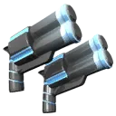{ .lu-ti width="24" loading="lazy" } [Daredevil Flareguns 3 (LOT 7537)](../7537.md) | 4 | Rank 3 Specialty Kit Item | 1 matrices; 0 rewards; 0 community references |
| 12994 | { .lu-ti width="24" loading="lazy" } [Daredevil Flareguns 3 (LOT 12994)](../12994.md) | 4 | Rank 3 Specialty Kit Item | 1 matrices; 0 rewards; 0 community references |
| 16595 | { .lu-ti width="24" loading="lazy" } [Disciple's Katana (LOT 16595)](../16595.md) | 1 | No client description | 28 matrices; 0 rewards; 1 community references |
| 12761 | 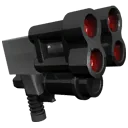{ .lu-ti width="24" loading="lazy" } [Double Blaster (LOT 12761)](../12761.md) | 4 | No client description | 1 matrices; 0 rewards; 1 community references |
| 13755 | [Dragon Disguise  Right Hand Proxy (LOT 13755)](../13755.md) | 1 | Used in Nexus Tower mission chains | 0 matrices; 0 rewards; 0 community references |
| 3015 | 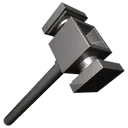{ .lu-ti width="24" loading="lazy" } [Dragon Style Maelstrom Hammer (LOT 3015)](../3015.md) | 3 | No client description | 0 matrices; 1 rewards; 1 community references |
| 10486 | [Dragon Style- Right Hand Proxy (LOT 10486)](../10486.md) | 2 | Used to fill the hand will using dragon style | 0 matrices; 0 rewards; 0 community references |
| 12759 | { .lu-ti width="24" loading="lazy" } [Elite Basher (LOT 12759)](../12759.md) | 3 | No client description | 0 matrices; 1 rewards; 1 community references |
| 10434 | { .lu-ti width="24" loading="lazy" } [Elite Battle Axe (LOT 10434)](../10434.md) | 3 | No client description | 11 matrices; 0 rewards; 1 community references |
| 7284 | { .lu-ti width="24" loading="lazy" } [Elite Blade of Knock Down (LOT 7284)](../7284.md) | 4 | No client description | 11 matrices; 0 rewards; 1 community references |
| 12718 | { .lu-ti width="24" loading="lazy" } [Elite Broadsword (LOT 12718)](../12718.md) | 3 | No client description | 40 matrices; 0 rewards; 1 community references |
| 7078 | { .lu-ti width="24" loading="lazy" } [Elite Cleaver (LOT 7078)](../7078.md) | 3 | No client description | 0 matrices; 1 rewards; 1 community references |
| 7075 | { .lu-ti width="24" loading="lazy" } [Elite Club (LOT 7075)](../7075.md) | 2 | No client description | 0 matrices; 1 rewards; 1 community references |
| 8478 | { .lu-ti width="24" loading="lazy" } [Elite Fang (LOT 8478)](../8478.md) | 3 | No client description | 11 matrices; 0 rewards; 1 community references |
| 13923 | { .lu-ti width="24" loading="lazy" } [Elite Force Blade (LOT 13923)](../13923.md) | 3 | No client description | 0 matrices; 0 rewards; 0 community references |
| 8476 | { .lu-ti width="24" loading="lazy" } [Elite Force Blade of Lightning (LOT 8476)](../8476.md) | 4 | No client description | 0 matrices; 1 rewards; 1 community references |
| 8470 | { .lu-ti width="24" loading="lazy" } [Elite Halberd (LOT 8470)](../8470.md) | 3 | No client description | 11 matrices; 0 rewards; 0 community references |
| 13919 | { .lu-ti width="24" loading="lazy" } [Elite Halberd (LOT 13919)](../13919.md) | 3 | No client description | 0 matrices; 0 rewards; 0 community references |
| 8469 | { .lu-ti width="24" loading="lazy" } [Elite Ice Saw (LOT 8469)](../8469.md) | 3 | No client description | 11 matrices; 0 rewards; 1 community references |
| 12728 | { .lu-ti width="24" loading="lazy" } [Elite Javelin (LOT 12728)](../12728.md) | 3 | No client description | 40 matrices; 0 rewards; 1 community references |
| 8472 | { .lu-ti width="24" loading="lazy" } [Elite Katana (LOT 8472)](../8472.md) | 3 | No client description | 11 matrices; 0 rewards; 1 community references |
| 12729 | 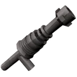{ .lu-ti width="24" loading="lazy" } [Elite Long Barrel Blaster (LOT 12729)](../12729.md) | 4 | No client description | 40 matrices; 0 rewards; 1 community references |
| 6938 | { .lu-ti width="24" loading="lazy" } [Elite Long Sword (LOT 6938)](../6938.md) | 3 | No client description | 1 matrices; 1 rewards; 1 community references |
| 8447 | { .lu-ti width="24" loading="lazy" } [Elite Oar (LOT 8447)](../8447.md) | 3 | No client description | 11 matrices; 0 rewards; 1 community references |
| 8450 | { .lu-ti width="24" loading="lazy" } [Elite Pickaxe (LOT 8450)](../8450.md) | 3 | No client description | 11 matrices; 0 rewards; 1 community references |
| 7283 | { .lu-ti width="24" loading="lazy" } [Elite Saw of Drowsiness (LOT 7283)](../7283.md) | 4 | No client description | 11 matrices; 0 rewards; 1 community references |
| 8473 | { .lu-ti width="24" loading="lazy" } [Elite Scimitar (LOT 8473)](../8473.md) | 3 | No client description | 11 matrices; 0 rewards; 1 community references |
| 8453 | { .lu-ti width="24" loading="lazy" } [Elite Shortsword (LOT 8453)](../8453.md) | 3 | No client description | 11 matrices; 0 rewards; 1 community references |
| 12760 | { .lu-ti width="24" loading="lazy" } [Elite Sword of Blocking (LOT 12760)](../12760.md) | 4 | No client description | 0 matrices; 1 rewards; 1 community references |
| 7394 | { .lu-ti width="24" loading="lazy" } [Engineer Wrench 1 (LOT 7394)](../7394.md) | 4 | Rank 1 Specialty Kit Item | 2 matrices; 0 rewards; 0 community references |
| 7395 | { .lu-ti width="24" loading="lazy" } [Engineer Wrench 2 (LOT 7395)](../7395.md) | 4 | Rank 2 Specialty Kit Item | 1 matrices; 0 rewards; 0 community references |
| 7396 | 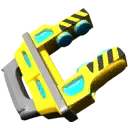{ .lu-ti width="24" loading="lazy" } [Engineer Wrench 3 (LOT 7396)](../7396.md) | 4 | Rank 3 Specialty Kit Item | 1 matrices; 0 rewards; 0 community references |
| 12964 | 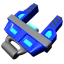{ .lu-ti width="24" loading="lazy" } [Engineer Wrench 3 (LOT 12964)](../12964.md) | 4 | Rank 3 Specialty Kit Item | 1 matrices; 0 rewards; 0 community references |
| 8483 | 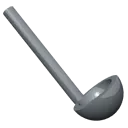{ .lu-ti width="24" loading="lazy" } [Exceptional Ladle (LOT 8483)](../8483.md) | 3 | No client description | 13 matrices; 0 rewards; 1 community references |
| 8480 | 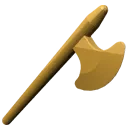{ .lu-ti width="24" loading="lazy" } [Exceptional Axe (LOT 8480)](../8480.md) | 3 | No client description | 13 matrices; 0 rewards; 1 community references |
| 8494 | { .lu-ti width="24" loading="lazy" } [Exceptional Dagger (LOT 8494)](../8494.md) | 3 | No client description | 13 matrices; 0 rewards; 1 community references |
| 2990 | { .lu-ti width="24" loading="lazy" } [Exceptional Flintlock Pistol (LOT 2990)](../2990.md) | 3 | Requires Imagination to fire. | 1 matrices; 1 rewards; 1 community references |
| 6847 | { .lu-ti width="24" loading="lazy" } [Exceptional Flintlock Rifle (LOT 6847)](../6847.md) | 3 | Requires Imagination to fire. | 1 matrices; 1 rewards; 1 community references |
| 1891 | { .lu-ti width="24" loading="lazy" } [Exceptional Flintlock Rifle of Blasting (LOT 1891)](../1891.md) | 3 | Requires Imagination to fire. | 1 matrices; 1 rewards; 1 community references |
| 8495 | { .lu-ti width="24" loading="lazy" } [Exceptional Force Blade (LOT 8495)](../8495.md) | 3 | No client description | 13 matrices; 0 rewards; 1 community references |
| 7851 | { .lu-ti width="24" loading="lazy" } [Exceptional Guitar (LOT 7851)](../7851.md) | 3 | No client description | 0 matrices; 1 rewards; 1 community references |
| 2643 | { .lu-ti width="24" loading="lazy" } [Exceptional Hatchet (LOT 2643)](../2643.md) | 3 | No client description | 14 matrices; 0 rewards; 1 community references |
| 6939 | { .lu-ti width="24" loading="lazy" } [Exceptional Ice Saw of Freezing (LOT 6939)](../6939.md) | 4 | No client description | 0 matrices; 1 rewards; 1 community references |
| 8331 | 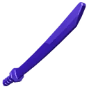{ .lu-ti width="24" loading="lazy" } [Exceptional Katana (LOT 8331)](../8331.md) | 1 | No client description | 18 matrices; 0 rewards; 1 community references |
| 3065 | { .lu-ti width="24" loading="lazy" } [Exceptional Katana of Shielding (LOT 3065)](../3065.md) | 4 | No client description | 0 matrices; 1 rewards; 1 community references |
| 6845 | { .lu-ti width="24" loading="lazy" } [Exceptional Long Axe (LOT 6845)](../6845.md) | 2 | No client description | 0 matrices; 1 rewards; 1 community references |
| 6936 | { .lu-ti width="24" loading="lazy" } [Exceptional Morning Star (LOT 6936)](../6936.md) | 3 | No client description | 1 matrices; 1 rewards; 1 community references |
| 12549 | { .lu-ti width="24" loading="lazy" } [Exceptional Pea Shooter (LOT 12549)](../12549.md) | 3 | Requires Imagination to fire. | 1 matrices; 0 rewards; 1 community references |
| 14107 | { .lu-ti width="24" loading="lazy" } [Exceptional Pea Shooter MK Ia (LOT 14107)](../14107.md) | 4 | Requires Imagination to fire. | 0 matrices; 0 rewards; 0 community references |
| 13423 | 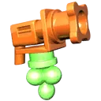{ .lu-ti width="24" loading="lazy" } [Exceptional Pea Shooter MKII (LOT 13423)](../13423.md) | 3 | Requires Imagination to fire. | 0 matrices; 1 rewards; 1 community references |
| 8482 | { .lu-ti width="24" loading="lazy" } [Exceptional Pipe Wrench (LOT 8482)](../8482.md) | 3 | No client description | 13 matrices; 0 rewards; 1 community references |
| 8487 | { .lu-ti width="24" loading="lazy" } [Exceptional Spear (LOT 8487)](../8487.md) | 3 | No client description | 13 matrices; 0 rewards; 1 community references |
| 12730 | 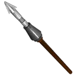{ .lu-ti width="24" loading="lazy" } [Fantastic Pilum (LOT 12730)](../12730.md) | 4 | No client description | 40 matrices; 0 rewards; 1 community references |
| 14684 | { .lu-ti width="24" loading="lazy" } [Flowing Katana (LOT 14684)](../14684.md) | 2 | No client description | 28 matrices; 0 rewards; 1 community references |
| 16597 | { .lu-ti width="24" loading="lazy" } [Forged Katana (LOT 16597)](../16597.md) | 1 | No client description | 27 matrices; 0 rewards; 1 community references |
| 16012 | { .lu-ti width="24" loading="lazy" } [Frakjaw's Maelstrom Battle Mace (LOT 16012)](../16012.md) | 2 | The Skeletons forged this from pure Maelstrom! | 1 matrices; 0 rewards; 0 community references |
| 14683 | { .lu-ti width="24" loading="lazy" } [Fury Katana (LOT 14683)](../14683.md) | 2 | No client description | 1 matrices; 0 rewards; 1 community references |
| 13585 | { .lu-ti width="24" loading="lazy" } [Gat Gun Sprayer (LOT 13585)](../13585.md) | 4 | No client description | 1 matrices; 0 rewards; 1 community references |
| 13583 | { .lu-ti width="24" loading="lazy" } [Gem Hammer (LOT 13583)](../13583.md) | 4 | No client description | 1 matrices; 0 rewards; 1 community references |
| 8305 | { .lu-ti width="24" loading="lazy" } [GF Survival Zone Control Object (LOT 8305)](../8305.md) | 5 | GF Zone Control Object for Survival | 0 matrices; 0 rewards; 0 community references |
| 3293 | [GM Only - Flamethrower (LOT 3293)](../3293.md) | 5 | No client description | 0 matrices; 0 rewards; 0 community references |
| 2243 | { .lu-ti width="24" loading="lazy" } [GM Only - Hammer of Doom (LOT 2243)](../2243.md) | 5 | No client description | 0 matrices; 0 rewards; 0 community references |
| 13424 | { .lu-ti width="24" loading="lazy" } [GM Smack Downer (LOT 13424)](../13424.md) | 4 | No client description | 0 matrices; 0 rewards; 0 community references |
| 12725 | { .lu-ti width="24" loading="lazy" } [Golden Battle Axe (LOT 12725)](../12725.md) | 3 | No client description | 1 matrices; 0 rewards; 1 community references |
| 6852 | { .lu-ti width="24" loading="lazy" } [Great Composite Axe (LOT 6852)](../6852.md) | 1 | No client description | 18 matrices; 0 rewards; 1 community references |
| 8474 | { .lu-ti width="24" loading="lazy" } [Great Corseque (LOT 8474)](../8474.md) | 1 | No client description | 20 matrices; 0 rewards; 0 community references |
| 13147 | { .lu-ti width="24" loading="lazy" } [Great Corseque (LOT 13147)](../13147.md) | 1 | No client description | 0 matrices; 1 rewards; 0 community references |
| 8455 | { .lu-ti width="24" loading="lazy" } [Great Crescent Wrench (LOT 8455)](../8455.md) | 1 | No client description | 18 matrices; 0 rewards; 0 community references |
| 12315 | { .lu-ti width="24" loading="lazy" } [Great Crescent Wrench (LOT 12315)](../12315.md) | 1 | No client description | 4 matrices; 0 rewards; 0 community references |
| 7069 | { .lu-ti width="24" loading="lazy" } [Great Fang (LOT 7069)](../7069.md) | 1 | No client description | 18 matrices; 0 rewards; 1 community references |
| 9731 | { .lu-ti width="24" loading="lazy" } [Great Flintlock Rifle of Blasting (LOT 9731)](../9731.md) | 3 | Requires Imagination to fire. | 0 matrices; 1 rewards; 0 community references |
| 1720 | 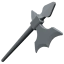{ .lu-ti width="24" loading="lazy" } [Great Halberd (LOT 1720)](../1720.md) | 1 | No client description | 0 matrices; 1 rewards; 1 community references |
| 1879 | { .lu-ti width="24" loading="lazy" } [Great Katana (LOT 1879)](../1879.md) | 1 | No client description | 0 matrices; 1 rewards; 1 community references |
| 8471 | { .lu-ti width="24" loading="lazy" } [Great Katana of Freezing (LOT 8471)](../8471.md) | 2 | No client description | 0 matrices; 1 rewards; 1 community references |
| 2586 | { .lu-ti width="24" loading="lazy" } [Great Longsword of Lightning (LOT 2586)](../2586.md) | 4 | No client description | 11 matrices; 0 rewards; 1 community references |
| 5696 | { .lu-ti width="24" loading="lazy" } [Great Mattock (LOT 5696)](../5696.md) | 1 | No client description | 18 matrices; 1 rewards; 1 community references |
| 2616 | { .lu-ti width="24" loading="lazy" } [Great Prismatic Wrench (LOT 2616)](../2616.md) | 2 | No client description | 0 matrices; 1 rewards; 1 community references |
| 6204 | { .lu-ti width="24" loading="lazy" } [Great Scimitar of Rooting (LOT 6204)](../6204.md) | 2 | No client description | 0 matrices; 1 rewards; 1 community references |
| 8451 | { .lu-ti width="24" loading="lazy" } [Great Shortsword (LOT 8451)](../8451.md) | 1 | No client description | 0 matrices; 1 rewards; 1 community references |
| 5954 | { .lu-ti width="24" loading="lazy" } [Great Shortsword of Stunning (LOT 5954)](../5954.md) | 2 | No client description | 1 matrices; 1 rewards; 1 community references |
| 12733 | { .lu-ti width="24" loading="lazy" } [Heavy Staff (LOT 12733)](../12733.md) | 4 | Two-Handed Weapon | 1 matrices; 0 rewards; 1 community references |
| 13922 | { .lu-ti width="24" loading="lazy" } [Heroic Force Blade (LOT 13922)](../13922.md) | 4 | No client description | 0 matrices; 0 rewards; 0 community references |
| 13918 | { .lu-ti width="24" loading="lazy" } [Heroic Halberd (LOT 13918)](../13918.md) | 4 | No client description | 0 matrices; 0 rewards; 0 community references |
| 12722 | { .lu-ti width="24" loading="lazy" } [Heroic Trident of Lightning (LOT 12722)](../12722.md) | 4 | No client description | 40 matrices; 0 rewards; 1 community references |
| 14685 | { .lu-ti width="24" loading="lazy" } [Hidden Blade (LOT 14685)](../14685.md) | 2 | No client description | 0 matrices; 1 rewards; 1 community references |
| 13760 | [Horseman Disguise  Right Hand Proxy (LOT 13760)](../13760.md) | 1 | Used in Nexus Tower mission chains | 0 matrices; 0 rewards; 0 community references |
| 13550 | [Imagination Backpack Right Hand Proxy - Gathers imagination (LOT 13550)](../13550.md) | 1 | No client description | 0 matrices; 0 rewards; 0 community references |
| 11195 | { .lu-ti width="24" loading="lazy" } [Imagination Spinjitzu Double-Bladed Dagger (LOT 11195)](../11195.md) | 2 | Charge-up to release a Spinjitzu attack! | 1 matrices; 1 rewards; 0 community references |
| 6881 | { .lu-ti width="24" loading="lazy" } [Improved Composite Axe (LOT 6881)](../6881.md) | 2 | No client description | 40 matrices; 0 rewards; 1 community references |
| 3077 | { .lu-ti width="24" loading="lazy" } [Improved Crescent Wrench (LOT 3077)](../3077.md) | 2 | No client description | 39 matrices; 0 rewards; 0 community references |
| 9263 | { .lu-ti width="24" loading="lazy" } [Improved Crescent Wrench (LOT 9263)](../9263.md) | 2 | No client description | 23 matrices; 0 rewards; 0 community references |
| 4824 | { .lu-ti width="24" loading="lazy" } [Improved Firefighter Axe (LOT 4824)](../4824.md) | 2 | No client description | 23 matrices; 0 rewards; 1 community references |
| 6742 | { .lu-ti width="24" loading="lazy" } [Improved Fishing Pole (LOT 6742)](../6742.md) | 2 | No client description | 40 matrices; 0 rewards; 1 community references |
| 7733 | { .lu-ti width="24" loading="lazy" } [Improved Frying Pan (LOT 7733)](../7733.md) | 2 | No client description | 23 matrices; 0 rewards; 1 community references |
| 8498 | { .lu-ti width="24" loading="lazy" } [Improved Hatchet (LOT 8498)](../8498.md) | 2 | No client description | 39 matrices; 0 rewards; 1 community references |
| 8501 | { .lu-ti width="24" loading="lazy" } [Improved Ice Saw (LOT 8501)](../8501.md) | 2 | No client description | 41 matrices; 0 rewards; 1 community references |
| 2622 | { .lu-ti width="24" loading="lazy" } [Improved Ladle (LOT 2622)](../2622.md) | 2 | No client description | 23 matrices; 0 rewards; 1 community references |
| 8504 | { .lu-ti width="24" loading="lazy" } [Improved Longsword (LOT 8504)](../8504.md) | 2 | No client description | 40 matrices; 0 rewards; 1 community references |
| 7734 | { .lu-ti width="24" loading="lazy" } [Improved Push Broom (LOT 7734)](../7734.md) | 2 | No client description | 23 matrices; 0 rewards; 0 community references |
| 13545 | { .lu-ti width="24" loading="lazy" } [Improved Push Broom (LOT 13545)](../13545.md) | 2 | No client description | 0 matrices; 0 rewards; 0 community references |
| 11432 | { .lu-ti width="24" loading="lazy" } [Improved Revolver (LOT 11432)](../11432.md) | 2 | Requires Imagination to fire. | 3 matrices; 0 rewards; 1 community references |
| 8502 | { .lu-ti width="24" loading="lazy" } [Improved Scimitar (LOT 8502)](../8502.md) | 2 | No client description | 39 matrices; 0 rewards; 1 community references |
| 10436 | { .lu-ti width="24" loading="lazy" } [Improved Scythe of Whirlwind (LOT 10436)](../10436.md) | 3 | Two-Handed Weapon | 1 matrices; 0 rewards; 1 community references |
| 8509 | { .lu-ti width="24" loading="lazy" } [Improved Trident (LOT 8509)](../8509.md) | 2 | No client description | 40 matrices; 0 rewards; 1 community references |
| 3870 | { .lu-ti width="24" loading="lazy" } [Improved Witch Broom (LOT 3870)](../3870.md) | 2 | No client description | 23 matrices; 0 rewards; 1 community references |
| 7526 | { .lu-ti width="24" loading="lazy" } [Inventor Improved Launcher 1 (LOT 7526)](../7526.md) | 4 | Rank 1 Specialty Kit Item | 2 matrices; 0 rewards; 0 community references |
| 7527 | { .lu-ti width="24" loading="lazy" } [Inventor Improved Launcher 2 (LOT 7527)](../7527.md) | 4 | Rank 2 Specialty Kit Item | 1 matrices; 0 rewards; 0 community references |
| 7528 | { .lu-ti width="24" loading="lazy" } [Inventor Improved Launcher 3 (LOT 7528)](../7528.md) | 4 | Rank 3 Specialty Kit Item | 1 matrices; 0 rewards; 0 community references |
| 12314 | { .lu-ti width="24" loading="lazy" } [Javelin of Lightning (LOT 12314)](../12314.md) | 2 | No client description | 0 matrices; 1 rewards; 1 community references |
| 7848 | { .lu-ti width="24" loading="lazy" } [Jonesy's Fishing Pole (LOT 7848)](../7848.md) | 1 | No client description | 0 matrices; 1 rewards; 1 community references |
| 14780 | { .lu-ti width="24" loading="lazy" } [Kai's Training Dagger (LOT 14780)](../14780.md) | 3 | No client description | 28 matrices; 0 rewards; 1 community references |
| 7391 | { .lu-ti width="24" loading="lazy" } [Knight Greatsword 1 (LOT 7391)](../7391.md) | 4 | Rank 1 Specialty Kit Item | 2 matrices; 0 rewards; 0 community references |
| 7392 | 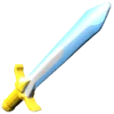{ .lu-ti width="24" loading="lazy" } [Knight Greatsword 2 (LOT 7392)](../7392.md) | 4 | Rank 2 Specialty Kit Item | 1 matrices; 0 rewards; 0 community references |
