# Right hand — page 2/3

[Item database](../README.md)

Pages: [1](type-6-1.md) | [2](type-6-2.md) | [3](type-6-3.md)

| LOT | Item | Rarity | Description | Source evidence |
| --- | --- | --- | --- | --- |
| 7393 | 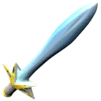{ .lu-ti width="24" loading="lazy" } [Knight Greatsword 3 (LOT 7393)](../7393.md) | 4 | Rank 3 Specialty Kit Item | 1 matrices; 0 rewards; 0 community references |
| 12968 | { .lu-ti width="24" loading="lazy" } [Knight Greatsword 3 (LOT 12968)](../12968.md) | 4 | Rank 3 Specialty Kit Item | 1 matrices; 0 rewards; 0 community references |
| 16149 | { .lu-ti width="24" loading="lazy" } [Krazi's Maelstrom Bone (LOT 16149)](../16149.md) | 3 | The Skeletons forged this from pure Maelstrom! | 1 matrices; 0 rewards; 0 community references |
| 13586 | 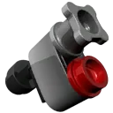{ .lu-ti width="24" loading="lazy" } [Launcher (LOT 13586)](../13586.md) | 4 | No client description | 1 matrices; 0 rewards; 1 community references |
| 12726 | 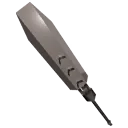{ .lu-ti width="24" loading="lazy" } [Little Friend (LOT 12726)](../12726.md) | 3 | Two-Handed Weapon | 1 matrices; 0 rewards; 1 community references |
| 12313 | { .lu-ti width="24" loading="lazy" } [Lucky Woodsman's Axe (LOT 12313)](../12313.md) | 3 | No client description | 0 matrices; 1 rewards; 1 community references |
| 16150 | { .lu-ti width="24" loading="lazy" } [Maelstrom Blacksmith's Hammer (LOT 16150)](../16150.md) | 2 | The Skeletons forged this from pure Maelstrom! | 1 matrices; 0 rewards; 0 community references |
| 16060 | { .lu-ti width="24" loading="lazy" } [Maelstrom Bone Axe (LOT 16060)](../16060.md) | 2 | The Skeletons forged this from pure Maelstrom! | 1 matrices; 0 rewards; 0 community references |
| 16148 | { .lu-ti width="24" loading="lazy" } [Maelstrom Bone Dagger (LOT 16148)](../16148.md) | 2 | The Skeletons forged this from pure Maelstrom! | 1 matrices; 0 rewards; 0 community references |
| 14472 | { .lu-ti width="24" loading="lazy" } [Maelstrom Dagger (LOT 14472)](../14472.md) | 1 | The Skeletons forged this from pure Maelstrom! | 0 matrices; 0 rewards; 0 community references |
| 16632 | 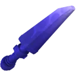{ .lu-ti width="24" loading="lazy" } [Maelstrom Dagger (LOT 16632)](../16632.md) | 1 | The Skeletons forged this from pure Maelstrom! | 2 matrices; 0 rewards; 0 community references |
| 16146 | 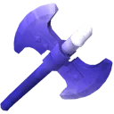{ .lu-ti width="24" loading="lazy" } [Maelstrom Double-Axe (LOT 16146)](../16146.md) | 2 | The Skeletons forged this from pure Maelstrom! | 1 matrices; 0 rewards; 0 community references |
| 2963 | 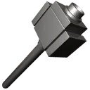{ .lu-ti width="24" loading="lazy" } [Mantis Style Maelstrom Hammer (LOT 2963)](../2963.md) | 3 | No client description | 0 matrices; 1 rewards; 1 community references |
| 10487 | [Mantis Style- Right Hand Proxy (LOT 10487)](../10487.md) | 2 | Used to fill the hand will using mantis style | 0 matrices; 0 rewards; 0 community references |
| 12732 | 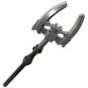{ .lu-ti width="24" loading="lazy" } [Massive Spear (LOT 12732)](../12732.md) | 3 | Two-Handed Weapon | 1 matrices; 0 rewards; 1 community references |
| 9528 | { .lu-ti width="24" loading="lazy" } [metal sword (LOT 9528)](../9528.md) | 5 | Standard Knight Sword Metal | 0 matrices; 0 rewards; 0 community references |
| 13582 | { .lu-ti width="24" loading="lazy" } [Mole Whacker (LOT 13582)](../13582.md) | 4 | Two-Handed Weapon | 1 matrices; 0 rewards; 1 community references |
| 3016 | { .lu-ti width="24" loading="lazy" } [Monkey Style Maelstrom Hammer (LOT 3016)](../3016.md) | 3 | No client description | 0 matrices; 1 rewards; 1 community references |
| 12927 | { .lu-ti width="24" loading="lazy" } [Mosaic Wand (LOT 12927)](../12927.md) | 3 | No client description | 40 matrices; 0 rewards; 1 community references |
| 6934 | { .lu-ti width="24" loading="lazy" } [Net of Bees (LOT 6934)](../6934.md) | 2 | No client description | 1 matrices; 1 rewards; 1 community references |
| 10481 | { .lu-ti width="24" loading="lazy" } [Ninja Flag - Mesh Effect (LOT 10481)](../10481.md) | 5 | No client description | 0 matrices; 0 rewards; 0 community references |
| 12567 | 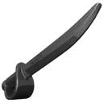{ .lu-ti width="24" loading="lazy" } [NPC Assembly Scout Wrench (LOT 12567)](../12567.md) | 5 | Assembly Scout Wrench | 0 matrices; 0 rewards; 0 community references |
| 3654 | { .lu-ti width="24" loading="lazy" } [NPC Beastie Blocks Microphone (LOT 3654)](../3654.md) | 5 | No client description | 0 matrices; 0 rewards; 0 community references |
| 16617 | { .lu-ti width="24" loading="lazy" } [NPC Black Samurai Axe (LOT 16617)](../16617.md) | 5 | No client description | 0 matrices; 0 rewards; 0 community references |
| 16619 | { .lu-ti width="24" loading="lazy" } [NPC Blue Samurai Axe (LOT 16619)](../16619.md) | 5 | No client description | 0 matrices; 0 rewards; 0 community references |
| 12447 | { .lu-ti width="24" loading="lazy" } [NPC Bone Axe (LOT 12447)](../12447.md) | 5 | NPC Bone Axe | 0 matrices; 0 rewards; 0 community references |
| 5646 | [NPC Camera (LOT 5646)](../5646.md) | 5 | Camera held by obstacle course camera man | 0 matrices; 0 rewards; 0 community references |
| 13358 | 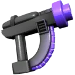{ .lu-ti width="24" loading="lazy" } [NPC Caveman Club Vendor (LOT 13358)](../13358.md) | 5 | No client description | 0 matrices; 0 rewards; 0 community references |
| 13354 | { .lu-ti width="24" loading="lazy" } [NPC CheerLeader Pom 1 Vendor (LOT 13354)](../13354.md) | 5 | No client description | 0 matrices; 0 rewards; 0 community references |
| 13353 | { .lu-ti width="24" loading="lazy" } [NPC Clown Horn Vendor (LOT 13353)](../13353.md) | 5 | No client description | 0 matrices; 0 rewards; 0 community references |
| 13351 | { .lu-ti width="24" loading="lazy" } [NPC Cowboy Gun Vendor (LOT 13351)](../13351.md) | 5 | No client description | 0 matrices; 0 rewards; 0 community references |
| 13348 | { .lu-ti width="24" loading="lazy" } [NPC Crash Dummy Wrench Vendor (LOT 13348)](../13348.md) | 5 | No client description | 0 matrices; 0 rewards; 0 community references |
| 14836 | { .lu-ti width="24" loading="lazy" } [NPC Cringe Lo Flower (LOT 14836)](../14836.md) | 5 | No client description | 0 matrices; 0 rewards; 0 community references |
| 10154 | { .lu-ti width="24" loading="lazy" } [NPC Duke Exetor Sword (LOT 10154)](../10154.md) | 5 | NPC Duke Exetor Sword | 0 matrices; 0 rewards; 0 community references |
| 6503 | { .lu-ti width="24" loading="lazy" } [NPC Epsilon Gun (LOT 6503)](../6503.md) | 5 | NPC Epsilon Gun | 0 matrices; 0 rewards; 0 community references |
| 8080 | { .lu-ti width="24" loading="lazy" } [NPC Epsilon Starcracker Gun (LOT 8080)](../8080.md) | 5 | NPC Epsilon Starcracker Gun | 0 matrices; 0 rewards; 0 community references |
| 5645 | [NPC Flagwaver Flag (LOT 5645)](../5645.md) | 5 | Flag waved by obstacle course flag waver | 0 matrices; 0 rewards; 0 community references |
| 6967 | { .lu-ti width="24" loading="lazy" } [NPC GF Monkey Pistol (LOT 6967)](../6967.md) | 5 | gun only for gf monkey | 0 matrices; 0 rewards; 0 community references |
| 6506 | [NPC Greeble Cannon Left (LOT 6506)](../6506.md) | 5 | No client description | 0 matrices; 0 rewards; 0 community references |
| 6505 | [NPC Greeble Cannon Right (LOT 6505)](../6505.md) | 5 | No client description | 0 matrices; 0 rewards; 0 community references |
| 6612 | { .lu-ti width="24" loading="lazy" } [NPC Guard Gun (LOT 6612)](../6612.md) | 5 | Gun the Guards carry | 0 matrices; 0 rewards; 0 community references |
| 10054 | { .lu-ti width="24" loading="lazy" } [NPC Hael Storm Sword (LOT 10054)](../10054.md) | 5 | NPC Hael Storm Sword | 0 matrices; 0 rewards; 0 community references |
| 5658 | [NPC Jackhammer (LOT 5658)](../5658.md) | 5 | bad offset | 0 matrices; 0 rewards; 0 community references |
| 13345 | { .lu-ti width="24" loading="lazy" } [NPC Jiu Jitsu Master Trophy Vendor (LOT 13345)](../13345.md) | 5 | No client description | 0 matrices; 0 rewards; 0 community references |
| 10503 | { .lu-ti width="24" loading="lazy" } [NPC Knight Vignette Weapon (LOT 10503)](../10503.md) | 4 | No client description | 0 matrices; 0 rewards; 0 community references |
| 12428 | { .lu-ti width="24" loading="lazy" } [NPC Large Bone Sickle (LOT 12428)](../12428.md) | 5 | NPC Large Bone Sickle | 0 matrices; 0 rewards; 0 community references |
| 13343 | { .lu-ti width="24" loading="lazy" } [NPC LifeGuard Board Vendor (LOT 13343)](../13343.md) | 5 | No client description | 0 matrices; 0 rewards; 0 community references |
| 14158 | { .lu-ti width="24" loading="lazy" } [NPC Maelstrom Bone (LOT 14158)](../14158.md) | 5 | No client description | 0 matrices; 0 rewards; 0 community references |
| 14017 | 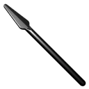{ .lu-ti width="24" loading="lazy" } [NPC Maelstrom Bone Axe (LOT 14017)](../14017.md) | 5 | NPC Maelstrom Bone Axe | 0 matrices; 0 rewards; 0 community references |
| 14019 | 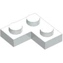{ .lu-ti width="24" loading="lazy" } [NPC Maelstrom Bow (LOT 14019)](../14019.md) | 5 | No client description | 0 matrices; 0 rewards; 0 community references |
| 14015 | 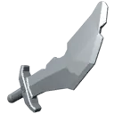{ .lu-ti width="24" loading="lazy" } [NPC Maelstrom Dark Blade (LOT 14015)](../14015.md) | 5 | No client description | 0 matrices; 0 rewards; 0 community references |
| 16480 | { .lu-ti width="24" loading="lazy" } [NPC Maelstrom Double Bladed Bone Axe (LOT 16480)](../16480.md) | 5 | NPC Maelstrom Double Bladed Bone Axe | 0 matrices; 0 rewards; 0 community references |
| 14159 | { .lu-ti width="24" loading="lazy" } [NPC Maelstrom Double Bladed Bone Dagger (LOT 14159)](../14159.md) | 5 | No client description | 0 matrices; 0 rewards; 0 community references |
| 14018 | { .lu-ti width="24" loading="lazy" } [NPC Maelstrom Engine Weapon (LOT 14018)](../14018.md) | 5 | NPC Maelstrom Engine Weapon | 0 matrices; 0 rewards; 0 community references |
| 14016 | { .lu-ti width="24" loading="lazy" } [NPC Maelstrom Hammer (LOT 14016)](../14016.md) | 5 | No client description | 0 matrices; 0 rewards; 0 community references |
| 14014 | { .lu-ti width="24" loading="lazy" } [NPC Maelstrom Katana (LOT 14014)](../14014.md) | 5 | No client description | 0 matrices; 0 rewards; 0 community references |
| 14160 | { .lu-ti width="24" loading="lazy" } [NPC Maelstrom Large Spear (LOT 14160)](../14160.md) | 5 | No client description | 0 matrices; 0 rewards; 0 community references |
| 14161 | { .lu-ti width="24" loading="lazy" } [NPC Maelstrom Mace (LOT 14161)](../14161.md) | 5 | No client description | 0 matrices; 0 rewards; 0 community references |
| 14162 | { .lu-ti width="24" loading="lazy" } [NPC Maelstrom Major Spear (LOT 14162)](../14162.md) | 5 | No client description | 0 matrices; 0 rewards; 0 community references |
| 14163 | { .lu-ti width="24" loading="lazy" } [NPC Maelstrom Nick Dagger (LOT 14163)](../14163.md) | 5 | No client description | 0 matrices; 0 rewards; 0 community references |
| 14164 | { .lu-ti width="24" loading="lazy" } [NPC Maelstrom Pick (LOT 14164)](../14164.md) | 5 | No client description | 0 matrices; 0 rewards; 0 community references |
| 14165 | { .lu-ti width="24" loading="lazy" } [NPC Maelstrom Scythe (LOT 14165)](../14165.md) | 5 | No client description | 0 matrices; 0 rewards; 0 community references |
| 14166 | { .lu-ti width="24" loading="lazy" } [NPC Maelstrom Spear (LOT 14166)](../14166.md) | 5 | No client description | 0 matrices; 0 rewards; 0 community references |
| 14167 | { .lu-ti width="24" loading="lazy" } [NPC Maelstrom Staff (LOT 14167)](../14167.md) | 5 | No client description | 0 matrices; 0 rewards; 0 community references |
| 14168 | { .lu-ti width="24" loading="lazy" } [NPC Maelstrom Thunder Wand (LOT 14168)](../14168.md) | 5 | No client description | 0 matrices; 0 rewards; 0 community references |
| 13340 | { .lu-ti width="24" loading="lazy" } [NPC Magician wand Vendor (LOT 13340)](../13340.md) | 5 | No client description | 0 matrices; 0 rewards; 0 community references |
| 5692 | { .lu-ti width="24" loading="lazy" } [NPC Map - right hand (LOT 5692)](../5692.md) | 5 | No client description | 0 matrices; 0 rewards; 0 community references |
| 8515 | { .lu-ti width="24" loading="lazy" } [NPC Mardolf Staff (LOT 8515)](../8515.md) | 5 | NPC Mardolf Staff | 0 matrices; 0 rewards; 0 community references |
| 8110 | { .lu-ti width="24" loading="lazy" } [NPC Melodie Foxtrot Weapon (LOT 8110)](../8110.md) | 5 | NPC Melodie Foxtrot Weapon | 0 matrices; 0 rewards; 0 community references |
| 16682 | { .lu-ti width="24" loading="lazy" } [NPC Numbchuck knife (LOT 16682)](../16682.md) | 5 | No client description | 0 matrices; 0 rewards; 0 community references |
| 13338 | { .lu-ti width="24" loading="lazy" } [NPC Nurse Needle Vendor (LOT 13338)](../13338.md) | 5 | No client description | 0 matrices; 0 rewards; 0 community references |
| 12093 | { .lu-ti width="24" loading="lazy" } [NPC Old Man Winter Staff (LOT 12093)](../12093.md) | 5 | NPC Old Man Winter Staff | 0 matrices; 0 rewards; 0 community references |
| 12608 | { .lu-ti width="24" loading="lazy" } [NPC Paradox Scout Staff (LOT 12608)](../12608.md) | 5 | Paradox ScoutStaff | 0 matrices; 0 rewards; 0 community references |
| 13336 | { .lu-ti width="24" loading="lazy" } [NPC Pharaoh Staff Vendor (LOT 13336)](../13336.md) | 5 | No client description | 0 matrices; 0 rewards; 0 community references |
| 16594 | 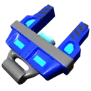{ .lu-ti width="24" loading="lazy" } [NPC Red Bull horn (LOT 16594)](../16594.md) | 5 | NPC Red Bull horn | 0 matrices; 0 rewards; 0 community references |
| 14835 | { .lu-ti width="24" loading="lazy" } [NPC Red Samurai Axe (LOT 14835)](../14835.md) | 5 | No client description | 0 matrices; 0 rewards; 0 community references |
| 16588 | { .lu-ti width="24" loading="lazy" } [NPC Red Wand (LOT 16588)](../16588.md) | 5 | NPC Red Wand | 0 matrices; 0 rewards; 0 community references |
| 7114 | { .lu-ti width="24" loading="lazy" } [NPC Renee Gun (LOT 7114)](../7114.md) | 5 | NPC Renee Gun | 0 matrices; 0 rewards; 0 community references |
| 3327 | [NPC Reporter's Camera (LOT 3327)](../3327.md) | 5 | No client description | 0 matrices; 0 rewards; 0 community references |
| 3328 | { .lu-ti width="24" loading="lazy" } [NPC Reporters Microphone (LOT 3328)](../3328.md) | 5 | No client description | 0 matrices; 0 rewards; 0 community references |
| 6512 | { .lu-ti width="24" loading="lazy" } [NPC Rusty Wrench (LOT 6512)](../6512.md) | 5 | NPC Rusty Wrench | 0 matrices; 0 rewards; 0 community references |
| 16514 | { .lu-ti width="24" loading="lazy" } [NPC Sensei Wu Staff (LOT 16514)](../16514.md) | 5 | NPC Sensei Wu Staff | 0 matrices; 0 rewards; 0 community references |
| 6494 | { .lu-ti width="24" loading="lazy" } [NPC Sentinel Scout Spear (LOT 6494)](../6494.md) | 5 | Spear used by Sentinel Scout NPCs | 0 matrices; 0 rewards; 0 community references |
| 12650 | { .lu-ti width="24" loading="lazy" } [NPC Sentinel Scout Sword (LOT 12650)](../12650.md) | 5 | NPC Sentinel Scout Sword | 0 matrices; 0 rewards; 0 community references |
| 3063 | { .lu-ti width="24" loading="lazy" } [NPC Short Staff (LOT 3063)](../3063.md) | 5 | bad offset | 0 matrices; 0 rewards; 0 community references |
| 16618 | { .lu-ti width="24" loading="lazy" } [NPC Silver Samurai Axe (LOT 16618)](../16618.md) | 5 | No client description | 0 matrices; 0 rewards; 0 community references |
| 13330 | { .lu-ti width="24" loading="lazy" } [NPC Singer Mic Vendor (LOT 13330)](../13330.md) | 5 | No client description | 0 matrices; 0 rewards; 0 community references |
| 13329 | { .lu-ti width="24" loading="lazy" } [NPC Skater Boardi Vendor (LOT 13329)](../13329.md) | 5 | No client description | 0 matrices; 0 rewards; 0 community references |
| 12450 | { .lu-ti width="24" loading="lazy" } [NPC Skeleton Engineer Flame Thrower (LOT 12450)](../12450.md) | 5 | NPC Skeleton Engineer Flame Thrower | 0 matrices; 0 rewards; 0 community references |
| 12449 | { .lu-ti width="24" loading="lazy" } [NPC Skeleton Pick Axe (LOT 12449)](../12449.md) | 5 | NPC Skeleton Pick Axe | 0 matrices; 0 rewards; 0 community references |
| 13325 | { .lu-ti width="24" loading="lazy" } [NPC Skier Ski Vendor (LOT 13325)](../13325.md) | 5 | No client description | 0 matrices; 0 rewards; 0 community references |
| 6501 | { .lu-ti width="24" loading="lazy" } [NPC Skylane Helm In Hand (LOT 6501)](../6501.md) | 5 | NPC Skylane Helm in hand | 0 matrices; 0 rewards; 0 community references |
| 12448 | { .lu-ti width="24" loading="lazy" } [NPC Small Bone Pick (LOT 12448)](../12448.md) | 5 | NPC Small Bone Pick | 0 matrices; 0 rewards; 0 community references |
| 13323 | { .lu-ti width="24" loading="lazy" } [NPC Spaceman Gun Vendor (LOT 13323)](../13323.md) | 5 | No client description | 0 matrices; 0 rewards; 0 community references |
| 13318 | { .lu-ti width="24" loading="lazy" } [NPC Spartan Spear Vendor (LOT 13318)](../13318.md) | 5 | No client description | 0 matrices; 0 rewards; 0 community references |
| 13317 | { .lu-ti width="24" loading="lazy" } [NPC Surfer Board Vendor (LOT 13317)](../13317.md) | 5 | No client description | 0 matrices; 0 rewards; 0 community references |
| 13316 | { .lu-ti width="24" loading="lazy" } [NPC Vampire Bat Vendor (LOT 13316)](../13316.md) | 5 | No client description | 0 matrices; 0 rewards; 0 community references |
| 13309 | { .lu-ti width="24" loading="lazy" } [NPC Vanda Darkflame Sword Right (LOT 13309)](../13309.md) | 5 | No client description | 0 matrices; 0 rewards; 0 community references |
| 12624 | { .lu-ti width="24" loading="lazy" } [NPC Venture Scout Axe (LOT 12624)](../12624.md) | 5 | Venture Scout Axe | 0 matrices; 0 rewards; 0 community references |
| 12625 | { .lu-ti width="24" loading="lazy" } [NPC Venture Scout Gun (LOT 12625)](../12625.md) | 5 | Venture Scout Gun | 0 matrices; 0 rewards; 0 community references |
| 14434 | { .lu-ti width="24" loading="lazy" } [NPC Weapon of Spinning Earth Staff (LOT 14434)](../14434.md) | 5 | No client description | 0 matrices; 0 rewards; 0 community references |
| 13315 | { .lu-ti width="24" loading="lazy" } [NPC WeightLifter Weight Vendor (LOT 13315)](../13315.md) | 5 | No client description | 0 matrices; 0 rewards; 0 community references |
| 5659 | [NPC Welding Torch (LOT 5659)](../5659.md) | 5 | No client description | 0 matrices; 0 rewards; 0 community references |
| 8519 | { .lu-ti width="24" loading="lazy" } [NPCJohnny Thunder Whip (LOT 8519)](../8519.md) | 5 | NPCJohnny Thunder Whip | 0 matrices; 0 rewards; 0 community references |
| 6972 | { .lu-ti width="24" loading="lazy" } [Numb Chuck's Maelstrom Staff (LOT 6972)](../6972.md) | 4 | No client description | 0 matrices; 1 rewards; 1 community references |
| 14123 | { .lu-ti width="24" loading="lazy" } [One-Eye's Blunderbuss (LOT 14123)](../14123.md) | 3 | Requires Imagination to fire. | 0 matrices; 0 rewards; 0 community references |
| 13584 | { .lu-ti width="24" loading="lazy" } [Overcharged Blaster (LOT 13584)](../13584.md) | 4 | No client description | 1 matrices; 0 rewards; 1 community references |
| 3014 | { .lu-ti width="24" loading="lazy" } [Panda Style Maelstrom Hammer (LOT 3014)](../3014.md) | 3 | No client description | 0 matrices; 1 rewards; 1 community references |
| 10488 | [Panda Style- Right Hand Proxy (LOT 10488)](../10488.md) | 2 | Used to fill the hand while using panda style | 0 matrices; 0 rewards; 0 community references |
| 12427 | { .lu-ti width="24" loading="lazy" } [PaperFigShield (LOT 12427)](../12427.md) | 3 | No client description | 0 matrices; 0 rewards; 0 community references |
| 14324 | { .lu-ti width="24" loading="lazy" } [Paradox Gear - Space Marauder - weapon proxy (LOT 14324)](../14324.md) | 4 | No client description | 0 matrices; 0 rewards; 0 community references |
| 14124 | { .lu-ti width="24" loading="lazy" } [Peg-Leg's Blunderbuss (LOT 14124)](../14124.md) | 3 | Requires Imagination to fire. | 0 matrices; 0 rewards; 0 community references |
| 10480 | { .lu-ti width="24" loading="lazy" } [Pirate Flag - Mesh Effect (LOT 10480)](../10480.md) | 5 | Used in the pirate flag wave emote | 0 matrices; 0 rewards; 0 community references |
| 7044 | { .lu-ti width="24" loading="lazy" } [Pirate Hook (LOT 7044)](../7044.md) | 4 | Equip to use the Pirate-only builds. | 0 matrices; 1 rewards; 0 community references |
| 9525 | 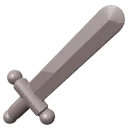{ .lu-ti width="24" loading="lazy" } [plastic sword (LOT 9525)](../9525.md) | 5 | Standard Knight Sword | 0 matrices; 0 rewards; 0 community references |
| 14378 | { .lu-ti width="24" loading="lazy" } [Plunger Gun (LOT 14378)](../14378.md) | 2 | Shoot targets around Avant Gardens with this here gizmo! | 0 matrices; 0 rewards; 0 community references |
| 8508 | 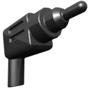{ .lu-ti width="24" loading="lazy" } [Pneumatic Drill of Blasting (LOT 8508)](../8508.md) | 3 | Requires Imagination to fire. | 0 matrices; 1 rewards; 0 community references |
| 14764 | { .lu-ti width="24" loading="lazy" } [Purified Axe (LOT 14764)](../14764.md) | 2 | No client description | 1 matrices; 1 rewards; 1 community references |
| 16151 | { .lu-ti width="24" loading="lazy" } [Purified Battle Mace (LOT 16151)](../16151.md) | 4 | No client description | 1 matrices; 1 rewards; 1 community references |
| 14736 | 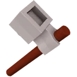{ .lu-ti width="24" loading="lazy" } [Purified Blacksmith's Hammer (LOT 14736)](../14736.md) | 2 | No client description | 1 matrices; 1 rewards; 1 community references |
| 14731 | { .lu-ti width="24" loading="lazy" } [Purified Bone (LOT 14731)](../14731.md) | 4 | No client description | 1 matrices; 1 rewards; 1 community references |
| 14801 | { .lu-ti width="24" loading="lazy" } [Purified Bone Dagger (LOT 14801)](../14801.md) | 2 | No client description | 1 matrices; 1 rewards; 1 community references |
| 16488 | 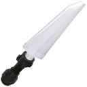{ .lu-ti width="24" loading="lazy" } [Purified Dagger (LOT 16488)](../16488.md) | 1 | No client description | 1 matrices; 0 rewards; 1 community references |
| 14691 | 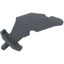{ .lu-ti width="24" loading="lazy" } [Purified Dark Blade (LOT 14691)](../14691.md) | 3 | No client description | 1 matrices; 1 rewards; 1 community references |
| 14837 | { .lu-ti width="24" loading="lazy" } [Purified Double-Axe (LOT 14837)](../14837.md) | 3 | No client description | 1 matrices; 1 rewards; 1 community references |
| 7850 | 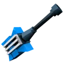{ .lu-ti width="24" loading="lazy" } [Quality Bass Guitar (LOT 7850)](../7850.md) | 3 | No client description | 0 matrices; 1 rewards; 1 community references |
| 8503 | { .lu-ti width="24" loading="lazy" } [Quality Corseque (LOT 8503)](../8503.md) | 3 | No client description | 20 matrices; 0 rewards; 1 community references |
| 8497 | { .lu-ti width="24" loading="lazy" } [Quality Cutlass (LOT 8497)](../8497.md) | 3 | No client description | 19 matrices; 0 rewards; 1 community references |
| 8506 | { .lu-ti width="24" loading="lazy" } [Quality Dirk (LOT 8506)](../8506.md) | 3 | No client description | 21 matrices; 0 rewards; 1 community references |
| 6844 | { .lu-ti width="24" loading="lazy" } [Quality Flintlock Pistol of Blasting (LOT 6844)](../6844.md) | 4 | Requires Imagination to fire. | 1 matrices; 1 rewards; 1 community references |
| 16251 | 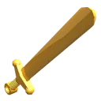{ .lu-ti width="24" loading="lazy" } [Quality Longsword (LOT 16251)](../16251.md) | 3 | No client description | 1 matrices; 0 rewards; 1 community references |
| 8499 | 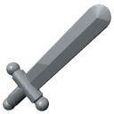{ .lu-ti width="24" loading="lazy" } [Quality Shortsword (LOT 8499)](../8499.md) | 3 | No client description | 1 matrices; 1 rewards; 1 community references |
| 8486 | 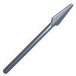{ .lu-ti width="24" loading="lazy" } [Quality Spear (LOT 8486)](../8486.md) | 3 | No client description | 0 matrices; 1 rewards; 1 community references |
| 8500 | { .lu-ti width="24" loading="lazy" } [Quality Woodsman's Axe (LOT 8500)](../8500.md) | 3 | No client description | 19 matrices; 0 rewards; 1 community references |
| 16602 | { .lu-ti width="24" loading="lazy" } [Rage (LOT 16602)](../16602.md) | 2 | No client description | 27 matrices; 0 rewards; 1 community references |
| 4996 | [Right Drumstick (LOT 4996)](../4996.md) | 5 | Drum equip for Concert QB | 0 matrices; 0 rewards; 0 community references |
| 7517 | 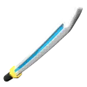{ .lu-ti width="24" loading="lazy" } [Samurai Katana 1 (LOT 7517)](../7517.md) | 4 | Rank 1 Specialty Kit Item | 2 matrices; 0 rewards; 0 community references |
| 7518 | 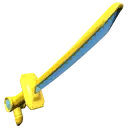{ .lu-ti width="24" loading="lazy" } [Samurai Katana 2 (LOT 7518)](../7518.md) | 4 | Rank 2 Specialty Kit Item | 1 matrices; 0 rewards; 0 community references |
| 7519 | 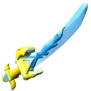{ .lu-ti width="24" loading="lazy" } [Samurai Katana 3 (LOT 7519)](../7519.md) | 4 | Rank 3 Specialty Kit Item | 1 matrices; 0 rewards; 0 community references |
| 12977 | { .lu-ti width="24" loading="lazy" } [Samurai Katana 3 (LOT 12977)](../12977.md) | 4 | Rank 3 Specialty Kit Item | 1 matrices; 0 rewards; 0 community references |
| 14714 | { .lu-ti width="24" loading="lazy" } [Sankaku Yari (LOT 14714)](../14714.md) | 3 | No client description | 3 matrices; 0 rewards; 1 community references |
| 12596 | { .lu-ti width="24" loading="lazy" } [Savage Club (LOT 12596)](../12596.md) | 2 | Two-Handed Weapon | 0 matrices; 1 rewards; 1 community references |
| 12486 | 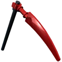{ .lu-ti width="24" loading="lazy" } [Scarlet Scythe (LOT 12486)](../12486.md) | 3 | Two-Handed Weapon | 1 matrices; 0 rewards; 1 community references |
| 14318 | 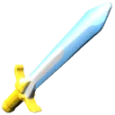{ .lu-ti width="24" loading="lazy" } [Sentinel Gear - Knight - weapon proxy (LOT 14318)](../14318.md) | 4 | No client description | 0 matrices; 0 rewards; 0 community references |
| 14682 | { .lu-ti width="24" loading="lazy" } [Shimmering Katana (LOT 14682)](../14682.md) | 2 | No client description | 28 matrices; 0 rewards; 1 community references |
| 16600 | { .lu-ti width="24" loading="lazy" } [Shimmering Yari (LOT 16600)](../16600.md) | 2 | No client description | 27 matrices; 0 rewards; 1 community references |
| 7523 | 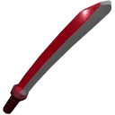{ .lu-ti width="24" loading="lazy" } [Shinobi Katana 1 (LOT 7523)](../7523.md) | 4 | Rank 1 Specialty Kit Item | 2 matrices; 0 rewards; 0 community references |
| 7524 | 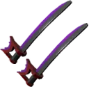{ .lu-ti width="24" loading="lazy" } [Shinobi Katana 2 (LOT 7524)](../7524.md) | 4 | Rank 2 Specialty Kit Item | 1 matrices; 0 rewards; 0 community references |
| 7525 | 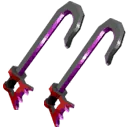{ .lu-ti width="24" loading="lazy" } [Shinobi Katana 3 (LOT 7525)](../7525.md) | 4 | Rank 3 Specialty Kit Item | 1 matrices; 0 rewards; 0 community references |
| 2631 | { .lu-ti width="24" loading="lazy" } [Shiver Me Timbers Axe (LOT 2631)](../2631.md) | 4 | No client description | 2 matrices; 1 rewards; 1 community references |
| 13750 | [Skeletonling Disguise Right Hand Proxy (LOT 13750)](../13750.md) | 1 | Used in Nexus Tower mission chains | 0 matrices; 0 rewards; 0 community references |
| 14122 | 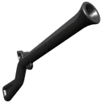{ .lu-ti width="24" loading="lazy" } [Skyme's Blunderbuss (LOT 14122)](../14122.md) | 4 | Requires Imagination to fire. | 0 matrices; 0 rewards; 0 community references |
| 13014 | { .lu-ti width="24" loading="lazy" } [Soap Gun (LOT 13014)](../13014.md) | 3 | Clean up Nexus Tower with this! | 0 matrices; 1 rewards; 1 community references |
| 7397 | 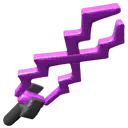{ .lu-ti width="24" loading="lazy" } [Sorcerer Wand 1 (LOT 7397)](../7397.md) | 4 | Rank 1 Specialty Kit Item | 2 matrices; 0 rewards; 0 community references |
| 7398 | { .lu-ti width="24" loading="lazy" } [Sorcerer Wand 2 (LOT 7398)](../7398.md) | 4 | Rank 2 Specialty Kit Item | 1 matrices; 0 rewards; 0 community references |
| 7399 | 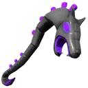{ .lu-ti width="24" loading="lazy" } [Sorcerer Wand 3 (LOT 7399)](../7399.md) | 4 | Rank 3 Specialty Kit Item | 1 matrices; 0 rewards; 0 community references |
| 12984 | { .lu-ti width="24" loading="lazy" } [Sorcerer Wand 3 (LOT 12984)](../12984.md) | 4 | Rank 3 Specialty Kit Item | 1 matrices; 0 rewards; 0 community references |
| 7520 | { .lu-ti width="24" loading="lazy" } [Space Marauder Blaster 1 (LOT 7520)](../7520.md) | 4 | Rank 1 Specialty Kit Item | 2 matrices; 0 rewards; 0 community references |
| 7521 | 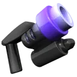{ .lu-ti width="24" loading="lazy" } [Space Marauder Blaster 2 (LOT 7521)](../7521.md) | 4 | Rank 2 Specialty Kit Item | 1 matrices; 0 rewards; 0 community references |
| 7522 | { .lu-ti width="24" loading="lazy" } [Space Marauder Blaster 3 (LOT 7522)](../7522.md) | 4 | Rank 3 Specialty Kit Item | 1 matrices; 0 rewards; 0 community references |
| 12987 | { .lu-ti width="24" loading="lazy" } [Space Marauder Blaster 3 (LOT 12987)](../12987.md) | 4 | Rank 3 Specialty Kit Item | 1 matrices; 0 rewards; 0 community references |
| 7514 | { .lu-ti width="24" loading="lazy" } [Space Ranger Zipgun 1 (LOT 7514)](../7514.md) | 4 | Rank 1 Specialty Kit Item | 2 matrices; 0 rewards; 0 community references |
| 7515 | 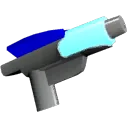{ .lu-ti width="24" loading="lazy" } [Space Ranger Zipgun 2 (LOT 7515)](../7515.md) | 4 | Rank 2 Specialty Kit Item | 1 matrices; 0 rewards; 0 community references |
| 7516 | 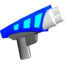{ .lu-ti width="24" loading="lazy" } [Space Ranger Zipgun 3 (LOT 7516)](../7516.md) | 4 | Rank 3 Specialty Kit Item | 1 matrices; 0 rewards; 0 community references |
| 12514 | { .lu-ti width="24" loading="lazy" } [Spark Thrower (LOT 12514)](../12514.md) | 3 | No client description | 0 matrices; 1 rewards; 1 community references |
| 12731 | { .lu-ti width="24" loading="lazy" } [Spike Hammer (LOT 12731)](../12731.md) | 4 | No client description | 40 matrices; 0 rewards; 1 community references |
| 14840 | { .lu-ti width="24" loading="lazy" } [Spinning Yari (LOT 14840)](../14840.md) | 2 | No client description | 28 matrices; 0 rewards; 1 community references |
| 14678 | 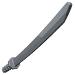{ .lu-ti width="24" loading="lazy" } [Stone Katana (LOT 14678)](../14678.md) | 2 | No client description | 0 matrices; 1 rewards; 1 community references |
| 16596 | 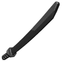{ .lu-ti width="24" loading="lazy" } [Student's Katana (LOT 16596)](../16596.md) | 1 | No client description | 28 matrices; 0 rewards; 1 community references |
| 7529 | 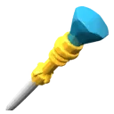{ .lu-ti width="24" loading="lazy" } [Summoner Staff 1 (LOT 7529)](../7529.md) | 4 | Rank 1 Specialty Kit Item | 2 matrices; 0 rewards; 0 community references |
| 7530 | { .lu-ti width="24" loading="lazy" } [Summoner Staff 2 (LOT 7530)](../7530.md) | 4 | Rank 2 Specialty Kit Item | 1 matrices; 0 rewards; 0 community references |
| 7531 | { .lu-ti width="24" loading="lazy" } [Summoner Staff 3 (LOT 7531)](../7531.md) | 4 | Rank 3 Specialty Kit Item | 1 matrices; 0 rewards; 0 community references |
| 12921 | { .lu-ti width="24" loading="lazy" } [Summoner Staff 3 (LOT 12921)](../12921.md) | 4 | Rank 3 Specialty Kit Item | 1 matrices; 0 rewards; 0 community references |
| 3855 | { .lu-ti width="24" loading="lazy" } [Super Bobbejaan Spanner (LOT 3855)](../3855.md) | 2 | No client description | 18 matrices; 0 rewards; 1 community references |
| 12719 | { .lu-ti width="24" loading="lazy" } [Super Cleaver (LOT 12719)](../12719.md) | 2 | No client description | 40 matrices; 0 rewards; 1 community references |
| 9258 | { .lu-ti width="24" loading="lazy" } [Super Composite Axe (LOT 9258)](../9258.md) | 2 | No client description | 19 matrices; 0 rewards; 1 community references |
| 8475 | 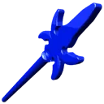{ .lu-ti width="24" loading="lazy" } [Super Corseque (LOT 8475)](../8475.md) | 2 | No client description | 18 matrices; 0 rewards; 1 community references |
| 12720 | { .lu-ti width="24" loading="lazy" } [Super Dagger (LOT 12720)](../12720.md) | 2 | No client description | 40 matrices; 0 rewards; 1 community references |
| 8477 | { .lu-ti width="24" loading="lazy" } [Super Dirk (LOT 8477)](../8477.md) | 2 | No client description | 18 matrices; 0 rewards; 1 community references |
| 12721 | { .lu-ti width="24" loading="lazy" } [Super Fang (LOT 12721)](../12721.md) | 2 | No client description | 40 matrices; 0 rewards; 0 community references |
| 12774 | { .lu-ti width="24" loading="lazy" } [Super Frankfurter (LOT 12774)](../12774.md) | 3 | No client description | 0 matrices; 0 rewards; 0 community references |
| 8454 | { .lu-ti width="24" loading="lazy" } [Super Hairbrush (LOT 8454)](../8454.md) | 2 | No client description | 19 matrices; 0 rewards; 1 community references |
| 8448 | { .lu-ti width="24" loading="lazy" } [Super Hatchet (LOT 8448)](../8448.md) | 2 | No client description | 18 matrices; 0 rewards; 0 community references |
| 12775 | { .lu-ti width="24" loading="lazy" } [Super Hatchet (LOT 12775)](../12775.md) | 2 | No client description | 1 matrices; 0 rewards; 0 community references |
| 12724 | { .lu-ti width="24" loading="lazy" } [Super Morning Star (LOT 12724)](../12724.md) | 2 | No client description | 40 matrices; 0 rewards; 1 community references |
| 12776 | { .lu-ti width="24" loading="lazy" } [Super Scimitar (LOT 12776)](../12776.md) | 2 | No client description | 1 matrices; 0 rewards; 1 community references |
| 8452 | { .lu-ti width="24" loading="lazy" } [Super Shortsword (LOT 8452)](../8452.md) | 2 | No client description | 18 matrices; 0 rewards; 1 community references |
| 8449 | { .lu-ti width="24" loading="lazy" } [Super Shovel (LOT 8449)](../8449.md) | 2 | No client description | 18 matrices; 0 rewards; 1 community references |
| 8468 | 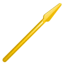{ .lu-ti width="24" loading="lazy" } [Super Spear (LOT 8468)](../8468.md) | 2 | No client description | 19 matrices; 0 rewards; 1 community references |
| 3121 | { .lu-ti width="24" loading="lazy" } [Superior Composite Mace (LOT 3121)](../3121.md) | 2 | No client description | 3 matrices; 0 rewards; 1 community references |
| 8343 | 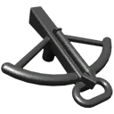{ .lu-ti width="24" loading="lazy" } [Superior Crossbow of Blasting (LOT 8343)](../8343.md) | 3 | Requires Imagination to fire. | 1 matrices; 1 rewards; 0 community references |
| 13921 | { .lu-ti width="24" loading="lazy" } [Superior Crossbow of Blasting (LOT 13921)](../13921.md) | 3 | Requires Imagination to fire. | 0 matrices; 0 rewards; 0 community references |
| 2630 | 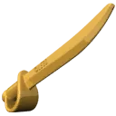{ .lu-ti width="24" loading="lazy" } [Superior Cutlass (LOT 2630)](../2630.md) | 2 | No client description | 1 matrices; 1 rewards; 1 community references |
| 6973 | { .lu-ti width="24" loading="lazy" } [Superior Fish on a Stick (LOT 6973)](../6973.md) | 2 | No client description | 21 matrices; 0 rewards; 1 community references |
| 8490 | { .lu-ti width="24" loading="lazy" } [Superior Halberd (LOT 8490)](../8490.md) | 2 | No client description | 22 matrices; 0 rewards; 0 community references |
| 13920 | 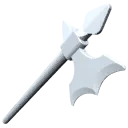{ .lu-ti width="24" loading="lazy" } [Superior Halberd (LOT 13920)](../13920.md) | 2 | No client description | 0 matrices; 0 rewards; 0 community references |
| 6205 | 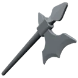{ .lu-ti width="24" loading="lazy" } [Superior Halberd of Knockback (LOT 6205)](../6205.md) | 3 | No client description | 0 matrices; 1 rewards; 1 community references |
| 8488 | { .lu-ti width="24" loading="lazy" } [Superior Hammer (LOT 8488)](../8488.md) | 2 | No client description | 20 matrices; 0 rewards; 1 community references |
| 12300 | 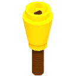{ .lu-ti width="24" loading="lazy" } [Superior Hand Bell (LOT 12300)](../12300.md) | 2 | No client description | 0 matrices; 0 rewards; 0 community references |
| 8485 | { .lu-ti width="24" loading="lazy" } [Superior Huge Axe (LOT 8485)](../8485.md) | 2 | No client description | 23 matrices; 0 rewards; 1 community references |
