# Right hand — page 3/3

[Item database](../README.md)

Pages: [1](type-6-1.md) | [2](type-6-2.md) | [3](type-6-3.md)

| LOT | Item | Rarity | Description | Source evidence |
| --- | --- | --- | --- | --- |
| 8493 | { .lu-ti width="24" loading="lazy" } [Superior Katana (LOT 8493)](../8493.md) | 2 | No client description | 20 matrices; 0 rewards; 1 community references |
| 7070 | { .lu-ti width="24" loading="lazy" } [Superior Lance (LOT 7070)](../7070.md) | 2 | No client description | 23 matrices; 0 rewards; 1 community references |
| 5952 | { .lu-ti width="24" loading="lazy" } [Superior Longsword of Stunning (LOT 5952)](../5952.md) | 3 | No client description | 1 matrices; 1 rewards; 1 community references |
| 6843 | 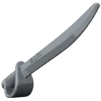{ .lu-ti width="24" loading="lazy" } [Superior Mate's Cutlass (LOT 6843)](../6843.md) | 2 | No client description | 1 matrices; 1 rewards; 1 community references |
| 1764 | { .lu-ti width="24" loading="lazy" } [Superior Pirate's Scimitar (LOT 1764)](../1764.md) | 2 | No client description | 1 matrices; 1 rewards; 1 community references |
| 8444 | 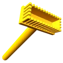{ .lu-ti width="24" loading="lazy" } [Superior Push Broom (LOT 8444)](../8444.md) | 2 | No client description | 0 matrices; 1 rewards; 1 community references |
| 8479 | { .lu-ti width="24" loading="lazy" } [Superior Shortsword (LOT 8479)](../8479.md) | 2 | No client description | 21 matrices; 0 rewards; 1 community references |
| 6887 | 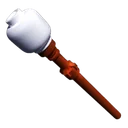{ .lu-ti width="24" loading="lazy" } [Superior Tiki Staff (LOT 6887)](../6887.md) | 2 | No client description | 1 matrices; 1 rewards; 1 community references |
| 8507 | { .lu-ti width="24" loading="lazy" } [Superior Trident (LOT 8507)](../8507.md) | 2 | No client description | 0 matrices; 1 rewards; 1 community references |
| 15892 | { .lu-ti width="24" loading="lazy" } [Sushi Delivery System (LOT 15892)](../15892.md) | 3 | Requires Imagination to fire. | 0 matrices; 1 rewards; 1 community references |
| 13942 | { .lu-ti width="24" loading="lazy" } [Test (LOT 13942)](../13942.md) | 3 | for testing only | 0 matrices; 0 rewards; 0 community references |
| 13969 | { .lu-ti width="24" loading="lazy" } [Test (LOT 13969)](../13969.md) |  | for testing only | 0 matrices; 0 rewards; 0 community references |
| 10504 | 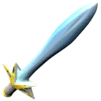{ .lu-ti width="24" loading="lazy" } [TEST 5 (LOT 10504)](../10504.md) | 5 | No client description | 0 matrices; 0 rewards; 0 community references |
| 6651 | { .lu-ti width="24" loading="lazy" } [Test AoE Hammer Tier 2 (LOT 6651)](../6651.md) | 5 | No client description | 0 matrices; 0 rewards; 0 community references |
| 6652 | 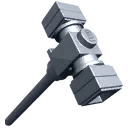{ .lu-ti width="24" loading="lazy" } [Test AoE Hammer Tier 3 (LOT 6652)](../6652.md) | 5 | No client description | 0 matrices; 0 rewards; 0 community references |
| 3071 | { .lu-ti width="24" loading="lazy" } [Test Ballistic Projectile Mortar Flintlock (LOT 3071)](../3071.md) | 5 | No client description | 0 matrices; 0 rewards; 0 community references |
| 4770 | { .lu-ti width="24" loading="lazy" } [Test Blaster (LOT 4770)](../4770.md) | 5 | Laser Gun For Testing | 0 matrices; 0 rewards; 0 community references |
| 4927 | 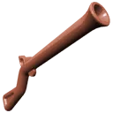{ .lu-ti width="24" loading="lazy" } [Test Blaster Imagination (LOT 4927)](../4927.md) | 5 | uses imagination | 0 matrices; 0 rewards; 0 community references |
| 4799 | [Test Bow (LOT 4799)](../4799.md) | 5 | bad offset; needs icon | 0 matrices; 0 rewards; 0 community references |
| 6906 | { .lu-ti width="24" loading="lazy" } [Test Bow Hand Modeled (LOT 6906)](../6906.md) | 5 | No client description | 0 matrices; 0 rewards; 0 community references |
| 6905 | { .lu-ti width="24" loading="lazy" } [Test Bow Regular (LOT 6905)](../6905.md) | 5 | No client description | 0 matrices; 0 rewards; 0 community references |
| 8021 | [Test Breastplate Test (LOT 8021)](../8021.md) | 5 | Trying skinned accessories | 0 matrices; 0 rewards; 0 community references |
| 4989 | { .lu-ti width="24" loading="lazy" } [Test Chargeup Flintlock Pistol (LOT 4989)](../4989.md) | 5 | Test for Chargeup Combo ranged weapons | 0 matrices; 0 rewards; 0 community references |
| 1272 | { .lu-ti width="24" loading="lazy" } [Test Chargeup Hammer (LOT 1272)](../1272.md) | 5 | No client description | 0 matrices; 0 rewards; 0 community references |
| 2239 | { .lu-ti width="24" loading="lazy" } [Test Chargeup Spear (LOT 2239)](../2239.md) | 5 | No client description | 0 matrices; 0 rewards; 0 community references |
| 6328 | { .lu-ti width="24" loading="lazy" } [Test Client Blaster (LOT 6328)](../6328.md) | 5 | Test Client Blaster | 0 matrices; 0 rewards; 0 community references |
| 2250 | [Test Contest HoverBoard (LOT 2250)](../2250.md) | 5 | No client description | 0 matrices; 0 rewards; 0 community references |
| 2851 | [Test Contest HoverBoard 2 (LOT 2851)](../2851.md) | 5 | No client description | 0 matrices; 0 rewards; 0 community references |
| 2852 | [Test Contest HoverBoard 3 (LOT 2852)](../2852.md) | 5 | No client description | 0 matrices; 0 rewards; 0 community references |
| 2854 | [Test Contest HoverBoard 5 (LOT 2854)](../2854.md) | 5 | No client description | 0 matrices; 0 rewards; 0 community references |
| 9787 | 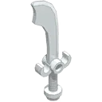{ .lu-ti width="24" loading="lazy" } [Test Dual Wield Sword &amp; Brush (LOT 9787)](../9787.md) | 5 | Test for Yegge | 0 matrices; 0 rewards; 0 community references |
| 12252 | { .lu-ti width="24" loading="lazy" } [TEST effects item (LOT 12252)](../12252.md) | 1 | No client description | 0 matrices; 0 rewards; 0 community references |
| 2241 | { .lu-ti width="24" loading="lazy" } [Test Elite Hammer (LOT 2241)](../2241.md) | 5 | No client description | 0 matrices; 0 rewards; 0 community references |
| 6393 | { .lu-ti width="24" loading="lazy" } [Test Experimental Pipe Wrench (LOT 6393)](../6393.md) | 5 | Testing multiple skills on one item | 0 matrices; 0 rewards; 0 community references |
| 8291 | { .lu-ti width="24" loading="lazy" } [Test Faction Currency Item (LOT 8291)](../8291.md) | 5 | This item costs faction currency | 1 matrices; 0 rewards; 0 community references |
| 3120 | { .lu-ti width="24" loading="lazy" } [Test Fire Staff (LOT 3120)](../3120.md) | 5 | No client description | 0 matrices; 0 rewards; 0 community references |
| 7164 | { .lu-ti width="24" loading="lazy" } [Test Fishing Pole (LOT 7164)](../7164.md) | 5 | No client description | 0 matrices; 0 rewards; 0 community references |
| 2847 | { .lu-ti width="24" loading="lazy" } [Test Flintlock Pistol (LOT 2847)](../2847.md) | 5 | No client description | 0 matrices; 0 rewards; 0 community references |
| 13910 | { .lu-ti width="24" loading="lazy" } [Test Gimble Test (LOT 13910)](../13910.md) | 2 | Test Gimble Test | 0 matrices; 0 rewards; 0 community references |
| 3053 | { .lu-ti width="24" loading="lazy" } [Test Hammer All Stat Buff (LOT 3053)](../3053.md) | 5 | Item to test buff stats with | 0 matrices; 0 rewards; 0 community references |
| 7089 | 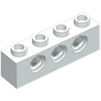{ .lu-ti width="24" loading="lazy" } [Test Horse Mount (LOT 7089)](../7089.md) | 5 | The Magical Mystery Horse | 0 matrices; 0 rewards; 0 community references |
| 7311 | { .lu-ti width="24" loading="lazy" } [Test jump attack (LOT 7311)](../7311.md) | 5 | test jump attack | 0 matrices; 0 rewards; 0 community references |
| 6639 | 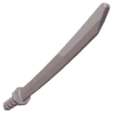{ .lu-ti width="24" loading="lazy" } [Test Katana - 2 pt (LOT 6639)](../6639.md) | 5 | No client description | 0 matrices; 0 rewards; 0 community references |
| 6640 | { .lu-ti width="24" loading="lazy" } [Test Katana - 3 pt (LOT 6640)](../6640.md) | 5 | No client description | 0 matrices; 0 rewards; 0 community references |
| 6641 | { .lu-ti width="24" loading="lazy" } [Test Katana - 4 pt (LOT 6641)](../6641.md) | 5 | No client description | 0 matrices; 0 rewards; 0 community references |
| 7339 | { .lu-ti width="24" loading="lazy" } [Test Katana of Bees (LOT 7339)](../7339.md) | 5 | Testing the SJ tornado skill | 0 matrices; 0 rewards; 0 community references |
| 13243 | { .lu-ti width="24" loading="lazy" } [TEST LUCAS (LOT 13243)](../13243.md) | 5 | No client description | 0 matrices; 0 rewards; 0 community references |
| 8334 | 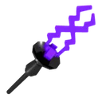{ .lu-ti width="24" loading="lazy" } [Test Maelstrom Staff (LOT 8334)](../8334.md) | 5 | No client description | 0 matrices; 0 rewards; 0 community references |
| 8274 | { .lu-ti width="24" loading="lazy" } [Test Performance Test Sword (LOT 8274)](../8274.md) | 5 | For performance testing accessories | 0 matrices; 0 rewards; 0 community references |
| 3639 | [Test Pet Chariot Hack (LOT 3639)](../3639.md) | 5 | No client description | 0 matrices; 0 rewards; 0 community references |
| 6713 | 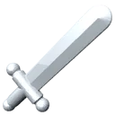{ .lu-ti width="24" loading="lazy" } [Test Precondition (LOT 6713)](../6713.md) | 5 | Precondition Test - bad offset | 0 matrices; 0 rewards; 0 community references |
| 4939 | { .lu-ti width="24" loading="lazy" } [Test Pulse Blaster (LOT 4939)](../4939.md) | 5 | test for pulse | 0 matrices; 0 rewards; 0 community references |
| 6872 | { .lu-ti width="24" loading="lazy" } [Test PvP Awesome Healing Staff (LOT 6872)](../6872.md) | 5 | Test healing staff | 0 matrices; 0 rewards; 0 community references |
| 6871 | 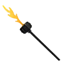{ .lu-ti width="24" loading="lazy" } [Test PvP Awesome Staff (LOT 6871)](../6871.md) | 5 | Test staff for PvP | 0 matrices; 0 rewards; 0 community references |
| 7039 | { .lu-ti width="24" loading="lazy" } [Test PvP Shortsword no stun (LOT 7039)](../7039.md) | 5 | Sword with no caster stun skill | 0 matrices; 0 rewards; 0 community references |
| 7035 | { .lu-ti width="24" loading="lazy" } [Test PvP Shortsword no stun no move (LOT 7035)](../7035.md) | 5 | Sword with no caster stun skill | 0 matrices; 0 rewards; 0 community references |
| 5628 | [Test Rangers Elite Long Bow (LOT 5628)](../5628.md) | 5 | bad offset | 0 matrices; 0 rewards; 0 community references |
| 13975 | { .lu-ti width="24" loading="lazy" } [Test Rank 1 Sword (LOT 13975)](../13975.md) | 4 | No client description | 0 matrices; 0 rewards; 0 community references |
| 13976 | { .lu-ti width="24" loading="lazy" } [Test Rank 2 Sword (LOT 13976)](../13976.md) | 4 | No client description | 0 matrices; 0 rewards; 0 community references |
| 13993 | { .lu-ti width="24" loading="lazy" } [Test Rank 3 Sword (LOT 13993)](../13993.md) | 4 | No client description | 0 matrices; 0 rewards; 0 community references |
| 10020 | { .lu-ti width="24" loading="lazy" } [Test Ryans Katana (LOT 10020)](../10020.md) | 5 | No client description | 0 matrices; 0 rewards; 0 community references |
| 7163 | 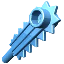{ .lu-ti width="24" loading="lazy" } [Test Saw of Pulling (LOT 7163)](../7163.md) | 5 | No client description | 0 matrices; 0 rewards; 0 community references |
| 5949 | { .lu-ti width="24" loading="lazy" } [Test Set ninja1 - Katana (LOT 5949)](../5949.md) | 5 | weapon for item set test | 0 matrices; 0 rewards; 0 community references |
| 7313 | { .lu-ti width="24" loading="lazy" } [Test SJ Katana NOT CURRENT (LOT 7313)](../7313.md) | 5 | Testing the SJ tornado skill | 0 matrices; 0 rewards; 0 community references |
| 3906 | { .lu-ti width="24" loading="lazy" } [Test Skunk Wrench (LOT 3906)](../3906.md) | 5 | Used in script for skunk to attach to head.  YR-SG | 0 matrices; 0 rewards; 0 community references |
| 5841 | { .lu-ti width="24" loading="lazy" } [Test Stun Pulse Blaster (LOT 5841)](../5841.md) | 5 | Stuns and fires multiple shots | 0 matrices; 0 rewards; 0 community references |
| 14190 | { .lu-ti width="24" loading="lazy" } [Test Summoner Valiant (LOT 14190)](../14190.md) | 2 | No client description | 0 matrices; 0 rewards; 0 community references |
| 4792 | { .lu-ti width="24" loading="lazy" } [Test Sword (LOT 4792)](../4792.md) | 5 | invisible??? | 0 matrices; 0 rewards; 0 community references |
| 5654 | 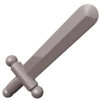{ .lu-ti width="24" loading="lazy" } [Test Sword (LOT 5654)](../5654.md) | 5 | For testing colors and NOT skills | 0 matrices; 0 rewards; 0 community references |
| 8081 | { .lu-ti width="24" loading="lazy" } [Test Sword of Testing (LOT 8081)](../8081.md) | 5 | No client description | 0 matrices; 0 rewards; 0 community references |
| 6544 | { .lu-ti width="24" loading="lazy" } [Test Tacarc (LOT 6544)](../6544.md) | 5 | Tacarc test | 0 matrices; 0 rewards; 0 community references |
| 7333 | { .lu-ti width="24" loading="lazy" } [Test tak effect (LOT 7333)](../7333.md) | 5 | TEST tak effect | 0 matrices; 0 rewards; 0 community references |
| 12574 | { .lu-ti width="24" loading="lazy" } [Test Wand of Skill Testing (LOT 12574)](../12574.md) | 3 | Use this to test new skills | 0 matrices; 0 rewards; 0 community references |
| 7013 | { .lu-ti width="24" loading="lazy" } [Test Weapon Skills Item (LOT 7013)](../7013.md) | 5 | Test Weapon Skills Item | 0 matrices; 0 rewards; 0 community references |
| 8157 | { .lu-ti width="24" loading="lazy" } [Test Will&#95;L test sword (LOT 8157)](../8157.md) | 5 | Test Will&#95;L test sword | 0 matrices; 0 rewards; 0 community references |
| 7149 | 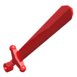{ .lu-ti width="24" loading="lazy" } [Test Wysiwyg long sword (LOT 7149)](../7149.md) | 5 | No client description | 0 matrices; 0 rewards; 0 community references |
| 8016 | { .lu-ti width="24" loading="lazy" } [Test&#95;Acc&#95;Epsilon Gun (LOT 8016)](../8016.md) | 5 | Test object for brett | 0 matrices; 0 rewards; 0 community references |
| 8007 | { .lu-ti width="24" loading="lazy" } [Test&#95;Acc&#95;ProxyHand1 (LOT 8007)](../8007.md) | 5 | Test object for brett | 0 matrices; 0 rewards; 0 community references |
| 12638 | 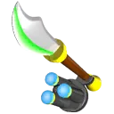{ .lu-ti width="24" loading="lazy" } [The Broadsider (LOT 12638)](../12638.md) | 4 | Two-Handed Weapon | 1 matrices; 0 rewards; 0 community references |
| 12816 | 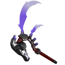{ .lu-ti width="24" loading="lazy" } [The Doomslicer (LOT 12816)](../12816.md) | 4 | Two-Handed Weapon | 1 matrices; 0 rewards; 0 community references |
| 14109 | { .lu-ti width="24" loading="lazy" } [The Furious Morning Star (LOT 14109)](../14109.md) | 3 | No client description | 0 matrices; 0 rewards; 0 community references |
| 12658 | { .lu-ti width="24" loading="lazy" } [The Nunchuks of Lightning (LOT 12658)](../12658.md) | 3 | Equip these to unleash Lightning Spinjitzu and rocket directly to the Ninjago Caves! | 1 matrices; 1 rewards; 0 community references |
| 12637 | 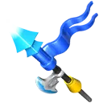{ .lu-ti width="24" loading="lazy" } [The Powerjouster (LOT 12637)](../12637.md) | 4 | Two-Handed Weapon | 1 matrices; 0 rewards; 0 community references |
| 12647 | 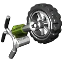{ .lu-ti width="24" loading="lazy" } [The Rutcarver (LOT 12647)](../12647.md) | 4 | Two-Handed Weapon | 1 matrices; 0 rewards; 0 community references |
| 12642 | { .lu-ti width="24" loading="lazy" } [The Samuraizor (LOT 12642)](../12642.md) | 4 | Two-Handed Weapon | 1 matrices; 0 rewards; 0 community references |
| 12656 | { .lu-ti width="24" loading="lazy" } [The Scythe of Quakes (LOT 12656)](../12656.md) | 3 | Equip this to unleash Earth Spinjitzu and rocket directly to the Ninjago Caves! | 1 matrices; 1 rewards; 1 community references |
| 12636 | { .lu-ti width="24" loading="lazy" } [The Serratorizer (LOT 12636)](../12636.md) | 4 | Two-Handed Weapon | 1 matrices; 0 rewards; 0 community references |
| 12659 | { .lu-ti width="24" loading="lazy" } [The Shurikens of Ice (LOT 12659)](../12659.md) | 3 | Equip these to unleash Ice Spinjitzu and rocket directly to the Ninjago Caves! | 1 matrices; 1 rewards; 1 community references |
| 12657 | { .lu-ti width="24" loading="lazy" } [The Sword of Fire (LOT 12657)](../12657.md) | 3 | Equip this to unleash Fire Spinjitzu and rocket directly to the Ninjago Caves! | 1 matrices; 1 rewards; 1 community references |
| 14108 | { .lu-ti width="24" loading="lazy" } [The Terrible Wand (LOT 14108)](../14108.md) | 3 | No client description | 0 matrices; 0 rewards; 1 community references |
| 12817 | 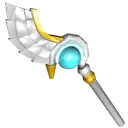{ .lu-ti width="24" loading="lazy" } [The Wingreaper (LOT 12817)](../12817.md) | 4 | Two-Handed Weapon | 1 matrices; 0 rewards; 0 community references |
| 12809 | 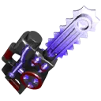{ .lu-ti width="24" loading="lazy" } [The Wormholer (LOT 12809)](../12809.md) | 4 | Two-Handed Weapon | 1 matrices; 0 rewards; 0 community references |
| 14829 | { .lu-ti width="24" loading="lazy" } [Training Bo Staff (LOT 14829)](../14829.md) | 2 | No client description | 28 matrices; 0 rewards; 1 community references |
| 14669 | { .lu-ti width="24" loading="lazy" } [Training Katana (LOT 14669)](../14669.md) | 1 | No client description | 0 matrices; 2 rewards; 1 community references |
| 14705 | { .lu-ti width="24" loading="lazy" } [Training Keibo (LOT 14705)](../14705.md) | 2 | No client description | 0 matrices; 1 rewards; 1 community references |
| 14713 | { .lu-ti width="24" loading="lazy" } [Training Yari (LOT 14713)](../14713.md) | 2 | No client description | 29 matrices; 0 rewards; 1 community references |
| 14362 | { .lu-ti width="24" loading="lazy" } [Venture Gear - Daredevil - weapon proxy (LOT 14362)](../14362.md) | 4 | No client description | 0 matrices; 0 rewards; 0 community references |
| 6923 | { .lu-ti width="24" loading="lazy" } [Wand of Freezing 1 (LOT 6923)](../6923.md) | 3 | No client description | 1 matrices; 1 rewards; 1 community references |
| 7727 | { .lu-ti width="24" loading="lazy" } [Wand of Freezing 2 (LOT 7727)](../7727.md) | 3 | No client description | 0 matrices; 1 rewards; 1 community references |
| 8491 | { .lu-ti width="24" loading="lazy" } [Wand of Knockback (LOT 8491)](../8491.md) | 3 | No client description | 13 matrices; 0 rewards; 1 community references |
| 12723 | { .lu-ti width="24" loading="lazy" } [Wand of Repulsion (LOT 12723)](../12723.md) | 4 | No client description | 1 matrices; 0 rewards; 1 community references |
| 8492 | { .lu-ti width="24" loading="lazy" } [Wand of Sleep (LOT 8492)](../8492.md) | 3 | No client description | 13 matrices; 0 rewards; 1 community references |
| 3206 | { .lu-ti width="24" loading="lazy" } [Water Sprayer (LOT 3206)](../3206.md) | 3 | Use this to clean things and spray water on them. | 0 matrices; 1 rewards; 1 community references |
| 16599 | 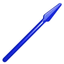{ .lu-ti width="24" loading="lazy" } [Wave Spike (LOT 16599)](../16599.md) | 2 | No client description | 27 matrices; 0 rewards; 1 community references |
| 8484 | { .lu-ti width="24" loading="lazy" } [Worthy Butterfly Net (LOT 8484)](../8484.md) | 1 | No client description | 20 matrices; 0 rewards; 1 community references |
| 2644 | { .lu-ti width="24" loading="lazy" } [Worthy Corseque (LOT 2644)](../2644.md) | 1 | No client description | 21 matrices; 0 rewards; 1 community references |
| 6930 | { .lu-ti width="24" loading="lazy" } [Worthy Drumstick of Repulsion (LOT 6930)](../6930.md) | 2 | No client description | 1 matrices; 1 rewards; 1 community references |
| 7068 | { .lu-ti width="24" loading="lazy" } [Worthy Force Blade (LOT 7068)](../7068.md) | 1 | No client description | 20 matrices; 0 rewards; 1 community references |
| 8489 | { .lu-ti width="24" loading="lazy" } [Worthy Ice Saw (LOT 8489)](../8489.md) | 1 | No client description | 20 matrices; 0 rewards; 1 community references |
| 7079 | 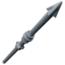{ .lu-ti width="24" loading="lazy" } [Worthy Javelin (LOT 7079)](../7079.md) | 1 | No client description | 20 matrices; 0 rewards; 1 community references |
| 6851 | { .lu-ti width="24" loading="lazy" } [Worthy Knife (LOT 6851)](../6851.md) | 1 | No client description | 3 matrices; 0 rewards; 1 community references |
| 2615 | 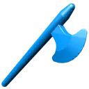{ .lu-ti width="24" loading="lazy" } [Worthy Large Axe (LOT 2615)](../2615.md) | 1 | No client description | 3 matrices; 0 rewards; 1 community references |
| 8496 | { .lu-ti width="24" loading="lazy" } [Worthy Morning Star (LOT 8496)](../8496.md) | 1 | No client description | 21 matrices; 0 rewards; 1 community references |
| 3067 | { .lu-ti width="24" loading="lazy" } [Worthy Shovel (LOT 3067)](../3067.md) | 1 | No client description | 20 matrices; 0 rewards; 1 community references |
| 8481 | 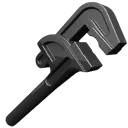{ .lu-ti width="24" loading="lazy" } [Worthy Wrench (LOT 8481)](../8481.md) | 1 | No client description | 20 matrices; 0 rewards; 1 community references |
| 16551 | 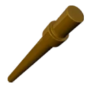{ .lu-ti width="24" loading="lazy" } [Wu's Imagination Staff (LOT 16551)](../16551.md) | 2 | Charge up to release a Spinjitzu attack! | 1 matrices; 1 rewards; 1 community references |
| 12734 | 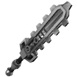{ .lu-ti width="24" loading="lazy" } [Zweihander (LOT 12734)](../12734.md) | 4 | Two-Handed Weapon | 1 matrices; 0 rewards; 1 community references |
